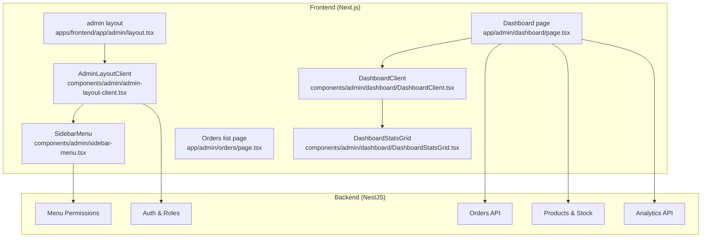
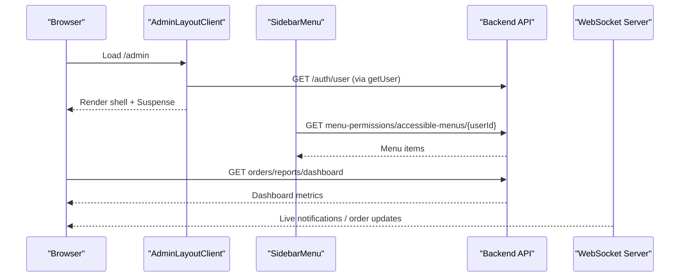
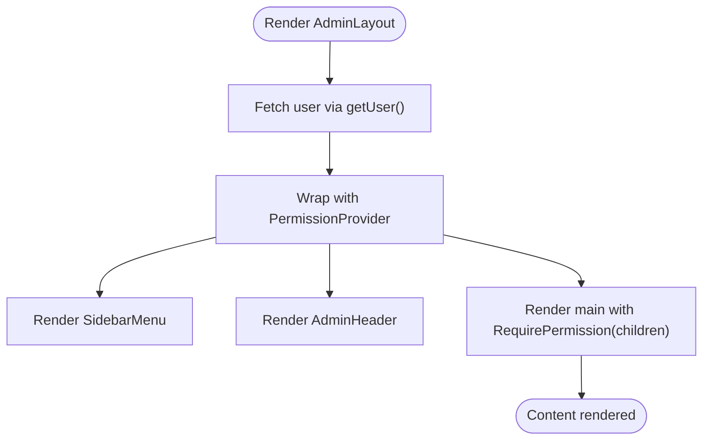
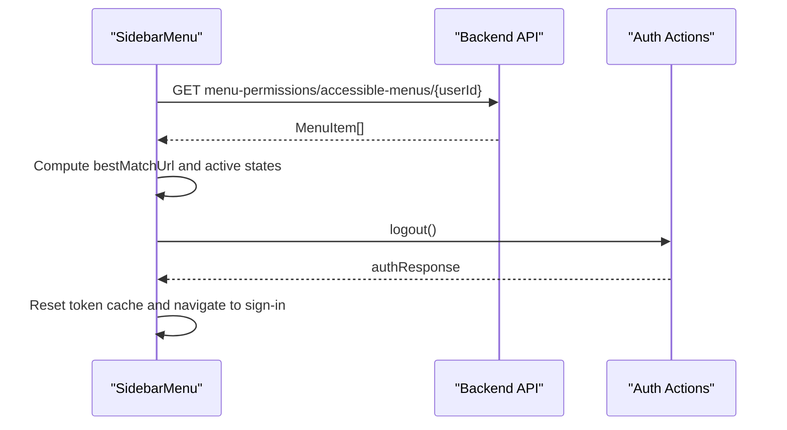
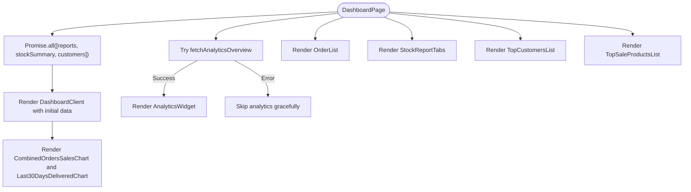
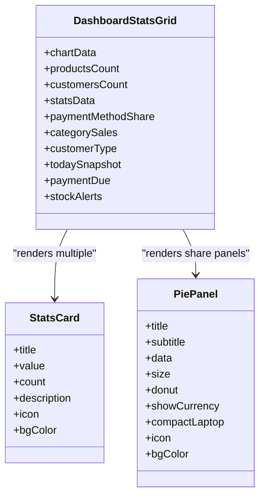
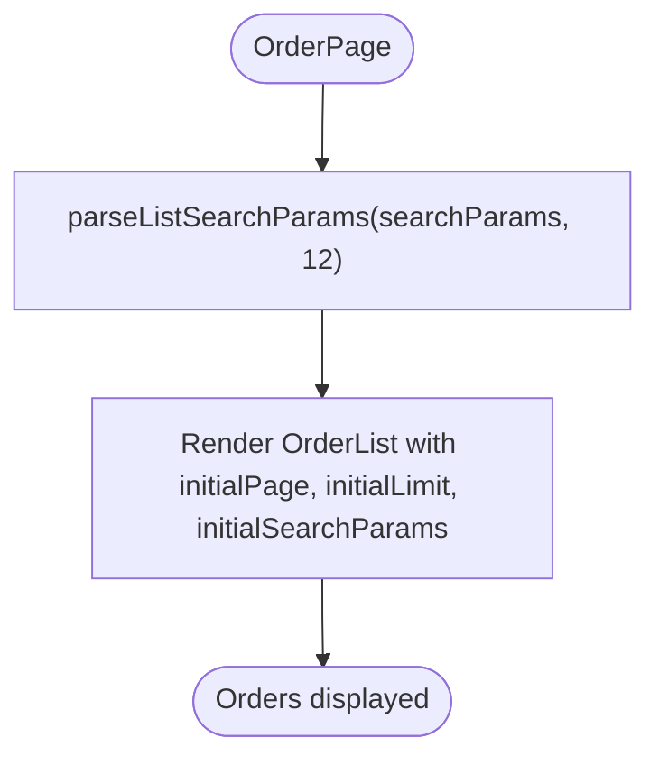
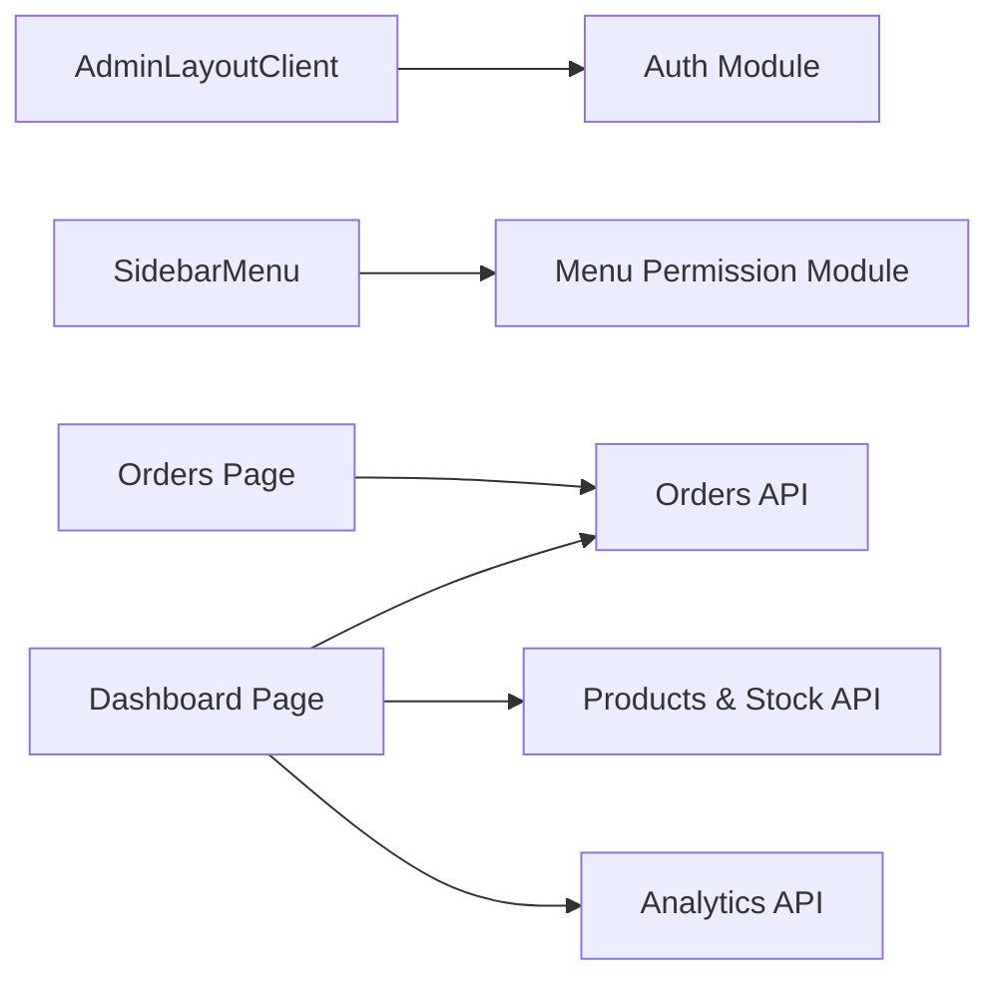

# Admin Dashboard

<cite>
**Referenced Files in This Document**
- [README.md](file://README.md)
- [apps/frontend/app/admin/layout.tsx](file://apps/frontend/app/admin/layout.tsx)
- [apps/frontend/components/admin/admin-layout-client.tsx](file://apps/frontend/components/admin/admin-layout-client.tsx)
- [apps/frontend/components/admin/sidebar-menu.tsx](file://apps/frontend/components/admin/sidebar-menu.tsx)
- [apps/frontend/app/admin/dashboard/page.tsx](file://apps/frontend/app/admin/dashboard/page.tsx)
- [apps/frontend/components/admin/dashboard/DashboardClient.tsx](file://apps/frontend/components/admin/dashboard/DashboardClient.tsx)
- [apps/frontend/components/admin/dashboard/DashboardStatsGrid.tsx](file://apps/frontend/components/admin/dashboard/DashboardStatsGrid.tsx)
- [apps/frontend/app/admin/orders/page.tsx](file://apps/frontend/app/admin/orders/page.tsx)
</cite>

## Table of Contents
1. [Introduction](#introduction)
2. [Project Structure](#project-structure)
3. [Core Components](#core-components)
4. [Architecture Overview](#architecture-overview)
5. [Detailed Component Analysis](#detailed-component-analysis)
6. [Dependency Analysis](#dependency-analysis)
7. [Performance Considerations](#performance-considerations)
8. [Troubleshooting Guide](#troubleshooting-guide)
9. [Conclusion](#conclusion)

## Introduction
This document explains the German Butcher admin dashboard system, focusing on the administrative interface and its core capabilities:
- Dashboard overview with key metrics, recent activities, and quick actions
- Business operations management (orders, products, customers, suppliers)
- System administration (roles, menu permissions, settings, monitoring)
- Analytics and reporting (sales reports, customer insights, performance metrics, export)
- Real-time features (live notifications, online users, instant order updates)
- Administrative workflows (order processing, inventory management, report generation, support tickets)
- Permission system, audit logging, and security measures
- Responsive design and mobile accessibility

The documentation is grounded in the repository’s frontend admin shell, dashboard pages, and backend modules that power these features.

## Project Structure
The admin dashboard is part of a monorepo with a Next.js 16 frontend and NestJS 11 backend. The admin UI lives under apps/frontend/app/admin, while business logic and APIs are implemented in apps/backend/src.

**Diagram sources**
- [apps/frontend/app/admin/layout.tsx:1-72](file://apps/frontend/app/admin/layout.tsx#L1-L72)
- [apps/frontend/components/admin/admin-layout-client.tsx:1-87](file://apps/frontend/components/admin/admin-layout-client.tsx#L1-L87)
- [apps/frontend/components/admin/sidebar-menu.tsx:1-484](file://apps/frontend/components/admin/sidebar-menu.tsx#L1-L484)
- [apps/frontend/app/admin/dashboard/page.tsx:1-119](file://apps/frontend/app/admin/dashboard/page.tsx#L1-L119)
- [apps/frontend/components/admin/dashboard/DashboardClient.tsx:1-56](file://apps/frontend/components/admin/dashboard/DashboardClient.tsx#L1-L56)
- [apps/frontend/components/admin/dashboard/DashboardStatsGrid.tsx:1-373](file://apps/frontend/components/admin/dashboard/DashboardStatsGrid.tsx#L1-L373)
- [apps/frontend/app/admin/orders/page.tsx:1-20](file://apps/frontend/app/admin/orders/page.tsx#L1-L20)

**Section sources**
- [README.md:5-66](file://README.md#L5-L66)

## Core Components
- Admin shell and layout: Provides authenticated layout, sidebar navigation, header, and permission context for all admin routes.
- Sidebar menu: Dynamically loads accessible menus based on user roles and permissions; supports collapse/expand and mobile drawer.
- Dashboard page: Aggregates analytics, stock summaries, and recent orders; renders charts and KPIs.
- Dashboard client and stats grid: Renders KPI cards, pie/donut panels, and order distribution visualizations.
- Orders list page: Centralized order listing with pagination and search parameters.

Key responsibilities:
- Authentication and role handling at the layout level
- Menu authorization via backend endpoints
- Data fetching for dashboard metrics and charts
- Responsive UI across devices

**Section sources**
- [apps/frontend/app/admin/layout.tsx:1-72](file://apps/frontend/app/admin/layout.tsx#L1-L72)
- [apps/frontend/components/admin/admin-layout-client.tsx:1-87](file://apps/frontend/components/admin/admin-layout-client.tsx#L1-L87)
- [apps/frontend/components/admin/sidebar-menu.tsx:1-484](file://apps/frontend/components/admin/sidebar-menu.tsx#L1-L484)
- [apps/frontend/app/admin/dashboard/page.tsx:1-119](file://apps/frontend/app/admin/dashboard/page.tsx#L1-L119)
- [apps/frontend/components/admin/dashboard/DashboardClient.tsx:1-56](file://apps/frontend/components/admin/dashboard/DashboardClient.tsx#L1-L56)
- [apps/frontend/components/admin/dashboard/DashboardStatsGrid.tsx:1-373](file://apps/frontend/components/admin/dashboard/DashboardStatsGrid.tsx#L1-L373)
- [apps/frontend/app/admin/orders/page.tsx:1-20](file://apps/frontend/app/admin/orders/page.tsx#L1-L20)

## Architecture Overview
The admin dashboard follows a layered architecture:
- Presentation layer: Next.js app router pages and React components
- Client-side orchestration: Data fetching utilities and hooks
- Backend services: NestJS controllers/services exposing REST APIs
- Real-time layer: Socket.IO for live updates (notifications, online users, order status changes)

**Diagram sources**
- [apps/frontend/components/admin/admin-layout-client.tsx:1-87](file://apps/frontend/components/admin/admin-layout-client.tsx#L1-L87)
- [apps/frontend/components/admin/sidebar-menu.tsx:85-114](file://apps/frontend/components/admin/sidebar-menu.tsx#L85-L114)
- [apps/frontend/app/admin/dashboard/page.tsx:32-45](file://apps/frontend/app/admin/dashboard/page.tsx#L32-L45)

## Detailed Component Analysis

### Admin Shell and Layout
Responsibilities:
- Fetches current user and wraps content with permission provider
- Manages mobile menu state and sidebar collapse
- Ensures children are guarded by RequirePermission

**Diagram sources**
- [apps/frontend/app/admin/layout.tsx:57-71](file://apps/frontend/app/admin/layout.tsx#L57-L71)
- [apps/frontend/components/admin/admin-layout-client.tsx:26-86](file://apps/frontend/components/admin/admin-layout-client.tsx#L26-L86)

**Section sources**
- [apps/frontend/app/admin/layout.tsx:1-72](file://apps/frontend/app/admin/layout.tsx#L1-L72)
- [apps/frontend/components/admin/admin-layout-client.tsx:1-87](file://apps/frontend/components/admin/admin-layout-client.tsx#L1-L87)

### Sidebar Menu and Menu Permissions
Responsibilities:
- Loads accessible menus per user ID from backend
- Handles logout flow and session reset
- Supports collapsed mode with tooltips and dropdowns
- Highlights active route using best-match URL logic

**Diagram sources**
- [apps/frontend/components/admin/sidebar-menu.tsx:85-114](file://apps/frontend/components/admin/sidebar-menu.tsx#L85-L114)
- [apps/frontend/components/admin/sidebar-menu.tsx:116-135](file://apps/frontend/components/admin/sidebar-menu.tsx#L116-L135)
- [apps/frontend/components/admin/sidebar-menu.tsx:161-182](file://apps/frontend/components/admin/sidebar-menu.tsx#L161-L182)

**Section sources**
- [apps/frontend/components/admin/sidebar-menu.tsx:1-484](file://apps/frontend/components/admin/sidebar-menu.tsx#L1-L484)

### Dashboard Page and Metrics Aggregation
Responsibilities:
- Concurrently fetches dashboard reports, stock summary, and customer count
- Renders KPIs, charts, and recent orders
- Gracefully handles analytics failures without breaking the page

**Diagram sources**
- [apps/frontend/app/admin/dashboard/page.tsx:32-45](file://apps/frontend/app/admin/dashboard/page.tsx#L32-L45)
- [apps/frontend/app/admin/dashboard/page.tsx:70-85](file://apps/frontend/app/admin/dashboard/page.tsx#L70-L85)
- [apps/frontend/app/admin/dashboard/page.tsx:103-118](file://apps/frontend/app/admin/dashboard/page.tsx#L103-L118)

**Section sources**
- [apps/frontend/app/admin/dashboard/page.tsx:1-119](file://apps/frontend/app/admin/dashboard/page.tsx#L1-L119)
- [apps/frontend/components/admin/dashboard/DashboardClient.tsx:1-56](file://apps/frontend/components/admin/dashboard/DashboardClient.tsx#L1-L56)

### Dashboard Stats Grid and KPIs
Responsibilities:
- Displays today’s sales, average order value, monthly sales/cancellations, total sales/cancel, product/customer counts, stock alerts, and payment due
- Computes growth indicators and formats currency
- Renders pie/donut panels for payment method share, category sales, new vs returning customers, and order distribution

**Diagram sources**
- [apps/frontend/components/admin/dashboard/DashboardStatsGrid.tsx:43-67](file://apps/frontend/components/admin/dashboard/DashboardStatsGrid.tsx#L43-L67)
- [apps/frontend/components/admin/dashboard/DashboardStatsGrid.tsx:134-255](file://apps/frontend/components/admin/dashboard/DashboardStatsGrid.tsx#L134-L255)
- [apps/frontend/components/admin/dashboard/DashboardStatsGrid.tsx:257-368](file://apps/frontend/components/admin/dashboard/DashboardStatsGrid.tsx#L257-L368)

**Section sources**
- [apps/frontend/components/admin/dashboard/DashboardStatsGrid.tsx:1-373](file://apps/frontend/components/admin/dashboard/DashboardStatsGrid.tsx#L1-L373)

### Orders List Page
Responsibilities:
- Parses list search params (page, limit, filters)
- Renders OrderList component with initial pagination and search parameters

**Diagram sources**
- [apps/frontend/app/admin/orders/page.tsx:8-16](file://apps/frontend/app/admin/orders/page.tsx#L8-L16)

**Section sources**
- [apps/frontend/app/admin/orders/page.tsx:1-20](file://apps/frontend/app/admin/orders/page.tsx#L1-L20)

## Dependency Analysis
High-level dependencies between admin UI components and backend modules:

**Diagram sources**
- [apps/frontend/components/admin/admin-layout-client.tsx:1-87](file://apps/frontend/components/admin/admin-layout-client.tsx#L1-L87)
- [apps/frontend/components/admin/sidebar-menu.tsx:85-114](file://apps/frontend/components/admin/sidebar-menu.tsx#L85-L114)
- [apps/frontend/app/admin/dashboard/page.tsx:32-45](file://apps/frontend/app/admin/dashboard/page.tsx#L32-L45)
- [apps/frontend/app/admin/orders/page.tsx:8-16](file://apps/frontend/app/admin/orders/page.tsx#L8-L16)

**Section sources**
- [apps/frontend/app/admin/dashboard/page.tsx:1-119](file://apps/frontend/app/admin/dashboard/page.tsx#L1-L119)
- [apps/frontend/components/admin/sidebar-menu.tsx:1-484](file://apps/frontend/components/admin/sidebar-menu.tsx#L1-L484)

## Performance Considerations
- Concurrent data fetching: The dashboard uses Promise.all to minimize round trips for reports, stock summary, and customer count.
- Revalidation strategy: Dashboard endpoints use revalidate flags to balance freshness and performance.
- Graceful degradation: Analytics widget failure does not break the dashboard; it logs and skips rendering.
- Skeleton loading: Sidebar and dashboard sections show skeletons to improve perceived performance.
- Mobile-first responsive design: Tailwind-based layout adapts to small screens with collapsible sidebar and stacked grids.

[No sources needed since this section provides general guidance]

## Troubleshooting Guide
Common issues and resolutions:
- Sidebar menu not loading:
  - Verify user ID is present and accessible-menus endpoint returns data.
  - Check network requests for menu-permissions/accessible-menus/{userId}.
- Logout not working:
  - Ensure logout action returns success and token cache is reset.
  - Confirm navigation redirects to sign-in.
- Dashboard metrics missing:
  - Inspect orders/reports/dashboard and products/reports/stock-summary responses.
  - Validate revalidate configuration and backend availability.
- Analytics widget not showing:
  - Check fetchAnalyticsOverview response shape and error logs.
  - Confirm backend analytics module is running.

**Section sources**
- [apps/frontend/components/admin/sidebar-menu.tsx:85-114](file://apps/frontend/components/admin/sidebar-menu.tsx#L85-L114)
- [apps/frontend/components/admin/sidebar-menu.tsx:116-135](file://apps/frontend/components/admin/sidebar-menu.tsx#L116-L135)
- [apps/frontend/app/admin/dashboard/page.tsx:70-85](file://apps/frontend/app/admin/dashboard/page.tsx#L70-L85)

## Conclusion
The German Butcher admin dashboard provides a comprehensive administrative interface built on Next.js and NestJS. It offers a robust shell with role-aware navigation, a rich dashboard with real-time-ready metrics, and scalable patterns for orders, products, customers, and analytics. The system emphasizes performance through concurrent fetching and graceful error handling, while maintaining responsive design and mobile accessibility.

[No sources needed since this section summarizes without analyzing specific files]