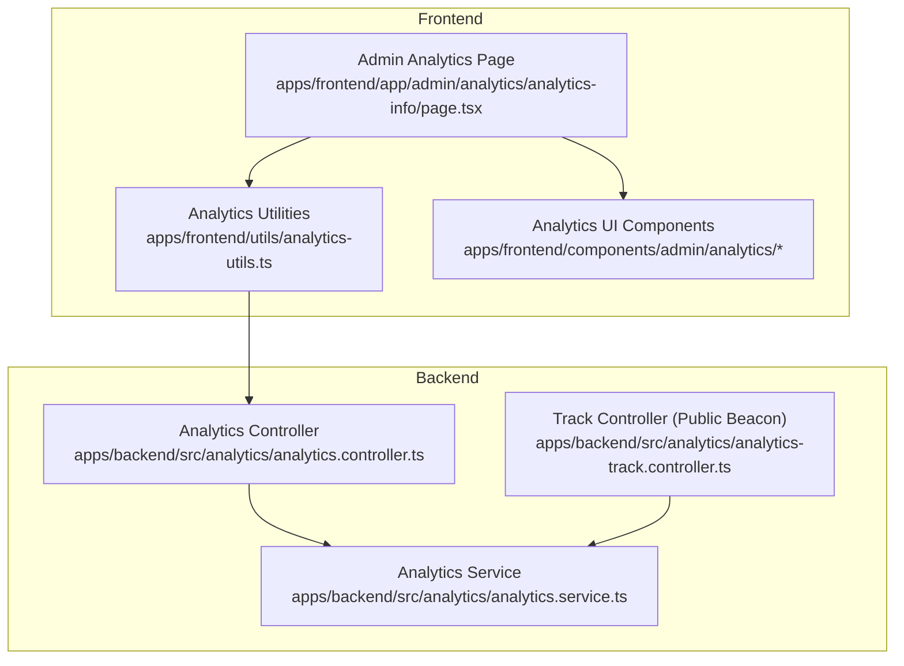
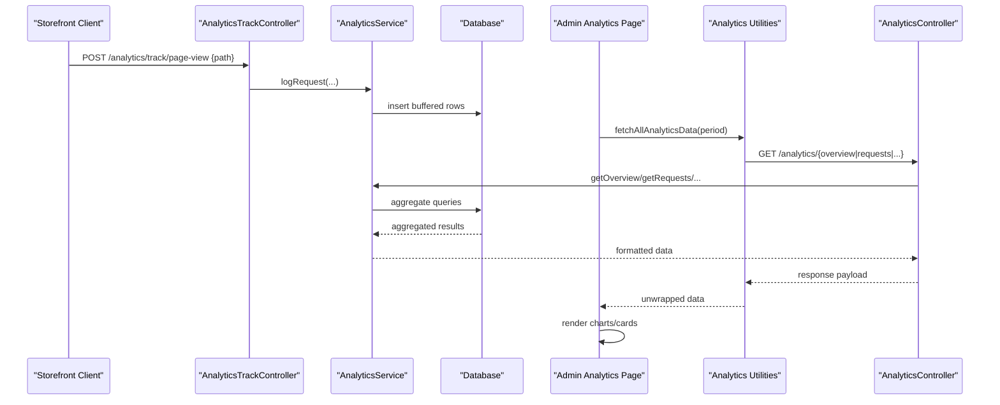
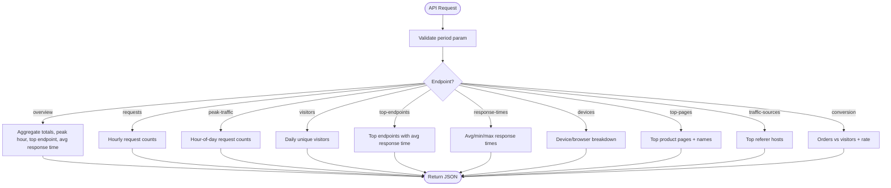
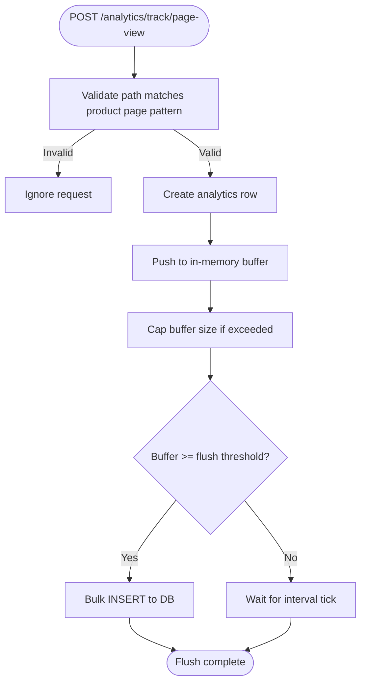
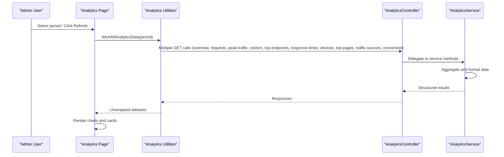
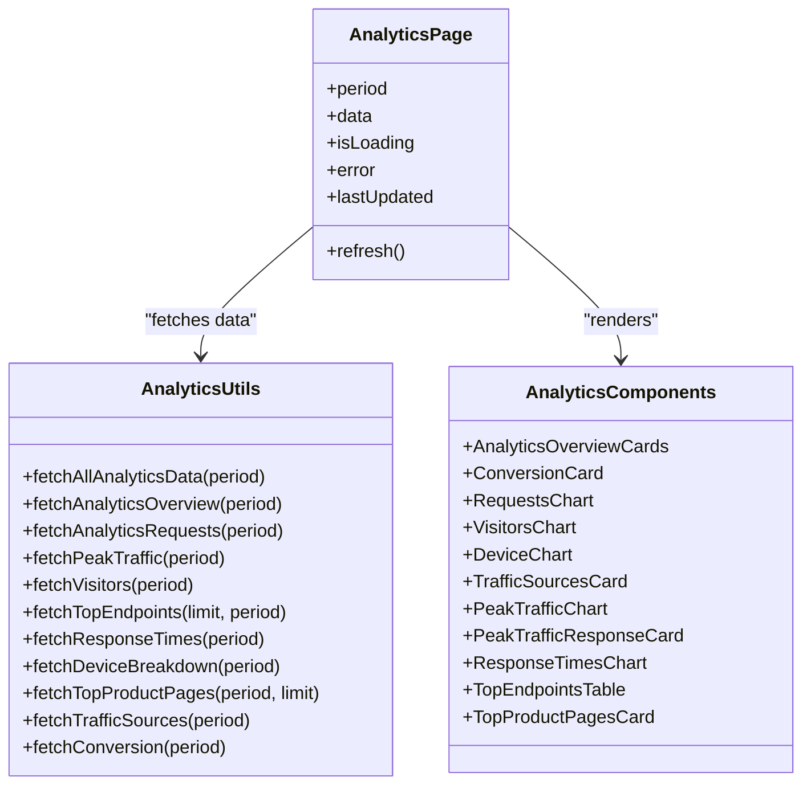
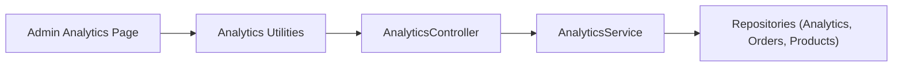

# Analytics & Reporting

<cite>
**Referenced Files in This Document**
- [analytics.controller.ts](file://apps/backend/src/analytics/analytics.controller.ts)
- [analytics.service.ts](file://apps/backend/src/analytics/analytics.service.ts)
- [analytics-track.controller.ts](file://apps/backend/src/analytics/analytics-track.controller.ts)
- [page.tsx (Analytics Dashboard)](file://apps/frontend/app/admin/analytics/analytics-info/page.tsx)
- [analytics-utils.ts](file://apps/frontend/utils/analytics-utils.ts)
- [index.ts (Analytics Components)](file://apps/frontend/components/admin/analytics/index.ts)
</cite>

## Table of Contents
1. [Introduction](#introduction)
2. [Project Structure](#project-structure)
3. [Core Components](#core-components)
4. [Architecture Overview](#architecture-overview)
5. [Detailed Component Analysis](#detailed-component-analysis)
6. [Dependency Analysis](#dependency-analysis)
7. [Performance Considerations](#performance-considerations)
8. [Troubleshooting Guide](#troubleshooting-guide)
9. [Conclusion](#conclusion)
10. [Appendices](#appendices)

## Introduction
This document explains the analytics and reporting capabilities exposed to the admin dashboard. It covers:
- Analytics dashboard features: visitor tracking, conversion metrics, device analytics, peak traffic analysis, and top endpoints monitoring.
- Real-time data ingestion and performance metrics.
- Data visualization components and how they consume backend APIs.
- Reporting system overview and export considerations.

Where applicable, this guide maps frontend pages and components to backend controllers, services, and data flows.

## Project Structure
The analytics feature spans both backend and frontend:
- Backend: NestJS module exposing analytics endpoints and a public page-view beacon for storefront product views.
- Frontend: Admin analytics dashboard page that aggregates multiple charts and cards, consuming analytics utilities that call the backend.

**Diagram sources**
- [page.tsx (Analytics Dashboard):1-261](file://apps/frontend/app/admin/analytics/analytics-info/page.tsx#L1-L261)
- [analytics-utils.ts:1-161](file://apps/frontend/utils/analytics-utils.ts#L1-L161)
- [analytics.controller.ts:1-330](file://apps/backend/src/analytics/analytics.controller.ts#L1-L330)
- [analytics.service.ts:1-617](file://apps/backend/src/analytics/analytics.service.ts#L1-L617)
- [analytics-track.controller.ts:1-62](file://apps/backend/src/analytics/analytics-track.controller.ts#L1-L62)

**Section sources**
- [page.tsx (Analytics Dashboard):1-261](file://apps/frontend/app/admin/analytics/analytics-info/page.tsx#L1-L261)
- [analytics.controller.ts:1-330](file://apps/backend/src/analytics/analytics.controller.ts#L1-L330)
- [analytics.service.ts:1-617](file://apps/backend/src/analytics/analytics.service.ts#L1-L617)
- [analytics-track.controller.ts:1-62](file://apps/backend/src/analytics/analytics-track.controller.ts#L1-L62)
- [analytics-utils.ts:1-161](file://apps/frontend/utils/analytics-utils.ts#L1-L161)

## Core Components
- Analytics API endpoints:
  - Overview, requests time series, peak traffic, unique visitors, top endpoints, response times, devices/browsers, top product pages, traffic sources, and conversion.
- Public page-view beacon:
  - Accepts product detail page paths from the storefront to record real browser visits.
- Admin analytics dashboard:
  - Period selector, refresh control, overview cards, request/visitor charts, device breakdown, traffic sources, peak traffic with response times, and top endpoints table.
- Analytics utilities:
  - Centralized fetchers for all analytics endpoints with consistent unwrapping of backend responses.

Key responsibilities:
- Backend controller: exposes REST endpoints with period parameters and standardized responses.
- Backend service: performs aggregation, timezone alignment, retention cleanup, and index management.
- Frontend page: orchestrates data fetching and composes visual widgets.
- Frontend components: render charts, tables, and summary cards.

**Section sources**
- [analytics.controller.ts:36-311](file://apps/backend/src/analytics/analytics.controller.ts#L36-L311)
- [analytics.service.ts:124-585](file://apps/backend/src/analytics/analytics.service.ts#L124-L585)
- [analytics-track.controller.ts:35-60](file://apps/backend/src/analytics/analytics-track.controller.ts#L35-L60)
- [page.tsx (Analytics Dashboard):75-257](file://apps/frontend/app/admin/analytics/analytics-info/page.tsx#L75-L257)
- [analytics-utils.ts:19-161](file://apps/frontend/utils/analytics-utils.ts#L19-L161)

## Architecture Overview
The analytics pipeline captures server-side request telemetry and public storefront page views, aggregates them into time-based metrics, and serves them to the admin dashboard.

**Diagram sources**
- [analytics-track.controller.ts:35-60](file://apps/backend/src/analytics/analytics-track.controller.ts#L35-L60)
- [analytics.service.ts:142-192](file://apps/backend/src/analytics/analytics.service.ts#L142-L192)
- [analytics.controller.ts:36-311](file://apps/backend/src/analytics/analytics.controller.ts#L36-L311)
- [analytics-utils.ts:100-161](file://apps/frontend/utils/analytics-utils.ts#L100-L161)
- [page.tsx (Analytics Dashboard):83-110](file://apps/frontend/app/admin/analytics/analytics-info/page.tsx#L83-L110)

## Detailed Component Analysis

### Analytics API Endpoints
Endpoints provide time-bucketed metrics and summaries. All accept a period parameter supporting 1h, 24h, 7d, 15d, 30d.

- GET /analytics/overview
  - Returns: requests per minute, total requests, unique visitors, peak hour, top endpoint, average response time.
- GET /analytics/requests
  - Returns: hourly request counts across the selected period.
- GET /analytics/peak-traffic
  - Returns: request count by hour-of-day over the period.
- GET /analytics/visitors
  - Returns: daily unique visitors aligned to local timezone.
- GET /analytics/top-endpoints
  - Returns: most accessed endpoints with counts and average response times.
- GET /analytics/response-times
  - Returns: average, minimum, maximum response times.
- GET /analytics/devices
  - Returns: device (mobile/tablet/desktop) and browser breakdown derived from user-agent strings.
- GET /analytics/top-pages
  - Returns: most viewed product detail pages with resolved product names.
- GET /analytics/traffic-sources
  - Returns: top referer hosts; missing referer counted as Direct.
- GET /analytics/conversion
  - Returns: orders vs unique visitors and conversion rate.

**Diagram sources**
- [analytics.controller.ts:36-311](file://apps/backend/src/analytics/analytics.controller.ts#L36-L311)

**Section sources**
- [analytics.controller.ts:36-311](file://apps/backend/src/analytics/analytics.controller.ts#L36-L311)

### Data Ingestion and Buffering
- Public page-view beacon accepts only product detail page paths and records them using the same schema as server request logs.
- Buffered writes are batch-flushed periodically or when thresholds are reached, with retry on failure and bounded buffer size.

**Diagram sources**
- [analytics-track.controller.ts:35-60](file://apps/backend/src/analytics/analytics-track.controller.ts#L35-L60)
- [analytics.service.ts:142-192](file://apps/backend/src/analytics/analytics.service.ts#L142-L192)

**Section sources**
- [analytics-track.controller.ts:35-60](file://apps/backend/src/analytics/analytics-track.controller.ts#L35-L60)
- [analytics.service.ts:142-192](file://apps/backend/src/analytics/analytics.service.ts#L142-L192)

### Admin Analytics Dashboard
The dashboard page:
- Provides a period selector and refresh button.
- Aggregates all analytics data via a single utility function.
- Renders overview cards, request and visitor charts, device breakdown, traffic sources, peak traffic with response times, and top endpoints table.

**Diagram sources**
- [page.tsx (Analytics Dashboard):83-110](file://apps/frontend/app/admin/analytics/analytics-info/page.tsx#L83-L110)
- [analytics-utils.ts:100-161](file://apps/frontend/utils/analytics-utils.ts#L100-L161)
- [analytics.controller.ts:36-311](file://apps/backend/src/analytics/analytics.controller.ts#L36-L311)
- [analytics.service.ts:194-585](file://apps/backend/src/analytics/analytics.service.ts#L194-L585)

**Section sources**
- [page.tsx (Analytics Dashboard):75-257](file://apps/frontend/app/admin/analytics/analytics-info/page.tsx#L75-L257)
- [analytics-utils.ts:100-161](file://apps/frontend/utils/analytics-utils.ts#L100-L161)

### Visualization Components
The analytics UI is composed of reusable components:
- Overview cards and conversion card
- Requests chart and visitors chart
- Device chart
- Traffic sources card
- Peak traffic chart and peak traffic + response times card
- Response times chart
- Top endpoints table
- Top product pages card

These components are exported from a central index and consumed by the analytics dashboard page.

**Diagram sources**
- [page.tsx (Analytics Dashboard):1-261](file://apps/frontend/app/admin/analytics/analytics-info/page.tsx#L1-L261)
- [analytics-utils.ts:1-161](file://apps/frontend/utils/analytics-utils.ts#L1-L161)
- [index.ts (Analytics Components):1-16](file://apps/frontend/components/admin/analytics/index.ts#L1-L16)

**Section sources**
- [index.ts (Analytics Components):1-16](file://apps/frontend/components/admin/analytics/index.ts#L1-L16)

### Reporting System Overview
The repository includes dedicated report routes under the admin area for:
- Daily summaries
- Monthly order reports
- Product sales analytics
- Area-wise orders
- Additional operational reports (e.g., coupon usage, deliveryman performance, inventory, refunds, top customers)

These pages represent the reporting surface for business insights beyond the technical analytics dashboard.

**Section sources**
- [daily-summary page](file://apps/frontend/app/admin/reports/daily-summary/page.tsx)
- [monthly-orders page](file://apps/frontend/app/admin/reports/monthly-orders/page.tsx)
- [product-sales page](file://apps/frontend/app/admin/reports/product-sales/page.tsx)

### Export Functionality
Export capabilities such as PDF generation and Excel exports are not implemented within the analytics module itself. The presence of a Next.js route for PDF image handling suggests potential integration points for exporting reports or charts externally.

- PDF image route exists at: apps/frontend/app/api/pdf-image
- No explicit PDF/Excel export logic was found in the analytics or reporting modules.

Recommendation: Integrate a server-side PDF generator or client-side export library to support downloadable reports from the reporting pages.

**Section sources**
- [pdf-image route](file://apps/frontend/app/api/pdf-image)

### Real-Time Analytics Features
- Real-time request buffering and periodic flushing ensure near-real-time availability of metrics.
- The dashboard supports manual refresh to pull latest data.
- Timezone-aware aggregations align charts to local hours/days.

**Section sources**
- [analytics.service.ts:59-80](file://apps/backend/src/analytics/analytics.service.ts#L59-L80)
- [analytics.service.ts:142-192](file://apps/backend/src/analytics/analytics.service.ts#L142-L192)
- [page.tsx (Analytics Dashboard):156-167](file://apps/frontend/app/admin/analytics/analytics-info/page.tsx#L156-L167)

### Performance Metrics
- Average, minimum, and maximum response times are available via the response-times endpoint.
- Peak traffic analysis shows busiest hours-of-day.
- Top endpoints include average response time per endpoint.

**Section sources**
- [analytics.controller.ts:193-216](file://apps/backend/src/analytics/analytics.controller.ts#L193-L216)
- [analytics.service.ts:364-380](file://apps/backend/src/analytics/analytics.service.ts#L364-L380)
- [analytics.controller.ts:99-122](file://apps/backend/src/analytics/analytics.controller.ts#L99-L122)
- [analytics.controller.ts:158-191](file://apps/backend/src/analytics/analytics.controller.ts#L158-L191)

### Abandoned Cart Analysis
Abandoned cart analysis is present as an admin route but is outside the scope of the analytics module’s core metrics.

**Section sources**
- [abandoned-carts route](file://apps/frontend/app/admin/analytics/abandoned-carts)

### Promotional Campaign Effectiveness Tracking
Promotional campaign effectiveness can be inferred indirectly through:
- Conversion rate changes correlated with campaign periods.
- Traffic source shifts during campaigns.
- Order volume spikes visible in monthly order reports.

For direct attribution, integrate campaign identifiers into analytics events and extend the service to correlate conversions with campaigns.

[No sources needed since this section provides general guidance]

### Charting Libraries and Customization
- The analytics UI uses React components for rendering charts and tables.
- Specific charting libraries are not referenced in the provided files; customization is achieved through component props and styling.
- Best practices:
  - Use consistent period labels and fixed ranges for stable comparisons.
  - Provide skeleton loaders and error states for better UX.
  - Keep chart axes aligned to local timezone for clarity.

**Section sources**
- [page.tsx (Analytics Dashboard):117-257](file://apps/frontend/app/admin/analytics/analytics-info/page.tsx#L117-L257)
- [index.ts (Analytics Components):1-16](file://apps/frontend/components/admin/analytics/index.ts#L1-L16)

## Dependency Analysis
The analytics feature has clear layering:
- Frontend page depends on analytics utilities.
- Analytics utilities depend on the backend controller endpoints.
- Backend controller delegates to the service for data aggregation.
- Service interacts with database repositories and manages indexes and retention.

**Diagram sources**
- [page.tsx (Analytics Dashboard):83-110](file://apps/frontend/app/admin/analytics/analytics-info/page.tsx#L83-L110)
- [analytics-utils.ts:100-161](file://apps/frontend/utils/analytics-utils.ts#L100-L161)
- [analytics.controller.ts:36-311](file://apps/backend/src/analytics/analytics.controller.ts#L36-L311)
- [analytics.service.ts:49-57](file://apps/backend/src/analytics/analytics.service.ts#L49-L57)

**Section sources**
- [analytics.service.ts:49-57](file://apps/backend/src/analytics/analytics.service.ts#L49-L57)
- [analytics.controller.ts:36-311](file://apps/backend/src/analytics/analytics.controller.ts#L36-L311)
- [analytics-utils.ts:100-161](file://apps/frontend/utils/analytics-utils.ts#L100-L161)
- [page.tsx (Analytics Dashboard):83-110](file://apps/frontend/app/admin/analytics/analytics-info/page.tsx#L83-L110)

## Performance Considerations
- Index management:
  - Service ensures critical indexes exist to avoid full-table scans on large datasets.
- Buffering and batching:
  - In-memory buffer reduces database write overhead; configurable batch size and interval.
- Retention policy:
  - Scheduled cleanup removes old rows to keep the analytics table manageable.
- Timezone alignment:
  - Aggregations align to local time to prevent misaligned buckets.

Optimization opportunities:
- Tune ANALYTICS_FLUSH_BATCH_SIZE and ANALYTICS_FLUSH_INTERVAL_MS based on traffic patterns.
- Adjust ANALYTICS_RETENTION_DAYS to balance storage costs and historical depth.
- Consider materialized views for heavy aggregations if query latency increases.

**Section sources**
- [analytics.service.ts:59-80](file://apps/backend/src/analytics/analytics.service.ts#L59-L80)
- [analytics.service.ts:89-117](file://apps/backend/src/analytics/analytics.service.ts#L89-L117)
- [analytics.service.ts:142-192](file://apps/backend/src/analytics/analytics.service.ts#L142-L192)
- [analytics.service.ts:593-615](file://apps/backend/src/analytics/analytics.service.ts#L593-L615)

## Troubleshooting Guide
Common issues and resolutions:
- Dashboard fails to load:
  - Verify authentication and permissions for analytics endpoints.
  - Check network errors and retry via the refresh button.
- Missing data in charts:
  - Ensure the period selector matches the expected range for each panel.
  - Confirm that the public page-view beacon is being called for product pages.
- Slow queries:
  - Verify indexes were created successfully at startup.
  - Review retention settings to avoid excessive data growth.

Operational checks:
- Inspect console logs for flush failures or index creation warnings.
- Validate environment variables for analytics configuration.

**Section sources**
- [page.tsx (Analytics Dashboard):171-188](file://apps/frontend/app/admin/analytics/analytics-info/page.tsx#L171-L188)
- [analytics.service.ts:109-117](file://apps/backend/src/analytics/analytics.service.ts#L109-L117)
- [analytics.service.ts:180-192](file://apps/backend/src/analytics/analytics.service.ts#L180-L192)

## Conclusion
The analytics subsystem provides comprehensive visibility into API traffic, visitor behavior, device distribution, peak traffic patterns, and endpoint performance. The admin dashboard consolidates these metrics into actionable visualizations. While reporting pages exist for business insights, export functionality is not yet integrated within the analytics module. Extending the analytics model to include campaign attribution and adding robust export capabilities will further enhance decision-making workflows.

[No sources needed since this section summarizes without analyzing specific files]

## Appendices

### API Reference Summary
- GET /analytics/overview
- GET /analytics/requests
- GET /analytics/peak-traffic
- GET /analytics/visitors
- GET /analytics/top-endpoints
- GET /analytics/response-times
- GET /analytics/devices
- GET /analytics/top-pages
- GET /analytics/traffic-sources
- GET /analytics/conversion
- POST /analytics/track/page-view

**Section sources**
- [analytics.controller.ts:36-311](file://apps/backend/src/analytics/analytics.controller.ts#L36-L311)
- [analytics-track.controller.ts:35-60](file://apps/backend/src/analytics/analytics-track.controller.ts#L35-L60)