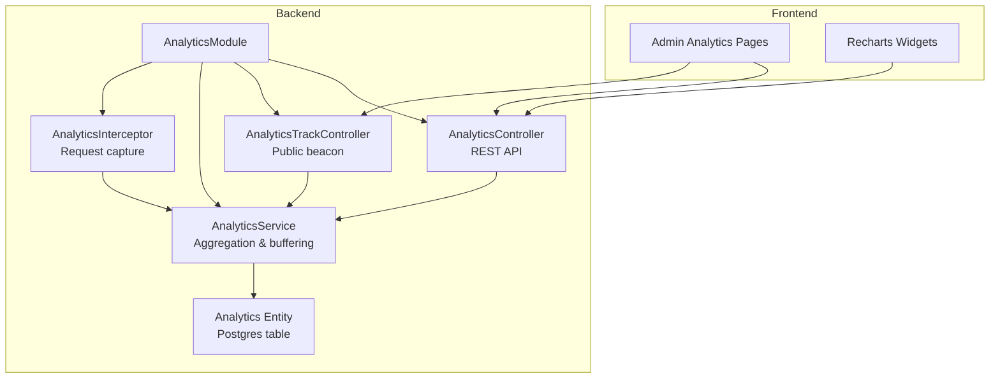
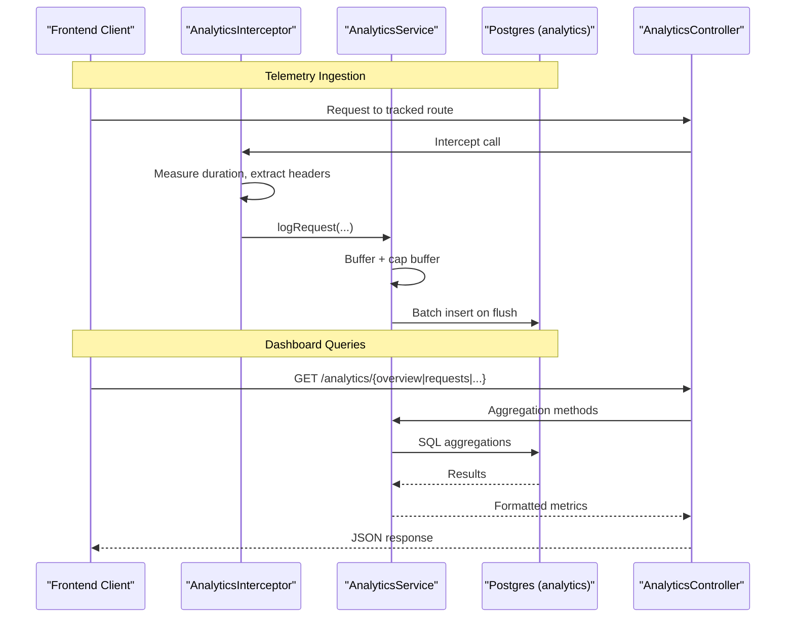
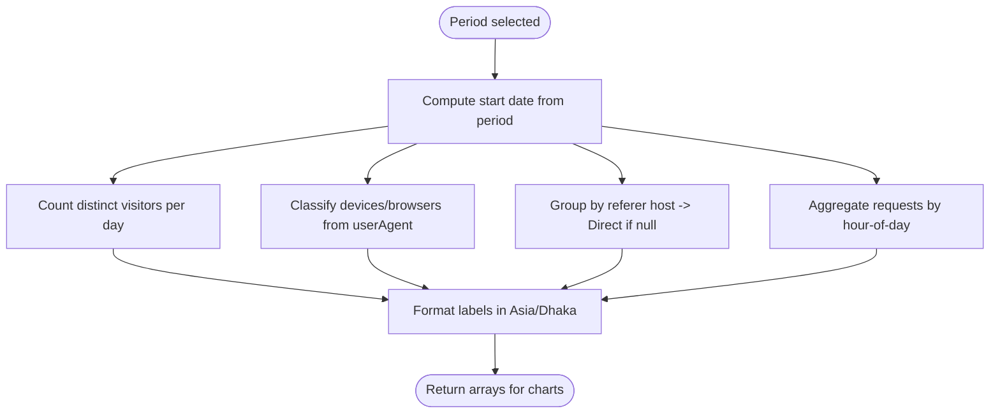
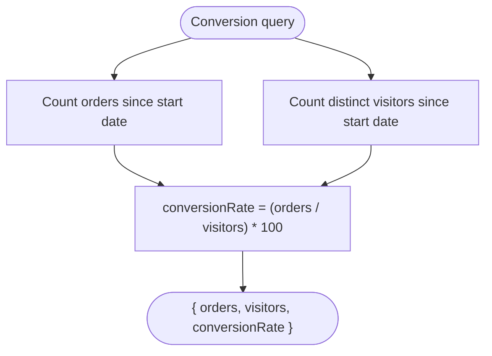
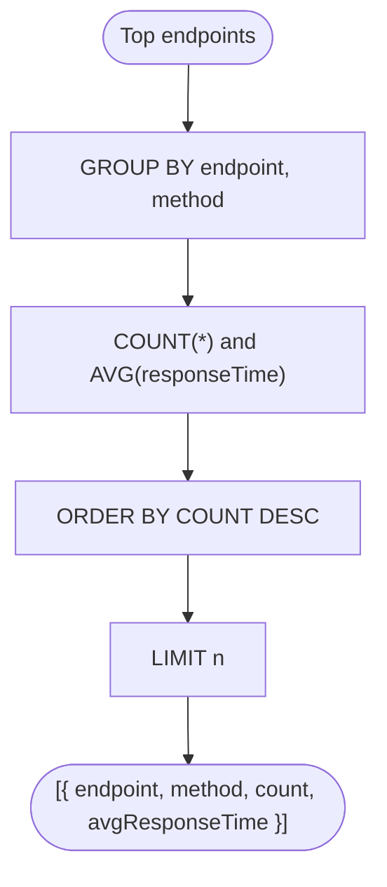
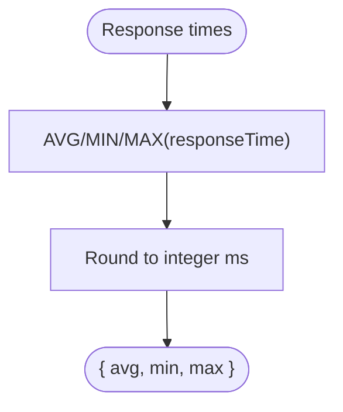
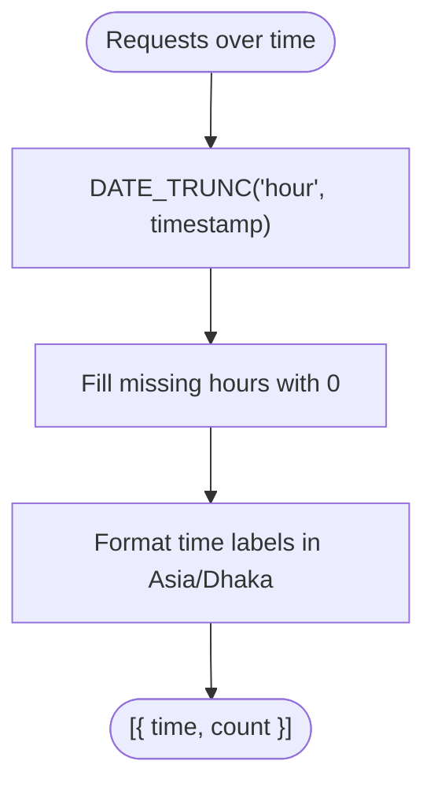
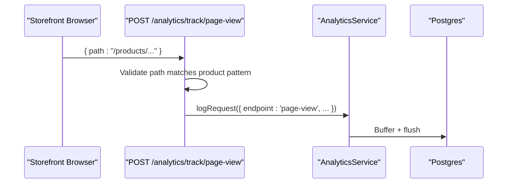
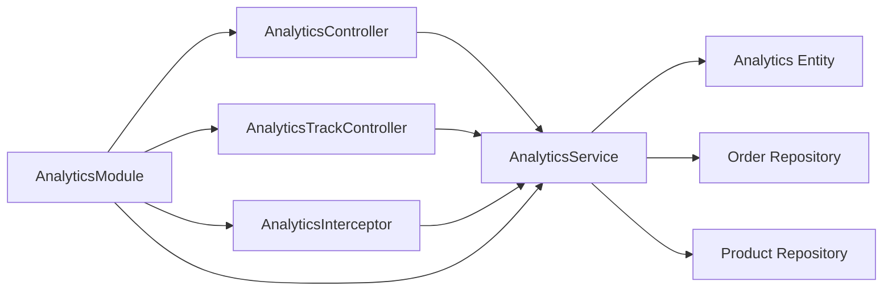

# Analytics Dashboard

<cite>
**Referenced Files in This Document**
- [analytics.controller.ts](file://apps/backend/src/analytics/analytics.controller.ts)
- [analytics.service.ts](file://apps/backend/src/analytics/analytics.service.ts)
- [analytics-track.controller.ts](file://apps/backend/src/analytics/analytics-track.controller.ts)
- [analytics.module.ts](file://apps/backend/src/analytics/analytics.module.ts)
- [analytics.interceptor.ts](file://apps/backend/src/analytics/interceptors/analytics.interceptor.ts)
- [analytics.entity.ts](file://apps/backend/src/analytics/entities/analytics.entity.ts)
- [analytics-response.dto.ts](file://apps/backend/src/analytics/dto/analytics-response.dto.ts)
- [log-request.dto.ts](file://apps/backend/src/analytics/dto/log-request.dto.ts)
</cite>

## Table of Contents
1. [Introduction](#introduction)
2. [Project Structure](#project-structure)
3. [Core Components](#core-components)
4. [Architecture Overview](#architecture-overview)
5. [Detailed Component Analysis](#detailed-component-analysis)
6. [Dependency Analysis](#dependency-analysis)
7. [Performance Considerations](#performance-considerations)
8. [Troubleshooting Guide](#troubleshooting-guide)
9. [Conclusion](#conclusion)

## Introduction
This document describes the real-time analytics dashboard and its backend support. It covers visitor tracking, device breakdown, traffic sources, peak traffic visualization, conversion metrics, top endpoints performance, response time analytics, request volume charts, abandoned carts analysis, customer behavior insights, payment transaction monitoring, WebSocket-based real-time updates, chart components using Recharts, data aggregation strategies, and performance optimizations. The documentation maps frontend features to backend APIs, data models, and integration patterns.

## Project Structure
The analytics feature is implemented as a NestJS module with controllers, services, entities, DTOs, and an interceptor that captures request telemetry. The frontend exposes admin analytics pages and reusable chart widgets.

**Diagram sources**
- [analytics.controller.ts:27-330](file://apps/backend/src/analytics/analytics.controller.ts#L27-L330)
- [analytics-track.controller.ts:29-61](file://apps/backend/src/analytics/analytics-track.controller.ts#L29-L61)
- [analytics.service.ts:38-616](file://apps/backend/src/analytics/analytics.service.ts#L38-L616)
- [analytics.interceptor.ts:13-115](file://apps/backend/src/analytics/interceptors/analytics.interceptor.ts#L13-L115)
- [analytics.entity.ts:12-58](file://apps/backend/src/analytics/entities/analytics.entity.ts#L12-L58)
- [analytics.module.ts:11-17](file://apps/backend/src/analytics/analytics.module.ts#L11-L17)

**Section sources**
- [analytics.controller.ts:27-330](file://apps/backend/src/analytics/analytics.controller.ts#L27-L330)
- [analytics.service.ts:38-616](file://apps/backend/src/analytics/analytics.service.ts#L38-L616)
- [analytics-track.controller.ts:29-61](file://apps/backend/src/analytics/analytics-track.controller.ts#L29-L61)
- [analytics.interceptor.ts:13-115](file://apps/backend/src/analytics/interceptors/analytics.interceptor.ts#L13-L115)
- [analytics.entity.ts:12-58](file://apps/backend/src/analytics/entities/analytics.entity.ts#L12-L58)
- [analytics.module.ts:11-17](file://apps/backend/src/analytics/analytics.module.ts#L11-L17)

## Core Components
- AnalyticsController: Exposes REST endpoints for overview, requests, peak traffic, visitors, top endpoints, response times, devices, top product pages, traffic sources, and conversion. All endpoints accept a period parameter (1h, 24h, 7d, 15d, 30d).
- AnalyticsTrackController: Public endpoint to record storefront page views for product detail paths.
- AnalyticsService: Implements buffering, periodic flush, retention cleanup, and all aggregation queries used by the dashboard.
- AnalyticsInterceptor: Captures allowed routes’ request/response metadata and enqueues analytics events.
- Analytics Entity: Postgres model storing endpoint, method, status code, response time, user/IP, user agent, referer, request path, timestamp, and authentication flag.
- DTOs: Define request payloads and API response shapes for Swagger and client consumption.

Key responsibilities:
- Real-time ingestion via interceptor and public beacon.
- Efficient batched persistence with configurable buffer size and flush cadence.
- Timezone-aware aggregations aligned to Bangladesh time (Asia/Dhaka).
- Performance-oriented SQL aggregations with indexes and concurrent index creation at boot.

**Section sources**
- [analytics.controller.ts:36-311](file://apps/backend/src/analytics/analytics.controller.ts#L36-L311)
- [analytics-track.controller.ts:35-60](file://apps/backend/src/analytics/analytics-track.controller.ts#L35-L60)
- [analytics.service.ts:142-548](file://apps/backend/src/analytics/analytics.service.ts#L142-L548)
- [analytics.interceptor.ts:20-114](file://apps/backend/src/analytics/interceptors/analytics.interceptor.ts#L20-L114)
- [analytics.entity.ts:12-58](file://apps/backend/src/analytics/entities/analytics.entity.ts#L12-L58)
- [analytics-response.dto.ts:1-66](file://apps/backend/src/analytics/dto/analytics-response.dto.ts#L1-L66)
- [log-request.dto.ts:1-46](file://apps/backend/src/analytics/dto/log-request.dto.ts#L1-L46)

## Architecture Overview
The system captures request telemetry through two channels:
- Interceptor-based capture for selected API routes.
- Public beacon for storefront product page views.

Telemetry is buffered and periodically flushed to the database. The dashboard consumes aggregated metrics via REST endpoints.

**Diagram sources**
- [analytics.interceptor.ts:20-114](file://apps/backend/src/analytics/interceptors/analytics.interceptor.ts#L20-L114)
- [analytics.service.ts:142-192](file://apps/backend/src/analytics/analytics.service.ts#L142-L192)
- [analytics.controller.ts:36-311](file://apps/backend/src/analytics/analytics.controller.ts#L36-L311)

## Detailed Component Analysis

### Visitor Tracking System
- Online users monitoring: Derived from unique visitors per day/hour using userId or ipAddress when userId is absent.
- Device analytics breakdown: Classifies mobile/tablet/desktop and browser distribution from stored userAgent strings.
- Traffic sources analysis: Groups by referer host; missing referer counts as Direct.
- Peak traffic visualization: Hour-of-day request counts across the selected period.

Implementation highlights:
- Unique visitors use COALESCE(userId, ipAddress) to deduplicate across authenticated and anonymous sessions.
- Device classification uses substring checks against userAgent.
- Traffic sources extract host from referer URL; empty referer mapped to Direct.
- Peak traffic aggregates hour-of-day counts with timezone alignment.

**Diagram sources**
- [analytics.service.ts:318-339](file://apps/backend/src/analytics/analytics.service.ts#L318-L339)
- [analytics.service.ts:382-440](file://apps/backend/src/analytics/analytics.service.ts#L382-L440)
- [analytics.service.ts:502-523](file://apps/backend/src/analytics/analytics.service.ts#L502-L523)
- [analytics.service.ts:288-316](file://apps/backend/src/analytics/analytics.service.ts#L288-L316)

**Section sources**
- [analytics.service.ts:318-339](file://apps/backend/src/analytics/analytics.service.ts#L318-L339)
- [analytics.service.ts:382-440](file://apps/backend/src/analytics/analytics.service.ts#L382-L440)
- [analytics.service.ts:502-523](file://apps/backend/src/analytics/analytics.service.ts#L502-L523)
- [analytics.service.ts:288-316](file://apps/backend/src/analytics/analytics.service.ts#L288-L316)

### Conversion Metrics Tracking
- Computes orders placed vs unique visitors within the selected period.
- Returns conversion rate as a percentage rounded to two decimals.

**Diagram sources**
- [analytics.service.ts:525-548](file://apps/backend/src/analytics/analytics.service.ts#L525-L548)

**Section sources**
- [analytics.service.ts:525-548](file://apps/backend/src/analytics/analytics.service.ts#L525-L548)

### Top Endpoints Performance Monitoring
- Aggregates most accessed endpoints with request count and average response time.
- Supports configurable limit and period.

**Diagram sources**
- [analytics.service.ts:341-362](file://apps/backend/src/analytics/analytics.service.ts#L341-L362)

**Section sources**
- [analytics.service.ts:341-362](file://apps/backend/src/analytics/analytics.service.ts#L341-L362)

### Response Time Analytics
- Provides average, minimum, and maximum response times for the selected period.

**Diagram sources**
- [analytics.service.ts:364-380](file://apps/backend/src/analytics/analytics.service.ts#L364-L380)

**Section sources**
- [analytics.service.ts:364-380](file://apps/backend/src/analytics/analytics.service.ts#L364-L380)

### Request Volume Charts
- Returns hourly request counts for the full period, zero-filling hours with no activity to ensure consistent chart axes.

**Diagram sources**
- [analytics.service.ts:254-286](file://apps/backend/src/analytics/analytics.service.ts#L254-L286)

**Section sources**
- [analytics.service.ts:254-286](file://apps/backend/src/analytics/analytics.service.ts#L254-L286)

### Abandoned Carts Analysis
- Frontend provides dedicated analytics pages for abandoned carts. Backend cart operations are captured by the interceptor when they match allowed routes, enabling correlation between cart activity and overall analytics.

Integration notes:
- Cart-related endpoints are included in the interceptor’s allowed routes list, ensuring cart events contribute to request volume and performance metrics.

**Section sources**
- [analytics.interceptor.ts:34-56](file://apps/backend/src/analytics/interceptors/analytics.interceptor.ts#L34-L56)

### Customer Behavior Insights
- Product page views are recorded via a public beacon for product detail paths, complementing API request logs with actual storefront visits.
- Top product pages are resolved to product names by matching numeric IDs or slugs.

**Diagram sources**
- [analytics-track.controller.ts:35-60](file://apps/backend/src/analytics/analytics-track.controller.ts#L35-L60)
- [analytics.service.ts:142-192](file://apps/backend/src/analytics/analytics.service.ts#L142-L192)

**Section sources**
- [analytics-track.controller.ts:35-60](file://apps/backend/src/analytics/analytics-track.controller.ts#L35-L60)
- [analytics.service.ts:446-500](file://apps/backend/src/analytics/analytics.service.ts#L446-L500)

### Payment Transaction Monitoring
- Payment-related endpoints are captured by the interceptor when they fall under allowed routes, contributing to request volume, response time, and top endpoints metrics.
- Conversion metrics correlate orders with visitors to reflect payment outcomes.

**Section sources**
- [analytics.interceptor.ts:34-56](file://apps/backend/src/analytics/interceptors/analytics.interceptor.ts#L34-L56)
- [analytics.service.ts:525-548](file://apps/backend/src/analytics/analytics.service.ts#L525-L548)

### WebSocket Connections for Real-Time Updates
- The repository includes a notification gateway module, indicating WebSocket infrastructure exists for real-time notifications. While not directly wired into the analytics service in the analyzed files, it can be leveraged to push live dashboard updates (e.g., online users, new conversions) to the frontend.

Recommendation:
- Extend the analytics service to emit events to the notification gateway upon significant metric changes or new order conversions, enabling real-time chart updates without polling.

**Section sources**
- [notification.gateway.ts](file://apps/backend/src/notification/notification.gateway.ts)

### Chart Components Using Recharts
- Frontend analytics widgets render charts using Recharts. These components consume the REST endpoints documented below and display:
  - Requests over time
  - Peak traffic by hour
  - Unique visitors trend
  - Device/browser breakdown
  - Traffic sources
  - Conversion metrics
  - Top endpoints and response times

Implementation guidance:
- Map API responses to Recharts-friendly datasets.
- Use consistent time formatting aligned to Asia/Dhaka.
- Handle empty states gracefully when periods have no data.

**Section sources**
- [analytics.controller.ts:36-311](file://apps/backend/src/analytics/analytics.controller.ts#L36-L311)

### Data Aggregation Strategies
- Timezone alignment: All chart labels and buckets align to Asia/Dhaka to avoid off-by-one issues around midnight.
- Zero-filling: Hours/days with no activity are filled with zeros to maintain consistent chart axes.
- Deduplication: Unique visitors use COALESCE(userId, ipAddress) to treat anonymous and authenticated sessions consistently.
- Device classification: Simple substring heuristics on userAgent for mobile/tablet/desktop and major browsers.
- Traffic attribution: Referer host extraction; missing referer treated as Direct.

**Section sources**
- [analytics.service.ts:254-339](file://apps/backend/src/analytics/analytics.service.ts#L254-L339)
- [analytics.service.ts:382-440](file://apps/backend/src/analytics/analytics.service.ts#L382-L440)
- [analytics.service.ts:502-523](file://apps/backend/src/analytics/analytics.service.ts#L502-L523)

### Performance Optimization Techniques
- Buffered writes: Configurable batch size and interval reduce DB round trips.
- Buffer capping: Prevents unbounded memory growth when DB is unreachable.
- Concurrent index creation: Ensures dashboard queries perform well even without schema migrations.
- Retention cleanup: Scheduled task purges old rows to keep the analytics table manageable.
- Query optimization: GROUP BY and DATE_TRUNC minimize server-side processing; results are zero-filled in-memory only where needed.

Configuration keys:
- ANALYTICS_FLUSH_BATCH_SIZE
- ANALYTICS_MAX_BUFFER_SIZE
- ANALYTICS_FLUSH_INTERVAL_MS
- ANALYTICS_RETENTION_DAYS

**Section sources**
- [analytics.service.ts:16-23](file://apps/backend/src/analytics/analytics.service.ts#L16-L23)
- [analytics.service.ts:59-80](file://apps/backend/src/analytics/analytics.service.ts#L59-L80)
- [analytics.service.ts:89-117](file://apps/backend/src/analytics/analytics.service.ts#L89-L117)
- [analytics.service.ts:142-192](file://apps/backend/src/analytics/analytics.service.ts#L142-L192)
- [analytics.service.ts:587-615](file://apps/backend/src/analytics/analytics.service.ts#L587-L615)

## Dependency Analysis
The analytics module composes controllers, service, entity, and interceptor. Controllers depend on the service; the service depends on TypeORM repositories and configuration. The interceptor depends on the service and common utilities.

**Diagram sources**
- [analytics.module.ts:11-17](file://apps/backend/src/analytics/analytics.module.ts#L11-L17)
- [analytics.controller.ts:27-330](file://apps/backend/src/analytics/analytics.controller.ts#L27-L330)
- [analytics-track.controller.ts:29-61](file://apps/backend/src/analytics/analytics-track.controller.ts#L29-L61)
- [analytics.interceptor.ts:13-115](file://apps/backend/src/analytics/interceptors/analytics.interceptor.ts#L13-L115)
- [analytics.service.ts:38-57](file://apps/backend/src/analytics/analytics.service.ts#L38-L57)

**Section sources**
- [analytics.module.ts:11-17](file://apps/backend/src/analytics/analytics.module.ts#L11-L17)
- [analytics.controller.ts:27-330](file://apps/backend/src/analytics/analytics.controller.ts#L27-L330)
- [analytics-track.controller.ts:29-61](file://apps/backend/src/analytics/analytics-track.controller.ts#L29-L61)
- [analytics.interceptor.ts:13-115](file://apps/backend/src/analytics/interceptors/analytics.interceptor.ts#L13-L115)
- [analytics.service.ts:38-57](file://apps/backend/src/analytics/analytics.service.ts#L38-L57)

## Performance Considerations
- Tune buffer settings based on traffic volume:
  - Increase ANALYTICS_FLUSH_BATCH_SIZE for high-throughput environments.
  - Adjust ANALYTICS_FLUSH_INTERVAL_MS to balance latency vs. throughput.
- Monitor retention window:
  - Set ANALYTICS_RETENTION_DAYS to control storage growth.
- Index health:
  - Ensure concurrent index creation succeeds at startup; verify DB permissions.
- Query patterns:
  - Prefer longer periods for stable trends; short periods may yield sparse data requiring zero-filling.

[No sources needed since this section provides general guidance]

## Troubleshooting Guide
Common issues and resolutions:
- Missing data in charts:
  - Verify that the selected period includes activity and that the timezone alignment is correct.
  - Check that the interceptor is enabled for the relevant routes.
- High memory usage:
  - Reduce ANALYTICS_MAX_BUFFER_SIZE or increase flush frequency.
- Slow dashboard queries:
  - Confirm indexes were created successfully; check DB logs for permission errors during index creation.
- No conversion data:
  - Ensure orders are being created and timestamps fall within the selected period.

Operational tips:
- Inspect buffer state indirectly via application logs for flush failures.
- Review scheduled retention logs to confirm cleanup runs.

**Section sources**
- [analytics.service.ts:89-117](file://apps/backend/src/analytics/analytics.service.ts#L89-L117)
- [analytics.service.ts:172-192](file://apps/backend/src/analytics/analytics.service.ts#L172-L192)
- [analytics.service.ts:587-615](file://apps/backend/src/analytics/analytics.service.ts#L587-L615)

## Conclusion
The analytics dashboard integrates robust request telemetry capture, efficient buffering, and timezone-aligned aggregations to deliver actionable insights. It supports visitor tracking, device and traffic source analysis, peak traffic visualization, conversion metrics, top endpoints performance, and response time analytics. With clear REST APIs, well-defined data models, and performance-focused design, the system provides a solid foundation for real-time business intelligence. Extending it with WebSocket-driven updates can further enhance the real-time experience.

[No sources needed since this section summarizes without analyzing specific files]