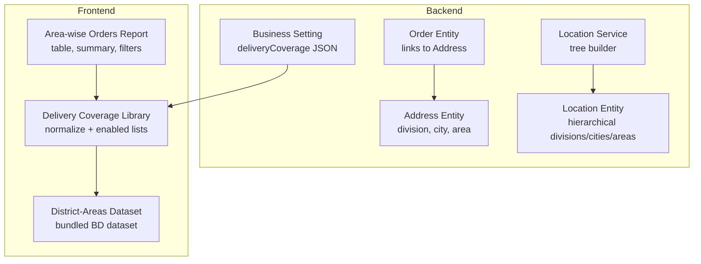
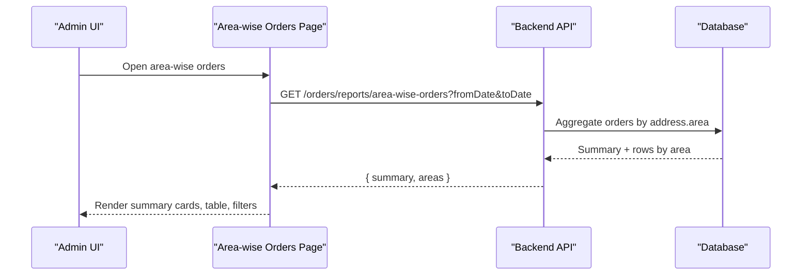
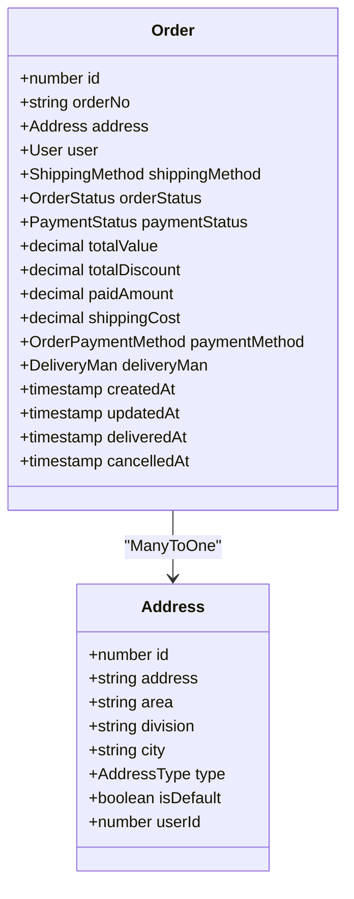
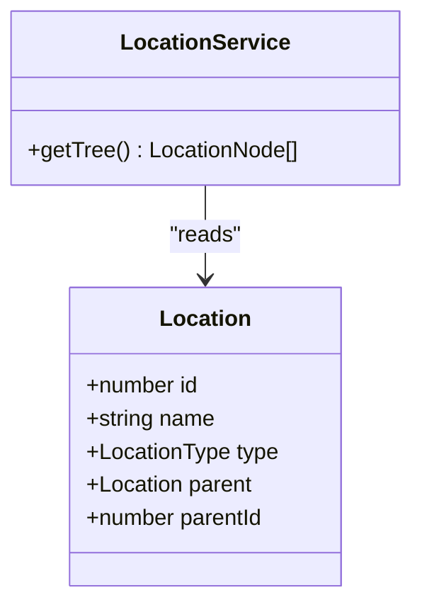
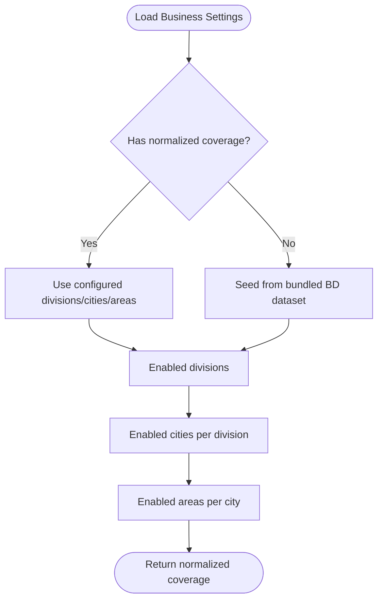
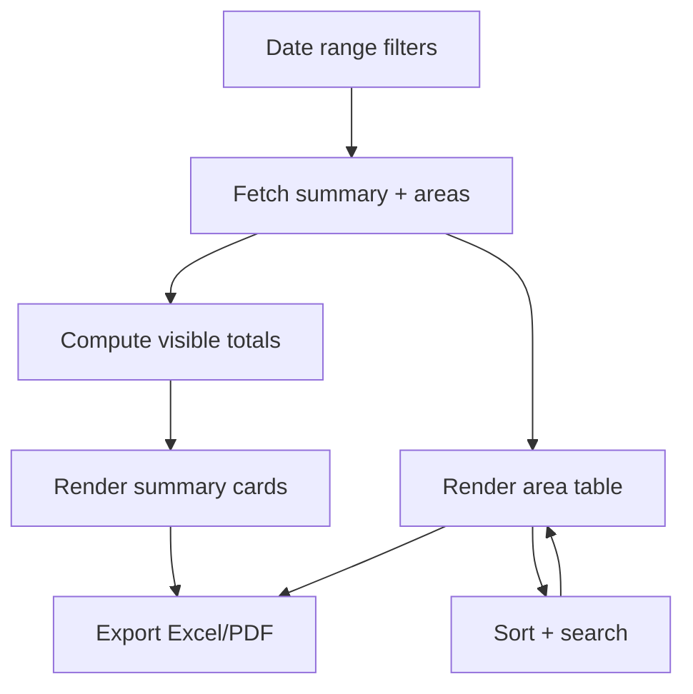
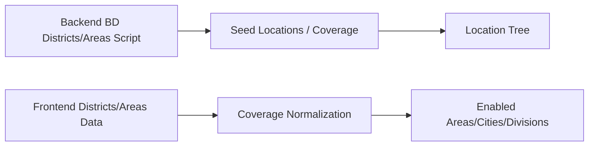
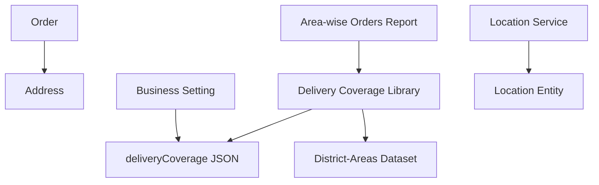

# Area-wise Order Analysis

<cite>
**Referenced Files in This Document**
- [area-wise-orders-list.tsx](file://apps/frontend/components/admin/reports/area-wise-orders/area-wise-orders-list.tsx)
- [delivery-coverage.ts](file://apps/frontend/lib/delivery-coverage.ts)
- [districts-areas.ts](file://apps/frontend/data/districts-areas.ts)
- [business-setting.entity.ts](file://apps/backend/src/business-settings/entities/business-setting.entity.ts)
- [address.entity.ts](file://apps/backend/src/address/entities/address.entity.ts)
- [order.entity.ts](file://apps/backend/src/order/entities/order.entity.ts)
- [location.entity.ts](file://apps/backend/src/location/entities/location.entity.ts)
- [location.service.ts](file://apps/backend/src/location/location.service.ts)
- [bd-districts-areas.ts](file://apps/backend/scripts/bd-districts-areas.ts)
</cite>

## Table of Contents
1. [Introduction](#introduction)
2. [Project Structure](#project-structure)
3. [Core Components](#core-components)
4. [Architecture Overview](#architecture-overview)
5. [Detailed Component Analysis](#detailed-component-analysis)
6. [Dependency Analysis](#dependency-analysis)
7. [Performance Considerations](#performance-considerations)
8. [Troubleshooting Guide](#troubleshooting-guide)
9. [Conclusion](#conclusion)

## Introduction
This document explains how orders are mapped to geographical areas and regions for spatial analysis, how delivery coverage is integrated with order locations, and how the area-wise order report visualizes performance and efficiency. It covers:
- Mapping orders to division, city (district), and area fields.
- Delivery coverage configuration and normalization.
- Visualization components for area-wise order metrics.
- Data models for canonical location hierarchies.
- Practical guidance for extending geocoding, area classification, and route optimization.

## Project Structure
The geographic order analysis spans backend data models, a canonical location hierarchy, business settings for delivery coverage, and frontend reporting and coverage management.

**Diagram sources**
- [address.entity.ts:13-46](file://apps/backend/src/address/entities/address.entity.ts#L13-L46)
- [order.entity.ts:24-47](file://apps/backend/src/order/entities/order.entity.ts#L24-L47)
- [location.entity.ts:18-41](file://apps/backend/src/location/entities/location.entity.ts#L18-L41)
- [location.service.ts:21-38](file://apps/backend/src/location/location.service.ts#L21-L38)
- [business-setting.entity.ts:108-122](file://apps/backend/src/business-settings/entities/business-setting.entity.ts#L108-L122)
- [delivery-coverage.ts:1-30](file://apps/frontend/lib/delivery-coverage.ts#L1-L30)
- [districts-areas.ts:1-10](file://apps/frontend/data/districts-areas.ts#L1-L10)
- [area-wise-orders-list.tsx:48-78](file://apps/frontend/components/admin/reports/area-wise-orders/area-wise-orders-list.tsx#L48-L78)

**Section sources**
- [address.entity.ts:13-46](file://apps/backend/src/address/entities/address.entity.ts#L13-L46)
- [order.entity.ts:24-47](file://apps/backend/src/order/entities/order.entity.ts#L24-L47)
- [location.entity.ts:18-41](file://apps/backend/src/location/entities/location.entity.ts#L18-L41)
- [location.service.ts:21-38](file://apps/backend/src/location/location.service.ts#L21-L38)
- [business-setting.entity.ts:108-122](file://apps/backend/src/business-settings/entities/business-setting.entity.ts#L108-L122)
- [delivery-coverage.ts:1-30](file://apps/frontend/lib/delivery-coverage.ts#L1-L30)
- [districts-areas.ts:1-10](file://apps/frontend/data/districts-areas.ts#L1-L10)
- [area-wise-orders-list.tsx:48-78](file://apps/frontend/components/admin/reports/area-wise-orders/area-wise-orders-list.tsx#L48-L78)

## Core Components
- Address model stores division, city, and area strings used for grouping orders by geography.
- Order entity links to an address, enabling per-order geographic aggregation.
- Location entity provides a hierarchical tree of divisions, cities, and areas.
- Business setting holds delivery coverage as a JSON structure of enabled divisions, cities, and areas.
- Frontend delivery coverage library normalizes stored coverage and computes enabled lists.
- Area-wise orders report aggregates and displays order counts, values, and completion rates by area.

Key responsibilities:
- Store and retrieve geographic attributes on addresses.
- Maintain canonical location hierarchy.
- Normalize and filter delivery coverage.
- Visualize area-level order performance.

**Section sources**
- [address.entity.ts:13-46](file://apps/backend/src/address/entities/address.entity.ts#L13-L46)
- [order.entity.ts:24-47](file://apps/backend/src/order/entities/order.entity.ts#L24-L47)
- [location.entity.ts:18-41](file://apps/backend/src/location/entities/location.entity.ts#L18-L41)
- [business-setting.entity.ts:108-122](file://apps/backend/src/business-settings/entities/business-setting.entity.ts#L108-L122)
- [delivery-coverage.ts:35-133](file://apps/frontend/lib/delivery-coverage.ts#L35-L133)
- [area-wise-orders-list.tsx:48-78](file://apps/frontend/components/admin/reports/area-wise-orders/area-wise-orders-list.tsx#L48-L78)

## Architecture Overview
Orders are grouped by the area field on their associated address. The area-wise report renders summary cards, a sortable table, and status breakdowns. Delivery coverage controls which areas are considered valid for delivery and can be edited via the settings UI.

**Diagram sources**
- [area-wise-orders-list.tsx:233-284](file://apps/frontend/components/admin/reports/area-wise-orders/area-wise-orders-list.tsx#L233-L284)
- [area-wise-orders-list.tsx:368-415](file://apps/frontend/components/admin/reports/area-wise-orders/area-wise-orders-list.tsx#L368-L415)

## Detailed Component Analysis

### Geographic Data Model
The system captures geographic context at the address level and associates it with orders.

**Diagram sources**
- [address.entity.ts:13-46](file://apps/backend/src/address/entities/address.entity.ts#L13-L46)
- [order.entity.ts:24-47](file://apps/backend/src/order/entities/order.entity.ts#L24-L47)

**Section sources**
- [address.entity.ts:13-46](file://apps/backend/src/address/entities/address.entity.ts#L13-L46)
- [order.entity.ts:24-47](file://apps/backend/src/order/entities/order.entity.ts#L24-L47)

### Canonical Location Hierarchy
A self-referencing location table represents divisions, cities, and areas. A service builds a tree from this flat structure.

**Diagram sources**
- [location.entity.ts:18-41](file://apps/backend/src/location/entities/location.entity.ts#L18-L41)
- [location.service.ts:21-38](file://apps/backend/src/location/location.service.ts#L21-L38)

**Section sources**
- [location.entity.ts:18-41](file://apps/backend/src/location/entities/location.entity.ts#L18-L41)
- [location.service.ts:21-38](file://apps/backend/src/location/location.service.ts#L21-L38)

### Delivery Coverage Integration
Delivery coverage is stored as JSON in business settings and normalized on the frontend into three lists: divisions, cities, and areas. Helper functions return enabled items based on current configuration or fall back to bundled datasets.

**Diagram sources**
- [business-setting.entity.ts:108-122](file://apps/backend/src/business-settings/entities/business-setting.entity.ts#L108-L122)
- [delivery-coverage.ts:35-133](file://apps/frontend/lib/delivery-coverage.ts#L35-L133)
- [districts-areas.ts:1-10](file://apps/frontend/data/districts-areas.ts#L1-L10)

**Section sources**
- [business-setting.entity.ts:108-122](file://apps/backend/src/business-settings/entities/business-setting.entity.ts#L108-L122)
- [delivery-coverage.ts:35-133](file://apps/frontend/lib/delivery-coverage.ts#L35-L133)
- [districts-areas.ts:1-10](file://apps/frontend/data/districts-areas.ts#L1-L10)

### Area-wise Orders Report
The report component presents:
- Summary cards: total orders, order value, delivered value, pending, processing, on hold, cancelled, and completion rate.
- A sortable, searchable table of areas with status breakdowns and monetary totals.
- Export options for Excel and PDF.

**Diagram sources**
- [area-wise-orders-list.tsx:233-284](file://apps/frontend/components/admin/reports/area-wise-orders/area-wise-orders-list.tsx#L233-L284)
- [area-wise-orders-list.tsx:368-415](file://apps/frontend/components/admin/reports/area-wise-orders/area-wise-orders-list.tsx#L368-L415)
- [area-wise-orders-list.tsx:449-525](file://apps/frontend/components/admin/reports/area-wise-orders/area-wise-orders-list.tsx#L449-L525)
- [area-wise-orders-list.tsx:527-735](file://apps/frontend/components/admin/reports/area-wise-orders/area-wise-orders-list.tsx#L527-L735)

**Section sources**
- [area-wise-orders-list.tsx:48-78](file://apps/frontend/components/admin/reports/area-wise-orders/area-wise-orders-list.tsx#L48-L78)
- [area-wise-orders-list.tsx:233-284](file://apps/frontend/components/admin/reports/area-wise-orders/area-wise-orders-list.tsx#L233-L284)
- [area-wise-orders-list.tsx:368-415](file://apps/frontend/components/admin/reports/area-wise-orders/area-wise-orders-list.tsx#L368-L415)
- [area-wise-orders-list.tsx:449-525](file://apps/frontend/components/admin/reports/area-wise-orders/area-wise-orders-list.tsx#L449-L525)
- [area-wise-orders-list.tsx:527-735](file://apps/frontend/components/admin/reports/area-wise-orders/area-wise-orders-list.tsx#L527-L735)

### Bundled Geographic Datasets
Both backend scripts and frontend data include a Bangladesh district-area dataset. This serves as a seed for coverage and area selection when no explicit configuration exists.

**Diagram sources**
- [bd-districts-areas.ts:1-10](file://apps/backend/scripts/bd-districts-areas.ts#L1-L10)
- [districts-areas.ts:1-10](file://apps/frontend/data/districts-areas.ts#L1-L10)
- [delivery-coverage.ts:96-133](file://apps/frontend/lib/delivery-coverage.ts#L96-L133)

**Section sources**
- [bd-districts-areas.ts:1-10](file://apps/backend/scripts/bd-districts-areas.ts#L1-L10)
- [districts-areas.ts:1-10](file://apps/frontend/data/districts-areas.ts#L1-L10)
- [delivery-coverage.ts:96-133](file://apps/frontend/lib/delivery-coverage.ts#L96-L133)

## Dependency Analysis
- Order → Address: Each order references an address containing division, city, and area.
- Business Setting → Delivery Coverage: JSONB field defines enabled geographic scopes.
- Frontend Coverage Library → Business Settings: Reads and normalizes coverage; falls back to bundled datasets.
- Location Service → Location Entity: Builds hierarchical tree for administrative divisions.
- Area-wise Report → Coverage Library: Uses enabled lists to constrain or label geographic scope.

**Diagram sources**
- [order.entity.ts:24-47](file://apps/backend/src/order/entities/order.entity.ts#L24-L47)
- [address.entity.ts:13-46](file://apps/backend/src/address/entities/address.entity.ts#L13-L46)
- [business-setting.entity.ts:108-122](file://apps/backend/src/business-settings/entities/business-setting.entity.ts#L108-L122)
- [delivery-coverage.ts:35-133](file://apps/frontend/lib/delivery-coverage.ts#L35-L133)
- [districts-areas.ts:1-10](file://apps/frontend/data/districts-areas.ts#L1-L10)
- [location.service.ts:21-38](file://apps/backend/src/location/location.service.ts#L21-L38)
- [location.entity.ts:18-41](file://apps/backend/src/location/entities/location.entity.ts#L18-L41)
- [area-wise-orders-list.tsx:233-284](file://apps/frontend/components/admin/reports/area-wise-orders/area-wise-orders-list.tsx#L233-L284)

**Section sources**
- [order.entity.ts:24-47](file://apps/backend/src/order/entities/order.entity.ts#L24-L47)
- [address.entity.ts:13-46](file://apps/backend/src/address/entities/address.entity.ts#L13-L46)
- [business-setting.entity.ts:108-122](file://apps/backend/src/business-settings/entities/business-setting.entity.ts#L108-L122)
- [delivery-coverage.ts:35-133](file://apps/frontend/lib/delivery-coverage.ts#L35-L133)
- [districts-areas.ts:1-10](file://apps/frontend/data/districts-areas.ts#L1-L10)
- [location.service.ts:21-38](file://apps/backend/src/location/location.service.ts#L21-L38)
- [location.entity.ts:18-41](file://apps/backend/src/location/entities/location.entity.ts#L18-L41)
- [area-wise-orders-list.tsx:233-284](file://apps/frontend/components/admin/reports/area-wise-orders/area-wise-orders-list.tsx#L233-L284)

## Performance Considerations
- Aggregation granularity: Grouping by area string is efficient if the database indexes the address.area column. Ensure indexing strategies align with query patterns.
- Coverage normalization: Filtering and deduplication occur in memory; keep enabled lists reasonably sized to avoid heavy client-side computations.
- Report rendering: Sorting and searching are performed client-side for the visible dataset; paginate or limit results server-side for large datasets.
- Timezone handling: When adding time-based geographic analytics, ensure consistent timezone alignment (e.g., UTC storage with display conversion).

[No sources needed since this section provides general guidance]

## Troubleshooting Guide
- Missing area data: If orders lack area values, area-wise aggregation will group them under empty or null labels. Validate address input and required fields during checkout.
- Coverage mismatch: If areas appear disabled unexpectedly, verify the deliveryCoverage JSON in business settings and ensure the corresponding entries are enabled.
- Inconsistent area names: Ensure area names match between address records and the bundled dataset to avoid duplicate or unrecognized entries.
- Location tree issues: Confirm that parentId relationships are correct in the location table so the tree renders properly.

**Section sources**
- [address.entity.ts:13-46](file://apps/backend/src/address/entities/address.entity.ts#L13-L46)
- [business-setting.entity.ts:108-122](file://apps/backend/src/business-settings/entities/business-setting.entity.ts#L108-L122)
- [delivery-coverage.ts:35-133](file://apps/frontend/lib/delivery-coverage.ts#L35-L133)
- [location.entity.ts:18-41](file://apps/backend/src/location/entities/location.entity.ts#L18-L41)

## Conclusion
The area-wise order analysis leverages address-level geographic fields, a canonical location hierarchy, and configurable delivery coverage to provide actionable insights. The frontend report visualizes order distribution, status breakdowns, and completion rates by area, while the coverage library ensures only enabled zones influence operations. Extending this system with geocoding, precise mapping APIs, and route optimization should build upon these stable data contracts and visualization patterns.

[No sources needed since this section summarizes without analyzing specific files]