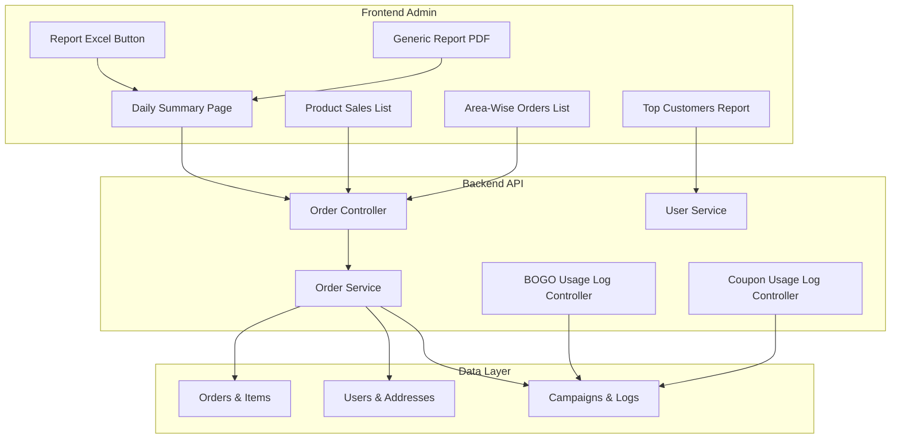
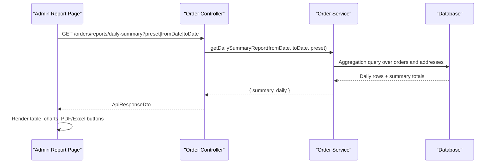
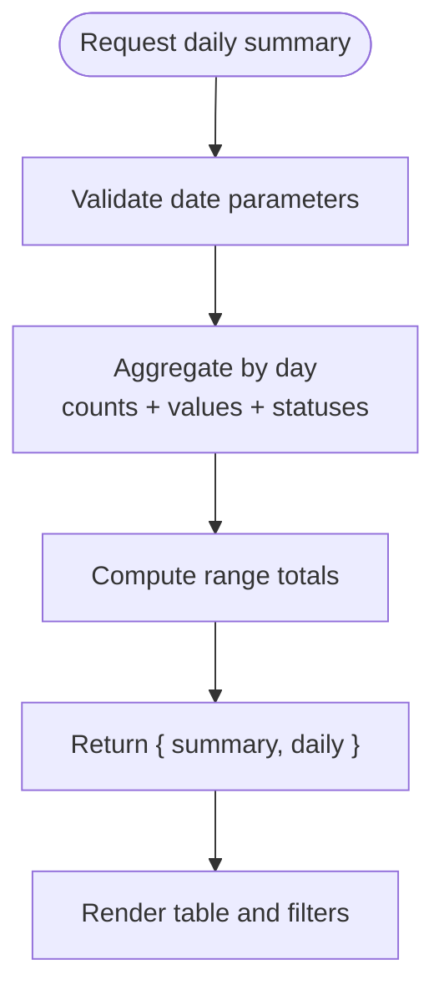
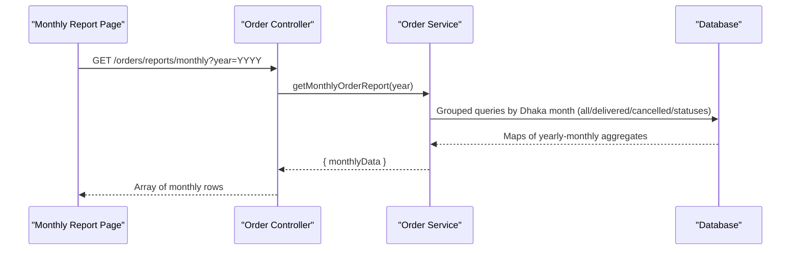
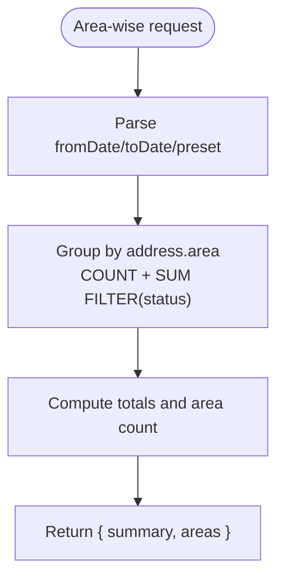
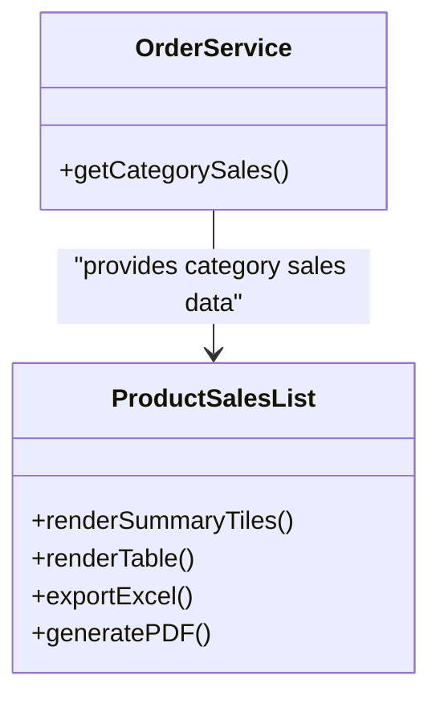
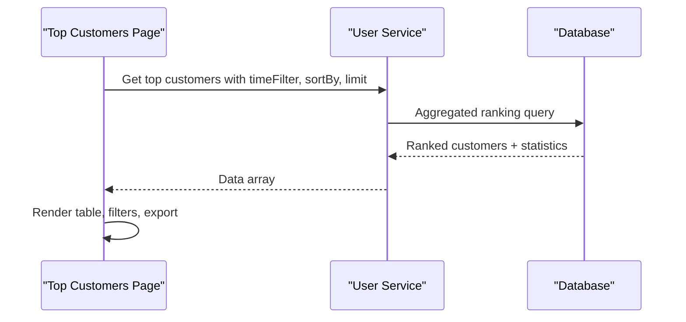
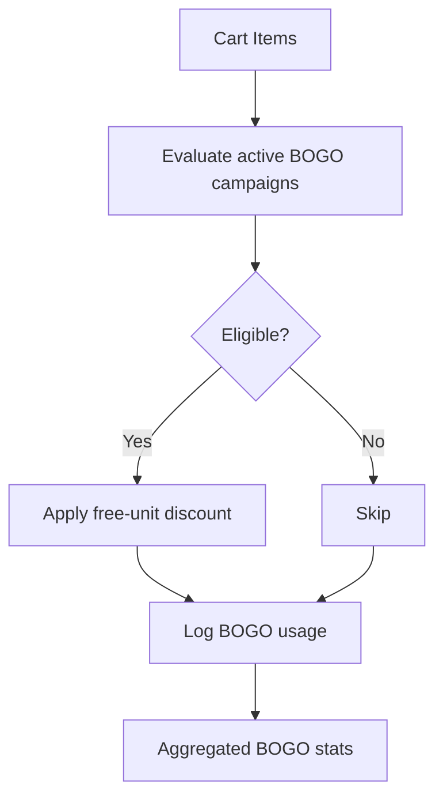
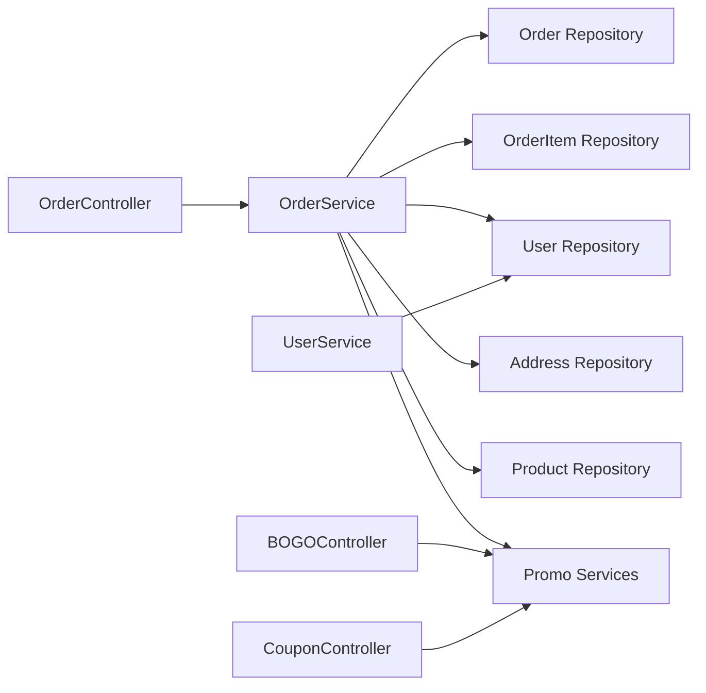

# Business Reports

<cite>
**Referenced Files in This Document**
- [order.controller.ts](file://apps/backend/src/order/order.controller.ts)
- [order.service.ts](file://apps/backend/src/order/order.service.ts)
- [daily-summary page](file://apps/frontend/app/admin/reports/daily-summary/page.tsx)
- [product-sales-list component](file://apps/frontend/components/admin/reports/product-sales/product-sales-list.tsx)
- [area-wise-orders-list component](file://apps/frontend/components/admin/reports/area-wise-orders/area-wise-orders-list.tsx)
- [top-customers component](file://apps/frontend/components/admin/reports/top-customers/top-customers.tsx)
- [user.service.ts](file://apps/backend/src/user/user.service.ts)
- [bogo-campaigns.service.ts](file://apps/backend/src/bogo-campaigns/bogo-campaigns.service.ts)
- [bogo-usage-log.controller.ts](file://apps/backend/src/bogo-usage-log/bogo-usage-log.controller.ts)
- [coupon-usage-log.controller.ts](file://apps/backend/src/coupon-usage-log/coupon-usage-log.controller.ts)
- [download-excel-button component](file://apps/frontend/components/admin/reports/download-excel-button.tsx)
- [generic-report-pdf component](file://apps/frontend/components/admin/reports/generic-report-pdf.tsx)
</cite>

## Table of Contents
1. [Introduction](#introduction)
2. [Project Structure](#project-structure)
3. [Core Components](#core-components)
4. [Architecture Overview](#architecture-overview)
5. [Detailed Component Analysis](#detailed-component-analysis)
6. [Dependency Analysis](#dependency-analysis)
7. [Performance Considerations](#performance-considerations)
8. [Troubleshooting Guide](#troubleshooting-guide)
9. [Conclusion](#conclusion)

## Introduction
This document explains the comprehensive business reporting system built into the application. It covers daily summary reports, monthly order reports, product sales analytics, customer insights, area-wise distribution analysis, promotional campaign effectiveness tracking, and export functionality for PDF and Excel. It also documents report generation services, data aggregation queries, chart-ready metrics, performance optimization strategies, scheduling considerations, caching approaches, and integration points with external reporting tools.

## Project Structure
The reporting system spans backend controllers and services that expose REST endpoints and perform SQL-based aggregation, and frontend pages and reusable components that render charts, tables, and downloadable reports.



**Diagram sources**
- [order.controller.ts:314-454](file://apps/backend/src/order/order.controller.ts#L314-L454)
- [order.service.ts:750-1000](file://apps/backend/src/order/order.service.ts#L750-L1000)
- [daily-summary page:70-99](file://apps/frontend/app/admin/reports/daily-summary/page.tsx#L70-L99)
- [product-sales-list component:87-134](file://apps/frontend/components/admin/reports/product-sales/product-sales-list.tsx#L87-L134)
- [area-wise-orders-list component:43-99](file://apps/frontend/components/admin/reports/area-wise-orders/area-wise-orders-list.tsx#L43-L99)
- [top-customers component:50-140](file://apps/frontend/components/admin/reports/top-customers/top-customers.tsx#L50-L140)
- [download-excel-button component:1-72](file://apps/frontend/components/admin/reports/download-excel-button.tsx#L1-L72)
- [generic-report-pdf component:1-249](file://apps/frontend/components/admin/reports/generic-report-pdf.tsx#L1-L249)

**Section sources**
- [order.controller.ts:314-454](file://apps/backend/src/order/order.controller.ts#L314-L454)
- [order.service.ts:750-1000](file://apps/backend/src/order/order.service.ts#L750-L1000)
- [daily-summary page:70-99](file://apps/frontend/app/admin/reports/daily-summary/page.tsx#L70-L99)
- [product-sales-list component:87-134](file://apps/frontend/components/admin/reports/product-sales/product-sales-list.tsx#L87-L134)
- [area-wise-orders-list component:43-99](file://apps/frontend/components/admin/reports/area-wise-orders/area-wise-orders-list.tsx#L43-L99)
- [top-customers component:50-140](file://apps/frontend/components/admin/reports/top-customers/top-customers.tsx#L50-L140)
- [download-excel-button component:1-72](file://apps/frontend/components/admin/reports/download-excel-button.tsx#L1-L72)
- [generic-report-pdf component:1-249](file://apps/frontend/components/admin/reports/generic-report-pdf.tsx#L1-L249)

## Core Components
- Daily summary report endpoint returns one row per day with order counts, values, delivered/cancelled/pending/processing/on-hold breakdowns, paid and due amounts, plus range totals. The frontend page fetches this endpoint and renders a table with filters by preset or custom date range.
- Monthly order report endpoint groups orders by Dhaka calendar month and returns all-order, delivered, cancelled, pending, processing, and on-hold counts and values. A separate endpoint lists available years.
- Area-wise order distribution groups orders by shipping area and provides total and delivered values and status counts per area.
- Product sales analytics provide category revenue share and top-performing items through dedicated endpoints and frontend list components.
- Customer insights include new vs returning customers and top customers ranked by orders or spending with time filters.
- Promotional campaign effectiveness includes BOGO usage stats, flash sale usage, free delivery usage, and coupon usage logs with aggregated statistics.
- Export functionality supports PDF generation via a generic report template and Excel exports using a shared client-side button component.

**Section sources**
- [order.controller.ts:314-454](file://apps/backend/src/order/order.controller.ts#L314-L454)
- [order.controller.ts:643-745](file://apps/backend/src/order/order.controller.ts#L643-L745)
- [order.controller.ts:542-583](file://apps/backend/src/order/order.controller.ts#L542-L583)
- [order.controller.ts:865-883](file://apps/backend/src/order/order.controller.ts#L865-L883)
- [order.service.ts:750-825](file://apps/backend/src/order/order.service.ts#L750-L825)
- [order.service.ts:1868-1949](file://apps/backend/src/order/order.service.ts#L1868-L1949)
- [order.service.ts:1951-2158](file://apps/backend/src/order/order.service.ts#L1951-L2158)
- [bogo-usage-log.controller.ts:87-133](file://apps/backend/src/bogo-usage-log/bogo-usage-log.controller.ts#L87-L133)
- [coupon-usage-log.controller.ts:28-146](file://apps/backend/src/coupon-usage-log/coupon-usage-log.controller.ts#L28-L146)
- [download-excel-button component:1-72](file://apps/frontend/components/admin/reports/download-excel-button.tsx#L1-L72)
- [generic-report-pdf component:1-249](file://apps/frontend/components/admin/reports/generic-report-pdf.tsx#L1-L249)

## Architecture Overview
The reporting architecture follows a layered pattern:
- Frontend admin pages request report data from backend endpoints.
- Controllers validate inputs, enforce permissions, and delegate to services.
- Services execute optimized SQL aggregations and return structured payloads.
- Frontend components render charts and tables and generate downloadable PDFs and Excel files.



**Diagram sources**
- [order.controller.ts:413-454](file://apps/backend/src/order/order.controller.ts#L413-L454)
- [order.service.ts:1868-1949](file://apps/backend/src/order/order.service.ts#L1868-L1949)
- [daily-summary page:70-99](file://apps/frontend/app/admin/reports/daily-summary/page.tsx#L70-L99)

## Detailed Component Analysis

### Daily Summary Report
- Endpoint: `/orders/reports/daily-summary`
- Purpose: Day-by-day order summary for a date range with order count/value, delivered/cancelled/pending/processing/on-hold counts, paid and due amounts, plus range totals.
- Parameters: `fromDate`, `toDate`, `preset`.
- Frontend: Fetches the endpoint and passes summary and daily arrays to a list component.



**Diagram sources**
- [order.controller.ts:413-454](file://apps/backend/src/order/order.controller.ts#L413-L454)
- [daily-summary page:70-99](file://apps/frontend/app/admin/reports/daily-summary/page.tsx#L70-L99)

**Section sources**
- [order.controller.ts:413-454](file://apps/backend/src/order/order.controller.ts#L413-L454)
- [daily-summary page:70-99](file://apps/frontend/app/admin/reports/daily-summary/page.tsx#L70-L99)

### Monthly Order Report
- Endpoints:
  - `/orders/reports/monthly` with optional `year` filter.
  - `/orders/reports/monthly/years` to list available years.
- Logic: Groups by Dhaka calendar month; returns all-order, delivered, cancelled, pending, processing, and on-hold counts and values.



**Diagram sources**
- [order.controller.ts:643-745](file://apps/backend/src/order/order.controller.ts#L643-L745)
- [order.service.ts:1951-2158](file://apps/backend/src/order/order.service.ts#L1951-L2158)

**Section sources**
- [order.controller.ts:643-745](file://apps/backend/src/order/order.controller.ts#L643-L745)
- [order.service.ts:1951-2158](file://apps/backend/src/order/order.service.ts#L1951-L2158)

### Area-Wise Order Distribution
- Endpoint: `/orders/reports/area-wise-orders`
- Purpose: Group orders by shipping area with total/delivered/cancelled/pending/processing/on-hold counts and values. Unknown areas are grouped under “Unknown”.
- Frontend: Renders a table with summary tiles and export options.



**Diagram sources**
- [order.controller.ts:542-583](file://apps/backend/src/order/order.controller.ts#L542-L583)
- [order.service.ts:1868-1949](file://apps/backend/src/order/order.service.ts#L1868-L1949)
- [area-wise-orders-list component:43-99](file://apps/frontend/components/admin/reports/area-wise-orders/area-wise-orders-list.tsx#L43-L99)

**Section sources**
- [order.controller.ts:542-583](file://apps/backend/src/order/order.controller.ts#L542-L583)
- [order.service.ts:1868-1949](file://apps/backend/src/order/order.service.ts#L1868-L1949)
- [area-wise-orders-list component:43-99](file://apps/frontend/components/admin/reports/area-wise-orders/area-wise-orders-list.tsx#L43-L99)

### Product Sales Analytics
- Category sales endpoint returns quantity and total value grouped by product category for delivered orders.
- Frontend product sales list shows summary tiles (total revenue, units sold, products sold), a table of top items, and export buttons.



**Diagram sources**
- [order.service.ts:761-786](file://apps/backend/src/order/order.service.ts#L761-L786)
- [product-sales-list component:87-134](file://apps/frontend/components/admin/reports/product-sales/product-sales-list.tsx#L87-L134)

**Section sources**
- [order.controller.ts:865-883](file://apps/backend/src/order/order.controller.ts#L865-L883)
- [order.service.ts:761-786](file://apps/backend/src/order/order.service.ts#L761-L786)
- [product-sales-list component:87-134](file://apps/frontend/components/admin/reports/product-sales/product-sales-list.tsx#L87-L134)

### Customer Insights
- New vs returning customers: service computes counts based on first-ever order and current month activity using Dhaka timezone-aware logic.
- Top customers: user service returns ranked customers with statistics including total orders, total spent, average order value, completed and pending orders, and default area.



**Diagram sources**
- [user.service.ts:441-486](file://apps/backend/src/user/user.service.ts#L441-L486)
- [top-customers component:50-140](file://apps/frontend/components/admin/reports/top-customers/top-customers.tsx#L50-L140)

**Section sources**
- [order.service.ts:788-825](file://apps/backend/src/order/order.service.ts#L788-L825)
- [user.service.ts:441-486](file://apps/backend/src/user/user.service.ts#L441-L486)
- [top-customers component:50-140](file://apps/frontend/components/admin/reports/top-customers/top-customers.tsx#L50-L140)

### Promotional Campaign Effectiveness Tracking
- BOGO campaigns:
  - Service evaluates eligible cart items and applies discounts based on buy/get rules.
  - Usage log controller exposes aggregated stats such as total uses, discount given, free units, order value, average order value, and unique campaigns, optionally filtered by date range and campaign ID.
- Flash sales and free delivery campaigns:
  - Integrated into order creation flow; usage is logged and can be analyzed via their respective usage log endpoints.
- Coupon usage:
  - Controller exposes aggregated coupon usage statistics and per-code logs.



**Diagram sources**
- [bogo-campaigns.service.ts:142-175](file://apps/backend/src/bogo-campaigns/bogo-campaigns.service.ts#L142-L175)
- [bogo-campaigns.service.ts:414-447](file://apps/backend/src/bogo-campaigns/bogo-campaigns.service.ts#L414-L447)
- [bogo-usage-log.controller.ts:87-133](file://apps/backend/src/bogo-usage-log/bogo-usage-log.controller.ts#L87-L133)
- [coupon-usage-log.controller.ts:28-146](file://apps/backend/src/coupon-usage-log/coupon-usage-log.controller.ts#L28-L146)

**Section sources**
- [bogo-campaigns.service.ts:142-175](file://apps/backend/src/bogo-campaigns/bogo-campaigns.service.ts#L142-L175)
- [bogo-campaigns.service.ts:414-447](file://apps/backend/src/bogo-campaigns/bogo-campaigns.service.ts#L414-L447)
- [bogo-usage-log.controller.ts:87-133](file://apps/backend/src/bogo-usage-log/bogo-usage-log.controller.ts#L87-L133)
- [coupon-usage-log.controller.ts:28-146](file://apps/backend/src/coupon-usage-log/coupon-usage-log.controller.ts#L28-L146)

### Export Functionality
- PDF generation:
  - Generic report PDF component accepts title, subtitle, columns, rows, and optional summary. It renders a styled A4 document with company header and footer.
  - Reusable PDF download link lazy-loads the document and triggers browser download.
- Excel export:
  - Shared Excel button builds an .xlsx file with headers, rows, and optional summary. It formats borders, header fill color, and alternating row colors. It dynamically imports exceljs at runtime.

```mermaid
classDiagram
class GenericReportPDF {
+title : string
+subtitle? : string
+columns : ReportPdfColumn[]
+rows : (string|number)[][]
+summary? : ReportPdfSummaryItem[]
}
class ReportExcelButton {
+title : string
+subtitle? : string
+headers : string[]
+rows : (string|number)[][]
+summary? : { label : string; value : string }[]
+fileName : string
}
GenericReportPDF <.. ReportExcelButton : "parallel export options"
```

**Diagram sources**
- [generic-report-pdf component:1-249](file://apps/frontend/components/admin/reports/generic-report-pdf.tsx#L1-L249)
- [download-excel-button component:1-72](file://apps/frontend/components/admin/reports/download-excel-button.tsx#L1-L72)

**Section sources**
- [generic-report-pdf component:1-249](file://apps/frontend/components/admin/reports/generic-report-pdf.tsx#L1-L249)
- [download-excel-button component:1-72](file://apps/frontend/components/admin/reports/download-excel-button.tsx#L1-L72)

## Dependency Analysis
Reporting endpoints depend on multiple domain services and repositories:
- Order controller depends on OrderService for aggregation logic.
- OrderService depends on repositories for orders, order items, users, addresses, products, and shipping methods, plus services for promotions and stock movement.
- User service provides top customer rankings and related statistics.
- Promotion modules (BOGO, flash sale, free delivery) integrate with usage logs for analytics.



**Diagram sources**
- [order.controller.ts:314-454](file://apps/backend/src/order/order.controller.ts#L314-L454)
- [order.service.ts:60-101](file://apps/backend/src/order/order.service.ts#L60-L101)
- [user.service.ts:441-486](file://apps/backend/src/user/user.service.ts#L441-L486)
- [bogo-usage-log.controller.ts:87-133](file://apps/backend/src/bogo-usage-log/bogo-usage-log.controller.ts#L87-L133)
- [coupon-usage-log.controller.ts:28-146](file://apps/backend/src/coupon-usage-log/coupon-usage-log.controller.ts#L28-L146)

**Section sources**
- [order.controller.ts:314-454](file://apps/backend/src/order/order.controller.ts#L314-L454)
- [order.service.ts:60-101](file://apps/backend/src/order/order.service.ts#L60-L101)
- [user.service.ts:441-486](file://apps/backend/src/user/user.service.ts#L441-L486)
- [bogo-usage-log.controller.ts:87-133](file://apps/backend/src/bogo-usage-log/bogo-usage-log.controller.ts#L87-L133)
- [coupon-usage-log.controller.ts:28-146](file://apps/backend/src/coupon-usage-log/coupon-usage-log.controller.ts#L28-L146)

## Performance Considerations
- Parallel dashboard aggregation:
  - The dashboard endpoint fans out multiple report queries in parallel to reduce round trips and improve load times.
- Timezone-aware grouping:
  - Monthly and daily series use Dhaka (UTC+6) boundaries to align with business operations, avoiding mis-grouping caused by UTC storage.
- Filtered aggregations:
  - Status-specific counts and values use SQL filters to minimize post-processing overhead.
- Pagination and limits:
  - Date-range order reports enforce safe pagination and limit bounds to prevent large payload issues.
- Client-side exports:
  - Excel generation uses dynamic import of exceljs to avoid heavy initial bundle cost.
- Caching strategy recommendations:
  - Cache dashboard and monthly report results keyed by year and preset/date range for short-lived periods.
  - Use cache invalidation on order state changes or promotion updates.
- Scheduling recommendations:
  - Precompute daily summaries and monthly aggregates during off-peak hours and store them in materialized views or cache layers.
- External tool integration:
  - Expose stable report endpoints for BI tools to consume; consider adding authentication tokens and rate limiting for external consumers.

**Section sources**
- [order.service.ts:877-916](file://apps/backend/src/order/order.service.ts#L877-L916)
- [order.service.ts:1951-2158](file://apps/backend/src/order/order.service.ts#L1951-L2158)
- [order.controller.ts:336-411](file://apps/backend/src/order/order.controller.ts#L336-L411)
- [download-excel-button component:1-72](file://apps/frontend/components/admin/reports/download-excel-button.tsx#L1-L72)

## Troubleshooting Guide
- Invalid date presets:
  - Area-wise report throws an error when an unsupported preset is provided; ensure only valid presets are used.
- Year parameter validation:
  - Monthly report validates the year parameter and rejects non-integer or out-of-range values.
- Missing data:
  - If no orders exist for a selected range, summary totals will be zero; verify filters and timezone alignment.
- Export issues:
  - Ensure data rows are present before enabling PDF/Excel buttons; both components hide themselves when disabled or empty.
- Promotion stats discrepancies:
  - Verify that usage logs are being created for BOGO, flash sale, free delivery, and coupon applications; check service logs for failures.

**Section sources**
- [order.service.ts:1873-1890](file://apps/backend/src/order/order.service.ts#L1873-L1890)
- [order.controller.ts:698-707](file://apps/backend/src/order/order.controller.ts#L698-L707)
- [generic-report-pdf component:232-249](file://apps/frontend/components/admin/reports/generic-report-pdf.tsx#L232-L249)
- [download-excel-button component:67-72](file://apps/frontend/components/admin/reports/download-excel-button.tsx#L67-L72)

## Conclusion
The reporting system provides robust, timezone-aligned analytics across daily summaries, monthly trends, product categories, customer insights, and geographic distribution. Promotional campaign effectiveness is tracked through dedicated usage logs and aggregated statistics. Export capabilities enable flexible sharing via PDF and Excel. For large datasets, parallel aggregation, careful filtering, and caching strategies help maintain performance. The modular design allows easy extension for additional report types and integration with external analytics platforms.