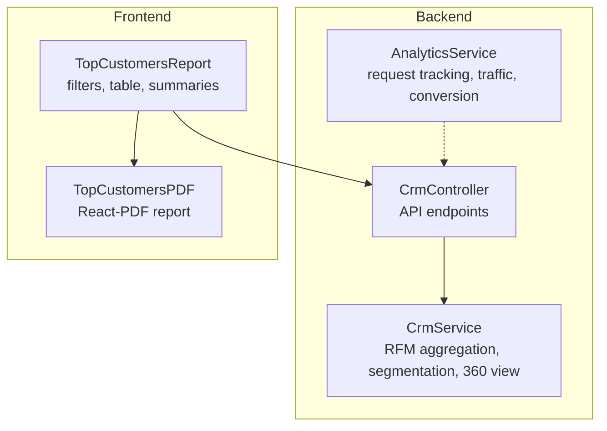
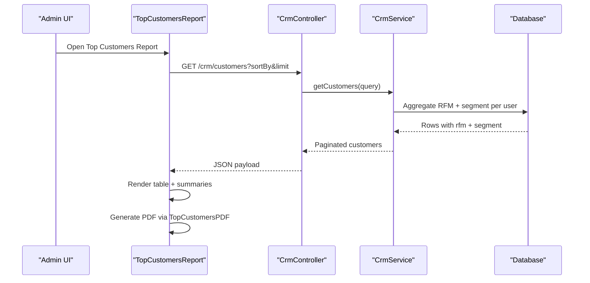
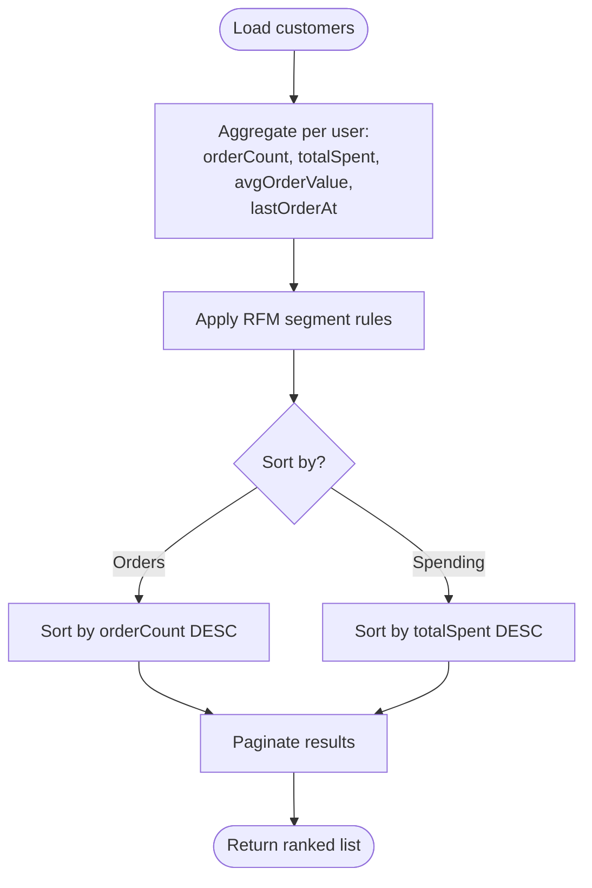
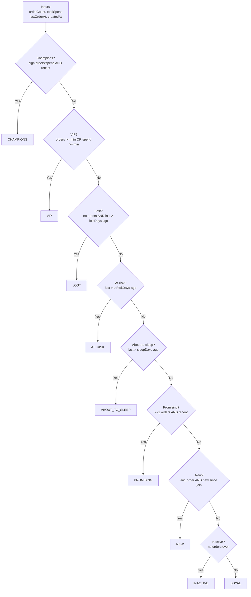
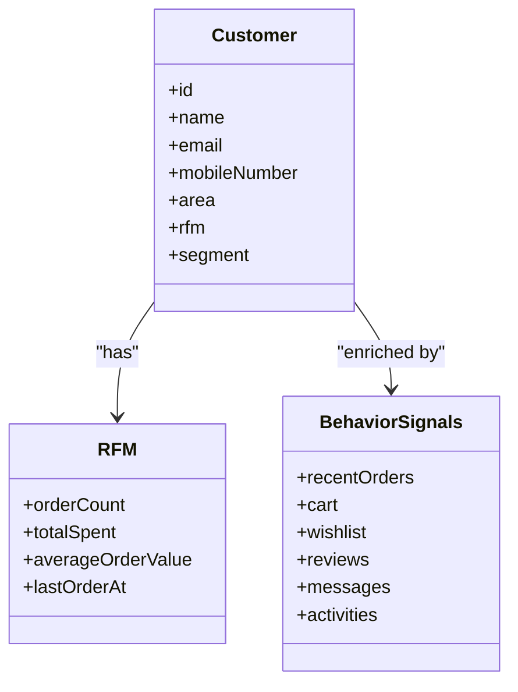
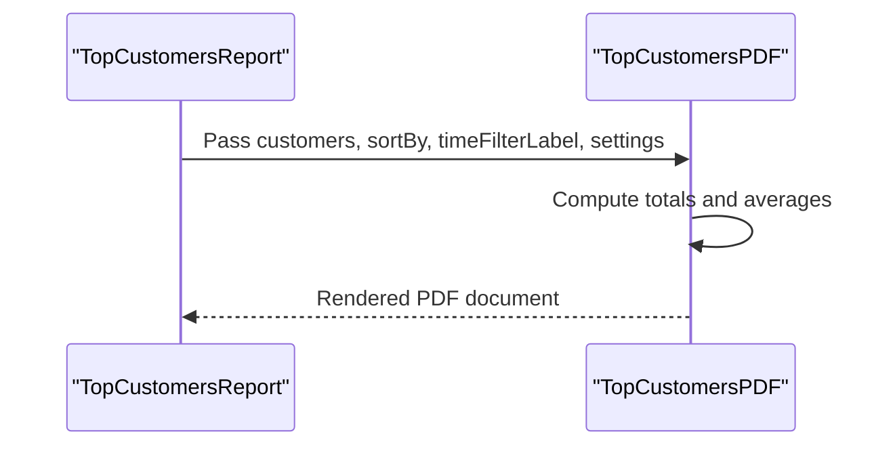
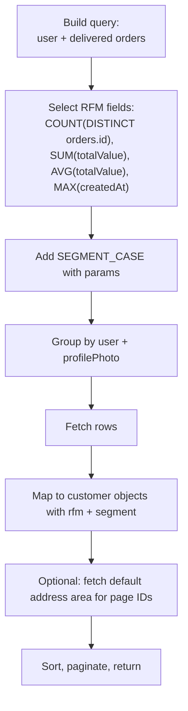
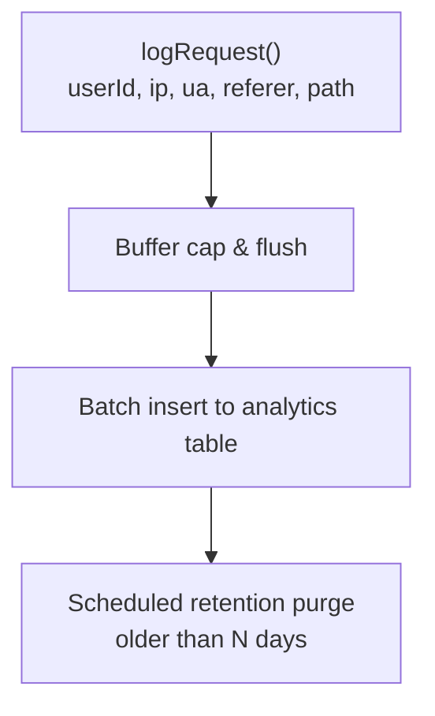
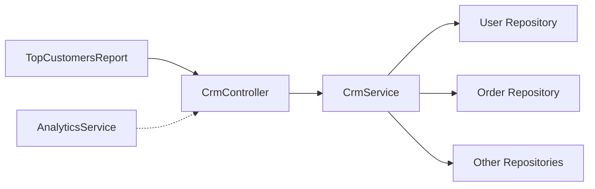

# Customer Insights Reports

<cite>
**Referenced Files in This Document**
- [analytics.service.ts](file://apps/backend/src/analytics/analytics.service.ts)
- [crm.service.ts](file://apps/backend/src/crm/crm.service.ts)
- [crm.controller.ts](file://apps/backend/src/crm/crm.controller.ts)
- [top-customers.tsx](file://apps/frontend/components/admin/reports/top-customers/top-customers.tsx)
- [TopCustomersPDF.tsx](file://apps/frontend/components/admin/reports/top-customers/TopCustomersPDF.tsx)
</cite>

## Table of Contents
1. [Introduction](#introduction)
2. [Project Structure](#project-structure)
3. [Core Components](#core-components)
4. [Architecture Overview](#architecture-overview)
5. [Detailed Component Analysis](#detailed-component-analysis)
6. [Dependency Analysis](#dependency-analysis)
7. [Performance Considerations](#performance-considerations)
8. [Troubleshooting Guide](#troubleshooting-guide)
9. [Conclusion](#conclusion)

## Introduction
This document explains how the system identifies top customers, segments them by behavior, and generates customer insights reports. It covers:
- How purchase frequency, total spending, and engagement metrics are aggregated.
- The RFM-based segmentation logic used to classify customers.
- Behavioral pattern analysis for retention and churn signals.
- PDF generation capabilities for customer reports, including summary metrics and ranked lists.
- Data aggregation patterns, performance safeguards, and privacy considerations.

## Project Structure
The customer insights feature spans backend analytics and CRM services, plus frontend report components and a PDF renderer.

**Diagram sources**
- [analytics.service.ts:142-161](file://apps/backend/src/analytics/analytics.service.ts#L142-L161)
- [crm.service.ts:167-296](file://apps/backend/src/crm/crm.service.ts#L167-L296)
- [crm.controller.ts:37-41](file://apps/backend/src/crm/crm.controller.ts#L37-L41)
- [top-customers.tsx:82-166](file://apps/frontend/components/admin/reports/top-customers/top-customers.tsx#L82-L166)
- [TopCustomersPDF.tsx:157-259](file://apps/frontend/components/admin/reports/top-customers/TopCustomersPDF.tsx#L157-L259)

**Section sources**
- [analytics.service.ts:142-161](file://apps/backend/src/analytics/analytics.service.ts#L142-L161)
- [crm.service.ts:167-296](file://apps/backend/src/crm/crm.service.ts#L167-L296)
- [crm.controller.ts:37-41](file://apps/backend/src/crm/crm.controller.ts#L37-L41)
- [top-customers.tsx:82-166](file://apps/frontend/components/admin/reports/top-customers/top-customers.tsx#L82-L166)
- [TopCustomersPDF.tsx:157-259](file://apps/frontend/components/admin/reports/top-customers/TopCustomersPDF.tsx#L157-L259)

## Core Components
- AnalyticsService: Buffers and flushes request telemetry, computes traffic and conversion metrics, and purges old rows on a schedule.
- CrmService: Aggregates per-customer RFM metrics (Recency, Frequency, Monetary), assigns segments, provides paginated lists, CSV export, campaign targeting, and a 360-degree customer view.
- CrmController: Exposes REST endpoints for CRM operations, including customer listing and export.
- TopCustomersReport (frontend): Renders filters, summary cards, and a ranked table; integrates Excel and PDF exports.
- TopCustomersPDF (frontend): Renders a branded PDF with summary metrics and a ranked customer table.

Key responsibilities:
- Purchase frequency: Count of delivered orders per customer.
- Total spending: Sum of order values for delivered orders.
- Engagement metrics: Last order date, average order value, recent activities, and optional cart/wishlist interactions.
- Segmentation: RFM-driven rules applied via SQL CASE expressions.
- Reporting: Frontend tables and downloadable PDFs.

**Section sources**
- [analytics.service.ts:142-161](file://apps/backend/src/analytics/analytics.service.ts#L142-L161)
- [crm.service.ts:167-296](file://apps/backend/src/crm/crm.service.ts#L167-L296)
- [crm.controller.ts:37-41](file://apps/backend/src/crm/crm.controller.ts#L37-L41)
- [top-customers.tsx:82-166](file://apps/frontend/components/admin/reports/top-customers/top-customers.tsx#L82-L166)
- [TopCustomersPDF.tsx:157-259](file://apps/frontend/components/admin/reports/top-customers/TopCustomersPDF.tsx#L157-L259)

## Architecture Overview
The reporting flow combines backend data aggregation with frontend presentation and PDF rendering.

**Diagram sources**
- [crm.controller.ts:37-41](file://apps/backend/src/crm/crm.controller.ts#L37-L41)
- [crm.service.ts:167-296](file://apps/backend/src/crm/crm.service.ts#L167-L296)
- [top-customers.tsx:82-166](file://apps/frontend/components/admin/reports/top-customers/top-customers.tsx#L82-L166)
- [TopCustomersPDF.tsx:157-259](file://apps/frontend/components/admin/reports/top-customers/TopCustomersPDF.tsx#L157-L259)

## Detailed Component Analysis

### Customer Identification and Ranking
- Purchase frequency is derived from the count of distinct delivered orders per customer.
- Total spending is the sum of order totals for delivered orders.
- Average order value is computed from the same delivered-order set.
- Ranking supports sorting by orders or spending, with stable tie-breaking by ID.

**Diagram sources**
- [crm.service.ts:180-202](file://apps/backend/src/crm/crm.service.ts#L180-L202)
- [crm.service.ts:238-265](file://apps/backend/src/crm/crm.service.ts#L238-L265)

**Section sources**
- [crm.service.ts:180-202](file://apps/backend/src/crm/crm.service.ts#L180-L202)
- [crm.service.ts:238-265](file://apps/backend/src/crm/crm.service.ts#L238-L265)

### RFM-Based Customer Segmentation Logic
Segmentation uses configurable thresholds and time windows:
- VIP and Champions thresholds based on minimum orders or minimum spending.
- Recency windows define New, Promising, About-to-Sleep, At-Risk, Lost, Inactive, and Loyal segments.
- Rules can be overridden via business settings; defaults are provided in code.

**Diagram sources**
- [crm.service.ts:38-75](file://apps/backend/src/crm/crm.service.ts#L38-L75)
- [crm.service.ts:137-161](file://apps/backend/src/crm/crm.service.ts#L137-L161)

**Section sources**
- [crm.service.ts:38-75](file://apps/backend/src/crm/crm.service.ts#L38-L75)
- [crm.service.ts:137-161](file://apps/backend/src/crm/crm.service.ts#L137-L161)

### Behavioral Pattern Analysis and Retention Signals
- Recency: Last order date relative to configured days thresholds indicates churn risk (About-to-Sleep, At-Risk, Lost).
- Frequency: Order count thresholds distinguish Champions/VIP vs Promising vs New vs Inactive.
- Monetary: Spending thresholds complement frequency for VIP classification.
- Engagement: Recent activities, wishlist, cart, reviews, and contact messages enrich the 360 view for behavioral insights.

**Diagram sources**
- [crm.service.ts:213-232](file://apps/backend/src/crm/crm.service.ts#L213-L232)
- [crm.service.ts:540-629](file://apps/backend/src/crm/crm.service.ts#L540-L629)

**Section sources**
- [crm.service.ts:213-232](file://apps/backend/src/crm/crm.service.ts#L213-L232)
- [crm.service.ts:540-629](file://apps/backend/src/crm/crm.service.ts#L540-L629)

### PDF Generation Capabilities
- TopCustomersReport renders summary metrics (count, total orders, total spent, average order value) and a ranked table.
- TopCustomersPDF renders a branded PDF with:
  - Report title and time filter label.
  - Summary box with key metrics.
  - Ranked table columns: Rank, Name, Mobile, Area, Orders, Total Spent, Avg Order.
  - Footer with generation timestamp and branding.

**Diagram sources**
- [top-customers.tsx:113-166](file://apps/frontend/components/admin/reports/top-customers/top-customers.tsx#L113-L166)
- [TopCustomersPDF.tsx:157-259](file://apps/frontend/components/admin/reports/top-customers/TopCustomersPDF.tsx#L157-L259)

**Section sources**
- [top-customers.tsx:113-166](file://apps/frontend/components/admin/reports/top-customers/top-customers.tsx#L113-L166)
- [TopCustomersPDF.tsx:157-259](file://apps/frontend/components/admin/reports/top-customers/TopCustomersPDF.tsx#L157-L259)

### Implementation Specifics: Data Aggregation and Query Patterns
- Aggregation joins user records with delivered orders to compute RFM fields.
- Segmentation is expressed as a SQL CASE expression using parameters from business settings.
- Pagination and sorting are performed in application code after fetching aggregated rows.
- Address area is fetched separately to avoid inflating aggregates due to joins.

**Diagram sources**
- [crm.service.ts:180-202](file://apps/backend/src/crm/crm.service.ts#L180-L202)
- [crm.service.ts:213-232](file://apps/backend/src/crm/crm.service.ts#L213-L232)
- [crm.service.ts:267-285](file://apps/backend/src/crm/crm.service.ts#L267-L285)

**Section sources**
- [crm.service.ts:180-202](file://apps/backend/src/crm/crm.service.ts#L180-L202)
- [crm.service.ts:213-232](file://apps/backend/src/crm/crm.service.ts#L213-L232)
- [crm.service.ts:267-285](file://apps/backend/src/crm/crm.service.ts#L267-L285)

### Privacy, Anonymization, and Compliance Considerations
- Analytics buffer stores potentially sensitive fields such as userId, ipAddress, userAgent, referer, and requestPath.
- Buffering caps memory usage and retries on failure; scheduled retention deletes older rows after a configurable number of days.
- Device/browser breakdown uses only user-agent strings without creating persistent identifiers.
- Recommendations:
  - Minimize or omit PII from analytics where possible.
  - Ensure retention policies align with data protection regulations.
  - Apply access controls and audit logging for any PII exposure.

**Diagram sources**
- [analytics.service.ts:142-161](file://apps/backend/src/analytics/analytics.service.ts#L142-L161)
- [analytics.service.ts:163-192](file://apps/backend/src/analytics/analytics.service.ts#L163-L192)
- [analytics.service.ts:587-615](file://apps/backend/src/analytics/analytics.service.ts#L587-L615)

**Section sources**
- [analytics.service.ts:142-161](file://apps/backend/src/analytics/analytics.service.ts#L142-L161)
- [analytics.service.ts:163-192](file://apps/backend/src/analytics/analytics.service.ts#L163-L192)
- [analytics.service.ts:587-615](file://apps/backend/src/analytics/analytics.service.ts#L587-L615)

## Dependency Analysis
- CrmController depends on CrmService for all CRM operations.
- CrmService depends on repositories for User, Order, Cart, Wishlist, ProductReview, ContactMessage, Address, BusinessSetting, and CRM entities.
- Frontend TopCustomersReport depends on CrmController endpoints and renders TopCustomersPDF for downloads.
- AnalyticsService is independent but complements insights through traffic and conversion metrics.

**Diagram sources**
- [crm.controller.ts:37-41](file://apps/backend/src/crm/crm.controller.ts#L37-L41)
- [crm.service.ts:103-130](file://apps/backend/src/crm/crm.service.ts#L103-L130)
- [analytics.service.ts:38-57](file://apps/backend/src/analytics/analytics.service.ts#L38-L57)
- [top-customers.tsx:82-166](file://apps/frontend/components/admin/reports/top-customers/top-customers.tsx#L82-L166)

**Section sources**
- [crm.controller.ts:37-41](file://apps/backend/src/crm/crm.controller.ts#L37-L41)
- [crm.service.ts:103-130](file://apps/backend/src/crm/crm.service.ts#L103-L130)
- [analytics.service.ts:38-57](file://apps/backend/src/analytics/analytics.service.ts#L38-L57)
- [top-customers.tsx:82-166](file://apps/frontend/components/admin/reports/top-customers/top-customers.tsx#L82-L166)

## Performance Considerations
- Analytics buffering reduces database load with batch inserts and periodic flushing.
- Index creation ensures dashboard queries do not full-scan analytics tables.
- RFM aggregation is done in one query per user; pagination occurs in application code to keep SQL simple.
- Address area is loaded separately to prevent row multiplication during joins.
- Scheduled retention keeps analytics tables bounded.

Recommendations:
- Monitor buffer sizes and flush intervals under high traffic.
- Validate index creation permissions in production environments.
- Consider materialized views or pre-aggregated tables if customer base grows significantly.

**Section sources**
- [analytics.service.ts:59-80](file://apps/backend/src/analytics/analytics.service.ts#L59-L80)
- [analytics.service.ts:89-117](file://apps/backend/src/analytics/analytics.service.ts#L89-L117)
- [analytics.service.ts:142-192](file://apps/backend/src/analytics/analytics.service.ts#L142-L192)
- [analytics.service.ts:587-615](file://apps/backend/src/analytics/analytics.service.ts#L587-L615)
- [crm.service.ts:167-202](file://apps/backend/src/crm/crm.service.ts#L167-L202)
- [crm.service.ts:267-285](file://apps/backend/src/crm/crm.service.ts#L267-L285)

## Troubleshooting Guide
Common issues and resolutions:
- Missing indexes causing slow analytics queries:
  - Verify index creation at startup; check logs for warnings about failed index creation.
- High memory usage from analytics buffer:
  - Adjust buffer cap and flush interval via configuration.
- Incorrect timezone buckets in charts:
  - Ensure UTC/Bangladesh time alignment in queries and formatting functions.
- Empty or stale customer segments:
  - Confirm business settings for segment thresholds and recency windows.
- PDF rendering errors:
  - Validate that customer statistics include required fields (orders, spent, average).

**Section sources**
- [analytics.service.ts:89-117](file://apps/backend/src/analytics/analytics.service.ts#L89-L117)
- [analytics.service.ts:163-192](file://apps/backend/src/analytics/analytics.service.ts#L163-L192)
- [analytics.service.ts:567-585](file://apps/backend/src/analytics/analytics.service.ts#L567-L585)
- [crm.service.ts:137-161](file://apps/backend/src/crm/crm.service.ts#L137-L161)
- [TopCustomersPDF.tsx:157-259](file://apps/frontend/components/admin/reports/top-customers/TopCustomersPDF.tsx#L157-L259)

## Conclusion
The customer insights system combines robust backend aggregation and segmentation with a clear frontend reporting experience. RFM-based rules provide actionable segmentation, while analytics telemetry supports broader performance and conversion insights. PDF generation delivers shareable reports with key metrics and rankings. With careful attention to privacy, retention, and performance, the system offers a solid foundation for ongoing customer analytics and targeted engagement.