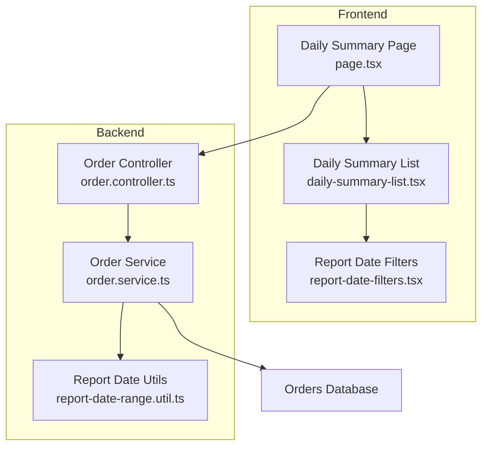
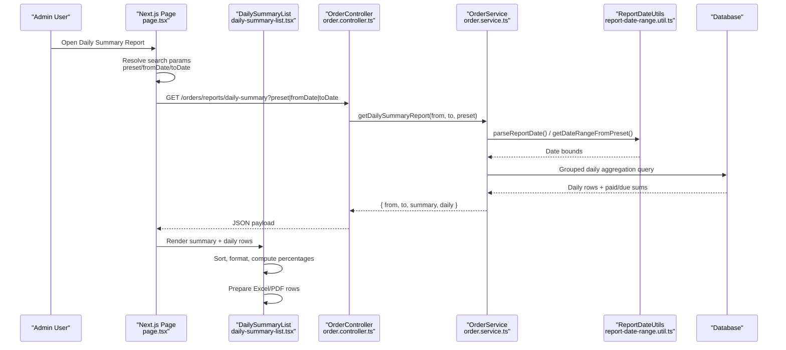
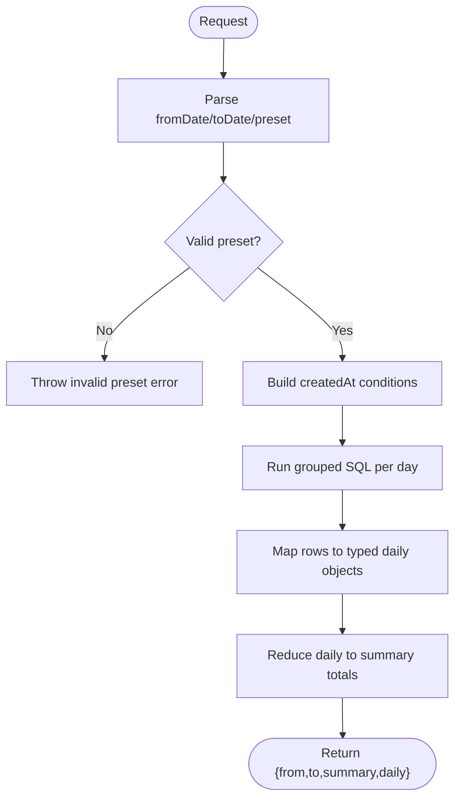
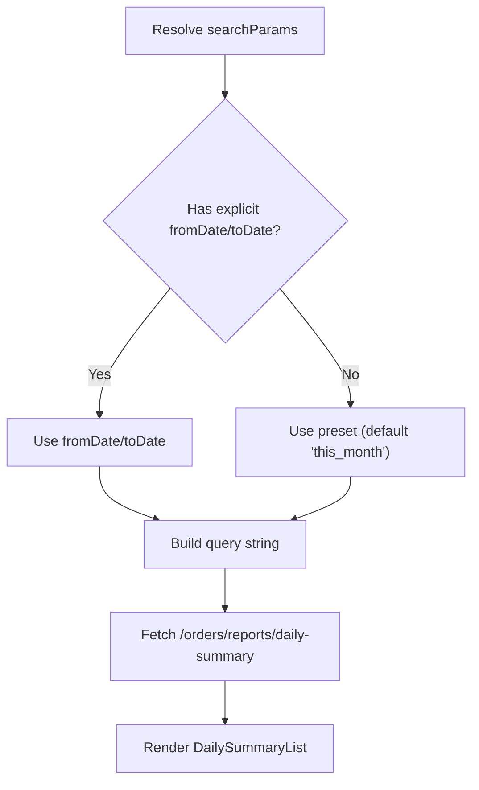
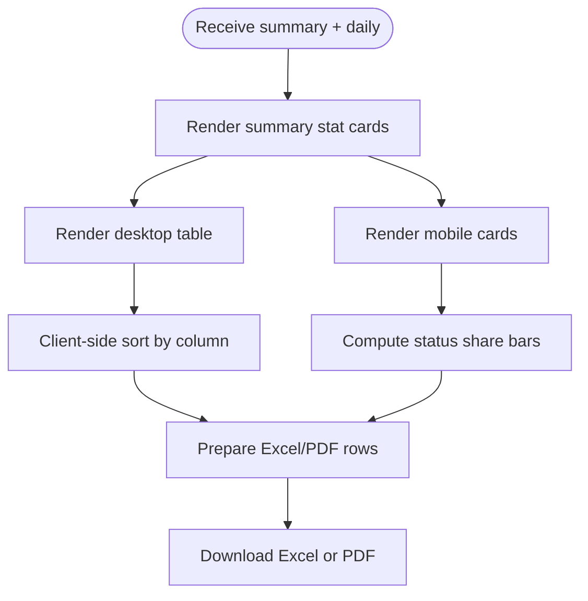
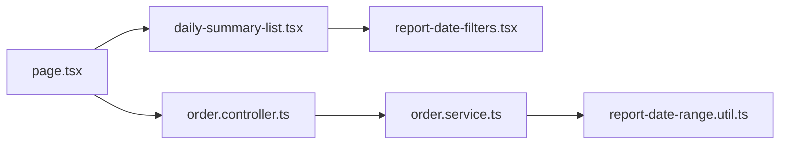

# Daily Summary Reports

<cite>
**Referenced Files in This Document**
- [page.tsx](file://apps/frontend/app/admin/reports/daily-summary/page.tsx)
- [daily-summary-list.tsx](file://apps/frontend/components/admin/reports/daily-summary/daily-summary-list.tsx)
- [order.controller.ts](file://apps/backend/src/order/order.controller.ts)
- [order.service.ts](file://apps/backend/src/order/order.service.ts)
- [report-date-range.util.ts](file://apps/backend/src/common/utils/report-date-range.util.ts)
- [report-date-filters.tsx](file://apps/frontend/components/admin/reports/report-date-filters.tsx)
</cite>

## Table of Contents
1. [Introduction](#introduction)
2. [Project Structure](#project-structure)
3. [Core Components](#core-components)
4. [Architecture Overview](#architecture-overview)
5. [Detailed Component Analysis](#detailed-component-analysis)
6. [Dependency Analysis](#dependency-analysis)
7. [Performance Considerations](#performance-considerations)
8. [Troubleshooting Guide](#troubleshooting-guide)
9. [Conclusion](#conclusion)

## Introduction
This document explains the daily summary reporting system that shows day-by-day sales trends, order statistics, and revenue metrics for a selected date range. It covers how orders are aggregated into daily rows, how totals are computed, how the frontend renders and exports the data, and how date filtering and refresh work end-to-end.

The report focuses on:
- Daily order counts and values
- Status breakdowns (delivered, pending, processing, on hold, cancelled)
- Paid and due amounts per day and across the selected range
- Export to Excel and PDF
- Date range presets and manual date selection

## Project Structure
The daily summary feature spans both backend and frontend:

- Backend API endpoint: `/admin/orders/reports/daily-summary`
- Frontend page: `app/admin/reports/daily-summary/page.tsx`
- Frontend list component: `components/admin/reports/daily-summary/daily-summary-list.tsx`
- Shared date utilities: `backend/src/common/utils/report-date-range.util.ts`
- Shared filter UI: `components/admin/reports/report-date-filters.tsx`

**Diagram sources**
- [page.tsx:15-99](file://apps/frontend/app/admin/reports/daily-summary/page.tsx#L15-L99)
- [daily-summary-list.tsx:251-403](file://apps/frontend/components/admin/reports/daily-summary/daily-summary-list.tsx#L251-L403)
- [order.controller.ts:413-454](file://apps/backend/src/order/order.controller.ts#L413-L454)
- [order.service.ts:1566-1680](file://apps/backend/src/order/order.service.ts#L1566-L1680)
- [report-date-range.util.ts:42-125](file://apps/backend/src/common/utils/report-date-range.util.ts#L42-L125)

**Section sources**
- [page.tsx:15-99](file://apps/frontend/app/admin/reports/daily-summary/page.tsx#L15-L99)
- [daily-summary-list.tsx:251-403](file://apps/frontend/components/admin/reports/daily-summary/daily-summary-list.tsx#L251-L403)
- [order.controller.ts:413-454](file://apps/backend/src/order/order.controller.ts#L413-L454)
- [order.service.ts:1566-1680](file://apps/backend/src/order/order.service.ts#L1566-L1680)
- [report-date-range.util.ts:42-125](file://apps/backend/src/common/utils/report-date-range.util.ts#L42-L125)

## Core Components
- Backend controller exposes a protected GET endpoint for daily summaries with query parameters for date range or preset.
- Backend service computes one grouped SQL query per day and aggregates range totals.
- Frontend page resolves search parameters, builds the request URL, and fetches the report.
- Frontend list component renders summary cards, a sortable table, mobile cards, and export controls.
- Shared filters provide quick presets and manual date pickers.

Key responsibilities:
- Date parsing and preset resolution
- Single round-trip aggregation query
- Client-side sorting and formatting
- Excel and PDF export preparation

**Section sources**
- [order.controller.ts:413-454](file://apps/backend/src/order/order.controller.ts#L413-L454)
- [order.service.ts:1566-1680](file://apps/backend/src/order/order.service.ts#L1566-L1680)
- [page.tsx:15-99](file://apps/frontend/app/admin/reports/daily-summary/page.tsx#L15-L99)
- [daily-summary-list.tsx:251-403](file://apps/frontend/components/admin/reports/daily-summary/daily-summary-list.tsx#L251-L403)
- [report-date-filters.tsx:106-194](file://apps/frontend/components/admin/reports/report-date-filters.tsx#L106-L194)

## Architecture Overview
The daily summary flow is a single-server-rendered request followed by client interactions for sorting and exporting.

**Diagram sources**
- [page.tsx:15-99](file://apps/frontend/app/admin/reports/daily-summary/page.tsx#L15-L99)
- [order.controller.ts:413-454](file://apps/backend/src/order/order.controller.ts#L413-L454)
- [order.service.ts:1566-1680](file://apps/backend/src/order/order.service.ts#L1566-L1680)
- [report-date-range.util.ts:42-125](file://apps/backend/src/common/utils/report-date-range.util.ts#L42-L125)

## Detailed Component Analysis

### Backend API Endpoint
- Route: `GET /admin/orders/reports/daily-summary`
- Query parameters:
  - `fromDate`: YYYY-MM-DD inclusive start
  - `toDate`: YYYY-MM-DD inclusive end
  - `preset`: One of today, this_week, last_week, this_month, last_month, last_3_months, last_6_months, last_year, this_year
- Response includes:
  - `from`, `to`: Selected range boundaries
  - `summary`: Range totals
  - `daily`: Array of daily rows

**Diagram sources**
- [order.controller.ts:413-454](file://apps/backend/src/order/order.controller.ts#L413-L454)
- [order.service.ts:1566-1680](file://apps/backend/src/order/order.service.ts#L1566-L1680)
- [report-date-range.util.ts:42-125](file://apps/backend/src/common/utils/report-date-range.util.ts#L42-L125)

**Section sources**
- [order.controller.ts:413-454](file://apps/backend/src/order/order.controller.ts#L413-L454)
- [order.service.ts:1566-1680](file://apps/backend/src/order/order.service.ts#L1566-L1680)
- [report-date-range.util.ts:42-125](file://apps/backend/src/common/utils/report-date-range.util.ts#L42-L125)

### Data Aggregation Logic
- The service uses a single grouped SQL query to compute per-day metrics:
  - Order count and total value
  - Delivered, cancelled, pending, processing, on hold counts and values
  - Paid amount and due amount (totalValue minus paidAmount)
- Timezone handling:
  - Orders are bucketed by Dhaka calendar day using a UTC timestamp plus an offset before grouping.
- Summary totals:
  - Computed by reducing the daily array to aggregate counts and values.

Key implementation details:
- Date parsing supports explicit dates and presets.
- Invalid presets throw descriptive errors.
- The response echoes the selected range boundaries in local date format.

**Section sources**
- [order.service.ts:1566-1680](file://apps/backend/src/order/order.service.ts#L1566-L1680)
- [report-date-range.util.ts:42-125](file://apps/backend/src/common/utils/report-date-range.util.ts#L42-L125)

### Frontend Page
- Resolves server-side search parameters:
  - `preset` takes precedence when no explicit date range is provided.
  - Otherwise, `fromDate` and `toDate` are used.
- Builds the request URL with either `preset` or explicit date parameters.
- Fetches the report via a protected helper and passes data to the list component.

**Diagram sources**
- [page.tsx:15-99](file://apps/frontend/app/admin/reports/daily-summary/page.tsx#L15-L99)

**Section sources**
- [page.tsx:15-99](file://apps/frontend/app/admin/reports/daily-summary/page.tsx#L15-L99)

### Frontend List Component
Responsibilities:
- Display range totals as stat cards
- Show day-by-day breakdown in a sortable table (desktop) and cards (mobile)
- Compute status percentages and derived values
- Provide Excel and PDF export
- Support refresh and filter updates

Data model:
- `DailySummary`: range totals including order counts/values, status splits, paid, due
- `DailyRow`: per-day metrics including counts, values, paid, due

Sorting:
- Supports sorting by date, orders, delivered, pending, processing, on hold, cancelled, paid, due
- Uses memoized sort to avoid unnecessary re-renders

Exporting:
- Prepares headers and rows for Excel export
- Prepares summary and rows for PDF generation

Refresh:
- Uses Next.js router refresh to reload server data

**Diagram sources**
- [daily-summary-list.tsx:251-403](file://apps/frontend/components/admin/reports/daily-summary/daily-summary-list.tsx#L251-L403)
- [daily-summary-list.tsx:800-995](file://apps/frontend/components/admin/reports/daily-summary/daily-summary-list.tsx#L800-L995)

**Section sources**
- [daily-summary-list.tsx:251-403](file://apps/frontend/components/admin/reports/daily-summary/daily-summary-list.tsx#L251-L403)
- [daily-summary-list.tsx:800-995](file://apps/frontend/components/admin/reports/daily-summary/daily-summary-list.tsx#L800-L995)

### Date Range Filtering
Shared filter UI provides:
- Quick presets: Today, This Week, Last Week, This Month, Last Month, Last 3 Months, Last 6 Months, Last Year, This Year
- Manual date pickers for custom ranges
- Apply and Clear actions that update URL search params

Behavior:
- Selecting a preset clears manual dates and vice versa
- Applying filters navigates to the same route with updated query parameters
- The page re-renders and refetches data based on new params

**Section sources**
- [report-date-filters.tsx:106-194](file://apps/frontend/components/admin/reports/report-date-filters.tsx#L106-L194)
- [page.tsx:15-99](file://apps/frontend/app/admin/reports/daily-summary/page.tsx#L15-L99)

## Dependency Analysis
The daily summary feature depends on shared date utilities and reusable report components.

**Diagram sources**
- [page.tsx:15-99](file://apps/frontend/app/admin/reports/daily-summary/page.tsx#L15-L99)
- [daily-summary-list.tsx:251-403](file://apps/frontend/components/admin/reports/daily-summary/daily-summary-list.tsx#L251-L403)
- [order.controller.ts:413-454](file://apps/backend/src/order/order.controller.ts#L413-L454)
- [order.service.ts:1566-1680](file://apps/backend/src/order/order.service.ts#L1566-L1680)
- [report-date-range.util.ts:42-125](file://apps/backend/src/common/utils/report-date-range.util.ts#L42-L125)

**Section sources**
- [page.tsx:15-99](file://apps/frontend/app/admin/reports/daily-summary/page.tsx#L15-L99)
- [daily-summary-list.tsx:251-403](file://apps/frontend/components/admin/reports/daily-summary/daily-summary-list.tsx#L251-L403)
- [order.controller.ts:413-454](file://apps/backend/src/order/order.controller.ts#L413-L454)
- [order.service.ts:1566-1680](file://apps/backend/src/order/order.service.ts#L1566-L1680)
- [report-date-range.util.ts:42-125](file://apps/backend/src/common/utils/report-date-range.util.ts#L42-L125)

## Performance Considerations
- Single grouped SQL query:
  - All daily metrics are computed in one database query, avoiding multiple round trips and heavy client-side aggregation.
- Server-side date range validation:
  - Invalid presets throw early, preventing unnecessary queries.
- Client-side optimizations:
  - Memoized sorting reduces re-renders when data changes.
  - Formatting and percentage calculations are lightweight and run only on rendered rows.
- Export preparation:
  - Rows and summary are prepared once per render pass to support Excel and PDF without extra network calls.

[No sources needed since this section provides general guidance]

## Troubleshooting Guide
Common issues and resolutions:
- Invalid date range preset:
  - The backend throws an error if an unknown preset is passed. Ensure the preset matches supported values.
- No data for selected range:
  - The frontend displays an empty state suggesting widening the date range or resetting to a preset like “this month.”
- Timezone discrepancies:
  - Days are bucketed using a timezone-aware utility; ensure reports reflect the intended local calendar day.
- Refresh not updating:
  - Use the built-in Refresh button to trigger a server-side data reload.

**Section sources**
- [order.service.ts:1566-1680](file://apps/backend/src/order/order.service.ts#L1566-L1680)
- [daily-summary-list.tsx:463-483](file://apps/frontend/components/admin/reports/daily-summary/daily-summary-list.tsx#L463-L483)

## Conclusion
The daily summary report delivers a concise, efficient view of daily sales trends, order statistics, and revenue metrics. It leverages a single grouped database query for performance, supports flexible date filtering through presets and manual selection, and provides client-side sorting and export capabilities. The architecture cleanly separates concerns between the Next.js page, the list component, the backend controller/service, and shared date utilities.

[No sources needed since this section summarizes without analyzing specific files]