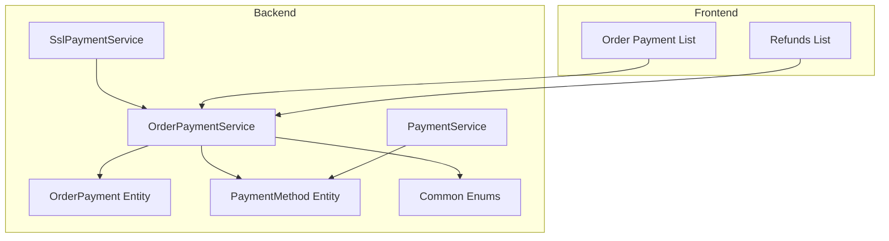
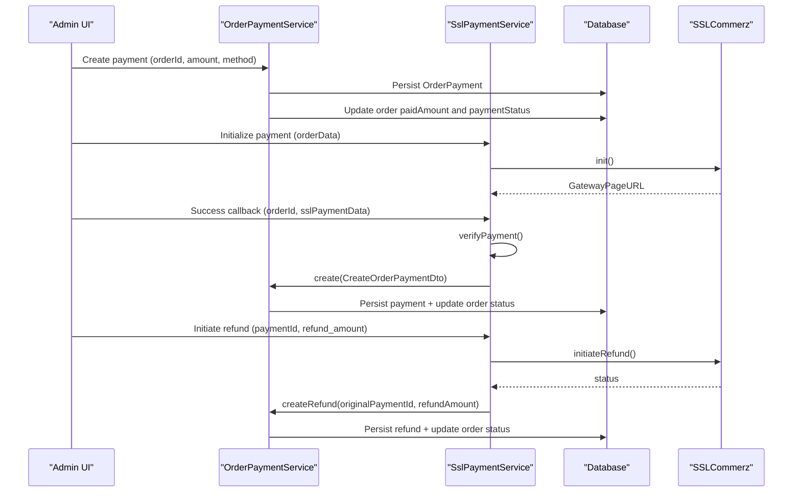
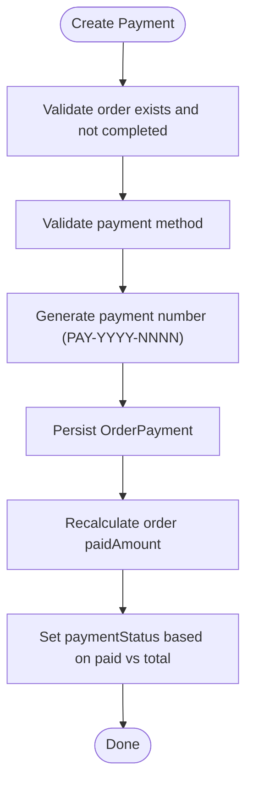
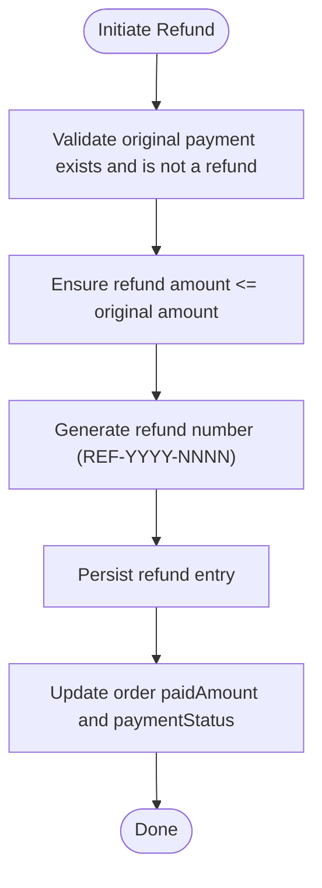
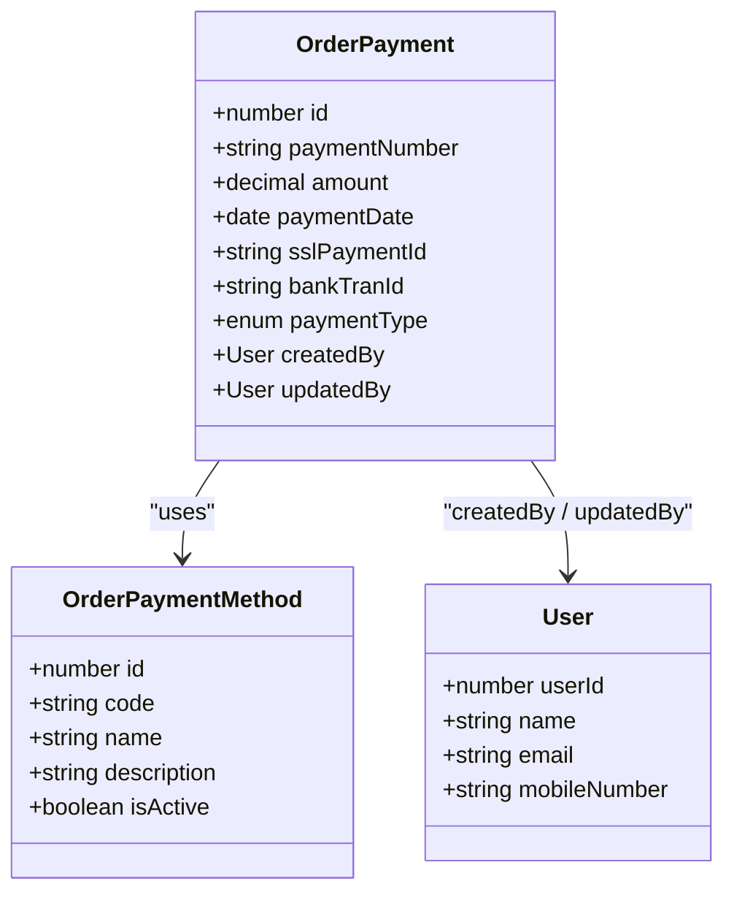
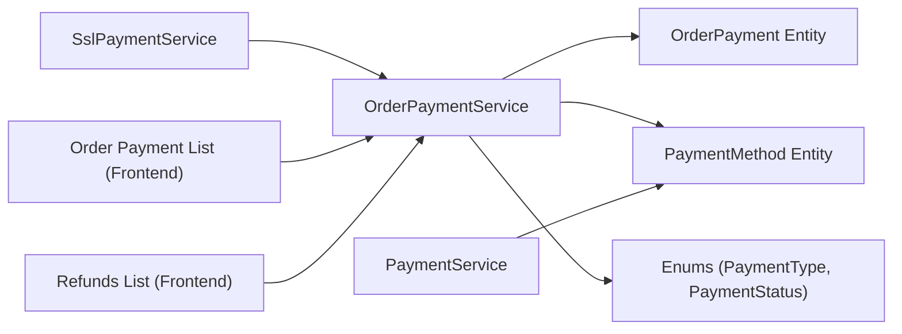

# Financial Reports

<cite>
**Referenced Files in This Document**
- [order-payment.service.ts](file://apps/backend/src/order-payment/order-payment.service.ts)
- [order-payment.entity.ts](file://apps/backend/src/order-payment/entities/order-payment.entity.ts)
- [ssl-payment.service.ts](file://apps/backend/src/ssl-payment/ssl-payment.service.ts)
- [payment.service.ts](file://apps/backend/src/payment/payment.service.ts)
- [payment-method.entity.ts](file://apps/backend/src/payment-method/entities/payment-method.entity.ts)
- [index.ts](file://apps/backend/src/common/enums/index.ts)
- [order.service.ts](file://apps/backend/src/order/order.service.ts)
- [order-payment-list.tsx](file://apps/frontend/components/admin/reports/order-payments/order-payment-list.tsx)
- [refunds-list.tsx](file://apps/frontend/components/admin/reports/refunds/refunds-list.tsx)
</cite>

## Table of Contents
1. [Introduction](#introduction)
2. [Project Structure](#project-structure)
3. [Core Components](#core-components)
4. [Architecture Overview](#architecture-overview)
5. [Detailed Component Analysis](#detailed-component-analysis)
6. [Dependency Analysis](#dependency-analysis)
7. [Performance Considerations](#performance-considerations)
8. [Troubleshooting Guide](#troubleshooting-guide)
9. [Conclusion](#conclusion)

## Introduction
This document explains the financial reporting and accounting support features for order payments, refunds, and related analytics. It covers how order payment tracking generates comprehensive financial summaries, including revenue breakdowns by payment method, transaction histories, and refund management reporting that tracks refund requests, processing times, and financial impact. It also documents integration with SSLCommerz, currency handling, audit trail generation, and compliance considerations for financial reporting standards.

## Project Structure
The financial reporting functionality spans backend services, entities, and frontend report components:
- Backend services handle payment creation, status updates, refund issuance, and third-party gateway integration.
- Entities model order payments, payment methods, and related relationships.
- Frontend components render payment and refund reports with filtering and export capabilities.

**Diagram sources**
- [order-payment.service.ts:1-309](file://apps/backend/src/order-payment/order-payment.service.ts#L1-L309)
- [ssl-payment.service.ts:1-414](file://apps/backend/src/ssl-payment/ssl-payment.service.ts#L1-L414)
- [payment.service.ts:1-138](file://apps/backend/src/payment/payment.service.ts#L1-L138)
- [order-payment.entity.ts:1-127](file://apps/backend/src/order-payment/entities/order-payment.entity.ts#L1-L127)
- [payment-method.entity.ts:1-94](file://apps/backend/src/payment-method/entities/payment-method.entity.ts#L1-L94)
- [index.ts:21-36](file://apps/backend/src/common/enums/index.ts#L21-L36)
- [order-payment-list.tsx:36-104](file://apps/frontend/components/admin/reports/order-payments/order-payment-list.tsx#L36-L104)
- [refunds-list.tsx:93-149](file://apps/frontend/components/admin/reports/refunds/refunds-list.tsx#L93-L149)

**Section sources**
- [order-payment.service.ts:1-309](file://apps/backend/src/order-payment/order-payment.service.ts#L1-L309)
- [ssl-payment.service.ts:1-414](file://apps/backend/src/ssl-payment/ssl-payment.service.ts#L1-L414)
- [payment.service.ts:1-138](file://apps/backend/src/payment/payment.service.ts#L1-L138)
- [order-payment.entity.ts:1-127](file://apps/backend/src/order-payment/entities/order-payment.entity.ts#L1-L127)
- [payment-method.entity.ts:1-94](file://apps/backend/src/payment-method/entities/payment-method.entity.ts#L1-L94)
- [index.ts:21-36](file://apps/backend/src/common/enums/index.ts#L21-L36)
- [order-payment-list.tsx:36-104](file://apps/frontend/components/admin/reports/order-payments/order-payment-list.tsx#L36-L104)
- [refunds-list.tsx:93-149](file://apps/frontend/components/admin/reports/refunds/refunds-list.tsx#L93-L149)

## Core Components
- OrderPaymentService: Creates payments, computes order payment status, lists transactions with filters, and manages refunds.
- SslPaymentService: Integrates with SSLCommerz to initialize payments, verify success/failure, process IPN callbacks, and initiate refunds.
- PaymentService: Manages purchase-related payments and updates purchase payment statuses.
- Entities and Enums: Model order payments, payment methods, and define shared enums for payment types and statuses.
- Frontend Report Components: Render payment and refund reports with date range filters, order status filters, and PDF export data preparation.

Key responsibilities:
- Revenue breakdowns by payment method are computed from delivered orders.
- Transaction histories include payment numbers, amounts, dates, payment methods, and user audit fields.
- Refund management creates reversal postings, updates order payment status, and supports gateway-initiated refunds.

**Section sources**
- [order-payment.service.ts:28-73](file://apps/backend/src/order-payment/order-payment.service.ts#L28-L73)
- [order-payment.service.ts:81-139](file://apps/backend/src/order-payment/order-payment.service.ts#L81-L139)
- [order-payment.service.ts:213-307](file://apps/backend/src/order-payment/order-payment.service.ts#L213-L307)
- [ssl-payment.service.ts:44-111](file://apps/backend/src/ssl-payment/ssl-payment.service.ts#L44-L111)
- [ssl-payment.service.ts:113-234](file://apps/backend/src/ssl-payment/ssl-payment.service.ts#L113-L234)
- [ssl-payment.service.ts:308-328](file://apps/backend/src/ssl-payment/ssl-payment.service.ts#L308-L328)
- [ssl-payment.service.ts:330-412](file://apps/backend/src/ssl-payment/ssl-payment.service.ts#L330-L412)
- [payment.service.ts:23-51](file://apps/backend/src/payment/payment.service.ts#L23-L51)
- [payment.service.ts:112-136](file://apps/backend/src/payment/payment.service.ts#L112-L136)
- [order-payment.entity.ts:18-127](file://apps/backend/src/order-payment/entities/order-payment.entity.ts#L18-L127)
- [payment-method.entity.ts:16-94](file://apps/backend/src/payment-method/entities/payment-method.entity.ts#L16-L94)
- [index.ts:21-36](file://apps/backend/src/common/enums/index.ts#L21-L36)
- [order-payment-list.tsx:36-104](file://apps/frontend/components/admin/reports/order-payments/order-payment-list.tsx#L36-L104)
- [refunds-list.tsx:93-149](file://apps/frontend/components/admin/reports/refunds/refunds-list.tsx#L93-L149)

## Architecture Overview
The system integrates order payments, third-party payment gateways, and reporting UIs. Payments are recorded against orders, with status updates driven by aggregated paid amounts. Refunds create negative payment entries and adjust order payment status accordingly. SSLCommerz handles external payment flows, while internal services ensure consistency and auditability.

**Diagram sources**
- [order-payment.service.ts:28-73](file://apps/backend/src/order-payment/order-payment.service.ts#L28-L73)
- [order-payment.service.ts:187-211](file://apps/backend/src/order-payment/order-payment.service.ts#L187-L211)
- [order-payment.service.ts:213-307](file://apps/backend/src/order-payment/order-payment.service.ts#L213-L307)
- [ssl-payment.service.ts:44-111](file://apps/backend/src/ssl-payment/ssl-payment.service.ts#L44-L111)
- [ssl-payment.service.ts:113-234](file://apps/backend/src/ssl-payment/ssl-payment.service.ts#L113-L234)
- [ssl-payment.service.ts:330-412](file://apps/backend/src/ssl-payment/ssl-payment.service.ts#L330-L412)

## Detailed Component Analysis

### Order Payment Tracking and Financial Summaries
OrderPaymentService provides:
- Payment creation with unique payment numbers per year and validation against completed orders.
- Aggregation of paid amounts to compute order payment status (pending, partial, completed).
- Filtering of payments by date range and order status, returning rich relations for reporting.
- Refund creation with validation, unique refund numbers, and order status updates reflecting full or partial refunds.

Revenue breakdowns by payment method are computed from delivered orders using a grouped query that returns counts and total values per method.

**Diagram sources**
- [order-payment.service.ts:28-73](file://apps/backend/src/order-payment/order-payment.service.ts#L28-L73)
- [order-payment.service.ts:187-211](file://apps/backend/src/order-payment/order-payment.service.ts#L187-L211)

**Section sources**
- [order-payment.service.ts:28-73](file://apps/backend/src/order-payment/order-payment.service.ts#L28-L73)
- [order-payment.service.ts:81-139](file://apps/backend/src/order-payment/order-payment.service.ts#L81-L139)
- [order-payment.service.ts:187-211](file://apps/backend/src/order-payment/order-payment.service.ts#L187-L211)
- [order.service.ts:737-759](file://apps/backend/src/order/order.service.ts#L737-L759)

### Refund Management Reporting
Refund management includes:
- Validation to prevent refunding non-existent or already refunded transactions.
- Creation of negative payment entries linked to original payments.
- Order status updates to reflect fully or partially refunded states.
- Integration with SSLCommerz to initiate refunds and create reversal postings upon success.

**Diagram sources**
- [order-payment.service.ts:213-307](file://apps/backend/src/order-payment/order-payment.service.ts#L213-L307)
- [ssl-payment.service.ts:330-412](file://apps/backend/src/ssl-payment/ssl-payment.service.ts#L330-L412)

**Section sources**
- [order-payment.service.ts:213-307](file://apps/backend/src/order-payment/order-payment.service.ts#L213-L307)
- [ssl-payment.service.ts:330-412](file://apps/backend/src/ssl-payment/ssl-payment.service.ts#L330-L412)
- [refunds-list.tsx:93-149](file://apps/frontend/components/admin/reports/refunds/refunds-list.tsx#L93-L149)

### Integration with Accounting Systems and Tax Calculation Modules
- The system records detailed payment and refund transactions with audit fields (createdBy, updatedBy), supporting reconciliation with external accounting systems.
- Currency handling uses BDT for SSLCommerz transactions; decimal precision is enforced via entity columns.
- Tax calculation modules are not explicitly implemented in the referenced files; however, the structured payment data and order totals provide a foundation for integrating tax computations downstream.

**Section sources**
- [order-payment.entity.ts:33-35](file://apps/backend/src/order-payment/entities/order-payment.entity.ts#L33-L35)
- [ssl-payment.service.ts:52-55](file://apps/backend/src/ssl-payment/ssl-payment.service.ts#L52-L55)
- [order-payment.entity.ts:111-125](file://apps/backend/src/order-payment/entities/order-payment.entity.ts#L111-L125)

### Implementation Specifics: Data Aggregation, Currency Handling, Audit Trail
- Data aggregation:
  - Payment method share is computed via grouped SQL queries over delivered orders.
  - Date range filtering uses helper utilities to normalize report ranges.
- Currency handling:
  - SSLCommerz initialization sets currency to BDT.
  - Amounts are stored with decimal precision.
- Audit trail:
  - OrderPayment entities track createdBy and updatedBy users.
  - Payment numbers and refund numbers provide traceability.

**Diagram sources**
- [order-payment.entity.ts:18-127](file://apps/backend/src/order-payment/entities/order-payment.entity.ts#L18-L127)
- [payment-method.entity.ts:16-94](file://apps/backend/src/payment-method/entities/payment-method.entity.ts#L16-L94)

**Section sources**
- [order.service.ts:737-759](file://apps/backend/src/order/order.service.ts#L737-L759)
- [order-payment.entity.ts:18-127](file://apps/backend/src/order-payment/entities/order-payment.entity.ts#L18-L127)
- [ssl-payment.service.ts:52-55](file://apps/backend/src/ssl-payment/ssl-payment.service.ts#L52-L55)

### Compliance Features for Financial Reporting Standards and Regulatory Requirements
- Auditability:
  - Unique payment and refund numbers per year ensure traceability.
  - User attribution via createdBy/updatedBy supports accountability.
- Data integrity:
  - Decimal precision for monetary values prevents rounding errors.
  - Validation rules prevent invalid operations (e.g., refunding a refund).
- External verification:
  - SSLCommerz payment verification ensures transaction authenticity before recording.
- Reporting clarity:
  - Frontend components prepare structured data for PDF exports, aiding compliance documentation.

**Section sources**
- [order-payment.service.ts:44-58](file://apps/backend/src/order-payment/order-payment.service.ts#L44-L58)
- [order-payment.service.ts:238-254](file://apps/backend/src/order-payment/order-payment.service.ts#L238-L254)
- [ssl-payment.service.ts:269-305](file://apps/backend/src/ssl-payment/ssl-payment.service.ts#L269-L305)
- [refunds-list.tsx:123-137](file://apps/frontend/components/admin/reports/refunds/refunds-list.tsx#L123-L137)

## Dependency Analysis
The following diagram shows key dependencies among services, entities, and enums:

**Diagram sources**
- [order-payment.service.ts:1-309](file://apps/backend/src/order-payment/order-payment.service.ts#L1-L309)
- [ssl-payment.service.ts:1-414](file://apps/backend/src/ssl-payment/ssl-payment.service.ts#L1-L414)
- [payment.service.ts:1-138](file://apps/backend/src/payment/payment.service.ts#L1-L138)
- [order-payment.entity.ts:1-127](file://apps/backend/src/order-payment/entities/order-payment.entity.ts#L1-L127)
- [payment-method.entity.ts:1-94](file://apps/backend/src/payment-method/entities/payment-method.entity.ts#L1-L94)
- [index.ts:21-36](file://apps/backend/src/common/enums/index.ts#L21-L36)
- [order-payment-list.tsx:36-104](file://apps/frontend/components/admin/reports/order-payments/order-payment-list.tsx#L36-L104)
- [refunds-list.tsx:93-149](file://apps/frontend/components/admin/reports/refunds/refunds-list.tsx#L93-L149)

**Section sources**
- [order-payment.service.ts:1-309](file://apps/backend/src/order-payment/order-payment.service.ts#L1-L309)
- [ssl-payment.service.ts:1-414](file://apps/backend/src/ssl-payment/ssl-payment.service.ts#L1-L414)
- [payment.service.ts:1-138](file://apps/backend/src/payment/payment.service.ts#L1-L138)
- [order-payment.entity.ts:1-127](file://apps/backend/src/order-payment/entities/order-payment.entity.ts#L1-L127)
- [payment-method.entity.ts:1-94](file://apps/backend/src/payment-method/entities/payment-method.entity.ts#L1-L94)
- [index.ts:21-36](file://apps/backend/src/common/enums/index.ts#L21-L36)
- [order-payment-list.tsx:36-104](file://apps/frontend/components/admin/reports/order-payments/order-payment-list.tsx#L36-L104)
- [refunds-list.tsx:93-149](file://apps/frontend/components/admin/reports/refunds/refunds-list.tsx#L93-L149)

## Performance Considerations
- Use grouped SQL queries for summary metrics to avoid loading large datasets into memory.
- Apply date range filters at the database level to reduce payload sizes.
- Leverage pagination for transaction lists to improve responsiveness.
- Avoid unnecessary relation loading; select only required fields for reports.

[No sources needed since this section provides general guidance]

## Troubleshooting Guide
Common issues and resolutions:
- Payment initialization failures:
  - Ensure SSLCommerz credentials are configured and server IP is whitelisted.
  - Verify configuration variables and network connectivity.
- Payment verification failures:
  - Confirm transaction IDs and amounts match between client and gateway responses.
  - Review logs for validation status mismatches.
- Refund initiation errors:
  - Validate bank_tran_id and tran_id differences.
  - Handle API connection errors and whitelist requirements.

**Section sources**
- [ssl-payment.service.ts:29-42](file://apps/backend/src/ssl-payment/ssl-payment.service.ts#L29-L42)
- [ssl-payment.service.ts:269-305](file://apps/backend/src/ssl-payment/ssl-payment.service.ts#L269-L305)
- [ssl-payment.service.ts:330-412](file://apps/backend/src/ssl-payment/ssl-payment.service.ts#L330-L412)

## Conclusion
The financial reporting and accounting support features provide robust order payment tracking, comprehensive financial summaries, and refund management with strong audit trails. Integration with SSLCommerz ensures secure and verifiable transactions, while structured data models and reporting components facilitate compliance and reconciliation. Future enhancements can include explicit tax calculation modules and deeper accounting system integrations.

[No sources needed since this section summarizes without analyzing specific files]