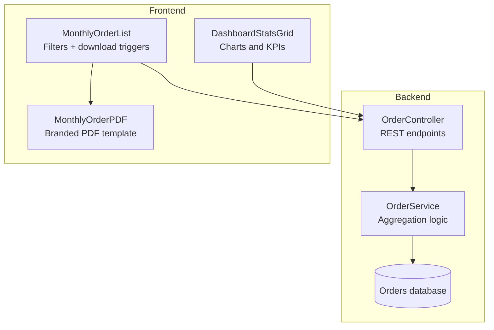
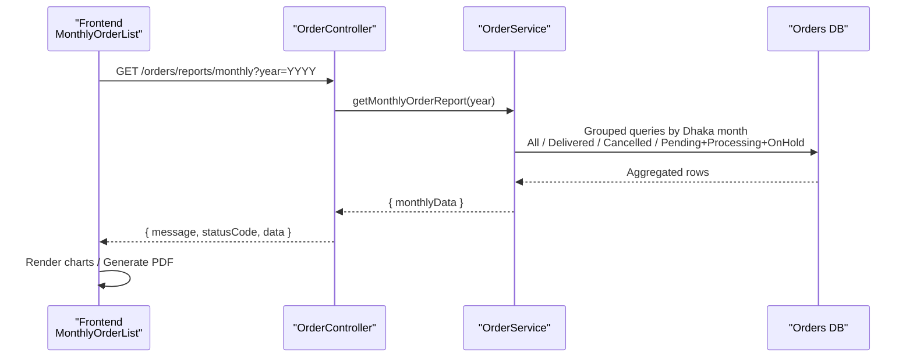
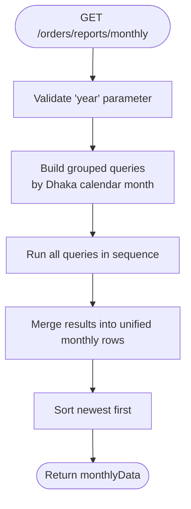
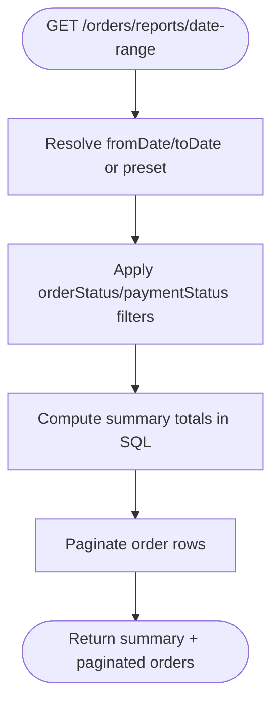
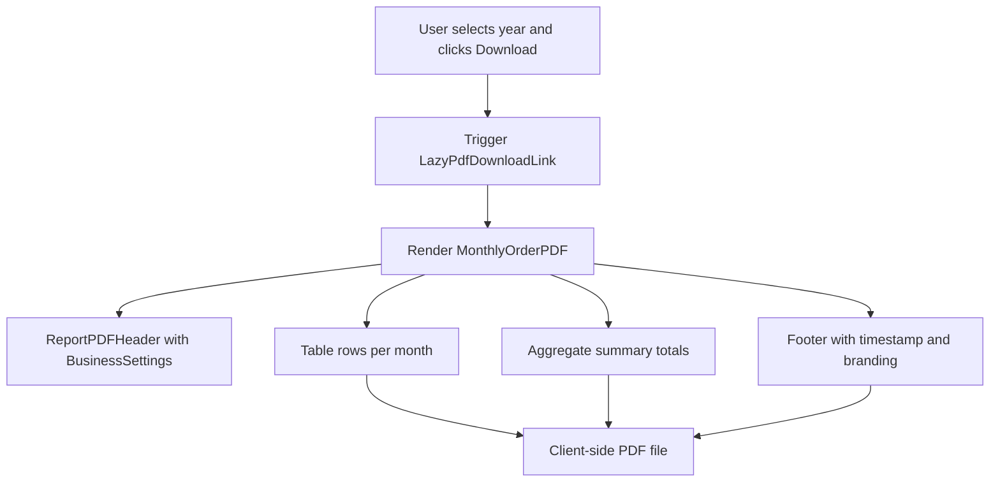
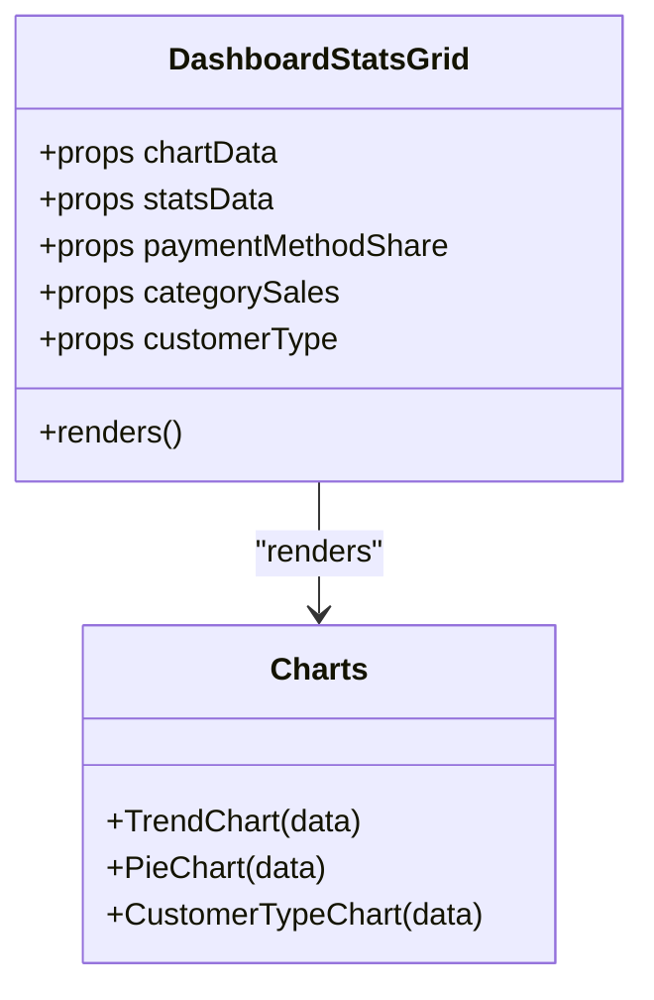
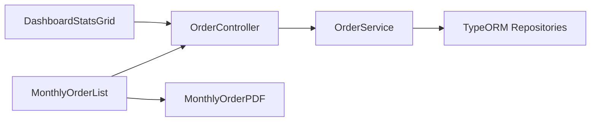

# Monthly Orders Reports

<cite>
**Referenced Files in This Document**
- [order.controller.ts](file://apps/backend/src/order/order.controller.ts)
- [order.service.ts](file://apps/backend/src/order/order.service.ts)
- [MonthlyOrderPDF.tsx](file://apps/frontend/components/admin/reports/monthly-orders/MonthlyOrderPDF.tsx)
- [monthly-order-list.tsx](file://apps/frontend/components/admin/reports/monthly-orders/monthly-order-list.tsx)
- [DashboardStatsGrid.tsx](file://apps/frontend/components/admin/dashboard/DashboardStatsGrid.tsx)
</cite>

## Table of Contents
1. [Introduction](#introduction)
2. [Project Structure](#project-structure)
3. [Core Components](#core-components)
4. [Architecture Overview](#architecture-overview)
5. [Detailed Component Analysis](#detailed-component-analysis)
6. [Dependency Analysis](#dependency-analysis)
7. [Performance Considerations](#performance-considerations)
8. [Troubleshooting Guide](#troubleshooting-guide)
9. [Conclusion](#conclusion)

## Introduction
This document explains the monthly orders reporting system, focusing on how historical order data is aggregated and analyzed over monthly periods, how PDF reports are generated with branding customization, how data filtering works across date ranges, order statuses, and payment methods, and how chart visualizations represent order trends, payment method distributions, and customer acquisition patterns. It also covers performance considerations for large datasets and caching strategies for frequently accessed reports.

## Project Structure
The monthly orders report spans backend API endpoints and services that aggregate order metrics, and frontend components that render charts and generate branded PDFs.

**Diagram sources**
- [order.controller.ts:644-745](file://apps/backend/src/order/order.controller.ts#L644-L745)
- [order.service.ts:1951-2158](file://apps/backend/src/order/order.service.ts#L1951-L2158)
- [monthly-order-list.tsx:286-298](file://apps/frontend/components/admin/reports/monthly-orders/monthly-order-list.tsx#L286-L298)
- [MonthlyOrderPDF.tsx:145-322](file://apps/frontend/components/admin/reports/monthly-orders/MonthlyOrderPDF.tsx#L145-L322)
- [DashboardStatsGrid.tsx:69-116](file://apps/frontend/components/admin/dashboard/DashboardStatsGrid.tsx#L69-L116)

**Section sources**
- [order.controller.ts:644-745](file://apps/backend/src/order/order.controller.ts#L644-L745)
- [order.service.ts:1951-2158](file://apps/backend/src/order/order.service.ts#L1951-L2158)
- [monthly-order-list.tsx:286-298](file://apps/frontend/components/admin/reports/monthly-orders/monthly-order-list.tsx#L286-L298)
- [MonthlyOrderPDF.tsx:145-322](file://apps/frontend/components/admin/reports/monthly-orders/MonthlyOrderPDF.tsx#L145-L322)
- [DashboardStatsGrid.tsx:69-116](file://apps/frontend/components/admin/dashboard/DashboardStatsGrid.tsx#L69-L116)

## Core Components
- Backend controller exposes protected endpoints for monthly order statistics and available years.
- Service aggregates monthly metrics using timezone-aware grouping and status-based filters.
- Frontend list component provides UI controls (year filter, presets) and triggers PDF generation.
- PDF component renders a branded, landscape A4 report with summary totals and per-month rows.
- Dashboard grid consumes related analytics to visualize trends, payment shares, and customer types.

Key responsibilities:
- Data aggregation and time-zone correctness
- Filtering by year, date range presets, order status, and payment status
- PDF generation with business settings branding
- Chart visualization of order trends and distribution metrics

**Section sources**
- [order.controller.ts:644-745](file://apps/backend/src/order/order.controller.ts#L644-L745)
- [order.service.ts:1951-2158](file://apps/backend/src/order/order.service.ts#L1951-L2158)
- [monthly-order-list.tsx:286-298](file://apps/frontend/components/admin/reports/monthly-orders/monthly-order-list.tsx#L286-L298)
- [MonthlyOrderPDF.tsx:145-322](file://apps/frontend/components/admin/reports/monthly-orders/MonthlyOrderPDF.tsx#L145-L322)
- [DashboardStatsGrid.tsx:69-116](file://apps/frontend/components/admin/dashboard/DashboardStatsGrid.tsx#L69-L116)

## Architecture Overview
The monthly report flow starts from the frontend, calls the backend REST API, and returns aggregated monthly metrics. The frontend can then render charts or generate a PDF.

**Diagram sources**
- [order.controller.ts:644-715](file://apps/backend/src/order/order.controller.ts#L644-L715)
- [order.service.ts:1951-2145](file://apps/backend/src/order/order.service.ts#L1951-L2145)

## Detailed Component Analysis

### Backend: Monthly Order Statistics Endpoint
- Endpoint: GET /orders/reports/monthly
- Query parameters:
  - year: optional integer; validated to be a 4-digit number between 2000 and 2100
- Response: array of monthly records including counts and values for all orders, delivered, cancelled, pending, processing, and on-hold.

Implementation highlights:
- Timezone-aware grouping uses Asia/Dhaka so months align with local business operations.
- Four grouped queries compute:
  - All orders
  - Delivered orders
  - Cancelled orders
  - Pending, processing, and on-hold orders combined via conditional aggregation
- Results are merged into a unified dataset sorted newest-first.

**Diagram sources**
- [order.controller.ts:682-715](file://apps/backend/src/order/order.controller.ts#L682-L715)
- [order.service.ts:1951-2145](file://apps/backend/src/order/order.service.ts#L1951-L2145)

**Section sources**
- [order.controller.ts:644-715](file://apps/backend/src/order/order.controller.ts#L644-L715)
- [order.service.ts:1951-2145](file://apps/backend/src/order/order.service.ts#L1951-L2145)

### Backend: Available Years Endpoint
- Endpoint: GET /orders/reports/monthly/years
- Purpose: Returns distinct years with order data, descending, for dropdown filters.
- Implementation: Extracts distinct years based on Dhaka timezone grouping.

**Section sources**
- [order.controller.ts:719-745](file://apps/backend/src/order/order.controller.ts#L719-L745)
- [order.service.ts:2147-2158](file://apps/backend/src/order/order.service.ts#L2147-L2158)

### Backend: Date Range and Status Filters
- Endpoint: GET /orders/reports/date-range
- Supports:
  - Custom date range (fromDate/toDate)
  - Presets: today, this_week, last_week, this_month, last_month, last_3_months, last_6_months, last_year, this_year
  - Filters: orderStatus, paymentStatus
  - Pagination: page, limit (capped at 500)
- Summary totals are computed in SQL over the filtered range without loading full order rows.

**Diagram sources**
- [order.controller.ts:336-411](file://apps/backend/src/order/order.controller.ts#L336-L411)
- [order.service.ts:1414-1441](file://apps/backend/src/order/order.service.ts#L1414-L1441)

**Section sources**
- [order.controller.ts:336-411](file://apps/backend/src/order/order.controller.ts#L336-L411)
- [order.service.ts:1404-1441](file://apps/backend/src/order/order.service.ts#L1404-L1441)

### Frontend: Monthly Report List and PDF Generation
- MonthlyOrderList:
  - Provides controls to select a year and trigger downloads
  - Uses LazyPdfDownloadLink to render MonthlyOrderPDF client-side
- MonthlyOrderPDF:
  - Renders a landscape A4 PDF with:
    - Branded header via shared ReportPDFHeader
    - Title and subtitle indicating selected year
    - Table with columns for year, month, all orders, amount, delivered, pending, processing, on hold, cancelled, and cancel rate
    - Summary section aggregating totals across months
    - Footer with generation timestamp and brand text

**Diagram sources**
- [monthly-order-list.tsx:286-298](file://apps/frontend/components/admin/reports/monthly-orders/monthly-order-list.tsx#L286-L298)
- [MonthlyOrderPDF.tsx:145-322](file://apps/frontend/components/admin/reports/monthly-orders/MonthlyOrderPDF.tsx#L145-L322)

**Section sources**
- [monthly-order-list.tsx:286-298](file://apps/frontend/components/admin/reports/monthly-orders/monthly-order-list.tsx#L286-L298)
- [MonthlyOrderPDF.tsx:145-322](file://apps/frontend/components/admin/reports/monthly-orders/MonthlyOrderPDF.tsx#L145-L322)

### Frontend: Charts and Visualizations
- DashboardStatsGrid consumes dashboard analytics to visualize:
  - Order trends over time
  - Payment method share (pie chart)
  - Category sales (pie chart)
  - Customer type share (new vs returning)
- These charts complement the monthly report by providing interactive insights derived from the same backend aggregation endpoints.

**Diagram sources**
- [DashboardStatsGrid.tsx:69-116](file://apps/frontend/components/admin/dashboard/DashboardStatsGrid.tsx#L69-L116)

**Section sources**
- [DashboardStatsGrid.tsx:69-116](file://apps/frontend/components/admin/dashboard/DashboardStatsGrid.tsx#L69-L116)

## Dependency Analysis
- Controller depends on service for business logic and data aggregation.
- Service depends on TypeORM repositories and raw SQL for efficient aggregation.
- Frontend list component depends on controller endpoints and PDF component for export.
- PDF component depends on shared header component and business settings for branding.
- Dashboard grid depends on multiple analytics endpoints to build charts.

**Diagram sources**
- [order.controller.ts:644-745](file://apps/backend/src/order/order.controller.ts#L644-L745)
- [order.service.ts:1951-2158](file://apps/backend/src/order/order.service.ts#L1951-L2158)
- [monthly-order-list.tsx:286-298](file://apps/frontend/components/admin/reports/monthly-orders/monthly-order-list.tsx#L286-L298)
- [MonthlyOrderPDF.tsx:145-322](file://apps/frontend/components/admin/reports/monthly-orders/MonthlyOrderPDF.tsx#L145-L322)
- [DashboardStatsGrid.tsx:69-116](file://apps/frontend/components/admin/dashboard/DashboardStatsGrid.tsx#L69-L116)

**Section sources**
- [order.controller.ts:644-745](file://apps/backend/src/order/order.controller.ts#L644-L745)
- [order.service.ts:1951-2158](file://apps/backend/src/order/order.service.ts#L1951-L2158)
- [monthly-order-list.tsx:286-298](file://apps/frontend/components/admin/reports/monthly-orders/monthly-order-list.tsx#L286-L298)
- [MonthlyOrderPDF.tsx:145-322](file://apps/frontend/components/admin/reports/monthly-orders/MonthlyOrderPDF.tsx#L145-L322)
- [DashboardStatsGrid.tsx:69-116](file://apps/frontend/components/admin/dashboard/DashboardStatsGrid.tsx#L69-L116)

## Performance Considerations
- Database-level aggregation:
  - Monthly report uses grouped SQL queries to compute counts and sums directly in the database, avoiding loading full order rows.
  - Conditional aggregation combines pending, processing, and on-hold metrics in a single query.
- Timezone handling:
  - Aggregations use Asia/Dhaka grouping to ensure correct monthly buckets aligned with business operations.
- Pagination and limits:
  - Date-range endpoint caps page size at 500 to prevent excessive payloads.
- Parallel dashboard requests:
  - Dashboard endpoint runs multiple analytics queries in parallel to reduce round trips.

Recommendations:
- Cache frequent reports:
  - Implement server-side caching for monthly report responses keyed by year and user role/permissions.
  - Use short-lived cache invalidation when new orders arrive or when configuration changes.
- Indexing:
  - Ensure indexes on createdAt and orderStatus to speed up grouped queries and filters.
- Streaming and chunking:
  - For very large exports, consider streaming PDF generation and progressive rendering on the frontend.

**Section sources**
- [order.service.ts:1951-2145](file://apps/backend/src/order/order.service.ts#L1951-L2145)
- [order.controller.ts:336-411](file://apps/backend/src/order/order.controller.ts#L336-L411)
- [order.service.ts:891-916](file://apps/backend/src/order/order.service.ts#L891-L916)

## Troubleshooting Guide
Common issues and resolutions:
- Invalid year parameter:
  - The monthly endpoint validates year to be an integer between 2000 and 2100; invalid inputs throw a bad request error.
- Incorrect month grouping:
  - If monthly totals appear off by one month, verify timezone settings and ensure queries group by Asia/Dhaka.
- Missing data for certain statuses:
  - If pending/processing/on-hold values are zero, confirm that orders exist within the selected year and that status enums match database values.
- PDF not generating:
  - Ensure business settings are provided to the PDF component for branding; missing settings may affect header/footer content.

Operational checks:
- Verify permissions:
  - Monthly endpoints require admin permissions; unauthorized access will be blocked.
- Inspect network payloads:
  - Confirm that the monthly endpoint returns structured monthlyData arrays and that the frontend maps them correctly.

**Section sources**
- [order.controller.ts:682-715](file://apps/backend/src/order/order.controller.ts#L682-L715)
- [order.service.ts:1951-2145](file://apps/backend/src/order/order.service.ts#L1951-L2145)
- [MonthlyOrderPDF.tsx:145-322](file://apps/frontend/components/admin/reports/monthly-orders/MonthlyOrderPDF.tsx#L145-L322)

## Conclusion
The monthly orders reporting system provides robust, timezone-correct aggregation of historical order data, supports flexible filtering by date ranges, statuses, and payment methods, and offers both interactive charts and branded PDF exports. Backend queries are optimized for performance through grouped SQL and conditional aggregation, while the frontend delivers a user-friendly interface for analysis and reporting. With proper indexing, caching, and validation, the system scales well to handle large historical datasets and frequent report access.