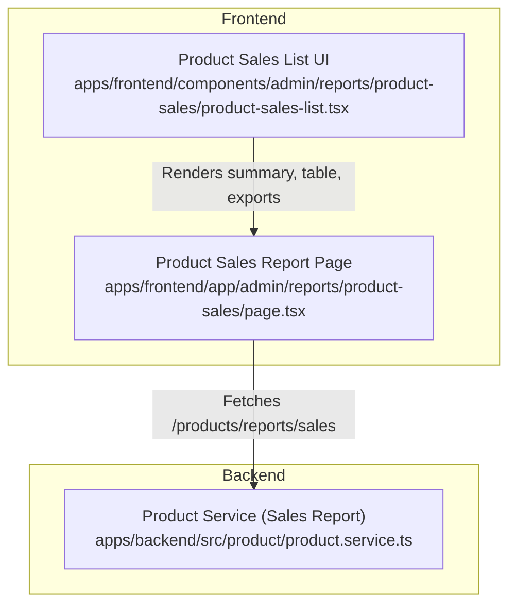
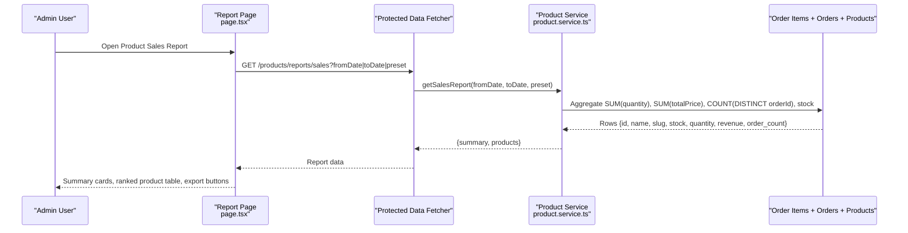
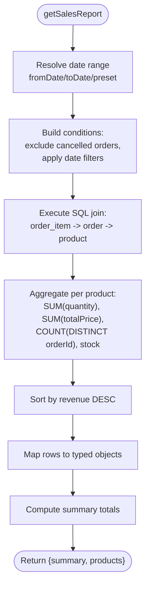
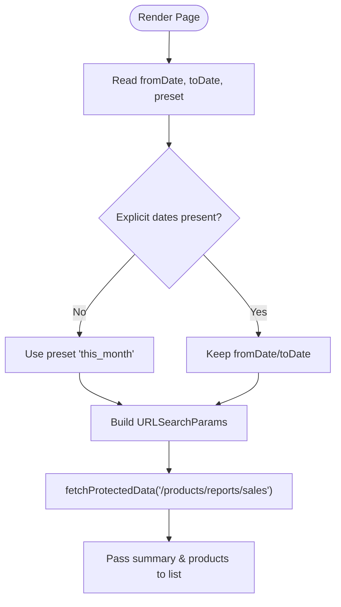
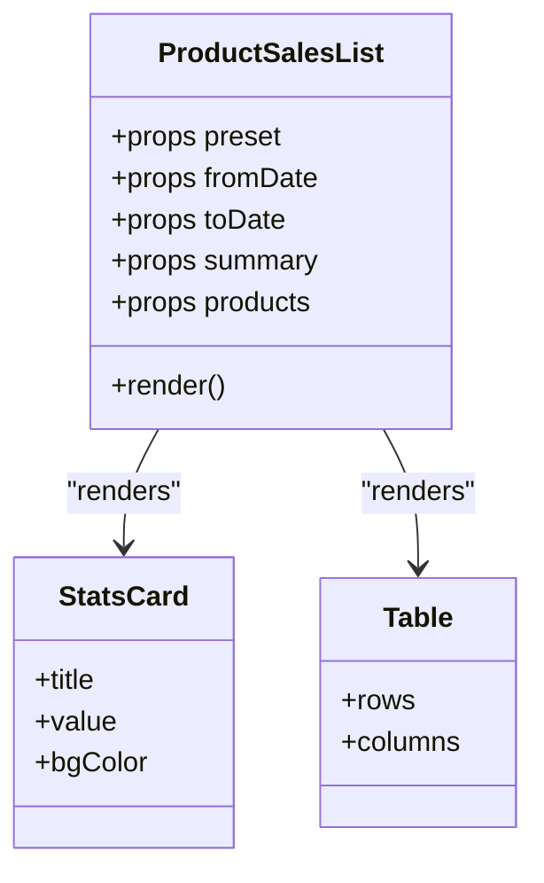
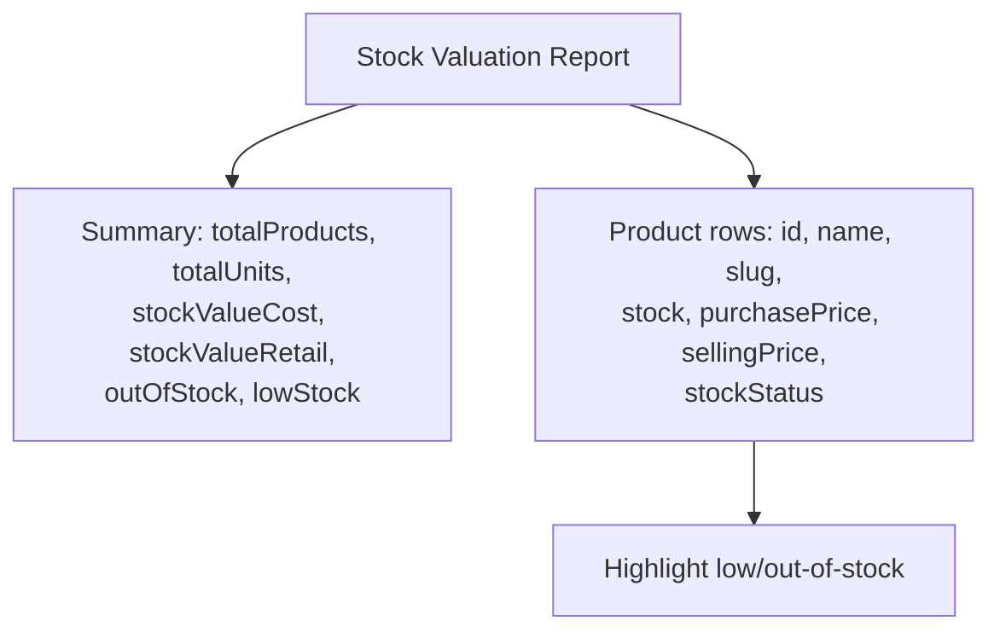
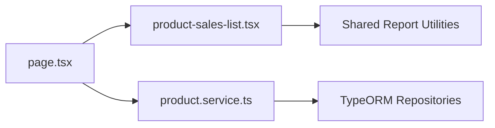

# Product Sales Analytics

<cite>
**Referenced Files in This Document**
- [product.service.ts](file://apps/backend/src/product/product.service.ts)
- [product-sales-list.tsx](file://apps/frontend/components/admin/reports/product-sales/product-sales-list.tsx)
- [page.tsx](file://apps/frontend/app/admin/reports/product-sales/page.tsx)
</cite>

## Table of Contents
1. [Introduction](#introduction)
2. [Project Structure](#project-structure)
3. [Core Components](#core-components)
4. [Architecture Overview](#architecture-overview)
5. [Detailed Component Analysis](#detailed-component-analysis)
6. [Dependency Analysis](#dependency-analysis)
7. [Performance Considerations](#performance-considerations)
8. [Troubleshooting Guide](#troubleshooting-guide)
9. [Conclusion](#conclusion)

## Introduction
This document explains the product sales analytics and reporting capabilities for identifying top-performing products, integrating inventory tracking with sales data, and enabling export and filtering. It focuses on how revenue-based ranking is computed, how stock levels are surfaced alongside sales metrics, and how the frontend renders summary cards, tables, and PDF/Excel exports.

## Project Structure
The product sales analytics feature spans a backend service that computes per-product sales and a frontend report page that displays results and supports export.

**Diagram sources**
- [page.tsx:15-81](file://apps/frontend/app/admin/reports/product-sales/page.tsx#L15-L81)
- [product-sales-list.tsx:46-256](file://apps/frontend/components/admin/reports/product-sales/product-sales-list.tsx#L46-L256)
- [product.service.ts:1487-1543](file://apps/backend/src/product/product.service.ts#L1487-L1543)

**Section sources**
- [page.tsx:15-81](file://apps/frontend/app/admin/reports/product-sales/page.tsx#L15-L81)
- [product-sales-list.tsx:46-256](file://apps/frontend/components/admin/reports/product-sales/product-sales-list.tsx#L46-L256)
- [product.service.ts:1487-1543](file://apps/backend/src/product/product.service.ts#L1487-L1543)

## Core Components
- Backend sales computation: Aggregates sold quantity, revenue, order count, and current stock per product within a date range, excluding cancelled orders. Results are sorted by revenue to identify top performers.
- Frontend report page: Resolves URL search parameters (preset or manual dates), calls the backend endpoint, and passes data to the list component.
- Frontend list component: Renders summary KPIs, a responsive table of products with stock indicators, and provides Excel/PDF export.

Key responsibilities:
- Ranking: By total revenue per product in the selected period.
- Inventory integration: Current stock is included per product; low stock is visually highlighted.
- Export: Excel and PDF generation using shared report utilities.

**Section sources**
- [product.service.ts:1487-1543](file://apps/backend/src/product/product.service.ts#L1487-L1543)
- [page.tsx:15-81](file://apps/frontend/app/admin/reports/product-sales/page.tsx#L15-L81)
- [product-sales-list.tsx:46-256](file://apps/frontend/components/admin/reports/product-sales/product-sales-list.tsx#L46-L256)

## Architecture Overview
The product sales analytics flow connects the Next.js admin page to the NestJS backend service. The backend aggregates order items joined with orders and products to compute per-product metrics. The frontend presents the results and offers export options.

**Diagram sources**
- [page.tsx:52-68](file://apps/frontend/app/admin/reports/product-sales/page.tsx#L52-L68)
- [product.service.ts:1487-1543](file://apps/backend/src/product/product.service.ts#L1487-L1543)

## Detailed Component Analysis

### Backend Sales Calculation
The backend method computes per-product sales metrics for a given date range. It:
- Resolves the effective date range from explicit fromDate/toDate or a preset.
- Excludes cancelled orders.
- Joins order items with orders and products.
- Aggregates:
  - quantity: sum of item quantities
  - revenue: sum of item totalPrice
  - orderCount: distinct orders containing the product
  - stock: current product stock
- Sorts results by revenue descending to rank top-performing products.
- Returns a summary with totalRevenue, totalQuantity, and productCount.

**Diagram sources**
- [product.service.ts:1487-1543](file://apps/backend/src/product/product.service.ts#L1487-L1543)

**Section sources**
- [product.service.ts:1487-1543](file://apps/backend/src/product/product.service.ts#L1487-L1543)

### Frontend Report Page
The report page:
- Reads searchParams for fromDate, toDate, and preset.
- Defaults to a monthly preset when no explicit date range is provided.
- Builds query parameters and fetches the sales report via a protected API utility.
- Passes summary and products to the list component.

**Diagram sources**
- [page.tsx:15-81](file://apps/frontend/app/admin/reports/product-sales/page.tsx#L15-L81)

**Section sources**
- [page.tsx:15-81](file://apps/frontend/app/admin/reports/product-sales/page.tsx#L15-L81)

### Frontend List Component
The list component:
- Displays three summary cards: Total Revenue, Units Sold, Products Sold.
- Renders a responsive table with columns: Rank, Product, Qty Sold, Orders, Revenue, Current Stock.
- Highlights low stock (stock < 5) in red.
- Provides Excel and PDF export using shared report utilities.
- Shows a mobile-friendly card layout when viewed on small screens.

**Diagram sources**
- [product-sales-list.tsx:46-256](file://apps/frontend/components/admin/reports/product-sales/product-sales-list.tsx#L46-L256)

**Section sources**
- [product-sales-list.tsx:46-256](file://apps/frontend/components/admin/reports/product-sales/product-sales-list.tsx#L46-L256)

### Inventory Tracking Integration
- Per-product stock is included in the backend aggregation and displayed in the table.
- Low stock thresholds are visually emphasized in the UI (stock < 5).
- A separate stock valuation report exists in the backend for broader inventory insights, including cost/retail values and low/out-of-stock counts.

**Diagram sources**
- [product.service.ts:1550-1593](file://apps/backend/src/product/product.service.ts#L1550-L1593)

**Section sources**
- [product-sales-list.tsx:229-243](file://apps/frontend/components/admin/reports/product-sales/product-sales-list.tsx#L229-L243)
- [product.service.ts:1550-1593](file://apps/backend/src/product/product.service.ts#L1550-L1593)

### Visualization Components
- Summary KPIs: Total Revenue, Units Sold, Products Sold.
- Ranked product table: Sorted by revenue, includes stock column.
- Mobile card view: Compact representation of the same data.
- Export: Excel and PDF generated from the same dataset.

Note: Category performance breakdowns and product comparison tools are not implemented in the analyzed files.

**Section sources**
- [product-sales-list.tsx:87-256](file://apps/frontend/components/admin/reports/product-sales/product-sales-list.tsx#L87-L256)

### Sales Calculations and Discount Impact
- Revenue is calculated as the sum of order item totalPrice across the selected period.
- Cancelled orders are excluded from aggregations.
- There is no explicit discount impact analysis in the analyzed code paths.

**Section sources**
- [product.service.ts:1487-1543](file://apps/backend/src/product/product.service.ts#L1487-L1543)

### Seasonal Trend Identification
- No time-series trend charts are present in the analyzed product sales report.
- Date-range filtering allows retrospective analysis but does not produce periodic trend visualizations.

[No sources needed since this section describes absence of features]

### Export Functionality
- Excel export: Uses shared report utility with headers, rows, and summary.
- PDF export: Uses shared PDF document builder with headers, alignment, flex widths, and business settings.

**Section sources**
- [product-sales-list.tsx:93-132](file://apps/frontend/components/admin/reports/product-sales/product-sales-list.tsx#L93-L132)

### Filtering by Categories, Brands, and Time Periods
- Time periods: Supported via fromDate/toDate or preset parameters.
- Categories and brands: Not supported in the analyzed product sales report endpoint or UI.

**Section sources**
- [page.tsx:20-33](file://apps/frontend/app/admin/reports/product-sales/page.tsx#L20-L33)
- [product-sales-list.tsx:136-138](file://apps/frontend/components/admin/reports/product-sales/product-sales-list.tsx#L136-L138)

## Dependency Analysis
The product sales analytics feature has clear separation between presentation and computation:
- The frontend page depends on the protected API utility to call the backend.
- The backend service depends on TypeORM repositories to aggregate order and product data.
- The frontend list component depends on shared report utilities for export.

**Diagram sources**
- [page.tsx:52-68](file://apps/frontend/app/admin/reports/product-sales/page.tsx#L52-L68)
- [product-sales-list.tsx:93-132](file://apps/frontend/components/admin/reports/product-sales/product-sales-list.tsx#L93-L132)
- [product.service.ts:1487-1543](file://apps/backend/src/product/product.service.ts#L1487-L1543)

**Section sources**
- [page.tsx:52-68](file://apps/frontend/app/admin/reports/product-sales/page.tsx#L52-L68)
- [product-sales-list.tsx:93-132](file://apps/frontend/components/admin/reports/product-sales/product-sales-list.tsx#L93-L132)
- [product.service.ts:1487-1543](file://apps/backend/src/product/product.service.ts#L1487-L1543)

## Performance Considerations
- Backend aggregation uses a single SQL query with joins and GROUP BY, which is efficient for typical e-commerce datasets.
- Sorting by revenue occurs server-side, reducing client processing.
- Frontend rendering is straightforward; large result sets may benefit from pagination if the dataset grows significantly.

[No sources needed since this section provides general guidance]

## Troubleshooting Guide
- Empty results: Ensure the selected date range includes valid non-cancelled orders.
- Incorrect rankings: Verify that order statuses exclude cancellations and that date filters are applied correctly.
- Missing stock values: Confirm product records have stock populated; the backend returns current stock per product.
- Export issues: Check that the shared report utilities are available and that the dataset is not empty before exporting.

**Section sources**
- [product.service.ts:1487-1543](file://apps/backend/src/product/product.service.ts#L1487-L1543)
- [product-sales-list.tsx:221-247](file://apps/frontend/components/admin/reports/product-sales/product-sales-list.tsx#L221-L247)

## Conclusion
The product sales analytics feature identifies top-performing products by revenue within a configurable date range, integrates current stock levels into the report, and provides both Excel and PDF exports. While category and brand filtering, discount impact analysis, and seasonal trend visualization are not present in the analyzed implementation, the existing architecture can be extended to support those capabilities by enhancing the backend aggregation and adding corresponding frontend controls and visualizations.