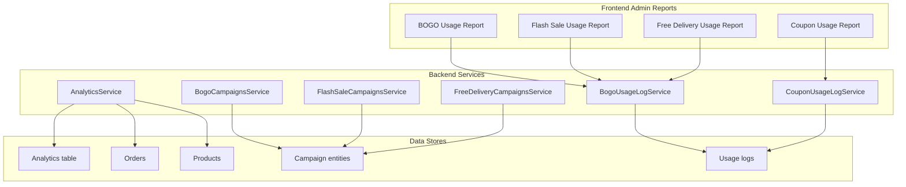
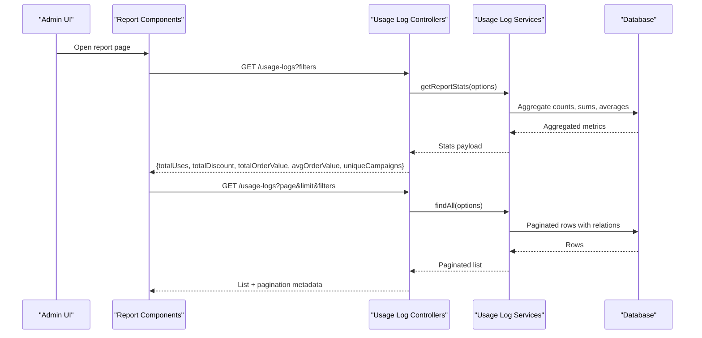
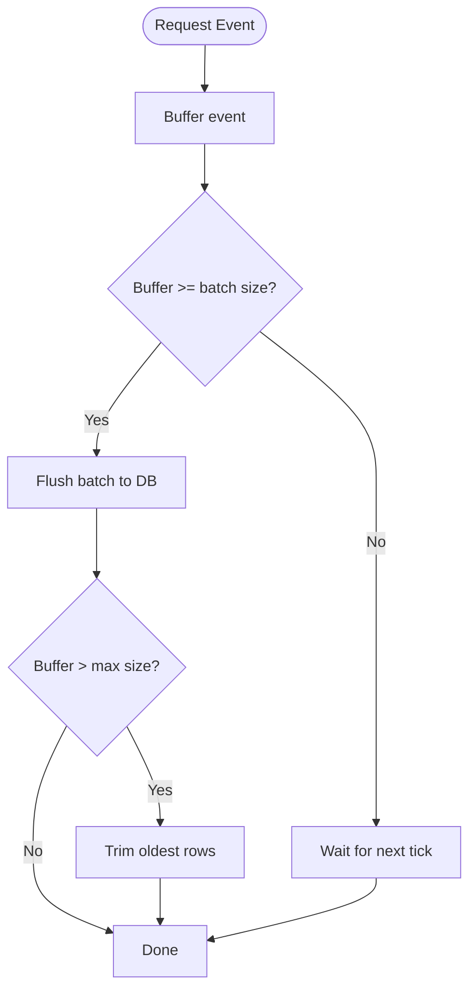
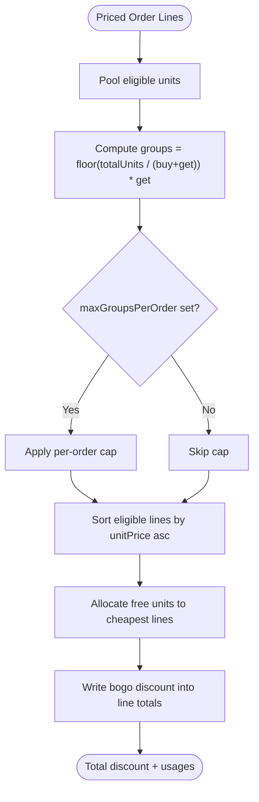
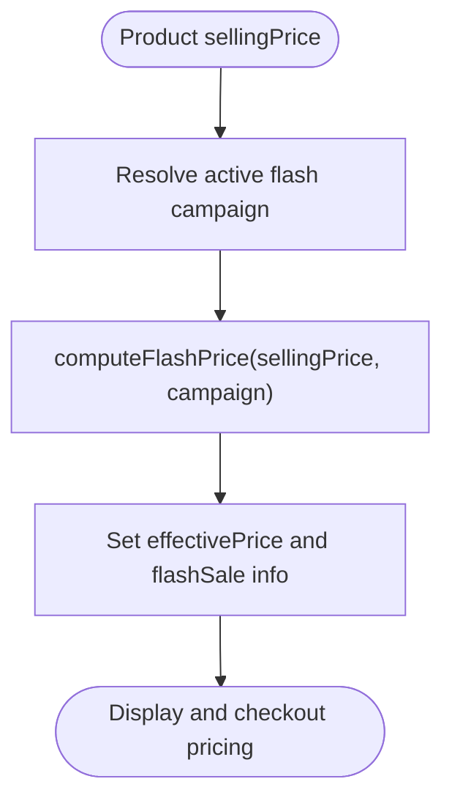
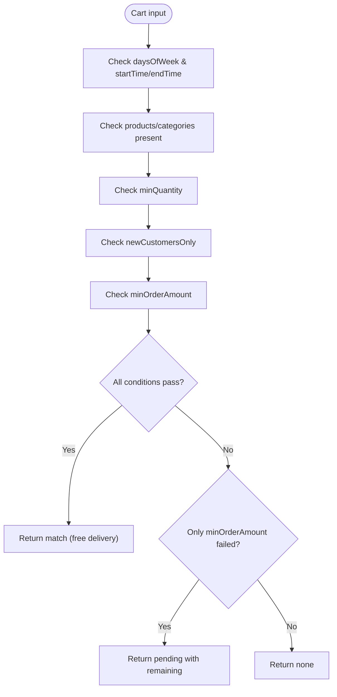
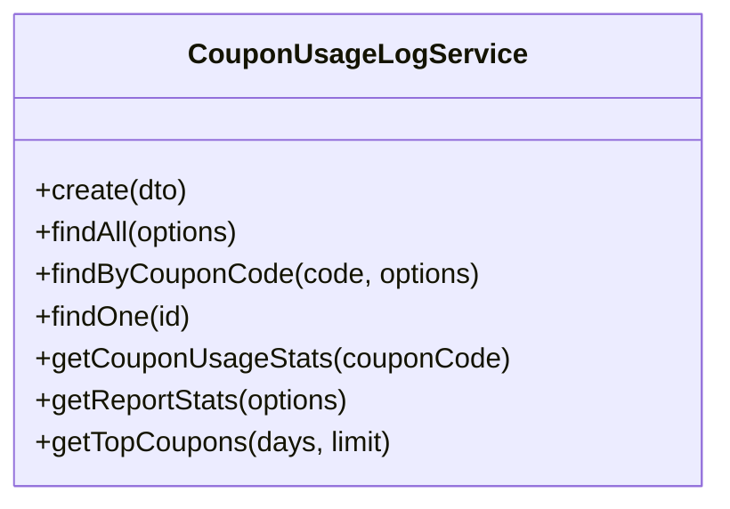
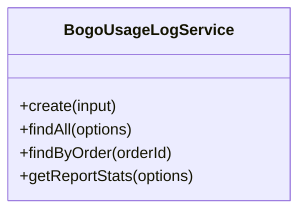
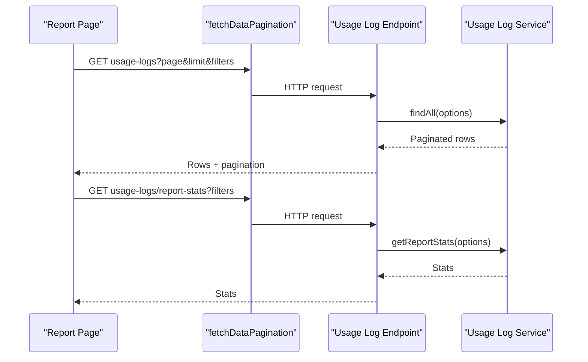
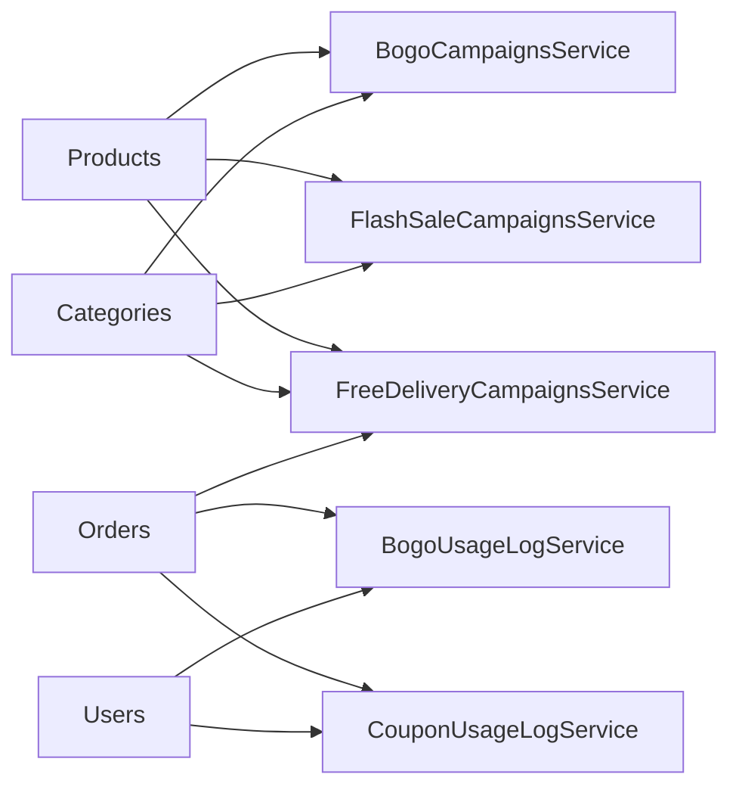

# Promotional Campaign Reports

<cite>
**Referenced Files in This Document**
- [analytics.service.ts](file://apps/backend/src/analytics/analytics.service.ts)
- [analytics.controller.ts](file://apps/backend/src/analytics/analytics.controller.ts)
- [bogo-campaigns.service.ts](file://apps/backend/src/bogo-campaigns/bogo-campaigns.service.ts)
- [bogo-usage-log.service.ts](file://apps/backend/src/bogo-usage-log/bogo-usage-log.service.ts)
- [flash-sale-campaigns.service.ts](file://apps/backend/src/flash-sale-campaigns/flash-sale-campaigns.service.ts)
- [free-delivery-campaigns.service.ts](file://apps/backend/src/free-delivery-campaigns/free-delivery-campaigns.service.ts)
- [coupon-usage-log.service.ts](file://apps/backend/src/coupon-usage-log/coupon-usage-log.service.ts)
- [bogo-usage-report.tsx](file://apps/frontend/components/admin/reports/bogo-usage-report.tsx)
- [flash-sale-usage-report.tsx](file://apps/frontend/components/admin/reports/flash-sale-usage-report.tsx)
- [free-delivery-usage-report.tsx](file://apps/frontend/components/admin/reports/free-delivery-usage-report.tsx)
- [coupon-usage-report.tsx](file://apps/frontend/components/admin/reports/coupon-usage-report.tsx)
</cite>

## Table of Contents
1. [Introduction](#introduction)
2. [Project Structure](#project-structure)
3. [Core Components](#core-components)
4. [Architecture Overview](#architecture-overview)
5. [Detailed Component Analysis](#detailed-component-analysis)
6. [Dependency Analysis](#dependency-analysis)
7. [Performance Considerations](#performance-considerations)
8. [Troubleshooting Guide](#troubleshooting-guide)
9. [Conclusion](#conclusion)

## Introduction
This document explains the promotional campaign effectiveness tracking and reporting system for BOGO campaigns, flash sales, free delivery campaigns, and coupon usage. It covers how campaign ROI is calculated, conversion rates are measured, customer engagement is tracked, comparative analysis is performed across campaigns, and how real-time monitoring and alerting capabilities support operational decisions.

The system combines:
- Real-time analytics ingestion and aggregation for traffic, visitors, endpoints, and conversion proxies.
- Campaign evaluation engines that compute discounts and eligibility at order time.
- Usage logs that record applied promotions with discount amounts, order totals, and user context.
- Admin report pages that visualize metrics, filter by date ranges, and export data.

## Project Structure
Promotional reporting spans backend services, usage loggers, and frontend admin reports:

**Diagram sources**
- [analytics.service.ts:142-192](file://apps/backend/src/analytics/analytics.service.ts#L142-L192)
- [bogo-campaigns.service.ts:95-175](file://apps/backend/src/bogo-campaigns/bogo-campaigns.service.ts#L95-L175)
- [flash-sale-campaigns.service.ts:70-80](file://apps/backend/src/flash-sale-campaigns/flash-sale-campaigns.service.ts#L70-L80)
- [free-delivery-campaigns.service.ts:269-340](file://apps/backend/src/free-delivery-campaigns/free-delivery-campaigns.service.ts#L269-L340)
- [coupon-usage-log.service.ts:181-215](file://apps/backend/src/coupon-usage-log/coupon-usage-log.service.ts#L181-L215)
- [bogo-usage-log.service.ts:113-149](file://apps/backend/src/bogo-usage-log/bogo-usage-log.service.ts#L113-L149)
- [bogo-usage-report.tsx:87-112](file://apps/frontend/components/admin/reports/bogo-usage-report.tsx#L87-L112)
- [flash-sale-usage-report.tsx:85-110](file://apps/frontend/components/admin/reports/flash-sale-usage-report.tsx#L85-L110)
- [free-delivery-usage-report.tsx:85-110](file://apps/frontend/components/admin/reports/free-delivery-usage-report.tsx#L85-L110)
- [coupon-usage-report.tsx:84-109](file://apps/frontend/components/admin/reports/coupon-usage-report.tsx#L84-L109)

**Section sources**
- [analytics.service.ts:142-192](file://apps/backend/src/analytics/analytics.service.ts#L142-L192)
- [bogo-campaigns.service.ts:95-175](file://apps/backend/src/bogo-campaigns/bogo-campaigns.service.ts#L95-L175)
- [flash-sale-campaigns.service.ts:70-80](file://apps/backend/src/flash-sale-campaigns/flash-sale-campaigns.service.ts#L70-L80)
- [free-delivery-campaigns.service.ts:269-340](file://apps/backend/src/free-delivery-campaigns/free-delivery-campaigns.service.ts#L269-L340)
- [coupon-usage-log.service.ts:181-215](file://apps/backend/src/coupon-usage-log/coupon-usage-log.service.ts#L181-L215)
- [bogo-usage-log.service.ts:113-149](file://apps/backend/src/bogo-usage-log/bogo-usage-log.service.ts#L113-L149)
- [bogo-usage-report.tsx:87-112](file://apps/frontend/components/admin/reports/bogo-usage-report.tsx#L87-L112)
- [flash-sale-usage-report.tsx:85-110](file://apps/frontend/components/admin/reports/flash-sale-usage-report.tsx#L85-L110)
- [free-delivery-usage-report.tsx:85-110](file://apps/frontend/components/admin/reports/free-delivery-usage-report.tsx#L85-L110)
- [coupon-usage-report.tsx:84-109](file://apps/frontend/components/admin/reports/coupon-usage-report.tsx#L84-L109)

## Core Components
- AnalyticsService: Ingests request events into a buffered store, aggregates traffic, unique visitors, peak hours, top endpoints, device/browser breakdown, product page views, traffic sources, and conversion proxy (orders vs unique visitors).
- BogoCampaignsService: Evaluates active BOGO campaigns, computes eligible free units, applies discounts to order lines, and exposes preview and usage increment logic.
- FlashSaleCampaignsService: Computes flash sale prices, resolves active campaigns, attaches effective pricing, and increments usage counters.
- FreeDeliveryCampaignsService: Evaluates free delivery eligibility based on day/time windows, product/category scope, minimum quantity/order amount, and new-customer constraints; returns pending progress when near threshold.
- CouponUsageLogService: Records coupon applications and provides aggregated stats, top coupons, and paginated usage lists.
- BogoUsageLogService: Records BOGO usages and provides aggregated report stats including total uses, discount given, free units, order value, average order value, and unique campaigns.

Key metrics exposed by reports:
- Total uses (orders or applications)
- Total discount given or shipping waived
- Total order value
- Average order value
- Unique campaigns or coupons used

**Section sources**
- [analytics.service.ts:194-548](file://apps/backend/src/analytics/analytics.service.ts#L194-L548)
- [bogo-campaigns.service.ts:95-175](file://apps/backend/src/bogo-campaigns/bogo-campaigns.service.ts#L95-L175)
- [flash-sale-campaigns.service.ts:70-80](file://apps/backend/src/flash-sale-campaigns/flash-sale-campaigns.service.ts#L70-L80)
- [free-delivery-campaigns.service.ts:269-340](file://apps/backend/src/free-delivery-campaigns/free-delivery-campaigns.service.ts#L269-L340)
- [coupon-usage-log.service.ts:181-215](file://apps/backend/src/coupon-usage-log/coupon-usage-log.service.ts#L181-L215)
- [bogo-usage-log.service.ts:113-149](file://apps/backend/src/bogo-usage-log/bogo-usage-log.service.ts#L113-L149)

## Architecture Overview
The unified reporting system integrates real-time analytics with campaign evaluation and usage logging:

**Diagram sources**
- [bogo-usage-log.service.ts:52-149](file://apps/backend/src/bogo-usage-log/bogo-usage-log.service.ts#L52-L149)
- [coupon-usage-log.service.ts:53-215](file://apps/backend/src/coupon-usage-log/coupon-usage-log.service.ts#L53-L215)
- [bogo-usage-report.tsx:87-112](file://apps/frontend/components/admin/reports/bogo-usage-report.tsx#L87-L112)
- [flash-sale-usage-report.tsx:85-110](file://apps/frontend/components/admin/reports/flash-sale-usage-report.tsx#L85-L110)
- [free-delivery-usage-report.tsx:85-110](file://apps/frontend/components/admin/reports/free-delivery-usage-report.tsx#L85-L110)
- [coupon-usage-report.tsx:84-109](file://apps/frontend/components/admin/reports/coupon-usage-report.tsx#L84-L109)

## Detailed Component Analysis

### Analytics and Conversion Measurement
AnalyticsService buffers request events and flushes them periodically to the database. It provides:
- Overview metrics: requests per minute, total requests, unique visitors, peak hour, top endpoint, average response time.
- Time-series metrics: hourly request counts, peak traffic distribution, unique visitors per day.
- Top endpoints and response time metrics.
- Device and browser breakdown from stored user-agent strings.
- Top product pages resolved from concrete paths.
- Traffic sources by referer host.
- Conversion proxy: orders divided by unique visitors over a period.

Real-time monitoring and alerting:
- Buffered writes with configurable batch size, interval, and max buffer cap ensure low-latency ingestion without overwhelming the database.
- Scheduled retention purges old analytics rows daily to keep storage bounded.
- Index creation ensures dashboard queries perform well even without ORM synchronization.

**Diagram sources**
- [analytics.service.ts:142-192](file://apps/backend/src/analytics/analytics.service.ts#L142-L192)
- [analytics.service.ts:593-615](file://apps/backend/src/analytics/analytics.service.ts#L593-L615)

**Section sources**
- [analytics.service.ts:142-192](file://apps/backend/src/analytics/analytics.service.ts#L142-L192)
- [analytics.service.ts:194-548](file://apps/backend/src/analytics/analytics.service.ts#L194-L548)
- [analytics.service.ts:593-615](file://apps/backend/src/analytics/analytics.service.ts#L593-L615)

### BOGO Campaign Evaluation and Attribution
BogoCampaignsService implements attribution logic for BOGO deals:
- Active campaigns are filtered by isActive, validFrom/validUntil, and maxUsage.
- Eligible units pool across lines/products; cheapest units become free according to buy/get rules.
- Per-order caps limit free groups per order.
- Discounts are written back into line pricing details so downstream calculations see reduced totals.
- Preview function estimates cart-level BOGO discount using flash sale precedence and product discount windows.
- Usage increment atomically bumps timesUsed while respecting maxUsage.

**Diagram sources**
- [bogo-campaigns.service.ts:95-175](file://apps/backend/src/bogo-campaigns/bogo-campaigns.service.ts#L95-L175)
- [bogo-campaigns.service.ts:322-340](file://apps/backend/src/bogo-campaigns/bogo-campaigns.service.ts#L322-L340)
- [bogo-campaigns.service.ts:419-494](file://apps/backend/src/bogo-campaigns/bogo-campaigns.service.ts#L419-L494)
- [bogo-campaigns.service.ts:506-517](file://apps/backend/src/bogo-campaigns/bogo-campaigns.service.ts#L506-L517)

**Section sources**
- [bogo-campaigns.service.ts:95-175](file://apps/backend/src/bogo-campaigns/bogo-campaigns.service.ts#L95-L175)
- [bogo-campaigns.service.ts:322-340](file://apps/backend/src/bogo-campaigns/bogo-campaigns.service.ts#L322-L340)
- [bogo-campaigns.service.ts:419-494](file://apps/backend/src/bogo-campaigns/bogo-campaigns.service.ts#L419-L494)
- [bogo-campaigns.service.ts:506-517](file://apps/backend/src/bogo-campaigns/bogo-campaigns.service.ts#L506-L517)

### Flash Sale Pricing and Impact
FlashSaleCampaignsService computes flash sale prices and resolves active campaigns:
- computeFlashPrice supports percentage and fixed discounts.
- Active campaigns are cached briefly and ordered by id to resolve precedence.
- attachFlashInfo sets effective price and display-only flash sale info.
- incrementUsage atomically updates usage counters.

**Diagram sources**
- [flash-sale-campaigns.service.ts:70-80](file://apps/backend/src/flash-sale-campaigns/flash-sale-campaigns.service.ts#L70-L80)
- [flash-sale-campaigns.service.ts:247-265](file://apps/backend/src/flash-sale-campaigns/flash-sale-campaigns.service.ts#L247-L265)
- [flash-sale-campaigns.service.ts:323-353](file://apps/backend/src/flash-sale-campaigns/flash-sale-campaigns.service.ts#L323-L353)
- [flash-sale-campaigns.service.ts:360-373](file://apps/backend/src/flash-sale-campaigns/flash-sale-campaigns.service.ts#L360-L373)

**Section sources**
- [flash-sale-campaigns.service.ts:70-80](file://apps/backend/src/flash-sale-campaigns/flash-sale-campaigns.service.ts#L70-L80)
- [flash-sale-campaigns.service.ts:247-265](file://apps/backend/src/flash-sale-campaigns/flash-sale-campaigns.service.ts#L247-L265)
- [flash-sale-campaigns.service.ts:323-353](file://apps/backend/src/flash-sale-campaigns/flash-sale-campaigns.service.ts#L323-L353)
- [flash-sale-campaigns.service.ts:360-373](file://apps/backend/src/flash-sale-campaigns/flash-sale-campaigns.service.ts#L360-L373)

### Free Delivery Campaign Eligibility
FreeDeliveryCampaignsService evaluates free delivery eligibility:
- Day-of-week and time-window checks.
- Product/category scope matching.
- Minimum quantity and minimum order amount thresholds.
- New-customer-only constraint.
- Returns pending status with remaining amount when close to unlocking.

**Diagram sources**
- [free-delivery-campaigns.service.ts:269-340](file://apps/backend/src/free-delivery-campaigns/free-delivery-campaigns.service.ts#L269-L340)
- [free-delivery-campaigns.service.ts:346-410](file://apps/backend/src/free-delivery-campaigns/free-delivery-campaigns.service.ts#L346-L410)

**Section sources**
- [free-delivery-campaigns.service.ts:269-340](file://apps/backend/src/free-delivery-campaigns/free-delivery-campaigns.service.ts#L269-L340)
- [free-delivery-campaigns.service.ts:346-410](file://apps/backend/src/free-delivery-campaigns/free-delivery-campaigns.service.ts#L346-L410)

### Coupon Usage Tracking and Reporting
CouponUsageLogService records coupon applications and provides:
- Paginated usage lists with filters by coupon code and date range.
- Aggregated stats: total uses, total discount given, total order value, average discount amount, unique coupons.
- Top coupons by usage over a configurable period.

**Diagram sources**
- [coupon-usage-log.service.ts:29-40](file://apps/backend/src/coupon-usage-log/coupon-usage-log.service.ts#L29-L40)
- [coupon-usage-log.service.ts:53-105](file://apps/backend/src/coupon-usage-log/coupon-usage-log.service.ts#L53-L105)
- [coupon-usage-log.service.ts:160-177](file://apps/backend/src/coupon-usage-log/coupon-usage-log.service.ts#L160-L177)
- [coupon-usage-log.service.ts:181-215](file://apps/backend/src/coupon-usage-log/coupon-usage-log.service.ts#L181-L215)
- [coupon-usage-log.service.ts:220-251](file://apps/backend/src/coupon-usage-log/coupon-usage-log.service.ts#L220-L251)

**Section sources**
- [coupon-usage-log.service.ts:29-40](file://apps/backend/src/coupon-usage-log/coupon-usage-log.service.ts#L29-L40)
- [coupon-usage-log.service.ts:53-105](file://apps/backend/src/coupon-usage-log/coupon-usage-log.service.ts#L53-L105)
- [coupon-usage-log.service.ts:160-177](file://apps/backend/src/coupon-usage-log/coupon-usage-log.service.ts#L160-L177)
- [coupon-usage-log.service.ts:181-215](file://apps/backend/src/coupon-usage-log/coupon-usage-log.service.ts#L181-L215)
- [coupon-usage-log.service.ts:220-251](file://apps/backend/src/coupon-usage-log/coupon-usage-log.service.ts#L220-L251)

### BOGO Usage Logging and Reporting
BogoUsageLogService records BOGO usages and provides:
- Paginated usage logs with campaign, order, and user relations.
- Aggregated report stats: total uses, total discount, total free units, total order value, average order value, unique campaigns.

**Diagram sources**
- [bogo-usage-log.service.ts:39-50](file://apps/backend/src/bogo-usage-log/bogo-usage-log.service.ts#L39-L50)
- [bogo-usage-log.service.ts:52-109](file://apps/backend/src/bogo-usage-log/bogo-usage-log.service.ts#L52-L109)
- [bogo-usage-log.service.ts:113-149](file://apps/backend/src/bogo-usage-log/bogo-usage-log.service.ts#L113-L149)

**Section sources**
- [bogo-usage-log.service.ts:39-50](file://apps/backend/src/bogo-usage-log/bogo-usage-log.service.ts#L39-L50)
- [bogo-usage-log.service.ts:52-109](file://apps/backend/src/bogo-usage-log/bogo-usage-log.service.ts#L52-L109)
- [bogo-usage-log.service.ts:113-149](file://apps/backend/src/bogo-usage-log/bogo-usage-log.service.ts#L113-L149)

### Frontend Report Pages
Each report component fetches both paginated rows and aggregated stats, supports date presets and custom ranges, and exports to Excel/PDF:
- BOGO Usage Report: displays total uses, discount given, free units, order value, unique campaigns.
- Flash Sale Usage Report: displays total uses, discount given, order value, unique campaigns.
- Free Delivery Usage Report: displays total uses, shipping waived, order value, unique campaigns.
- Coupon Usage Report: displays total uses, discount given, order value, unique coupons.

**Diagram sources**
- [bogo-usage-report.tsx:87-112](file://apps/frontend/components/admin/reports/bogo-usage-report.tsx#L87-L112)
- [flash-sale-usage-report.tsx:85-110](file://apps/frontend/components/admin/reports/flash-sale-usage-report.tsx#L85-L110)
- [free-delivery-usage-report.tsx:85-110](file://apps/frontend/components/admin/reports/free-delivery-usage-report.tsx#L85-L110)
- [coupon-usage-report.tsx:84-109](file://apps/frontend/components/admin/reports/coupon-usage-report.tsx#L84-L109)

**Section sources**
- [bogo-usage-report.tsx:87-112](file://apps/frontend/components/admin/reports/bogo-usage-report.tsx#L87-L112)
- [flash-sale-usage-report.tsx:85-110](file://apps/frontend/components/admin/reports/flash-sale-usage-report.tsx#L85-L110)
- [free-delivery-usage-report.tsx:85-110](file://apps/frontend/components/admin/reports/free-delivery-usage-report.tsx#L85-L110)
- [coupon-usage-report.tsx:84-109](file://apps/frontend/components/admin/reports/coupon-usage-report.tsx#L84-L109)

## Dependency Analysis
Campaign evaluation dependencies:
- BOGO discount application depends on product pricing and category scoping, and respects flash sale precedence.
- Flash sale pricing is independent but interacts with product discount windows during preview.
- Free delivery eligibility depends on product/category presence, minimum thresholds, and user history.
- Usage logs depend on order and user contexts for reporting.

**Diagram sources**
- [bogo-campaigns.service.ts:95-175](file://apps/backend/src/bogo-campaigns/bogo-campaigns.service.ts#L95-L175)
- [flash-sale-campaigns.service.ts:247-265](file://apps/backend/src/flash-sale-campaigns/flash-sale-campaigns.service.ts#L247-L265)
- [free-delivery-campaigns.service.ts:269-340](file://apps/backend/src/free-delivery-campaigns/free-delivery-campaigns.service.ts#L269-L340)
- [bogo-usage-log.service.ts:52-109](file://apps/backend/src/bogo-usage-log/bogo-usage-log.service.ts#L52-L109)
- [coupon-usage-log.service.ts:53-105](file://apps/backend/src/coupon-usage-log/coupon-usage-log.service.ts#L53-L105)

**Section sources**
- [bogo-campaigns.service.ts:95-175](file://apps/backend/src/bogo-campaigns/bogo-campaigns.service.ts#L95-L175)
- [flash-sale-campaigns.service.ts:247-265](file://apps/backend/src/flash-sale-campaigns/flash-sale-campaigns.service.ts#L247-L265)
- [free-delivery-campaigns.service.ts:269-340](file://apps/backend/src/free-delivery-campaigns/free-delivery-campaigns.service.ts#L269-L340)
- [bogo-usage-log.service.ts:52-109](file://apps/backend/src/bogo-usage-log/bogo-usage-log.service.ts#L52-L109)
- [coupon-usage-log.service.ts:53-105](file://apps/backend/src/coupon-usage-log/coupon-usage-log.service.ts#L53-L105)

## Performance Considerations
- Analytics ingestion uses buffered inserts with configurable batch size and interval to reduce database load while keeping latency low.
- Index creation ensures efficient querying for dashboards and reports.
- Campaign resolution caches active campaigns briefly to avoid frequent database reads during high traffic.
- Report queries use separate count queries to optimize pagination performance.
- Retention cleanup runs daily to prevent unbounded growth of analytics tables.

Recommendations:
- Tune ANALYTICS_FLUSH_BATCH_SIZE and ANALYTICS_FLUSH_INTERVAL_MS based on traffic patterns.
- Monitor ANALYTICS_MAX_BUFFER_SIZE to balance memory usage and durability.
- Ensure database indexes exist for timestamp-based queries.
- Use date-range filters judiciously to avoid large scans.

**Section sources**
- [analytics.service.ts:142-192](file://apps/backend/src/analytics/analytics.service.ts#L142-L192)
- [analytics.service.ts:89-117](file://apps/backend/src/analytics/analytics.service.ts#L89-L117)
- [analytics.service.ts:593-615](file://apps/backend/src/analytics/analytics.service.ts#L593-L615)
- [bogo-campaigns.service.ts:322-340](file://apps/backend/src/bogo-campaigns/bogo-campaigns.service.ts#L322-L340)
- [flash-sale-campaigns.service.ts:247-265](file://apps/backend/src/flash-sale-campaigns/flash-sale-campaigns.service.ts#L247-L265)
- [bogo-usage-log.service.ts:52-109](file://apps/backend/src/bogo-usage-log/bogo-usage-log.service.ts#L52-L109)

## Troubleshooting Guide
Common issues and resolutions:
- Missing analytics data: verify buffer flush configuration and database connectivity; check scheduled retention settings.
- Campaign not applying: confirm isActive, validFrom/validUntil, and maxUsage limits; review precedence rules (lowest id wins).
- Incorrect discount amounts: validate computeFlashPrice inputs and BOGO allocation logic; ensure line pricing updates occur before downstream calculations.
- Free delivery not triggering: check day/time windows, product/category scope, minimum quantity/order amount, and new-customer constraints.
- Report empty results: ensure usage logs are created for orders; verify date filters and pagination parameters.

Operational tips:
- Inspect logs for warnings about campaign exhaustion mid-order.
- Use report stats to detect anomalies in discount distributions or order values.
- Export reports to Excel/PDF for offline analysis and audit trails.

**Section sources**
- [analytics.service.ts:142-192](file://apps/backend/src/analytics/analytics.service.ts#L142-L192)
- [bogo-campaigns.service.ts:506-517](file://apps/backend/src/bogo-campaigns/bogo-campaigns.service.ts#L506-L517)
- [flash-sale-campaigns.service.ts:360-373](file://apps/backend/src/flash-sale-campaigns/flash-sale-campaigns.service.ts#L360-L373)
- [free-delivery-campaigns.service.ts:269-340](file://apps/backend/src/free-delivery-campaigns/free-delivery-campaigns.service.ts#L269-L340)
- [bogo-usage-log.service.ts:52-109](file://apps/backend/src/bogo-usage-log/bogo-usage-log.service.ts#L52-L109)

## Conclusion
The promotional campaign reporting system provides a comprehensive view of campaign effectiveness across BOGO, flash sales, free delivery, and coupons. It combines real-time analytics, robust campaign evaluation, detailed usage logging, and intuitive admin reports. Administrators can measure ROI through discount impact and order value, track conversion via visitor-to-order ratios, and compare multiple campaigns simultaneously using consistent metrics. The architecture supports scalability through buffering, caching, and scheduled maintenance, enabling reliable monitoring and informed decision-making.