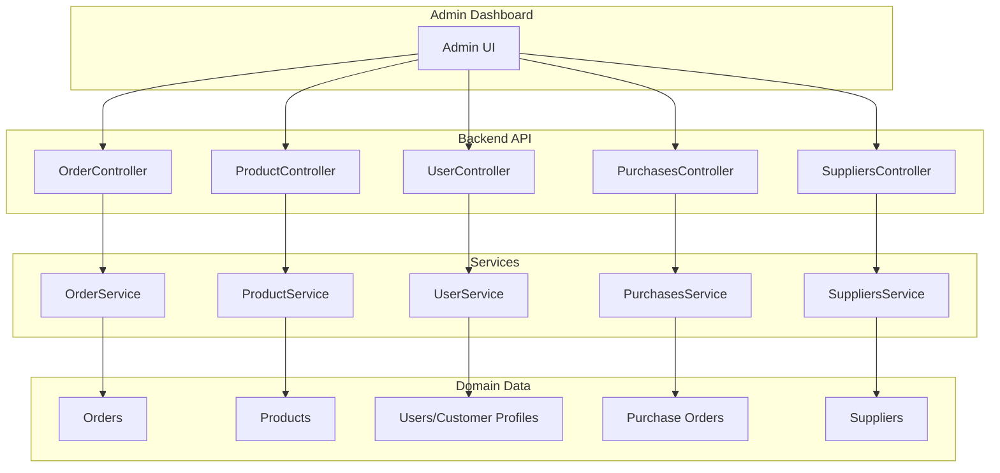
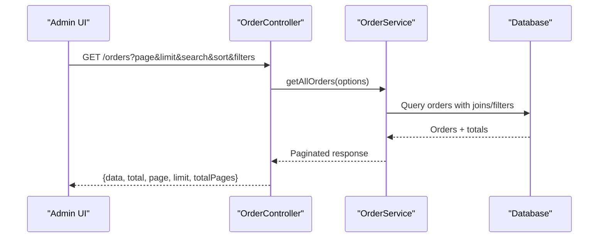
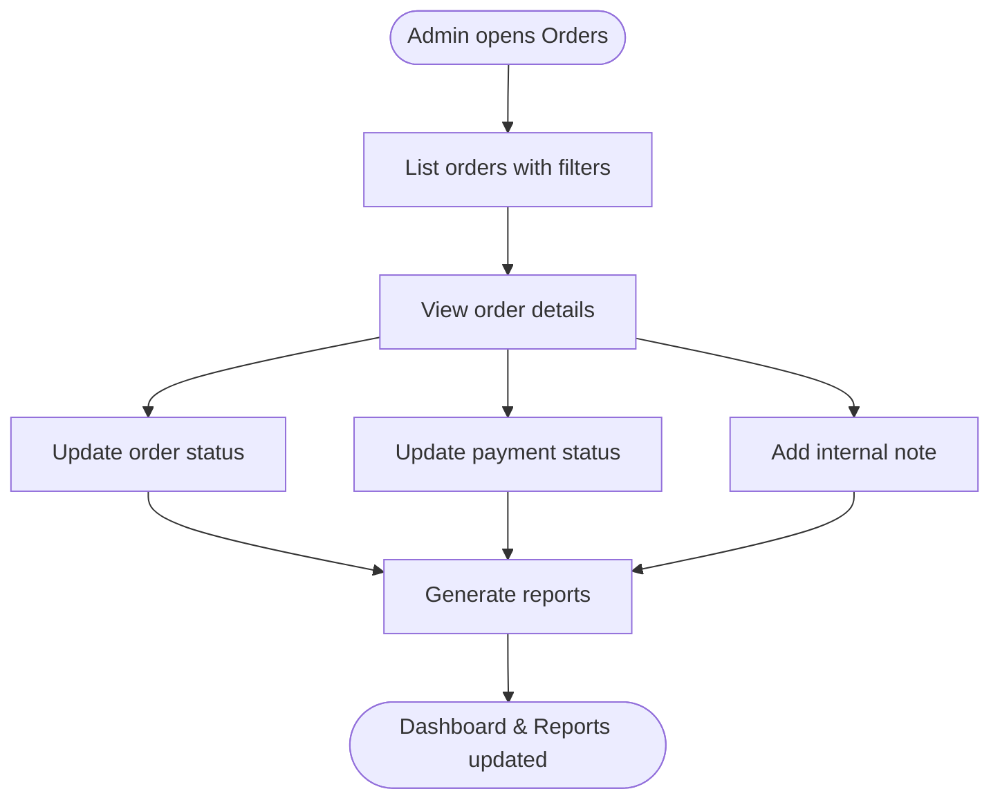
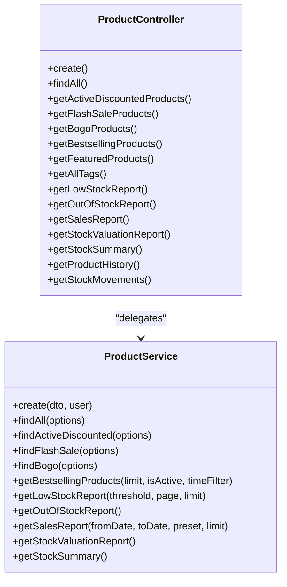
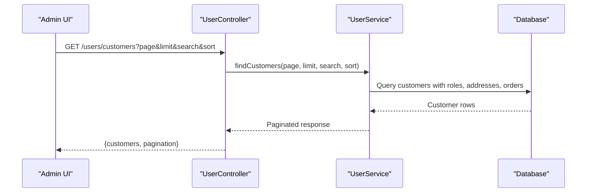
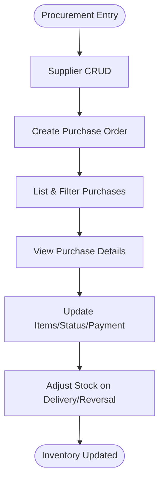
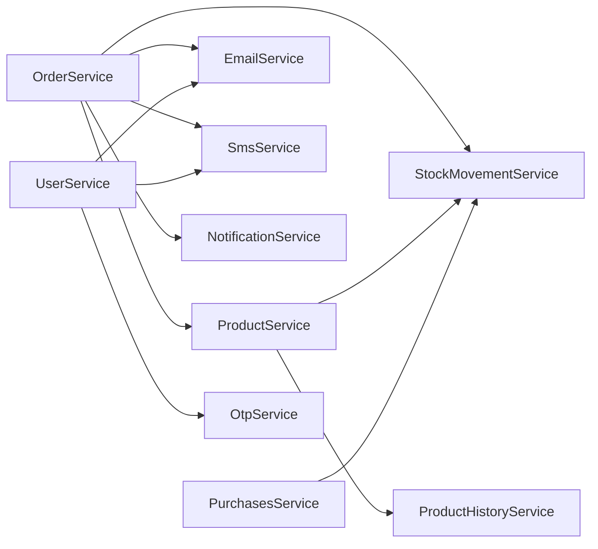

# Business Operations Management

<cite>
**Referenced Files in This Document**
- [order.controller.ts](file://apps/backend/src/order/order.controller.ts)
- [order.service.ts](file://apps/backend/src/order/order.service.ts)
- [product.controller.ts](file://apps/backend/src/product/product.controller.ts)
- [product.service.ts](file://apps/backend/src/product/product.service.ts)
- [user.controller.ts](file://apps/backend/src/user/user.controller.ts)
- [user.service.ts](file://apps/backend/src/user/user.service.ts)
- [purchase.controller.ts](file://apps/backend/src/purchase/purchase.controller.ts)
- [purchase.service.ts](file://apps/backend/src/purchase/purchase.service.ts)
- [supplier.controller.ts](file://apps/backend/src/supplier/supplier.controller.ts)
- [supplier.service.ts](file://apps/backend/src/supplier/supplier.service.ts)
</cite>

## Table of Contents
1. [Introduction](#introduction)
2. [Project Structure](#project-structure)
3. [Core Components](#core-components)
4. [Architecture Overview](#architecture-overview)
5. [Detailed Component Analysis](#detailed-component-analysis)
6. [Dependency Analysis](#dependency-analysis)
7. [Performance Considerations](#performance-considerations)
8. [Troubleshooting Guide](#troubleshooting-guide)
9. [Conclusion](#conclusion)

## Introduction
This document explains business operations management for the admin dashboard, focusing on order administration, product management, customer management, and procurement operations. It maps backend controllers and services to operational workflows such as order listing and filtering, payment status updates, product inventory tracking, stock movement auditing, supplier and purchase order management, and reporting endpoints used by the admin UI.

The goal is to help administrators understand how orders flow through the system, how inventory changes are tracked, how customers are managed, and how procurement integrates with stock levels.

## Project Structure
The relevant backend modules are organized by domain:
- Orders: order listing, lifecycle transitions, notes, payment status, and reports.
- Products: catalog CRUD, discounts, flash-sale/BOGO integration, stock valuation, history, and movements.
- Users: customer lists, top customers, user profile retrieval, and customer reports.
- Procurement: suppliers and purchase orders with stock adjustments.

**Diagram sources**
- [order.controller.ts:39-44](file://apps/backend/src/order/order.controller.ts#L39-L44)
- [product.controller.ts:49-58](file://apps/backend/src/product/product.controller.ts#L49-L58)
- [user.controller.ts:37-42](file://apps/backend/src/user/user.controller.ts#L37-L42)
- [purchase.controller.ts:35-41](file://apps/backend/src/purchase/purchase.controller.ts#L35-L41)
- [supplier.controller.ts:36-42](file://apps/backend/src/supplier/supplier.controller.ts#L36-L42)

**Section sources**
- [order.controller.ts:39-44](file://apps/backend/src/order/order.controller.ts#L39-L44)
- [product.controller.ts:49-58](file://apps/backend/src/product/product.controller.ts#L49-L58)
- [user.controller.ts:37-42](file://apps/backend/src/user/user.controller.ts#L37-L42)
- [purchase.controller.ts:35-41](file://apps/backend/src/purchase/purchase.controller.ts#L35-L41)
- [supplier.controller.ts:36-42](file://apps/backend/src/supplier/supplier.controller.ts#L36-L42)

## Core Components
- Order Administration
  - List orders with pagination, search, sorting, and filters by order status, payment status, payment method, shipping method, area, division, and city.
  - View single order details and neighbor navigation.
  - Update order status and add internal notes.
  - Update payment status.
  - Access dashboard and report endpoints for statistics, date-range reports, daily summaries, refunds, delivery performance, area-wise orders, monthly data, and last-30-days delivered series.

- Product Management
  - Create, list, filter, sort, and retrieve products.
  - Discounted, flash-sale, BOGO, bestsellers, featured, and tag endpoints.
  - Inventory reports: low stock, out-of-stock, sales, stock valuation, stock summary.
  - Product history audit trail and stock movement ledger.

- Customer Management
  - List customers with pagination and search.
  - Retrieve non-customer users (staff/admin).
  - Top customers by orders or spending with time filters.
  - Customer list report with registration date range support.
  - Get a customer profile with addresses and delivered order history.

- Procurement Operations
  - Supplier CRUD with search, active status, and pagination.
  - Purchase order creation with multiple items, status and payment tracking.
  - Purchase listing with filters by product, supplier, status, payment status, and date ranges.
  - Stock adjustments when purchases are delivered or reversed.

**Section sources**
- [order.controller.ts:59-158](file://apps/backend/src/order/order.controller.ts#L59-L158)
- [order.controller.ts:182-312](file://apps/backend/src/order/order.controller.ts#L182-L312)
- [order.controller.ts:316-800](file://apps/backend/src/order/order.controller.ts#L316-L800)
- [product.controller.ts:60-85](file://apps/backend/src/product/product.controller.ts#L60-L85)
- [product.controller.ts:87-250](file://apps/backend/src/product/product.controller.ts#L87-L250)
- [product.controller.ts:252-515](file://apps/backend/src/product/product.controller.ts#L252-L515)
- [product.controller.ts:517-800](file://apps/backend/src/product/product.controller.ts#L517-L800)
- [user.controller.ts:42-82](file://apps/backend/src/user/user.controller.ts#L42-L82)
- [user.controller.ts:83-131](file://apps/backend/src/user/user.controller.ts#L83-L131)
- [user.controller.ts:132-195](file://apps/backend/src/user/user.controller.ts#L132-L195)
- [user.controller.ts:197-258](file://apps/backend/src/user/user.controller.ts#L197-L258)
- [user.controller.ts:260-346](file://apps/backend/src/user/user.controller.ts#L260-L346)
- [purchase.controller.ts:43-67](file://apps/backend/src/purchase/purchase.controller.ts#L43-L67)
- [purchase.controller.ts:68-141](file://apps/backend/src/purchase/purchase.controller.ts#L68-L141)
- [purchase.controller.ts:142-217](file://apps/backend/src/purchase/purchase.controller.ts#L142-L217)
- [supplier.controller.ts:43-63](file://apps/backend/src/supplier/supplier.controller.ts#L43-L63)
- [supplier.controller.ts:64-129](file://apps/backend/src/supplier/supplier.controller.ts#L64-L129)
- [supplier.controller.ts:130-201](file://apps/backend/src/supplier/supplier.controller.ts#L130-L201)

## Architecture Overview
The admin dashboard interacts with REST endpoints exposed by NestJS controllers. Controllers validate requests, enforce permissions, and delegate business logic to services. Services coordinate repositories, external services (email, SMS, notifications), and related domains (stock movements, campaigns, coupons).

**Diagram sources**
- [order.controller.ts:59-158](file://apps/backend/src/order/order.controller.ts#L59-L158)
- [order.service.ts:46-101](file://apps/backend/src/order/order.service.ts#L46-L101)

## Detailed Component Analysis

### Order Administration
Order administration supports full lifecycle management:
- Listing and filtering:
  - Pagination via page and limit.
  - Search by order number.
  - Sorting by date ascending/descending.
  - Filters: orderStatus, paymentStatus, paymentMethodId, shippingMethodId, area, division, city.
- Details and navigation:
  - Single order by ID with rich relations.
  - Neighbor IDs for previous/next order navigation.
- Lifecycle operations:
  - Update order status with an optional note.
  - Add internal notes to an order.
  - Update payment status.
- Reporting:
  - Dashboard reports aggregated in one endpoint.
  - Date-range order report with presets and filters.
  - Daily summary, refund report, deliveryman performance, area-wise orders.
  - Statistics by status, monthly reports, years dropdown, last-30-days delivered series, today snapshot.

**Diagram sources**
- [order.controller.ts:59-158](file://apps/backend/src/order/order.controller.ts#L59-L158)
- [order.controller.ts:182-312](file://apps/backend/src/order/order.controller.ts#L182-L312)
- [order.controller.ts:316-800](file://apps/backend/src/order/order.controller.ts#L316-L800)

Key implementation highlights:
- Order listing uses query parameters for comprehensive filtering and returns paginated results with total counts.
- Order detail retrieval includes extensive relations (user, address, shipping/payment methods, payments, items, coupon, status tracks, notes, delivery man).
- Status and payment updates are permission-gated and return updated order objects.
- Report endpoints provide pre-aggregated metrics suitable for dashboard charts and tables.

**Section sources**
- [order.controller.ts:59-158](file://apps/backend/src/order/order.controller.ts#L59-L158)
- [order.controller.ts:182-312](file://apps/backend/src/order/order.controller.ts#L182-L312)
- [order.controller.ts:316-800](file://apps/backend/src/order/order.controller.ts#L316-L800)
- [order.service.ts:696-735](file://apps/backend/src/order/order.service.ts#L696-L735)

### Product Management
Product management covers catalog operations, promotions, inventory tracking, and audits:
- Catalog CRUD:
  - Create product with brand, category, unit, supplier, gallery, attachment.
  - List products with filters: category, brand, supplier, featured, search, price range, tags, discount flags, active status.
  - Sort by price or name.
- Promotions and storefront views:
  - Active discounted products.
  - Flash-sale products.
  - BOGO products.
  - Bestsellers with time windows.
  - Featured products.
  - Tags enumeration.
- Inventory and reporting:
  - Low stock and out-of-stock reports.
  - Sales report per product over date ranges.
  - Stock valuation and stock summary.
- Auditing and movements:
  - Product history audit trail.
  - Stock movement ledger across all products.

**Diagram sources**
- [product.controller.ts:60-85](file://apps/backend/src/product/product.controller.ts#L60-L85)
- [product.controller.ts:87-250](file://apps/backend/src/product/product.controller.ts#L87-L250)
- [product.controller.ts:252-515](file://apps/backend/src/product/product.controller.ts#L252-L515)
- [product.controller.ts:517-800](file://apps/backend/src/product/product.controller.ts#L517-L800)
- [product.service.ts:127-173](file://apps/backend/src/product/product.service.ts#L127-L173)
- [product.service.ts:175-302](file://apps/backend/src/product/product.service.ts#L175-L302)

Operational notes:
- Product list queries use selective field selection and optimized count queries to reduce payload size and improve performance.
- Promotion endpoints integrate with campaign services to compute effective pricing without caching stale promotion data.
- Inventory reports expose actionable insights for restocking and valuation.
- History and stock movement endpoints provide traceability for compliance and reconciliation.

**Section sources**
- [product.controller.ts:60-85](file://apps/backend/src/product/product.controller.ts#L60-L85)
- [product.controller.ts:87-250](file://apps/backend/src/product/product.controller.ts#L87-L250)
- [product.controller.ts:252-515](file://apps/backend/src/product/product.controller.ts#L252-L515)
- [product.controller.ts:517-800](file://apps/backend/src/product/product.controller.ts#L517-L800)
- [product.service.ts:127-173](file://apps/backend/src/product/product.service.ts#L127-L173)
- [product.service.ts:175-302](file://apps/backend/src/product/product.service.ts#L175-L302)

### Customer Management
Customer management provides administrative visibility into customer profiles and activity:
- Customer listing:
  - Paginated list with search by name, email, mobile number.
  - Includes role, profile photo, addresses, and order references.
- Non-customer users:
  - Staff/admin listing with role filtering and search.
- Top customers:
  - Ranked by total orders or total spending with time filters.
  - Includes statistics like completed and pending orders.
- Customer list report:
  - Registration date range filtering with summary totals.
- Profile view:
  - Full profile including addresses and delivered order history with item-level details.

**Diagram sources**
- [user.controller.ts:42-82](file://apps/backend/src/user/user.controller.ts#L42-L82)
- [user.service.ts:118-187](file://apps/backend/src/user/user.service.ts#L118-L187)

Operational notes:
- Customer queries join roles, profile photos, addresses, and orders to present a unified view.
- Top customers aggregation computes order counts and spending within configurable time windows.
- Customer list report aggregates registration-based cohorts with order totals.

**Section sources**
- [user.controller.ts:42-82](file://apps/backend/src/user/user.controller.ts#L42-L82)
- [user.controller.ts:83-131](file://apps/backend/src/user/user.controller.ts#L83-L131)
- [user.controller.ts:132-195](file://apps/backend/src/user/user.controller.ts#L132-L195)
- [user.controller.ts:197-258](file://apps/backend/src/user/user.controller.ts#L197-L258)
- [user.controller.ts:260-346](file://apps/backend/src/user/user.controller.ts#L260-L346)
- [user.service.ts:118-187](file://apps/backend/src/user/user.service.ts#L118-L187)
- [user.service.ts:357-479](file://apps/backend/src/user/user.service.ts#L357-L479)
- [user.service.ts:481-559](file://apps/backend/src/user/user.service.ts#L481-L559)

### Procurement Operations
Procurement operations manage suppliers and purchase orders, integrating with inventory:
- Supplier management:
  - Create, read, update, delete suppliers.
  - List with search, active status, and pagination.
- Purchase orders:
  - Create multi-item purchase orders linked to a supplier.
  - List with filters by product, supplier, status, payment status, and date ranges.
  - Read details with items, supplier info, payments, and audit fields.
  - Update items, status, and payment information; adjust stock on delivery/reversal.
  - Delete purchase orders with stock reversal if delivered.

**Diagram sources**
- [supplier.controller.ts:43-63](file://apps/backend/src/supplier/supplier.controller.ts#L43-L63)
- [supplier.controller.ts:64-129](file://apps/backend/src/supplier/supplier.controller.ts#L64-L129)
- [supplier.controller.ts:130-201](file://apps/backend/src/supplier/supplier.controller.ts#L130-L201)
- [purchase.controller.ts:43-67](file://apps/backend/src/purchase/purchase.controller.ts#L43-L67)
- [purchase.controller.ts:68-141](file://apps/backend/src/purchase/purchase.controller.ts#L68-L141)
- [purchase.controller.ts:142-217](file://apps/backend/src/purchase/purchase.controller.ts#L142-L217)
- [purchase.service.ts:45-103](file://apps/backend/src/purchase/purchase.service.ts#L45-L103)
- [purchase.service.ts:105-178](file://apps/backend/src/purchase/purchase.service.ts#L105-L178)
- [purchase.service.ts:201-273](file://apps/backend/src/purchase/purchase.service.ts#L201-L273)
- [purchase.service.ts:275-383](file://apps/backend/src/purchase/purchase.service.ts#L275-L383)

Operational notes:
- Purchase creation validates supplier and product references, calculates totals, and sets payment status based on amount paid.
- Purchase updates handle item revisions, status transitions, and stock adjustments using a centralized stock movement service.
- Supplier listing includes attachments and product associations for vendor catalogs.

**Section sources**
- [supplier.controller.ts:43-63](file://apps/backend/src/supplier/supplier.controller.ts#L43-L63)
- [supplier.controller.ts:64-129](file://apps/backend/src/supplier/supplier.controller.ts#L64-L129)
- [supplier.controller.ts:130-201](file://apps/backend/src/supplier/supplier.controller.ts#L130-L201)
- [supplier.service.ts:23-34](file://apps/backend/src/supplier/supplier.service.ts#L23-L34)
- [supplier.service.ts:36-74](file://apps/backend/src/supplier/supplier.service.ts#L36-L74)
- [supplier.service.ts:76-110](file://apps/backend/src/supplier/supplier.service.ts#L76-L110)
- [purchase.controller.ts:43-67](file://apps/backend/src/purchase/purchase.controller.ts#L43-L67)
- [purchase.controller.ts:68-141](file://apps/backend/src/purchase/purchase.controller.ts#L68-L141)
- [purchase.controller.ts:142-217](file://apps/backend/src/purchase/purchase.controller.ts#L142-L217)
- [purchase.service.ts:45-103](file://apps/backend/src/purchase/purchase.service.ts#L45-L103)
- [purchase.service.ts:105-178](file://apps/backend/src/purchase/purchase.service.ts#L105-L178)
- [purchase.service.ts:201-273](file://apps/backend/src/purchase/purchase.service.ts#L201-L273)
- [purchase.service.ts:275-383](file://apps/backend/src/purchase/purchase.service.ts#L275-L383)

## Dependency Analysis
Cross-domain dependencies:
- OrderService depends on:
  - Product repository for stock checks and sale counting.
  - Address, shipping method, payment method repositories.
  - Coupon usage logging and campaign services (flash sale, BOGO, free delivery).
  - Email, SMS, and notification services for confirmations and alerts.
  - StockMovementService to record order sales against inventory.
- ProductService depends on:
  - Brand, category, supplier, unit, attachment repositories.
  - Campaign services for flash sale and BOGO enrichment.
  - ProductHistoryService for audit trails.
  - StockMovementService for inventory change records.
- PurchasesService depends on:
  - Product and supplier repositories.
  - StockMovementService to adjust inventory on delivery/reversal.
- UserService depends on:
  - Role repository for user classification.
  - OTP, SMS, and email services for authentication flows.

**Diagram sources**
- [order.service.ts:1-101](file://apps/backend/src/order/order.service.ts#L1-L101)
- [product.service.ts:1-82](file://apps/backend/src/product/product.service.ts#L1-L82)
- [purchase.service.ts:1-43](file://apps/backend/src/purchase/purchase.service.ts#L1-L43)
- [user.service.ts:1-42](file://apps/backend/src/user/user.service.ts#L1-L42)

**Section sources**
- [order.service.ts:1-101](file://apps/backend/src/order/order.service.ts#L1-L101)
- [product.service.ts:1-82](file://apps/backend/src/product/product.service.ts#L1-L82)
- [purchase.service.ts:1-43](file://apps/backend/src/purchase/purchase.service.ts#L1-L43)
- [user.service.ts:1-42](file://apps/backend/src/user/user.service.ts#L1-L42)

## Performance Considerations
- Caching strategies:
  - Product list responses use SWR-style caching with short fresh TTL and longer stale-while-revalidate to avoid database thundering herds under load.
  - Storefront endpoints (discounted, flash-sale, BOGO, bestsellers, featured, tags) apply HTTP cache headers and cache keys to reduce repeated computation.
- Query optimization:
  - Product list selects only necessary fields and uses separate count queries to minimize payload size and improve throughput.
  - Bestseller and promotional queries leverage cached campaign lists rather than heavy joins.
- Aggregation endpoints:
  - Dashboard and report endpoints aggregate data server-side to reduce client-side processing and multiple round trips.

[No sources needed since this section provides general guidance]

## Troubleshooting Guide
Common issues and resolutions:
- Order creation failures:
  - Inactive products or insufficient stock result in validation errors.
  - Shipping method requiring online payment conflicts with cash-on-delivery selection.
  - Missing references (user, address, shipping method, payment method, coupon) cause not found exceptions.
- Payment and discount anomalies:
  - Ensure coupon validity dates and exclusion rules are correctly configured.
  - Verify flash sale and BOGO campaign eligibility and usage limits.
- Stock discrepancies:
  - Check stock movement logs for purchase reversals and order sales.
  - Confirm purchase status transitions trigger appropriate stock adjustments.
- Customer data inconsistencies:
  - Validate role assignments for customer vs staff/admin separation.
  - Confirm address default flags and area population for top customer analytics.

**Section sources**
- [order.service.ts:103-173](file://apps/backend/src/order/order.service.ts#L103-L173)
- [order.service.ts:190-290](file://apps/backend/src/order/order.service.ts#L190-L290)
- [order.service.ts:310-432](file://apps/backend/src/order/order.service.ts#L310-L432)
- [purchase.service.ts:275-383](file://apps/backend/src/purchase/purchase.service.ts#L275-L383)
- [user.service.ts:561-629](file://apps/backend/src/user/user.service.ts#L561-L629)

## Conclusion
The admin dashboard’s business operations are backed by well-structured controllers and services that enforce permissions, validate inputs, and coordinate cross-domain workflows. Orders drive inventory changes and generate rich reports; products integrate promotions and maintain auditable stock movements; customers are searchable and analyzable; and procurement ties supplier relationships to purchase orders and inventory replenishment. Together, these components enable comprehensive order administration, product management, customer oversight, and supply chain tracking within the admin interface.

[No sources needed since this section summarizes without analyzing specific files]