# Customer Management

<cite>
**Referenced Files in This Document**   
- [apps/frontend/app/admin/customer/customer-list/page.tsx](file://apps/frontend/app/admin/customer/customer-list/page.tsx)
- [apps/frontend/app/admin/customer/[id]/view/page.tsx](file://apps/frontend/app/admin/customer/[id]/view/page.tsx)
- [apps/frontend/components/admin/customer/customer-list.tsx](file://apps/frontend/components/admin/customer/customer-list.tsx)
- [apps/frontend/components/admin/customer/CustomerDetail.tsx](file://apps/frontend/components/admin/customer/CustomerDetail.tsx)
- [apps/frontend/app/admin/crm/customers/[id]/page.tsx](file://apps/frontend/app/admin/crm/customers/[id]/page.tsx)
- [apps/frontend/components/admin/crm/crm-customer-detail.tsx](file://apps/frontend/components/admin/crm/crm-customer-detail.tsx)
- [apps/backend/src/user/entities/user.entity.ts](file://apps/backend/src/user/entities/user.entity.ts)
- [apps/backend/src/address/entities/address.entity.ts](file://apps/backend/src/address/entities/address.entity.ts)
- [apps/backend/src/order/entities/order.entity.ts](file://apps/backend/src/order/entities/order.entity.ts)
- [apps/backend/src/user/user.controller.ts](file://apps/backend/src/user/user.controller.ts)
- [apps/backend/src/address/address.controller.ts](file://apps/backend/src/address/address.controller.ts)
- [apps/backend/src/order/order.controller.ts](file://apps/backend/src/order/order.controller.ts)
- [apps/backend/src/crm/crm.controller.ts](file://apps/backend/src/crm/crm.controller.ts)
- [apps/backend/src/crm/crm.service.ts](file://apps/backend/src/crm/crm.service.ts)
</cite>

## Table of Contents
1. Introduction
2. Project Structure
3. Core Components
4. Architecture Overview
5. Detailed Component Analysis
6. Dependency Analysis
7. Performance Considerations
8. Troubleshooting Guide
9. Conclusion
10. Appendices

## Introduction
This document explains the customer management system exposed through the admin dashboard. It covers:
- Customer profile management including personal information, contact details, and account status
- Customer order history viewing with filtering capabilities and order details access
- Address management including multiple addresses per customer, default address setting, and validation
- Customer support integration including ticket-like activity management, communication history, and customer segmentation
- Customer analytics such as purchase patterns, lifetime value, and engagement metrics
- Customer account operations like activation/deactivation, role management, and bulk customer operations
- Common workflows for viewing profiles, managing addresses, and analyzing behavior

The system is split between a Next.js frontend under `apps/frontend` and a NestJS backend under `apps/backend`. The CRM module adds segmentation, campaigns, and activity tracking on top of core user, address, and order data.

## Project Structure
Customer-related functionality spans several modules:
- Frontend customer list and detail pages
- CRM 360 view and activities
- Backend user, address, order, and CRM controllers/services
- Data models for users, addresses, and orders

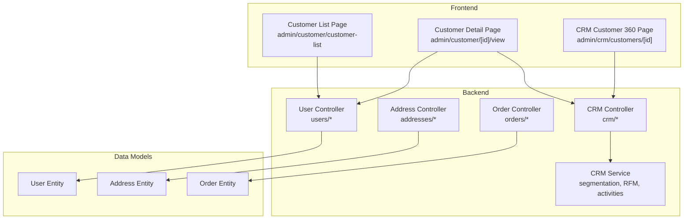

**Diagram sources**
- [apps/frontend/app/admin/customer/customer-list/page.tsx:1-20](file://apps/frontend/app/admin/customer/customer-list/page.tsx#L1-L20)
- [apps/frontend/app/admin/customer/[id]/view/page.tsx:1-17](file://apps/frontend/app/admin/customer/[id]/view/page.tsx#L1-L17)
- [apps/frontend/app/admin/crm/customers/[id]/page.tsx:1-15](file://apps/frontend/app/admin/crm/customers/[id]/page.tsx#L1-L15)
- [apps/backend/src/user/user.controller.ts:37-82](file://apps/backend/src/user/user.controller.ts#L37-L82)
- [apps/backend/src/address/address.controller.ts:38-89](file://apps/backend/src/address/address.controller.ts#L38-L89)
- [apps/backend/src/order/order.controller.ts:39-158](file://apps/backend/src/order/order.controller.ts#L39-L158)
- [apps/backend/src/crm/crm.controller.ts:29-41](file://apps/backend/src/crm/crm.controller.ts#L29-L41)
- [apps/backend/src/crm/crm.service.ts:103-130](file://apps/backend/src/crm/crm.service.ts#L103-L130)
- [apps/backend/src/user/entities/user.entity.ts:22-60](file://apps/backend/src/user/entities/user.entity.ts#L22-L60)
- [apps/backend/src/address/entities/address.entity.ts:13-46](file://apps/backend/src/address/entities/address.entity.ts#L13-L46)
- [apps/backend/src/order/entities/order.entity.ts:24-57](file://apps/backend/src/order/entities/order.entity.ts#L24-L57)

**Section sources**
- [apps/frontend/app/admin/customer/customer-list/page.tsx:1-20](file://apps/frontend/app/admin/customer/customer-list/page.tsx#L1-L20)
- [apps/frontend/app/admin/customer/[id]/view/page.tsx:1-17](file://apps/frontend/app/admin/customer/[id]/view/page.tsx#L1-L17)
- [apps/frontend/app/admin/crm/customers/[id]/page.tsx:1-15](file://apps/frontend/app/admin/crm/customers/[id]/page.tsx#L1-L15)
- [apps/backend/src/user/user.controller.ts:37-82](file://apps/backend/src/user/user.controller.ts#L37-L82)
- [apps/backend/src/address/address.controller.ts:38-89](file://apps/backend/src/address/address.controller.ts#L38-L89)
- [apps/backend/src/order/order.controller.ts:39-158](file://apps/backend/src/order/order.controller.ts#L39-L158)
- [apps/backend/src/crm/crm.controller.ts:29-41](file://apps/backend/src/crm/crm.controller.ts#L29-L41)
- [apps/backend/src/crm/crm.service.ts:103-130](file://apps/backend/src/crm/crm.service.ts#L103-L130)
- [apps/backend/src/user/entities/user.entity.ts:22-60](file://apps/backend/src/user/entities/user.entity.ts#L22-L60)
- [apps/backend/src/address/entities/address.entity.ts:13-46](file://apps/backend/src/address/entities/address.entity.ts#L13-L46)
- [apps/backend/src/order/entities/order.entity.ts:24-57](file://apps/backend/src/order/entities/order.entity.ts#L24-L57)

## Core Components
- Customer list page: paginated table with search by name, email, or phone; shows verification status, area, join date, last login; links to view/edit.
- Customer detail page: profile strip, order stats, tabs for orders, cart/wishlist, shipping addresses, reviews, messages, and activities; supports adding/updating/deleting activities via CRM endpoints.
- CRM 360 page: unified view with RFM segment badge, recent orders, cart/wishlist, addresses, reviews, messages, and activities; includes campaign preview and export features at the CRM layer.
- Backend user controller: lists customers with pagination/search, retrieves single user, updates/removes users, provides top customers and reports.
- Backend address controller: CRUD for addresses, default address retrieval, listing by user ID with permission checks.
- Backend order controller: filters orders by status/payment/method/area/division/city, reads orders by user, updates statuses and payment status, exposes reporting endpoints.
- CRM controller/service: segmented customer list, CSV export, customer 360 payload, global and per-customer activities, campaign creation/sending, segment rules.

**Section sources**
- [apps/frontend/components/admin/customer/customer-list.tsx:48-115](file://apps/frontend/components/admin/customer/customer-list.tsx#L48-L115)
- [apps/frontend/components/admin/customer/CustomerDetail.tsx:127-182](file://apps/frontend/components/admin/customer/CustomerDetail.tsx#L127-L182)
- [apps/frontend/components/admin/crm/crm-customer-detail.tsx:165-208](file://apps/frontend/components/admin/crm/crm-customer-detail.tsx#L165-L208)
- [apps/backend/src/user/user.controller.ts:42-82](file://apps/backend/src/user/user.controller.ts#L42-L82)
- [apps/backend/src/address/address.controller.ts:45-109](file://apps/backend/src/address/address.controller.ts#L45-L109)
- [apps/backend/src/order/order.controller.ts:59-158](file://apps/backend/src/order/order.controller.ts#L59-L158)
- [apps/backend/src/crm/crm.controller.ts:37-41](file://apps/backend/src/crm/crm.controller.ts#L37-L41)
- [apps/backend/src/crm/crm.service.ts:167-296](file://apps/backend/src/crm/crm.service.ts#L167-L296)

## Architecture Overview
The admin dashboard composes UI components that call REST endpoints. The CRM module enriches basic user/order/address data with RFM segmentation, activities, and campaign tools.

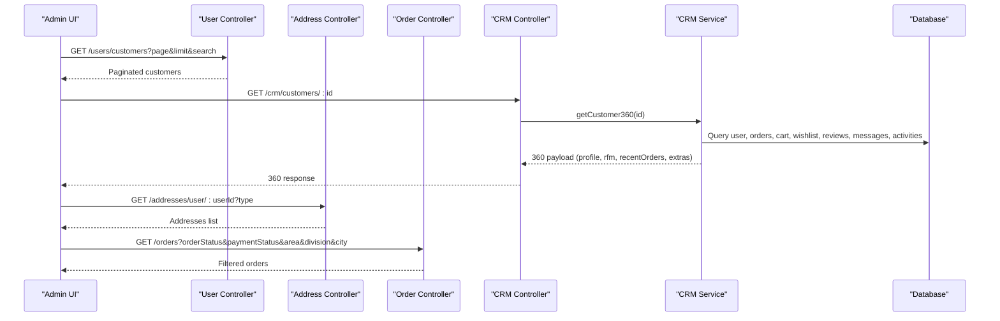

**Diagram sources**
- [apps/backend/src/user/user.controller.ts:42-82](file://apps/backend/src/user/user.controller.ts#L42-L82)
- [apps/backend/src/crm/crm.controller.ts:160-165](file://apps/backend/src/crm/crm.controller.ts#L160-L165)
- [apps/backend/src/crm/crm.service.ts:540-629](file://apps/backend/src/crm/crm.service.ts#L540-L629)
- [apps/backend/src/address/address.controller.ts:176-219](file://apps/backend/src/address/address.controller.ts#L176-L219)
- [apps/backend/src/order/order.controller.ts:59-158](file://apps/backend/src/order/order.controller.ts#L59-L158)

## Detailed Component Analysis

### Customer Profile Management
- Personal information: name, email, mobile number, profile photo, verification status, join date, last login.
- Account status: verified/unverified; role defaults to customer role id 3.
- Editing: available via edit routes guarded by permissions.

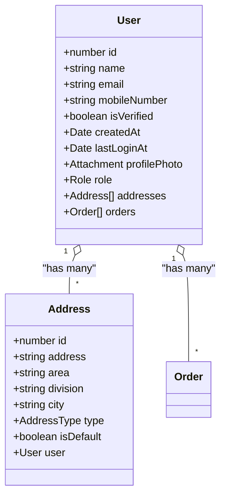

**Diagram sources**
- [apps/backend/src/user/entities/user.entity.ts:22-60](file://apps/backend/src/user/entities/user.entity.ts#L22-L60)
- [apps/backend/src/address/entities/address.entity.ts:13-46](file://apps/backend/src/address/entities/address.entity.ts#L13-L46)
- [apps/backend/src/order/entities/order.entity.ts:24-57](file://apps/backend/src/order/entities/order.entity.ts#L24-L57)

**Section sources**
- [apps/backend/src/user/entities/user.entity.ts:22-130](file://apps/backend/src/user/entities/user.entity.ts#L22-L130)
- [apps/backend/src/address/entities/address.entity.ts:13-46](file://apps/backend/src/address/entities/address.entity.ts#L13-L46)

### Customer Order History Viewing
- Orders are listed per customer with status badges, payment method, shipping method, totals, discounts, and due amounts.
- Filtering across all orders supports order status, payment status, payment method, shipping method, area, division, and city.
- Navigation from customer detail to order view is supported.

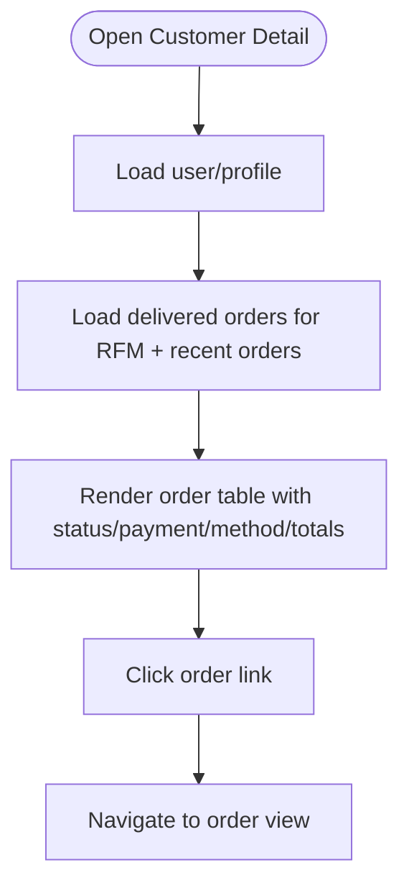

**Diagram sources**
- [apps/frontend/components/admin/customer/CustomerDetail.tsx:560-643](file://apps/frontend/components/admin/customer/CustomerDetail.tsx#L560-L643)
- [apps/backend/src/order/order.controller.ts:59-158](file://apps/backend/src/order/order.controller.ts#L59-L158)

**Section sources**
- [apps/frontend/components/admin/customer/CustomerDetail.tsx:560-643](file://apps/frontend/components/admin/customer/CustomerDetail.tsx#L560-L643)
- [apps/backend/src/order/order.controller.ts:59-158](file://apps/backend/src/order/order.controller.ts#L59-L158)

### Address Management
- Multiple addresses per customer with type and default flag.
- Default address selection logic used to surface area in lists and 360 header.
- Admins can list any user’s addresses; regular users restricted to their own.

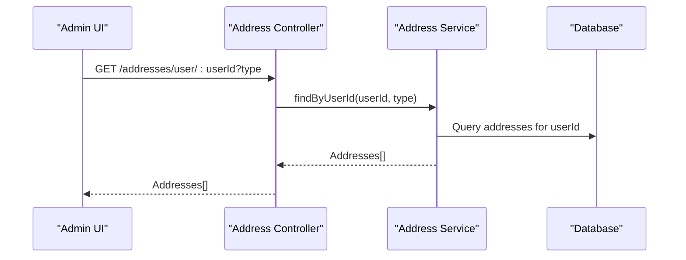

**Diagram sources**
- [apps/backend/src/address/address.controller.ts:176-219](file://apps/backend/src/address/address.controller.ts#L176-L219)

**Section sources**
- [apps/backend/src/address/address.controller.ts:45-109](file://apps/backend/src/address/address.controller.ts#L45-L109)
- [apps/backend/src/address/address.controller.ts:176-219](file://apps/backend/src/address/address.controller.ts#L176-L219)
- [apps/backend/src/address/entities/address.entity.ts:13-46](file://apps/backend/src/address/entities/address.entity.ts#L13-L46)

### Customer Support Integration
- Activities: notes, tasks, calls, emails per customer; global activity feed with filters by type/status/overdue.
- Communication history: product reviews and contact messages surfaced in 360.
- Segmentation: RFM-based segments computed dynamically; configurable thresholds via business settings.

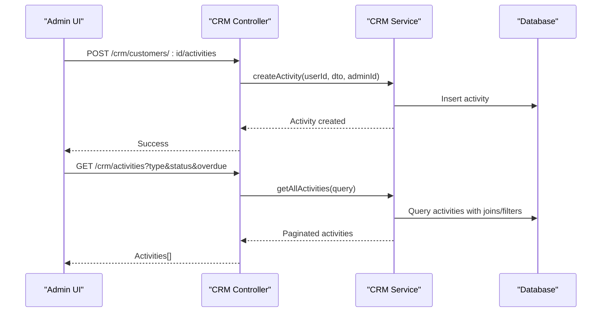

**Diagram sources**
- [apps/backend/src/crm/crm.controller.ts:169-202](file://apps/backend/src/crm/crm.controller.ts#L169-L202)
- [apps/backend/src/crm/crm.controller.ts:204-247](file://apps/backend/src/crm/crm.controller.ts#L204-L247)
- [apps/backend/src/crm/crm.service.ts:634-789](file://apps/backend/src/crm/crm.service.ts#L634-L789)

**Section sources**
- [apps/backend/src/crm/crm.controller.ts:169-247](file://apps/backend/src/crm/crm.controller.ts#L169-L247)
- [apps/backend/src/crm/crm.service.ts:634-789](file://apps/backend/src/crm/crm.service.ts#L634-L789)

### Customer Analytics
- RFM metrics: order count, total spent, average order value, last order date, segment.
- Segment computation uses SQL CASE over delivered orders and timestamps; thresholds configurable via business settings.
- Top customers endpoint returns rankings by orders or spending with optional time filters.
- Reports include customer list report, order statistics, monthly reports, and more.

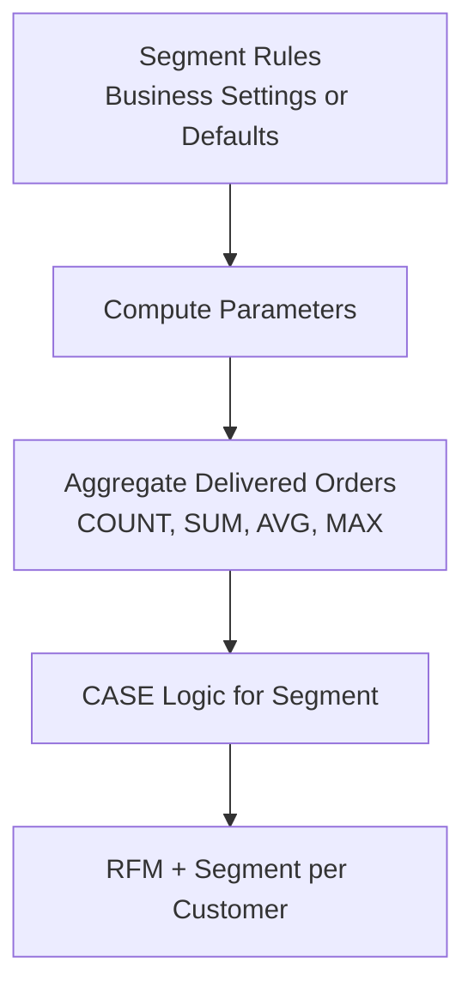

**Diagram sources**
- [apps/backend/src/crm/crm.service.ts:38-48](file://apps/backend/src/crm/crm.service.ts#L38-L48)
- [apps/backend/src/crm/crm.service.ts:56-75](file://apps/backend/src/crm/crm.service.ts#L56-L75)
- [apps/backend/src/crm/crm.service.ts:137-161](file://apps/backend/src/crm/crm.service.ts#L137-L161)
- [apps/backend/src/crm/crm.service.ts:167-296](file://apps/backend/src/crm/crm.service.ts#L167-L296)

**Section sources**
- [apps/backend/src/crm/crm.service.ts:38-48](file://apps/backend/src/crm/crm.service.ts#L38-L48)
- [apps/backend/src/crm/crm.service.ts:56-75](file://apps/backend/src/crm/crm.service.ts#L56-L75)
- [apps/backend/src/crm/crm.service.ts:137-161](file://apps/backend/src/crm/crm.service.ts#L137-L161)
- [apps/backend/src/crm/crm.service.ts:167-296](file://apps/backend/src/crm/crm.service.ts#L167-L296)
- [apps/backend/src/user/user.controller.ts:132-195](file://apps/backend/src/user/user.controller.ts#L132-L195)

### Customer Account Operations
- Activation/deactivation: not explicitly modeled as an enabled/disabled flag; verification status is present.
- Role management: user entity stores roleId with default customer role id 3; roles are separate entities.
- Bulk operations: CSV export of filtered customers via CRM endpoint; top customers and reports provide aggregated views.

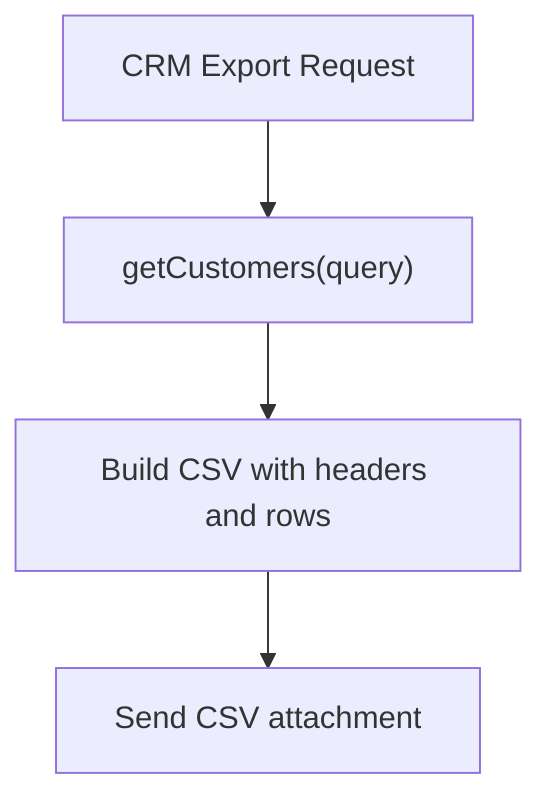

**Diagram sources**
- [apps/backend/src/crm/crm.controller.ts:101-158](file://apps/backend/src/crm/crm.controller.ts#L101-L158)
- [apps/backend/src/crm/crm.service.ts:301-309](file://apps/backend/src/crm/crm.service.ts#L301-L309)

**Section sources**
- [apps/backend/src/user/entities/user.entity.ts:62-77](file://apps/backend/src/user/entities/user.entity.ts#L62-L77)
- [apps/backend/src/crm/crm.controller.ts:101-158](file://apps/backend/src/crm/crm.controller.ts#L101-L158)
- [apps/backend/src/crm/crm.service.ts:301-309](file://apps/backend/src/crm/crm.service.ts#L301-L309)

### Common Workflows

#### Viewing Customer Profiles
- Navigate to customer list, open a row to view profile, orders, cart/wishlist, addresses, reviews, messages, and activities.
- The detail page fetches both user data and CRM extras; if CRM fails, the page still renders with missing extra tabs.

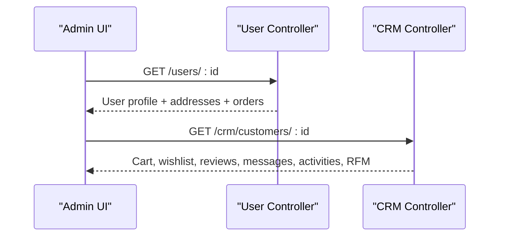

**Diagram sources**
- [apps/frontend/components/admin/customer/CustomerDetail.tsx:150-182](file://apps/frontend/components/admin/customer/CustomerDetail.tsx#L150-L182)
- [apps/backend/src/user/user.controller.ts:260-273](file://apps/backend/src/user/user.controller.ts#L260-L273)
- [apps/backend/src/crm/crm.controller.ts:160-165](file://apps/backend/src/crm/crm.controller.ts#L160-L165)

**Section sources**
- [apps/frontend/components/admin/customer/CustomerDetail.tsx:150-182](file://apps/frontend/components/admin/customer/CustomerDetail.tsx#L150-L182)
- [apps/backend/src/user/user.controller.ts:260-273](file://apps/backend/src/user/user.controller.ts#L260-L273)
- [apps/backend/src/crm/crm.controller.ts:160-165](file://apps/backend/src/crm/crm.controller.ts#L160-L165)

#### Managing Customer Addresses
- Retrieve addresses for a specific user; set default address using the address model’s default flag.
- Admins can manage any user’s addresses; non-admins limited to their own.

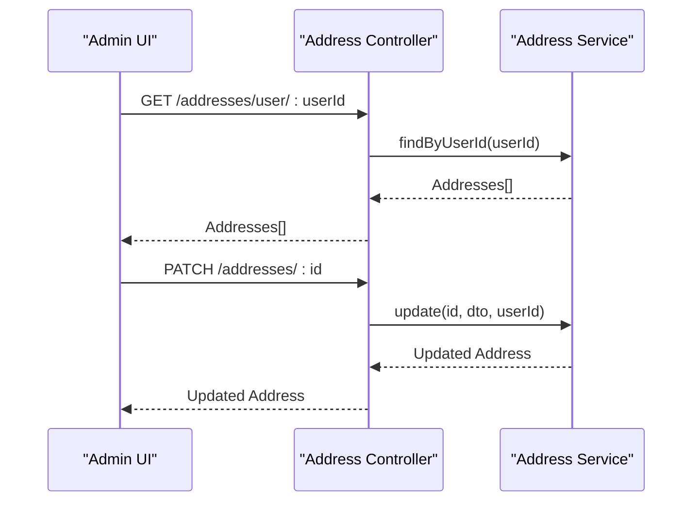

**Diagram sources**
- [apps/backend/src/address/address.controller.ts:131-175](file://apps/backend/src/address/address.controller.ts#L131-L175)
- [apps/backend/src/address/address.controller.ts:176-219](file://apps/backend/src/address/address.controller.ts#L176-L219)

**Section sources**
- [apps/backend/src/address/address.controller.ts:131-175](file://apps/backend/src/address/address.controller.ts#L131-L175)
- [apps/backend/src/address/address.controller.ts:176-219](file://apps/backend/src/address/address.controller.ts#L176-L219)

#### Analyzing Customer Behavior
- Use CRM 360 to see RFM metrics and segment.
- Use top customers endpoint to rank by orders or spending with time filters.
- Use order reports and dashboards for broader analytics.

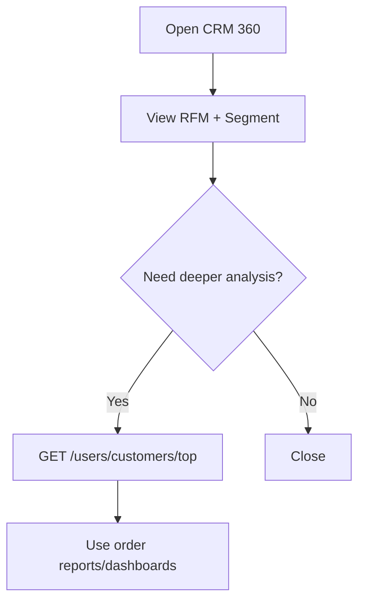

**Diagram sources**
- [apps/backend/src/crm/crm.service.ts:540-629](file://apps/backend/src/crm/crm.service.ts#L540-L629)
- [apps/backend/src/user/user.controller.ts:132-195](file://apps/backend/src/user/user.controller.ts#L132-L195)

**Section sources**
- [apps/backend/src/crm/crm.service.ts:540-629](file://apps/backend/src/crm/crm.service.ts#L540-L629)
- [apps/backend/src/user/user.controller.ts:132-195](file://apps/backend/src/user/user.controller.ts#L132-L195)

## Dependency Analysis
Key dependencies and relationships:
- Frontend components depend on backend controllers for data and actions.
- CRM service depends on user, order, cart, wishlist, product review, contact message repositories and SMS/email services.
- Address controller enforces role-based access control.
- Order controller enforces read permissions based on user role and ownership.

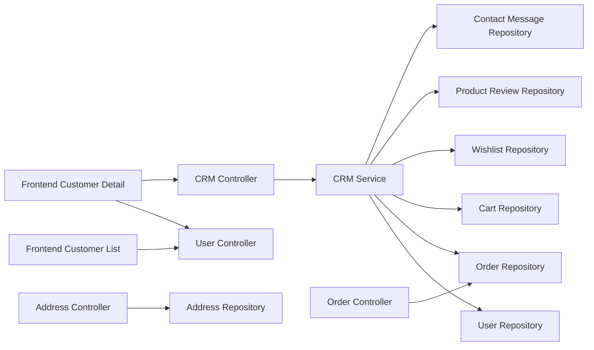

**Diagram sources**
- [apps/backend/src/crm/crm.service.ts:103-130](file://apps/backend/src/crm/crm.service.ts#L103-L130)
- [apps/backend/src/address/address.controller.ts:38-89](file://apps/backend/src/address/address.controller.ts#L38-L89)
- [apps/backend/src/order/order.controller.ts:39-158](file://apps/backend/src/order/order.controller.ts#L39-L158)

**Section sources**
- [apps/backend/src/crm/crm.service.ts:103-130](file://apps/backend/src/crm/crm.service.ts#L103-L130)
- [apps/backend/src/address/address.controller.ts:38-89](file://apps/backend/src/address/address.controller.ts#L38-L89)
- [apps/backend/src/order/order.controller.ts:39-158](file://apps/backend/src/order/order.controller.ts#L39-L158)

## Performance Considerations
- CRM customer list aggregates delivered orders in SQL and performs JS-side sorting/filtering/pagination; suitable for small-to-medium retail datasets.
- Area lookup for default address is done in a second query to avoid inflating aggregates; this reduces cardinality issues.
- Campaign delivery serializes sends with pauses to respect gateway rate limits; large segments may take minutes.
- Order reports and dashboards expose batched endpoints to reduce round trips.

[No sources needed since this section provides general guidance]

## Troubleshooting Guide
- Customer detail page fallback: If CRM 360 endpoint fails, the page still loads basic user data; extra tabs may be empty. Check network requests to `/crm/customers/:id`.
- Activity creation/update/delete: Ensure permissions allow CRM menu actions; verify title is provided for new activities.
- Address access errors: Non-admin users attempting to access another user’s addresses will receive forbidden responses; confirm role or use admin context.
- Order visibility: Customers can only view their own orders; staff/admins can view any order. Verify JWT role claims when debugging.

**Section sources**
- [apps/frontend/components/admin/customer/CustomerDetail.tsx:150-182](file://apps/frontend/components/admin/customer/CustomerDetail.tsx#L150-L182)
- [apps/backend/src/address/address.controller.ts:200-219](file://apps/backend/src/address/address.controller.ts#L200-L219)
- [apps/backend/src/order/order.controller.ts:46-57](file://apps/backend/src/order/order.controller.ts#L46-L57)

## Conclusion
The customer management system integrates profile, order, address, and CRM capabilities into a cohesive admin experience. It provides robust segmentation, analytics, and support workflows while maintaining clear separation between core commerce data and CRM enhancements. Administrators can efficiently manage customers, analyze behavior, and coordinate follow-ups through activities and campaigns.

[No sources needed since this section summarizes without analyzing specific files]

## Appendices

### API Endpoints Summary

- Users
  - GET /users/customers?page&limit&search&sort
  - GET /users/:id
  - PATCH /users/:id
  - DELETE /users/:id
  - GET /users/customers/top?limit&sortBy&timeFilter
  - GET /users/reports/customer-list?fromDate&toDate|preset

- Addresses
  - POST /addresses
  - GET /addresses?type
  - GET /addresses/default?type
  - GET /addresses/:id
  - PATCH /addresses/:id
  - DELETE /addresses/:id
  - GET /addresses/user/:userId?type

- Orders
  - GET /orders?page&limit&search&sort&orderStatus&paymentStatus&paymentMethodId&shippingMethodId&area&division&city
  - GET /orders/:id
  - GET /orders/:id/neighbors
  - GET /orders/user/:userId
  - PATCH /orders/:id/order-status
  - POST /orders/:id/notes
  - PATCH /orders/:id/payment-status
  - GET /orders/reports/dashboard
  - GET /orders/reports/date-range?fromDate&toDate|preset&orderStatus&paymentStatus&page&limit
  - GET /orders/reports/daily-summary?fromDate&toDate|preset
  - GET /orders/reports/refunds?fromDate&toDate|preset
  - GET /orders/reports/deliveryman-performance?fromDate&toDate|preset
  - GET /orders/reports/area-wise-orders?fromDate&toDate|preset
  - GET /orders/reports/statistics
  - GET /orders/reports/monthly?year
  - GET /orders/reports/monthly/years
  - GET /orders/reports/last-30-days-delivered
  - GET /orders/reports/today

- CRM
  - GET /crm/customers?page&limit&search&segment&sortBy&sortOrder
  - GET /crm/customers/export?query
  - GET /crm/customers/:id
  - GET /crm/customers/:id/activities?page&limit&type&status
  - POST /crm/customers/:id/activities
  - PATCH /crm/activities/:id
  - DELETE /crm/activities/:id
  - GET /crm/activities?page&limit&type&status&overdue
  - GET /crm/segment-rules
  - POST /crm/campaigns
  - GET /crm/campaigns?page&limit
  - GET /crm/campaigns/recipients-preview?segment
  - GET /crm/campaigns/:id
  - POST /crm/campaigns/:id/send
  - DELETE /crm/campaigns/:id
  - GET /crm/dashboard

**Section sources**
- [apps/backend/src/user/user.controller.ts:42-397](file://apps/backend/src/user/user.controller.ts#L42-L397)
- [apps/backend/src/address/address.controller.ts:45-219](file://apps/backend/src/address/address.controller.ts#L45-L219)
- [apps/backend/src/order/order.controller.ts:59-800](file://apps/backend/src/order/order.controller.ts#L59-L800)
- [apps/backend/src/crm/crm.controller.ts:37-258](file://apps/backend/src/crm/crm.controller.ts#L37-L258)