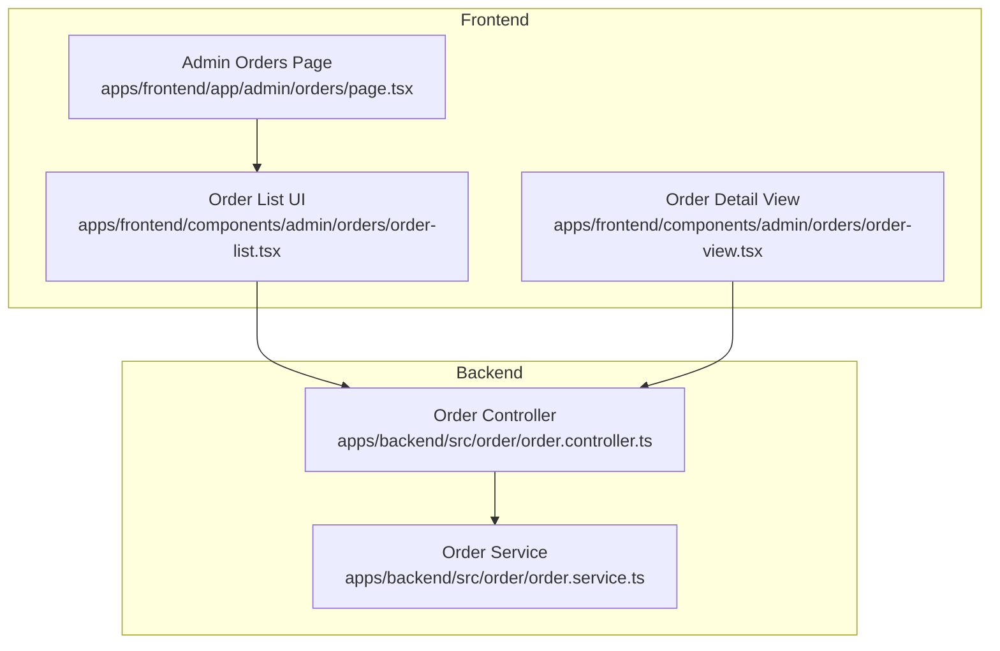
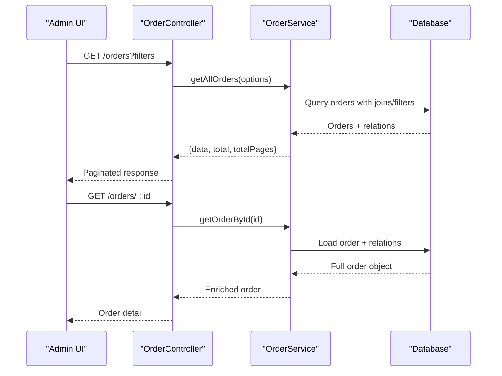
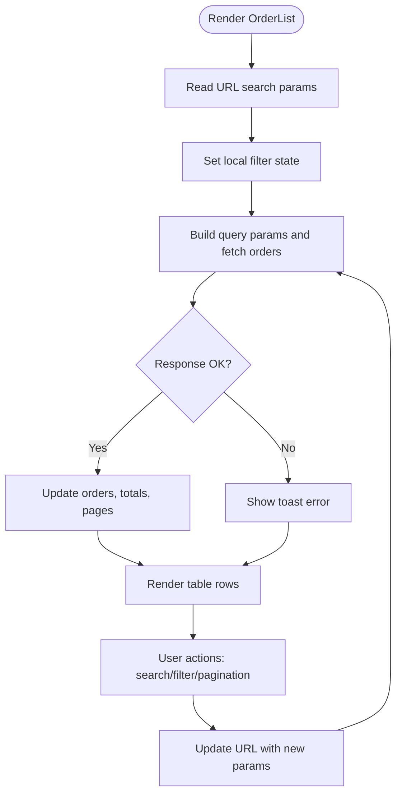
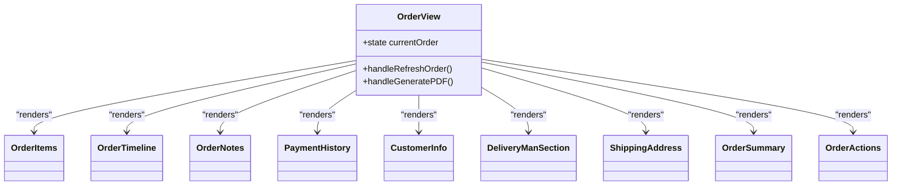
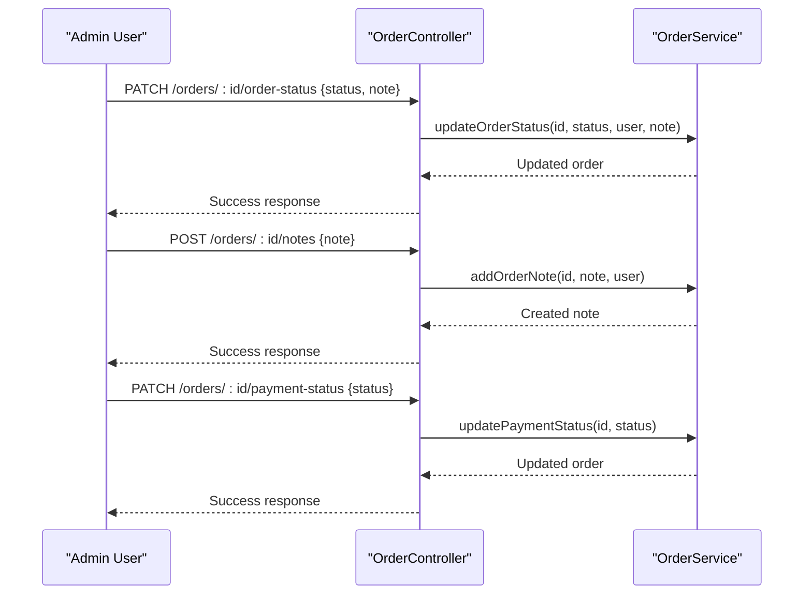
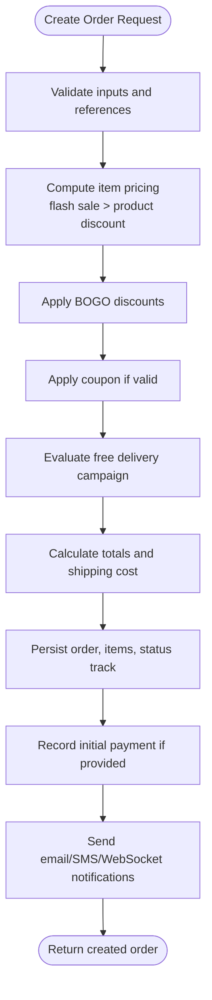
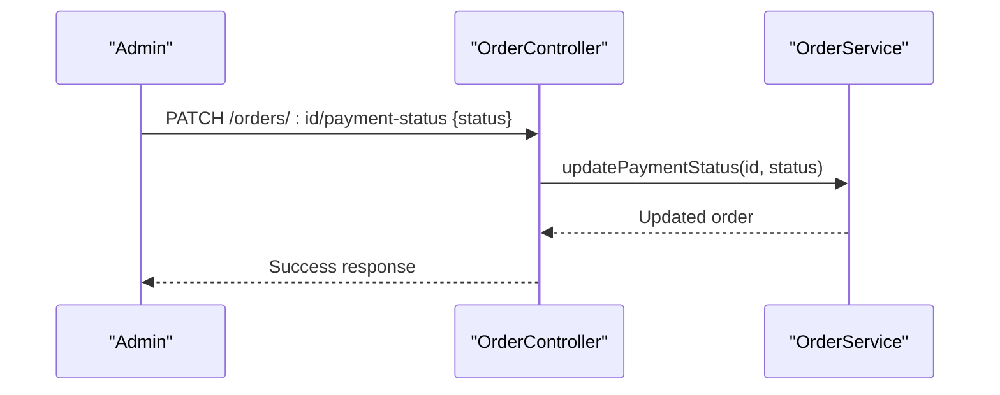
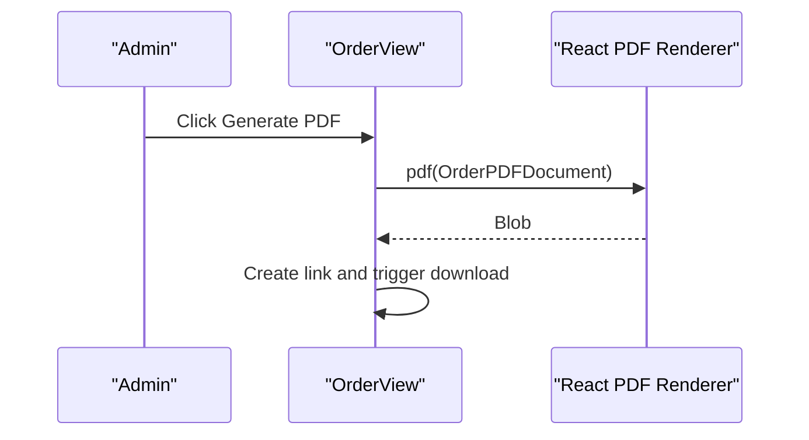
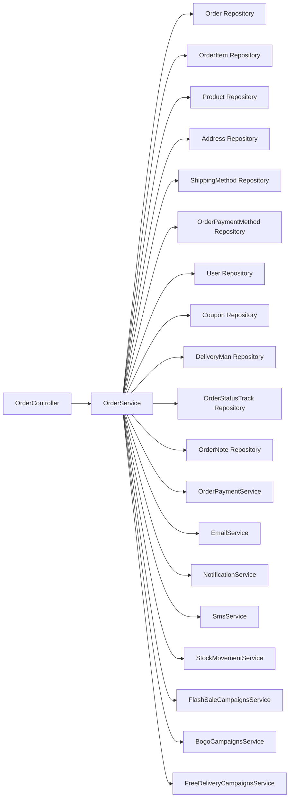

# Orders Management

<cite>
**Referenced Files in This Document**
- [order.controller.ts](file://apps/backend/src/order/order.controller.ts)
- [order.service.ts](file://apps/backend/src/order/order.service.ts)
- [page.tsx](file://apps/frontend/app/admin/orders/page.tsx)
- [order-list.tsx](file://apps/frontend/components/admin/orders/order-list.tsx)
- [order-view.tsx](file://apps/frontend/components/admin/orders/order-view.tsx)
</cite>

## Table of Contents
1. [Introduction](#introduction)
2. [Project Structure](#project-structure)
3. [Core Components](#core-components)
4. [Architecture Overview](#architecture-overview)
5. [Detailed Component Analysis](#detailed-component-analysis)
6. [Dependency Analysis](#dependency-analysis)
7. [Performance Considerations](#performance-considerations)
8. [Troubleshooting Guide](#troubleshooting-guide)
9. [Conclusion](#conclusion)

## Introduction
This document explains the orders management system used by the admin dashboard. It covers order listing with filtering and search, order detail view, lifecycle management (status transitions, cancellation, refund handling, delivery assignment), payment recording and configuration, export and PDF generation, reporting endpoints, and common operational workflows such as processing new orders, handling returns, and generating reports.

The backend is a NestJS API exposing order CRUD, status updates, notes, payment status changes, and multiple report endpoints. The frontend provides an admin order list page with rich filters and an order detail view that composes customer information, items, timeline, notes, payments, shipping address, summary, and actions including PDF generation and thermal printing.

## Project Structure
The orders feature spans both backend and frontend:

- Backend
  - Order controller exposes REST endpoints for listing, creating, reading, updating status, adding notes, updating payment status, and reporting.
  - Order service implements order creation, retrieval, status tracking, and report queries.
- Frontend
  - Admin route renders the order list page.
  - Order list component handles pagination, search, and multi-criteria filtering.
  - Order view component composes all detail sections and supports PDF generation and thermal printing.

**Diagram sources**
- [page.tsx:1-20](file://apps/frontend/app/admin/orders/page.tsx#L1-L20)
- [order-list.tsx:1-120](file://apps/frontend/components/admin/orders/order-list.tsx#L1-L120)
- [order-view.tsx:1-60](file://apps/frontend/components/admin/orders/order-view.tsx#L1-L60)
- [order.controller.ts:39-158](file://apps/backend/src/order/order.controller.ts#L39-L158)
- [order.service.ts:46-101](file://apps/backend/src/order/order.service.ts#L46-L101)

**Section sources**
- [page.tsx:1-20](file://apps/frontend/app/admin/orders/page.tsx#L1-L20)
- [order.controller.ts:39-158](file://apps/backend/src/order/order.controller.ts#L39-L158)
- [order.service.ts:46-101](file://apps/backend/src/order/order.service.ts#L46-L101)

## Core Components
- Order listing and filtering
  - Supports search by order number, filter by order status, payment status, payment method, shipping method, area, division, and city.
  - Pagination with URL-synced state and stale-time indicators for undelivered orders.
- Order detail view
  - Displays customer info, order items, timeline, notes, payment history, shipping address, and summary.
  - Provides actions for status change, cancellation, refund, editing, payment recording, PDF generation, and thermal printing.
- Order lifecycle
  - Status transitions via protected PATCH endpoint.
  - Notes appended to order timeline.
  - Payment status updates.
  - Delivery man assignment through the detail view.
- Reporting and exports
  - Dashboard aggregation, date-range reports, daily summaries, refunds, delivery performance, area-wise orders, monthly statistics, last-30-days delivered series, and today snapshot.
  - Client-side PDF invoice generation from the order detail view.

**Section sources**
- [order.controller.ts:59-158](file://apps/backend/src/order/order.controller.ts#L59-L158)
- [order.controller.ts:230-312](file://apps/backend/src/order/order.controller.ts#L230-L312)
- [order.controller.ts:316-800](file://apps/backend/src/order/order.controller.ts#L316-L800)
- [order-list.tsx:163-331](file://apps/frontend/components/admin/orders/order-list.tsx#L163-L331)
- [order-view.tsx:20-77](file://apps/frontend/components/admin/orders/order-view.tsx#L20-L77)

## Architecture Overview
The admin orders flow uses a client-server architecture:

- The admin UI calls the orders API for listing and details.
- The controller validates requests, enforces authentication/permissions, and delegates business logic to the service.
- The service orchestrates repositories, related services (payments, campaigns, stock movement, notifications), and returns enriched data.

**Diagram sources**
- [order.controller.ts:59-158](file://apps/backend/src/order/order.controller.ts#L59-L158)
- [order.controller.ts:182-197](file://apps/backend/src/order/order.controller.ts#L182-L197)
- [order.service.ts:696-735](file://apps/backend/src/order/order.service.ts#L696-L735)

## Detailed Component Analysis

### Order Listing and Filtering
The admin order list page composes a client-side table with:
- Search input for order number.
- Filters for order status, payment status, payment method, shipping method, area, division, and city.
- Pagination synced with URL parameters.
- Active filter badges with clear functionality.
- Row actions: view details, edit (when allowed), add payment, cancel/refund (via modals), copy order number.

Key behaviors:
- Initial load reads URL params and sets local state accordingly.
- Fetching builds query parameters from current state and calls the backend list endpoint.
- Stale-time indicator highlights orders not delivered or cancelled after three days.
- Detail links preserve list context (route, page, filters).

**Diagram sources**
- [order-list.tsx:163-331](file://apps/frontend/components/admin/orders/order-list.tsx#L163-L331)
- [order-list.tsx:398-413](file://apps/frontend/components/admin/orders/order-list.tsx#L398-L413)

**Section sources**
- [page.tsx:1-20](file://apps/frontend/app/admin/orders/page.tsx#L1-L20)
- [order-list.tsx:163-331](file://apps/frontend/components/admin/orders/order-list.tsx#L163-L331)
- [order-list.tsx:398-413](file://apps/frontend/components/admin/orders/order-list.tsx#L398-L413)

### Order Detail View
The order detail view composes several subcomponents:
- Customer information panel.
- Delivery man section for assignment.
- Shipping address panel.
- Order items list.
- Timeline of status changes.
- Notes panel.
- Payment history.
- Summary with totals, discounts, coupon, paid amount, and BOGO usage.
- Actions toolbar supporting status update, cancellation, refund, editing, payment recording, PDF generation, and thermal printing.

PDF generation is performed client-side using a React PDF renderer; thermal printing is supported via a dedicated utility.

**Diagram sources**
- [order-view.tsx:20-77](file://apps/frontend/components/admin/orders/order-view.tsx#L20-L77)
- [order-view.tsx:83-127](file://apps/frontend/components/admin/orders/order-view.tsx#L83-L127)

**Section sources**
- [order-view.tsx:20-77](file://apps/frontend/components/admin/orders/order-view.tsx#L20-L77)
- [order-view.tsx:83-127](file://apps/frontend/components/admin/orders/order-view.tsx#L83-L127)

### Order Lifecycle Management
Status transitions and administrative operations are exposed via protected endpoints:
- Update order status with optional note.
- Add order note.
- Update payment status.
- Create order (with validation, discount application, stock updates, notifications).

The service tracks status changes and enriches order retrieval with status tracks, notes, and related entities.

**Diagram sources**
- [order.controller.ts:230-312](file://apps/backend/src/order/order.controller.ts#L230-L312)

**Section sources**
- [order.controller.ts:230-312](file://apps/backend/src/order/order.controller.ts#L230-L312)
- [order.service.ts:696-735](file://apps/backend/src/order/order.service.ts#L696-L735)

### Order Creation Flow
Order creation performs comprehensive validation and enrichment:
- Generates unique order number per year.
- Validates user, address, shipping method, payment method, product availability, and stock.
- Applies flash sale pricing, product discounts, BOGO promotions, coupons, and free delivery campaigns.
- Records stock movements and campaign usage logs.
- Persists order, items, and optional initial payment.
- Sends confirmation email/SMS and WebSocket notifications.

**Diagram sources**
- [order.service.ts:103-694](file://apps/backend/src/order/order.service.ts#L103-L694)

**Section sources**
- [order.service.ts:103-694](file://apps/backend/src/order/order.service.ts#L103-L694)

### Payment Management
- Recording payments: During order creation, if a paid amount is provided, a payment record is created via the order payment service.
- Updating payment status: Admins can update payment status through a protected endpoint.
- Payment method configuration: The order list filters against configured payment methods; the order detail view shows payment history and allows adding payments.

**Diagram sources**
- [order.controller.ts:295-312](file://apps/backend/src/order/order.controller.ts#L295-L312)
- [order.service.ts:558-568](file://apps/backend/src/order/order.service.ts#L558-L568)

**Section sources**
- [order.controller.ts:295-312](file://apps/backend/src/order/order.controller.ts#L295-L312)
- [order.service.ts:558-568](file://apps/backend/src/order/order.service.ts#L558-L568)

### Export, PDF Generation, and Thermal Printing
- PDF generation: The order detail view generates a PDF invoice client-side using a React PDF document component and triggers a download.
- Thermal printing: The order detail view includes a thermal print action that formats and prints invoices on thermal printers.
- Data export: The backend provides multiple report endpoints for exporting aggregated data (dashboard, date range, daily summary, refunds, delivery performance, area-wise orders, monthly stats, last-30-days delivered, today snapshot).

**Diagram sources**
- [order-view.tsx:50-62](file://apps/frontend/components/admin/orders/order-view.tsx#L50-L62)

**Section sources**
- [order-view.tsx:50-62](file://apps/frontend/components/admin/orders/order-view.tsx#L50-L62)
- [order.controller.ts:316-800](file://apps/backend/src/order/order.controller.ts#L316-L800)

### Common Workflows

#### Processing New Orders
- Receive order creation request.
- Validate and compute pricing/discounts.
- Persist order and items.
- Send confirmations and notifications.
- Admin views order in list/detail and updates status as needed.

**Section sources**
- [order.service.ts:103-694](file://apps/backend/src/order/order.service.ts#L103-L694)
- [order.controller.ts:159-181](file://apps/backend/src/order/order.controller.ts#L159-L181)

#### Handling Returns and Refunds
- Cancel orders via protected endpoints and add cancellation reasons/notes.
- Record refunds through refund-related flows and adjust payment status accordingly.
- Use refund report endpoint to analyze cancellations and refunded amounts over time.

**Section sources**
- [order.controller.ts:456-497](file://apps/backend/src/order/order.controller.ts#L456-L497)

#### Generating Reports
- Use dashboard aggregation endpoint for a single round-trip overview.
- Use date-range report endpoint for detailed paginated orders plus summary metrics.
- Use daily summary, refunds, delivery performance, area-wise orders, monthly statistics, last-30-days delivered, and today snapshot endpoints for specific analytical needs.

**Section sources**
- [order.controller.ts:316-800](file://apps/backend/src/order/order.controller.ts#L316-L800)

## Dependency Analysis
The orders module depends on several internal services and entities:

**Diagram sources**
- [order.controller.ts:39-44](file://apps/backend/src/order/order.controller.ts#L39-L44)
- [order.service.ts:63-101](file://apps/backend/src/order/order.service.ts#L63-L101)

**Section sources**
- [order.service.ts:63-101](file://apps/backend/src/order/order.service.ts#L63-L101)

## Performance Considerations
- Server-side pagination and filtering reduce payload sizes.
- Report endpoints aggregate data server-side to minimize client computation and network round trips.
- Dashboard aggregation endpoint consolidates multiple queries into one response.
- Client-side PDF generation avoids server rendering overhead but requires browser resources.
- Throttling protects order creation endpoints from abuse.

[No sources needed since this section provides general guidance]

## Troubleshooting Guide
- No orders found
  - Clear active filters and verify search terms.
  - Ensure correct pagination and limit values.
- Failed to load orders
  - Check network connectivity and authentication.
  - Verify backend health and permissions.
- Cannot update order status
  - Confirm role-based permissions and module access.
  - Validate status transition rules.
- Payment status not updating
  - Ensure correct payment status enum value.
  - Verify protected endpoint access.
- PDF generation issues
  - Confirm browser support for React PDF renderer.
  - Check order data completeness for rendering.

**Section sources**
- [order-list.tsx:247-285](file://apps/frontend/components/admin/orders/order-list.tsx#L247-L285)
- [order.controller.ts:230-312](file://apps/backend/src/order/order.controller.ts#L230-L312)

## Conclusion
The orders management system provides a robust foundation for admin operations across listing, filtering, detail inspection, lifecycle control, payment handling, reporting, and export capabilities. Its modular design separates concerns between controller, service, and UI components, enabling maintainability and scalability while offering practical tools for day-to-day order operations and analytics.

[No sources needed since this section summarizes without analyzing specific files]