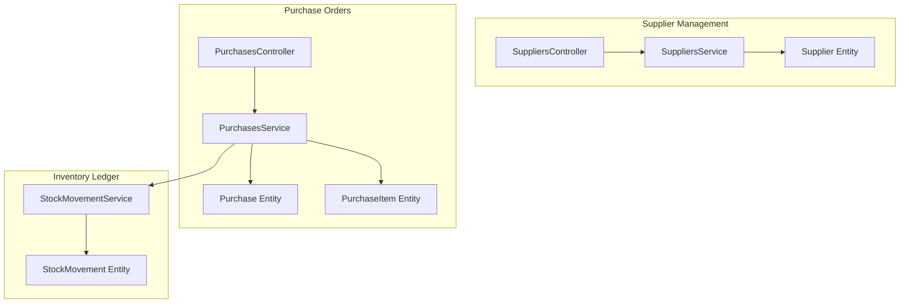
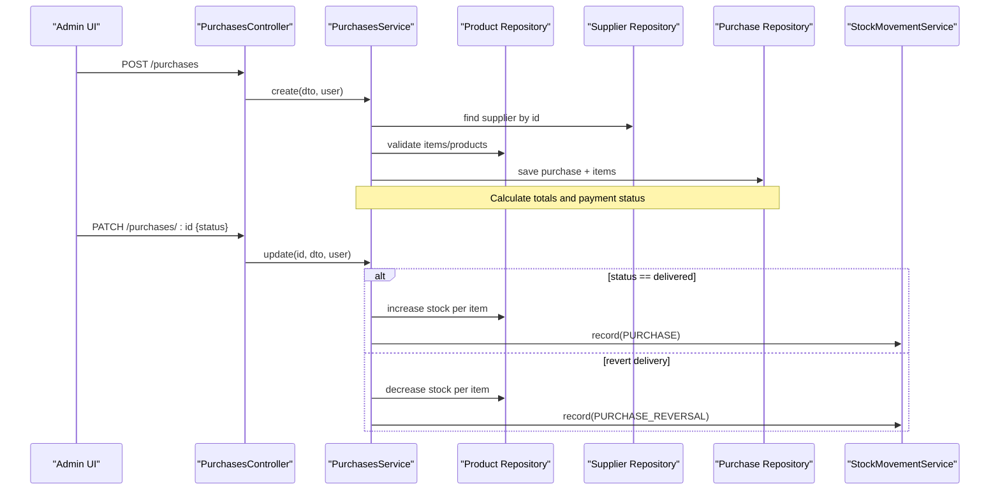
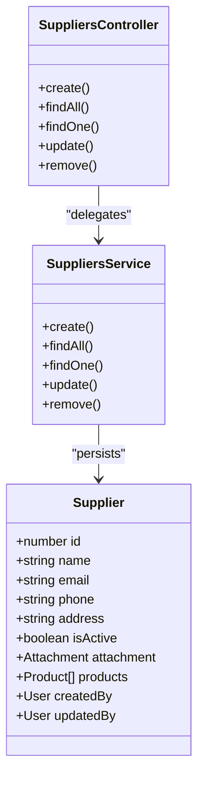
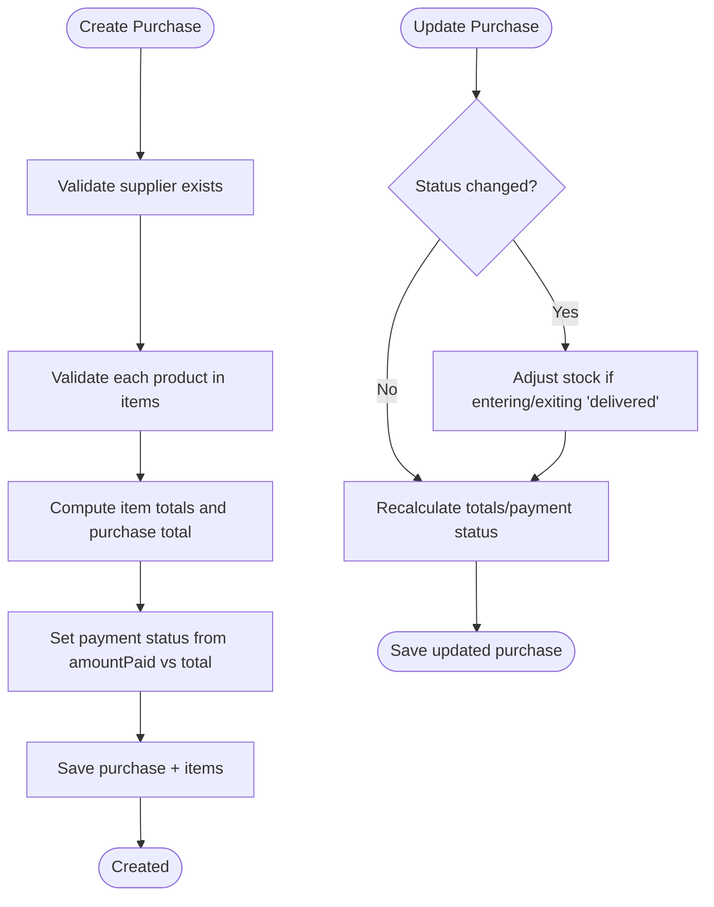
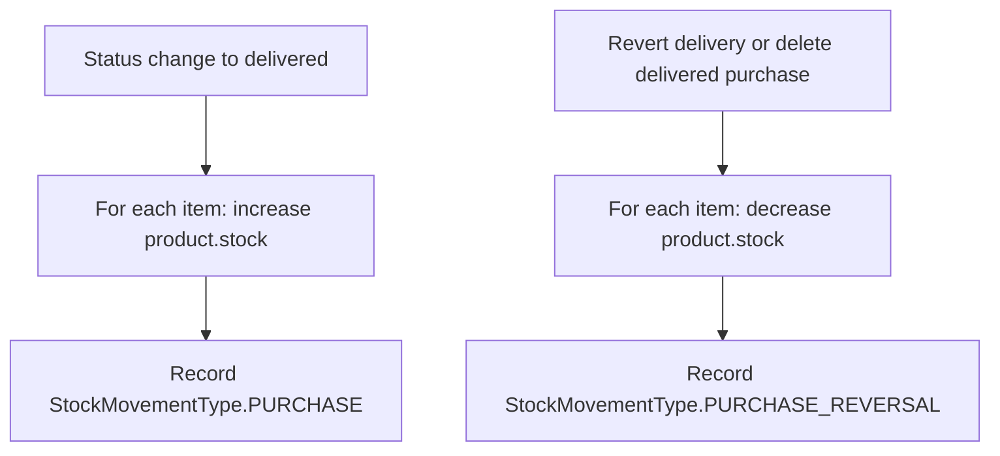
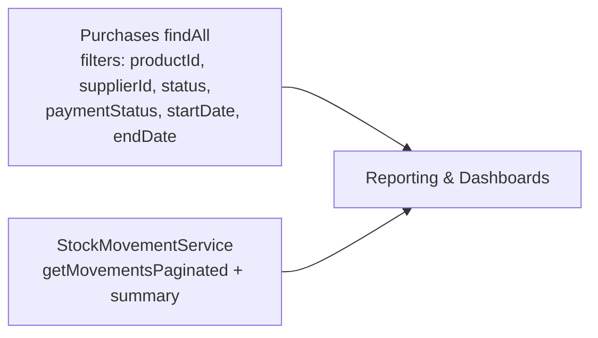
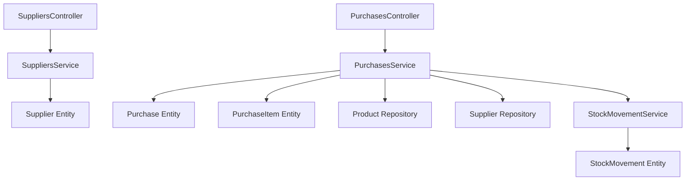

# Procurement & Supply Chain

<cite>
**Referenced Files in This Document**
- [purchase.controller.ts](file://apps/backend/src/purchase/purchase.controller.ts)
- [purchase.service.ts](file://apps/backend/src/purchase/purchase.service.ts)
- [purchase.entity.ts](file://apps/backend/src/purchase/entities/purchase.entity.ts)
- [purchase-item.entity.ts](file://apps/backend/src/purchase/entities/purchase-item.entity.ts)
- [supplier.controller.ts](file://apps/backend/src/supplier/supplier.controller.ts)
- [supplier.service.ts](file://apps/backend/src/supplier/supplier.service.ts)
- [supplier.entity.ts](file://apps/backend/src/supplier/entities/supplier.entity.ts)
- [stock-movement.service.ts](file://apps/backend/src/stock-movement/stock-movement.service.ts)
- [stock-movement.entity.ts](file://apps/backend/src/stock-movement/entities/stock-movement.entity.ts)
</cite>

## Table of Contents
1. [Introduction](#introduction)
2. [Project Structure](#project-structure)
3. [Core Components](#core-components)
4. [Architecture Overview](#architecture-overview)
5. [Detailed Component Analysis](#detailed-component-analysis)
6. [Dependency Analysis](#dependency-analysis)
7. [Performance Considerations](#performance-considerations)
8. [Troubleshooting Guide](#troubleshooting-guide)
9. [Conclusion](#conclusion)

## Introduction
This document explains the procurement and supply chain management capabilities implemented in the backend, focusing on supplier management, purchase order lifecycle, inventory receiving via stock movements, and reporting-oriented queries. It also provides practical workflow examples for creating purchase orders, receiving goods, and managing suppliers.

The system is built with NestJS controllers, services, TypeORM entities, and a dedicated stock movement ledger to ensure auditable inventory changes.

## Project Structure
Procurement-related functionality is organized into three main areas:
- Supplier management (CRUD, search, pagination, relations to products and attachments)
- Purchase order management (CRUD, status and payment tracking, item-level details)
- Stock movement ledger (auditable record of inventory changes triggered by purchases and other events)

**Diagram sources**
- [supplier.controller.ts:1-203](file://apps/backend/src/supplier/supplier.controller.ts#L1-L203)
- [supplier.service.ts:1-112](file://apps/backend/src/supplier/supplier.service.ts#L1-L112)
- [supplier.entity.ts:1-103](file://apps/backend/src/supplier/entities/supplier.entity.ts#L1-L103)
- [purchase.controller.ts:1-220](file://apps/backend/src/purchase/purchase.controller.ts#L1-L220)
- [purchase.service.ts:1-383](file://apps/backend/src/purchase/purchase.service.ts#L1-L383)
- [purchase.entity.ts:1-222](file://apps/backend/src/purchase/entities/purchase.entity.ts#L1-L222)
- [purchase-item.entity.ts:1-92](file://apps/backend/src/purchase/entities/purchase-item.entity.ts#L1-L92)
- [stock-movement.service.ts:1-226](file://apps/backend/src/stock-movement/stock-movement.service.ts#L1-L226)
- [stock-movement.entity.ts:1-75](file://apps/backend/src/stock-movement/entities/stock-movement.entity.ts#L1-L75)

**Section sources**
- [supplier.controller.ts:1-203](file://apps/backend/src/supplier/supplier.controller.ts#L1-L203)
- [purchase.controller.ts:1-220](file://apps/backend/src/purchase/purchase.controller.ts#L1-L220)
- [stock-movement.service.ts:1-226](file://apps/backend/src/stock-movement/stock-movement.service.ts#L1-L226)

## Core Components
- Supplier management: Create, read, update, delete suppliers; list with pagination, search, sort, and active filter; includes product relationships and attachment metadata.
- Purchase orders: Create multi-item purchase orders from a single supplier; track status (pending, shipped, delivered, cancelled), payment status (due, partial, paid), total value, and amount paid; support filtering by product, supplier, status, payment status, and date ranges.
- Inventory receiving: When a purchase becomes delivered, stock is increased per item and recorded in the stock movement ledger; reversing or deleting delivered purchases decrements stock accordingly.
- Stock movement ledger: Immutable-style records of inventory changes with before/after snapshots, typed events, and optional user attribution.

**Section sources**
- [supplier.controller.ts:43-201](file://apps/backend/src/supplier/supplier.controller.ts#L43-L201)
- [supplier.service.ts:23-110](file://apps/backend/src/supplier/supplier.service.ts#L23-L110)
- [purchase.controller.ts:43-217](file://apps/backend/src/purchase/purchase.controller.ts#L43-L217)
- [purchase.service.ts:45-381](file://apps/backend/src/purchase/purchase.service.ts#L45-L381)
- [stock-movement.service.ts:63-226](file://apps/backend/src/stock-movement/stock-movement.service.ts#L63-L226)

## Architecture Overview
The procurement flow integrates supplier data, purchase orders, and inventory ledgers:

**Diagram sources**
- [purchase.controller.ts:43-67](file://apps/backend/src/purchase/purchase.controller.ts#L43-L67)
- [purchase.controller.ts:168-195](file://apps/backend/src/purchase/purchase.controller.ts#L168-L195)
- [purchase.service.ts:45-103](file://apps/backend/src/purchase/purchase.service.ts#L45-L103)
- [purchase.service.ts:201-273](file://apps/backend/src/purchase/purchase.service.ts#L201-L273)
- [purchase.service.ts:333-381](file://apps/backend/src/purchase/purchase.service.ts#L333-L381)
- [stock-movement.service.ts:63-87](file://apps/backend/src/stock-movement/stock-movement.service.ts#L63-L87)

## Detailed Component Analysis

### Supplier Management
Supplier management supports full CRUD operations with pagination, search across name/email/phone, sorting, and an active flag filter. Suppliers can be linked to products and have an attachment (e.g., documents).

Key behaviors:
- Create supplier with default active state and audit fields (createdBy/updatedBy).
- List suppliers with joins to attachment, createdBy, updatedBy, and related products with their attachments.
- Retrieve, update, and delete suppliers with proper error handling when not found.

**Diagram sources**
- [supplier.entity.ts:16-103](file://apps/backend/src/supplier/entities/supplier.entity.ts#L16-L103)
- [supplier.controller.ts:41-201](file://apps/backend/src/supplier/supplier.controller.ts#L41-L201)
- [supplier.service.ts:16-110](file://apps/backend/src/supplier/supplier.service.ts#L16-L110)

**Section sources**
- [supplier.controller.ts:43-201](file://apps/backend/src/supplier/supplier.controller.ts#L43-L201)
- [supplier.service.ts:23-110](file://apps/backend/src/supplier/supplier.service.ts#L23-L110)
- [supplier.entity.ts:16-103](file://apps/backend/src/supplier/entities/supplier.entity.ts#L16-L103)

### Purchase Order Management
Purchase orders encapsulate one or more line items from a single supplier. The system tracks:
- Status: pending, shipped, delivered, cancelled
- Payment status: due, partial, paid
- Total value and amount paid
- Audit fields (createdBy/updatedBy) and payments relation

Creation flow:
- Validates supplier and each product in the items array.
- Computes item totals and purchase total value.
- Derives payment status based on amountPaid vs totalValue.
- Persists purchase and items.

Update flow:
- Supports changing supplier, updating items, adjusting total value and amount paid.
- Automatically recalculates totals and payment status.
- Adjusts inventory when status transitions to/from delivered.

**Diagram sources**
- [purchase.service.ts:45-103](file://apps/backend/src/purchase/purchase.service.ts#L45-L103)
- [purchase.service.ts:201-273](file://apps/backend/src/purchase/purchase.service.ts#L201-L273)
- [purchase.service.ts:286-293](file://apps/backend/src/purchase/purchase.service.ts#L286-L293)
- [purchase.service.ts:333-346](file://apps/backend/src/purchase/purchase.service.ts#L333-L346)

**Section sources**
- [purchase.controller.ts:43-217](file://apps/backend/src/purchase/purchase.controller.ts#L43-L217)
- [purchase.service.ts:45-381](file://apps/backend/src/purchase/purchase.service.ts#L45-L381)
- [purchase.entity.ts:19-222](file://apps/backend/src/purchase/entities/purchase.entity.ts#L19-L222)
- [purchase-item.entity.ts:16-92](file://apps/backend/src/purchase/entities/purchase-item.entity.ts#L16-L92)

### Inventory Receiving and Stock Movement Ledger
When a purchase reaches delivered status, stock increases per item and a stock movement record is created. If a delivered purchase is reverted or deleted, stock decreases and a reversal movement is recorded.

**Diagram sources**
- [purchase.service.ts:333-381](file://apps/backend/src/purchase/purchase.service.ts#L333-L381)
- [stock-movement.service.ts:63-87](file://apps/backend/src/stock-movement/stock-movement.service.ts#L63-L87)
- [stock-movement.entity.ts:9-75](file://apps/backend/src/stock-movement/entities/stock-movement.entity.ts#L9-L75)

**Section sources**
- [purchase.service.ts:333-381](file://apps/backend/src/purchase/purchase.service.ts#L333-L381)
- [stock-movement.service.ts:63-226](file://apps/backend/src/stock-movement/stock-movement.service.ts#L63-L226)
- [stock-movement.entity.ts:9-75](file://apps/backend/src/stock-movement/entities/stock-movement.entity.ts#L9-L75)

### Supply Chain Tracking and Reporting
- Purchase listing supports filters by product, supplier, status, payment status, and date range, enabling operational dashboards and reports.
- Stock movement service provides paginated listings with summary metrics (counts by type, units in/out), supporting cost and volume analysis.

**Diagram sources**
- [purchase.controller.ts:68-141](file://apps/backend/src/purchase/purchase.controller.ts#L68-L141)
- [purchase.service.ts:105-178](file://apps/backend/src/purchase/purchase.service.ts#L105-L178)
- [stock-movement.service.ts:89-114](file://apps/backend/src/stock-movement/stock-movement.service.ts#L89-L114)
- [stock-movement.service.ts:166-209](file://apps/backend/src/stock-movement/stock-movement.service.ts#L166-L209)

**Section sources**
- [purchase.controller.ts:68-141](file://apps/backend/src/purchase/purchase.controller.ts#L68-L141)
- [purchase.service.ts:105-178](file://apps/backend/src/purchase/purchase.service.ts#L105-L178)
- [stock-movement.service.ts:89-209](file://apps/backend/src/stock-movement/stock-movement.service.ts#L89-L209)

## Dependency Analysis
High-level dependencies among modules:

**Diagram sources**
- [supplier.controller.ts:41-201](file://apps/backend/src/supplier/supplier.controller.ts#L41-L201)
- [supplier.service.ts:16-110](file://apps/backend/src/supplier/supplier.service.ts#L16-L110)
- [purchase.controller.ts:40-217](file://apps/backend/src/purchase/purchase.controller.ts#L40-L217)
- [purchase.service.ts:31-43](file://apps/backend/src/purchase/purchase.service.ts#L31-L43)
- [stock-movement.service.ts:54-61](file://apps/backend/src/stock-movement/stock-movement.service.ts#L54-L61)

**Section sources**
- [purchase.service.ts:31-43](file://apps/backend/src/purchase/purchase.service.ts#L31-L43)
- [stock-movement.service.ts:54-61](file://apps/backend/src/stock-movement/stock-movement.service.ts#L54-L61)

## Performance Considerations
- Use pagination and server-side filtering for large datasets in both purchases and stock movements.
- Prefer query builders with selective joins to avoid N+1 issues when listing purchases with items, suppliers, and payments.
- Keep stock movement writes lightweight; the ledger intentionally logs failures without breaking the parent operation.
- Indexing strategies are present on stock movements for efficient querying by product and date.

[No sources needed since this section provides general guidance]

## Troubleshooting Guide
Common issues and resolutions:
- Supplier not found during purchase creation/update: Ensure the supplier ID exists and is active if required by business rules.
- Product not found in purchase items: Validate that all referenced product IDs exist before submission.
- Negative or excessive amount paid: Amount paid must be non-negative and cannot exceed total value; adjust accordingly.
- Stock discrepancies after deletion/reversion: Confirm whether the purchase was delivered; stock adjustments occur only for delivered purchases.
- Missing stock movement records: The ledger logs errors internally; check application logs for failed movement recordings.

**Section sources**
- [purchase.service.ts:49-56](file://apps/backend/src/purchase/purchase.service.ts#L49-L56)
- [purchase.service.ts:68-75](file://apps/backend/src/purchase/purchase.service.ts#L68-L75)
- [purchase.service.ts:241-248](file://apps/backend/src/purchase/purchase.service.ts#L241-L248)
- [purchase.service.ts:275-284](file://apps/backend/src/purchase/purchase.service.ts#L275-L284)
- [stock-movement.service.ts:81-86](file://apps/backend/src/stock-movement/stock-movement.service.ts#L81-L86)

## Conclusion
The procurement and supply chain module provides robust supplier management, comprehensive purchase order lifecycle control, and an auditable stock movement ledger. Filtering and summary capabilities enable effective reporting and performance monitoring. For advanced approval workflows and vendor communication features, consider extending the existing purchase status model and integrating notification channels.

[No sources needed since this section summarizes without analyzing specific files]