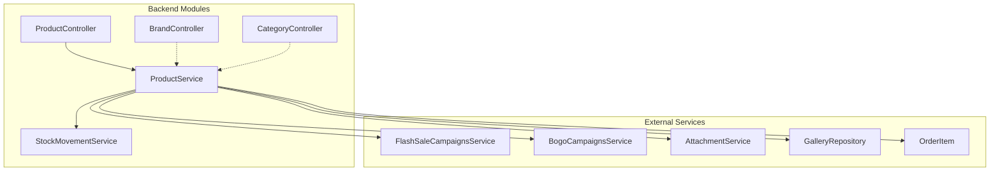
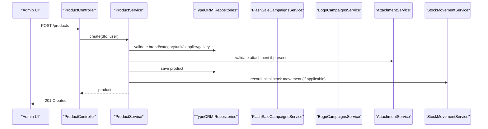
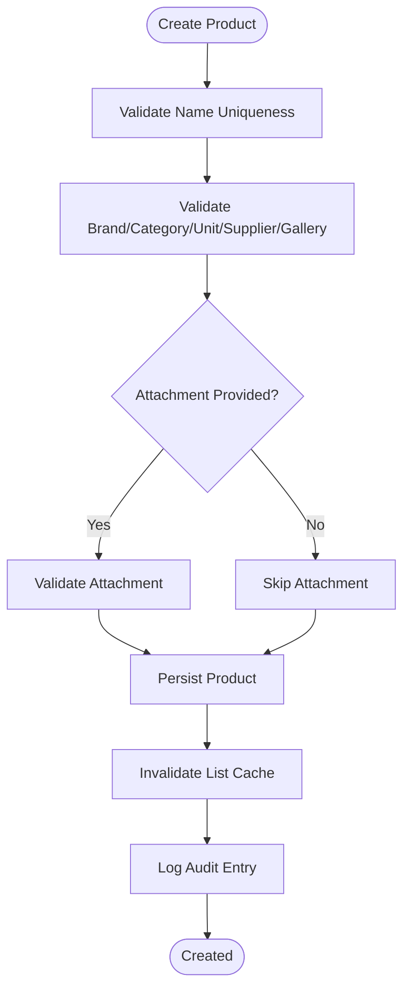
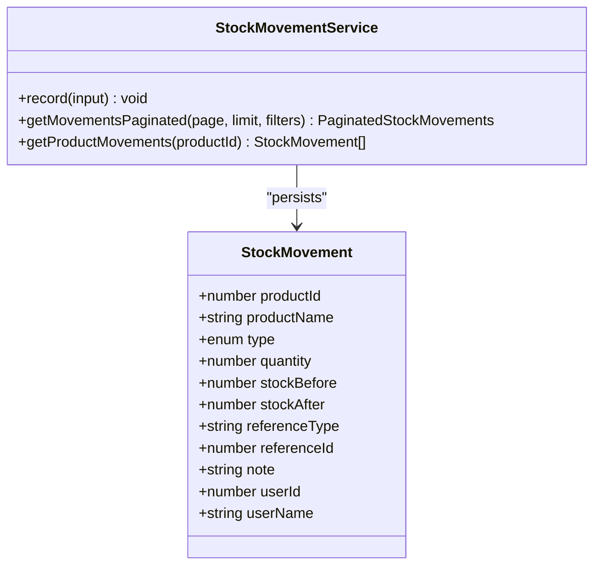
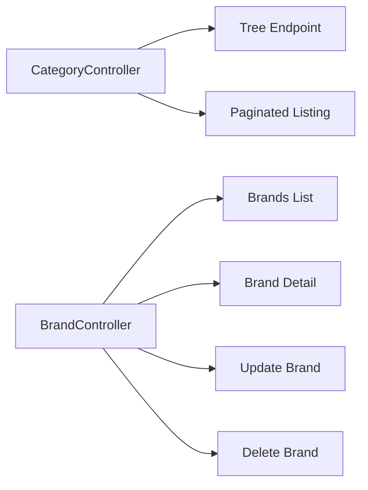
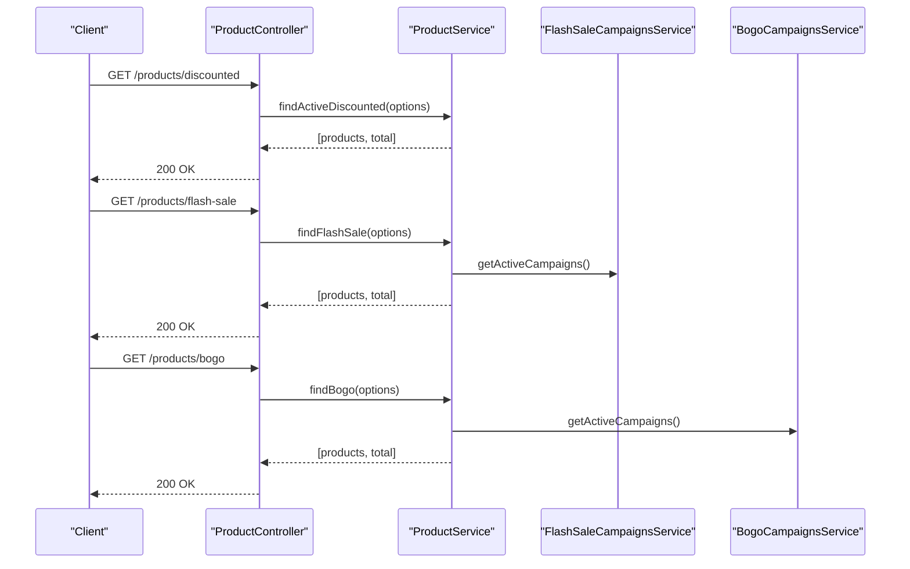
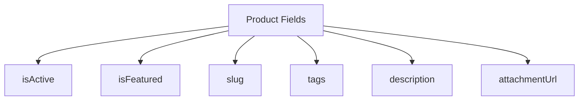
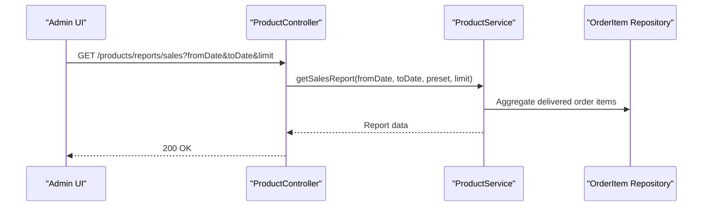
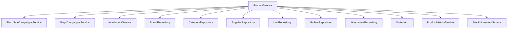

# Product Management

<cite>
**Referenced Files in This Document**
- [product.controller.ts](file://apps/backend/src/product/product.controller.ts)
- [product.service.ts](file://apps/backend/src/product/product.service.ts)
- [brand.controller.ts](file://apps/backend/src/brand/brand.controller.ts)
- [category.controller.ts](file://apps/backend/src/category/category.controller.ts)
- [stock-movement.service.ts](file://apps/backend/src/stock-movement/stock-movement.service.ts)
</cite>

## Table of Contents
1. [Introduction](#introduction)
2. [Project Structure](#project-structure)
3. [Core Components](#core-components)
4. [Architecture Overview](#architecture-overview)
5. [Detailed Component Analysis](#detailed-component-analysis)
6. [Dependency Analysis](#dependency-analysis)
7. [Performance Considerations](#performance-considerations)
8. [Troubleshooting Guide](#troubleshooting-guide)
9. [Conclusion](#conclusion)
10. [Appendices](#appendices)

## Introduction
This document explains the product management system’s end-to-end capabilities for administering products, inventory, categories, brands, pricing, promotions, and reporting. It focuses on:
- Product CRUD with rich media (images and descriptions), variants support via units, and audit history
- Inventory management including stock tracking, low-stock alerts, valuation, and movement history
- Category and brand organization with hierarchical category trees
- Pricing and discount management including regular price, sale price, percentage/fixed discounts, flash sales, and BOGO campaigns
- Bulk operations, import/export patterns, and visibility controls
- SEO-friendly slugs, tags, featured status, and performance metrics such as bestsellers and sales reports

## Project Structure
The backend exposes a NestJS API organized by domain modules. The product module is central and integrates with related domains:
- Products: controllers, services, DTOs, entities
- Brands: CRUD endpoints for brand catalog
- Categories: hierarchical tree and product-linked listings
- Stock Movement: immutable ledger for stock changes
- Supporting services: attachments, galleries, suppliers, units, orders, campaign services

**Diagram sources**
- [product.controller.ts:49-58](file://apps/backend/src/product/product.controller.ts#L49-L58)
- [product.service.ts:56-82](file://apps/backend/src/product/product.service.ts#L56-L82)
- [brand.controller.ts:39-43](file://apps/backend/src/brand/brand.controller.ts#L39-L43)
- [category.controller.ts:39-43](file://apps/backend/src/category/category.controller.ts#L39-L43)
- [stock-movement.service.ts:54-61](file://apps/backend/src/stock-movement/stock-movement.service.ts#L54-L61)

**Section sources**
- [product.controller.ts:49-58](file://apps/backend/src/product/product.controller.ts#L49-L58)
- [product.service.ts:56-82](file://apps/backend/src/product/product.service.ts#L56-L82)
- [brand.controller.ts:39-43](file://apps/backend/src/brand/brand.controller.ts#L39-L43)
- [category.controller.ts:39-43](file://apps/backend/src/category/category.controller.ts#L39-L43)
- [stock-movement.service.ts:54-61](file://apps/backend/src/stock-movement/stock-movement.service.ts#L54-L61)

## Core Components
- Product controller: REST endpoints for listing, filtering, discounted/flash-sale/BOGO lists, bestsellers, tags, minimal list, low/out-of-stock reports, sales report, stock valuation, stock summary, slug lookup, and product history.
- Product service: business logic for creation, updates, queries, caching, campaign integration, and reporting.
- Brand controller: full CRUD for brands with pagination and filters.
- Category controller: hierarchical tree, paginated categories, and product merging.
- Stock movement service: immutable ledger for stock changes with summaries and filters.

Key responsibilities:
- Product lifecycle: create, read, update, delete (via controller/service), audit logging
- Inventory: stock adjustments, low-stock/out-of-stock reports, stock valuation, movement ledger
- Organization: categories (tree), brands
- Pricing/promotions: discount fields, active discount query, flash sale and BOGO campaign integration
- Visibility/SEO: isActive, isFeatured, slug, tags
- Performance: SWR-style cache for lists, HTTP cache decorators, selective field selection

**Section sources**
- [product.controller.ts:49-800](file://apps/backend/src/product/product.controller.ts#L49-L800)
- [product.service.ts:127-800](file://apps/backend/src/product/product.service.ts#L127-L800)
- [brand.controller.ts:39-333](file://apps/backend/src/brand/brand.controller.ts#L39-L333)
- [category.controller.ts:39-338](file://apps/backend/src/category/category.controller.ts#L39-L338)
- [stock-movement.service.ts:54-226](file://apps/backend/src/stock-movement/stock-movement.service.ts#L54-L226)

## Architecture Overview
The product subsystem follows a layered architecture:
- Controller layer validates requests, applies guards and permissions, and formats responses
- Service layer implements business rules, composes repositories, and coordinates external services
- Data access uses TypeORM repositories; lists are optimized with selective selects and caching
- Campaign services enrich product data without coupling to cached payloads
- Stock movements are recorded immutably for auditability

**Diagram sources**
- [product.controller.ts:60-85](file://apps/backend/src/product/product.controller.ts#L60-L85)
- [product.service.ts:127-173](file://apps/backend/src/product/product.service.ts#L127-L173)
- [stock-movement.service.ts:63-87](file://apps/backend/src/stock-movement/stock-movement.service.ts#L63-L87)

## Detailed Component Analysis

### Product Lifecycle and Rich Media
- Creation: Validates name uniqueness, references (brand, category, unit, supplier, gallery), optional attachment, persists product, invalidates caches, logs audit entry.
- Reading: Supports comprehensive filtering (category hierarchy, brand, supplier, search, price range, tags, featured, active, discount flags), sorting, pagination, and specialized endpoints for discounted, flash-sale, BOGO, bestsellers, tags, minimal list, and slug-based retrieval.
- Updates: Handled via update DTOs and guarded endpoints; audit trail captures changes.
- Deletion: Controlled via permission-guarded routes and integrated with audit/history.
- Rich media: Attachments and galleries are validated and attached; images and descriptions are part of product details.

**Diagram sources**
- [product.service.ts:127-173](file://apps/backend/src/product/product.service.ts#L127-L173)

**Section sources**
- [product.controller.ts:60-85](file://apps/backend/src/product/product.controller.ts#L60-L85)
- [product.service.ts:127-173](file://apps/backend/src/product/product.service.ts#L127-L173)

### Inventory Management
- Stock tracking: Products maintain stock levels; reports provide low-stock and out-of-stock lists.
- Low stock alerts: Endpoint returns products at or below a configurable threshold.
- Stock valuation: Aggregates total units and values at purchase and selling prices across all products.
- Stock movement history: Immutable ledger records every change with before/after snapshots, type, reference context, and user attribution.

**Diagram sources**
- [stock-movement.service.ts:54-226](file://apps/backend/src/stock-movement/stock-movement.service.ts#L54-L226)

**Section sources**
- [product.controller.ts:586-735](file://apps/backend/src/product/product.controller.ts#L586-L735)
- [stock-movement.service.ts:54-226](file://apps/backend/src/stock-movement/stock-movement.service.ts#L54-L226)

### Category and Brand Organization
- Categories: Hierarchical structure with parent-child relationships; supports tree retrieval, filtered listing, and product merging.
- Brands: Full CRUD with pagination, search, slug filter, and product-related filters.

**Diagram sources**
- [category.controller.ts:79-219](file://apps/backend/src/category/category.controller.ts#L79-L219)
- [brand.controller.ts:95-333](file://apps/backend/src/brand/brand.controller.ts#L95-L333)

**Section sources**
- [category.controller.ts:79-219](file://apps/backend/src/category/category.controller.ts#L79-L219)
- [brand.controller.ts:95-333](file://apps/backend/src/brand/brand.controller.ts#L95-L333)

### Pricing and Discount Management
- Regular pricing: Selling and purchase prices stored per product.
- Discounts: Percentage or fixed discounts with start/end dates; active discount filtering available.
- Promotions: Integration with flash-sale and BOGO campaigns; storefront endpoints return eligible products based on direct assignment or category membership.

**Diagram sources**
- [product.controller.ts:252-418](file://apps/backend/src/product/product.controller.ts#L252-L418)
- [product.service.ts:568-741](file://apps/backend/src/product/product.service.ts#L568-L741)

**Section sources**
- [product.controller.ts:252-418](file://apps/backend/src/product/product.controller.ts#L252-L418)
- [product.service.ts:568-741](file://apps/backend/src/product/product.service.ts#L568-L741)

### Visibility Controls and SEO Settings
- Visibility: isActive flag controls product availability; isFeatured highlights products for homepage and curated lists.
- SEO: slug-based routing and retrieval; tags for categorization and filtering; description and image assets for rich presentation.

**Diagram sources**
- [product.service.ts:196-240](file://apps/backend/src/product/product.service.ts#L196-L240)

**Section sources**
- [product.controller.ts:419-515](file://apps/backend/src/product/product.controller.ts#L419-L515)
- [product.service.ts:196-240](file://apps/backend/src/product/product.service.ts#L196-L240)

### Performance Metrics and Reporting
- Bestsellers: Ranked by sold quantity within time windows using delivered orders.
- Sales report: Per-product quantity and revenue over date ranges, excluding cancelled orders.
- Stock valuation: Total units and value at purchase and selling prices.
- Stock summary: Counts for total, out-of-stock, and low-stock items for dashboard KPIs.

**Diagram sources**
- [product.controller.ts:658-701](file://apps/backend/src/product/product.controller.ts#L658-L701)
- [product.service.ts:512-566](file://apps/backend/src/product/product.service.ts#L512-L566)

**Section sources**
- [product.controller.ts:658-701](file://apps/backend/src/product/product.controller.ts#L658-L701)
- [product.service.ts:512-566](file://apps/backend/src/product/product.service.ts#L512-L566)

### Bulk Operations, Import/Export, and Variants
- Bulk updates: Use the product list and update endpoints to apply changes across multiple products; leverage filters to scope operations.
- Import/export: Utilize minimal product list endpoint for export and batch update endpoints for import-driven bulk edits.
- Variants: Represented through units and attributes; while variant SKUs can be managed via product-level SKU fields, the system supports unit-based sizing/measurement.

[No sources needed since this section provides general guidance]

## Dependency Analysis
The product module depends on several internal services and repositories:
- External dependencies: FlashSaleCampaignsService, BogoCampaignsService, AttachmentService
- Data dependencies: Brand, Category, Supplier, Unit, Gallery, OrderItem, Attachment
- Cross-cutting: ProductHistoryService, StockMovementService

**Diagram sources**
- [product.service.ts:56-82](file://apps/backend/src/product/product.service.ts#L56-L82)

**Section sources**
- [product.service.ts:56-82](file://apps/backend/src/product/product.service.ts#L56-L82)

## Performance Considerations
- List caching: Custom SWR-style cache avoids DB herd under load; TTL and stale-while-revalidate configured for product lists.
- HTTP cache: Decorators enable browser/CDN caching for read endpoints.
- Selective selects: Queries select only necessary fields to reduce payload size and join overhead.
- Efficient counting: Separate count queries avoid expensive joins for totals.
- Campaign enrichment: Campaign data is attached post-cache to keep cached lists fresh while avoiding repeated campaign queries.

[No sources needed since this section provides general guidance]

## Troubleshooting Guide
Common issues and resolutions:
- Duplicate product names: Creation fails with conflict; ensure unique names or adjust naming strategy.
- Invalid references: Ensure brand, category, unit, supplier, and gallery IDs exist before creating/updating products.
- Missing attachments: If an attachment is provided, it must be valid; otherwise, omit or correct the URL.
- Stock movement recording failures: Ledger writes are logged but do not break stock operations; check logs for persistence errors.
- Low stock thresholds: Adjust threshold parameter to match operational needs when querying low-stock reports.

**Section sources**
- [product.service.ts:127-173](file://apps/backend/src/product/product.service.ts#L127-L173)
- [stock-movement.service.ts:63-87](file://apps/backend/src/stock-movement/stock-movement.service.ts#L63-L87)

## Conclusion
The product management system provides a robust foundation for managing products, inventory, categories, brands, pricing, and promotions. It emphasizes performance through caching and efficient queries, maintains auditability via product history and stock movement ledgers, and offers extensive reporting and filtering capabilities. Administrators can confidently manage the full product lifecycle, from creation and media-rich detailing to inventory control and promotional campaigns.

[No sources needed since this section summarizes without analyzing specific files]

## Appendices

### Common Workflows

#### Adding a New Product
1. Prepare product data including name, category, brand, unit, supplier, pricing, and optional attachment.
2. Call the create endpoint with the appropriate DTO.
3. System validates references and attachment, persists product, invalidates caches, and logs audit entry.

**Section sources**
- [product.controller.ts:60-85](file://apps/backend/src/product/product.controller.ts#L60-L85)
- [product.service.ts:127-173](file://apps/backend/src/product/product.service.ts#L127-L173)

#### Managing Inventory Levels
1. Use stock adjustment endpoints to increase/decrease stock.
2. Review low-stock and out-of-stock reports to identify replenishment needs.
3. Inspect stock movement history for detailed audit trails.

**Section sources**
- [product.controller.ts:586-735](file://apps/backend/src/product/product.controller.ts#L586-L735)
- [stock-movement.service.ts:89-121](file://apps/backend/src/stock-movement/stock-movement.service.ts#L89-L121)

#### Organizing Product Catalogs
1. Create categories and build hierarchical trees.
2. Assign products to categories; use child category inclusion in filters.
3. Manage brands separately and link them to products.

**Section sources**
- [category.controller.ts:79-219](file://apps/backend/src/category/category.controller.ts#L79-L219)
- [brand.controller.ts:95-333](file://apps/backend/src/brand/brand.controller.ts#L95-L333)