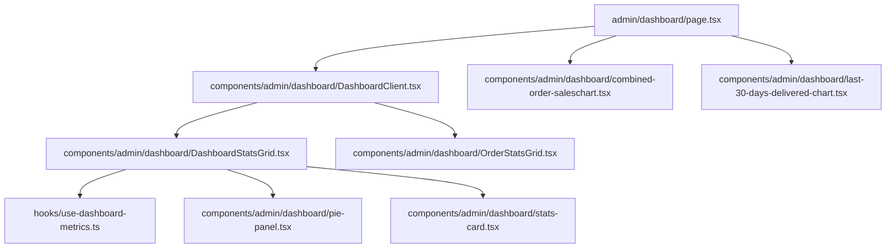
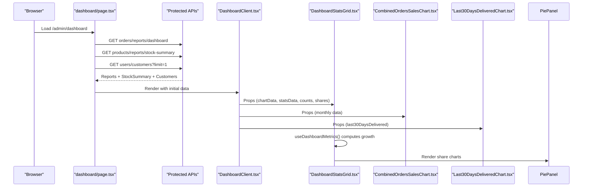
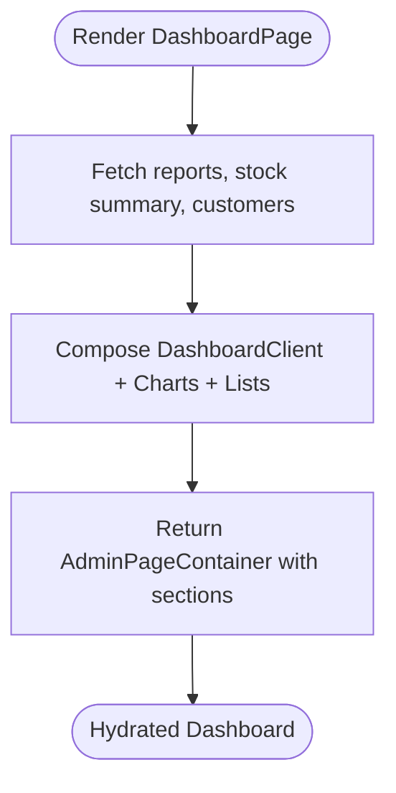
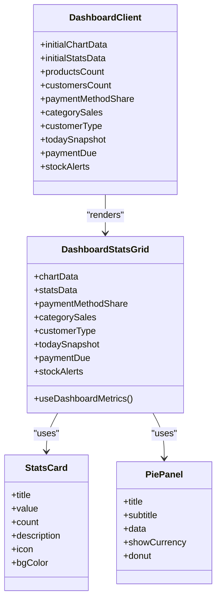
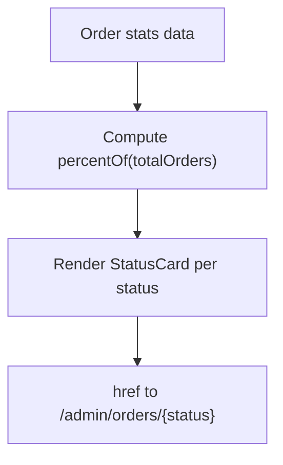
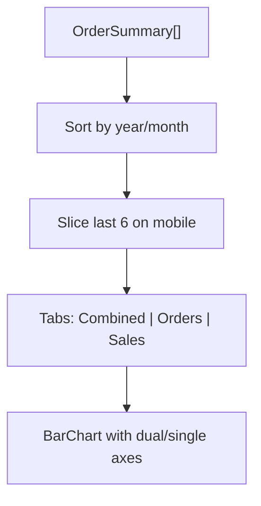
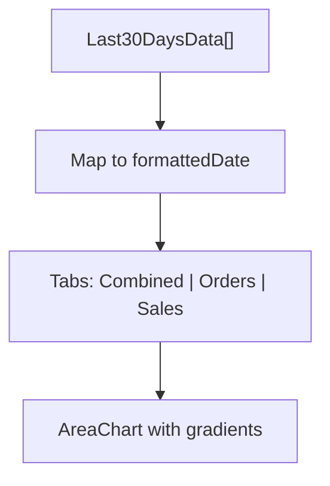
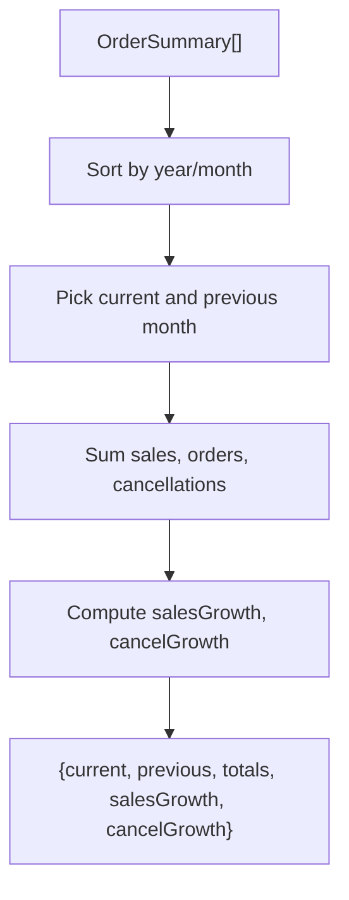
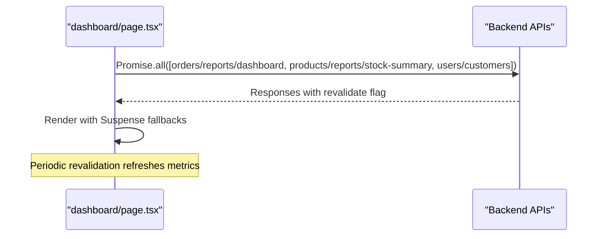
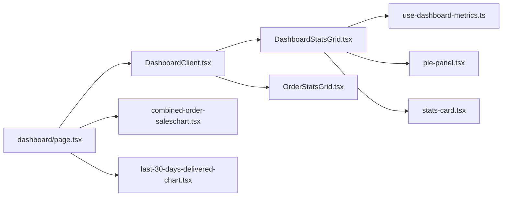

# Dashboard Overview

<cite>
**Referenced Files in This Document**
- [page.tsx](file://apps/frontend/app/admin/dashboard/page.tsx)
- [DashboardClient.tsx](file://apps/frontend/components/admin/dashboard/DashboardClient.tsx)
- [DashboardStatsGrid.tsx](file://apps/frontend/components/admin/dashboard/DashboardStatsGrid.tsx)
- [stats-card.tsx](file://apps/frontend/components/admin/dashboard/stats-card.tsx)
- [OrderStatsGrid.tsx](file://apps/frontend/components/admin/dashboard/OrderStatsGrid.tsx)
- [combined-order-saleschart.tsx](file://apps/frontend/components/admin/dashboard/combined-order-saleschart.tsx)
- [last-30-days-delivered-chart.tsx](file://apps/frontend/components/admin/dashboard/last-30-days-delivered-chart.tsx)
- [pie-panel.tsx](file://apps/frontend/components/admin/dashboard/pie-panel.tsx)
- [use-dashboard-metrics.ts](file://apps/frontend/hooks/use-dashboard-metrics.ts)
</cite>

## Table of Contents
1. [Introduction](#introduction)
2. [Project Structure](#project-structure)
3. [Core Components](#core-components)
4. [Architecture Overview](#architecture-overview)
5. [Detailed Component Analysis](#detailed-component-analysis)
6. [Dependency Analysis](#dependency-analysis)
7. [Performance Considerations](#performance-considerations)
8. [Troubleshooting Guide](#troubleshooting-guide)
9. [Conclusion](#conclusion)
10. [Appendices](#appendices)

## Introduction
This document explains the admin dashboard overview and key metrics display. It covers the main page structure, real-time statistics cards (sales, orders, customers, inventory), interactive charts (combined order sales, last 30 days delivered), performance indicators, quick actions for common tasks, responsive layout behavior, data fetching strategies, caching, and how to customize or extend widgets.

## Project Structure
The dashboard is implemented as a Next.js App Router route with server-side data fetching and client-side interactivity:
- Route entry point orchestrates data loading and composes UI sections.
- Client components render KPI cards, charts, and status grids.
- A shared hook computes growth metrics from monthly chart data.

**Diagram sources**
- [page.tsx:1-119](file://apps/frontend/app/admin/dashboard/page.tsx#L1-L119)
- [DashboardClient.tsx:1-56](file://apps/frontend/components/admin/dashboard/DashboardClient.tsx#L1-L56)
- [DashboardStatsGrid.tsx:1-373](file://apps/frontend/components/admin/dashboard/DashboardStatsGrid.tsx#L1-L373)
- [OrderStatsGrid.tsx:1-171](file://apps/frontend/components/admin/dashboard/OrderStatsGrid.tsx#L1-L171)
- [combined-order-saleschart.tsx:1-302](file://apps/frontend/components/admin/dashboard/combined-order-saleschart.tsx#L1-L302)
- [last-30-days-delivered-chart.tsx:1-313](file://apps/frontend/components/admin/dashboard/last-30-days-delivered-chart.tsx#L1-L313)
- [use-dashboard-metrics.ts:1-65](file://apps/frontend/hooks/use-dashboard-metrics.ts#L1-L65)
- [pie-panel.tsx:1-181](file://apps/frontend/components/admin/dashboard/pie-panel.tsx#L1-L181)
- [stats-card.tsx:1-123](file://apps/frontend/components/admin/dashboard/stats-card.tsx#L1-L123)

**Section sources**
- [page.tsx:1-119](file://apps/frontend/app/admin/dashboard/page.tsx#L1-L119)
- [DashboardClient.tsx:1-56](file://apps/frontend/components/admin/dashboard/DashboardClient.tsx#L1-L56)

## Core Components
- Dashboard page: Loads reports, stock summary, and customer count; renders stats grid, charts, order list, stock tabs, top lists.
- DashboardClient: Passes initial data into stats and order grids.
- DashboardStatsGrid: Renders KPI cards and small pie panels for payment methods, categories, and customer types; uses a hook to compute growth.
- OrderStatsGrid: Shows order counts by status with percentage progress and links to filtered order lists.
- Charts:
  - CombinedOrdersSalesChart: Bar chart with combined orders/sales and separate tabs.
  - Last30DaysDeliveredChart: Area chart for daily orders and revenue over 30 days.
- Shared widgets:
  - PiePanel: Reusable donut/pie chart with legend and tooltip.
  - StatsCard: Reusable metric card with optional sparkline and badge.
- Hook: useDashboardMetrics computes current vs previous month totals and growth rates.

**Section sources**
- [page.tsx:30-68](file://apps/frontend/app/admin/dashboard/page.tsx#L30-L68)
- [DashboardClient.tsx:13-55](file://apps/frontend/components/admin/dashboard/DashboardClient.tsx#L13-L55)
- [DashboardStatsGrid.tsx:43-81](file://apps/frontend/components/admin/dashboard/DashboardStatsGrid.tsx#L43-L81)
- [OrderStatsGrid.tsx:14-32](file://apps/frontend/components/admin/dashboard/OrderStatsGrid.tsx#L14-L32)
- [combined-order-saleschart.tsx:25-42](file://apps/frontend/components/admin/dashboard/combined-order-saleschart.tsx#L25-L42)
- [last-30-days-delivered-chart.tsx:27-40](file://apps/frontend/components/admin/dashboard/last-30-days-delivered-chart.tsx#L27-L40)
- [pie-panel.tsx:5-33](file://apps/frontend/components/admin/dashboard/pie-panel.tsx#L5-L33)
- [stats-card.tsx:6-35](file://apps/frontend/components/admin/dashboard/stats-card.tsx#L6-L35)
- [use-dashboard-metrics.ts:31-63](file://apps/frontend/hooks/use-dashboard-metrics.ts#L31-L63)

## Architecture Overview
The dashboard follows a server-first data-fetching pattern with Suspense boundaries and revalidation. The page aggregates multiple endpoints concurrently and passes results down to client components.

**Diagram sources**
- [page.tsx:32-68](file://apps/frontend/app/admin/dashboard/page.tsx#L32-L68)
- [DashboardClient.tsx:26-55](file://apps/frontend/components/admin/dashboard/DashboardClient.tsx#L26-L55)
- [DashboardStatsGrid.tsx:69-81](file://apps/frontend/components/admin/dashboard/DashboardStatsGrid.tsx#L69-L81)
- [combined-order-saleschart.tsx:40-67](file://apps/frontend/components/admin/dashboard/combined-order-saleschart.tsx#L40-L67)
- [last-30-days-delivered-chart.tsx:38-51](file://apps/frontend/components/admin/dashboard/last-30-days-delivered-chart.tsx#L38-L51)
- [use-dashboard-metrics.ts:31-63](file://apps/frontend/hooks/use-dashboard-metrics.ts#L31-L63)

## Detailed Component Analysis

### Main Dashboard Page
Responsibilities:
- Concurrently fetch dashboard reports, stock summary, and customer count.
- Render the client dashboard section, two charts, order list, stock tabs, and top lists.
- Provide skeleton placeholders via Suspense fallbacks.
- Use revalidation for near-real-time updates.

Key behaviors:
- Uses a single consolidated report endpoint plus lightweight stock and customer endpoints.
- Analytics widget is isolated so failures do not break the dashboard.

**Diagram sources**
- [page.tsx:32-68](file://apps/frontend/app/admin/dashboard/page.tsx#L32-L68)
- [page.tsx:103-118](file://apps/frontend/app/admin/dashboard/page.tsx#L103-L118)

**Section sources**
- [page.tsx:1-119](file://apps/frontend/app/admin/dashboard/page.tsx#L1-L119)

### DashboardClient and Stats Grid
- DashboardClient receives initial data and delegates rendering to stats and order grids.
- DashboardStatsGrid:
  - Computes current vs previous month and growth using useDashboardMetrics.
  - Displays KPI cards for today, average order value, monthly sales/cancel, all-time totals, product/customer counts, stock alerts, and payment due.
  - Renders small pie panels for new vs returning customers, revenue by payment method, revenue by category, and order distribution across statuses.

**Diagram sources**
- [DashboardClient.tsx:13-55](file://apps/frontend/components/admin/dashboard/DashboardClient.tsx#L13-L55)
- [DashboardStatsGrid.tsx:43-81](file://apps/frontend/components/admin/dashboard/DashboardStatsGrid.tsx#L43-L81)
- [stats-card.tsx:6-35](file://apps/frontend/components/admin/dashboard/stats-card.tsx#L6-L35)
- [pie-panel.tsx:5-33](file://apps/frontend/components/admin/dashboard/pie-panel.tsx#L5-L33)

**Section sources**
- [DashboardClient.tsx:1-56](file://apps/frontend/components/admin/dashboard/DashboardClient.tsx#L1-L56)
- [DashboardStatsGrid.tsx:1-373](file://apps/frontend/components/admin/dashboard/DashboardStatsGrid.tsx#L1-L373)

### Order Status Grid
- Displays total and per-status order counts with percentage progress bars.
- Each card links to a filtered order list view.

**Diagram sources**
- [OrderStatsGrid.tsx:32-40](file://apps/frontend/components/admin/dashboard/OrderStatsGrid.tsx#L32-L40)
- [OrderStatsGrid.tsx:42-168](file://apps/frontend/components/admin/dashboard/OrderStatsGrid.tsx#L42-L168)

**Section sources**
- [OrderStatsGrid.tsx:1-171](file://apps/frontend/components/admin/dashboard/OrderStatsGrid.tsx#L1-L171)

### Interactive Charts

#### Combined Orders & Sales Chart
- Bar chart with three tabs: Combined, Orders, Sales.
- Sorts months chronologically and adapts visible range on mobile.
- Dual Y-axis in combined view: orders (left) and sales (right).

**Diagram sources**
- [combined-order-saleschart.tsx:40-70](file://apps/frontend/components/admin/dashboard/combined-order-saleschart.tsx#L40-L70)
- [combined-order-saleschart.tsx:140-298](file://apps/frontend/components/admin/dashboard/combined-order-saleschart.tsx#L140-L298)

**Section sources**
- [combined-order-saleschart.tsx:1-302](file://apps/frontend/components/admin/dashboard/combined-order-saleschart.tsx#L1-L302)

#### Last 30 Days Delivered Chart
- Area chart with three tabs: Combined, Orders, Sales.
- Formats dates for X-axis and provides gradient fills.
- Dual Y-axis in combined view: orders (left) and sales (right).

**Diagram sources**
- [last-30-days-delivered-chart.tsx:38-51](file://apps/frontend/components/admin/dashboard/last-30-days-delivered-chart.tsx#L38-L51)
- [last-30-days-delivered-chart.tsx:108-307](file://apps/frontend/components/admin/dashboard/last-30-days-delivered-chart.tsx#L108-L307)

**Section sources**
- [last-30-days-delivered-chart.tsx:1-313](file://apps/frontend/components/admin/dashboard/last-30-days-delivered-chart.tsx#L1-L313)

### Real-Time Metrics Hook
- Sorts monthly data chronologically.
- Extracts current and previous month summaries.
- Aggregates all-time totals and computes growth percentages.

**Diagram sources**
- [use-dashboard-metrics.ts:31-63](file://apps/frontend/hooks/use-dashboard-metrics.ts#L31-L63)

**Section sources**
- [use-dashboard-metrics.ts:1-65](file://apps/frontend/hooks/use-dashboard-metrics.ts#L1-L65)

### Quick Actions Panel
Quick actions are provided through:
- Order status cards that link directly to filtered order lists.
- Top customers and top sale products lists rendered below the charts.
- Stock report tabs for out-of-stock and low-stock items.

These provide immediate navigation to common administrative tasks without leaving the dashboard.

**Section sources**
- [OrderStatsGrid.tsx:32-40](file://apps/frontend/components/admin/dashboard/OrderStatsGrid.tsx#L32-L40)
- [page.tsx:112-115](file://apps/frontend/app/admin/dashboard/page.tsx#L112-L115)

### Responsive Layout System
- KPI grid adapts from 2 columns on small screens to 4+ on larger screens.
- Charts switch between bar and area views, adjust axis labels, and limit visible data on mobile.
- Pie panels scale sizes and can be compacted for laptop screens.

Examples:
- KPI grid breakpoints and sizing are defined within the stats grid component.
- Combined chart hides older months on mobile and rotates X-axis labels.
- Last 30 days chart adjusts heights and label angles based on screen size.

**Section sources**
- [DashboardStatsGrid.tsx:137-137](file://apps/frontend/components/admin/dashboard/DashboardStatsGrid.tsx#L137-L137)
- [combined-order-saleschart.tsx:43-70](file://apps/frontend/components/admin/dashboard/combined-order-saleschart.tsx#L43-L70)
- [last-30-days-delivered-chart.tsx:98-106](file://apps/frontend/components/admin/dashboard/last-30-days-delivered-chart.tsx#L98-L106)
- [pie-panel.tsx:48-50](file://apps/frontend/components/admin/dashboard/pie-panel.tsx#L48-L50)

### Data Fetching Strategies, Caching, and Real-Time Updates
- Server-side concurrent requests for dashboard reports, stock summary, and customer count.
- Revalidation interval set for near-real-time metrics.
- Analytics widget wrapped in try/catch to avoid breaking the dashboard if analytics fail.
- Skeleton placeholders ensure fast initial paint while data loads.

**Diagram sources**
- [page.tsx:32-45](file://apps/frontend/app/admin/dashboard/page.tsx#L32-L45)
- [page.tsx:70-85](file://apps/frontend/app/admin/dashboard/page.tsx#L70-L85)
- [page.tsx:87-101](file://apps/frontend/app/admin/dashboard/page.tsx#L87-L101)

**Section sources**
- [page.tsx:30-85](file://apps/frontend/app/admin/dashboard/page.tsx#L30-L85)

### Customizing Widgets and Adding New Metric Cards
To add a new metric card:
- Add a new StatsCard instance inside DashboardStatsGrid’s KPI grid.
- Provide title, value, optional count, description, icon, and bgColor.
- If needed, integrate additional data props passed from DashboardClient.

To add a new pie panel:
- Prepare data in the format expected by PiePanel (name, value, color, percentage).
- Insert a PiePanel component in the second row of DashboardStatsGrid.
- Optionally enable donut mode and currency formatting.

To extend charts:
- For combined chart: add a new tab content and series mapping to existing data keys.
- For last 30 days chart: map additional fields into formattedData and bind them to Area series.

Best practices:
- Keep colors accessible and consistent with existing palettes.
- Ensure tooltips format values appropriately (currency vs counts).
- Respect responsive constraints (mobile truncation, rotated labels).

**Section sources**
- [DashboardStatsGrid.tsx:137-255](file://apps/frontend/components/admin/dashboard/DashboardStatsGrid.tsx#L137-L255)
- [DashboardStatsGrid.tsx:257-368](file://apps/frontend/components/admin/dashboard/DashboardStatsGrid.tsx#L257-L368)
- [combined-order-saleschart.tsx:140-298](file://apps/frontend/components/admin/dashboard/combined-order-saleschart.tsx#L140-L298)
- [last-30-days-delivered-chart.tsx:108-307](file://apps/frontend/components/admin/dashboard/last-30-days-delivered-chart.tsx#L108-L307)
- [pie-panel.tsx:52-181](file://apps/frontend/components/admin/dashboard/pie-panel.tsx#L52-L181)

## Dependency Analysis
High-level dependencies among dashboard components:

**Diagram sources**
- [page.tsx:1-119](file://apps/frontend/app/admin/dashboard/page.tsx#L1-L119)
- [DashboardClient.tsx:1-56](file://apps/frontend/components/admin/dashboard/DashboardClient.tsx#L1-L56)
- [DashboardStatsGrid.tsx:1-373](file://apps/frontend/components/admin/dashboard/DashboardStatsGrid.tsx#L1-L373)
- [OrderStatsGrid.tsx:1-171](file://apps/frontend/components/admin/dashboard/OrderStatsGrid.tsx#L1-L171)
- [combined-order-saleschart.tsx:1-302](file://apps/frontend/components/admin/dashboard/combined-order-saleschart.tsx#L1-L302)
- [last-30-days-delivered-chart.tsx:1-313](file://apps/frontend/components/admin/dashboard/last-30-days-delivered-chart.tsx#L1-L313)
- [use-dashboard-metrics.ts:1-65](file://apps/frontend/hooks/use-dashboard-metrics.ts#L1-L65)
- [pie-panel.tsx:1-181](file://apps/frontend/components/admin/dashboard/pie-panel.tsx#L1-L181)
- [stats-card.tsx:1-123](file://apps/frontend/components/admin/dashboard/stats-card.tsx#L1-L123)

**Section sources**
- [page.tsx:1-119](file://apps/frontend/app/admin/dashboard/page.tsx#L1-L119)
- [DashboardClient.tsx:1-56](file://apps/frontend/components/admin/dashboard/DashboardClient.tsx#L1-L56)
- [DashboardStatsGrid.tsx:1-373](file://apps/frontend/components/admin/dashboard/DashboardStatsGrid.tsx#L1-L373)
- [OrderStatsGrid.tsx:1-171](file://apps/frontend/components/admin/dashboard/OrderStatsGrid.tsx#L1-L171)
- [combined-order-saleschart.tsx:1-302](file://apps/frontend/components/admin/dashboard/combined-order-saleschart.tsx#L1-L302)
- [last-30-days-delivered-chart.tsx:1-313](file://apps/frontend/components/admin/dashboard/last-30-days-delivered-chart.tsx#L1-L313)
- [use-dashboard-metrics.ts:1-65](file://apps/frontend/hooks/use-dashboard-metrics.ts#L1-L65)
- [pie-panel.tsx:1-181](file://apps/frontend/components/admin/dashboard/pie-panel.tsx#L1-L181)
- [stats-card.tsx:1-123](file://apps/frontend/components/admin/dashboard/stats-card.tsx#L1-L123)

## Performance Considerations
- Concurrent data fetching reduces round trips and improves Time to First Meaningful Paint.
- Revalidation keeps metrics fresh without full page reloads.
- Suspense fallbacks provide instant skeleton UI during data load.
- Charts adapt to mobile by limiting visible data points and rotating labels.
- Memoization in the metrics hook avoids unnecessary recomputation when chart data changes.

[No sources needed since this section provides general guidance]

## Troubleshooting Guide
Common issues and resolutions:
- Missing or empty metrics:
  - Verify backend endpoints return valid payloads for orders/reports/dashboard, products/reports/stock-summary, and users/customers.
  - Check revalidation configuration and network connectivity.
- Analytics widget not showing:
  - Failures are intentionally swallowed; check console logs for errors and confirm the analytics endpoint returns the expected shape.
- Charts not rendering:
  - Ensure chartData arrays are non-empty and correctly typed.
  - Confirm responsive container dimensions are available after hydration.
- Incorrect growth indicators:
  - Validate that monthly data includes both current and previous months; otherwise growth defaults to zero.

**Section sources**
- [page.tsx:70-85](file://apps/frontend/app/admin/dashboard/page.tsx#L70-L85)
- [use-dashboard-metrics.ts:31-63](file://apps/frontend/hooks/use-dashboard-metrics.ts#L31-L63)

## Conclusion
The admin dashboard combines server-side data aggregation with client-side interactivity to deliver a comprehensive overview of sales, orders, customers, and inventory. Its modular components, responsive design, and robust data fetching strategy make it easy to extend with new metrics and visualizations while maintaining performance and reliability.

[No sources needed since this section summarizes without analyzing specific files]

## Appendices

### Example: Adding a New Metric Card
Steps:
1. Open DashboardStatsGrid.
2. Add a new StatsCard with appropriate props (title, value, count, description, icon, bgColor).
3. If you need new data, extend DashboardClient props and pass it down.

Reference paths:
- [DashboardStatsGrid.tsx:137-255](file://apps/frontend/components/admin/dashboard/DashboardStatsGrid.tsx#L137-L255)
- [DashboardClient.tsx:13-55](file://apps/frontend/components/admin/dashboard/DashboardClient.tsx#L13-L55)

### Example: Adding a New Pie Panel
Steps:
1. Prepare data array with name, value, color, percentage.
2. Insert PiePanel in DashboardStatsGrid’s second row.
3. Toggle donut and showCurrency as needed.

Reference paths:
- [DashboardStatsGrid.tsx:257-368](file://apps/frontend/components/admin/dashboard/DashboardStatsGrid.tsx#L257-L368)
- [pie-panel.tsx:52-181](file://apps/frontend/components/admin/dashboard/pie-panel.tsx#L52-L181)