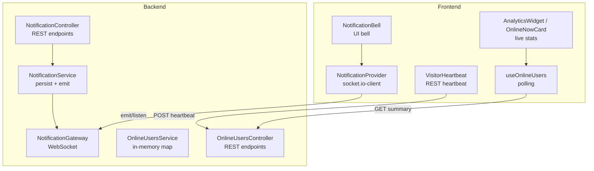
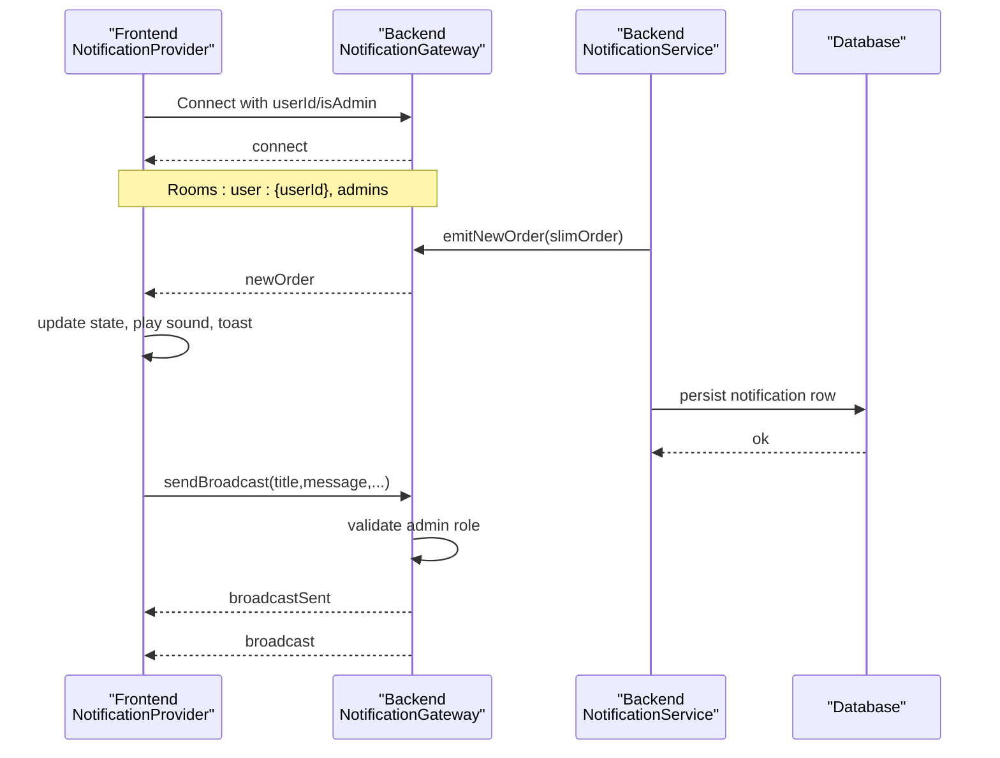
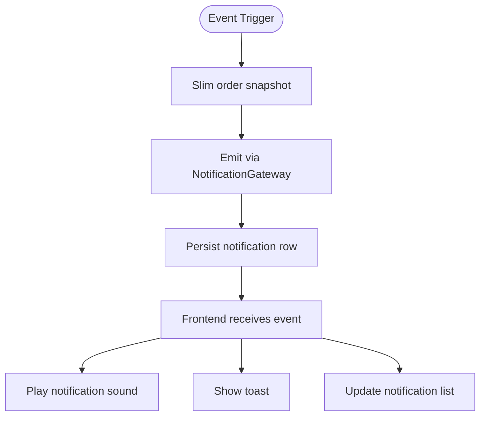
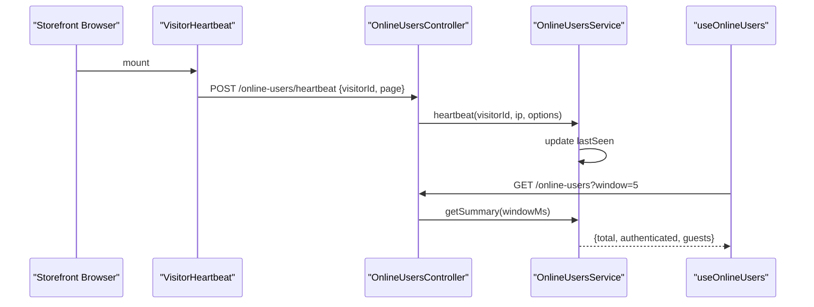
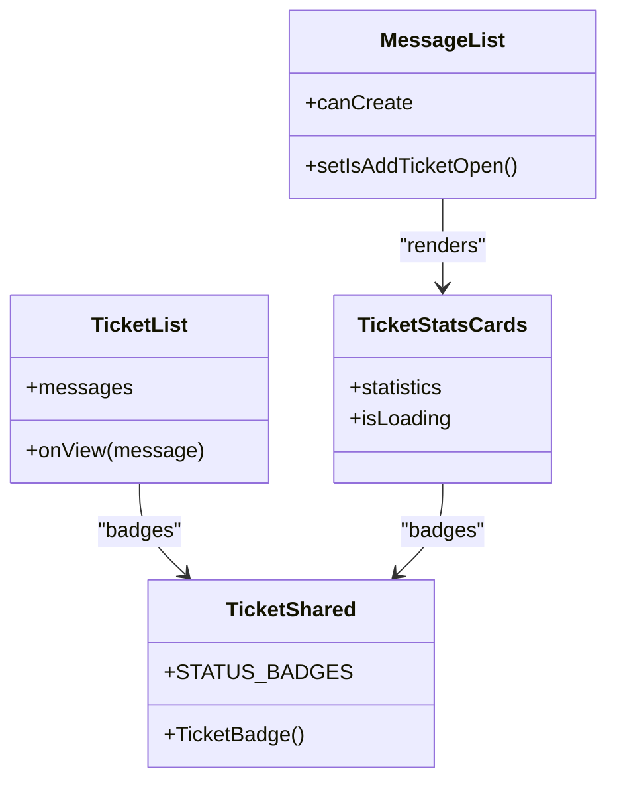
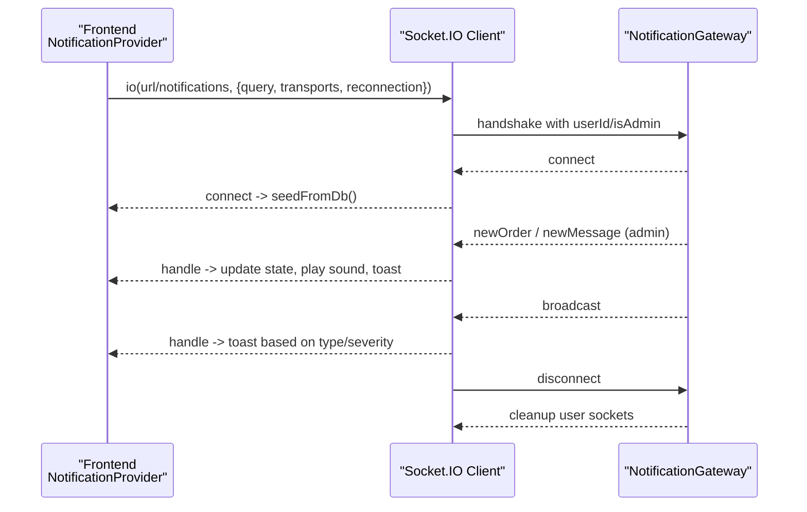
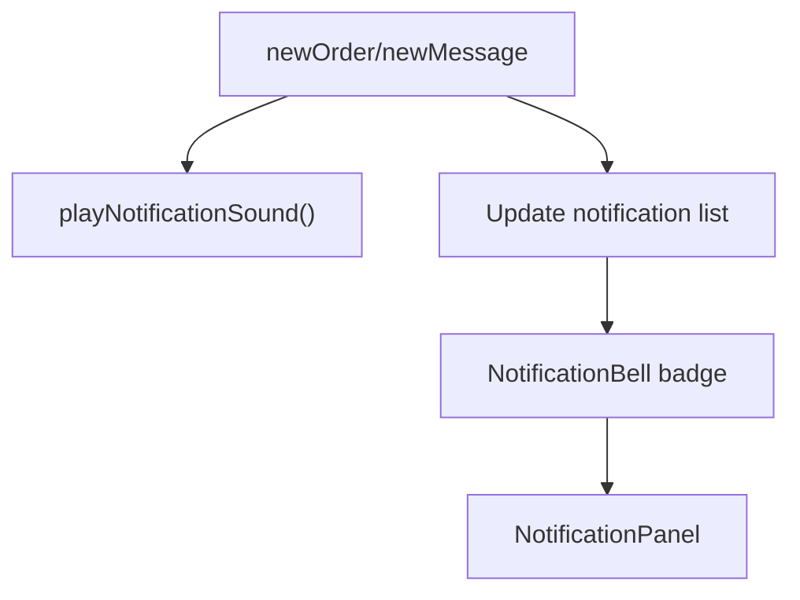
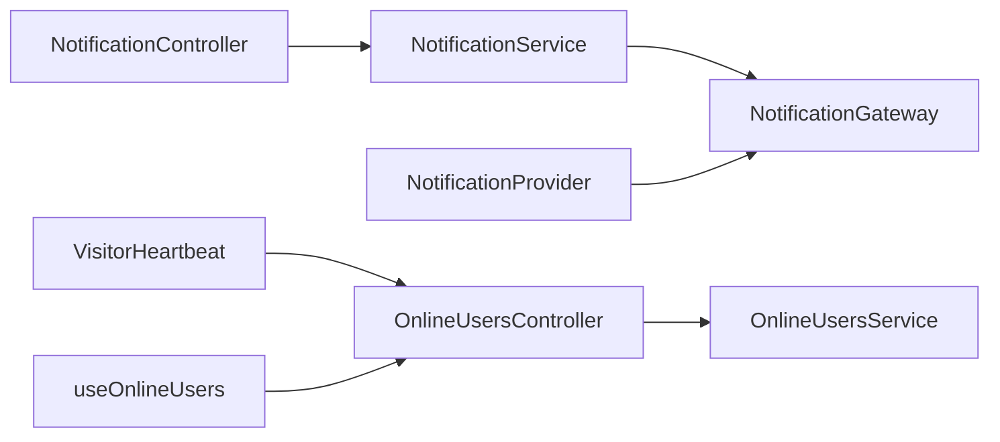

# Real-time Features

<cite>
**Referenced Files in This Document**
- [notification.gateway.ts](file://apps/backend/src/notification/notification.gateway.ts)
- [notification.service.ts](file://apps/backend/src/notification/notification.service.ts)
- [notification.controller.ts](file://apps/backend/src/notification/notification.controller.ts)
- [online-users.service.ts](file://apps/backend/src/online-users/online-users.service.ts)
- [online-users.controller.ts](file://apps/backend/src/online-users/online-users.controller.ts)
- [visitor-heartbeat.tsx](file://apps/frontend/components/common/visitor-heartbeat.tsx)
- [use-online-users.ts](file://apps/frontend/hooks/use-online-users.ts)
- [analytics-widget.tsx](file://apps/frontend/components/admin/analytics/analytics-widget.tsx)
- [online-now-card.tsx](file://apps/frontend/components/admin/analytics/online-now-card.tsx)
- [notification-provider.tsx](file://apps/frontend/providers/notification-provider.tsx)
- [notification-sound.ts](file://apps/frontend/lib/notification-sound.ts)
- [notification-bell.tsx](file://apps/frontend/components/notification-bell.tsx)
- [ticket-list.tsx](file://apps/frontend/components/admin/inbox/ticket-list.tsx)
- [ticket-stats-cards.tsx](file://apps/frontend/components/admin/inbox/ticket-stats-cards.tsx)
- [message-list.tsx](file://apps/frontend/components/admin/inbox/message-list.tsx)
- [ticket-shared.tsx](file://apps/frontend/components/admin/inbox/ticket-shared.tsx)
</cite>

## Table of Contents
1. [Introduction](#introduction)
2. [Project Structure](#project-structure)
3. [Core Components](#core-components)
4. [Architecture Overview](#architecture-overview)
5. [Detailed Component Analysis](#detailed-component-analysis)
6. [Dependency Analysis](#dependency-analysis)
7. [Performance Considerations](#performance-considerations)
8. [Troubleshooting Guide](#troubleshooting-guide)
9. [Conclusion](#conclusion)

## Introduction
This document explains the real-time features powering the admin dashboard: live notifications, online user tracking, and customer support ticket management. It covers WebSocket-based communication, connection and error handling, reconnection strategies, notification sounds, visual indicators, and user preference hooks for alerts.

## Project Structure
The real-time system spans backend modules (WebSocket gateway, services, controllers) and frontend components (providers, hooks, UI widgets). The key areas are:
- Backend: Notification Gateway (realtime events), Notification Service (persistence and event orchestration), Online Users service/controller (heartbeat and summary).
- Frontend: Notification Provider (Socket.IO client, event handlers, persistence sync), Visitor Heartbeat (storefront heartbeat), Online Users hook and analytics widgets, Inbox ticket UIs.

**Diagram sources**
- [notification-provider.tsx:86-114](file://apps/frontend/providers/notification-provider.tsx#L86-L114)
- [notification.gateway.ts:15-37](file://apps/backend/src/notification/notification.gateway.ts#L15-L37)
- [visitor-heartbeat.tsx:26-43](file://apps/frontend/components/common/visitor-heartbeat.tsx#L26-L43)
- [online-users.controller.ts:31-51](file://apps/backend/src/online-users/online-users.controller.ts#L31-L51)
- [use-online-users.ts:8-29](file://apps/frontend/hooks/use-online-users.ts#L8-L29)
- [notification.controller.ts:25-47](file://apps/backend/src/notification/notification.controller.ts#L25-L47)

**Section sources**
- [notification.gateway.ts:15-37](file://apps/backend/src/notification/notification.gateway.ts#L15-L37)
- [notification.service.ts:21-29](file://apps/backend/src/notification/notification.service.ts#L21-L29)
- [notification.controller.ts:25-47](file://apps/backend/src/notification/notification.controller.ts#L25-L47)
- [online-users.service.ts:20-33](file://apps/backend/src/online-users/online-users.service.ts#L20-L33)
- [online-users.controller.ts:26-51](file://apps/backend/src/online-users/online-users.controller.ts#L26-L51)
- [visitor-heartbeat.tsx:26-43](file://apps/frontend/components/common/visitor-heartbeat.tsx#L26-L43)
- [use-online-users.ts:8-29](file://apps/frontend/hooks/use-online-users.ts#L8-L29)
- [notification-provider.tsx:86-114](file://apps/frontend/providers/notification-provider.tsx#L86-L114)

## Core Components
- Notification Gateway: WebSocket server that manages rooms, routes events to users or admins, and validates broadcast requests.
- Notification Service: Orchestrates emitting realtime events and persisting notifications for both admin and user audiences.
- Notification Controller: REST endpoints to fetch and manage persisted notifications.
- Online Users Service: In-memory store of active visitors with heartbeat timestamps; computes summaries and page counts.
- Online Users Controller: Exposes heartbeat registration and online summary endpoints.
- Frontend Notification Provider: Manages Socket.IO connection, listens for events, updates local state, plays sounds, and shows toast notifications.
- Visitor Heartbeat: Periodically sends a heartbeat from the storefront to keep visitor presence alive.
- Online Users Hook and Widgets: Polls the online summary endpoint and renders live metrics.
- Inbox Ticket UIs: Lists, statistics, and shared badges for support tickets.

**Section sources**
- [notification.gateway.ts:43-87](file://apps/backend/src/notification/notification.gateway.ts#L43-L87)
- [notification.service.ts:60-167](file://apps/backend/src/notification/notification.service.ts#L60-L167)
- [notification.controller.ts:30-79](file://apps/backend/src/notification/notification.controller.ts#L30-L79)
- [online-users.service.ts:41-92](file://apps/backend/src/online-users/online-users.service.ts#L41-L92)
- [online-users.controller.ts:31-98](file://apps/backend/src/online-users/online-users.controller.ts#L31-L98)
- [notification-provider.tsx:86-248](file://apps/frontend/providers/notification-provider.tsx#L86-L248)
- [visitor-heartbeat.tsx:26-43](file://apps/frontend/components/common/visitor-heartbeat.tsx#L26-L43)
- [use-online-users.ts:8-29](file://apps/frontend/hooks/use-online-users.ts#L8-L29)
- [ticket-list.tsx:12-38](file://apps/frontend/components/admin/inbox/ticket-list.tsx#L12-L38)
- [ticket-stats-cards.tsx:13-34](file://apps/frontend/components/admin/inbox/ticket-stats-cards.tsx#L13-L34)
- [message-list.tsx:294-330](file://apps/frontend/components/admin/inbox/message-list.tsx#L294-L330)
- [ticket-shared.tsx:69-116](file://apps/frontend/components/admin/inbox/ticket-shared.tsx#L69-L116)

## Architecture Overview
Real-time communication is built on Socket.IO under the “notifications” namespace. Admins receive broadcasts and new-order/new-message events; customers receive order confirmation, status, and payment updates. Persistence is decoupled via the Notification Service so UIs remain responsive even if storage fails.

**Diagram sources**
- [notification-provider.tsx:86-114](file://apps/frontend/providers/notification-provider.tsx#L86-L114)
- [notification.gateway.ts:43-87](file://apps/backend/src/notification/notification.gateway.ts#L43-L87)
- [notification.service.ts:60-75](file://apps/backend/src/notification/notification.service.ts#L60-L75)
- [notification.gateway.ts:228-338](file://apps/backend/src/notification/notification.gateway.ts#L228-L338)

## Detailed Component Analysis

### Live Notification System
- Realtime events:
  - Admin-only: newOrder, newMessage
  - User-specific: orderConfirmation, orderStatusUpdate, paymentStatusUpdate
  - General: notification, broadcast
- Persistence:
  - Admin feed (audience=admin) and user feed (audience=user) are stored separately.
  - Broadcasts are visible to all users; admin rows are shared across the admin team.
- UI integration:
  - NotificationProvider subscribes to events, updates local list, plays sound, and shows toasts.
  - NotificationBell displays unread count and opens panel.

**Diagram sources**
- [notification.service.ts:37-58](file://apps/backend/src/notification/notification.service.ts#L37-L58)
- [notification.service.ts:60-167](file://apps/backend/src/notification/notification.service.ts#L60-L167)
- [notification-provider.tsx:133-235](file://apps/frontend/providers/notification-provider.tsx#L133-L235)
- [notification-sound.ts:4-14](file://apps/frontend/lib/notification-sound.ts#L4-L14)

**Section sources**
- [notification.gateway.ts:148-222](file://apps/backend/src/notification/notification.gateway.ts#L148-L222)
- [notification.service.ts:60-167](file://apps/backend/src/notification/notification.service.ts#L60-L167)
- [notification-provider.tsx:133-235](file://apps/frontend/providers/notification-provider.tsx#L133-L235)
- [notification-bell.tsx:22-53](file://apps/frontend/components/notification-bell.tsx#L22-L53)

### Online User Tracking
- Storefront visitors send periodic heartbeats with a stable visitorId and optional authenticated userId.
- Backend maintains an in-memory map keyed by visitorId (or IP fallback), pruning stale entries every minute.
- Admins can query the current online summary (total, authenticated, guests) and per-page counts.
- Frontend polls the summary every 30 seconds and renders live metrics.

**Diagram sources**
- [visitor-heartbeat.tsx:26-43](file://apps/frontend/components/common/visitor-heartbeat.tsx#L26-L43)
- [online-users.controller.ts:31-51](file://apps/backend/src/online-users/online-users.controller.ts#L31-L51)
- [online-users.service.ts:41-53](file://apps/backend/src/online-users/online-users.service.ts#L41-L53)
- [use-online-users.ts:8-29](file://apps/frontend/hooks/use-online-users.ts#L8-L29)

**Section sources**
- [online-users.service.ts:17-33](file://apps/backend/src/online-users/online-users.service.ts#L17-L33)
- [online-users.service.ts:55-92](file://apps/backend/src/online-users/online-users.service.ts#L55-L92)
- [online-users.controller.ts:53-98](file://apps/backend/src/online-users/online-users.controller.ts#L53-L98)
- [use-online-users.ts:8-29](file://apps/frontend/hooks/use-online-users.ts#L8-L29)
- [analytics-widget.tsx:102-129](file://apps/frontend/components/admin/analytics/analytics-widget.tsx#L102-L129)
- [online-now-card.tsx:16-35](file://apps/frontend/components/admin/analytics/online-now-card.tsx#L16-L35)

### Ticket Management System (Customer Support)
- Ticket list presents messages with subject preview and avatar initials.
- Statistics cards show counts by status and priority.
- Shared helpers render status/priority badges consistently.
- Message list page provides actions like adding tickets and filtering by status.

**Diagram sources**
- [ticket-list.tsx:12-38](file://apps/frontend/components/admin/inbox/ticket-list.tsx#L12-L38)
- [ticket-stats-cards.tsx:13-34](file://apps/frontend/components/admin/inbox/ticket-stats-cards.tsx#L13-L34)
- [ticket-shared.tsx:69-116](file://apps/frontend/components/admin/inbox/ticket-shared.tsx#L69-L116)
- [message-list.tsx:294-330](file://apps/frontend/components/admin/inbox/message-list.tsx#L294-L330)

**Section sources**
- [ticket-list.tsx:12-38](file://apps/frontend/components/admin/inbox/ticket-list.tsx#L12-L38)
- [ticket-stats-cards.tsx:13-34](file://apps/frontend/components/admin/inbox/ticket-stats-cards.tsx#L13-L34)
- [ticket-shared.tsx:69-116](file://apps/frontend/components/admin/inbox/ticket-shared.tsx#L69-L116)
- [message-list.tsx:294-330](file://apps/frontend/components/admin/inbox/message-list.tsx#L294-L330)

### WebSocket Implementation, Connection Management, Error Handling, Reconnection
- Namespace and CORS:
  - Socket.IO runs under the “notifications” namespace with configured CORS origins and credentials enabled.
- Connection lifecycle:
  - On connect, clients join user-specific room and optionally the “admins” room.
  - On disconnect, socket IDs are removed from the user mapping.
- Event routing:
  - Admin-only channels: newOrder, newMessage.
  - User-targeted channels: orderConfirmation, orderStatusUpdate, paymentStatusUpdate, notification.
  - Broadcast channel: broadcast to all clients.
- Admin broadcast authorization:
  - Validates userId, verifies admin role, enforces required fields, and returns recipient count.
- Frontend connection:
  - Uses socket.io-client with transports set to websocket, withCredentials true, and reconnection enabled with delay/backoff caps.
  - Listens for connect/disconnect/connect_error and seeds unread notifications from the database on reconnect.

**Diagram sources**
- [notification.gateway.ts:15-37](file://apps/backend/src/notification/notification.gateway.ts#L15-L37)
- [notification.gateway.ts:43-87](file://apps/backend/src/notification/notification.gateway.ts#L43-L87)
- [notification.gateway.ts:228-338](file://apps/backend/src/notification/notification.gateway.ts#L228-L338)
- [notification-provider.tsx:86-131](file://apps/frontend/providers/notification-provider.tsx#L86-L131)
- [notification-provider.tsx:133-235](file://apps/frontend/providers/notification-provider.tsx#L133-L235)

**Section sources**
- [notification.gateway.ts:15-37](file://apps/backend/src/notification/notification.gateway.ts#L15-L37)
- [notification.gateway.ts:43-87](file://apps/backend/src/notification/notification.gateway.ts#L43-L87)
- [notification.gateway.ts:228-338](file://apps/backend/src/notification/notification.gateway.ts#L228-L338)
- [notification-provider.tsx:86-131](file://apps/frontend/providers/notification-provider.tsx#L86-L131)
- [notification-provider.tsx:133-235](file://apps/frontend/providers/notification-provider.tsx#L133-L235)

### Notification Sound System, Visual Indicators, and Preferences
- Sound:
  - A simple utility plays a notification audio file at reduced volume when new orders/messages arrive.
- Visual indicators:
  - NotificationBell shows a badge with unread count and opens a popover/sheet with the notification panel.
  - Analytics widgets display a live “Online Now” card with a pulsing indicator.
- Preferences:
  - No explicit user preference toggles are present in the referenced files; sound playback is unconditional on event receipt.

**Diagram sources**
- [notification-provider.tsx:133-154](file://apps/frontend/providers/notification-provider.tsx#L133-L154)
- [notification-sound.ts:4-14](file://apps/frontend/lib/notification-sound.ts#L4-L14)
- [notification-bell.tsx:22-53](file://apps/frontend/components/notification-bell.tsx#L22-L53)
- [online-now-card.tsx:16-35](file://apps/frontend/components/admin/analytics/online-now-card.tsx#L16-L35)

**Section sources**
- [notification-sound.ts:4-14](file://apps/frontend/lib/notification-sound.ts#L4-L14)
- [notification-bell.tsx:22-53](file://apps/frontend/components/notification-bell.tsx#L22-L53)
- [online-now-card.tsx:16-35](file://apps/frontend/components/admin/analytics/online-now-card.tsx#L16-L35)

## Dependency Analysis
- NotificationService depends on NotificationGateway for realtime emission and TypeORM repository for persistence.
- NotificationController exposes REST endpoints that delegate to NotificationService.
- Frontend NotificationProvider depends on socket.io-client and REST APIs for seeding and marking read.
- OnlineUsersController uses OnlineUsersService; frontend useOnlineUsers polls the controller.
- VisitorHeartbeat posts to OnlineUsersController to maintain presence.

**Diagram sources**
- [notification.controller.ts:25-47](file://apps/backend/src/notification/notification.controller.ts#L25-L47)
- [notification.service.ts:21-29](file://apps/backend/src/notification/notification.service.ts#L21-L29)
- [notification.gateway.ts:15-37](file://apps/backend/src/notification/notification.gateway.ts#L15-L37)
- [notification-provider.tsx:86-114](file://apps/frontend/providers/notification-provider.tsx#L86-L114)
- [online-users.controller.ts:31-51](file://apps/backend/src/online-users/online-users.controller.ts#L31-L51)
- [online-users.service.ts:20-33](file://apps/backend/src/online-users/online-users.service.ts#L20-L33)
- [visitor-heartbeat.tsx:26-43](file://apps/frontend/components/common/visitor-heartbeat.tsx#L26-L43)
- [use-online-users.ts:8-29](file://apps/frontend/hooks/use-online-users.ts#L8-L29)

**Section sources**
- [notification.controller.ts:25-47](file://apps/backend/src/notification/notification.controller.ts#L25-L47)
- [notification.service.ts:21-29](file://apps/backend/src/notification/notification.service.ts#L21-L29)
- [notification.gateway.ts:15-37](file://apps/backend/src/notification/notification.gateway.ts#L15-L37)
- [notification-provider.tsx:86-114](file://apps/frontend/providers/notification-provider.tsx#L86-L114)
- [online-users.controller.ts:31-51](file://apps/backend/src/online-users/online-users.controller.ts#L31-L51)
- [online-users.service.ts:20-33](file://apps/backend/src/online-users/online-users.service.ts#L20-L33)
- [visitor-heartbeat.tsx:26-43](file://apps/frontend/components/common/visitor-heartbeat.tsx#L26-L43)
- [use-online-users.ts:8-29](file://apps/frontend/hooks/use-online-users.ts#L8-L29)

## Performance Considerations
- Keep payloads slim: NotificationService already slims order snapshots before emitting and persisting to reduce bandwidth and avoid leaking sensitive relations.
- Avoid blocking operations in hot paths: NotificationService’s persist method is fail-open so realtime emits are not blocked by DB failures.
- Limit polling frequency: useOnlineUsers polls every 30 seconds; adjust only if necessary.
- Manage WebSocket overhead: Only one socket instance per app shell; ensure cleanup on unmount.
- Prune stale visitors: OnlineUsersService prunes entries older than the configured window to keep memory bounded.

[No sources needed since this section provides general guidance]

## Troubleshooting Guide
- WebSocket connection errors:
  - Check CORS configuration and origin allowlist on the gateway.
  - Verify environment variable for socket URL and that credentials are enabled.
- Missing notifications after reload:
  - NotificationProvider seeds unread notifications from the API on mount and reconnect; ensure the admin notifications endpoint is accessible.
- Broadcast failures:
  - Ensure the broadcasting user has admin role and that title/message are provided; check logs for unauthorized attempts.
- Online users not updating:
  - Confirm VisitorHeartbeat is sending periodic heartbeats and that the online-users endpoint is reachable.
  - Validate that the window parameter is within allowed bounds.

**Section sources**
- [notification.gateway.ts:15-37](file://apps/backend/src/notification/notification.gateway.ts#L15-L37)
- [notification-provider.tsx:86-131](file://apps/frontend/providers/notification-provider.tsx#L86-L131)
- [notification-provider.tsx:37-79](file://apps/frontend/providers/notification-provider.tsx#L37-L79)
- [notification.gateway.ts:228-338](file://apps/backend/src/notification/notification.gateway.ts#L228-L338)
- [visitor-heartbeat.tsx:26-43](file://apps/frontend/components/common/visitor-heartbeat.tsx#L26-L43)
- [online-users.controller.ts:53-98](file://apps/backend/src/online-users/online-users.controller.ts#L53-L98)

## Conclusion
The real-time subsystem combines a robust WebSocket gateway with resilient persistence and clear separation between admin and user audiences. Online presence is tracked via lightweight heartbeats, while the inbox UI provides a consistent experience for managing support tickets. The frontend integrates seamlessly with the backend through a single provider that handles connection lifecycle, event routing, sound, and visual feedback.