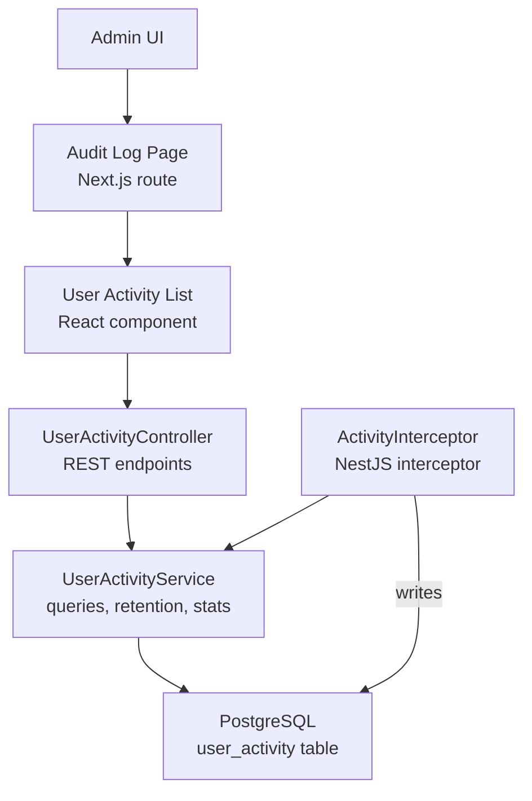
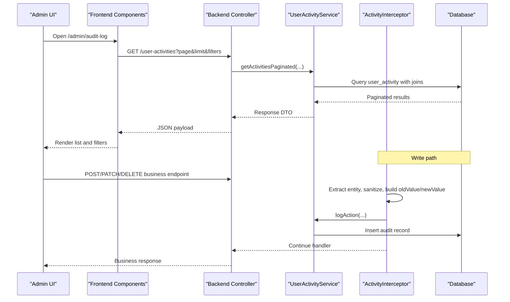
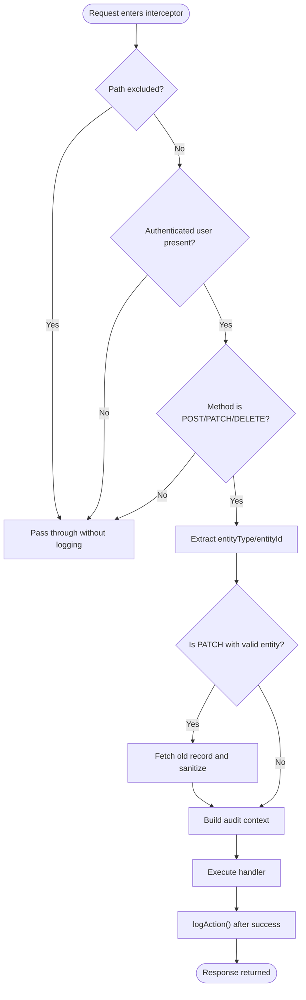
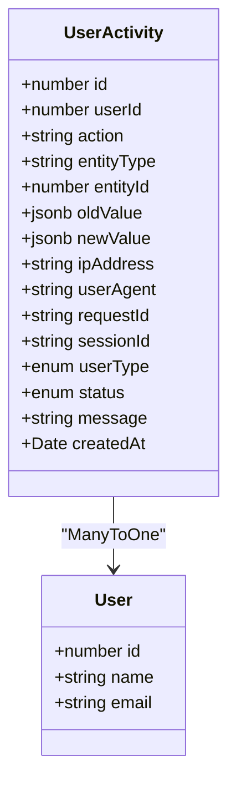
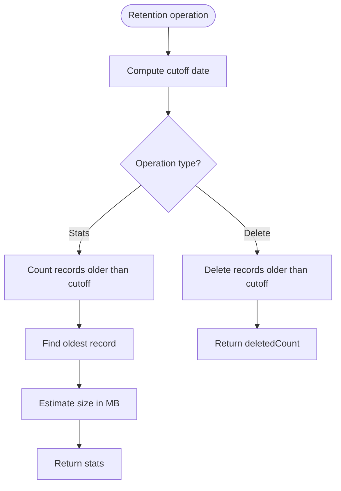
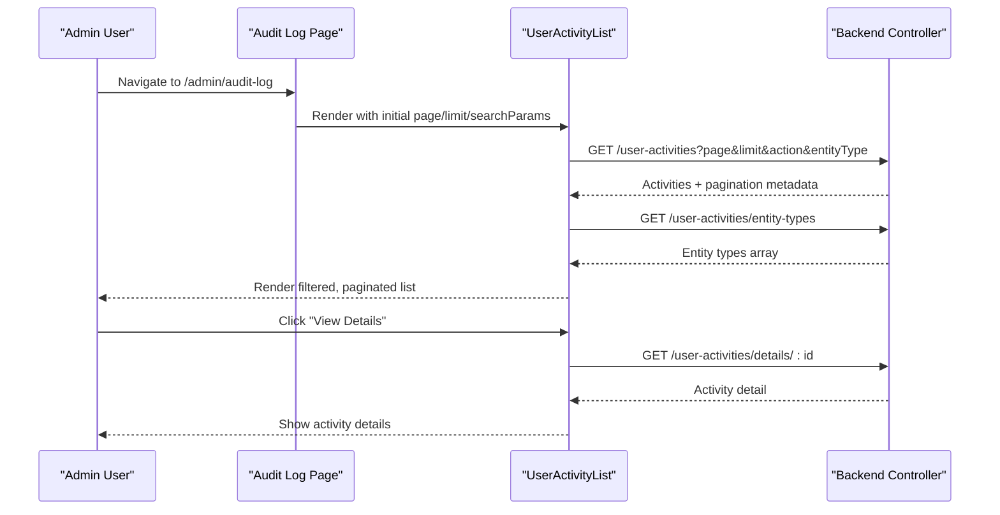
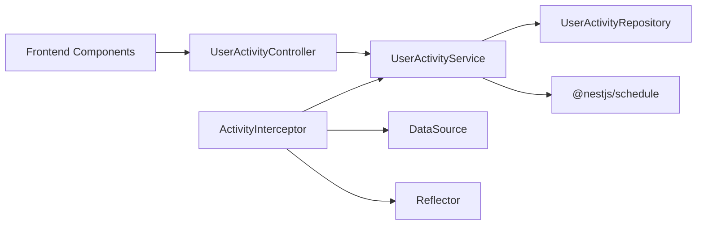

# Audit Logging

<cite>
**Referenced Files in This Document**
- [activity.interceptor.ts](file://apps/backend/src/interceptor/activity.interceptor.ts)
- [user-activity.entity.ts](file://apps/backend/src/user-activity/entities/user-activity.entity.ts)
- [user-activity.service.ts](file://apps/backend/src/user-activity/user-activity.service.ts)
- [user-activity.controller.ts](file://apps/backend/src/user-activity/user-activity.controller.ts)
- [page.tsx](file://apps/frontend/app/admin/audit-log/page.tsx)
- [user-activity-list.tsx](file://apps/frontend/components/admin/reports/user-activity/user-activity-list.tsx)
- [activity-details.tsx](file://apps/frontend/components/admin/reports/user-activity/activity-details.tsx)
</cite>

## Table of Contents
1. [Introduction](#introduction)
2. [Project Structure](#project-structure)
3. [Core Components](#core-components)
4. [Architecture Overview](#architecture-overview)
5. [Detailed Component Analysis](#detailed-component-analysis)
6. [Dependency Analysis](#dependency-analysis)
7. [Performance Considerations](#performance-considerations)
8. [Troubleshooting Guide](#troubleshooting-guide)
9. [Privacy and Compliance](#privacy-and-compliance)
10. [Conclusion](#conclusion)

## Introduction
This document explains the audit logging and activity tracking system used to record administrative actions, user modifications, permission changes, and system configuration updates. It covers:
- How request/response data and user context are captured through an interceptor-based mechanism.
- The audit log data model and persistence layer.
- The backend API for viewing, searching, filtering, and managing audit logs.
- The frontend admin interface for browsing and inspecting audit entries.
- Log retention policies, scheduled cleanup, and guidance for extending the system with custom audit entries and external monitoring integrations.

## Project Structure
The audit logging feature spans both backend and frontend:
- Backend NestJS module provides:
  - An interceptor that captures write operations and enriches them with user and request context.
  - A service that persists audit records and exposes query, retention, and statistics functionality.
  - A controller exposing REST endpoints for the admin UI.
- Frontend Next.js admin page renders a paginated list of activities with filters and drill-down details.

**Diagram sources**
- [page.tsx:1-20](file://apps/frontend/app/admin/audit-log/page.tsx#L1-L20)
- [user-activity-list.tsx:152-163](file://apps/frontend/components/admin/reports/user-activity/user-activity-list.tsx#L152-L163)
- [user-activity.controller.ts:25-140](file://apps/backend/src/user-activity/user-activity.controller.ts#L25-L140)
- [user-activity.service.ts:34-131](file://apps/backend/src/user-activity/user-activity.service.ts#L34-L131)
- [activity.interceptor.ts:20-73](file://apps/backend/src/interceptor/activity.interceptor.ts#L20-L73)

**Section sources**
- [page.tsx:1-20](file://apps/frontend/app/admin/audit-log/page.tsx#L1-L20)
- [user-activity.controller.ts:25-140](file://apps/backend/src/user-activity/user-activity.controller.ts#L25-L140)
- [user-activity.service.ts:34-131](file://apps/backend/src/user-activity/user-activity.service.ts#L34-L131)
- [activity.interceptor.ts:20-73](file://apps/backend/src/interceptor/activity.interceptor.ts#L20-L73)

## Core Components
- ActivityInterceptor: Captures POST/PATCH/DELETE requests, extracts entity context, fetches old values for PATCH, sanitizes sensitive fields, and writes audit records after successful handler execution.
- UserActivity entity: Defines the persisted audit record schema, including user context, action, entity reference, before/after snapshots, network context, and timestamps.
- UserActivityService: Provides methods to log actions, query paginated activities with filters, retrieve audit trails per entity, manage retention, and run scheduled cleanup.
- UserActivityController: Exposes admin-facing endpoints for listing, filtering, retrieving details, auditing specific entities, and managing retention.
- Frontend Audit Log UI: Renders a paginated list, supports filtering by action and entity type, and allows drilling into individual activity details.

**Section sources**
- [activity.interceptor.ts:20-73](file://apps/backend/src/interceptor/activity.interceptor.ts#L20-L73)
- [user-activity.entity.ts:12-87](file://apps/backend/src/user-activity/entities/user-activity.entity.ts#L12-L87)
- [user-activity.service.ts:34-131](file://apps/backend/src/user-activity/user-activity.service.ts#L34-L131)
- [user-activity.controller.ts:25-140](file://apps/backend/src/user-activity/user-activity.controller.ts#L25-L140)
- [user-activity-list.tsx:152-163](file://apps/frontend/components/admin/reports/user-activity/user-activity-list.tsx#L152-L163)

## Architecture Overview
The audit system uses a layered architecture:
- Interceptor layer intercepts relevant HTTP methods and enriches request context.
- Service layer encapsulates persistence, querying, and retention logic.
- Controller layer exposes secure admin endpoints guarded by authentication and permissions.
- Frontend consumes these endpoints to provide search, filter, pagination, and detail views.

**Diagram sources**
- [user-activity.controller.ts:25-140](file://apps/backend/src/user-activity/user-activity.controller.ts#L25-L140)
- [user-activity.service.ts:34-131](file://apps/backend/src/user-activity/user-activity.service.ts#L34-L131)
- [activity.interceptor.ts:37-73](file://apps/backend/src/interceptor/activity.interceptor.ts#L37-L73)
- [activity.interceptor.ts:184-251](file://apps/backend/src/interceptor/activity.interceptor.ts#L184-L251)

## Detailed Component Analysis

### ActivityInterceptor
Responsibilities:
- Skips excluded high-frequency routes and non-authenticated or non-write requests.
- Extracts entityType and entityId from URL segments.
- For PATCH, loads the old record using raw SQL against known entity tables, sanitizes it, and aligns keys with the incoming body for meaningful diffs.
- Builds a human-readable message based on route patterns and entity types.
- Persists audit records after the handler completes successfully.

Key behaviors:
- Logged methods: POST, PATCH, DELETE.
- Excluded paths include heartbeat and check endpoints.
- Sensitive fields like password-related columns are removed from snapshots.
- Request context includes IP address, user agent, request ID, session ID, and user type derived from role mapping.

**Diagram sources**
- [activity.interceptor.ts:37-73](file://apps/backend/src/interceptor/activity.interceptor.ts#L37-L73)
- [activity.interceptor.ts:75-134](file://apps/backend/src/interceptor/activity.interceptor.ts#L75-L134)
- [activity.interceptor.ts:184-251](file://apps/backend/src/interceptor/activity.interceptor.ts#L184-L251)

**Section sources**
- [activity.interceptor.ts:20-73](file://apps/backend/src/interceptor/activity.interceptor.ts#L20-L73)
- [activity.interceptor.ts:75-134](file://apps/backend/src/interceptor/activity.interceptor.ts#L75-L134)
- [activity.interceptor.ts:184-251](file://apps/backend/src/interceptor/activity.interceptor.ts#L184-L251)
- [activity.interceptor.ts:254-335](file://apps/backend/src/interceptor/activity.interceptor.ts#L254-L335)
- [activity.interceptor.ts:399-600](file://apps/backend/src/interceptor/activity.interceptor.ts#L399-L600)

### UserActivity Entity
Defines the audit record structure:
- Identifiers and relationships: primary key, user association, and foreign key userId.
- Action metadata: HTTP method and route path combined into action string.
- Entity references: entityType and entityId for linking to affected resources.
- Snapshots: oldValue and newValue stored as JSONB for flexible diffing.
- Contextual fields: ipAddress, userAgent, requestId, sessionId.
- Classification: userType (admin/customer/system) and status (success/failure).
- Timestamps: createdAt.

Indexes optimize common queries by userId/action, entityType/entityId, and createdAt.

**Diagram sources**
- [user-activity.entity.ts:12-87](file://apps/backend/src/user-activity/entities/user-activity.entity.ts#L12-L87)

**Section sources**
- [user-activity.entity.ts:12-87](file://apps/backend/src/user-activity/entities/user-activity.entity.ts#L12-L87)

### UserActivityService
Responsibilities:
- Persist audit records via logAction.
- Provide paginated queries with filters for action, entityType, userType, status, and userId.
- Retrieve distinct entity types for UI dropdowns.
- Get detailed activity by ID and all activities for a specific user.
- Retrieve full audit trail for a given entityType/entityId.
- Manage retention: delete old records and compute statistics.
- Schedule daily cleanup at 2 AM.

Important notes:
- Pagination uses skip/take with ordering by createdAt DESC.
- Filters use LIKE prefix matching for action strings (e.g., "PATCH").
- Retention defaults to 90 days; statistics estimate size based on count.

**Diagram sources**
- [user-activity.service.ts:202-250](file://apps/backend/src/user-activity/user-activity.service.ts#L202-L250)

**Section sources**
- [user-activity.service.ts:34-131](file://apps/backend/src/user-activity/user-activity.service.ts#L34-L131)
- [user-activity.service.ts:133-195](file://apps/backend/src/user-activity/user-activity.service.ts#L133-L195)
- [user-activity.service.ts:202-277](file://apps/backend/src/user-activity/user-activity.service.ts#L202-L277)

### UserActivityController
Endpoints:
- GET /user-activities: Paginated list with filters (action, entityType, userType, status, userId).
- GET /user-activities/audit-trail/:entityType/:entityId: Full audit trail for an entity.
- GET /user-activities/entity-types: Distinct entity types for filters.
- GET /user-activities/details/:id: Single activity detail.
- GET /user-activities/:userId: All activities for a user.
- POST /user-activities/retention/cleanup: Manually trigger retention cleanup.
- GET /user-activities/retention/stats: Statistics about old records.

Security:
- Most endpoints require JWT and module-level permissions scoped to /admin/audit-log.
- Some endpoints (like user-specific retrieval) require only JWT.

**Section sources**
- [user-activity.controller.ts:25-140](file://apps/backend/src/user-activity/user-activity.controller.ts#L25-L140)
- [user-activity.controller.ts:142-207](file://apps/backend/src/user-activity/user-activity.controller.ts#L142-L207)
- [user-activity.controller.ts:209-310](file://apps/backend/src/user-activity/user-activity.controller.ts#L209-L310)
- [user-activity.controller.ts:312-393](file://apps/backend/src/user-activity/user-activity.controller.ts#L312-L393)

### Frontend Audit Log Interface
- Route: /admin/audit-log renders a server-side page that delegates rendering to a client component.
- UserActivityList component:
  - Fetches paginated activities from the backend.
  - Populates entity-type filter options from the backend’s distinct entity types endpoint.
  - Supports filtering by action and entityType, pagination controls, and navigation to detail view.
- ActivityDetails component:
  - Displays method badge, path, status, and contextual information for a single activity.

**Diagram sources**
- [page.tsx:1-20](file://apps/frontend/app/admin/audit-log/page.tsx#L1-L20)
- [user-activity-list.tsx:152-163](file://apps/frontend/components/admin/reports/user-activity/user-activity-list.tsx#L152-L163)
- [user-activity.controller.ts:25-140](file://apps/backend/src/user-activity/user-activity.controller.ts#L25-L140)

**Section sources**
- [page.tsx:1-20](file://apps/frontend/app/admin/audit-log/page.tsx#L1-L20)
- [user-activity-list.tsx:152-163](file://apps/frontend/components/admin/reports/user-activity/user-activity-list.tsx#L152-L163)
- [activity-details.tsx:182-212](file://apps/frontend/components/admin/reports/user-activity/activity-details.tsx#L182-L212)

## Dependency Analysis
Interactions between components:
- ActivityInterceptor depends on:
  - UserActivityService for persisting audit records.
  - DataSource for raw SQL queries to load old records and fetch related names.
  - Reflector for determining user type from decorators/handlers.
- UserActivityService depends on:
  - TypeORM Repository for UserActivity.
  - @nestjs/schedule for cron-based cleanup.
- UserActivityController depends on:
  - Authentication and permission guards.
  - UserActivityService for data access.
- Frontend components depend on:
  - Backend REST endpoints exposed by UserActivityController.

**Diagram sources**
- [activity.interceptor.ts:31-35](file://apps/backend/src/interceptor/activity.interceptor.ts#L31-L35)
- [activity.interceptor.ts:75-134](file://apps/backend/src/interceptor/activity.interceptor.ts#L75-L134)
- [user-activity.service.ts:29-32](file://apps/backend/src/user-activity/user-activity.service.ts#L29-L32)
- [user-activity.service.ts:256-277](file://apps/backend/src/user-activity/user-activity.service.ts#L256-L277)
- [user-activity.controller.ts:25-29](file://apps/backend/src/user-activity/user-activity.controller.ts#L25-L29)

**Section sources**
- [activity.interceptor.ts:31-35](file://apps/backend/src/interceptor/activity.interceptor.ts#L31-L35)
- [user-activity.service.ts:29-32](file://apps/backend/src/user-activity/user-activity.service.ts#L29-L32)
- [user-activity.controller.ts:25-29](file://apps/backend/src/user-activity/user-activity.controller.ts#L25-L29)

## Performance Considerations
- Interceptor overhead:
  - Only POST/PATCH/DELETE are logged; GET requests are skipped.
  - Excluded paths avoid logging high-frequency heartbeats.
  - Old record fetching uses raw SQL with explicit column selection to reduce relation loading.
- Database indexing:
  - Indexes on userId/action, entityType/entityId, and createdAt improve query performance for common filters and timelines.
- Pagination:
  - Server-side pagination limits memory usage and reduces payload sizes.
- Retention:
  - Scheduled cleanup prevents unbounded growth of audit logs.
  - Manual cleanup and stats endpoints allow administrators to control storage costs.

[No sources needed since this section provides general guidance]

## Troubleshooting Guide
Common issues and resolutions:
- No audit entries appear:
  - Verify the request method is POST/PATCH/DELETE.
  - Ensure the user is authenticated and present in the request context.
  - Confirm the route is not in the excluded paths list.
- PATCH oldValue is null:
  - The entity may not be supported for old-record fetching, or the entityId is invalid.
  - Check that the entityType maps to a known entity class in the interceptor.
- Sensitive data appears in logs:
  - The interceptor sanitizes certain fields; ensure no new sensitive fields are added without updating the sanitizer.
- Retention cleanup not running:
  - Verify the scheduler is enabled and the application runs continuously.
  - Use the retention stats endpoint to confirm how many records would be deleted.

**Section sources**
- [activity.interceptor.ts:25-29](file://apps/backend/src/interceptor/activity.interceptor.ts#L25-L29)
- [activity.interceptor.ts:75-134](file://apps/backend/src/interceptor/activity.interceptor.ts#L75-L134)
- [activity.interceptor.ts:136-182](file://apps/backend/src/interceptor/activity.interceptor.ts#L136-L182)
- [user-activity.service.ts:256-277](file://apps/backend/src/user-activity/user-activity.service.ts#L256-L277)

## Privacy and Compliance
Privacy considerations:
- Sensitive fields such as passwords and OTP-related columns are explicitly excluded from audit snapshots.
- Network context (IP, user agent, request ID, session ID) is recorded but should be treated as personal data under applicable privacy regulations.
- JSONB snapshots may contain business-sensitive data; ensure appropriate access controls and encryption at rest.

Compliance recommendations:
- Maintain immutable audit trails for critical administrative actions.
- Implement role-based access to audit endpoints so only authorized personnel can view logs.
- Define and enforce retention policies aligned with regulatory requirements (e.g., financial, healthcare).
- Integrate with SIEM or compliance monitoring systems by exporting audit events to centralized logging pipelines.

[No sources needed since this section provides general guidance]

## Conclusion
The audit logging system provides robust capture of administrative and user actions through an interceptor-driven pipeline, persistent JSONB-backed snapshots, and a comprehensive admin interface for inspection and management. With built-in retention scheduling, filtering, and security guards, it supports operational visibility and compliance needs. Extending the system involves adding entity support in the interceptor, refining message generation, and integrating with external monitoring tools while maintaining strict privacy controls.

[No sources needed since this section summarizes without analyzing specific files]