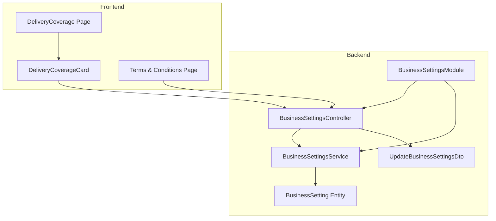
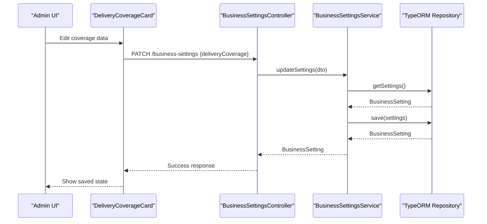
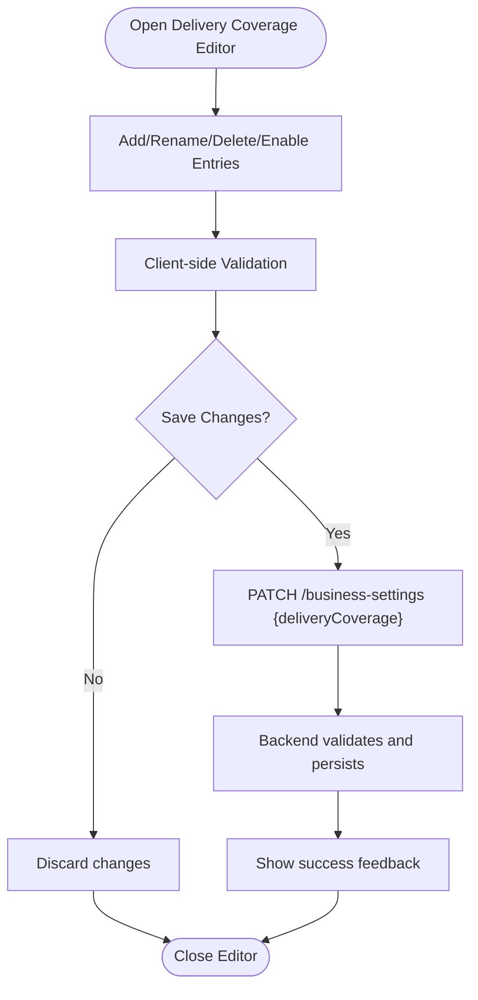
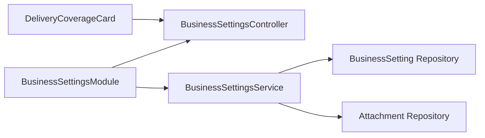

# Business Settings

<cite>
**Referenced Files in This Document**
- [business-settings.controller.ts](file://apps/backend/src/business-settings/business-settings.controller.ts)
- [business-settings.service.ts](file://apps/backend/src/business-settings/business-settings.service.ts)
- [business-setting.entity.ts](file://apps/backend/src/business-settings/entities/business-setting.entity.ts)
- [update-business-settings.dto.ts](file://apps/backend/src/business-settings/dto/update-business-settings.dto.ts)
- [business-settings.module.ts](file://apps/backend/src/business-settings/business-settings.module.ts)
- [delivery-coverage-card.tsx](file://apps/frontend/components/admin/settings/delivery-coverage-card.tsx)
- [delivery-coverage page.tsx](file://apps/frontend/app/admin/settings/delivery-coverage/page.tsx)
- [terms-and-conditions page.tsx](file://apps/frontend/app/(main)/(policy)/terms-and-conditions/page.tsx)
</cite>

## Table of Contents
1. [Introduction](#introduction)
2. [Project Structure](#project-structure)
3. [Core Components](#core-components)
4. [Architecture Overview](#architecture-overview)
5. [Detailed Component Analysis](#detailed-component-analysis)
6. [Dependency Analysis](#dependency-analysis)
7. [Performance Considerations](#performance-considerations)
8. [Troubleshooting Guide](#troubleshooting-guide)
9. [Conclusion](#conclusion)

## Introduction
This document explains the business settings management functionality, focusing on:
- Company information configuration (business name, contact details, branding)
- Delivery coverage area management (geographic boundaries and service zones)
- Shipping methods setup (costs, timeframes, regional restrictions)
- Payment method configuration (gateways, fees, currency)
- System preferences (email templates, notifications, operational hours)

The backend exposes a singleton business settings record that stores company info, maintenance mode, delivery coverage, CRM thresholds, and logo references. The frontend provides an admin UI to edit these settings, including a dedicated delivery coverage editor.

## Project Structure
Business settings are implemented as a NestJS module with a controller, service, entity, and DTO. The frontend includes an admin settings page for delivery coverage and uses business settings across public pages.

**Diagram sources**
- [business-settings.controller.ts:19-53](file://apps/backend/src/business-settings/business-settings.controller.ts#L19-L53)
- [business-settings.service.ts:10-81](file://apps/backend/src/business-settings/business-settings.service.ts#L10-L81)
- [business-setting.entity.ts:11-174](file://apps/backend/src/business-settings/entities/business-setting.entity.ts#L11-L174)
- [update-business-settings.dto.ts:11-182](file://apps/backend/src/business-settings/dto/update-business-settings.dto.ts#L11-L182)
- [business-settings.module.ts:9-14](file://apps/backend/src/business-settings/business-settings.module.ts#L9-L14)
- [delivery-coverage-card.tsx:670-686](file://apps/frontend/components/admin/settings/delivery-coverage-card.tsx#L670-L686)
- [delivery-coverage page.tsx:1-9](file://apps/frontend/app/admin/settings/delivery-coverage/page.tsx#L1-L9)
- [terms-and-conditions page.tsx:19-25](file://apps/frontend/app/(main)/(policy)/terms-and-conditions/page.tsx#L19-L25)

**Section sources**
- [business-settings.controller.ts:19-53](file://apps/backend/src/business-settings/business-settings.controller.ts#L19-L53)
- [business-settings.service.ts:10-81](file://apps/backend/src/business-settings/business-settings.service.ts#L10-L81)
- [business-setting.entity.ts:11-174](file://apps/backend/src/business-settings/entities/business-setting.entity.ts#L11-L174)
- [update-business-settings.dto.ts:11-182](file://apps/backend/src/business-settings/dto/update-business-settings.dto.ts#L11-L182)
- [business-settings.module.ts:9-14](file://apps/backend/src/business-settings/business-settings.module.ts#L9-L14)
- [delivery-coverage-card.tsx:670-686](file://apps/frontend/components/admin/settings/delivery-coverage-card.tsx#L670-L686)
- [delivery-coverage page.tsx:1-9](file://apps/frontend/app/admin/settings/delivery-coverage/page.tsx#L1-L9)
- [terms-and-conditions page.tsx:19-25](file://apps/frontend/app/(main)/(policy)/terms-and-conditions/page.tsx#L19-L25)

## Core Components
- BusinessSettingsController: Exposes GET /business-settings (public) and PATCH /business-settings (admin).
- BusinessSettingsService: Reads/updates the singleton BusinessSetting row; resolves attachment IDs for logos.
- BusinessSetting Entity: Defines all configurable fields, including company info, maintenance window, delivery coverage JSON, CRM thresholds, and logo attachments.
- UpdateBusinessSettingsDto: Validates incoming updates for all editable fields.
- Frontend Delivery Coverage Card: Provides an interactive editor for divisions/cities/areas and persists changes via PATCH.

Key responsibilities:
- Public storefront reads settings without authentication.
- Admin updates require JWT and permission guard.
- Logos are linked by Attachment ID and resolved server-side.
- Delivery coverage is stored as structured JSON and edited through the admin UI.

**Section sources**
- [business-settings.controller.ts:19-53](file://apps/backend/src/business-settings/business-settings.controller.ts#L19-L53)
- [business-settings.service.ts:18-81](file://apps/backend/src/business-settings/business-settings.service.ts#L18-L81)
- [business-setting.entity.ts:11-174](file://apps/backend/src/business-settings/entities/business-setting.entity.ts#L11-L174)
- [update-business-settings.dto.ts:11-182](file://apps/backend/src/business-settings/dto/update-business-settings.dto.ts#L11-L182)
- [delivery-coverage-card.tsx:670-686](file://apps/frontend/components/admin/settings/delivery-coverage-card.tsx#L670-L686)

## Architecture Overview
The business settings feature follows a standard MVC pattern with validation at the DTO layer and persistence via TypeORM. The frontend admin UI composes the delivery coverage editor and calls the backend API to persist changes.

**Diagram sources**
- [business-settings.controller.ts:28-53](file://apps/backend/src/business-settings/business-settings.controller.ts#L28-L53)
- [business-settings.service.ts:39-81](file://apps/backend/src/business-settings/business-settings.service.ts#L39-L81)
- [delivery-coverage-card.tsx:670-686](file://apps/frontend/components/admin/settings/delivery-coverage-card.tsx#L670-L686)

## Detailed Component Analysis

### Company Information Configuration
Company information includes display name, address, phone, email, WhatsApp number, social links, website URL, and branding assets (website and invoice logos). These values are persisted in the singleton BusinessSetting row and consumed by storefront components, invoices, and reports.

- Fields: businessName, address, phone, email, adminNotificationEmail, whatsappNumber, messengerUrl, websiteUrl, logo, invoiceLogo.
- Branding: Logo and invoiceLogo are Attachment entities referenced by ID; the service resolves them during update.
- Validation: All string fields are optional and validated as strings in the DTO.

Common scenarios:
- Set or clear the website logo using logoId.
- Set or clear the invoice logo using invoiceLogoId.
- Update contact details and social links for storefront display.

Validation rules:
- Strings are validated with IsString and IsOptional.
- Attachment IDs are passed as strings; empty string clears the reference.

**Section sources**
- [business-setting.entity.ts:20-75](file://apps/backend/src/business-settings/entities/business-setting.entity.ts#L20-L75)
- [business-setting.entity.ts:156-173](file://apps/backend/src/business-settings/entities/business-setting.entity.ts#L156-L173)
- [update-business-settings.dto.ts:12-93](file://apps/backend/src/business-settings/dto/update-business-settings.dto.ts#L12-L93)
- [business-settings.service.ts:44-70](file://apps/backend/src/business-settings/business-settings.service.ts#L44-L70)

### Delivery Coverage Area Management
Delivery coverage defines which geographic areas are served. It is stored as a JSON object containing divisions, cities, and areas, each with enabled flags. The admin UI allows adding, renaming, deleting, and enabling/disabling entries.

- Data model: deliveryCoverage.divisions[], deliveryCoverage.cities[], deliveryCoverage.areas[].
- Admin UI: DeliveryCoverageCard manages local state and persists changes via PATCH.
- Validation: deliveryCoverage is validated as an object with nested arrays and booleans.

Operational flow:
- Admin edits coverage in the UI.
- Frontend sends PATCH with updated deliveryCoverage.
- Backend validates and saves the new structure.

**Diagram sources**
- [delivery-coverage-card.tsx:670-686](file://apps/frontend/components/admin/settings/delivery-coverage-card.tsx#L670-L686)
- [business-setting.entity.ts:108-122](file://apps/backend/src/business-settings/entities/business-setting.entity.ts#L108-L122)
- [update-business-settings.dto.ts:130-145](file://apps/backend/src/business-settings/dto/update-business-settings.dto.ts#L130-L145)

**Section sources**
- [business-setting.entity.ts:108-122](file://apps/backend/src/business-settings/entities/business-setting.entity.ts#L108-L122)
- [update-business-settings.dto.ts:130-145](file://apps/backend/src/business-settings/dto/update-business-settings.dto.ts#L130-L145)
- [delivery-coverage-card.tsx:670-686](file://apps/frontend/components/admin/settings/delivery-coverage-card.tsx#L670-L686)
- [delivery-coverage page.tsx:1-9](file://apps/frontend/app/admin/settings/delivery-coverage/page.tsx#L1-L9)

### Shipping Methods Setup
Shipping methods are managed separately from business settings but are used alongside them to define cost calculations, delivery timeframes, and regional restrictions. Public policy pages read active shipping methods to keep published timelines consistent with admin configuration.

- Integration point: Terms and Conditions page fetches active shipping methods to reflect configured delivery timelines.
- Typical fields (conceptual): cost calculation rules, estimated delivery windows, and region filters aligned with delivery coverage.

Best practices:
- Keep shipping method timeframes synchronized with the published policy content.
- Use delivery coverage to restrict available shipping options by region.

**Section sources**
- [terms-and-conditions page.tsx:19-25](file://apps/frontend/app/(main)/(policy)/terms-and-conditions/page.tsx#L19-L25)

### Payment Method Configuration
Payment methods are configured through dedicated modules and controllers. While not part of the BusinessSetting entity, they integrate with order flows and may reference currency and fee settings elsewhere in the system.

- Related modules: payment-method, order-payment-method, payment, ssl-payment.
- Typical configuration points: gateway credentials, transaction fees, supported currencies, and availability toggles.

Note: This section describes integration context; specific field definitions are outside the BusinessSetting scope.

**Section sources**
- [payment-method.controller.ts](file://apps/backend/src/payment-method/payment-method.controller.ts)
- [order-payment-method.controller.ts](file://apps/backend/src/order-payment-method/order-payment-method.controller.ts)
- [payment.controller.ts](file://apps/backend/src/payment/payment.controller.ts)
- [ssl-payment.controller.ts](file://apps/backend/src/ssl-payment/ssl-payment.controller.ts)

### System Preferences
System preferences include maintenance mode and related scheduling, plus notification-related email addresses. These are part of the BusinessSetting entity and influence storefront behavior and administrative communications.

- Maintenance mode: maintenanceMode flag with optional maintenanceMessage and scheduled window (maintenanceStartsAt, maintenanceEndsAt).
- Notifications: adminNotificationEmail holds comma-separated admin emails for alerts.

Operational notes:
- When maintenanceMode is true and within the scheduled window, the storefront shows a maintenance page.
- Admin notification emails route important events to designated recipients.

**Section sources**
- [business-setting.entity.ts:77-106](file://apps/backend/src/business-settings/entities/business-setting.entity.ts#L77-L106)
- [business-setting.entity.ts:41-54](file://apps/backend/src/business-settings/entities/business-setting.entity.ts#L41-L54)
- [update-business-settings.dto.ts:95-128](file://apps/backend/src/business-settings/dto/update-business-settings.dto.ts#L95-L128)

## Dependency Analysis
The BusinessSettingsModule wires the controller, service, and repositories. The service depends on the BusinessSetting and Attachment repositories. The frontend delivery coverage card interacts with the controller’s PATCH endpoint.

**Diagram sources**
- [business-settings.module.ts:9-14](file://apps/backend/src/business-settings/business-settings.module.ts#L9-L14)
- [business-settings.service.ts:10-16](file://apps/backend/src/business-settings/business-settings.service.ts#L10-L16)
- [delivery-coverage-card.tsx:670-686](file://apps/frontend/components/admin/settings/delivery-coverage-card.tsx#L670-L686)

**Section sources**
- [business-settings.module.ts:9-14](file://apps/backend/src/business-settings/business-settings.module.ts#L9-L14)
- [business-settings.service.ts:10-16](file://apps/backend/src/business-settings/business-settings.service.ts#L10-L16)
- [delivery-coverage-card.tsx:670-686](file://apps/frontend/components/admin/settings/delivery-coverage-card.tsx#L670-L686)

## Performance Considerations
- Singleton access pattern: The service ensures a single BusinessSetting row exists and returns it quickly; if missing, it seeds a default row.
- Eager loading of attachments: Logo and invoiceLogo are eagerly loaded to avoid N+1 queries when rendering settings.
- Minimal payload: Only necessary fields are exposed; DTO validation prevents unnecessary processing.

Recommendations:
- Cache frequently read settings at the application level if needed.
- Avoid large file uploads for logos; prefer optimized images to reduce payload size.

**Section sources**
- [business-settings.service.ts:18-36](file://apps/backend/src/business-settings/business-settings.service.ts#L18-L36)
- [business-setting.entity.ts:156-173](file://apps/backend/src/business-settings/entities/business-setting.entity.ts#L156-L173)

## Troubleshooting Guide
Common issues and resolutions:
- Failed to load business settings: Indicates a database error while reading or seeding the singleton row. Check database connectivity and permissions.
- Failed to update business settings: Occurs when saving fails or attachment resolution errors occur. Verify attachment IDs exist and are valid.
- Logo not updating: Ensure logoId is provided correctly; empty string clears the logo. Confirm the referenced Attachment exists.
- Invoice logo not updating: Same as above; ensure invoiceLogoId is correct and points to a PNG asset suitable for PDF generation.
- Delivery coverage not saving: Verify the structure matches the expected JSON shape and that the PATCH request includes the full coverage object.

Operational checks:
- Confirm JWT and permission guards are present for PATCH requests.
- Validate DTO inputs on the client side to prevent invalid payloads.

**Section sources**
- [business-settings.service.ts:30-36](file://apps/backend/src/business-settings/business-settings.service.ts#L30-L36)
- [business-settings.service.ts:74-81](file://apps/backend/src/business-settings/business-settings.service.ts#L74-L81)
- [business-settings.controller.ts:38-53](file://apps/backend/src/business-settings/business-settings.controller.ts#L38-L53)

## Conclusion
Business settings provide a centralized configuration surface for company information, branding, maintenance mode, delivery coverage, and CRM thresholds. The backend enforces validation and persistence, while the frontend offers an intuitive admin interface for editing critical settings like delivery coverage. Shipping and payment configurations integrate with these settings to deliver a cohesive commerce experience.