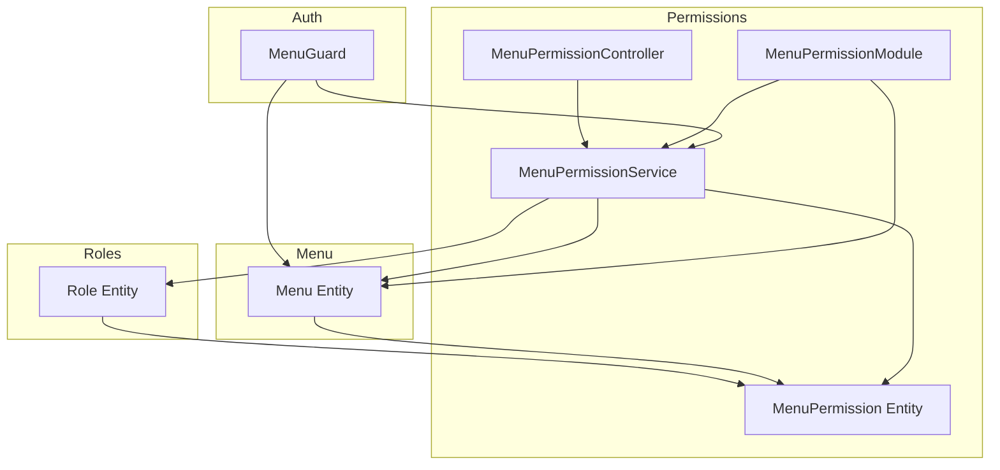
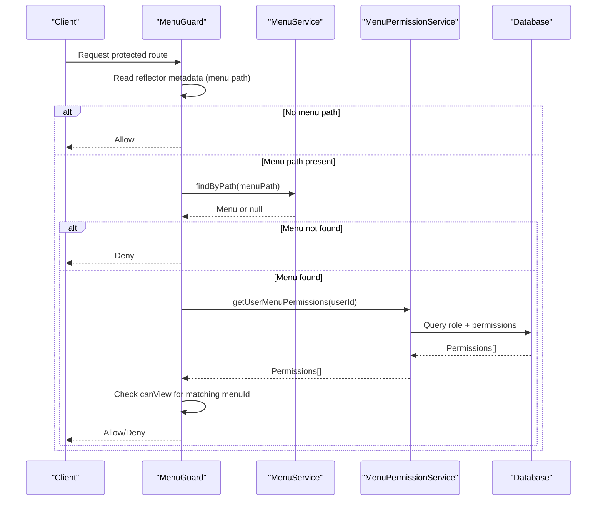
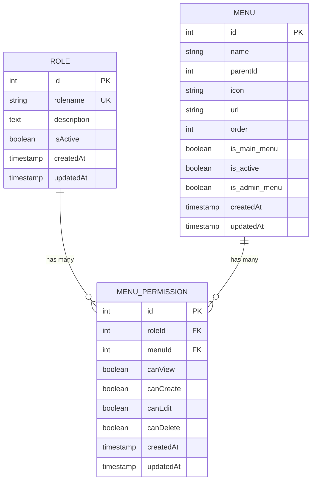
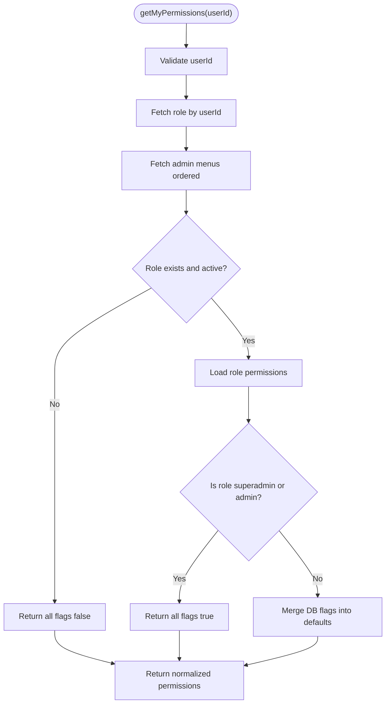
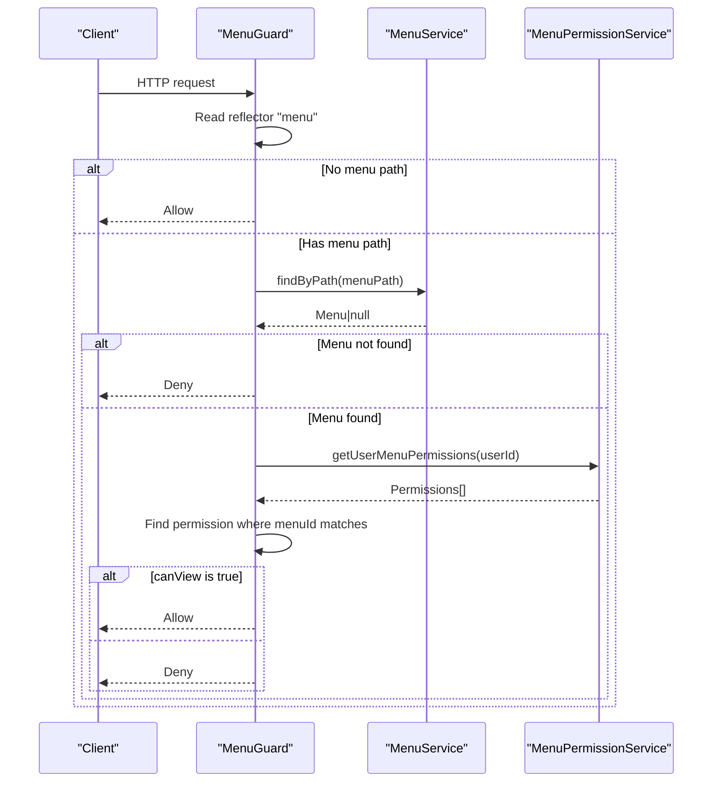
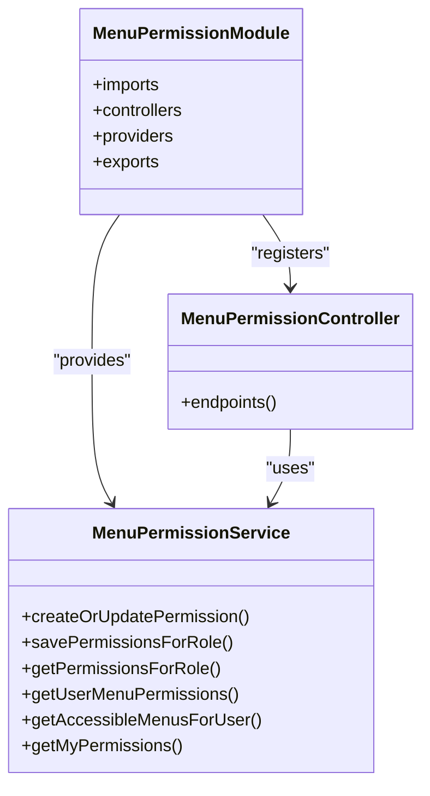
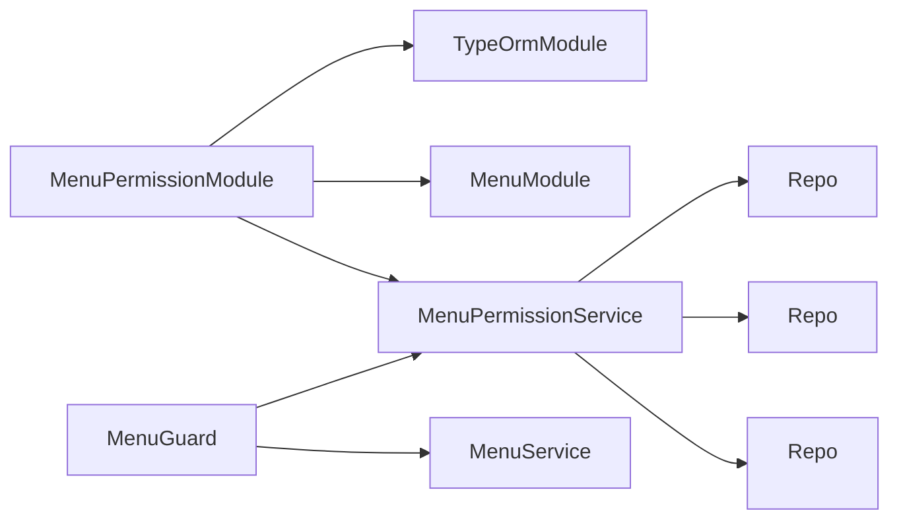

# Permission System

<cite>
**Referenced Files in This Document**
- [menu.guard.ts](file://apps/backend/src/auth/guards/menu.guard.ts)
- [menu-permission.service.ts](file://apps/backend/src/menu-permission/menu-permission.service.ts)
- [menu-permission.module.ts](file://apps/backend/src/menu-permission/menu-permission.module.ts)
- [menu-permission.controller.ts](file://apps/backend/src/menu-permission/menu-permission.controller.ts)
- [menu-permission.entity.ts](file://apps/backend/src/menu-permission/entities/menu-permission.entity.ts)
- [role.entity.ts](file://apps/backend/src/roles/entities/role.entity.ts)
- [menu.entity.ts](file://apps/backend/src/menu/entities/menu.entity.ts)
</cite>

## Table of Contents
1. [Introduction](#introduction)
2. [Project Structure](#project-structure)
3. [Core Components](#core-components)
4. [Architecture Overview](#architecture-overview)
5. [Detailed Component Analysis](#detailed-component-analysis)
6. [Dependency Analysis](#dependency-analysis)
7. [Performance Considerations](#performance-considerations)
8. [Troubleshooting Guide](#troubleshooting-guide)
9. [Conclusion](#conclusion)

## Introduction
This document explains the permission and role-based access control system used to secure admin routes, API endpoints, and menu visibility. It covers:
- Hierarchical roles and permissions model
- Menu permission configuration for visibility and granular actions (view, create, edit, delete)
- Permission evaluation logic and guard implementation
- Decorator usage for protecting routes and endpoints
- Practical examples for complex scenarios, troubleshooting, and best practices

The system combines a role entity, a hierarchical menu entity, and a role-to-menu permission matrix to enforce both UI visibility and backend authorization.

## Project Structure
The permission system spans several modules:
- Roles: defines user roles with activation state and relationships to users
- Menu: defines a hierarchical menu tree with flags for admin menus and URLs
- MenuPermission: defines per-role, per-menu action flags (view, create, edit, delete)
- MenuPermissionService: provides permission queries, batch upserts, and current-user permission resolution
- MenuGuard: enforces route-level access based on menu path and user permissions
- MenuPermissionModule: global module exporting services and entities for reuse across guards and controllers

**Diagram sources**
- [role.entity.ts:14-78](file://apps/backend/src/roles/entities/role.entity.ts#L14-L78)
- [menu.entity.ts:12-114](file://apps/backend/src/menu/entities/menu.entity.ts#L12-L114)
- [menu-permission.entity.ts:12-71](file://apps/backend/src/menu-permission/entities/menu-permission.entity.ts#L12-L71)
- [menu-permission.service.ts:9-18](file://apps/backend/src/menu-permission/menu-permission.service.ts#L9-L18)
- [menu-permission.controller.ts:1-20](file://apps/backend/src/menu-permission/menu-permission.controller.ts#L1-L20)
- [menu-permission.module.ts:13-23](file://apps/backend/src/menu-permission/menu-permission.module.ts#L13-L23)
- [menu.guard.ts:7-13](file://apps/backend/src/auth/guards/menu.guard.ts#L7-L13)

**Section sources**
- [menu-permission.module.ts:13-23](file://apps/backend/src/menu-permission/menu-permission.module.ts#L13-L23)
- [menu-permission.service.ts:9-18](file://apps/backend/src/menu-permission/menu-permission.service.ts#L9-L18)
- [menu.guard.ts:7-13](file://apps/backend/src/auth/guards/menu.guard.ts#L7-L13)

## Core Components
- Role: Represents an administrative role with activation status and a one-to-many relationship to users.
- Menu: Represents a hierarchical menu item with URL, order, parent-child relationships, and flags indicating whether it is an admin menu.
- MenuPermission: A join entity that assigns view/create/edit/delete flags per role and per menu.
- MenuPermissionService: Provides methods to:
  - Upsert single or batch permissions for a role
  - Resolve permissions for a specific role or user
  - Compute accessible top-level menus for a user
  - Generate the current user’s effective permissions for all admin menus (with special handling for superadmin/admin and inactive roles)
- MenuGuard: Enforces route-level access by checking if the requested menu path exists and if the user has canView permission for that menu.

Key responsibilities:
- Data model integrity and relationships are defined in entities
- Business logic for permission calculation resides in MenuPermissionService
- Route protection is implemented via MenuGuard
- Controller endpoints manage CRUD operations over the permission matrix

**Section sources**
- [role.entity.ts:14-78](file://apps/backend/src/roles/entities/role.entity.ts#L14-L78)
- [menu.entity.ts:12-114](file://apps/backend/src/menu/entities/menu.entity.ts#L12-L114)
- [menu-permission.entity.ts:12-71](file://apps/backend/src/menu-permission/entities/menu-permission.entity.ts#L12-L71)
- [menu-permission.service.ts:20-178](file://apps/backend/src/menu-permission/menu-permission.service.ts#L20-L178)
- [menu.guard.ts:15-35](file://apps/backend/src/auth/guards/menu.guard.ts#L15-L35)

## Architecture Overview
The permission architecture integrates three layers:
- Data layer: Role, Menu, and MenuPermission entities define the schema and relationships
- Service layer: MenuPermissionService computes effective permissions and exposes them to guards and controllers
- Enforcement layer: MenuGuard protects routes; decorators protect controller endpoints

**Diagram sources**
- [menu.guard.ts:15-35](file://apps/backend/src/auth/guards/menu.guard.ts#L15-L35)
- [menu-permission.service.ts:53-64](file://apps/backend/src/menu-permission/menu-permission.service.ts#L53-L64)

## Detailed Component Analysis

### Entities and Relationships
- Role:
  - Fields include id, rolename, description, isActive, timestamps, createdBy, updatedBy, and users
  - One-to-many relationship to User
- Menu:
  - Hierarchical structure using parentId and TreeChildren/TreeParent
  - Flags: isMainMenu, isActive, isAdminMenu
  - url and order support navigation and sorting
- MenuPermission:
  - Links Role and Menu
  - Action flags: canView, canCreate, canEdit, canDelete
  - Timestamps for auditability

**Diagram sources**
- [role.entity.ts:14-78](file://apps/backend/src/roles/entities/role.entity.ts#L14-L78)
- [menu.entity.ts:12-114](file://apps/backend/src/menu/entities/menu.entity.ts#L12-L114)
- [menu-permission.entity.ts:12-71](file://apps/backend/src/menu-permission/entities/menu-permission.entity.ts#L12-L71)

**Section sources**
- [role.entity.ts:14-78](file://apps/backend/src/roles/entities/role.entity.ts#L14-L78)
- [menu.entity.ts:12-114](file://apps/backend/src/menu/entities/menu.entity.ts#L12-L114)
- [menu-permission.entity.ts:12-71](file://apps/backend/src/menu-permission/entities/menu-permission.entity.ts#L12-L71)

### MenuPermissionService
Responsibilities:
- Single permission upsert: createOrUpdatePermission
- Batch permission upsert: savePermissionsForRole
- Role-scoped query: getPermissionsForRole
- User-scoped query: getUserMenuPermissions
- Accessible menus computation: getAccessibleMenusForUser
- Current user effective permissions: getMyPermissions

Algorithm highlights:
- getMyPermissions resolves the active role for the user, fetches all admin menus, and returns a normalized permission set:
  - If no role or role is inactive: all flags false
  - If role is superadmin or admin: all flags true without requiring explicit rows
  - Otherwise: merge DB flags into default false for each admin menu

**Diagram sources**
- [menu-permission.service.ts:130-178](file://apps/backend/src/menu-permission/menu-permission.service.ts#L130-L178)

**Section sources**
- [menu-permission.service.ts:20-178](file://apps/backend/src/menu-permission/menu-permission.service.ts#L20-L178)

### MenuGuard
Purpose:
- Protects routes by evaluating a reflector-decorated menu path against the user’s permissions
- Allows requests when no menu restriction is specified
- Denies when the menu does not exist or the user lacks canView

Evaluation flow:
- Extract request.user and reflector metadata (menu path)
- If no menu path, allow
- Lookup menu by path; deny if not found
- Fetch user’s menu permissions and check canView for the matched menu

**Diagram sources**
- [menu.guard.ts:15-35](file://apps/backend/src/auth/guards/menu.guard.ts#L15-L35)

**Section sources**
- [menu.guard.ts:15-35](file://apps/backend/src/auth/guards/menu.guard.ts#L15-L35)

### Module and Controller Integration
- MenuPermissionModule:
  - Declared @Global() so guards and other modules can inject MenuPermissionService and MenuService
  - Exports MenuPermissionService and MenuModule
- MenuPermissionController:
  - Uses @Roles('superadmin') decorator to restrict management endpoints to superadmin

**Diagram sources**
- [menu-permission.module.ts:13-23](file://apps/backend/src/menu-permission/menu-permission.module.ts#L13-L23)
- [menu-permission.controller.ts:45-45](file://apps/backend/src/menu-permission/menu-permission.controller.ts#L45-L45)
- [menu-permission.controller.ts:81-81](file://apps/backend/src/menu-permission/menu-permission.controller.ts#L81-L81)
- [menu-permission.controller.ts:125-125](file://apps/backend/src/menu-permission/menu-permission.controller.ts#L125-L125)
- [menu-permission.controller.ts:172-172](file://apps/backend/src/menu-permission/menu-permission.controller.ts#L172-L172)
- [menu-permission.controller.ts:251-251](file://apps/backend/src/menu-permission/menu-permission.controller.ts#L251-L251)

**Section sources**
- [menu-permission.module.ts:13-23](file://apps/backend/src/menu-permission/menu-permission.module.ts#L13-L23)
- [menu-permission.controller.ts:45-45](file://apps/backend/src/menu-permission/menu-permission.controller.ts#L45-L45)
- [menu-permission.controller.ts:81-81](file://apps/backend/src/menu-permission/menu-permission.controller.ts#L81-L81)
- [menu-permission.controller.ts:125-125](file://apps/backend/src/menu-permission/menu-permission.controller.ts#L125-L125)
- [menu-permission.controller.ts:172-172](file://apps/backend/src/menu-permission/menu-permission.controller.ts#L172-L172)
- [menu-permission.controller.ts:251-251](file://apps/backend/src/menu-permission/menu-permission.controller.ts#L251-L251)

## Dependency Analysis
- MenuPermissionModule depends on TypeOrmModule for MenuPermission, Role, and Menu entities, and on MenuModule for MenuService
- MenuPermissionService depends on repositories for MenuPermission, Role, and Menu
- MenuGuard depends on Reflector, MenuService, and MenuPermissionService
- Controllers use @Roles decorator to enforce endpoint-level restrictions

**Diagram sources**
- [menu-permission.module.ts:13-23](file://apps/backend/src/menu-permission/menu-permission.module.ts#L13-L23)
- [menu-permission.service.ts:9-18](file://apps/backend/src/menu-permission/menu-permission.service.ts#L9-L18)
- [menu.guard.ts:7-13](file://apps/backend/src/auth/guards/menu.guard.ts#L7-L13)

**Section sources**
- [menu-permission.module.ts:13-23](file://apps/backend/src/menu-permission/menu-permission.module.ts#L13-L23)
- [menu-permission.service.ts:9-18](file://apps/backend/src/menu-permission/menu-permission.service.ts#L9-L18)
- [menu.guard.ts:7-13](file://apps/backend/src/auth/guards/menu.guard.ts#L7-L13)

## Performance Considerations
- Batch upsert: Use savePermissionsForRole to update multiple menu permissions in a transaction to reduce round-trips and ensure consistency
- Efficient queries: getAccessibleMenusForUser filters by canView before querying menus and sorts children by order to minimize client-side processing
- Avoid redundant checks: getMyPermissions centralizes permission normalization for the frontend, reducing repeated server calls

[No sources needed since this section provides general guidance]

## Troubleshooting Guide
Common issues and resolutions:
- Route denied despite having a role:
  - Ensure the route is decorated with the correct menu path reflector metadata
  - Verify the menu exists and has a valid url
  - Confirm the user’s role is active and has canView=true for the target menu
- Menu not visible in dashboard:
  - Check getAccessibleMenusForUser results; only menus with canView=true are included
  - Ensure the menu is marked as an admin menu if required by your UI logic
- Superadmin/admin cannot see changes:
  - Remember superadmin/admin always receive all-true permissions; verify you are not expecting DB rows to override this behavior
- Endpoint access denied:
  - Verify the controller method uses the appropriate @Roles decorator (e.g., superadmin)
  - Confirm the caller’s role matches the decorator requirement

Operational checks:
- Validate role.isActive for the logged-in user
- Inspect MenuPermission entries for the role and menu combination
- Confirm Menu.isAdminMenu and Menu.url are correctly set for admin sections

**Section sources**
- [menu.guard.ts:15-35](file://apps/backend/src/auth/guards/menu.guard.ts#L15-L35)
- [menu-permission.service.ts:66-88](file://apps/backend/src/menu-permission/menu-permission.service.ts#L66-L88)
- [menu-permission.service.ts:130-178](file://apps/backend/src/menu-permission/menu-permission.service.ts#L130-L178)
- [menu-permission.controller.ts:45-45](file://apps/backend/src/menu-permission/menu-permission.controller.ts#L45-L45)

## Conclusion
The permission system combines a clear data model (Role, Menu, MenuPermission) with robust service logic and strict enforcement via guards and decorators. By configuring the permission matrix per role and leveraging the provided service methods, administrators can precisely control both UI visibility and backend access. Best practices include using batch upserts for performance, relying on getMyPermissions for consistent frontend rendering, and ensuring routes and endpoints are properly guarded.

[No sources needed since this section summarizes without analyzing specific files]