# System Administration

<cite>
**Referenced Files in This Document**
- [auth.controller.ts](file://apps/backend/src/auth/auth.controller.ts)
- [user.controller.ts](file://apps/backend/src/user/user.controller.ts)
- [roles.controller.ts](file://apps/backend/src/roles/roles.controller.ts)
- [menu-permission.controller.ts](file://apps/backend/src/menu-permission/menu-permission.controller.ts)
- [business-settings.controller.ts](file://apps/backend/src/business-settings/business-settings.controller.ts)
- [shipping-methods.controller.ts](file://apps/backend/src/shipping-methods/shipping-methods.controller.ts)
- [payment-method.controller.ts](file://apps/backend/src/payment-method/payment-method.controller.ts)
- [user-activity.controller.ts](file://apps/backend/src/user-activity/user-activity.controller.ts)
- [admin-layout-client.tsx](file://apps/frontend/components/admin/admin-layout-client.tsx)
- [sidebar-menu.tsx](file://apps/frontend/components/admin/sidebar-menu.tsx)
- [layout.tsx](file://apps/frontend/app/admin/layout.tsx)
</cite>

## Table of Contents
1. [Introduction](#introduction)
2. [Project Structure](#project-structure)
3. [Core Components](#core-components)
4. [Architecture Overview](#architecture-overview)
5. [Detailed Component Analysis](#detailed-component-analysis)
6. [Dependency Analysis](#dependency-analysis)
7. [Performance Considerations](#performance-considerations)
8. [Troubleshooting Guide](#troubleshooting-guide)
9. [Conclusion](#conclusion)

## Introduction
This document explains the system administration features exposed by the admin dashboard and backend APIs. It covers:
- User management (creation, role assignment, profile editing, activity monitoring)
- Permission system (role-based access control, menu permissions, granular module permissions)
- Business settings (company info, delivery coverage, shipping methods, payment methods, preferences)
- Audit logging for administrative actions
- Security measures for admin access
- System health and online user monitoring
- Responsive design and mobile accessibility considerations

## Project Structure
The admin system is split between a NestJS backend and a Next.js frontend:
- Backend exposes REST endpoints for authentication, users, roles, menu permissions, business settings, shipping methods, payment methods, and audit logs.
- Frontend provides the admin shell, sidebar navigation driven by permissions, and pages that consume these endpoints.

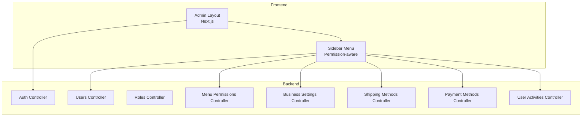

**Diagram sources**
- [layout.tsx:57-71](file://apps/frontend/app/admin/layout.tsx#L57-L71)
- [sidebar-menu.tsx:85-114](file://apps/frontend/components/admin/sidebar-menu.tsx#L85-L114)
- [auth.controller.ts:31-36](file://apps/backend/src/auth/auth.controller.ts#L31-L36)
- [user.controller.ts:37-41](file://apps/backend/src/user/user.controller.ts#L37-L41)
- [roles.controller.ts:32-36](file://apps/backend/src/roles/roles.controller.ts#L32-L36)
- [menu-permission.controller.ts:37-42](file://apps/backend/src/menu-permission/menu-permission.controller.ts#L37-L42)
- [business-settings.controller.ts:19-24](file://apps/backend/src/business-settings/business-settings.controller.ts#L19-L24)
- [shipping-methods.controller.ts:28-34](file://apps/backend/src/shipping-methods/shipping-methods.controller.ts#L28-L34)
- [payment-method.controller.ts:34-38](file://apps/backend/src/payment-method/payment-method.controller.ts#L34-L38)
- [user-activity.controller.ts:25-29](file://apps/backend/src/user-activity/user-activity.controller.ts#L25-L29)

**Section sources**
- [layout.tsx:57-71](file://apps/frontend/app/admin/layout.tsx#L57-L71)
- [sidebar-menu.tsx:85-114](file://apps/frontend/components/admin/sidebar-menu.tsx#L85-L114)

## Core Components
- Authentication and session management: login, refresh, logout, OTP flows, throttling.
- User management: list customers/staff, create/update/delete users, password change/reset.
- Role management: CRUD for roles with admin-only guards.
- Menu permissions: per-role view/create/edit/delete toggles; accessible menus per user.
- Business settings: read-only public endpoint; protected update endpoint.
- Shipping methods: CRUD with permission checks.
- Payment methods: CRUD with permission checks.
- Audit logging: paginated activities, entity trails, retention stats/cleanup.
- Admin UI: responsive layout, permission-aware sidebar, mobile-friendly interactions.

**Section sources**
- [auth.controller.ts:31-309](file://apps/backend/src/auth/auth.controller.ts#L31-L309)
- [user.controller.ts:37-399](file://apps/backend/src/user/user.controller.ts#L37-L399)
- [roles.controller.ts:32-139](file://apps/backend/src/roles/roles.controller.ts#L32-L139)
- [menu-permission.controller.ts:37-276](file://apps/backend/src/menu-permission/menu-permission.controller.ts#L37-L276)
- [business-settings.controller.ts:19-55](file://apps/backend/src/business-settings/business-settings.controller.ts#L19-L55)
- [shipping-methods.controller.ts:28-114](file://apps/backend/src/shipping-methods/shipping-methods.controller.ts#L28-L114)
- [payment-method.controller.ts:34-292](file://apps/backend/src/payment-method/payment-method.controller.ts#L34-L292)
- [user-activity.controller.ts:25-395](file://apps/backend/src/user-activity/user-activity.controller.ts#L25-L395)
- [admin-layout-client.tsx:26-87](file://apps/frontend/components/admin/admin-layout-client.tsx#L26-L87)
- [sidebar-menu.tsx:58-484](file://apps/frontend/components/admin/sidebar-menu.tsx#L58-L484)

## Architecture Overview
The admin dashboard uses JWT-based authentication and role/permission checks to gate access to resources. The sidebar dynamically loads accessible menus based on the current user’s permissions.

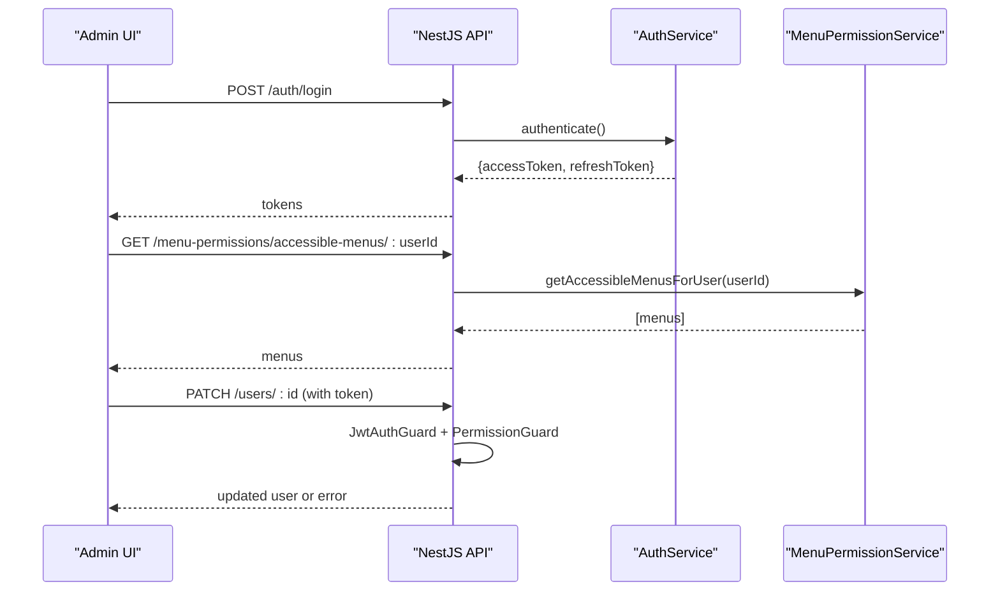

**Diagram sources**
- [auth.controller.ts:81-114](file://apps/backend/src/auth/auth.controller.ts#L81-L114)
- [menu-permission.controller.ts:225-248](file://apps/backend/src/menu-permission/menu-permission.controller.ts#L225-L248)
- [user.controller.ts:316-331](file://apps/backend/src/user/user.controller.ts#L316-L331)

## Detailed Component Analysis

### Authentication and Security
- Endpoints: register, login, refresh, logout, validate, mobile-login, verify-otp.
- Security controls:
  - Throttling on sensitive endpoints (register, login, mobile-login, verify-otp).
  - JWT guard for protected routes; refresh guard for token renewal.
  - Logout logs activity when available.

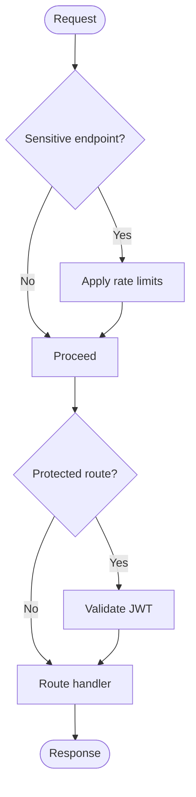

**Diagram sources**
- [auth.controller.ts:38-79](file://apps/backend/src/auth/auth.controller.ts#L38-L79)
- [auth.controller.ts:81-114](file://apps/backend/src/auth/auth.controller.ts#L81-L114)
- [auth.controller.ts:116-150](file://apps/backend/src/auth/auth.controller.ts#L116-L150)
- [auth.controller.ts:152-195](file://apps/backend/src/auth/auth.controller.ts#L152-L195)
- [auth.controller.ts:231-307](file://apps/backend/src/auth/auth.controller.ts#L231-L307)

**Section sources**
- [auth.controller.ts:31-309](file://apps/backend/src/auth/auth.controller.ts#L31-L309)

### User Management
- Capabilities:
  - List customers and non-customer users with pagination, search, sorting, and filters.
  - Create, update, delete users.
  - Change own password; request/reset password via mobile OTP.
  - Top customers and customer list reports.
- Authorization:
  - Many endpoints require both JWT and module-level permissions using a decorator and guard.

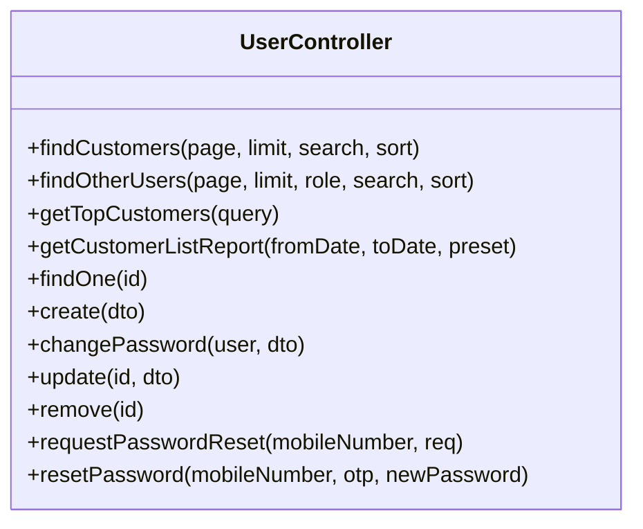

**Diagram sources**
- [user.controller.ts:44-82](file://apps/backend/src/user/user.controller.ts#L44-L82)
- [user.controller.ts:83-131](file://apps/backend/src/user/user.controller.ts#L83-L131)
- [user.controller.ts:132-195](file://apps/backend/src/user/user.controller.ts#L132-L195)
- [user.controller.ts:197-258](file://apps/backend/src/user/user.controller.ts#L197-L258)
- [user.controller.ts:260-273](file://apps/backend/src/user/user.controller.ts#L260-L273)
- [user.controller.ts:274-291](file://apps/backend/src/user/user.controller.ts#L274-L291)
- [user.controller.ts:292-315](file://apps/backend/src/user/user.controller.ts#L292-L315)
- [user.controller.ts:316-331](file://apps/backend/src/user/user.controller.ts#L316-L331)
- [user.controller.ts:332-346](file://apps/backend/src/user/user.controller.ts#L332-L346)
- [user.controller.ts:347-397](file://apps/backend/src/user/user.controller.ts#L347-L397)

**Section sources**
- [user.controller.ts:37-399](file://apps/backend/src/user/user.controller.ts#L37-L399)

### Role-Based Access Control and Menu Permissions
- Roles:
  - CRUD operations for roles, guarded by JWT and admin guard.
- Menu permissions:
  - Per-role toggles for view/create/edit/delete on each menu.
  - Bulk save permissions for a role.
  - Query accessible menus for a user.
  - Fetch my permissions and role/user-specific permissions.

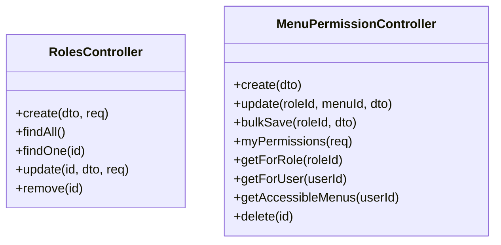

**Diagram sources**
- [roles.controller.ts:37-137](file://apps/backend/src/roles/roles.controller.ts#L37-L137)
- [menu-permission.controller.ts:44-78](file://apps/backend/src/menu-permission/menu-permission.controller.ts#L44-L78)
- [menu-permission.controller.ts:80-122](file://apps/backend/src/menu-permission/menu-permission.controller.ts#L80-L122)
- [menu-permission.controller.ts:124-149](file://apps/backend/src/menu-permission/menu-permission.controller.ts#L124-L149)
- [menu-permission.controller.ts:151-169](file://apps/backend/src/menu-permission/menu-permission.controller.ts#L151-L169)
- [menu-permission.controller.ts:171-198](file://apps/backend/src/menu-permission/menu-permission.controller.ts#L171-L198)
- [menu-permission.controller.ts:200-223](file://apps/backend/src/menu-permission/menu-permission.controller.ts#L200-L223)
- [menu-permission.controller.ts:225-248](file://apps/backend/src/menu-permission/menu-permission.controller.ts#L225-L248)
- [menu-permission.controller.ts:250-274](file://apps/backend/src/menu-permission/menu-permission.controller.ts#L250-L274)

**Section sources**
- [roles.controller.ts:32-139](file://apps/backend/src/roles/roles.controller.ts#L32-L139)
- [menu-permission.controller.ts:37-276](file://apps/backend/src/menu-permission/menu-permission.controller.ts#L37-L276)

### Business Settings Management
- Public read endpoint returns company information and general settings used by storefront components.
- Protected update endpoint requires JWT and module permissions for business-info settings.

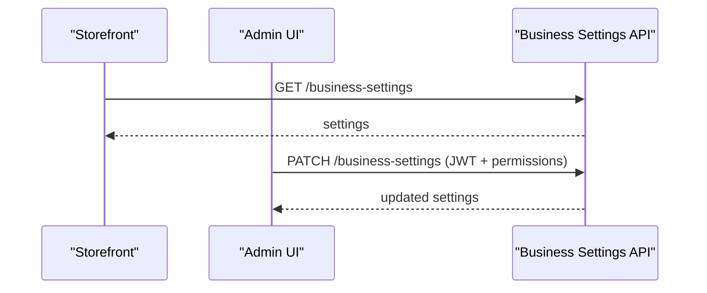

**Diagram sources**
- [business-settings.controller.ts:26-36](file://apps/backend/src/business-settings/business-settings.controller.ts#L26-L36)
- [business-settings.controller.ts:38-53](file://apps/backend/src/business-settings/business-settings.controller.ts#L38-L53)

**Section sources**
- [business-settings.controller.ts:19-55](file://apps/backend/src/business-settings/business-settings.controller.ts#L19-L55)

### Delivery Coverage Areas
- Delivery coverage areas are managed through location-related modules and referenced by shipping and order flows. While this documentation focuses on controllers explicitly shown, administrators typically configure coverage via related location and shipping endpoints.

[No sources needed since this section does not analyze specific files]

### Shipping Methods Configuration
- CRUD for shipping methods with permission checks.
- Filtering by activation status.

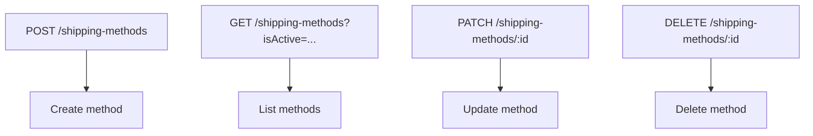

**Diagram sources**
- [shipping-methods.controller.ts:35-51](file://apps/backend/src/shipping-methods/shipping-methods.controller.ts#L35-L51)
- [shipping-methods.controller.ts:53-70](file://apps/backend/src/shipping-methods/shipping-methods.controller.ts#L53-L70)
- [shipping-methods.controller.ts:83-101](file://apps/backend/src/shipping-methods/shipping-methods.controller.ts#L83-L101)
- [shipping-methods.controller.ts:102-112](file://apps/backend/src/shipping-methods/shipping-methods.controller.ts#L102-L112)

**Section sources**
- [shipping-methods.controller.ts:28-114](file://apps/backend/src/shipping-methods/shipping-methods.controller.ts#L28-L114)

### Payment Methods Configuration
- CRUD for payment methods with permission checks.
- Supports partial updates and conflict handling when methods are in use.

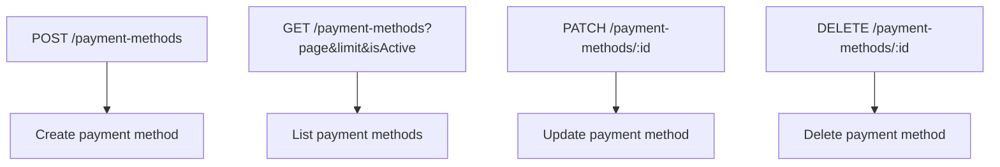

**Diagram sources**
- [payment-method.controller.ts:39-103](file://apps/backend/src/payment-method/payment-method.controller.ts#L39-L103)
- [payment-method.controller.ts:104-148](file://apps/backend/src/payment-method/payment-method.controller.ts#L104-L148)
- [payment-method.controller.ts:149-184](file://apps/backend/src/payment-method/payment-method.controller.ts#L149-L184)
- [payment-method.controller.ts:185-248](file://apps/backend/src/payment-method/payment-method.controller.ts#L185-L248)
- [payment-method.controller.ts:249-290](file://apps/backend/src/payment-method/payment-method.controller.ts#L249-L290)

**Section sources**
- [payment-method.controller.ts:34-292](file://apps/backend/src/payment-method/payment-method.controller.ts#L34-L292)

### Audit Logging and Administrative Actions
- Paginated retrieval of user activities with filters (action, entityType, userType, status, userId).
- Entity-specific audit trail.
- Distinct entity types listing.
- Retention statistics and cleanup of old records.

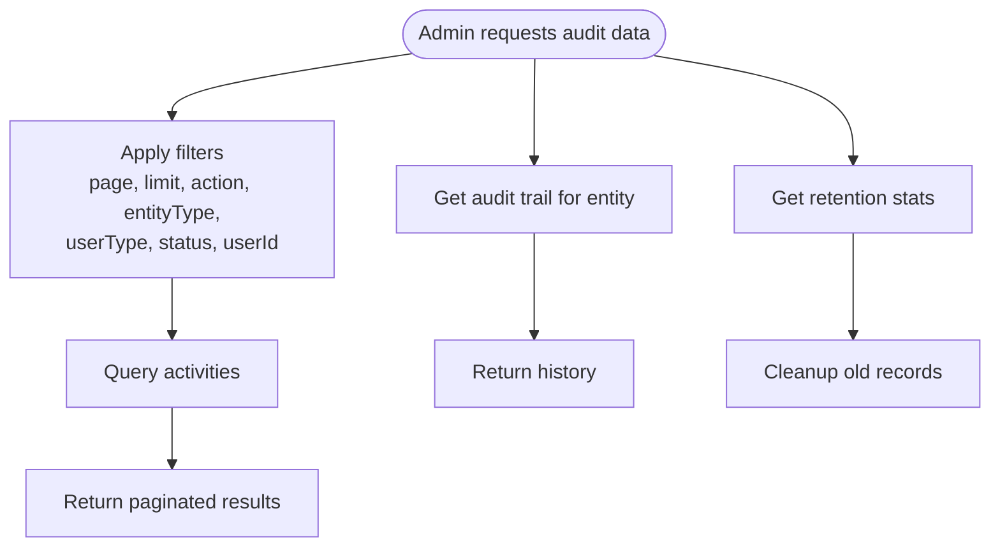

**Diagram sources**
- [user-activity.controller.ts:31-140](file://apps/backend/src/user-activity/user-activity.controller.ts#L31-L140)
- [user-activity.controller.ts:142-178](file://apps/backend/src/user-activity/user-activity.controller.ts#L142-L178)
- [user-activity.controller.ts:180-207](file://apps/backend/src/user-activity/user-activity.controller.ts#L180-L207)
- [user-activity.controller.ts:312-350](file://apps/backend/src/user-activity/user-activity.controller.ts#L312-L350)
- [user-activity.controller.ts:352-393](file://apps/backend/src/user-activity/user-activity.controller.ts#L352-L393)

**Section sources**
- [user-activity.controller.ts:25-395](file://apps/backend/src/user-activity/user-activity.controller.ts#L25-L395)

### System Health Monitoring and Online Users
- The admin dashboard includes analytics widgets and an “Online Now” card that displays authenticated and guest counts.
- These are rendered client-side and fetch live metrics from backend analytics endpoints.

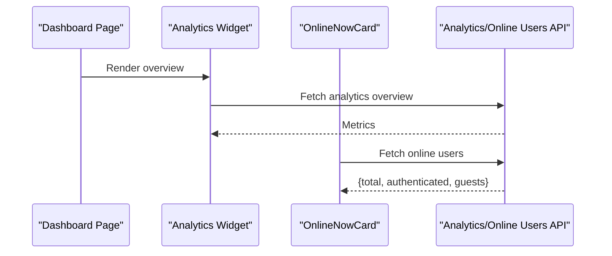

**Diagram sources**
- [layout.tsx:57-71](file://apps/frontend/app/admin/layout.tsx#L57-L71)
- [sidebar-menu.tsx:85-114](file://apps/frontend/components/admin/sidebar-menu.tsx#L85-L114)

**Section sources**
- [layout.tsx:57-71](file://apps/frontend/app/admin/layout.tsx#L57-L71)

### Responsive Design and Mobile Accessibility
- Admin layout adapts to mobile with collapsible sidebar, header adjustments, and touch-friendly controls.
- Sidebar supports collapsed state, overlay on mobile, and keyboard-accessible dropdowns.
- Content area adjusts padding and spacing based on viewport size.

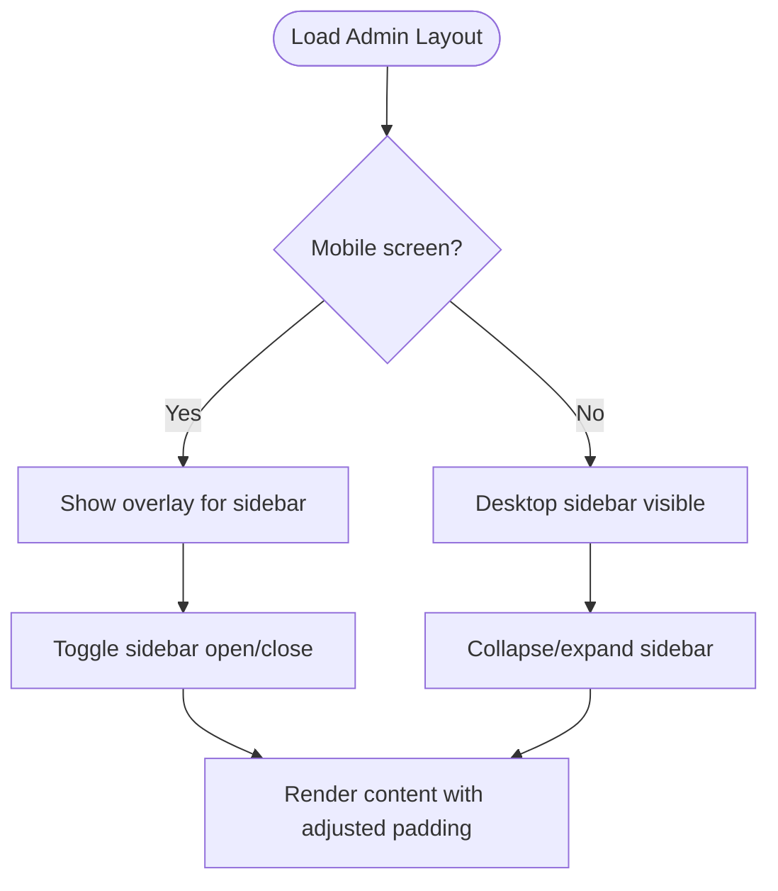

**Diagram sources**
- [admin-layout-client.tsx:56-87](file://apps/frontend/components/admin/admin-layout-client.tsx#L56-L87)
- [sidebar-menu.tsx:197-250](file://apps/frontend/components/admin/sidebar-menu.tsx#L197-L250)
- [sidebar-menu.tsx:397-480](file://apps/frontend/components/admin/sidebar-menu.tsx#L397-L480)

**Section sources**
- [admin-layout-client.tsx:26-87](file://apps/frontend/components/admin/admin-layout-client.tsx#L26-L87)
- [sidebar-menu.tsx:58-484](file://apps/frontend/components/admin/sidebar-menu.tsx#L58-L484)

## Dependency Analysis
Key relationships among admin components:
- Frontend admin layout depends on user context and permission provider.
- Sidebar consumes accessible menus endpoint to render navigation.
- Controllers enforce JWT and role/permission guards before executing business logic.

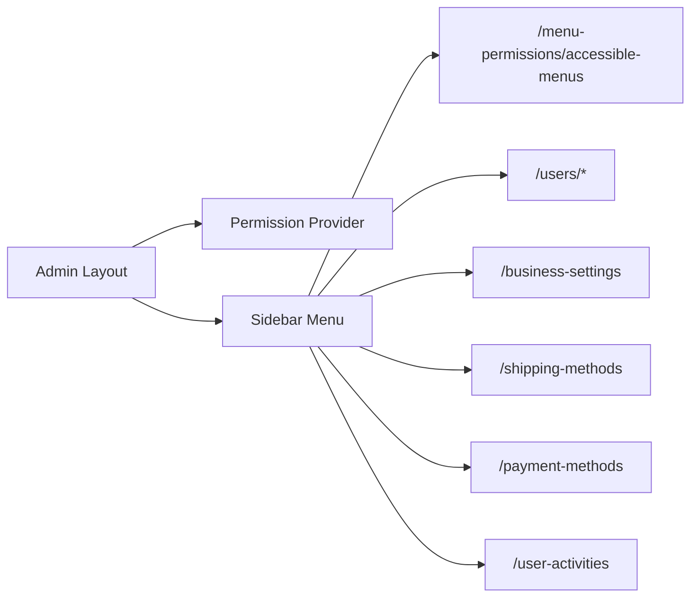

**Diagram sources**
- [admin-layout-client.tsx:56-87](file://apps/frontend/components/admin/admin-layout-client.tsx#L56-L87)
- [sidebar-menu.tsx:85-114](file://apps/frontend/components/admin/sidebar-menu.tsx#L85-L114)
- [menu-permission.controller.ts:225-248](file://apps/backend/src/menu-permission/menu-permission.controller.ts#L225-L248)
- [user.controller.ts:42-44](file://apps/backend/src/user/user.controller.ts#L42-L44)
- [business-settings.controller.ts:38-40](file://apps/backend/src/business-settings/business-settings.controller.ts#L38-L40)
- [shipping-methods.controller.ts:35-37](file://apps/backend/src/shipping-methods/shipping-methods.controller.ts#L35-L37)
- [payment-method.controller.ts:39-41](file://apps/backend/src/payment-method/payment-method.controller.ts#L39-L41)
- [user-activity.controller.ts:31-33](file://apps/backend/src/user-activity/user-activity.controller.ts#L31-L33)

**Section sources**
- [admin-layout-client.tsx:26-87](file://apps/frontend/components/admin/admin-layout-client.tsx#L26-L87)
- [sidebar-menu.tsx:85-114](file://apps/frontend/components/admin/sidebar-menu.tsx#L85-L114)

## Performance Considerations
- Use pagination and filtering on all list endpoints to avoid large payloads.
- Prefer bulk operations where available (e.g., bulk save menu permissions).
- Leverage server-side caching/revalidation strategies in the frontend for dashboards.
- Keep audit log retention policies tuned to balance compliance and storage costs.

[No sources needed since this section provides general guidance]

## Troubleshooting Guide
- Authentication failures:
  - Verify JWT presence and validity; check throttling limits on login/register endpoints.
- Permission denials:
  - Ensure the user has the required role and module permissions; confirm accessible menus are returned correctly.
- Data not updating:
  - Confirm PATCH/PUT endpoints are called with correct IDs and payloads; check conflict responses for payment methods.
- Audit logs missing:
  - Only write operations are logged; verify action type and entity mapping.
- Mobile UI issues:
  - Check sidebar collapse state and overlay behavior; ensure content padding adjusts on small screens.

**Section sources**
- [auth.controller.ts:38-79](file://apps/backend/src/auth/auth.controller.ts#L38-L79)
- [auth.controller.ts:81-114](file://apps/backend/src/auth/auth.controller.ts#L81-L114)
- [menu-permission.controller.ts:225-248](file://apps/backend/src/menu-permission/menu-permission.controller.ts#L225-L248)
- [payment-method.controller.ts:249-290](file://apps/backend/src/payment-method/payment-method.controller.ts#L249-L290)
- [user-activity.controller.ts:31-140](file://apps/backend/src/user-activity/user-activity.controller.ts#L31-L140)
- [sidebar-menu.tsx:197-250](file://apps/frontend/components/admin/sidebar-menu.tsx#L197-L250)

## Conclusion
The admin dashboard provides a comprehensive set of tools for managing users, roles, permissions, business settings, shipping and payment methods, and auditing administrative actions. Security is enforced at multiple layers with JWT, role guards, and module-level permissions. The frontend offers a responsive, mobile-friendly experience with dynamic, permission-aware navigation. Administrators can monitor system health and maintain operational integrity through robust audit logging and retention controls.