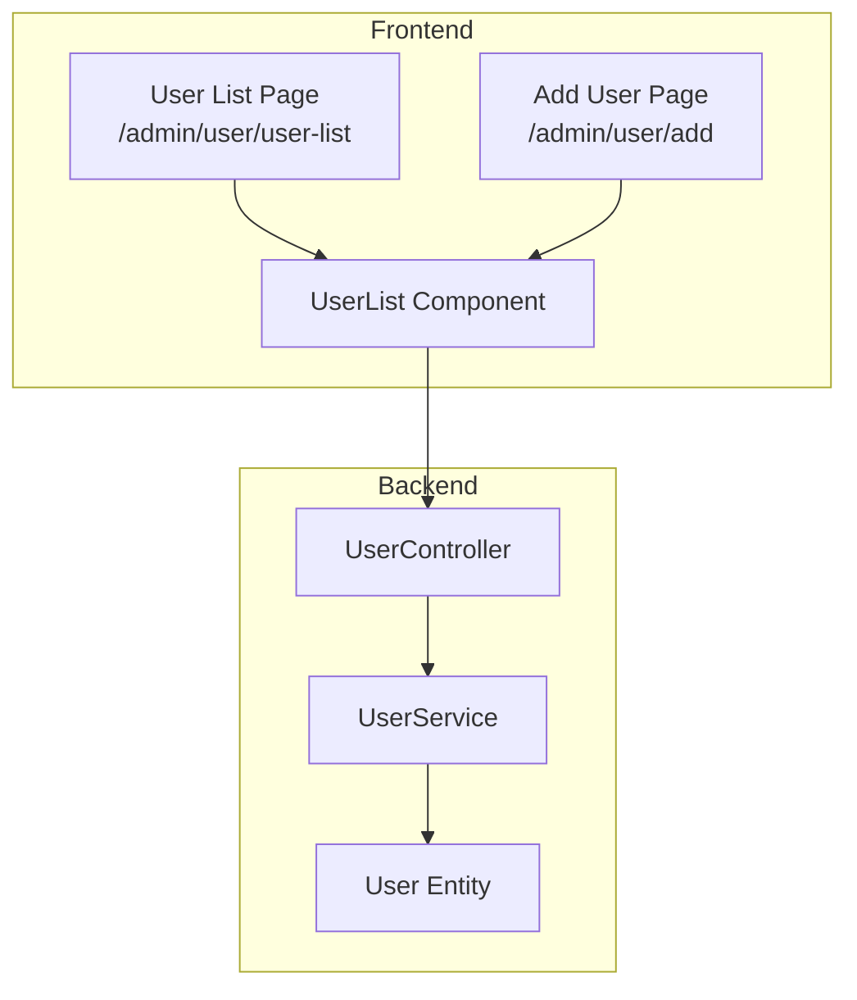
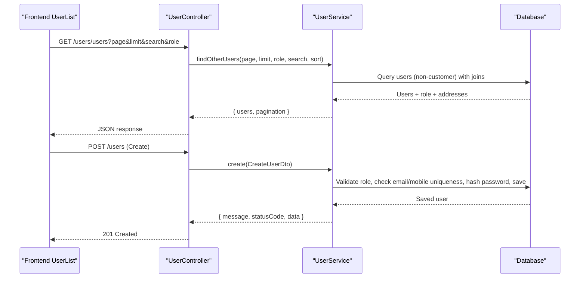
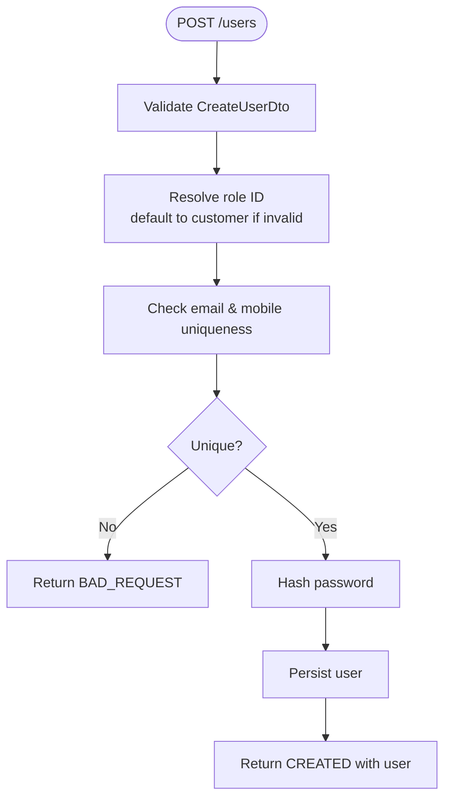
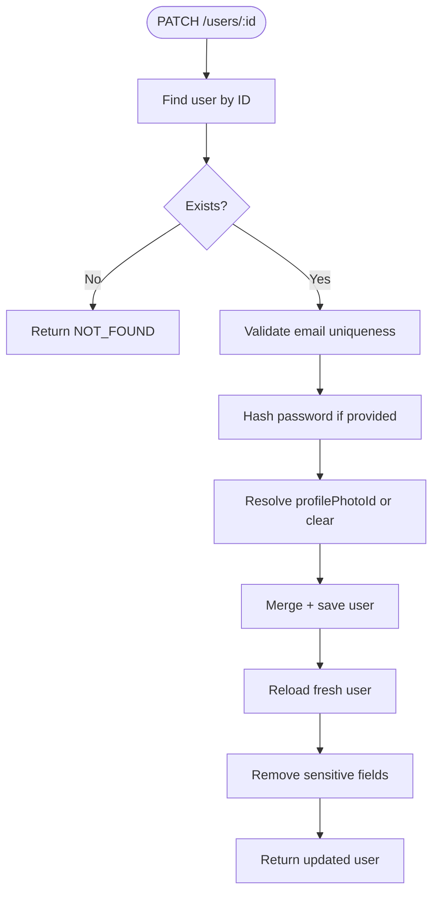
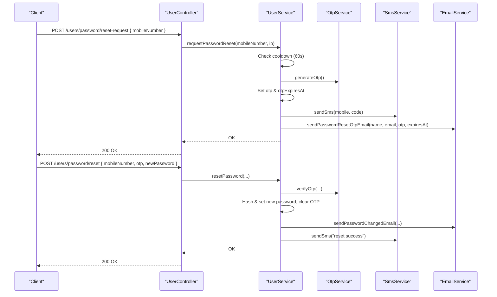
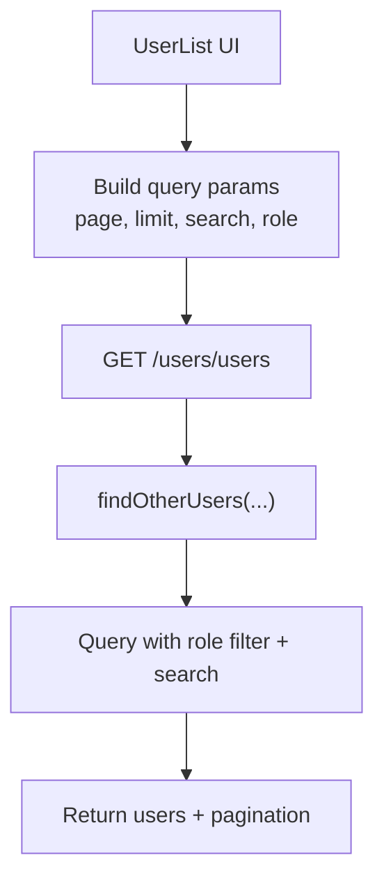
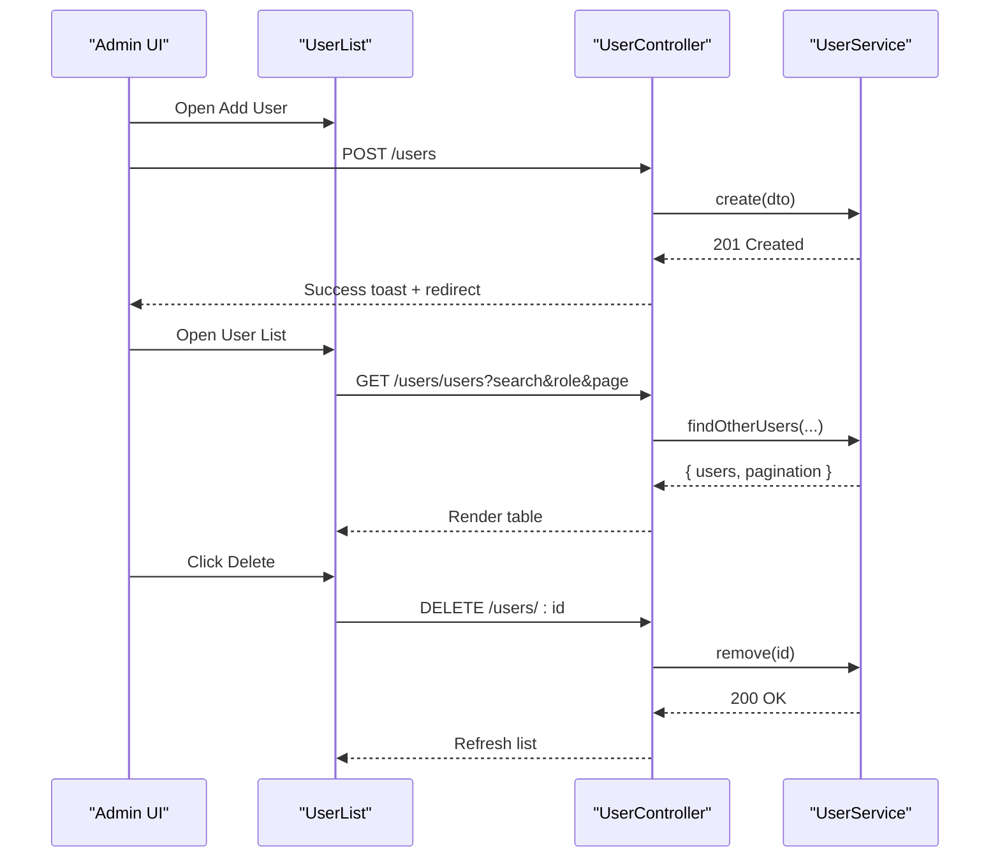
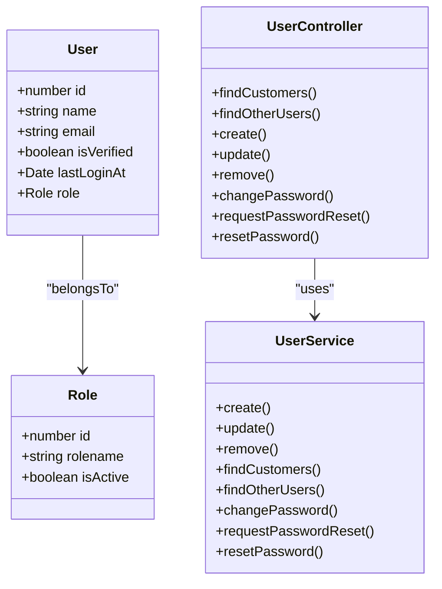
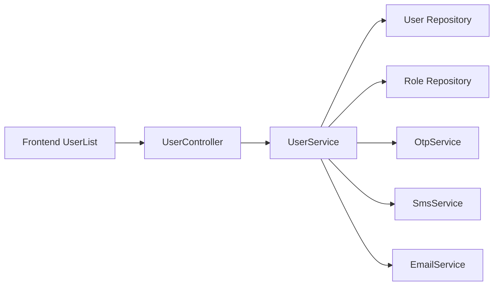

# User Management

<cite>
**Referenced Files in This Document**
- [user.controller.ts](file://apps/backend/src/user/user.controller.ts)
- [user.service.ts](file://apps/backend/src/user/user.service.ts)
- [create-user.dto.ts](file://apps/backend/src/user/dto/create-user.dto.ts)
- [update-user.dto.ts](file://apps/backend/src/user/dto/update-user.dto.ts)
- [user.entity.ts](file://apps/backend/src/user/entities/user.entity.ts)
- [user-list.tsx](file://apps/frontend/components/admin/user/user-list.tsx)
- [page.tsx (User List)](file://apps/frontend/app/admin/user/user-list/page.tsx)
- [page.tsx (Add User)](file://apps/frontend/app/admin/user/add/page.tsx)
</cite>

## Table of Contents
1. [Introduction](#introduction)
2. [Project Structure](#project-structure)
3. [Core Components](#core-components)
4. [Architecture Overview](#architecture-overview)
5. [Detailed Component Analysis](#detailed-component-analysis)
6. [Dependency Analysis](#dependency-analysis)
7. [Performance Considerations](#performance-considerations)
8. [Troubleshooting Guide](#troubleshooting-guide)
9. [Conclusion](#conclusion)

## Introduction
This document explains the user management functionality exposed by the admin dashboard. It covers:
- Creating users with form validation, initial role assignment, and verification fields
- Editing user profiles, managing passwords, and controlling account status
- Searching, filtering, pagination, and deletion workflows
- Integration with authentication and OTP-based password reset flows
- The relationship between users, roles, and permissions within the access control system

## Project Structure
The user management feature spans backend controllers/services and frontend admin pages:
- Backend: NestJS controller and service expose REST endpoints for listing, creating, updating, deleting users, plus password change/reset flows
- Frontend: Admin UI provides a paginated user list with search/filter and navigation to add/edit forms

**Diagram sources**
- [page.tsx (User List):1-19](file://apps/frontend/app/admin/user/user-list/page.tsx#L1-L19)
- [page.tsx (Add User):1-30](file://apps/frontend/app/admin/user/add/page.tsx#L1-L30)
- [user-list.tsx:1-510](file://apps/frontend/components/admin/user/user-list.tsx#L1-L510)
- [user.controller.ts:1-399](file://apps/backend/src/user/user.controller.ts#L1-L399)
- [user.service.ts:1-948](file://apps/backend/src/user/user.service.ts#L1-L948)
- [user.entity.ts:1-183](file://apps/backend/src/user/entities/user.entity.ts#L1-L183)

**Section sources**
- [page.tsx (User List):1-19](file://apps/frontend/app/admin/user/user-list/page.tsx#L1-L19)
- [page.tsx (Add User):1-30](file://apps/frontend/app/admin/user/add/page.tsx#L1-L30)
- [user-list.tsx:1-510](file://apps/frontend/components/admin/user/user-list.tsx#L1-L510)
- [user.controller.ts:1-399](file://apps/backend/src/user/user.controller.ts#L1-L399)
- [user.service.ts:1-948](file://apps/backend/src/user/user.service.ts#L1-L948)
- [user.entity.ts:1-183](file://apps/backend/src/user/entities/user.entity.ts#L1-L183)

## Core Components
- Backend Controller: Exposes endpoints for listing customers and non-customer users, top customer reports, single user retrieval, CRUD operations, and password change/reset
- Backend Service: Implements business logic including validation, hashing, OTP/password reset, queries, and data transformation
- DTOs: Define input validation rules for create/update operations
- Entity: Defines the User model and relationships (role, addresses, orders, profile photo, activities)
- Frontend User List: Paginated table with search, role filter, delete confirmation, and permission-gated actions
- Frontend Add User Page: Form page that delegates to a reusable user form component

Key responsibilities:
- Validation: Email format, mobile number, password length, optional boolean flags
- Security: Password hashing, OTP generation/validation, throttling on reset request endpoint
- Access Control: JWT + Permission guards and module-level permissions for admin routes
- Data Presentation: Role badges, verification status, last login timestamps

**Section sources**
- [user.controller.ts:1-399](file://apps/backend/src/user/user.controller.ts#L1-L399)
- [user.service.ts:1-948](file://apps/backend/src/user/user.service.ts#L1-L948)
- [create-user.dto.ts:1-81](file://apps/backend/src/user/dto/create-user.dto.ts#L1-L81)
- [update-user.dto.ts:1-95](file://apps/backend/src/user/dto/update-user.dto.ts#L1-L95)
- [user.entity.ts:1-183](file://apps/backend/src/user/entities/user.entity.ts#L1-L183)
- [user-list.tsx:1-510](file://apps/frontend/components/admin/user/user-list.tsx#L1-L510)
- [page.tsx (Add User):1-30](file://apps/frontend/app/admin/user/add/page.tsx#L1-L30)

## Architecture Overview
The admin user management follows a layered architecture:
- Frontend pages render UI and call backend APIs
- Controllers validate requests and delegate to services
- Services orchestrate repositories, external services (OTP/SMS/Email), and return normalized responses
- Entities define persistent models and relations

**Diagram sources**
- [user.controller.ts:83-131](file://apps/backend/src/user/user.controller.ts#L83-L131)
- [user.controller.ts:274-291](file://apps/backend/src/user/user.controller.ts#L274-L291)
- [user.service.ts:189-258](file://apps/backend/src/user/user.service.ts#L189-L258)
- [user.service.ts:561-629](file://apps/backend/src/user/user.service.ts#L561-L629)

## Detailed Component Analysis

### User Creation Workflow
- Input validation is enforced via CreateUserDto:
  - Name: string, min/max length
  - Email: optional but validated when present
  - Password: optional but validated when present (min length)
  - Mobile number: optional phone format
  - Verification flag: optional boolean
  - Role ID: optional number; defaults to customer role if invalid or missing
- Service behavior:
  - Validates role existence; falls back to default role if needed
  - Checks uniqueness of email and mobile number
  - Hashes password before persisting
  - Returns created user data

**Diagram sources**
- [create-user.dto.ts:1-81](file://apps/backend/src/user/dto/create-user.dto.ts#L1-L81)
- [user.service.ts:561-629](file://apps/backend/src/user/user.service.ts#L561-L629)

**Section sources**
- [create-user.dto.ts:1-81](file://apps/backend/src/user/dto/create-user.dto.ts#L1-L81)
- [user.service.ts:561-629](file://apps/backend/src/user/user.service.ts#L561-L629)

### User Profile Editing Capabilities
- UpdateUserDto supports partial updates:
  - Name, email, mobile number, password (optional)
  - Verification flag (isVerified)
  - Profile photo reference (profilePhotoId)
- Service update flow:
  - Finds user by ID; throws not found if missing
  - Validates new email uniqueness
  - Hashes password if provided
  - Resolves profile photo attachment by ID or clears it
  - Merges and saves changes; reloads fresh entity to ensure eager relations are correct
  - Omits sensitive fields (password, otp, otpExpiresAt) from response

**Diagram sources**
- [update-user.dto.ts:1-95](file://apps/backend/src/user/dto/update-user.dto.ts#L1-L95)
- [user.service.ts:630-713](file://apps/backend/src/user/user.service.ts#L630-L713)

**Section sources**
- [update-user.dto.ts:1-95](file://apps/backend/src/user/dto/update-user.dto.ts#L1-L95)
- [user.service.ts:630-713](file://apps/backend/src/user/user.service.ts#L630-L713)

### Password Management
- Change my password (authenticated user):
  - Verifies current password
  - Ensures new password differs from current
  - Hashes and saves new password
  - Sends security notification email (fire-and-forget)
- Password reset flow (mobile-based OTP):
  - Request: Generates OTP, stores expiration, sends SMS and email
  - Reset: Validates OTP and expiration, hashes new password, clears OTP fields, sends notifications

**Diagram sources**
- [user.controller.ts:347-397](file://apps/backend/src/user/user.controller.ts#L347-L397)
- [user.service.ts:830-938](file://apps/backend/src/user/user.service.ts#L830-L938)

**Section sources**
- [user.controller.ts:292-315](file://apps/backend/src/user/user.controller.ts#L292-L315)
- [user.controller.ts:347-397](file://apps/backend/src/user/user.controller.ts#L347-L397)
- [user.service.ts:718-770](file://apps/backend/src/user/user.service.ts#L718-L770)
- [user.service.ts:830-938](file://apps/backend/src/user/user.service.ts#L830-L938)

### Account Status Control (Active/Inactive)
- The User entity includes an isVerified flag used to indicate verification status
- The frontend displays verification status in the user list
- The update payload supports toggling isVerified during profile edits

Note: There is no explicit active/inactive toggle field in the User entity; verification is represented by isVerified.

**Section sources**
- [user.entity.ts:79-85](file://apps/backend/src/user/entities/user.entity.ts#L79-L85)
- [update-user.dto.ts:75-84](file://apps/backend/src/user/dto/update-user.dto.ts#L75-L84)
- [user-list.tsx:305-319](file://apps/frontend/components/admin/user/user-list.tsx#L305-L319)

### User Search and Filtering Options
- Frontend UserList supports:
  - Text search across name, email, mobile
  - Role filter (All, Customer, Admin)
  - Pagination with URL-synced parameters
- Backend endpoints:
  - GET /users/users: Lists non-customer users with role and search filters
  - GET /users/customers: Lists customer users with search and sort options

**Diagram sources**
- [user-list.tsx:107-154](file://apps/frontend/components/admin/user/user-list.tsx#L107-L154)
- [user.controller.ts:83-131](file://apps/backend/src/user/user.controller.ts#L83-L131)
- [user.service.ts:189-258](file://apps/backend/src/user/user.service.ts#L189-L258)

**Section sources**
- [user-list.tsx:107-154](file://apps/frontend/components/admin/user/user-list.tsx#L107-L154)
- [user.controller.ts:83-131](file://apps/backend/src/user/user.controller.ts#L83-L131)
- [user.service.ts:189-258](file://apps/backend/src/user/user.service.ts#L189-L258)

### Bulk Operations
- Current implementation does not provide bulk operations (e.g., bulk delete or bulk role assignment). Only single-user delete is supported via the list view.

**Section sources**
- [user-list.tsx:160-178](file://apps/frontend/components/admin/user/user-list.tsx#L160-L178)
- [user.controller.ts:332-346](file://apps/backend/src/user/user.controller.ts#L332-L346)

### User Activity Tracking
- The User entity has a one-to-many relationship with UserActivity
- No dedicated admin endpoints for querying activity are shown in the referenced files

**Section sources**
- [user.entity.ts:179-180](file://apps/backend/src/user/entities/user.entity.ts#L179-L180)

### Examples of User CRUD Operations Through the Admin Interface
- Create:
  - Navigate to Add User page; submit form; backend validates DTO, assigns role, hashes password, returns created user
- Read:
  - User list fetches paginated users with optional search and role filter
  - Single user detail can be fetched via GET /users/:id
- Update:
  - Edit user profile; optional fields include name, email, mobile, password, isVerified, profilePhotoId
- Delete:
  - Confirm delete dialog triggers DELETE /users/:id; list refreshes on success

**Diagram sources**
- [page.tsx (Add User):1-30](file://apps/frontend/app/admin/user/add/page.tsx#L1-L30)
- [user-list.tsx:119-178](file://apps/frontend/components/admin/user/user-list.tsx#L119-L178)
- [user.controller.ts:274-346](file://apps/backend/src/user/user.controller.ts#L274-L346)
- [user.service.ts:561-629](file://apps/backend/src/user/user.service.ts#L561-L629)
- [user.service.ts:772-784](file://apps/backend/src/user/user.service.ts#L772-L784)

**Section sources**
- [page.tsx (Add User):1-30](file://apps/frontend/app/admin/user/add/page.tsx#L1-L30)
- [user-list.tsx:119-178](file://apps/frontend/components/admin/user/user-list.tsx#L119-L178)
- [user.controller.ts:274-346](file://apps/backend/src/user/user.controller.ts#L274-L346)
- [user.service.ts:561-629](file://apps/backend/src/user/user.service.ts#L561-L629)
- [user.service.ts:772-784](file://apps/backend/src/user/user.service.ts#L772-L784)

### Error Handling Scenarios
- Duplicate email/mobile during creation: BAD_REQUEST
- Invalid role ID during creation: NOT_FOUND or fallback to default role
- Not found user during update/delete: NOT_FOUND
- Incorrect current password: BAD_REQUEST
- Invalid/expired OTP: BAD_REQUEST
- Network or API errors in frontend: Toast messages displayed to the user

**Section sources**
- [user.service.ts:588-610](file://apps/backend/src/user/user.service.ts#L588-L610)
- [user.service.ts:630-713](file://apps/backend/src/user/user.service.ts#L630-L713)
- [user.service.ts:718-770](file://apps/backend/src/user/user.service.ts#L718-L770)
- [user.service.ts:883-938](file://apps/backend/src/user/user.service.ts#L883-L938)
- [user-list.tsx:165-178](file://apps/frontend/components/admin/user/user-list.tsx#L165-L178)

### Integration with Authentication System
- Endpoints are protected by JWT guard and permission guard where applicable
- Module-level permissions restrict access to admin routes under /admin/user
- Password change uses authenticated user context
- Password reset integrates OTP service and SMS/email services

**Section sources**
- [user.controller.ts:42-44](file://apps/backend/src/user/user.controller.ts#L42-L44)
- [user.controller.ts:83-85](file://apps/backend/src/user/user.controller.ts#L83-L85)
- [user.controller.ts:292-315](file://apps/backend/src/user/user.controller.ts#L292-L315)
- [user.controller.ts:347-397](file://apps/backend/src/user/user.controller.ts#L347-L397)

### Relationship Between Users, Roles, and Permissions
- Users belong to a Role (many-to-one)
- Default role is customer (ID 3) if none or invalid role is provided
- Admin endpoints enforce module permissions for /admin/user
- Frontend conditionally shows actions based on permissions

**Diagram sources**
- [user.entity.ts:62-68](file://apps/backend/src/user/entities/user.entity.ts#L62-L68)
- [user.controller.ts:1-399](file://apps/backend/src/user/user.controller.ts#L1-L399)
- [user.service.ts:1-948](file://apps/backend/src/user/user.service.ts#L1-L948)

**Section sources**
- [user.entity.ts:62-68](file://apps/backend/src/user/entities/user.entity.ts#L62-L68)
- [user.controller.ts:42-44](file://apps/backend/src/user/user.controller.ts#L42-L44)
- [user.controller.ts:83-85](file://apps/backend/src/user/user.controller.ts#L83-L85)
- [user.service.ts:561-629](file://apps/backend/src/user/user.service.ts#L561-L629)

## Dependency Analysis
- Controller depends on:
  - Guards (JWT, Permission)
  - DTOs (CreateUserDto, UpdateUserDto, ChangePasswordDto)
  - UserService
- Service depends on:
  - TypeORM repositories (User, Role)
  - External services (OtpService, SmsService, EmailService)
- Frontend depends on:
  - API utilities for fetching/pagination/deleting
  - Permission hooks to gate UI actions

**Diagram sources**
- [user.controller.ts:1-399](file://apps/backend/src/user/user.controller.ts#L1-L399)
- [user.service.ts:1-42](file://apps/backend/src/user/user.service.ts#L1-L42)
- [user-list.tsx:1-510](file://apps/frontend/components/admin/user/user-list.tsx#L1-L510)

**Section sources**
- [user.controller.ts:1-399](file://apps/backend/src/user/user.controller.ts#L1-L399)
- [user.service.ts:1-42](file://apps/backend/src/user/user.service.ts#L1-L42)
- [user-list.tsx:1-510](file://apps/frontend/components/admin/user/user-list.tsx#L1-L510)

## Performance Considerations
- Pagination: Both frontend and backend use page/limit to avoid large payloads
- Query optimization: Service uses selective column selection and joins only necessary relations
- Report endpoints: Use time-range helpers to compute date bounds efficiently
- Throttling: Password reset request endpoint is rate-limited to prevent abuse

[No sources needed since this section provides general guidance]

## Troubleshooting Guide
- Cannot create user due to duplicate email/mobile:
  - Ensure unique values; handle BAD_REQUEST in UI
- Role assignment fails:
  - Verify role ID exists; service may fall back to default role
- Update returns not found:
  - Confirm user ID exists before editing
- Password change fails:
  - Verify current password; ensure new password differs
- OTP reset fails:
  - Check cooldown window and OTP validity; ensure SMS/email delivery

**Section sources**
- [user.service.ts:588-610](file://apps/backend/src/user/user.service.ts#L588-L610)
- [user.service.ts:630-713](file://apps/backend/src/user/user.service.ts#L630-L713)
- [user.service.ts:718-770](file://apps/backend/src/user/user.service.ts#L718-L770)
- [user.service.ts:830-938](file://apps/backend/src/user/user.service.ts#L830-L938)

## Conclusion
The admin user management system provides robust CRUD operations, secure password handling, and flexible search/filter capabilities. It integrates tightly with the authentication subsystem through JWT and permission guards, and leverages OTP-based flows for password recovery. While bulk operations are not currently implemented, the existing design allows for future extensions such as bulk role assignment or status toggles.

[No sources needed since this section summarizes without analyzing specific files]