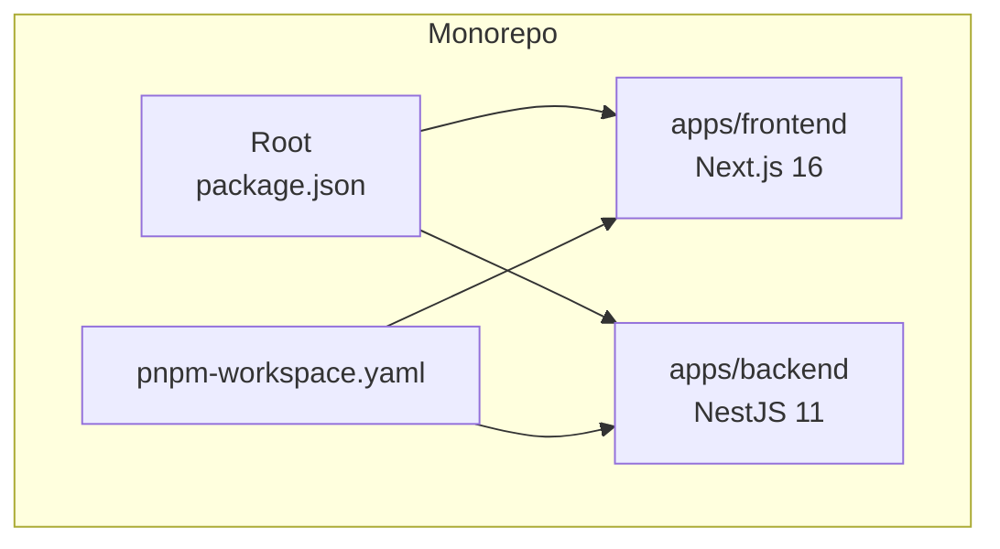
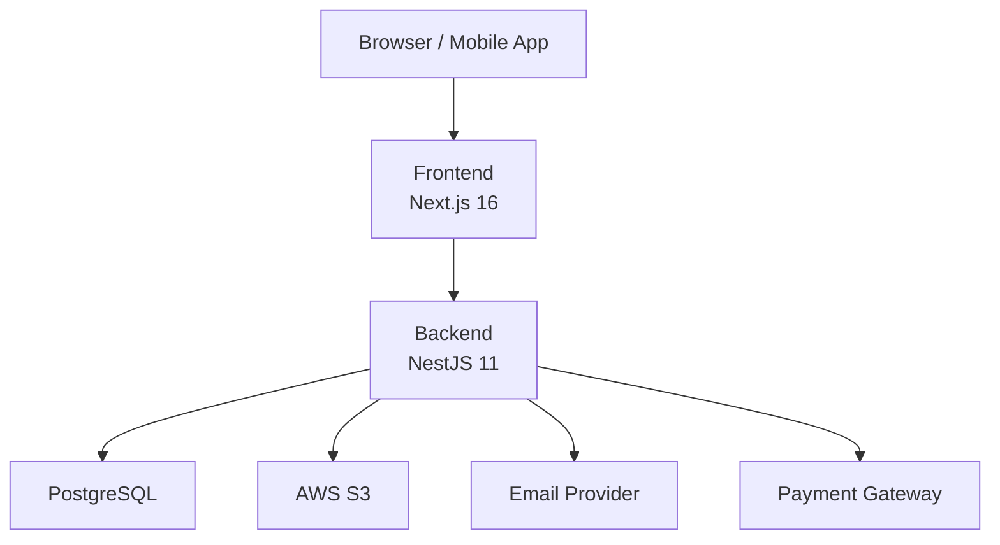
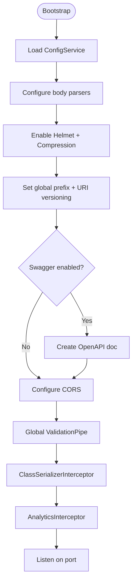
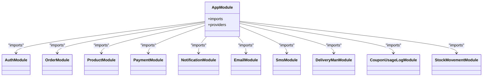
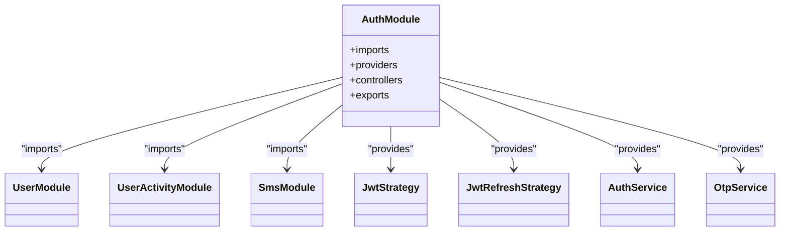
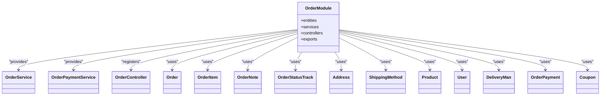
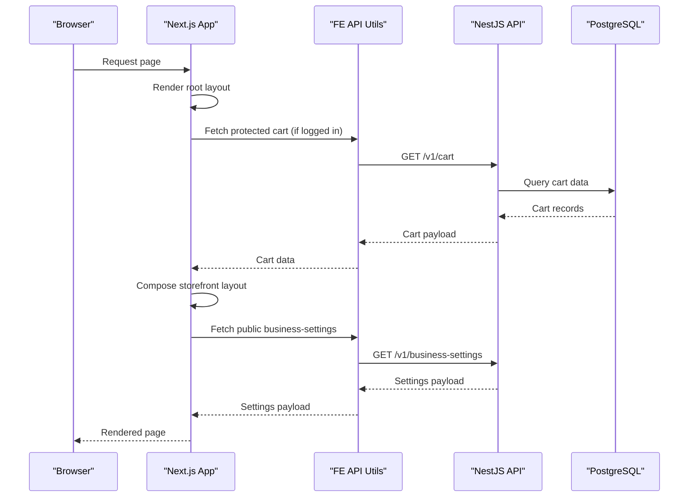
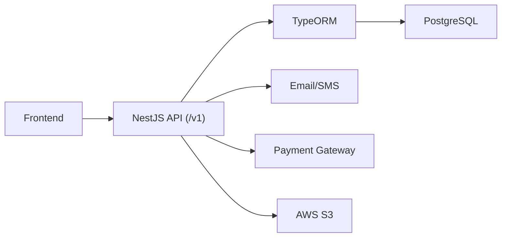

# Architecture & Design

<cite>
**Referenced Files in This Document**
- [README.md](file://README.md)
- [package.json](file://package.json)
- [pnpm-workspace.yaml](file://pnpm-workspace.yaml)
- [apps/backend/src/main.ts](file://apps/backend/src/main.ts)
- [apps/backend/src/app.module.ts](file://apps/backend/src/app.module.ts)
- [apps/backend/src/auth/auth.module.ts](file://apps/backend/src/auth/auth.module.ts)
- [apps/backend/src/order/order.module.ts](file://apps/backend/src/order/order.module.ts)
- [apps/frontend/next.config.js](file://apps/frontend/next.config.js)
- [apps/frontend/app/layout.tsx](file://apps/frontend/app/layout.tsx)
- [apps/frontend/app/(main)/layout.tsx](file://apps/frontend/app/(main)/layout.tsx)
</cite>

## Table of Contents
1. [Introduction](#introduction)
2. [Project Structure](#project-structure)
3. [Core Components](#core-components)
4. [Architecture Overview](#architecture-overview)
5. [Detailed Component Analysis](#detailed-component-analysis)
6. [Dependency Analysis](#dependency-analysis)
7. [Performance Considerations](#performance-considerations)
8. [Troubleshooting Guide](#troubleshooting-guide)
9. [Conclusion](#conclusion)

## Introduction
This document describes the architecture and design of the German Butcher e-commerce platform. The system is a monorepo with pnpm workspaces that separates a Next.js frontend from a NestJS backend, exposing a versioned REST API and real-time capabilities. It follows a modular, feature-based backend architecture and an App Router-driven frontend structure, enabling scalable growth toward microservices while maintaining a cohesive development experience.

Key goals:
- Clear separation between client-side React components and server-side API endpoints
- Modular backend organization by domain features
- Predictable data flow from user interactions to database operations and back
- Cross-cutting concerns for authentication, authorization, logging, caching, and error handling
- Technology stack decisions aligned with performance, developer productivity, and operational reliability

## Project Structure
The repository uses a monorepo layout under apps/:
- apps/frontend: Next.js 16 storefront and admin UI (App Router, Tailwind CSS, Radix UI primitives)
- apps/backend: NestJS 11 API with TypeORM and PostgreSQL
- Root workspace configuration via pnpm-workspace.yaml and shared scripts in package.json

**Diagram sources**
- [package.json:1-30](file://package.json#L1-L30)
- [pnpm-workspace.yaml:1-19](file://pnpm-workspace.yaml#L1-L19)

**Section sources**
- [README.md:1-32](file://README.md#L1-L32)
- [package.json:1-30](file://package.json#L1-L30)
- [pnpm-workspace.yaml:1-19](file://pnpm-workspace.yaml#L1-L19)

## Core Components
- Frontend (Next.js):
  - App Router layouts and pages for storefront and admin
  - Providers for cart, notifications, and search state
  - Server actions and API utilities for fetching protected/public data
  - Image optimization configured for S3-hosted assets
- Backend (NestJS):
  - Global bootstrap with compression, Helmet, CORS, validation, serialization, analytics interceptors
  - Feature modules organized by domain (auth, orders, products, payments, etc.)
  - Database integration via TypeORM with connection pooling and environment-aware sync
  - Rate limiting, throttling guards, and global interceptors for cross-cutting behavior

**Section sources**
- [apps/frontend/app/layout.tsx:1-210](file://apps/frontend/app/layout.tsx#L1-L210)
- [apps/frontend/app/(main)/layout.tsx:1-73](file://apps/frontend/app/(main)/layout.tsx#L1-L73)
- [apps/frontend/next.config.js:1-39](file://apps/frontend/next.config.js#L1-L39)
- [apps/backend/src/main.ts:1-150](file://apps/backend/src/main.ts#L1-L150)
- [apps/backend/src/app.module.ts:1-184](file://apps/backend/src/app.module.ts#L1-L184)

## Architecture Overview
High-level system context:
- Browser or mobile app interacts with the Next.js frontend
- Next.js renders pages and calls the NestJS API over HTTP
- NestJS routes requests through controllers to services, which interact with PostgreSQL via TypeORM
- External integrations include AWS S3 for images, email providers, payment gateways, and optional real-time channels

[No sources needed since this diagram shows conceptual workflow, not actual code structure]

## Detailed Component Analysis

### Monorepo and Workspace Configuration
- Root package.json defines unified scripts for dev, build, start, and Docker orchestration across apps
- pnpm-workspace.yaml declares apps/* as packages and allows native builds for specific dependencies

Benefits:
- Single command to run/build all applications
- Shared dependency management and consistent tooling
- Isolated environments per app with workspace awareness

**Section sources**
- [package.json:1-30](file://package.json#L1-L30)
- [pnpm-workspace.yaml:1-19](file://pnpm-workspace.yaml#L1-L19)

### Backend Bootstrap and Cross-Cutting Concerns
- Application entry point configures:
  - Body size limits for large payloads
  - Compression for JSON responses
  - Helmet security headers
  - Versioned API prefix (/v1)
  - Swagger/OpenAPI documentation (environment-controlled)
  - CORS policy based on environment variables
  - Global ValidationPipe and ClassSerializerInterceptor
  - Analytics interceptor for request tracking
  - Graceful shutdown hooks

**Diagram sources**
- [apps/backend/src/main.ts:16-149](file://apps/backend/src/main.ts#L16-L149)

**Section sources**
- [apps/backend/src/main.ts:1-150](file://apps/backend/src/main.ts#L1-L150)

### Backend Module Composition and Feature Modules
- AppModule wires infrastructure modules (Config, Schedule, Throttler, TypeORM) and registers all feature modules
- Global guards and interceptors are provided at the root level
- Connection pooling and environment-aware synchronization are configured for TypeORM

**Diagram sources**
- [apps/backend/src/app.module.ts:60-184](file://apps/backend/src/app.module.ts#L60-L184)

**Section sources**
- [apps/backend/src/app.module.ts:1-184](file://apps/backend/src/app.module.ts#L1-L184)

### Authentication Module
- AuthModule composes:
  - User and UserActivity modules
  - Passport and JWT strategies
  - OTP and SMS services
  - Asynchronous JWT configuration using ConfigService

**Diagram sources**
- [apps/backend/src/auth/auth.module.ts:1-37](file://apps/backend/src/auth/auth.module.ts#L1-L37)

**Section sources**
- [apps/backend/src/auth/auth.module.ts:1-37](file://apps/backend/src/auth/auth.module.ts#L1-L37)

### Order Domain Module
- OrderModule aggregates entities and related services:
  - Order, OrderItem, OrderNote, OrderStatusTrack
  - Integrates with Address, ShippingMethod, Product, User, DeliveryMan
  - Coordinates with OrderPayment, Coupon, and usage logs
  - Exports services for other modules

**Diagram sources**
- [apps/backend/src/order/order.module.ts:1-66](file://apps/backend/src/order/order.module.ts#L1-L66)

**Section sources**
- [apps/backend/src/order/order.module.ts:1-66](file://apps/backend/src/order/order.module.ts#L1-L66)

### Frontend Layouts and Data Flow
- Root layout sets up providers (Cart, Notification, Search), injects Google Tag Manager and Analytics, and fetches initial cart data for authenticated users
- Main storefront layout handles maintenance mode, loads business settings, and composes header/footer and interactive widgets

**Diagram sources**
- [apps/frontend/app/layout.tsx:1-210](file://apps/frontend/app/layout.tsx#L1-L210)
- [apps/frontend/app/(main)/layout.tsx:1-73](file://apps/frontend/app/(main)/layout.tsx#L1-L73)

**Section sources**
- [apps/frontend/app/layout.tsx:1-210](file://apps/frontend/app/layout.tsx#L1-L210)
- [apps/frontend/app/(main)/layout.tsx:1-73](file://apps/frontend/app/(main)/layout.tsx#L1-L73)

## Dependency Analysis
- Frontend depends on:
  - Next.js runtime and App Router
  - External image hosts (S3) configured via next.config.js
  - Backend API endpoints exposed under /v1
- Backend depends on:
  - TypeORM and PostgreSQL
  - Environment configuration via ConfigService
  - Optional integrations (email, SMS, payment, S3)
  - Global guards and interceptors for rate limiting, activity tracking, and HTTP caching

**Diagram sources**
- [apps/frontend/next.config.js:14-35](file://apps/frontend/next.config.js#L14-L35)
- [apps/backend/src/app.module.ts:93-115](file://apps/backend/src/app.module.ts#L93-L115)

**Section sources**
- [apps/frontend/next.config.js:1-39](file://apps/frontend/next.config.js#L1-L39)
- [apps/backend/src/app.module.ts:1-184](file://apps/backend/src/app.module.ts#L1-L184)

## Performance Considerations
- Backend:
  - Response compression reduces payload sizes
  - Global validation and serialization minimize overhead and ensure consistent response shapes
  - Connection pooling configured for high-throughput database access
  - Rate limiting protects against abuse and stabilizes load
- Frontend:
  - Standalone output for efficient deployment
  - Image optimization with long cache TTL for immutable S3 objects
  - Transpilation exclusions for heavy libraries to reduce bundle size

Recommendations:
- Enable HTTP/2 and CDN caching for static assets
- Use server-side caching where appropriate (e.g., business settings)
- Monitor database query performance and add indexes as needed
- Profile frontend bundles and lazy-load non-critical components

[No sources needed since this section provides general guidance]

## Troubleshooting Guide
Common issues and resolutions:
- Port conflicts: Ensure ports used by frontend and backend are free; adjust environment variables if necessary
- Database connectivity: Verify PostgreSQL credentials and network access; confirm pool settings align with capacity
- Docker build failures: Clear caches, verify Node/pnpm versions, and check network availability during install
- Frontend build issues: Clear Next.js cache, reinstall dependencies, and validate Node version compatibility

Operational checks:
- Confirm Swagger docs are accessible when enabled
- Validate CORS origins match deployed frontend domains
- Inspect global interceptors and guards for unexpected behavior

**Section sources**
- [README.md:282-310](file://README.md#L282-L310)
- [apps/backend/src/main.ts:89-109](file://apps/backend/src/main.ts#L89-L109)

## Conclusion
The German Butcher platform leverages a modern monorepo with clear separation between Next.js and NestJS. The backend’s modular, feature-based design supports scalability and maintainability, while the frontend’s App Router structure enables rich interactivity and strong SEO. Cross-cutting concerns such as authentication, authorization, validation, caching, and analytics are consistently applied. With robust DevOps tooling and environment-aware configurations, the system is well-positioned to evolve into a microservices-oriented architecture while preserving a cohesive developer experience.

[No sources needed since this section summarizes without analyzing specific files]