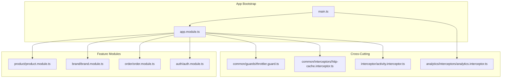
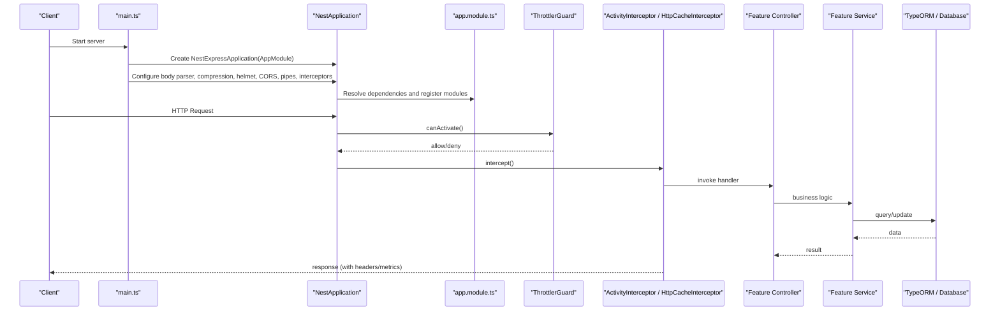
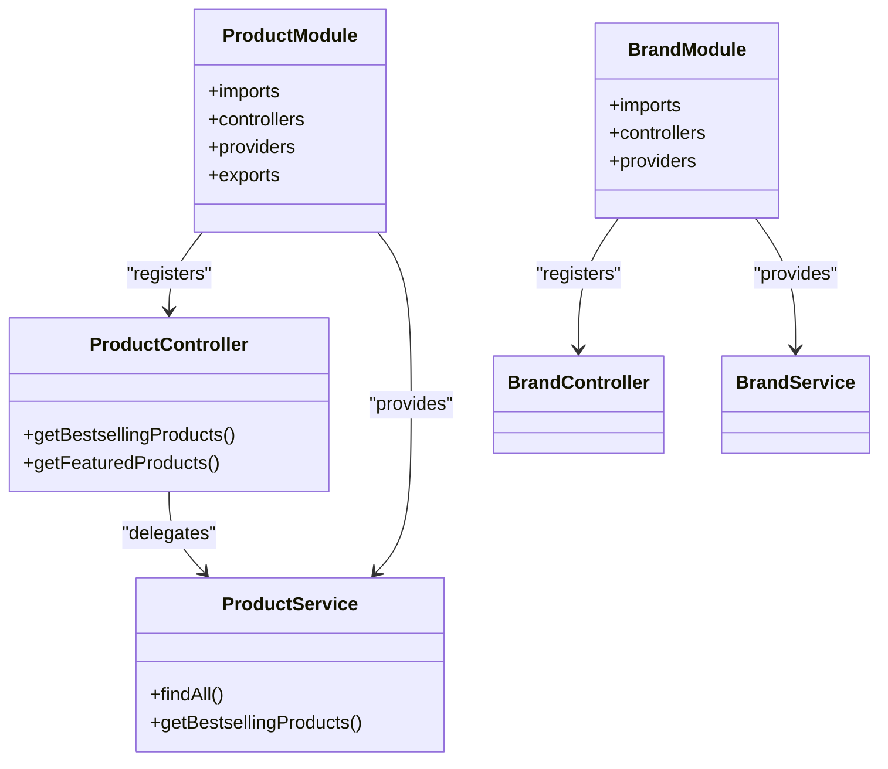
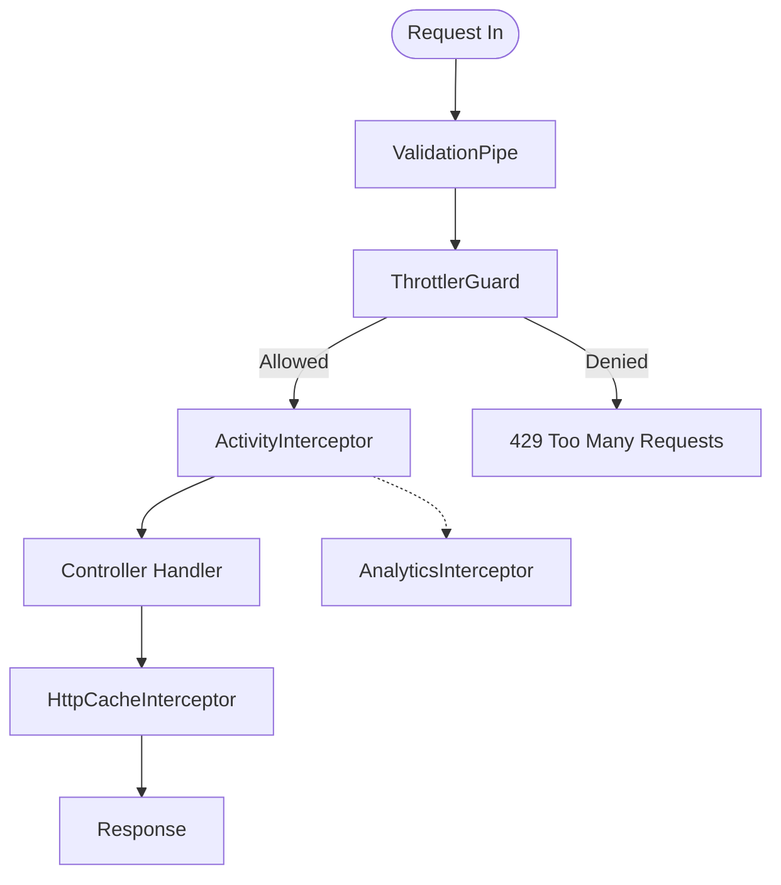
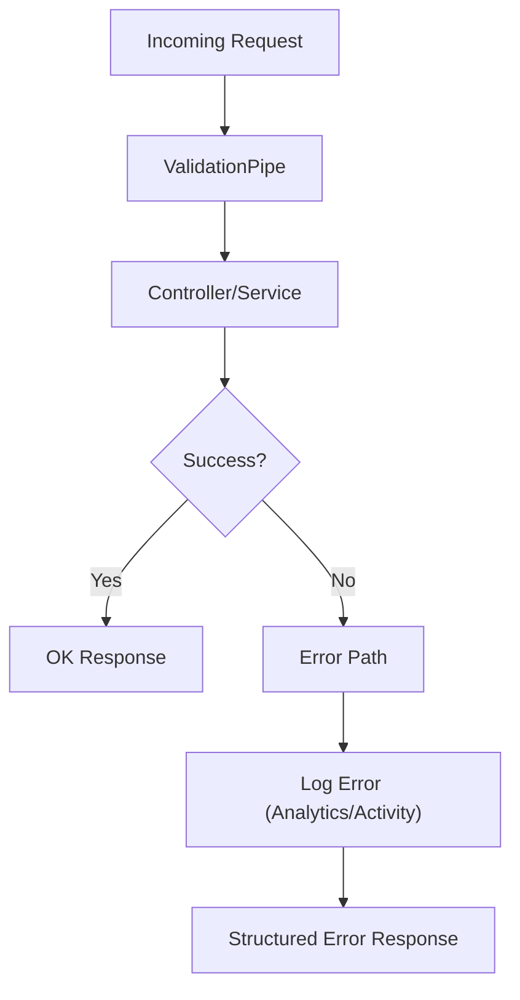
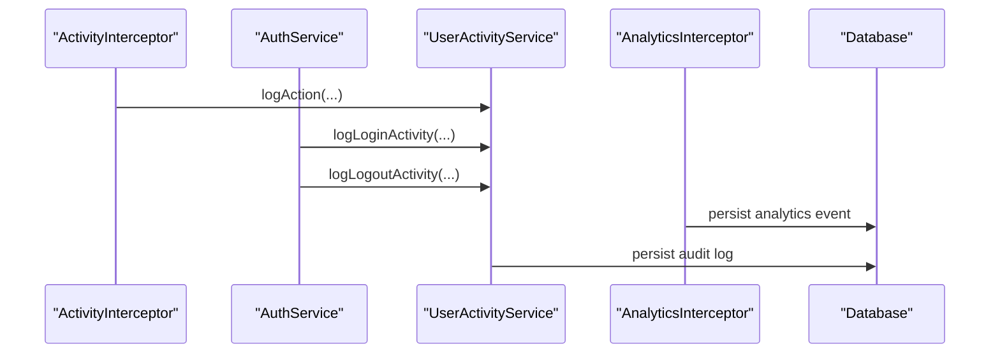
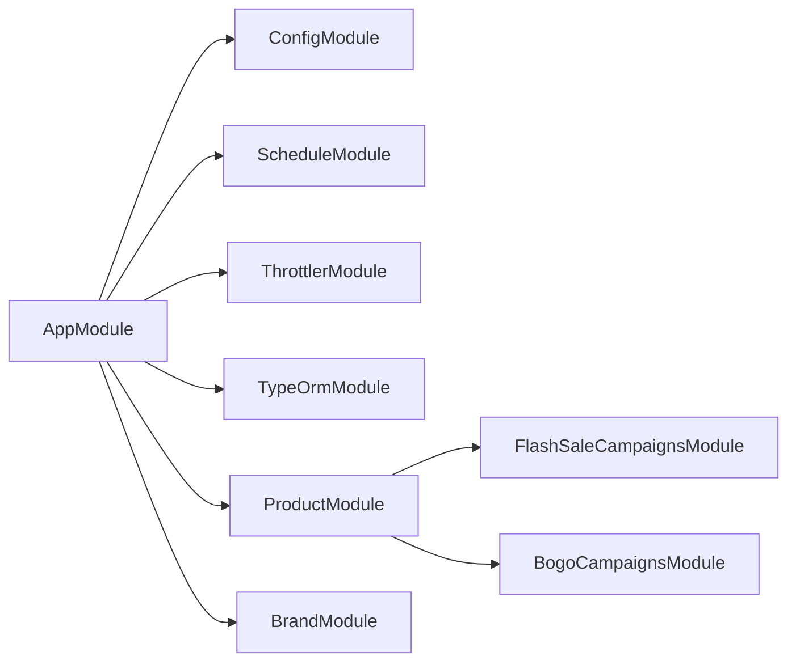

# Backend Architecture

<cite>
**Referenced Files in This Document**
- [main.ts](file://apps/backend/src/main.ts)
- [app.module.ts](file://apps/backend/src/app.module.ts)
- [configuration.ts](file://apps/backend/src/config/configuration.ts)
- [throttler.guard.ts](file://apps/backend/src/common/guards/throttler.guard.ts)
- [http-cache.interceptor.ts](file://apps/backend/src/common/interceptors/http-cache.interceptor.ts)
- [activity.interceptor.ts](file://apps/backend/src/interceptor/activity.interceptor.ts)
- [analytics.interceptor.ts](file://apps/backend/src/analytics/interceptors/analytics.interceptor.ts)
- [log-request.dto.ts](file://apps/backend/src/analytics/dto/log-request.dto.ts)
- [product.module.ts](file://apps/backend/src/product/product.module.ts)
- [brand.module.ts](file://apps/backend/src/brand/brand.module.ts)
- [product.controller.ts](file://apps/backend/src/product/product.controller.ts)
- [auth.service.ts](file://apps/backend/src/auth/auth.service.ts)
- [user-activity.service.ts](file://apps/backend/src/user-activity/user-activity.service.ts)
- [notification.gateway.ts](file://apps/backend/src/notification/notification.gateway.ts)
</cite>

## Table of Contents
1. [Introduction](#introduction)
2. [Project Structure](#project-structure)
3. [Core Components](#core-components)
4. [Architecture Overview](#architecture-overview)
5. [Detailed Component Analysis](#detailed-component-analysis)
6. [Dependency Analysis](#dependency-analysis)
7. [Performance Considerations](#performance-considerations)
8. [Troubleshooting Guide](#troubleshooting-guide)
9. [Conclusion](#conclusion)

## Introduction
This document explains the backend architecture of the NestJS application, focusing on:
- Feature-based modular architecture and dependency injection
- Application bootstrap and module configuration
- Configuration management patterns
- Controller-service-repository pattern usage
- Middleware stack, guards, interceptors, and pipes
- Error handling strategies, logging, and performance optimizations
- Guidelines for adding new features following existing patterns

The goal is to make the system understandable for both technical and non-technical readers while providing concrete references to source files.

## Project Structure
The backend follows a feature-based module layout under apps/backend/src. Each domain (for example, product, brand, order, auth) has its own folder containing controllers, services, entities, DTOs, and a module that wires them together. Cross-cutting concerns such as guards, interceptors, decorators, and shared utilities live under common or dedicated folders.

**Diagram sources**
- [main.ts:16-128](file://apps/backend/src/main.ts#L16-L128)
- [app.module.ts:60-181](file://apps/backend/src/app.module.ts#L60-L181)
- [throttler.guard.ts:1-28](file://apps/backend/src/common/guards/throttler.guard.ts#L1-L28)
- [http-cache.interceptor.ts:1-35](file://apps/backend/src/common/interceptors/http-cache.interceptor.ts#L1-L35)
- [activity.interceptor.ts:34-76](file://apps/backend/src/interceptor/activity.interceptor.ts#L34-L76)
- [analytics.interceptor.ts:84-115](file://apps/backend/src/analytics/interceptors/analytics.interceptor.ts#L84-L115)
- [product.module.ts:30-67](file://apps/backend/src/product/product.module.ts#L30-L67)
- [brand.module.ts:9-14](file://apps/backend/src/brand/brand.module.ts#L9-L14)

**Section sources**
- [main.ts:16-128](file://apps/backend/src/main.ts#L16-L128)
- [app.module.ts:60-181](file://apps/backend/src/app.module.ts#L60-L181)

## Core Components
- Application bootstrap: main.ts configures body parsers, compression, security headers, CORS, global pipes and interceptors, API versioning, Swagger, and shutdown hooks.
- Root module: app.module.ts registers all feature modules, TypeORM with async configuration, throttling, scheduling, and global providers (guards and interceptors).
- Configuration: configuration.ts centralizes environment-driven settings for payment providers and URLs.
- Cross-cutting:
  - ThrottlerGuard enforces rate limits with an optional skip decorator.
  - HttpCacheInterceptor sets Cache-Control headers based on a decorator.
  - ActivityInterceptor records user activity and audit logs.
  - AnalyticsInterceptor captures request metrics and persists analytics events.

Key responsibilities:
- Controllers expose HTTP endpoints and delegate business logic to services.
- Services encapsulate business rules and orchestrate repositories/entities.
- Entities represent database models via TypeORM.
- DTOs define validated input/output contracts.

**Section sources**
- [main.ts:16-128](file://apps/backend/src/main.ts#L16-L128)
- [app.module.ts:60-181](file://apps/backend/src/app.module.ts#L60-L181)
- [configuration.ts:1-16](file://apps/backend/src/config/configuration.ts#L1-L16)
- [throttler.guard.ts:1-28](file://apps/backend/src/common/guards/throttler.guard.ts#L1-L28)
- [http-cache.interceptor.ts:1-35](file://apps/backend/src/common/interceptors/http-cache.interceptor.ts#L1-L35)
- [activity.interceptor.ts:34-76](file://apps/backend/src/interceptor/activity.interceptor.ts#L34-L76)
- [analytics.interceptor.ts:84-115](file://apps/backend/src/analytics/interceptors/analytics.interceptor.ts#L84-L115)

## Architecture Overview
The application uses NestJS’s DI container to wire modules and services. The root AppModule imports feature modules and provides global guards and interceptors. The bootstrap process in main.ts applies cross-cutting infrastructure before listening on the configured port.

**Diagram sources**
- [main.ts:16-128](file://apps/backend/src/main.ts#L16-L128)
- [app.module.ts:60-181](file://apps/backend/src/app.module.ts#L60-L181)
- [throttler.guard.ts:1-28](file://apps/backend/src/common/guards/throttler.guard.ts#L1-L28)
- [http-cache.interceptor.ts:1-35](file://apps/backend/src/common/interceptors/http-cache.interceptor.ts#L1-L35)
- [activity.interceptor.ts:34-76](file://apps/backend/src/interceptor/activity.interceptor.ts#L34-L76)

## Detailed Component Analysis

### Application Bootstrap (main.ts)
Responsibilities:
- Creates the NestExpressApplication with AppModule.
- Configures body size limits for JSON and URL-encoded payloads.
- Enables compression and Helmet security headers.
- Enables shutdown hooks for graceful termination.
- Sets trust proxy for reverse proxies.
- Applies global prefix and URI versioning.
- Conditionally enables Swagger documentation based on environment variables.
- Configures CORS from environment variables.
- Registers global ValidationPipe and ClassSerializerInterceptor.
- Registers AnalyticsInterceptor globally for request metrics.

Operational notes:
- Swagger can be enabled in production via an environment flag.
- Global pipes validate and transform incoming payloads.
- Global interceptors sanitize responses and collect analytics.

**Section sources**
- [main.ts:16-128](file://apps/backend/src/main.ts#L16-L128)

### Root Module Configuration (app.module.ts)
Responsibilities:
- Imports ConfigModule with environment file selection by NODE_ENV.
- Configures ThrottlerModule with multiple named throttlers.
- Configures TypeOrmModule.forRootAsync using ConfigService for Postgres connection and pool settings.
- Registers all feature modules (address, analytics, attachment, auth, campaigns, banners, brands, cart, categories, clients, CRM, contact messages, coupons, delivery man, flash sales, free delivery, gallery, menu, permissions, notifications, online users, orders, payments, products, purchases, recipes, roles, locations, sales partners, sales points, shipping methods, SSL payment, subscribers, suppliers, testimonials, units, user activity, wishlist).
- Provides global guards and interceptors:
  - APP_GUARD: ThrottlerGuard
  - APP_INTERCEPTOR: ActivityInterceptor
  - APP_INTERCEPTOR: HttpCacheInterceptor

Configuration highlights:
- Synchronize mode controlled by environment flags.
- Connection pool sizing via environment variables.

**Section sources**
- [app.module.ts:60-181](file://apps/backend/src/app.module.ts#L60-L181)

### Configuration Management (configuration.ts)
Centralizes external service configuration:
- Payment provider credentials and URLs.
- Base URLs for backend and frontend.

Usage pattern:
- Environment variables are mapped into typed configuration objects consumed by services.

**Section sources**
- [configuration.ts:1-16](file://apps/backend/src/config/configuration.ts#L1-L16)

### Controller-Service-Repository Pattern
Typical flow:
- Controller handles HTTP requests, validates inputs (via DTOs and pipes), and delegates to a service.
- Service implements business logic and coordinates repository/entity operations.
- Repository (via TypeORM) performs persistence.

Example structure:
- Product feature includes a controller, service, and module wiring entities and related modules.
- Brand feature demonstrates a minimal module with controller, service, and entity registration.

**Diagram sources**
- [product.controller.ts:439-489](file://apps/backend/src/product/product.controller.ts#L439-L489)
- [product.module.ts:30-67](file://apps/backend/src/product/product.module.ts#L30-L67)
- [brand.module.ts:9-14](file://apps/backend/src/brand/brand.module.ts#L9-L14)

**Section sources**
- [product.module.ts:30-67](file://apps/backend/src/product/product.module.ts#L30-L67)
- [brand.module.ts:9-14](file://apps/backend/src/brand/brand.module.ts#L9-L14)
- [product.controller.ts:439-489](file://apps/backend/src/product/product.controller.ts#L439-L489)

### Middleware Stack, Guards, Interceptors, and Pipes
- Pipes:
  - Global ValidationPipe whitelists and transforms request payloads.
- Guards:
  - ThrottlerGuard enforces rate limits and supports a skip decorator.
- Interceptors:
  - ActivityInterceptor records user actions and audit logs.
  - HttpCacheInterceptor sets Cache-Control headers for cacheable endpoints.
  - AnalyticsInterceptor collects request/response metrics and persists analytics.
- Global setup:
  - main.ts registers ValidationPipe, ClassSerializerInterceptor, and AnalyticsInterceptor.
  - app.module.ts registers ThrottlerGuard, ActivityInterceptor, and HttpCacheInterceptor as global providers.

**Diagram sources**
- [main.ts:111-125](file://apps/backend/src/main.ts#L111-L125)
- [app.module.ts:167-181](file://apps/backend/src/app.module.ts#L167-L181)
- [throttler.guard.ts:1-28](file://apps/backend/src/common/guards/throttler.guard.ts#L1-L28)
- [http-cache.interceptor.ts:1-35](file://apps/backend/src/common/interceptors/http-cache.interceptor.ts#L1-L35)
- [activity.interceptor.ts:34-76](file://apps/backend/src/interceptor/activity.interceptor.ts#L34-L76)
- [analytics.interceptor.ts:84-115](file://apps/backend/src/analytics/interceptors/analytics.interceptor.ts#L84-L115)

**Section sources**
- [main.ts:111-125](file://apps/backend/src/main.ts#L111-L125)
- [app.module.ts:167-181](file://apps/backend/src/app.module.ts#L167-L181)
- [throttler.guard.ts:1-28](file://apps/backend/src/common/guards/throttler.guard.ts#L1-L28)
- [http-cache.interceptor.ts:1-35](file://apps/backend/src/common/interceptors/http-cache.interceptor.ts#L1-L35)
- [activity.interceptor.ts:34-76](file://apps/backend/src/interceptor/activity.interceptor.ts#L34-L76)
- [analytics.interceptor.ts:84-115](file://apps/backend/src/analytics/interceptors/analytics.interceptor.ts#L84-L115)

### Error Handling Strategies
- Validation errors are handled by the global ValidationPipe, which strips unknown fields and transforms types.
- AnalyticsInterceptor captures error responses and persists analytics with status codes and timing.
- ActivityInterceptor logs failed attempts gracefully without breaking request flow.
- Authentication-related services log login/logout activities and handle failures without exposing sensitive details.

**Diagram sources**
- [main.ts:111-125](file://apps/backend/src/main.ts#L111-L125)
- [analytics.interceptor.ts:84-115](file://apps/backend/src/analytics/interceptors/analytics.interceptor.ts#L84-L115)
- [activity.interceptor.ts:184-252](file://apps/backend/src/interceptor/activity.interceptor.ts#L184-L252)
- [auth.service.ts:369-432](file://apps/backend/src/auth/auth.service.ts#L369-L432)

**Section sources**
- [analytics.interceptor.ts:84-115](file://apps/backend/src/analytics/interceptors/analytics.interceptor.ts#L84-L115)
- [activity.interceptor.ts:184-252](file://apps/backend/src/interceptor/activity.interceptor.ts#L184-L252)
- [auth.service.ts:369-432](file://apps/backend/src/auth/auth.service.ts#L369-L432)

### Logging Implementation
- User activity logging:
  - ActivityInterceptor extracts user context, action type, entity info, and persists audit entries.
  - Auth service logs login/logout events with contextual metadata.
  - User activity service includes scheduled cleanup tasks for old records.
- Analytics logging:
  - AnalyticsInterceptor measures endpoint latency and status, then persists analytics records.
  - LogRequestDto defines the shape of analytics events.
- Real-time notifications:
  - Notification gateway logs client join/disconnect events with user context.

**Diagram sources**
- [activity.interceptor.ts:184-252](file://apps/backend/src/interceptor/activity.interceptor.ts#L184-L252)
- [auth.service.ts:369-432](file://apps/backend/src/auth/auth.service.ts#L369-L432)
- [user-activity.service.ts:241-278](file://apps/backend/src/user-activity/user-activity.service.ts#L241-L278)
- [analytics.interceptor.ts:84-115](file://apps/backend/src/analytics/interceptors/analytics.interceptor.ts#L84-L115)
- [log-request.dto.ts:1-45](file://apps/backend/src/analytics/dto/log-request.dto.ts#L1-L45)
- [notification.gateway.ts:77-110](file://apps/backend/src/notification/notification.gateway.ts#L77-L110)

**Section sources**
- [activity.interceptor.ts:184-252](file://apps/backend/src/interceptor/activity.interceptor.ts#L184-L252)
- [auth.service.ts:369-432](file://apps/backend/src/auth/auth.service.ts#L369-L432)
- [user-activity.service.ts:241-278](file://apps/backend/src/user-activity/user-activity.service.ts#L241-L278)
- [analytics.interceptor.ts:84-115](file://apps/backend/src/analytics/interceptors/analytics.interceptor.ts#L84-L115)
- [log-request.dto.ts:1-45](file://apps/backend/src/analytics/dto/log-request.dto.ts#L1-L45)
- [notification.gateway.ts:77-110](file://apps/backend/src/notification/notification.gateway.ts#L77-L110)

### Performance Optimization Techniques
- Compression: Enabled globally to reduce payload sizes.
- Security headers: Helmet applied globally.
- Body size limits: Increased for large payloads.
- Caching:
  - HttpCacheInterceptor sets Cache-Control headers for cacheable endpoints.
  - Product controller uses caching decorators for bestsellers and featured products.
- Rate limiting:
  - ThrottlerModule configured with multiple windows; ThrottlerGuard enforces limits.
- Database:
  - TypeORM connection pooling configured via environment variables.
  - Auto-loading entities reduces boilerplate.
- Analytics buffering:
  - Analytics service batches and flushes analytics records asynchronously.

**Section sources**
- [main.ts:20-36](file://apps/backend/src/main.ts#L20-L36)
- [http-cache.interceptor.ts:16-32](file://apps/backend/src/common/interceptors/http-cache.interceptor.ts#L16-L32)
- [product.controller.ts:439-489](file://apps/backend/src/product/product.controller.ts#L439-L489)
- [app.module.ts:70-114](file://apps/backend/src/app.module.ts#L70-L114)
- [analytics.interceptor.ts:84-115](file://apps/backend/src/analytics/interceptors/analytics.interceptor.ts#L84-L115)

### Adding New Features: Recommended Structure
Follow these steps to add a new feature consistently:
1. Create a feature folder under src with:
   - dto/: Input/output DTOs with validation decorators.
   - entities/: TypeORM entities representing database tables.
   - <feature>.controller.ts: HTTP endpoints delegating to the service.
   - <feature>.service.ts: Business logic and repository calls.
   - <feature>.module.ts: Register controllers, providers, and exports; import dependent modules.
2. Wire the feature module into app.module.ts imports.
3. If needed, add:
   - Guards under common/guards or feature-specific guards.
   - Interceptors under common/interceptors or feature-specific interceptors.
   - Decorators under common/decorators if you need custom metadata.
4. Add DTOs and ensure they are used in controllers for validation.
5. Use environment variables via ConfigService or configuration.ts for external settings.
6. Add tests under the feature folder (unit and e2e where appropriate).

Pattern examples:
- Minimal feature: brand.module.ts shows a simple module with controller, service, and entity registration.
- Complex feature: product.module.ts demonstrates importing multiple related modules, registering entities, and exporting services.

**Section sources**
- [brand.module.ts:9-14](file://apps/backend/src/brand/brand.module.ts#L9-L14)
- [product.module.ts:30-67](file://apps/backend/src/product/product.module.ts#L30-L67)

## Dependency Analysis
High-level relationships:
- AppModule depends on all feature modules and core infrastructure modules (ConfigModule, ScheduleModule, ThrottlerModule, TypeOrmModule).
- Feature modules depend on each other when necessary (e.g., product module imports campaign modules).
- Cross-cutting components (guards, interceptors) are provided globally at the root level.

**Diagram sources**
- [app.module.ts:60-181](file://apps/backend/src/app.module.ts#L60-L181)
- [product.module.ts:30-67](file://apps/backend/src/product/product.module.ts#L30-L67)

**Section sources**
- [app.module.ts:60-181](file://apps/backend/src/app.module.ts#L60-L181)
- [product.module.ts:30-67](file://apps/backend/src/product/product.module.ts#L30-L67)

## Performance Considerations
- Enable compression and set appropriate body size limits for large payloads.
- Use HttpCacheInterceptor and caching decorators for read-heavy endpoints.
- Tune ThrottlerModule limits according to traffic patterns.
- Optimize database connections with proper pool sizing and timeouts.
- Batch analytics writes to reduce database overhead.
- Avoid unnecessary eager loading; prefer selective queries in services.

[No sources needed since this section provides general guidance]

## Troubleshooting Guide
Common issues and resolutions:
- Validation errors: Ensure DTOs include correct validators and that ValidationPipe is active globally.
- Rate limiting hits: Check ThrottlerGuard behavior and consider skipping throttle for specific routes using the reflector override.
- CORS failures: Verify CORS_ORIGINS and allowed headers in main.ts.
- Large payload rejections: Confirm body parser limits are increased in main.ts.
- Analytics not persisting: Inspect AnalyticsInterceptor error paths and buffer flushing logic.
- Audit logs missing: Review ActivityInterceptor exclusion rules and logged methods.

**Section sources**
- [main.ts:89-125](file://apps/backend/src/main.ts#L89-L125)
- [throttler.guard.ts:15-26](file://apps/backend/src/common/guards/throttler.guard.ts#L15-L26)
- [analytics.interceptor.ts:84-115](file://apps/backend/src/analytics/interceptors/analytics.interceptor.ts#L84-L115)
- [activity.interceptor.ts:34-76](file://apps/backend/src/interceptor/activity.interceptor.ts#L34-L76)

## Conclusion
The backend leverages NestJS’s modular architecture, DI container, and robust cross-cutting mechanisms to deliver a scalable and maintainable system. Feature-based modules encapsulate domain logic, while global guards, interceptors, and pipes enforce consistent behavior across the application. Configuration is centralized and environment-driven, and performance is optimized through compression, caching, rate limiting, and efficient database configuration. Following the established patterns ensures consistency and ease of extension as the application grows.

[No sources needed since this section summarizes without analyzing specific files]