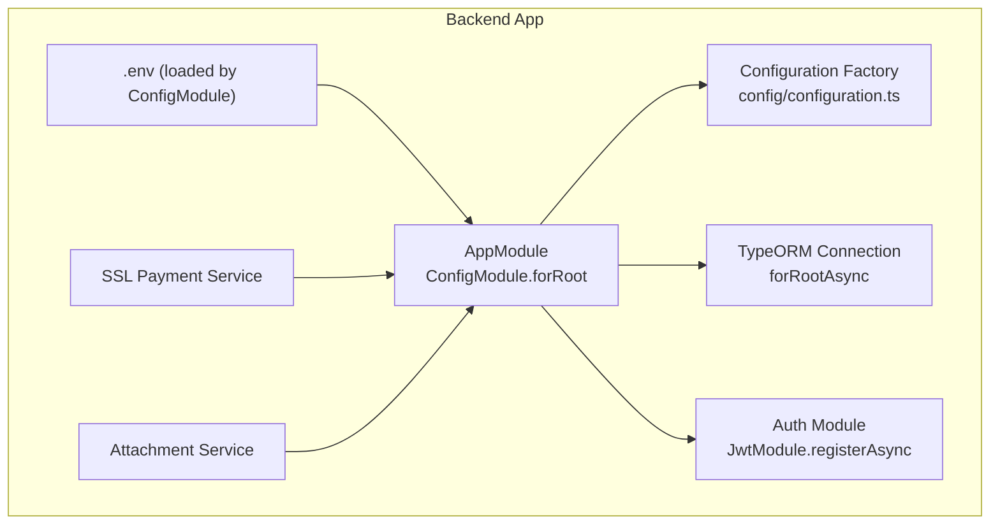
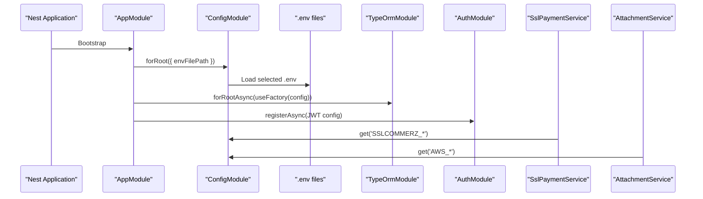
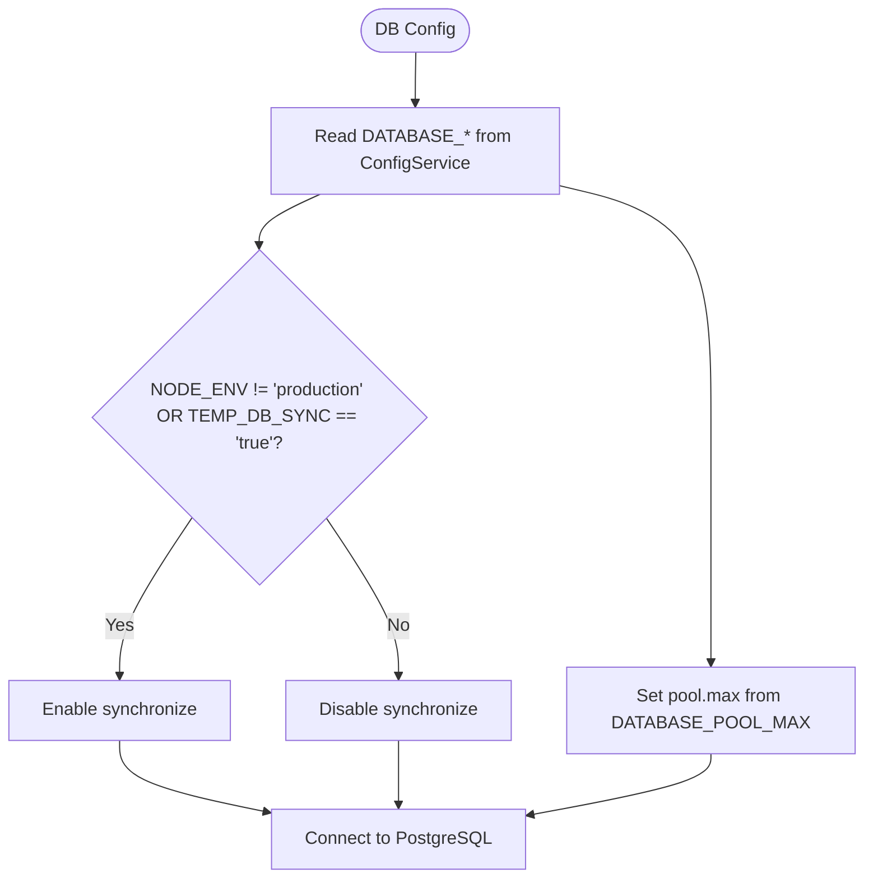
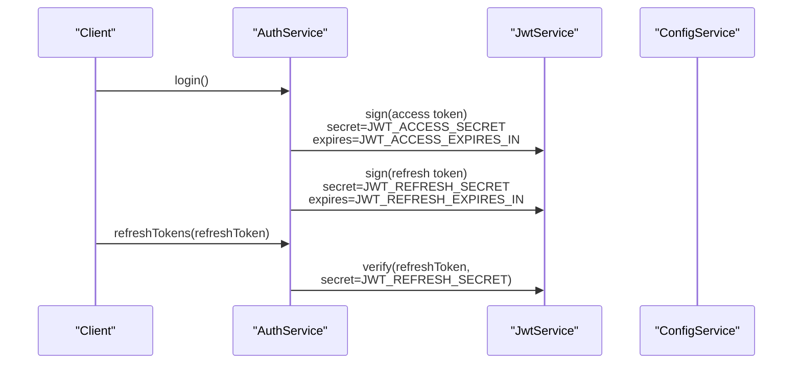
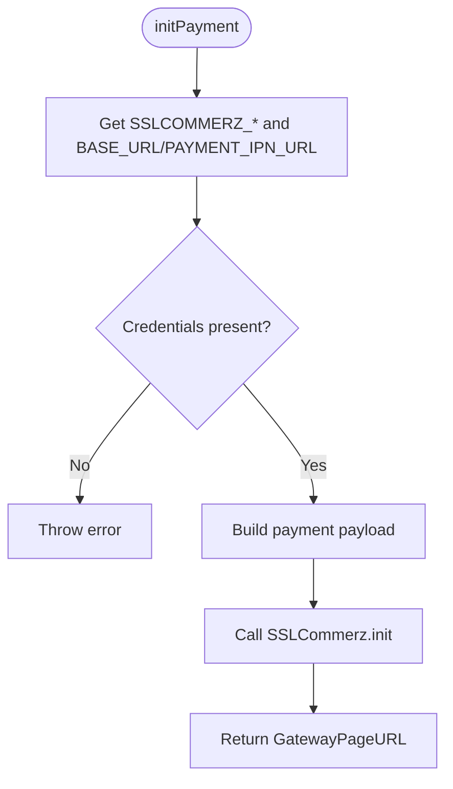
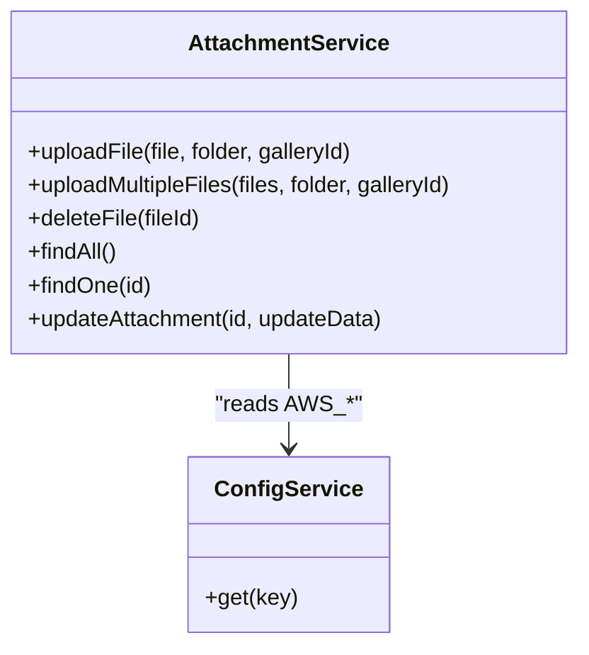
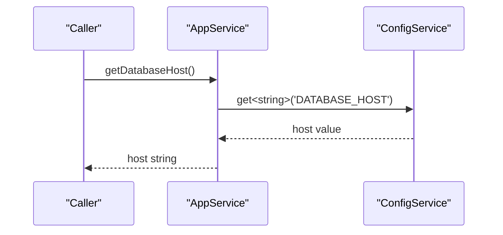
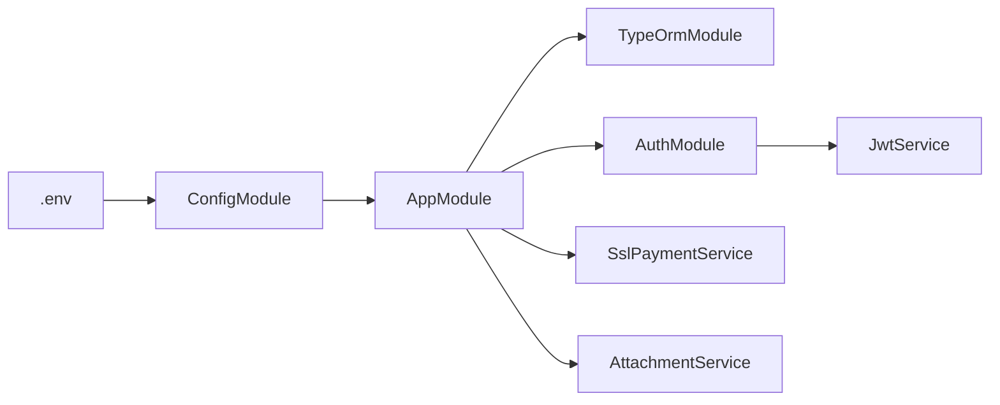

# Configuration Management

<cite>
**Referenced Files in This Document**
- [app.module.ts](file://apps/backend/src/app.module.ts)
- [configuration.ts](file://apps/backend/src/config/configuration.ts)
- [.env](file://apps/backend/.env)
- [auth.module.ts](file://apps/backend/src/auth/auth.module.ts)
- [auth.service.ts](file://apps/backend/src/auth/auth.service.ts)
- [ssl-payment.service.ts](file://apps/backend/src/ssl-payment/ssl-payment.service.ts)
- [attachment.service.ts](file://apps/backend/src/attachment/attachment.service.ts)
- [app.service.ts](file://apps/backend/src/app.service.ts)
</cite>

## Table of Contents
1. [Introduction](#introduction)
2. [Project Structure](#project-structure)
3. [Core Components](#core-components)
4. [Architecture Overview](#architecture-overview)
5. [Detailed Component Analysis](#detailed-component-analysis)
6. [Dependency Analysis](#dependency-analysis)
7. [Performance Considerations](#performance-considerations)
8. [Troubleshooting Guide](#troubleshooting-guide)
9. [Conclusion](#conclusion)
10. [Appendices](#appendices)

## Introduction
This document explains the configuration management system in the NestJS backend, focusing on environment-based configuration using @nestjs/config. It covers how different environments are handled via separate .env files, how to access configuration values safely and type-safely, how database connections and external services are configured, and how runtime overrides work. It also provides guidance for adding new configuration options, validating environment variables, organizing configuration files, and managing deployment-specific settings securely.

## Project Structure
The configuration system is centered around:
- Global configuration module initialization and environment file selection
- A typed configuration factory for grouped settings
- Service-level consumption of configuration via ConfigService
- Environment variables defined in .env files

**Diagram sources**
- [app.module.ts:63-115](file://apps/backend/src/app.module.ts#L63-L115)
- [configuration.ts:1-16](file://apps/backend/src/config/configuration.ts#L1-L16)
- [.env:1-108](file://apps/backend/.env#L1-L108)

**Section sources**
- [app.module.ts:63-115](file://apps/backend/src/app.module.ts#L63-L115)
- [configuration.ts:1-16](file://apps/backend/src/config/configuration.ts#L1-L16)
- [.env:1-108](file://apps/backend/.env#L1-L108)

## Core Components
- ConfigModule initialization:
  - Global configuration enabled
  - Environment file selection based on NODE_ENV
- Typed configuration factory:
  - Groups related settings (e.g., payment providers)
- Services consuming configuration:
  - Database connection via TypeORM
  - JWT secrets and expiration via Auth module
  - External integrations (SSLCommerz, AWS S3)

Key responsibilities:
- Centralize environment variable loading
- Provide typed access patterns
- Isolate sensitive configuration from business logic

**Section sources**
- [app.module.ts:63-115](file://apps/backend/src/app.module.ts#L63-L115)
- [configuration.ts:1-16](file://apps/backend/src/config/configuration.ts#L1-L16)

## Architecture Overview
The application bootstraps with AppModule, which configures:
- Global ConfigModule with environment-specific .env files
- ThrottlerModule using ConfigService
- TypeOrmModule using ConfigService for database connectivity
- Feature modules (Auth, SSL Payment, Attachment) that consume configuration

**Diagram sources**
- [app.module.ts:63-115](file://apps/backend/src/app.module.ts#L63-L115)
- [auth.module.ts:21-30](file://apps/backend/src/auth/auth.module.ts#L21-L30)
- [ssl-payment.service.ts:29-42](file://apps/backend/src/ssl-payment/ssl-payment.service.ts#L29-L42)
- [attachment.service.ts:20-36](file://apps/backend/src/attachment/attachment.service.ts#L20-L36)

## Detailed Component Analysis

### Environment-Based Configuration Loading
- ConfigModule.forRoot sets:
  - isGlobal: true
  - envFilePath: selects .env.production when NODE_ENV equals production; otherwise .env.local
- The repository’s .env file contains all required keys for development/testing and demonstrates typical categories (database, JWT, SMS, OTP, CORS, Swagger, AWS S3, SSLCommerz, payment URLs, ZeptoMail, performance flags).

Operational notes:
- Ensure NODE_ENV is set appropriately in your deployment environment to load the correct file.
- Keep secrets out of version control; use platform secret managers or CI/CD secret injection.

**Section sources**
- [app.module.ts:63-69](file://apps/backend/src/app.module.ts#L63-L69)
- [.env:1-108](file://apps/backend/.env#L1-L108)

### Database Connection Configuration
- TypeOrmModule.forRootAsync reads:
  - DATABASE_HOST, DATABASE_PORT, DATABASE_USER, DATABASE_PASSWORD, DATABASE_NAME
  - TEMP_DB_SYNC controls synchronize behavior
  - DATABASE_POOL_MAX sets pool max size
- Behavior:
  - synchronize is enabled unless NODE_ENV is production and TEMP_DB_SYNC is not true

**Diagram sources**
- [app.module.ts:93-115](file://apps/backend/src/app.module.ts#L93-L115)

**Section sources**
- [app.module.ts:93-115](file://apps/backend/src/app.module.ts#L93-L115)

### Authentication Configuration (JWT)
- AuthModule registers JwtModule asynchronously:
  - Reads JWT_ACCESS_SECRET and JWT_ACCESS_EXPIRES_IN
- AuthService uses ConfigService to:
  - Verify refresh tokens with JWT_REFRESH_SECRET
  - Sign access and refresh tokens with respective secrets and expirations

**Diagram sources**
- [auth.module.ts:21-30](file://apps/backend/src/auth/auth.module.ts#L21-L30)
- [auth.service.ts:107-169](file://apps/backend/src/auth/auth.service.ts#L107-L169)

**Section sources**
- [auth.module.ts:21-30](file://apps/backend/src/auth/auth.module.ts#L21-L30)
- [auth.service.ts:107-169](file://apps/backend/src/auth/auth.service.ts#L107-L169)

### External Service Integrations

#### SSLCommerz Payment Integration
- SslPaymentService reads:
  - SSLCOMMERZ_STORE_ID, SSLCOMMERZ_STORE_PASSWORD, SSLCOMMERZ_IS_LIVE
  - BASE_URL, PAYMENT_IPN_URL
- Validates credentials presence and constructs payment data with success/fail/cancel URLs and IPN endpoint.

**Diagram sources**
- [ssl-payment.service.ts:29-111](file://apps/backend/src/ssl-payment/ssl-payment.service.ts#L29-L111)

**Section sources**
- [ssl-payment.service.ts:29-111](file://apps/backend/src/ssl-payment/ssl-payment.service.ts#L29-L111)

#### AWS S3 File Storage
- AttachmentService constructs an S3 client using:
  - AWS_REGION, AWS_S3_ACCESS_KEY, AWS_S3_SECRET_KEY
- Uses AWS_S3_BUCKET_NAME and AWS_S3_BASE_URL for object operations and URL generation.

**Diagram sources**
- [attachment.service.ts:20-36](file://apps/backend/src/attachment/attachment.service.ts#L20-L36)

**Section sources**
- [attachment.service.ts:20-36](file://apps/backend/src/attachment/attachment.service.ts#L20-L36)

### Accessing Configuration Values
- Direct usage pattern:
  - Inject ConfigService into a service
  - Use get<T>('KEY', defaultValue?) to retrieve typed values
- Example reference:
  - AppService.getDatabaseHost returns DATABASE_HOST via ConfigService

**Diagram sources**
- [app.service.ts:1-11](file://apps/backend/src/app.service.ts#L1-L11)

**Section sources**
- [app.service.ts:1-11](file://apps/backend/src/app.service.ts#L1-L11)

### Adding New Configuration Options
Recommended steps:
1. Define the environment variable in the appropriate .env file (.env.local for local, .env.production for production).
2. If grouping related settings, extend the configuration factory to include the new option under a logical namespace.
3. Consume the configuration via ConfigService.get<T>('KEY', default?) in services or modules.
4. For external integrations, validate required keys at startup or within the integration service and throw clear errors if missing.

Examples in codebase:
- Grouped configuration example exists in the configuration factory for payment-related settings.
- Direct environment variable access examples exist across services (database, JWT, SSLCommerz, AWS S3).

**Section sources**
- [configuration.ts:1-16](file://apps/backend/src/config/configuration.ts#L1-L16)
- [app.module.ts:93-115](file://apps/backend/src/app.module.ts#L93-L115)
- [ssl-payment.service.ts:29-42](file://apps/backend/src/ssl-payment/ssl-payment.service.ts#L29-L42)
- [attachment.service.ts:20-36](file://apps/backend/src/attachment/attachment.service.ts#L20-L36)

### Validating Environment Variables
Patterns used in the codebase:
- Presence checks before use (e.g., SSLCommerz credentials validation)
- Boolean toggles derived from string comparisons (e.g., SSLCOMMERZ_IS_LIVE === 'true')
- Conditional feature flags (e.g., TEMP_DB_SYNC)

Best practices:
- Validate critical secrets at startup or in dedicated validators
- Provide meaningful error messages indicating missing or invalid configuration
- Avoid logging sensitive values

**Section sources**
- [ssl-payment.service.ts:29-42](file://apps/backend/src/ssl-payment/ssl-payment.service.ts#L29-L42)
- [app.module.ts:105-115](file://apps/backend/src/app.module.ts#L105-L115)

### Runtime Configuration Overrides
- ConfigModule supports dynamic configuration through useFactory patterns and async registration.
- Modules like ThrottlerModule and TypeOrmModule demonstrate reading configuration at runtime via ConfigService inside factories.
- You can override defaults by providing environment variables or injecting configuration into custom factories.

**Section sources**
- [app.module.ts:70-115](file://apps/backend/src/app.module.ts#L70-L115)

## Dependency Analysis
Configuration flows from environment files into the application core and then into feature modules and services.

**Diagram sources**
- [app.module.ts:63-115](file://apps/backend/src/app.module.ts#L63-L115)
- [auth.module.ts:21-30](file://apps/backend/src/auth/auth.module.ts#L21-L30)
- [ssl-payment.service.ts:29-42](file://apps/backend/src/ssl-payment/ssl-payment.service.ts#L29-L42)
- [attachment.service.ts:20-36](file://apps/backend/src/attachment/attachment.service.ts#L20-L36)

**Section sources**
- [app.module.ts:63-115](file://apps/backend/src/app.module.ts#L63-L115)

## Performance Considerations
- Database pooling:
  - DATABASE_POOL_MAX controls maximum connections; tune according to workload and resource limits.
- Synchronize behavior:
  - synchronize should be disabled in production to avoid unintended schema changes.
- External service calls:
  - Validate and cache non-sensitive configuration where appropriate to reduce repeated lookups.
- Logging:
  - Avoid logging sensitive configuration values; sanitize logs for PII and secrets.

[No sources needed since this section provides general guidance]

## Troubleshooting Guide
Common issues and resolutions:
- Missing environment variables:
  - Ensure the correct .env file is loaded based on NODE_ENV.
  - Verify all required keys are present (e.g., DATABASE_*, JWT_*, SSLCOMMERZ_*, AWS_*).
- Database connection failures:
  - Check host, port, credentials, and database name.
  - Confirm TEMP_DB_SYNC and NODE_ENV settings.
- JWT verification/signing errors:
  - Verify JWT_ACCESS_SECRET, JWT_REFRESH_SECRET, and expiration values.
- SSLCommerz initialization errors:
  - Confirm store credentials and mode flag.
  - Validate BASE_URL and PAYMENT_IPN_URL endpoints.
- AWS S3 upload failures:
  - Validate region, access key, secret key, bucket name, and base URL.

**Section sources**
- [app.module.ts:93-115](file://apps/backend/src/app.module.ts#L93-L115)
- [auth.service.ts:107-169](file://apps/backend/src/auth/auth.service.ts#L107-L169)
- [ssl-payment.service.ts:29-111](file://apps/backend/src/ssl-payment/ssl-payment.service.ts#L29-L111)
- [attachment.service.ts:20-36](file://apps/backend/src/attachment/attachment.service.ts#L20-L36)

## Conclusion
The backend employs a robust, environment-driven configuration strategy using @nestjs/config. Configuration is centralized, consumed via ConfigService, and applied across database connections, authentication, and external integrations. By following the patterns shown—environment file selection, typed configuration access, and explicit validation—you can safely extend and maintain configuration as the application grows.

[No sources needed since this section summarizes without analyzing specific files]

## Appendices

### Security Best Practices
- Never commit secrets to version control; inject them via secure channels (CI/CD, secret managers).
- Restrict access to .env files at the OS level.
- Avoid logging sensitive values; sanitize logs.
- Use HTTPS for all external endpoints and ensure BASE_URL and FRONTEND_URL are correctly set per environment.

[No sources needed since this section provides general guidance]

### Configuration File Organization
- Keep environment-specific files separate:
  - .env.local for local development
  - .env.production for production deployments
- Group related settings logically (e.g., database, auth, payments, storage).
- Document required variables and their expected formats in comments or documentation.

**Section sources**
- [app.module.ts:63-69](file://apps/backend/src/app.module.ts#L63-L69)
- [.env:1-108](file://apps/backend/.env#L1-L108)