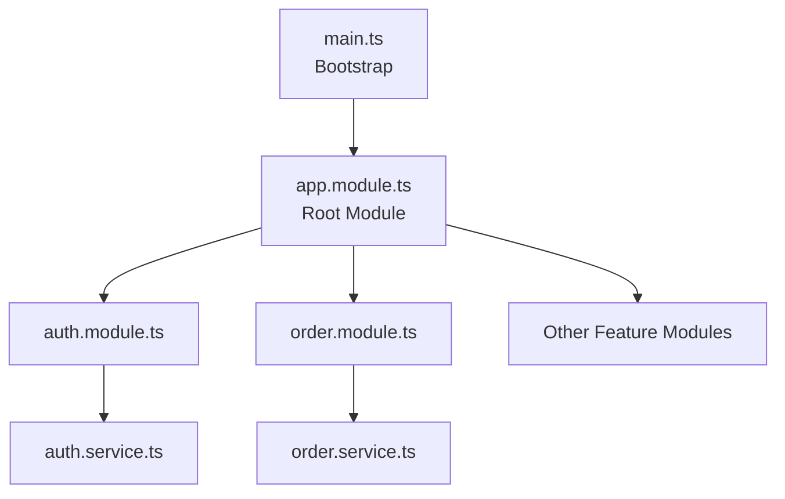
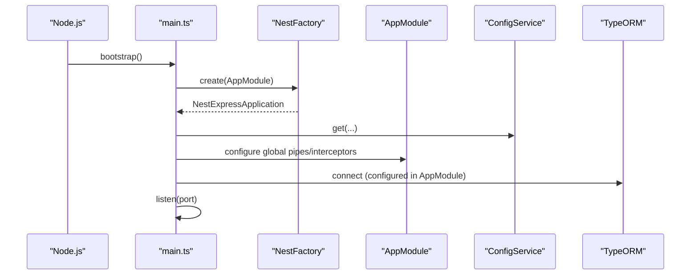
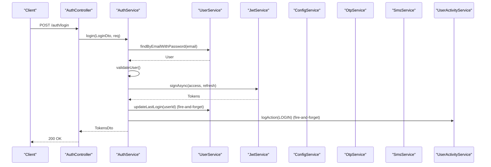
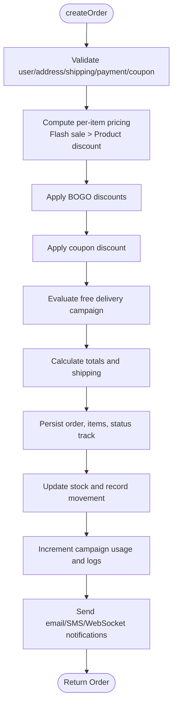
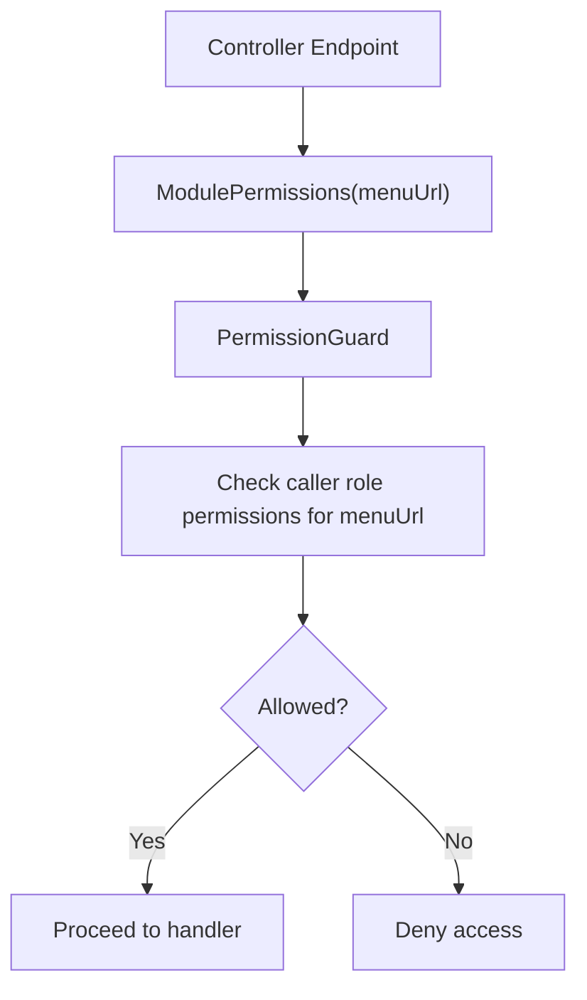
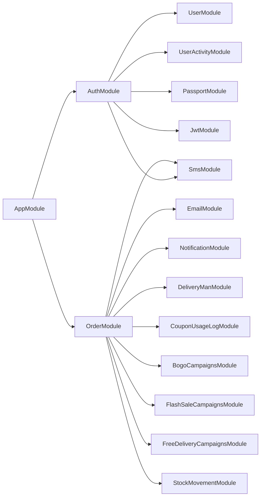

# Dependency Injection & Services

<cite>
**Referenced Files in This Document**
- [main.ts](file://apps/backend/src/main.ts)
- [app.module.ts](file://apps/backend/src/app.module.ts)
- [configuration.ts](file://apps/backend/src/config/configuration.ts)
- [auth.module.ts](file://apps/backend/src/auth/auth.module.ts)
- [auth.service.ts](file://apps/backend/src/auth/auth.service.ts)
- [order.module.ts](file://apps/backend/src/order/order.module.ts)
- [order.service.ts](file://apps/backend/src/order/order.service.ts)
- [module-permissions.decorator.ts](file://apps/backend/src/auth/decorators/module-permissions.decorator.ts)
</cite>

## Table of Contents
1. [Introduction](#introduction)
2. [Project Structure](#project-structure)
3. [Core Components](#core-components)
4. [Architecture Overview](#architecture-overview)
5. [Detailed Component Analysis](#detailed-component-analysis)
6. [Dependency Analysis](#dependency-analysis)
7. [Performance Considerations](#performance-considerations)
8. [Troubleshooting Guide](#troubleshooting-guide)
9. [Conclusion](#conclusion)
10. [Appendices](#appendices)

## Introduction
This document explains the dependency injection (DI) system and service layer architecture in the NestJS backend. It focuses on how services are created, registered, and injected via Nest’s DI container; how business logic is encapsulated in services; error handling strategies; configuration access; custom decorators for DI; and lifecycle management. It also provides guidance for creating new services, implementing interfaces, preventing circular dependencies, and testing services with complex dependencies.

## Project Structure
The backend follows a feature-based module structure under apps/backend/src. Each domain area typically contains:
- A module that wires controllers, services, repositories, and cross-cutting concerns
- A service class decorated with @Injectable()
- Controllers that delegate to services
- Entities and DTOs co-located with their feature

At the application root:
- app.module.ts registers global modules (TypeORM, ConfigModule, Throttler, Schedule), sets global guards/interceptors, and imports all feature modules
- main.ts bootstraps the Nest application, configures global pipes/interceptors, security headers, compression, CORS, versioning, and Swagger

**Diagram sources**
- [main.ts:16-128](file://apps/backend/src/main.ts#L16-L128)
- [app.module.ts:60-183](file://apps/backend/src/app.module.ts#L60-L183)
- [auth.module.ts:15-35](file://apps/backend/src/auth/auth.module.ts#L15-L35)
- [order.module.ts:32-65](file://apps/backend/src/order/order.module.ts#L32-L65)

**Section sources**
- [main.ts:16-128](file://apps/backend/src/main.ts#L16-L128)
- [app.module.ts:60-183](file://apps/backend/src/app.module.ts#L60-L183)

## Core Components
- Root module wiring: The root module configures TypeORM, ConfigModule, throttling, scheduling, and imports all feature modules. It also registers global guards and interceptors.
- Bootstrap: The bootstrap function creates the Nest application, applies global validation, serialization, analytics interception, security headers, compression, CORS, API versioning, and Swagger.
- Configuration: Environment-driven configuration is provided through ConfigModule and a typed configuration factory.
- Authentication service: Demonstrates constructor injection of multiple services (User, JwtService, ConfigService, OTP/SMS, UserActivity).
- Order service: Demonstrates repository injection via @InjectRepository(), cross-service collaboration (email, notification, SMS, campaigns, stock movement), and robust error handling.

Key responsibilities:
- Service layer encapsulates business logic and coordinates external integrations
- Modules declare providers and exports to control DI scope
- Global pipes/interceptors standardize validation, response shaping, and analytics

**Section sources**
- [app.module.ts:60-183](file://apps/backend/src/app.module.ts#L60-L183)
- [main.ts:16-128](file://apps/backend/src/main.ts#L16-L128)
- [configuration.ts:1-16](file://apps/backend/src/config/configuration.ts#L1-L16)
- [auth.service.ts:21-32](file://apps/backend/src/auth/auth.service.ts#L21-L32)
- [order.service.ts:59-101](file://apps/backend/src/order/order.service.ts#L59-L101)

## Architecture Overview
Nest’s DI container resolves dependencies at runtime based on metadata produced by decorators:
- @Injectable() marks classes as injectable
- Constructor parameters are resolved from the active module’s provider registry
- @InjectRepository() injects TypeORM repositories registered via TypeOrmModule.forFeature()
- @Inject() can be used for tokens or non-class dependencies
- Modules export services to make them available to other modules

```mermaid
classDiagram
class AuthService {
+validateUser(email, password)
+login(loginDto, req)
+refreshTokens(refreshToken)
+initiateMobileLogin(mobileNumber, clientIp)
+verifyMobileOtp(mobileNumber, otp, req, name)
-generateTokens(user)
-sanitizeUser(user)
-logLoginActivity(user, req, loginMethod)
-logLogoutActivity(user, req)
}
class OrderService {
+createOrder(createOrderDto)
+getOrderById(id)
+getPaymentMethodShare()
+getCategorySales()
+getCustomerTypeShare()
}
class UserService
class JwtService
class ConfigService
class OtpService
class SmsService
class UserActivityService
class EmailService
class NotificationService
class StockMovementService
class Repository_Order
class Repository_OrderItem
class Repository_Product
class Repository_Address
class Repository_ShippingMethod
class Repository_OrderPaymentMethod
class Repository_User
class Repository_Coupon
class Repository_DeliveryMan
class Repository_OrderStatusTrack
class Repository_OrderNote
AuthService --> UserService : "uses"
AuthService --> JwtService : "uses"
AuthService --> ConfigService : "uses"
AuthService --> OtpService : "uses"
AuthService --> SmsService : "uses"
AuthService --> UserActivityService : "uses"
OrderService --> Repository_Order : "@InjectRepository"
OrderService --> Repository_OrderItem : "@InjectRepository"
OrderService --> Repository_Product : "@InjectRepository"
OrderService --> Repository_Address : "@InjectRepository"
OrderService --> Repository_ShippingMethod : "@InjectRepository"
OrderService --> Repository_OrderPaymentMethod : "@InjectRepository"
OrderService --> Repository_User : "@InjectRepository"
OrderService --> Repository_Coupon : "@InjectRepository"
OrderService --> Repository_DeliveryMan : "@InjectRepository"
OrderService --> Repository_OrderStatusTrack : "@InjectRepository"
OrderService --> Repository_OrderNote : "@InjectRepository"
OrderService --> EmailService : "uses"
OrderService --> NotificationService : "uses"
OrderService --> StockMovementService : "uses"
```

**Diagram sources**
- [auth.service.ts:21-32](file://apps/backend/src/auth/auth.service.ts#L21-L32)
- [order.service.ts:59-101](file://apps/backend/src/order/order.service.ts#L59-L101)

**Section sources**
- [auth.service.ts:21-32](file://apps/backend/src/auth/auth.service.ts#L21-L32)
- [order.service.ts:59-101](file://apps/backend/src/order/order.service.ts#L59-L101)

## Detailed Component Analysis

### Root Module and Bootstrap
- Root module:
  - Registers TypeORM with environment-driven settings and connection pooling
  - Enables ConfigModule globally and loads .env files conditionally
  - Imports all feature modules
  - Registers global guards and interceptors (e.g., throttling guard, activity interceptor, HTTP cache interceptor)
- Bootstrap:
  - Creates NestExpressApplication
  - Applies body parser limits, compression, Helmet, proxy trust, global prefix, API versioning
  - Configures CORS, ValidationPipe, ClassSerializerInterceptor, AnalyticsInterceptor
  - Optionally enables Swagger based on environment variables

**Diagram sources**
- [main.ts:16-128](file://apps/backend/src/main.ts#L16-L128)
- [app.module.ts:60-115](file://apps/backend/src/app.module.ts#L60-L115)

**Section sources**
- [main.ts:16-128](file://apps/backend/src/main.ts#L16-L128)
- [app.module.ts:60-183](file://apps/backend/src/app.module.ts#L60-L183)

### Authentication Service
- Responsibilities:
  - Validates users, generates JWT access/refresh tokens
  - Handles mobile OTP flow with cooldown and SMS delivery
  - Logs login/logout activities asynchronously without blocking responses
- DI usage:
  - Injected via constructor: UserService, JwtService, ConfigService, OtpService, SmsService, UserActivityService
- Error handling:
  - Throws UnauthorizedException/BadRequestException/ServiceUnavailableException with structured payloads
  - Uses fire-and-forget patterns for non-critical side effects (audit logs)

**Diagram sources**
- [auth.service.ts:54-100](file://apps/backend/src/auth/auth.service.ts#L54-L100)
- [auth.service.ts:146-170](file://apps/backend/src/auth/auth.service.ts#L146-L170)
- [auth.service.ts:382-407](file://apps/backend/src/auth/auth.service.ts#L382-L407)

**Section sources**
- [auth.service.ts:21-32](file://apps/backend/src/auth/auth.service.ts#L21-L32)
- [auth.service.ts:54-100](file://apps/backend/src/auth/auth.service.ts#L54-L100)
- [auth.service.ts:107-170](file://apps/backend/src/auth/auth.service.ts#L107-L170)
- [auth.service.ts:172-358](file://apps/backend/src/auth/auth.service.ts#L172-L358)
- [auth.service.ts:382-431](file://apps/backend/src/auth/auth.service.ts#L382-L431)

### Order Service
- Responsibilities:
  - Orchestrates order creation: pricing, discounts (flash sale, product discount, BOGO, coupon), shipping cost, free delivery eligibility
  - Persists orders, items, status tracks, notes, payments
  - Emits notifications (email, SMS, WebSocket) and updates campaign usage logs
- DI usage:
  - Repositories injected via @InjectRepository()
  - Cross-service collaborators: EmailService, NotificationService, SmsService, CouponUsageLogService, FreeDeliveryCampaignsService, FlashSaleCampaignsService, BogoCampaignsService, StockMovementService
- Error handling:
  - Throws NotFoundException/BadRequestException for invalid inputs
  - Wraps optional side-effects (campaign usage increments, logging) in try/catch to avoid failing core operations

**Diagram sources**
- [order.service.ts:103-694](file://apps/backend/src/order/order.service.ts#L103-L694)

**Section sources**
- [order.module.ts:32-65](file://apps/backend/src/order/order.module.ts#L32-L65)
- [order.service.ts:59-101](file://apps/backend/src/order/order.service.ts#L59-L101)
- [order.service.ts:103-694](file://apps/backend/src/order/order.service.ts#L103-L694)

### Custom Decorators for DI and Metadata
- ModulePermissions decorator:
  - Declares which admin menu URL a controller endpoint belongs to
  - Used by permission guards to map HTTP methods to actions (canView, canCreate, canEdit, canDelete)
- Common decorators:
  - HTTP cache, skip analytics, skip throttle decorators exist under common/decorators for request-level behavior

**Diagram sources**
- [module-permissions.decorator.ts:1-15](file://apps/backend/src/auth/decorators/module-permissions.decorator.ts#L1-L15)

**Section sources**
- [module-permissions.decorator.ts:1-15](file://apps/backend/src/auth/decorators/module-permissions.decorator.ts#L1-L15)

## Dependency Analysis
- Module graph:
  - AppModule imports all feature modules, making their exported services available across the app
  - AuthModule depends on UserModule, UserActivityModule, SmsModule, PassportModule, and JwtModule (async registration)
  - OrderModule depends on many feature modules (email, notification, sms, delivery-man, coupon usage, flash/free/bogo campaigns, stock movement)
- Provider relationships:
  - Services depend on repositories and other services via constructor injection
  - Global guards/interceptors are registered once at the root level

**Diagram sources**
- [app.module.ts:60-183](file://apps/backend/src/app.module.ts#L60-L183)
- [auth.module.ts:15-35](file://apps/backend/src/auth/auth.module.ts#L15-L35)
- [order.module.ts:32-65](file://apps/backend/src/order/order.module.ts#L32-L65)

**Section sources**
- [app.module.ts:60-183](file://apps/backend/src/app.module.ts#L60-L183)
- [auth.module.ts:15-35](file://apps/backend/src/auth/auth.module.ts#L15-L35)
- [order.module.ts:32-65](file://apps/backend/src/order/order.module.ts#L32-L65)

## Performance Considerations
- Database connectivity:
  - Connection pool size configured via environment variables; tune max/min and timeouts according to workload
- Request throughput:
  - Compression enabled for JSON responses
  - Body parser limits increased for large payloads
  - Rate limiting configured with short/medium/long windows
- I/O-bound operations:
  - Non-critical side effects (audit logs, notifications, campaign usage increments) are fire-and-forget to avoid blocking responses
- Query efficiency:
  - Use selective relations and query builders where appropriate to reduce N+1 queries
- Caching:
  - HTTP cache interceptor and Redis-backed caching (if added) can reduce repeated computations

[No sources needed since this section provides general guidance]

## Troubleshooting Guide
- Circular dependencies:
  - Symptoms: Nest throws “Nest can’t resolve dependencies” errors during startup
  - Prevention:
    - Extract shared logic into separate modules/services
    - Use forwardRef() sparingly when unavoidable
    - Prefer interface-based contracts to decouple implementations
- Configuration issues:
  - Ensure required environment variables are present (database, JWT secrets, payment URLs)
  - Verify ConfigModule env file selection logic and variable names
- Validation and serialization:
  - If fields are missing or types mismatch, check ValidationPipe whitelist/transform options
  - Use ClassSerializerInterceptor to exclude sensitive fields from responses
- External service failures:
  - For OTP/SMS/email, ensure proper error propagation and fallbacks
  - Wrap optional integrations in try/catch and log errors without failing core flows

**Section sources**
- [main.ts:111-125](file://apps/backend/src/main.ts#L111-L125)
- [app.module.ts:93-115](file://apps/backend/src/app.module.ts#L93-L115)
- [auth.service.ts:172-358](file://apps/backend/src/auth/auth.service.ts#L172-L358)
- [order.service.ts:103-694](file://apps/backend/src/order/order.service.ts#L103-L694)

## Conclusion
The backend leverages Nest’s DI container to compose modular, testable services. Business logic is centralized in services, with modules controlling visibility and lifetime. Configuration is environment-driven, and global pipes/interceptors standardize cross-cutting concerns. Robust error handling and fire-and-forget patterns keep critical paths responsive. Following the patterns shown here will help you add new services safely, manage lifecycles, prevent circular dependencies, and write effective tests.

[No sources needed since this section summarizes without analyzing specific files]

## Appendices

### How to Create a New Service
- Define a service class with @Injectable()
- Inject dependencies via constructor (services, repositories via @InjectRepository(), or tokens via @Inject())
- Register the service in its feature module’s providers array
- Export the service if other modules need it
- Consume the service in controllers or other services

**Section sources**
- [auth.service.ts:21-32](file://apps/backend/src/auth/auth.service.ts#L21-L32)
- [order.service.ts:59-101](file://apps/backend/src/order/order.service.ts#L59-L101)
- [order.module.ts:61-65](file://apps/backend/src/order/order.module.ts#L61-L65)

### Implementing Interfaces
- Define TypeScript interfaces for service contracts
- Inject interfaces instead of concrete classes to improve testability
- Provide implementations in modules’ providers arrays

[No sources needed since this section provides general guidance]

### Managing Service Lifecycles
- Singleton by default within a module scope
- Use onModuleDestroy() for cleanup tasks (e.g., flushing analytics rows)
- Leverage Nest lifecycle hooks (@OnApplicationBootstrap, @OnApplicationShutdown) where appropriate

**Section sources**
- [main.ts:31-32](file://apps/backend/src/main.ts#L31-L32)

### Testing Strategies for Complex Dependencies
- Unit tests:
  - Instantiate services with mocked dependencies using Jest
  - Mock repositories and external services (email, SMS, notifications)
- Integration tests:
  - Use Test.createTestingModule to build a partial module graph
  - Replace real integrations with in-memory or test doubles
- E2E tests:
  - Spin up the Nest application and hit endpoints
  - Use test databases and seed data

**Section sources**
- [auth.service.spec.ts:9-12](file://apps/backend/src/auth/auth.service.spec.ts#L9-L12)
- [order.service.spec.ts:9-12](file://apps/backend/src/order/order.service.spec.ts#L9-L12)