# Module Organization

<cite>
**Referenced Files in This Document**
- [app.module.ts](file://apps/backend/src/app.module.ts)
- [auth.module.ts](file://apps/backend/src/auth/auth.module.ts)
- [sms.module.ts](file://apps/backend/src/auth/sms.module.ts)
- [product.module.ts](file://apps/backend/src/product/product.module.ts)
- [order.module.ts](file://apps/backend/src/order/order.module.ts)
- [user.module.ts](file://apps/backend/src/user/user.module.ts)
- [email.module.ts](file://apps/backend/src/email/email.module.ts)
- [notification.module.ts](file://apps/backend/src/notification/notification.module.ts)
- [product-history.module.ts](file://apps/backend/src/product-history/product-history.module.ts)
- [stock-movement.module.ts](file://apps/backend/src/stock-movement/stock-movement.module.ts)
- [common/index.ts](file://apps/backend/src/common/index.ts)
</cite>

## Table of Contents
1. [Introduction](#introduction)
2. [Project Structure](#project-structure)
3. [Core Components](#core-components)
4. [Architecture Overview](#architecture-overview)
5. [Detailed Component Analysis](#detailed-component-analysis)
6. [Dependency Analysis](#dependency-analysis)
7. [Performance Considerations](#performance-considerations)
8. [Troubleshooting Guide](#troubleshooting-guide)
9. [Conclusion](#conclusion)

## Introduction
This document explains the NestJS module organization pattern used in the German Butcher backend. The application follows a feature-based modular architecture where each business domain (for example, auth, product, order, user, notification, email) is encapsulated in its own module. The root AppModule imports and wires all feature modules together, while shared capabilities are exposed via dedicated modules or global providers.

The goal is to help you understand:
- How feature modules are structured and registered
- How cross-module dependencies are managed through imports and exports
- Which patterns are used for dependency injection
- Best practices for creating new feature modules with loose coupling and clear boundaries

## Project Structure
At a high level, the backend organizes code by feature directories under apps/backend/src. Each feature typically contains:
- A module file that declares controllers, providers, imports, and exports
- Controllers handling HTTP endpoints
- Services implementing business logic
- Entities mapped to the database
- DTOs and guards as needed

The root AppModule is the composition root that:
- Configures infrastructure (configuration, throttling, scheduling, TypeORM)
- Imports all feature modules
- Registers global guards and interceptors

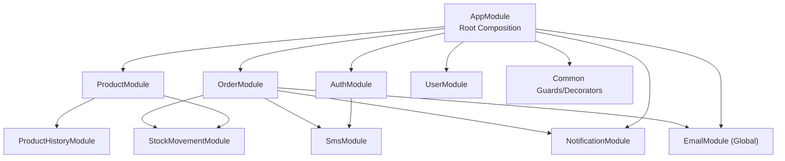

**Diagram sources**
- [app.module.ts:60-166](file://apps/backend/src/app.module.ts#L60-L166)
- [auth.module.ts:15-35](file://apps/backend/src/auth/auth.module.ts#L15-L35)
- [product.module.ts:30-67](file://apps/backend/src/product/product.module.ts#L30-L67)
- [order.module.ts:32-64](file://apps/backend/src/order/order.module.ts#L32-L64)
- [user.module.ts:12-18](file://apps/backend/src/user/user.module.ts#L12-L18)
- [email.module.ts:6-12](file://apps/backend/src/email/email.module.ts#L6-L12)
- [notification.module.ts:9-15](file://apps/backend/src/notification/notification.module.ts#L9-L15)
- [sms.module.ts:4-8](file://apps/backend/src/auth/sms.module.ts#L4-L8)
- [product-history.module.ts:6-11](file://apps/backend/src/product-history/product-history.module.ts#L6-L11)
- [stock-movement.module.ts:6-11](file://apps/backend/src/stock-movement/stock-movement.module.ts#L6-L11)

**Section sources**
- [app.module.ts:1-184](file://apps/backend/src/app.module.ts#L1-L184)

## Core Components
- AppModule: Central registry that imports all feature modules and configures global infrastructure such as configuration, throttling, scheduling, and TypeORM. It also registers global guards and interceptors.
- Feature Modules: Domain-specific modules like AuthModule, ProductModule, OrderModule, UserModule, NotificationModule, etc., encapsulating their own controllers, services, entities, and dependencies.
- Shared Modules: Cross-cutting concerns such as EmailModule (global), SmsModule, and common utilities exposed via decorators/guards.

Key responsibilities:
- AppModule orchestrates module registration and global DI tokens (APP_GUARD, APP_INTERCEPTOR).
- Feature modules declare their own scope, import only what they need, and export only what other modules must consume.
- Global modules (e.g., EmailModule) provide services without requiring explicit imports in consuming modules.

**Section sources**
- [app.module.ts:60-181](file://apps/backend/src/app.module.ts#L60-L181)
- [email.module.ts:6-12](file://apps/backend/src/email/email.module.ts#L6-L12)
- [common/index.ts:1-3](file://apps/backend/src/common/index.ts#L1-L3)

## Architecture Overview
The system uses a layered, feature-based architecture:
- Infrastructure layer: Configuration, throttling, scheduling, database connection
- Feature layer: Business domains implemented as modules
- Shared layer: Global services and reusable utilities

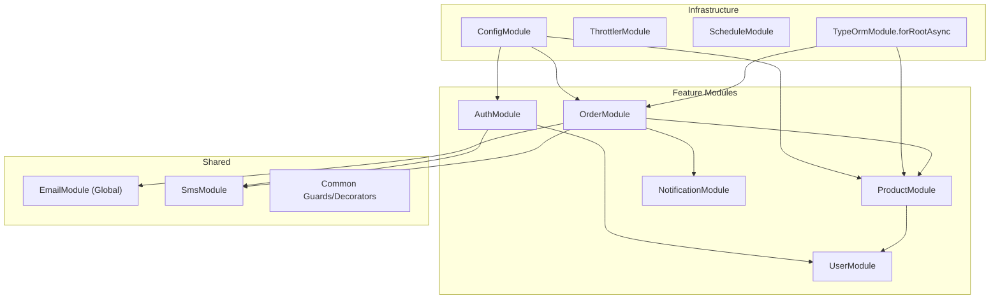

**Diagram sources**
- [app.module.ts:60-115](file://apps/backend/src/app.module.ts#L60-L115)
- [auth.module.ts:15-35](file://apps/backend/src/auth/auth.module.ts#L15-L35)
- [product.module.ts:30-67](file://apps/backend/src/product/product.module.ts#L30-L67)
- [order.module.ts:32-64](file://apps/backend/src/order/order.module.ts#L32-L64)
- [email.module.ts:6-12](file://apps/backend/src/email/email.module.ts#L6-L12)
- [notification.module.ts:9-15](file://apps/backend/src/notification/notification.module.ts#L9-L15)
- [sms.module.ts:4-8](file://apps/backend/src/auth/sms.module.ts#L4-L8)

## Detailed Component Analysis

### Root AppModule
Responsibilities:
- Imports all feature modules
- Configures global infrastructure (config, throttling, schedule, TypeORM)
- Registers global guards and interceptors

Highlights:
- ThrottlerModule configured with multiple throttlers
- TypeOrmModule.forRootAsync reads DB settings from ConfigService
- Global APP_GUARD and APP_INTERCEPTOR registrations

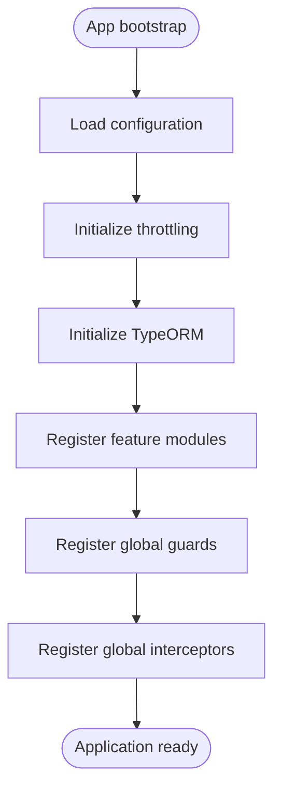

**Diagram sources**
- [app.module.ts:60-181](file://apps/backend/src/app.module.ts#L60-L181)

**Section sources**
- [app.module.ts:60-181](file://apps/backend/src/app.module.ts#L60-L181)

### AuthModule
Responsibilities:
- Authentication and authorization logic
- JWT strategy setup
- OTP and SMS integration
- Exposes AuthService for other modules

Patterns:
- Imports dependent modules (UserModule, UserActivityModule, SmsModule)
- Uses PassportModule and JwtModule.registerAsync with ConfigService
- Exports AuthService to allow consumers to inject it

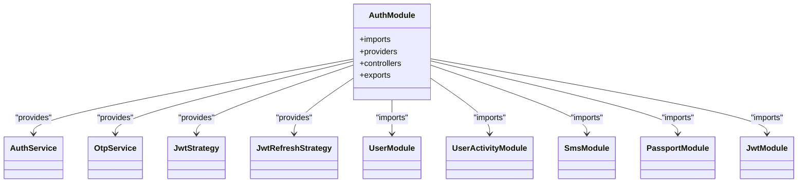

**Diagram sources**
- [auth.module.ts:15-35](file://apps/backend/src/auth/auth.module.ts#L15-L35)

**Section sources**
- [auth.module.ts:15-35](file://apps/backend/src/auth/auth.module.ts#L15-L35)

### ProductModule
Responsibilities:
- Product catalog management
- Integrates with categories, brands, attachments, units, suppliers, galleries, coupons
- Coordinates with campaign modules and stock movement tracking

Patterns:
- Declares TypeOrmModule.forFeature for related entities
- Imports supporting modules (FlashSaleCampaignsModule, BogoCampaignsModule, ProductHistoryModule, StockMovementModule)
- Exposes ProductService, CategoryService, BrandService, AttachmentService, UnitsService, SuppliersService

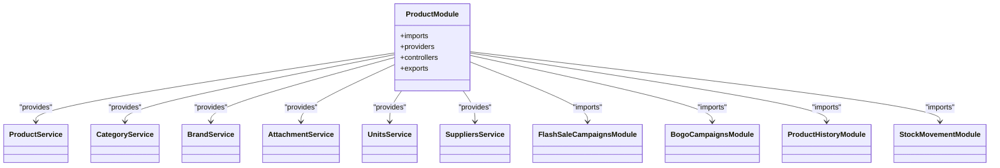

**Diagram sources**
- [product.module.ts:30-67](file://apps/backend/src/product/product.module.ts#L30-L67)

**Section sources**
- [product.module.ts:30-67](file://apps/backend/src/product/product.module.ts#L30-L67)

### OrderModule
Responsibilities:
- Order lifecycle management
- Integrates with payment methods, coupons, delivery man, campaigns, stock movement, email, notifications, and SMS

Patterns:
- Declares TypeOrmModule.forFeature for order-related entities
- Imports many cross-domain modules to coordinate order processing
- Exposes OrderService and OrderPaymentService

```mermaid
classDiagram
class OrderModule {
+imports
+providers
+controllers
+exports
}
class OrderService
class OrderPaymentService
class EmailModule
class NotificationModule
class SmsModule
class DeliveryManModule
class CouponUsageLogModule
class BogoCampaignsModule
class BogoUsageLogModule
class FlashSaleCampaignsModule
class FlashSaleUsageLogModule
class FreeDeliveryCampaignsModule
class FreeDeliveryUsageLogModule
class StockMovementModule
OrderModule --> OrderService : "provides"
OrderModule --> OrderPaymentService : "provides"
OrderModule --> EmailModule : "imports"
OrderModule --> NotificationModule : "imports"
OrderModule --> SmsModule : "imports"
OrderModule --> DeliveryManModule : "imports"
OrderModule --> CouponUsageLogModule : "imports"
OrderModule --> BogoCampaignsModule : "imports"
OrderModule --> BogoUsageLogModule : "imports"
OrderModule --> FlashSaleCampaignsModule : "imports"
OrderModule --> FlashSaleUsageLogModule : "imports"
OrderModule --> FreeDeliveryCampaignsModule : "imports"
OrderModule --> FreeDeliveryUsageLogModule : "imports"
OrderModule --> StockMovementModule : "imports"
```

**Diagram sources**
- [order.module.ts:32-64](file://apps/backend/src/order/order.module.ts#L32-L64)

**Section sources**
- [order.module.ts:32-64](file://apps/backend/src/order/order.module.ts#L32-L64)

### UserModule
Responsibilities:
- User management
- Integrates with AddressModule and exposes OTP/SMS services

Patterns:
- Imports AddressModule
- Provides UserService, SmsService, OtpService
- Exposes UserService, SmsService, OtpService for reuse

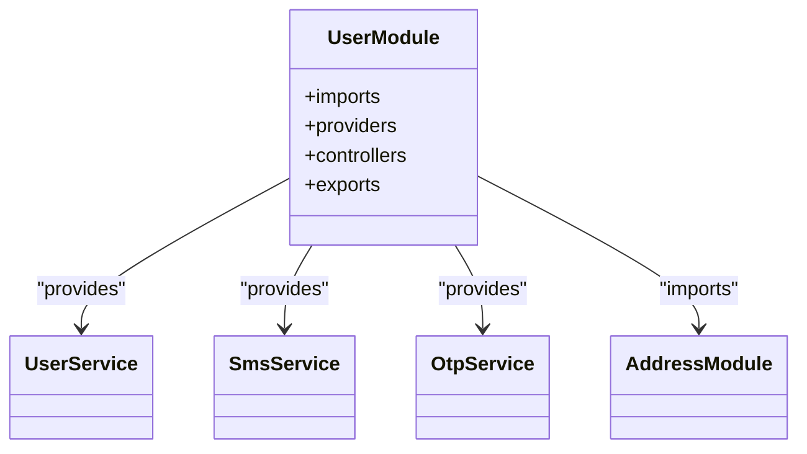

**Diagram sources**
- [user.module.ts:12-18](file://apps/backend/src/user/user.module.ts#L12-L18)

**Section sources**
- [user.module.ts:12-18](file://apps/backend/src/user/user.module.ts#L12-L18)

### EmailModule (Global)
Responsibilities:
- Provides EmailService globally across the application

Patterns:
- Decorated with @Global() so it can be consumed without explicit imports
- Exposes EmailService

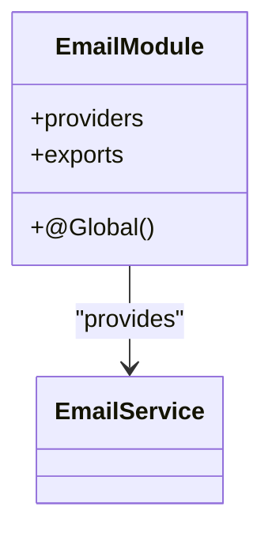

**Diagram sources**
- [email.module.ts:6-12](file://apps/backend/src/email/email.module.ts#L6-L12)

**Section sources**
- [email.module.ts:6-12](file://apps/backend/src/email/email.module.ts#L6-L12)

### NotificationModule
Responsibilities:
- Real-time notifications via WebSocket gateway
- Integrates with UserModule and persists notifications

Patterns:
- Imports UserModule
- Provides NotificationGateway and NotificationService
- Exposes NotificationService

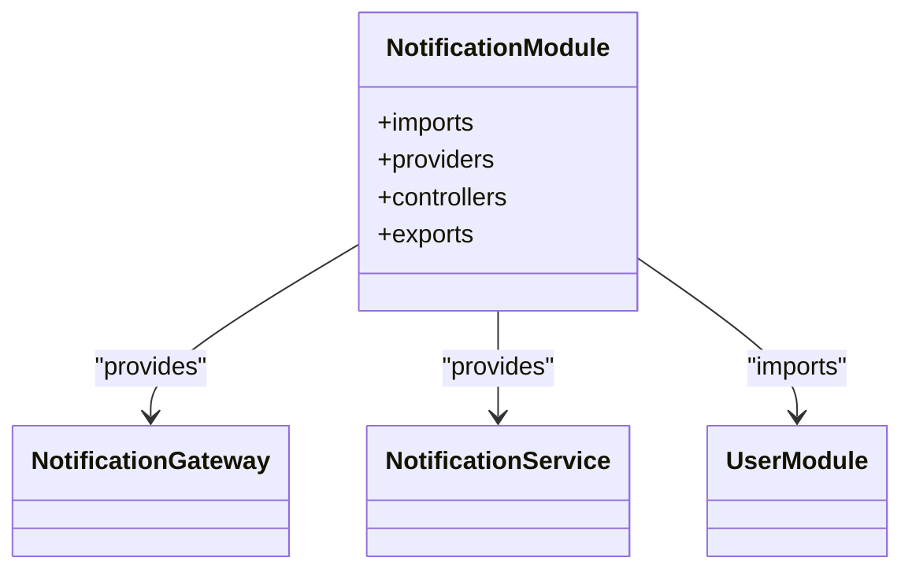

**Diagram sources**
- [notification.module.ts:9-15](file://apps/backend/src/notification/notification.module.ts#L9-L15)

**Section sources**
- [notification.module.ts:9-15](file://apps/backend/src/notification/notification.module.ts#L9-L15)

### Supporting Modules
- SmsModule: Lightweight module exposing SmsService
- ProductHistoryModule: Tracks product history changes
- StockMovementModule: Tracks inventory movements

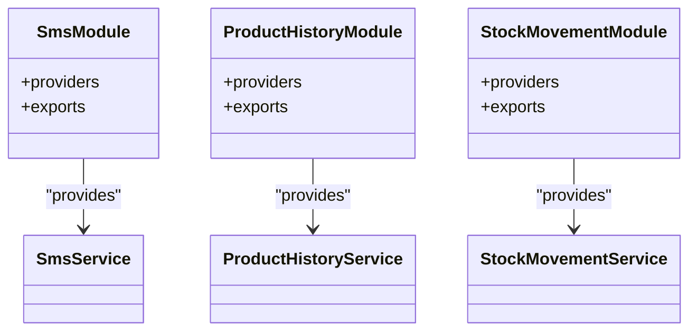

**Diagram sources**
- [sms.module.ts:4-8](file://apps/backend/src/auth/sms.module.ts#L4-L8)
- [product-history.module.ts:6-11](file://apps/backend/src/product-history/product-history.module.ts#L6-L11)
- [stock-movement.module.ts:6-11](file://apps/backend/src/stock-movement/stock-movement.module.ts#L6-L11)

**Section sources**
- [sms.module.ts:4-8](file://apps/backend/src/auth/sms.module.ts#L4-L8)
- [product-history.module.ts:6-11](file://apps/backend/src/product-history/product-history.module.ts#L6-L11)
- [stock-movement.module.ts:6-11](file://apps/backend/src/stock-movement/stock-movement.module.ts#L6-L11)

## Dependency Analysis
Cross-module relationships:
- AuthModule depends on UserModule, UserActivityModule, and SmsModule; it exports AuthService.
- ProductModule depends on several supporting modules and services; it exports core product-related services.
- OrderModule has extensive dependencies across campaigns, usage logs, delivery, stock movement, email, notifications, and SMS; it exports OrderService and OrderPaymentService.
- EmailModule is global and does not require explicit imports.
- NotificationModule depends on UserModule and exposes NotificationService.

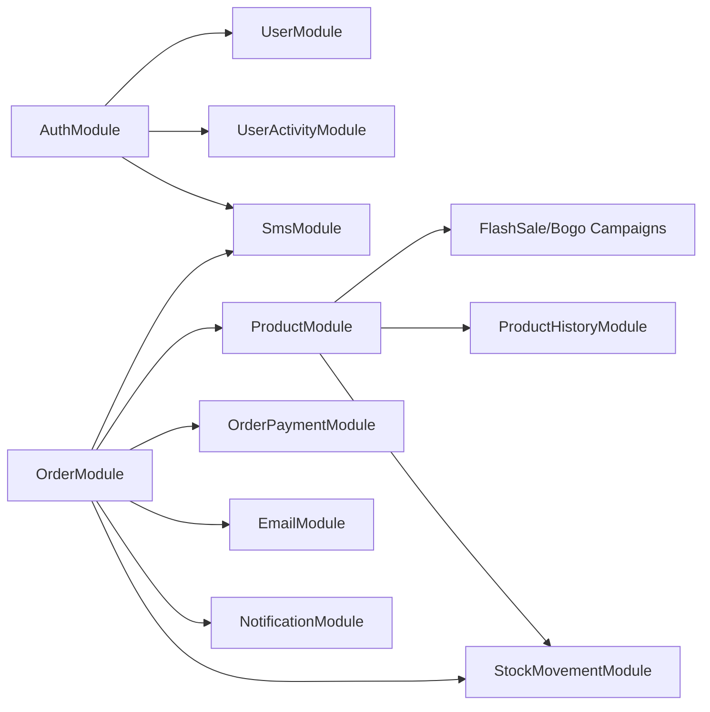

**Diagram sources**
- [auth.module.ts:15-35](file://apps/backend/src/auth/auth.module.ts#L15-L35)
- [product.module.ts:30-67](file://apps/backend/src/product/product.module.ts#L30-L67)
- [order.module.ts:32-64](file://apps/backend/src/order/order.module.ts#L32-L64)
- [email.module.ts:6-12](file://apps/backend/src/email/email.module.ts#L6-L12)
- [notification.module.ts:9-15](file://apps/backend/src/notification/notification.module.ts#L9-L15)
- [sms.module.ts:4-8](file://apps/backend/src/auth/sms.module.ts#L4-L8)

**Section sources**
- [auth.module.ts:15-35](file://apps/backend/src/auth/auth.module.ts#L15-L35)
- [product.module.ts:30-67](file://apps/backend/src/product/product.module.ts#L30-L67)
- [order.module.ts:32-64](file://apps/backend/src/order/order.module.ts#L32-L64)
- [email.module.ts:6-12](file://apps/backend/src/email/email.module.ts#L6-L12)
- [notification.module.ts:9-15](file://apps/backend/src/notification/notification.module.ts#L9-L15)
- [sms.module.ts:4-8](file://apps/backend/src/auth/sms.module.ts#L4-L8)

## Performance Considerations
- Use lazy loading for heavy modules if they are not always required at startup.
- Prefer exporting only necessary services to reduce coupling and improve testability.
- Avoid circular dependencies between modules; refactor shared logic into shared modules or use interfaces.
- Keep entity definitions close to their feature modules to maintain cohesion.
- Configure TypeORM pool sizes based on expected load and environment constraints.

[No sources needed since this section provides general guidance]

## Troubleshooting Guide
Common issues and resolutions:
- Missing provider error: Ensure the service is provided in the same module or imported from another module that exports it.
- Circular dependency: Refactor shared logic into a separate module or use forwardRef when absolutely necessary.
- Global module misuse: Only mark modules as global when truly needed; prefer explicit imports to keep boundaries clear.
- Configuration errors: Verify environment variables for database, JWT secrets, and throttling limits.

Best practices:
- Always register TypeOrmModule.forFeature for entities used within a module.
- Export only services that other modules need; avoid leaking internal implementation details.
- Keep controllers thin; delegate business logic to services.
- Use guards and interceptors for cross-cutting concerns like authentication, logging, and caching.

**Section sources**
- [app.module.ts:60-181](file://apps/backend/src/app.module.ts#L60-L181)
- [email.module.ts:6-12](file://apps/backend/src/email/email.module.ts#L6-L12)

## Conclusion
The German Butcher backend employs a clean, feature-based NestJS module architecture. The root AppModule acts as the composition root, wiring infrastructure and feature modules. Feature modules encapsulate their own concerns and expose only what is necessary via exports. Shared capabilities are either explicitly imported or made globally available (as with EmailModule). Following these patterns ensures loose coupling, clear boundaries, and maintainable growth as new features are added.

[No sources needed since this section summarizes without analyzing specific files]