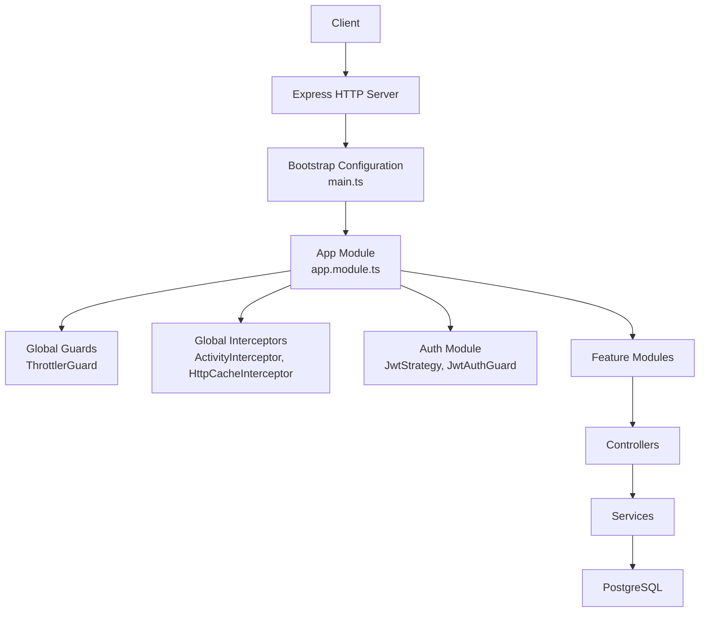
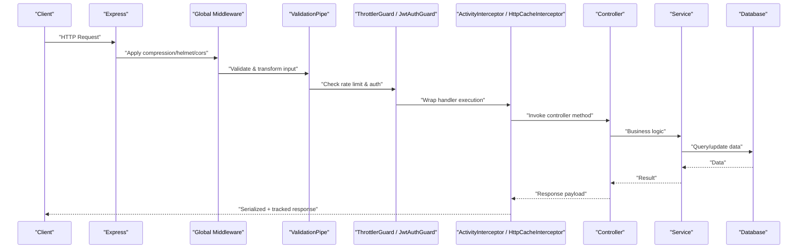
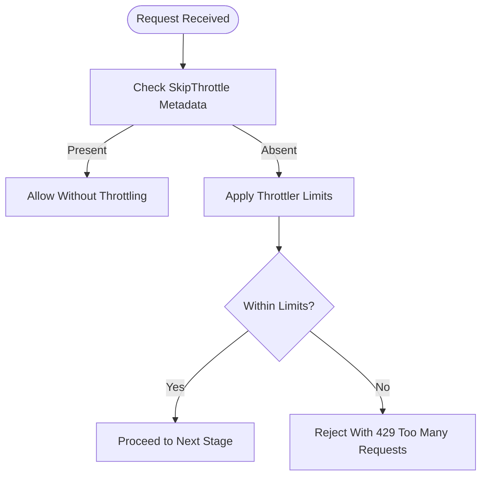
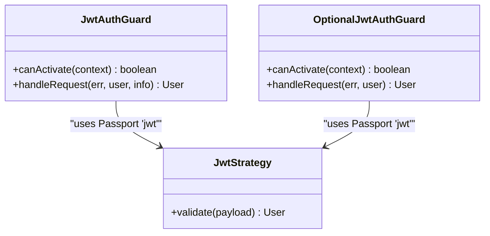
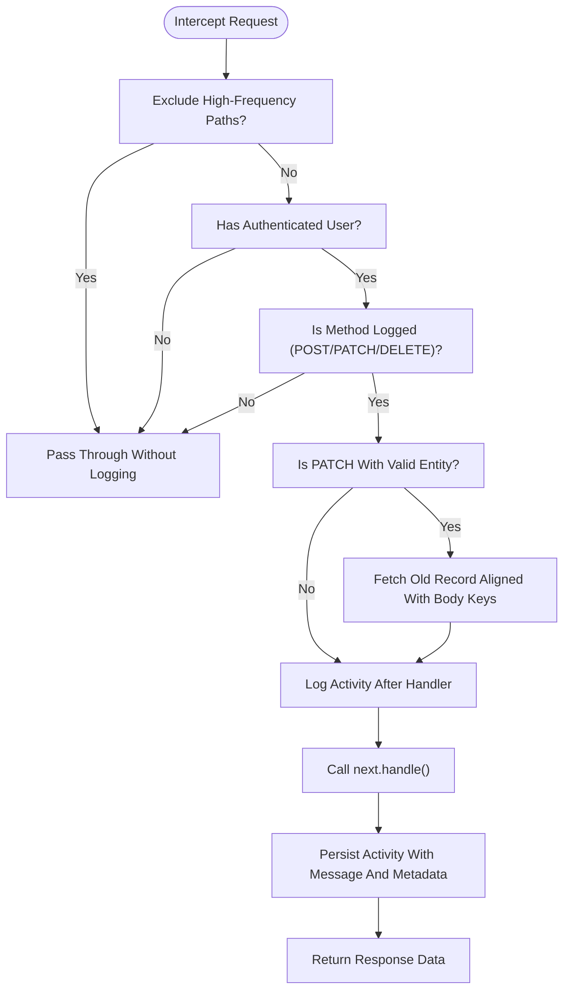
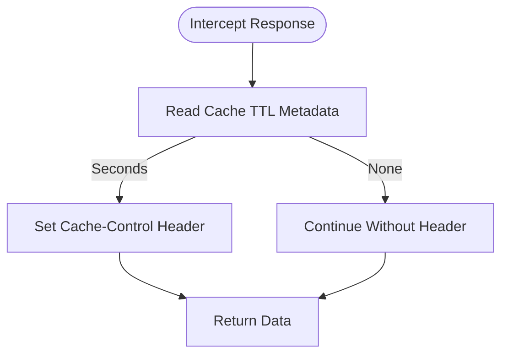
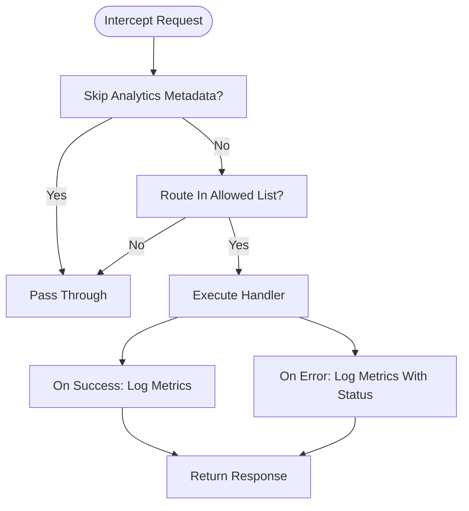
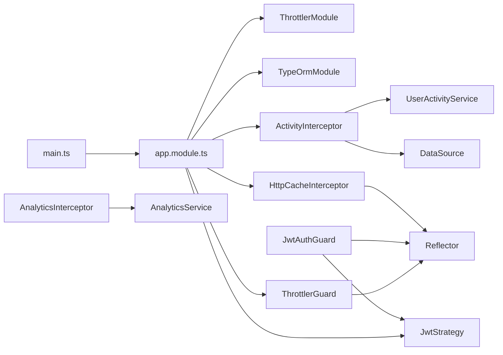

# Request Processing Pipeline

<cite>
**Referenced Files in This Document**
- [main.ts](file://apps/backend/src/main.ts)
- [app.module.ts](file://apps/backend/src/app.module.ts)
- [throttler.guard.ts](file://apps/backend/src/common/guards/throttler.guard.ts)
- [skip-throttle.decorator.ts](file://apps/backend/src/common/decorators/skip-throttle.decorator.ts)
- [jwt-auth.guard.ts](file://apps/backend/src/auth/guards/jwt-auth.guard.ts)
- [optional-jwt-auth.guard.ts](file://apps/backend/src/auth/guards/optional-jwt-auth.guard.ts)
- [jwt.strategy.ts](file://apps/backend/src/auth/strategies/jwt.strategy.ts)
- [activity.interceptor.ts](file://apps/backend/src/interceptor/activity.interceptor.ts)
- [http-cache.interceptor.ts](file://apps/backend/src/common/interceptors/http-cache.interceptor.ts)
- [analytics.interceptor.ts](file://apps/backend/src/analytics/interceptors/analytics.interceptor.ts)
- [auth.controller.ts](file://apps/backend/src/auth/auth.controller.ts)
</cite>

## Table of Contents
1. [Introduction](#introduction)
2. [Project Structure](#project-structure)
3. [Core Components](#core-components)
4. [Architecture Overview](#architecture-overview)
5. [Detailed Component Analysis](#detailed-component-analysis)
6. [Dependency Analysis](#dependency-analysis)
7. [Performance Considerations](#performance-considerations)
8. [Troubleshooting Guide](#troubleshooting-guide)
9. [Conclusion](#conclusion)
10. [Appendices](#appendices)

## Introduction
This document explains the complete request processing pipeline in the NestJS backend, from HTTP request reception to response generation. It covers how controllers, middleware, guards, interceptors, pipes, and filters interact, with a focus on:
- Global rate limiting via ThrottlerGuard
- Authentication via JWT strategy and guards
- Custom interceptors for activity tracking and HTTP caching
- Global validation through ValidationPipe and ClassSerializerInterceptor
- Execution order, extension points, error handling, logging integration, and performance optimization techniques

## Project Structure
The backend is organized by feature modules under apps/backend/src. The request pipeline is configured at application bootstrap and module registration:
- Bootstrap configuration (body size, compression, helmet, CORS, global prefix/versioning, Swagger, global pipes/interceptors) lives in main.ts
- Global providers (guards and interceptors), throttling configuration, and database setup live in app.module.ts
- Feature-specific authentication logic and strategies are under auth/
- Shared cross-cutting concerns like throttling and caching live under common/
- Activity tracking interceptor is under interceptor/
- Analytics interception is under analytics/

**Diagram sources**
- [main.ts:16-128](file://apps/backend/src/main.ts#L16-L128)
- [app.module.ts:60-181](file://apps/backend/src/app.module.ts#L60-L181)

**Section sources**
- [main.ts:16-128](file://apps/backend/src/main.ts#L16-L128)
- [app.module.ts:60-181](file://apps/backend/src/app.module.ts#L60-L181)

## Core Components
- Application bootstrap and global configuration
  - Body parser limits increased for large payloads
  - Compression enabled for JSON responses
  - Helmet security headers applied
  - CORS configured from environment variables
  - Global API prefix and URI versioning enabled
  - Swagger documentation conditionally enabled
  - Global pipes: ValidationPipe with whitelist and transform
  - Global interceptors: ClassSerializerInterceptor and AnalyticsInterceptor
- Global guards and interceptors
  - ThrottlerGuard registered as APP_GUARD for rate limiting
  - ActivityInterceptor registered as APP_INTERCEPTOR for activity tracking
  - HttpCacheInterceptor registered as APP_INTERCEPTOR for Cache-Control headers
- Authentication
  - JwtStrategy validates access tokens from Authorization header
  - JwtAuthGuard enforces authentication and supports public routes via metadata
  - OptionalJwtAuthGuard allows anonymous requests when no token is present
- Rate limiting
  - ThrottlerModule configured with short/medium/long windows
  - ThrottlerGuard extends default guard and respects SkipThrottle decorator
- Caching
  - HttpCacheInterceptor sets Cache-Control based on route-level metadata

**Section sources**
- [main.ts:16-128](file://apps/backend/src/main.ts#L16-L128)
- [app.module.ts:60-181](file://apps/backend/src/app.module.ts#L60-L181)
- [throttler.guard.ts:1-27](file://apps/backend/src/common/guards/throttler.guard.ts#L1-L27)
- [skip-throttle.decorator.ts:1-4](file://apps/backend/src/common/decorators/skip-throttle.decorator.ts#L1-L4)
- [jwt.strategy.ts:1-27](file://apps/backend/src/auth/strategies/jwt.strategy.ts#L1-L27)
- [jwt-auth.guard.ts:1-45](file://apps/backend/src/auth/guards/jwt-auth.guard.ts#L1-L45)
- [optional-jwt-auth.guard.ts:1-18](file://apps/backend/src/auth/guards/optional-jwt-auth.guard.ts#L1-L18)
- [http-cache.interceptor.ts:1-35](file://apps/backend/src/common/interceptors/http-cache.interceptor.ts#L1-L35)

## Architecture Overview
The request lifecycle follows NestJS’s standard execution order with this project’s customizations:
1. Express receives the HTTP request
2. Global middleware runs (compression, helmet, CORS)
3. Global pipes run (ValidationPipe)
4. Global guards run (ThrottlerGuard)
5. Route-level guards run (e.g., JwtAuthGuard)
6. Interceptors wrap controller methods (ActivityInterceptor, HttpCacheInterceptor)
7. Pipes validate/transform parameters and body
8. Controller executes business logic via services
9. Response is serialized (ClassSerializerInterceptor) and tracked (AnalyticsInterceptor)
10. Filters handle exceptions thrown anywhere in the chain

**Diagram sources**
- [main.ts:16-128](file://apps/backend/src/main.ts#L16-L128)
- [app.module.ts:60-181](file://apps/backend/src/app.module.ts#L60-L181)
- [throttler.guard.ts:1-27](file://apps/backend/src/common/guards/throttler.guard.ts#L1-L27)
- [jwt-auth.guard.ts:1-45](file://apps/backend/src/auth/guards/jwt-auth.guard.ts#L1-L45)
- [activity.interceptor.ts:20-73](file://apps/backend/src/interceptor/activity.interceptor.ts#L20-L73)
- [http-cache.interceptor.ts:11-35](file://apps/backend/src/common/interceptors/http-cache.interceptor.ts#L11-L35)

## Detailed Component Analysis

### Global Bootstrap and Pipeline Setup
- Body parsers: Increased limits for JSON and URL-encoded payloads to support large checkout payloads
- Compression: Enabled for JSON responses to reduce bandwidth usage
- Security: Helmet applied for secure headers
- CORS: Configured from environment variables; credentials allowed
- Versioning: Global prefix v1 and URI-based API versioning
- Swagger: Conditionally enabled; Bearer auth scheme documented
- Global pipes: ValidationPipe with whitelist and implicit conversion
- Global interceptors: ClassSerializerInterceptor strips excluded fields; AnalyticsInterceptor logs selected endpoints

Key behaviors:
- All responses pass through serialization and analytics tracking
- Public APIs can opt out of analytics using a skip decorator (used by AnalyticsInterceptor)
- Global rate limiting is enforced unless explicitly skipped

**Section sources**
- [main.ts:16-128](file://apps/backend/src/main.ts#L16-L128)

### Global Rate Limiting with ThrottlerGuard
- ThrottlerModule defines three throttlers: short (1 minute), medium (5 minutes), long (1 hour)
- ThrottlerGuard extends Nest’s default guard and checks for SkipThrottle metadata
- If SkipThrottle is set on a controller or route, throttling is bypassed
- Controllers can override per-endpoint limits using Throttle decorator

Usage patterns:
- Apply @SkipThrottle() to high-throughput or internal endpoints that must not be rate-limited
- Use @Throttle({ short, medium, long }) on sensitive endpoints like login and OTP verification

**Diagram sources**
- [throttler.guard.ts:1-27](file://apps/backend/src/common/guards/throttler.guard.ts#L1-L27)
- [skip-throttle.decorator.ts:1-4](file://apps/backend/src/common/decorators/skip-throttle.decorator.ts#L1-L4)
- [auth.controller.ts:231-277](file://apps/backend/src/auth/auth.controller.ts#L231-L277)

**Section sources**
- [app.module.ts:70-92](file://apps/backend/src/app.module.ts#L70-L92)
- [throttler.guard.ts:1-27](file://apps/backend/src/common/guards/throttler.guard.ts#L1-L27)
- [skip-throttle.decorator.ts:1-4](file://apps/backend/src/common/decorators/skip-throttle.decorator.ts#L1-L4)
- [auth.controller.ts:231-277](file://apps/backend/src/auth/auth.controller.ts#L231-L277)

### Authentication with JWT Strategy and Guards
- JwtStrategy extracts Bearer tokens and validates them against the configured secret
- JwtAuthGuard enforces authentication and supports public routes via isPublic metadata
- OptionalJwtAuthGuard allows anonymous access while still resolving req.user if a valid token exists
- Controllers decorate protected endpoints with @UseGuards(JwtAuthGuard) and @ApiBearerAuth('token')

Execution behavior:
- If isPublic is true, JwtAuthGuard bypasses authentication
- Otherwise, Passport validates the token; invalid/expired tokens throw UnauthorizedException
- Successful validation attaches user info to req.user

**Diagram sources**
- [jwt.strategy.ts:1-27](file://apps/backend/src/auth/strategies/jwt.strategy.ts#L1-L27)
- [jwt-auth.guard.ts:1-45](file://apps/backend/src/auth/guards/jwt-auth.guard.ts#L1-L45)
- [optional-jwt-auth.guard.ts:1-18](file://apps/backend/src/auth/guards/optional-jwt-auth.guard.ts#L1-L18)

**Section sources**
- [jwt.strategy.ts:1-27](file://apps/backend/src/auth/strategies/jwt.strategy.ts#L1-L27)
- [jwt-auth.guard.ts:1-45](file://apps/backend/src/auth/guards/jwt-auth.guard.ts#L1-L45)
- [optional-jwt-auth.guard.ts:1-18](file://apps/backend/src/auth/guards/optional-jwt-auth.guard.ts#L1-L18)
- [auth.controller.ts:197-229](file://apps/backend/src/auth/auth.controller.ts#L197-L229)

### Activity Tracking Interceptor
- ActivityInterceptor records user actions for POST/PATCH/DELETE
- Excludes high-frequency routes from logging
- Skips logging when no authenticated user is present
- For PATCH, fetches old record values aligned with incoming body keys
- Builds descriptive action messages for specific routes (orders, cart, CRM, products, etc.)
- Persists activity via UserActivityService with IP, user agent, request ID, session ID, and user type

**Diagram sources**
- [activity.interceptor.ts:20-73](file://apps/backend/src/interceptor/activity.interceptor.ts#L20-L73)
- [activity.interceptor.ts:75-133](file://apps/backend/src/interceptor/activity.interceptor.ts#L75-L133)
- [activity.interceptor.ts:184-251](file://apps/backend/src/interceptor/activity.interceptor.ts#L184-L251)
- [activity.interceptor.ts:254-335](file://apps/backend/src/interceptor/activity.interceptor.ts#L254-L335)
- [activity.interceptor.ts:399-600](file://apps/backend/src/interceptor/activity.interceptor.ts#L399-L600)

**Section sources**
- [activity.interceptor.ts:20-73](file://apps/backend/src/interceptor/activity.interceptor.ts#L20-L73)
- [activity.interceptor.ts:75-133](file://apps/backend/src/interceptor/activity.interceptor.ts#L75-L133)
- [activity.interceptor.ts:184-251](file://apps/backend/src/interceptor/activity.interceptor.ts#L184-L251)
- [activity.interceptor.ts:254-335](file://apps/backend/src/interceptor/activity.interceptor.ts#L254-L335)
- [activity.interceptor.ts:399-600](file://apps/backend/src/interceptor/activity.interceptor.ts#L399-L600)

### HTTP Cache Interceptor
- HttpCacheInterceptor reads cache TTL metadata from decorators
- Sets Cache-Control header with public caching and stale-while-revalidate
- Only applies when metadata is present on route or controller

**Diagram sources**
- [http-cache.interceptor.ts:11-35](file://apps/backend/src/common/interceptors/http-cache.interceptor.ts#L11-L35)

**Section sources**
- [http-cache.interceptor.ts:11-35](file://apps/backend/src/common/interceptors/http-cache.interceptor.ts#L11-L35)

### Analytics Interceptor
- AnalyticsInterceptor logs selected endpoints with timing, status code, and context
- Respects skip-analytics metadata to exclude certain routes
- Tracks only whitelisted route prefixes (products, orders, cart, wishlist, categories, brands, auth)
- Logs both successful and error paths without breaking the request flow

**Diagram sources**
- [analytics.interceptor.ts:13-116](file://apps/backend/src/analytics/interceptors/analytics.interceptor.ts#L13-L116)

**Section sources**
- [analytics.interceptor.ts:13-116](file://apps/backend/src/analytics/interceptors/analytics.interceptor.ts#L13-L116)

### Execution Order Summary
- Global middleware: compression, helmet, CORS
- Global pipes: ValidationPipe
- Global guards: ThrottlerGuard
- Route-level guards: JwtAuthGuard or OptionalJwtAuthGuard
- Global interceptors: ActivityInterceptor, HttpCacheInterceptor
- Controller method execution
- Global interceptors post-processing: ClassSerializerInterceptor, AnalyticsInterceptor

Note: The exact ordering between global and route-level components follows NestJS conventions; in this project, global guards and interceptors are registered in app.module.ts, while route-level guards are applied via decorators on controllers.

**Section sources**
- [main.ts:111-125](file://apps/backend/src/main.ts#L111-L125)
- [app.module.ts:167-181](file://apps/backend/src/app.module.ts#L167-L181)

## Dependency Analysis
- Main entry point depends on AppModule for DI container and global providers
- AppModule configures ThrottlerModule, TypeOrmModule, and registers global guards/interceptors
- ThrottlerGuard depends on Reflector and Throttler storage
- JwtAuthGuard depends on Reflector and Passport's AuthGuard
- JwtStrategy depends on ConfigService for secrets
- ActivityInterceptor depends on UserActivityService, DataSource, and Reflector
- HttpCacheInterceptor depends on Reflector and route metadata
- AnalyticsInterceptor depends on AnalyticsService and Reflector

**Diagram sources**
- [main.ts:16-128](file://apps/backend/src/main.ts#L16-L128)
- [app.module.ts:60-181](file://apps/backend/src/app.module.ts#L60-L181)
- [throttler.guard.ts:1-27](file://apps/backend/src/common/guards/throttler.guard.ts#L1-L27)
- [jwt-auth.guard.ts:1-45](file://apps/backend/src/auth/guards/jwt-auth.guard.ts#L1-L45)
- [jwt.strategy.ts:1-27](file://apps/backend/src/auth/strategies/jwt.strategy.ts#L1-L27)
- [activity.interceptor.ts:20-73](file://apps/backend/src/interceptor/activity.interceptor.ts#L20-L73)
- [http-cache.interceptor.ts:11-35](file://apps/backend/src/common/interceptors/http-cache.interceptor.ts#L11-L35)
- [analytics.interceptor.ts:13-116](file://apps/backend/src/analytics/interceptors/analytics.interceptor.ts#L13-L116)

**Section sources**
- [app.module.ts:60-181](file://apps/backend/src/app.module.ts#L60-L181)

## Performance Considerations
- Increase body parser limits only where necessary to avoid memory pressure
- Enable compression for JSON-heavy endpoints to reduce bandwidth
- Use Cache-Control headers via HttpCacheInterceptor for read-only endpoints to leverage CDN/proxy caching
- Avoid unnecessary logging on high-frequency routes; use exclusion lists in ActivityInterceptor
- Keep analytics logging lightweight and non-blocking; failures should not impact request latency
- Tune database pool settings and connection timeouts in TypeOrmModule configuration
- Use skip-throttle for internal health-check or heartbeat endpoints to prevent artificial rate-limiting

[No sources needed since this section provides general guidance]

## Troubleshooting Guide
Common issues and resolutions:
- 429 Too Many Requests
  - Cause: Rate limit exceeded
  - Resolution: Adjust ThrottlerModule limits or apply @SkipThrottle() to exempt endpoints
- 401 Unauthorized
  - Cause: Missing or invalid JWT token
  - Resolution: Ensure Authorization header contains a valid Bearer token; verify JwtStrategy secret configuration
- Unexpected analytics entries
  - Cause: Endpoint matches allowed list or skip-analytics metadata missing
  - Resolution: Add skip-analytics metadata or adjust allowedRoutes in AnalyticsInterceptor
- Missing Cache-Control headers
  - Cause: Cache TTL metadata not applied
  - Resolution: Apply cache decorator/metadata to route or controller
- Large payload rejections
  - Cause: Default body parser limits too small
  - Resolution: Verify body parser limits in main.ts

**Section sources**
- [throttler.guard.ts:1-27](file://apps/backend/src/common/guards/throttler.guard.ts#L1-L27)
- [jwt-auth.guard.ts:31-44](file://apps/backend/src/auth/guards/jwt-auth.guard.ts#L31-L44)
- [analytics.interceptor.ts:20-56](file://apps/backend/src/analytics/interceptors/analytics.interceptor.ts#L20-L56)
- [http-cache.interceptor.ts:16-31](file://apps/backend/src/common/interceptors/http-cache.interceptor.ts#L16-L31)
- [main.ts:20-23](file://apps/backend/src/main.ts#L20-L23)

## Conclusion
The backend’s request pipeline integrates robust security, validation, rate limiting, caching, and observability. Global guards and interceptors provide consistent cross-cutting behavior, while feature modules encapsulate domain logic. Extending the pipeline involves adding new guards, interceptors, or pipes following established patterns and registering them globally or at route level as appropriate. Proper configuration and careful use of decorators ensure predictable execution order and maintainable architecture.

[No sources needed since this section summarizes without analyzing specific files]

## Appendices

### How To Extend The Pipeline

- Create a custom guard
  - Implement canActivate and optionally handleRequest
  - Register globally via APP_GUARD or apply at route/controller level
  - Example pattern: see JwtAuthGuard and OptionalJwtAuthGuard

- Create a custom interceptor
  - Implement intercept to wrap handler execution
  - Use RxJS operators to observe success/error flows
  - Register globally via APP_INTERCEPTOR or apply at route/controller level
  - Example pattern: see ActivityInterceptor and HttpCacheInterceptor

- Create a custom pipe
  - Implement transform to validate/transform inputs
  - Register globally via useGlobalPipes or apply at parameter level
  - Example pattern: see ValidationPipe usage in main.ts

- Integrate with throttling
  - Use @SkipThrottle() to bypass rate limiting for specific routes/controllers
  - Override per-endpoint limits with @Throttle decorator

- Integrate with analytics
  - Respect skip-analytics metadata to exclude routes from analytics logging
  - Ensure endpoint path matches allowed list or extend AnalyticsInterceptor

**Section sources**
- [jwt-auth.guard.ts:1-45](file://apps/backend/src/auth/guards/jwt-auth.guard.ts#L1-L45)
- [optional-jwt-auth.guard.ts:1-18](file://apps/backend/src/auth/guards/optional-jwt-auth.guard.ts#L1-L18)
- [activity.interceptor.ts:20-73](file://apps/backend/src/interceptor/activity.interceptor.ts#L20-L73)
- [http-cache.interceptor.ts:11-35](file://apps/backend/src/common/interceptors/http-cache.interceptor.ts#L11-L35)
- [main.ts:111-125](file://apps/backend/src/main.ts#L111-L125)
- [skip-throttle.decorator.ts:1-4](file://apps/backend/src/common/decorators/skip-throttle.decorator.ts#L1-L4)
- [analytics.interceptor.ts:20-56](file://apps/backend/src/analytics/interceptors/analytics.interceptor.ts#L20-L56)