# Database Design

<cite>
**Referenced Files in This Document**
- [database.dbml](file://apps/backend/database.dbml)
- [app.module.ts](file://apps/backend/src/app.module.ts)
- [user.entity.ts](file://apps/backend/src/user/entities/user.entity.ts)
- [product.entity.ts](file://apps/backend/src/product/entities/product.entity.ts)
- [order.entity.ts](file://apps/backend/src/order/entities/order.entity.ts)
- [cart.entity.ts](file://apps/backend/src/cart/entities/cart.entity.ts)
- [category.entity.ts](file://apps/backend/src/category/entities/category.entity.ts)
- [user-activity.entity.ts](file://apps/backend/src/user-activity/entities/user-activity.entity.ts)
- [package.json](file://apps/backend/package.json)
</cite>

## Table of Contents
1. [Introduction](#introduction)
2. [Project Structure](#project-structure)
3. [Core Components](#core-components)
4. [Architecture Overview](#architecture-overview)
5. [Detailed Component Analysis](#detailed-component-analysis)
6. [Dependency Analysis](#dependency-analysis)
7. [Performance Considerations](#performance-considerations)
8. [Troubleshooting Guide](#troubleshooting-guide)
9. [Conclusion](#conclusion)

## Introduction
This document describes the PostgreSQL database design for the backend application. It focuses on the TypeORM entity model, the relational schema defined in the DBML file, and how core entities such as users, products, orders, categories, carts, and related domain tables interact. It also covers normalization principles, indexing strategy, constraints, migration approach, data seeding, backup and recovery considerations, query optimization patterns, connection pooling configuration, and security guidance.

The documentation is grounded in:
- The DBML schema that defines tables, columns, enums, indexes, and foreign keys.
- Selected TypeORM entity files that define relationships, indices, and business logic around persistence.
- Application configuration that wires up TypeORM, connection pooling, and environment-driven behavior.

## Project Structure
The database design is primarily represented by:
- A DBML file describing the complete PostgreSQL schema, including enums, tables, indexes, and references.
- TypeORM entity classes under feature folders that mirror the DBML structure and add runtime behavior such as computed properties, validation hooks, and eager relations.
- NestJS module configuration that initializes TypeORM with a PostgreSQL driver and connection pool settings.

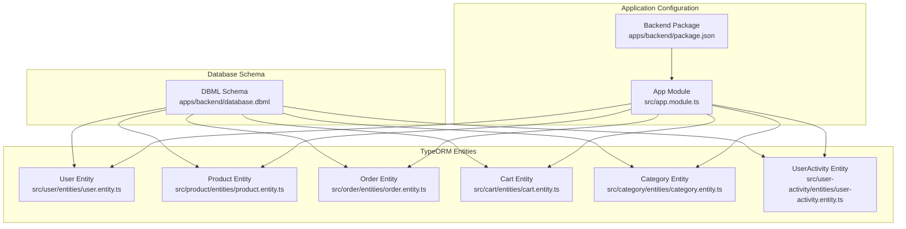

**Diagram sources**
- [database.dbml:1-538](file://apps/backend/database.dbml#L1-L538)
- [user.entity.ts:1-183](file://apps/backend/src/user/entities/user.entity.ts#L1-L183)
- [product.entity.ts:1-500](file://apps/backend/src/product/entities/product.entity.ts#L1-L500)
- [order.entity.ts:1-157](file://apps/backend/src/order/entities/order.entity.ts#L1-L157)
- [cart.entity.ts:1-79](file://apps/backend/src/cart/entities/cart.entity.ts#L1-L79)
- [category.entity.ts:1-139](file://apps/backend/src/category/entities/category.entity.ts#L1-L139)
- [user-activity.entity.ts:1-87](file://apps/backend/src/user-activity/entities/user-activity.entity.ts#L1-L87)
- [app.module.ts:93-115](file://apps/backend/src/app.module.ts#L93-L115)
- [package.json:23-64](file://apps/backend/package.json#L23-L64)

**Section sources**
- [database.dbml:1-538](file://apps/backend/database.dbml#L1-L538)
- [app.module.ts:93-115](file://apps/backend/src/app.module.ts#L93-L115)
- [package.json:23-64](file://apps/backend/package.json#L23-L64)

## Core Components
The core data model centers around:
- Users: authentication, roles, profile attachments, OTP fields, and audit activity.
- Products: catalog items with pricing, discounts, stock, units, brands, suppliers, categories, and galleries.
- Orders: customer purchases with status tracking, payments, shipping methods, coupons, and addresses.
- Carts: per-user shopping carts with cart items.
- Categories: hierarchical product taxonomy with slugs and menu flags.
- Supporting entities: attachments, galleries, brands, suppliers, units, payment methods, shipping methods, coupons, and audit logs.

Key relationship types present in the schema:
- One-to-many: user to addresses; category to products; order to order items; order to order payments; order to status tracks; brand to products; supplier to products; unit to products; attachment to multiple domains.
- One-to-one: user to cart; user to wishlist (entity exists in code but not shown in DBML excerpt).
- Self-referential: category.parentId points back to category; menu.parentId points back to menu.
- Many-to-many: BOGO campaigns to products via a join table (defined in code; not visible in this DBML excerpt).

Normalization principles applied:
- First normal form: atomic values, no repeating groups.
- Second normal form: non-key attributes depend on the whole primary key.
- Third normal form: removal of transitive dependencies through separate tables (e.g., brands, suppliers, units, categories, payment methods, shipping methods).
- Referential integrity enforced via foreign keys and cascade behaviors where appropriate.

Constraints and defaults:
- Primary keys are auto-increment integers.
- Unique constraints on identifiers like email, slug, SKU, order numbers, coupon codes, and method codes.
- Enumerated columns for statuses and types.
- Timestamps with default creation and update times.
- Boolean flags with sensible defaults.

**Section sources**
- [database.dbml:60-538](file://apps/backend/database.dbml#L60-L538)
- [user.entity.ts:22-183](file://apps/backend/src/user/entities/user.entity.ts#L22-L183)
- [product.entity.ts:41-500](file://apps/backend/src/product/entities/product.entity.ts#L41-L500)
- [order.entity.ts:24-157](file://apps/backend/src/order/entities/order.entity.ts#L24-L157)
- [cart.entity.ts:16-79](file://apps/backend/src/cart/entities/cart.entity.ts#L16-L79)
- [category.entity.ts:22-139](file://apps/backend/src/category/entities/category.entity.ts#L22-L139)

## Architecture Overview
The application uses NestJS with TypeORM and PostgreSQL. The database schema is modeled both in DBML and in TypeScript entities. The app module configures TypeORM with environment variables for host, port, credentials, database name, and connection pool parameters. Synchronization is disabled in production unless explicitly enabled.

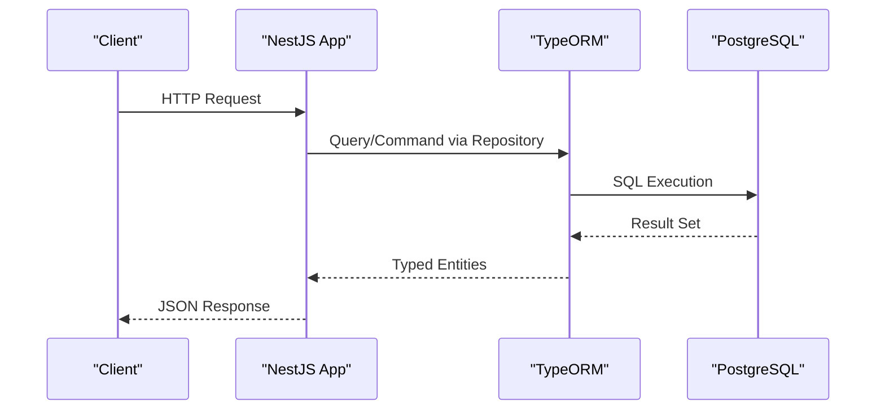

**Diagram sources**
- [app.module.ts:93-115](file://apps/backend/src/app.module.ts#L93-L115)
- [package.json:55-62](file://apps/backend/package.json#L55-L62)

**Section sources**
- [app.module.ts:93-115](file://apps/backend/src/app.module.ts#L93-L115)
- [package.json:55-62](file://apps/backend/package.json#L55-L62)

## Detailed Component Analysis

### User Domain
The user entity models account identity, verification state, OTP flow, role assignment, profile photo attachment, and one-to-one links to cart and wishlist. It also has one-to-many relationships to addresses and order history, plus an audit trail through user activities.

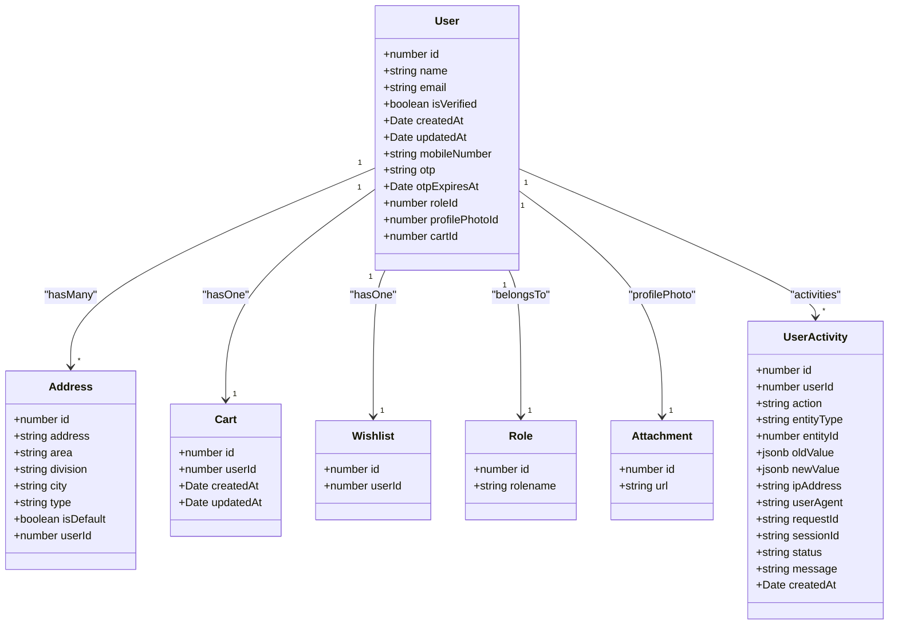

**Diagram sources**
- [user.entity.ts:22-183](file://apps/backend/src/user/entities/user.entity.ts#L22-L183)
- [user-activity.entity.ts:23-87](file://apps/backend/src/user-activity/entities/user-activity.entity.ts#L23-L87)
- [database.dbml:60-75](file://apps/backend/database.dbml#L60-L75)

Key observations:
- Email is unique; password and OTP fields are sensitive and excluded from API responses.
- Roles constrain access control at the application layer.
- Audit logging captures changes across entities with JSONB payloads for before/after snapshots.

**Section sources**
- [user.entity.ts:22-183](file://apps/backend/src/user/entities/user.entity.ts#L22-L183)
- [user-activity.entity.ts:23-87](file://apps/backend/src/user-activity/entities/user-activity.entity.ts#L23-L87)
- [database.dbml:60-75](file://apps/backend/database.dbml#L60-L75)

### Product Domain
Products are central to the catalog and include pricing, discount rules, inventory, and relationships to categories, brands, suppliers, units, attachments, and galleries. They also participate in purchase orders and sales.

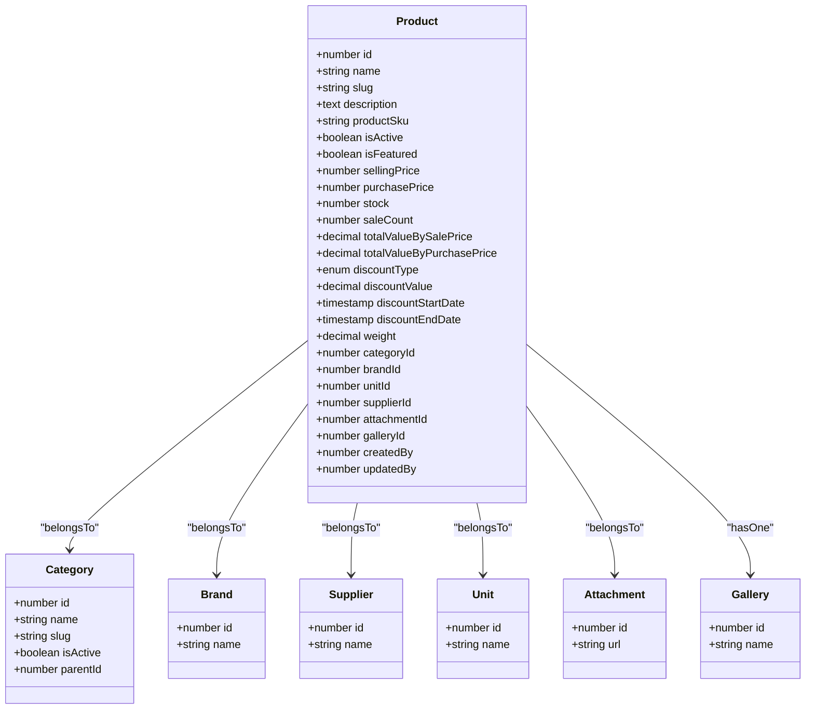

**Diagram sources**
- [product.entity.ts:41-500](file://apps/backend/src/product/entities/product.entity.ts#L41-L500)
- [category.entity.ts:22-139](file://apps/backend/src/category/entities/category.entity.ts#L22-L139)
- [database.dbml:92-148](file://apps/backend/database.dbml#L92-L148)

Indexing highlights:
- Slug, active flag, featured flag, sale count, selling price, creation date, and composite filters are indexed for efficient storefront queries and admin filtering.

Business logic highlights:
- Slug generation on insert/update.
- SKU generation if missing.
- Discount validation and effective price computation.
- Inventory value calculations based on stock and prices.

**Section sources**
- [product.entity.ts:41-500](file://apps/backend/src/product/entities/product.entity.ts#L41-L500)
- [category.entity.ts:22-139](file://apps/backend/src/category/entities/category.entity.ts#L22-L139)
- [database.dbml:92-148](file://apps/backend/database.dbml#L92-L148)

### Order Domain
Orders encapsulate customer transactions, linking to addresses, users, shipping methods, coupons, and payment methods. They have one-to-many relationships to order items, order payments, and status tracks.

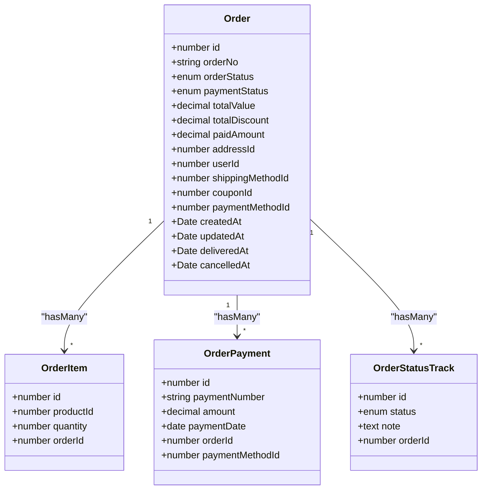

**Diagram sources**
- [order.entity.ts:24-157](file://apps/backend/src/order/entities/order.entity.ts#L24-L157)
- [database.dbml:357-405](file://apps/backend/database.dbml#L357-L405)

Query optimization notes:
- Status and payment status columns are indexed for fast filtering and dashboards.
- Composite queries often join order with items and payments; consider covering indexes for common report queries.

**Section sources**
- [order.entity.ts:24-157](file://apps/backend/src/order/entities/order.entity.ts#L24-L157)
- [database.dbml:357-405](file://apps/backend/database.dbml#L357-L405)

### Cart Domain
Carts provide a per-user container for pending purchases. The cart entity maintains a one-to-one link to the user and one-to-many cart items.

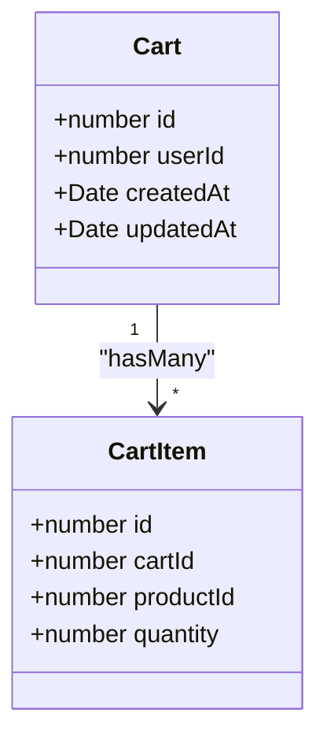

**Diagram sources**
- [cart.entity.ts:16-79](file://apps/backend/src/cart/entities/cart.entity.ts#L16-L79)
- [database.dbml:296-308](file://apps/backend/database.dbml#L296-L308)

Behavioral notes:
- Computed totals and item counts are exposed via getters.
- Cascade delete ensures cart cleanup when the user is removed.

**Section sources**
- [cart.entity.ts:16-79](file://apps/backend/src/cart/entities/cart.entity.ts#L16-L79)
- [database.dbml:296-308](file://apps/backend/database.dbml#L296-L308)

### Category Domain
Categories support hierarchical organization of products and recipes. The self-referential parent-child relationship enables nested taxonomies.

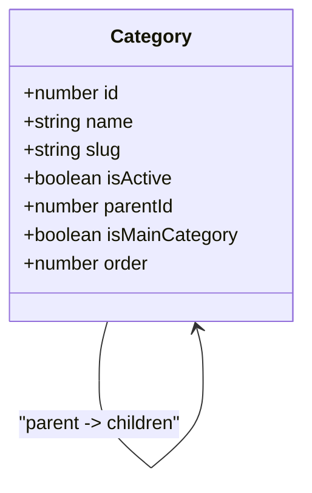

**Diagram sources**
- [category.entity.ts:22-139](file://apps/backend/src/category/entities/category.entity.ts#L22-L139)
- [database.dbml:77-90](file://apps/backend/database.dbml#L77-L90)

Indexing highlights:
- Slug, active flag, parent ID, order, and main menu flag are indexed to optimize navigation and listing queries.

**Section sources**
- [category.entity.ts:22-139](file://apps/backend/src/category/entities/category.entity.ts#L22-L139)
- [database.dbml:77-90](file://apps/backend/database.dbml#L77-L90)

### Menu and Permissions
Menus can be hierarchical and are used for admin or public navigation. Menu permissions tie roles to menus with view capabilities.

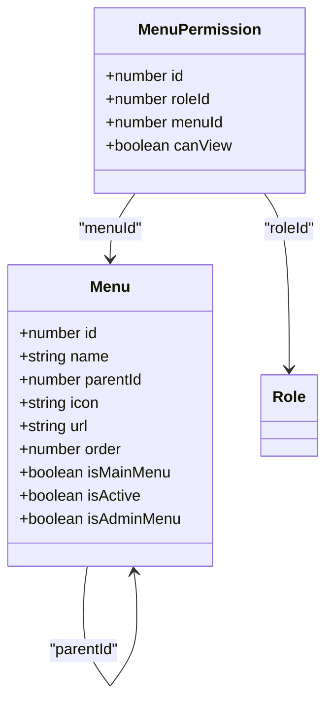

**Diagram sources**
- [database.dbml:150-196](file://apps/backend/database.dbml#L150-L196)

**Section sources**
- [database.dbml:150-196](file://apps/backend/database.dbml#L150-L196)

### Purchase and Payment
Purchases track procurement from suppliers, with line items and associated payments. Payment methods are enumerated and tracked.

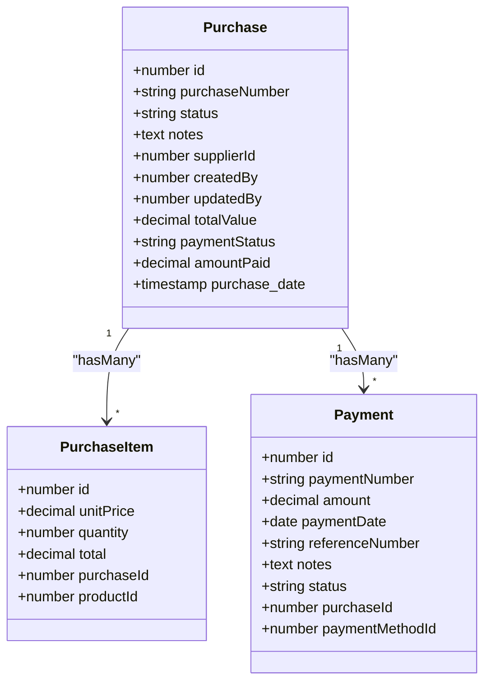

**Diagram sources**
- [database.dbml:198-283](file://apps/backend/database.dbml#L198-L283)
- [database.dbml:228-254](file://apps/backend/database.dbml#L228-L254)

**Section sources**
- [database.dbml:198-283](file://apps/backend/database.dbml#L198-L283)
- [database.dbml:228-254](file://apps/backend/database.dbml#L228-L254)

### Attachments and Galleries
Attachments store metadata and URLs for media assets. Galleries group attachments, and many entities reference attachments or galleries.

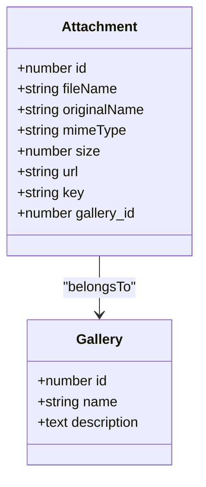

**Diagram sources**
- [database.dbml:137-148](file://apps/backend/database.dbml#L137-L148)
- [database.dbml:349-355](file://apps/backend/database.dbml#L349-L355)

**Section sources**
- [database.dbml:137-148](file://apps/backend/database.dbml#L137-L148)
- [database.dbml:349-355](file://apps/backend/database.dbml#L349-L355)

## Dependency Analysis
The following diagram shows high-level relationships among core entities and their supporting tables.

```mermaid
graph TB
User["User"]
Address["Address"]
Cart["Cart"]
CartItem["CartItem"]
Product["Product"]
Category["Category"]
Brand["Brand"]
Supplier["Supplier"]
Unit["Unit"]
Order["Order"]
OrderItem["OrderItem"]
OrderPayment["OrderPayment"]
OrderStatusTrack["OrderStatusTrack"]
Coupon["Coupon"]
ShippingMethod["ShippingMethod"]
OrderPaymentMethod["OrderPaymentMethod"]
Attachment["Attachment"]
Gallery["Gallery"]
Menu["Menu"]
MenuPermission["MenuPermission"]
Role["Role"]
Purchase["Purchase"]
PurchaseItem["PurchaseItem"]
Payment["Payment"]
PaymentMethod["PaymentMethod"]
User --> Address
User --> Cart
User --> Order
Cart --> CartItem
Product --> Category
Product --> Brand
Product --> Supplier
Product --> Unit
Product --> Attachment
Product --> Gallery
Order --> Address
Order --> User
Order --> ShippingMethod
Order --> Coupon
Order --> OrderPaymentMethod
Order --> OrderItem
Order --> OrderPayment
Order --> OrderStatusTrack
Menu --> MenuPermission
Role --> MenuPermission
Purchase --> PurchaseItem
Purchase --> Payment
Payment --> PaymentMethod
```

**Diagram sources**
- [database.dbml:60-538](file://apps/backend/database.dbml#L60-L538)

**Section sources**
- [database.dbml:60-538](file://apps/backend/database.dbml#L60-L538)

## Performance Considerations

### Indexing Strategy
- Single-column indexes:
  - Product: slug, isActive, isFeatured, saleCount, sellingPrice, createdAt.
  - Banner: isActive, position, type, displayOrder, and composites for filtering.
  - Category: slug, isActive, parentId, order, isMainCategory, and composite parentId+isActive.
  - Analytics and UserActivity: timestamp, endpoint, userId+action, entityType+entityId, createdAt.
- Foreign key indexes:
  - Many FK columns benefit from explicit indexes for join performance, especially on frequently queried relations like order_item.orderId, order_item.productId, order_payment.orderId, and purchase_item.purchaseId.
- Composite indexes:
  - For common filter combinations such as product discount windows and category listings.

Recommendations:
- Add indexes on frequently filtered columns not yet indexed, such as order.paymentStatus, order.orderStatus, order.userId, and order.createdAt.
- Consider partial indexes for active records to reduce index size.
- Monitor index usage and remove unused indexes.

**Section sources**
- [product.entity.ts:41-50](file://apps/backend/src/product/entities/product.entity.ts#L41-L50)
- [banner.entity.ts:30-35](file://apps/backend/src/banner/entities/banner.entity.ts#L30-L35)
- [category.entity.ts:22-29](file://apps/backend/src/category/entities/category.entity.ts#L22-L29)
- [user-activity.entity.ts:23-27](file://apps/backend/src/user-activity/entities/user-activity.entity.ts#L23-L27)
- [database.dbml:163-166](file://apps/backend/database.dbml#L163-L166)

### Connection Pooling Configuration
TypeORM is configured with:
- Host, port, username, password, and database loaded from environment variables.
- Auto-loading of entities.
- Synchronize disabled in production unless explicitly enabled.
- Connection pool max/min sizes, idle timeout, and connection timeout.

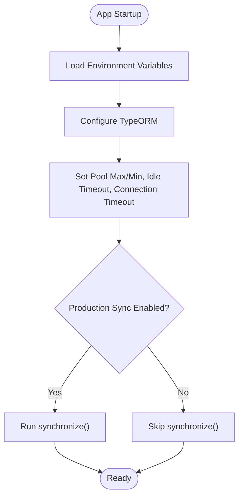

**Diagram sources**
- [app.module.ts:93-115](file://apps/backend/src/app.module.ts#L93-L115)

**Section sources**
- [app.module.ts:93-115](file://apps/backend/src/app.module.ts#L93-L115)

### Query Optimization Patterns
- Prefer selective column projection to avoid loading unnecessary relations.
- Use pagination and cursor-based queries for large lists.
- Leverage enum columns for efficient filtering.
- Avoid N+1 queries by using joins or batched loads where possible.
- Cache read-heavy data (products, categories, banners) at the application layer when appropriate.

[No sources needed since this section provides general guidance]

### Security Considerations
- Store only hashed passwords; never expose them in API responses.
- Protect OTP fields and expiration timestamps.
- Enforce least privilege database accounts for application connections.
- Use TLS for database connections in production.
- Validate and sanitize inputs at the application layer; rely on DB constraints for integrity.
- Restrict direct database access to administrators and CI/CD pipelines.

[No sources needed since this section provides general guidance]

## Troubleshooting Guide

Common issues and resolutions:
- Migration failures:
  - Ensure migrations are run against the correct database and environment.
  - Verify that synchronize is disabled in production and migrations are applied manually.
- Connection errors:
  - Check DATABASE_HOST, DATABASE_PORT, DATABASE_USER, DATABASE_PASSWORD, and DATABASE_NAME.
  - Validate network connectivity and firewall rules.
- Slow queries:
  - Inspect execution plans for missing indexes.
  - Review complex joins and consider denormalization for reporting tables.
- Data integrity violations:
  - Confirm referential integrity constraints and cascade behaviors.
  - Validate enum values and required fields.

Operational tips:
- Keep DBML and entity definitions synchronized.
- Use structured audit logs to trace changes.
- Back up regularly and test restore procedures.

**Section sources**
- [app.module.ts:93-115](file://apps/backend/src/app.module.ts#L93-L115)
- [user-activity.entity.ts:23-87](file://apps/backend/src/user-activity/entities/user-activity.entity.ts#L23-L87)

## Conclusion
The database design follows sound normalization principles and leverages TypeORM to enforce relationships and constraints. The DBML schema provides a clear contract for PostgreSQL, while entity classes add business logic and indexing strategies tailored to performance needs. Connection pooling is configurable, and synchronization is controlled per environment. To maintain reliability and performance:
- Keep DBML and entities aligned.
- Apply targeted indexes based on query patterns.
- Use migrations for schema evolution.
- Implement robust backups and recovery procedures.
- Secure database access and sensitive fields.

[No sources needed since this section summarizes without analyzing specific files]