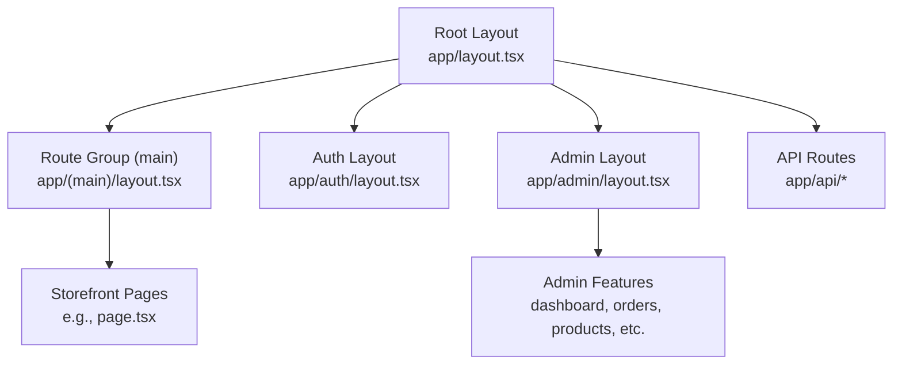
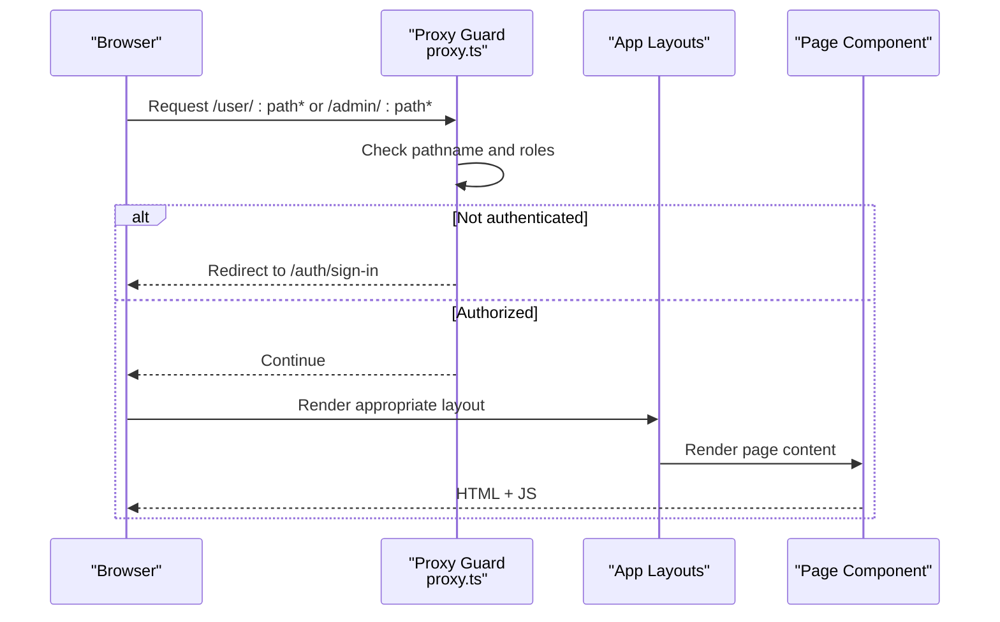
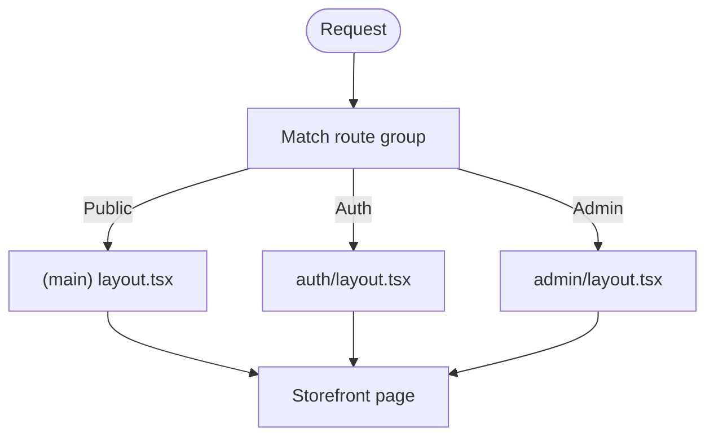
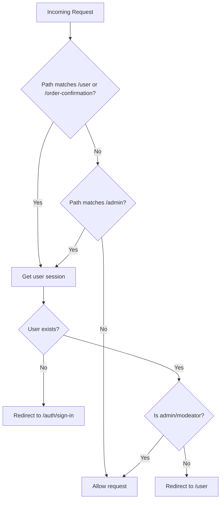
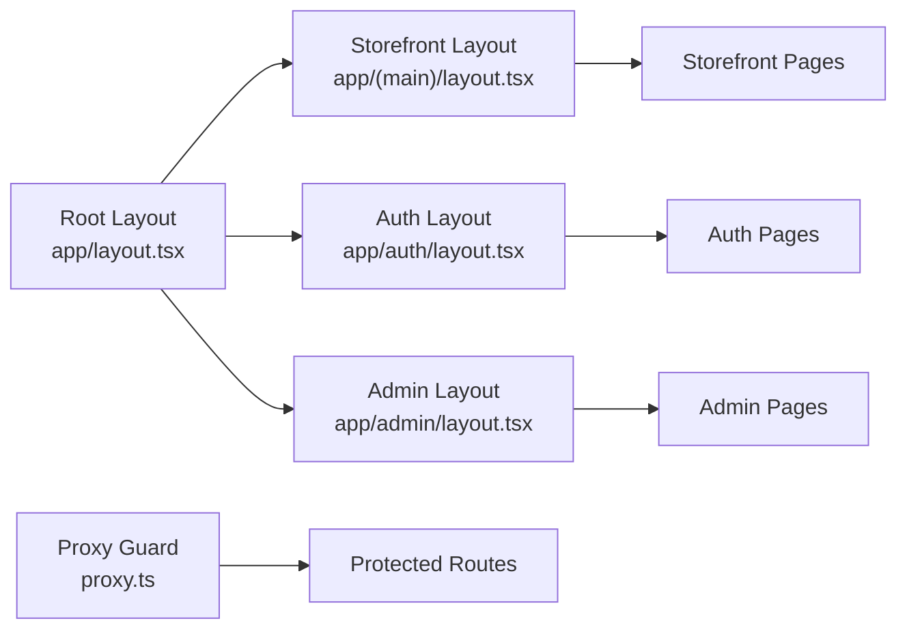

# Application Structure & Routing

<cite>
**Referenced Files in This Document**
- [next.config.js](file://apps/frontend/next.config.js)
- [proxy.ts](file://apps/frontend/proxy.ts)
- [layout.tsx](file://apps/frontend/app/layout.tsx)
- [layout.tsx](file://apps/frontend/app/(main)/layout.tsx)
- [layout.tsx](file://apps/frontend/app/admin/layout.tsx)
- [layout.tsx](file://apps/frontend/app/auth/layout.tsx)
- [page.tsx](file://apps/frontend/app/(main)/page.tsx)
</cite>

## Table of Contents
1. [Introduction](#introduction)
2. [Project Structure](#project-structure)
3. [Core Components](#core-components)
4. [Architecture Overview](#architecture-overview)
5. [Detailed Component Analysis](#detailed-component-analysis)
6. [Dependency Analysis](#dependency-analysis)
7. [Performance Considerations](#performance-considerations)
8. [Troubleshooting Guide](#troubleshooting-guide)
9. [Conclusion](#conclusion)

## Introduction
This document explains the Next.js App Router structure and routing strategy for the frontend application. It covers route groups, layout hierarchy, server vs client component usage, protected routes, dynamic routes, API routes, development proxy configuration, SEO metadata, and performance optimizations tied to the routing architecture.

## Project Structure
The frontend uses the Next.js App Router with a clear separation between public storefront pages, authentication flows, admin console, and API endpoints:

- Root layout at app/layout.tsx provides global providers, fonts, analytics, and site-wide metadata.
- Route group (main) contains public storefront pages and shares a common layout.
- Admin section under app/admin is an isolated area with its own layout and UI shell.
- Auth flows live under app/auth with a dedicated layout.
- API routes are defined under app/api.

**Diagram sources**
- [layout.tsx](file://apps/frontend/app/layout.tsx)
- [layout.tsx](file://apps/frontend/app/(main)/layout.tsx)
- [layout.tsx](file://apps/frontend/app/admin/layout.tsx)
- [layout.tsx](file://apps/frontend/app/auth/layout.tsx)

**Section sources**
- [layout.tsx](file://apps/frontend/app/layout.tsx)
- [layout.tsx](file://apps/frontend/app/(main)/layout.tsx)
- [layout.tsx](file://apps/frontend/app/admin/layout.tsx)
- [layout.tsx](file://apps/frontend/app/auth/layout.tsx)

## Core Components
- Root layout sets up global providers (cart, notifications, search), fonts, analytics, and site metadata. It also fetches user context and cart data on the server to hydrate client state.
- Storefront layout under (main) composes header, footer, mobile bottom bar, WhatsApp widget, maintenance takeover, and a route progress indicator.
- Admin layout wraps the admin shell and uses Suspense to render a skeleton while the interactive client shell loads.
- Auth layout provides a minimal shell for sign-in/sign-up/forgot-password flows.

Key responsibilities:
- Metadata generation at the root level defines title templates, Open Graph, Twitter cards, icons, manifest, robots, and verification tags.
- Maintenance mode is evaluated per request in the storefront layout using business settings.
- Admin layout defers heavy client-side UI behind Suspense for better perceived performance.

**Section sources**
- [layout.tsx](file://apps/frontend/app/layout.tsx)
- [layout.tsx](file://apps/frontend/app/(main)/layout.tsx)
- [layout.tsx](file://apps/frontend/app/admin/layout.tsx)
- [layout.tsx](file://apps/frontend/app/auth/layout.tsx)

## Architecture Overview
The routing architecture combines:
- App Router file-based routing with route groups for logical grouping without URL impact.
- Middleware-like protection via a custom proxy function that guards user and admin routes.
- Server components by default with selective client components where interactivity is required.
- Parallel and intercepting routes supported by the App Router; examples are provided conceptually below.

**Diagram sources**
- [proxy.ts](file://apps/frontend/proxy.ts)
- [layout.tsx](file://apps/frontend/app/layout.tsx)
- [layout.tsx](file://apps/frontend/app/(main)/layout.tsx)
- [layout.tsx](file://apps/frontend/app/admin/layout.tsx)
- [layout.tsx](file://apps/frontend/app/auth/layout.tsx)

## Detailed Component Analysis

### App Router Layout Hierarchy
- Root layout: Global providers, fonts, analytics, metadata, and initial data fetching for user/cart.
- Storefront layout: Header/footer, maintenance check, visitor heartbeat, route loading bar, and mobile UX elements.
- Admin layout: Skeleton fallback and client shell wrapped in Suspense.
- Auth layout: Minimal shell for auth flows.

**Diagram sources**
- [layout.tsx](file://apps/frontend/app/layout.tsx)
- [layout.tsx](file://apps/frontend/app/(main)/layout.tsx)
- [layout.tsx](file://apps/frontend/app/admin/layout.tsx)
- [layout.tsx](file://apps/frontend/app/auth/layout.tsx)

**Section sources**
- [layout.tsx](file://apps/frontend/app/layout.tsx)
- [layout.tsx](file://apps/frontend/app/(main)/layout.tsx)
- [layout.tsx](file://apps/frontend/app/admin/layout.tsx)
- [layout.tsx](file://apps/frontend/app/auth/layout.tsx)

### Protected Routes and Role-Based Access
The proxy guard enforces:
- Authentication for user-related routes (/user, /order-confirmation).
- Role checks for admin routes (/admin), allowing only admin/superadmin/moderator.
- Redirects to login when unauthenticated or unauthorized.

**Diagram sources**
- [proxy.ts](file://apps/frontend/proxy.ts)

**Section sources**
- [proxy.ts](file://apps/frontend/proxy.ts)

### Dynamic Routes and Nested Patterns
- Product detail: app/(main)/product/[slug]/page.tsx
- Order confirmation: app/(main)/order-confirmation/[id]/page.tsx
- Recipe detail: app/(main)/recipe/[id]/page.tsx
- Brand/category listing and detail under route group (brand-category):
  - app/(main)/(brand-category)/brands/page.tsx and [slug]/page.tsx
  - app/(main)/(brand-category)/categories/page.tsx and [slug]/page.tsx
- User account nested route: app/(main)/user/(account)/[id]/...

These patterns leverage Next.js dynamic segments and route groups to keep URLs clean while organizing code logically.

**Section sources**
- [page.tsx](file://apps/frontend/app/(main)/page.tsx)

### Server Components vs Client Components Strategy
- Default server components for layouts and pages to maximize SSR/ISR and reduce client bundle size.
- Selective use of client components for interactive UI (e.g., admin shell, modals, charts).
- The admin layout demonstrates Suspense around a client component to improve initial load.

Best practices observed:
- Keep data-heavy rendering on the server.
- Move only interactive parts to client components.
- Use Suspense boundaries to show skeletons during client hydration.

**Section sources**
- [layout.tsx](file://apps/frontend/app/admin/layout.tsx)

### API Routes Organization
API routes are colocated under app/api. Examples include:
- app/api/auth/token
- app/api/pdf-image

These routes can be called from server components or client actions and are independent of the UI routing.

**Section sources**
- [layout.tsx](file://apps/frontend/app/layout.tsx)

### Development Proxy Setup
A proxy helper is provided to forward requests and enforce access control before reaching route handlers. It:
- Matches specific path prefixes for user and admin sections.
- Reads user session and role information.
- Redirects appropriately based on authentication and authorization.

Note: Ensure this proxy is wired into your development environment according to your setup (e.g., Next.js middleware if applicable).

**Section sources**
- [proxy.ts](file://apps/frontend/proxy.ts)

### Route-Based Code Splitting
- Each route group and folder maps to a separate chunk.
- Place heavy components inside feature folders (e.g., admin features) to ensure they are only loaded when those routes are visited.
- Avoid importing large client components into shared layouts unless necessary.

### Parallel Routes and Intercepting Routes
- Parallel routes: Define multiple slots within a route segment to render multiple pages concurrently.
- Intercepting routes: Use the `@` syntax to intercept navigation and render alternative UI without changing the URL.

These features are available through the App Router and can be used to build dashboards, modals, and split views.

### SEO Considerations and Metadata Management
- Root layout generates comprehensive metadata including title template, description, keywords, Open Graph, Twitter card, icons, manifest, robots, and verification tags.
- Business settings influence OG images dynamically when a logo is configured.
- The homepage page defines its own metadata for canonical URL and SEO-specific fields.

Recommendations:
- Keep metadata close to the route it describes.
- Use dynamic metadata for personalized or content-driven pages.
- Validate social sharing previews after changes.

**Section sources**
- [layout.tsx](file://apps/frontend/app/layout.tsx)
- [page.tsx](file://apps/frontend/app/(main)/page.tsx)

### Performance Optimizations Specific to Routing
- Images: Configured with remote patterns, quality presets, and long cache TTL for S3-hosted assets.
- Standalone output: Enables optimized deployment artifacts.
- React Compiler: Enabled to optimize component rendering.
- Fonts: Preloaded via next/font with swap display to avoid layout shifts.
- ISR-friendly comments indicate awareness of revalidation behavior in certain routes.

**Section sources**
- [next.config.js](file://apps/frontend/next.config.js)
- [layout.tsx](file://apps/frontend/app/layout.tsx)
- [page.tsx](file://apps/frontend/app/(main)/page.tsx)

## Dependency Analysis
High-level dependencies among routing and layout layers:

**Diagram sources**
- [layout.tsx](file://apps/frontend/app/layout.tsx)
- [layout.tsx](file://apps/frontend/app/(main)/layout.tsx)
- [layout.tsx](file://apps/frontend/app/admin/layout.tsx)
- [layout.tsx](file://apps/frontend/app/auth/layout.tsx)
- [proxy.ts](file://apps/frontend/proxy.ts)

**Section sources**
- [layout.tsx](file://apps/frontend/app/layout.tsx)
- [layout.tsx](file://apps/frontend/app/(main)/layout.tsx)
- [layout.tsx](file://apps/frontend/app/admin/layout.tsx)
- [layout.tsx](file://apps/frontend/app/auth/layout.tsx)
- [proxy.ts](file://apps/frontend/proxy.ts)

## Performance Considerations
- Prefer server components for data fetching and static rendering.
- Use Suspense to defer non-critical client interactions.
- Configure image optimization for CDN-backed assets and set appropriate cache TTLs.
- Leverage route groups to isolate heavy features and enable granular code splitting.
- Monitor hydration time for admin shell and other client-heavy areas.

## Troubleshooting Guide
Common issues and resolutions:
- Unauthorized redirects: Verify user session and role resolution in the proxy guard. Ensure cookies or tokens are present and correctly parsed.
- Admin access denied: Confirm user has admin/superadmin/moderator role.
- Maintenance page unexpectedly shown: Check business settings flags and scheduled maintenance window logic in the storefront layout.
- Slow initial admin load: Ensure heavy UI is wrapped in Suspense and lazy-loaded.
- Image caching not effective: Verify remotePatterns and minimumCacheTTL in next.config.js match your CDN hostnames.

**Section sources**
- [proxy.ts](file://apps/frontend/proxy.ts)
- [layout.tsx](file://apps/frontend/app/(main)/layout.tsx)
- [next.config.js](file://apps/frontend/next.config.js)

## Conclusion
The application’s routing architecture leverages Next.js App Router conventions with route groups, layered layouts, and a proxy-based guard for protected routes. Server components dominate for performance, with selective client components for interactivity. Metadata and image optimization are configured at the root and build levels to support SEO and performance goals. Following the patterns outlined here will help maintain scalability, clarity, and speed across the storefront, auth, and admin experiences.