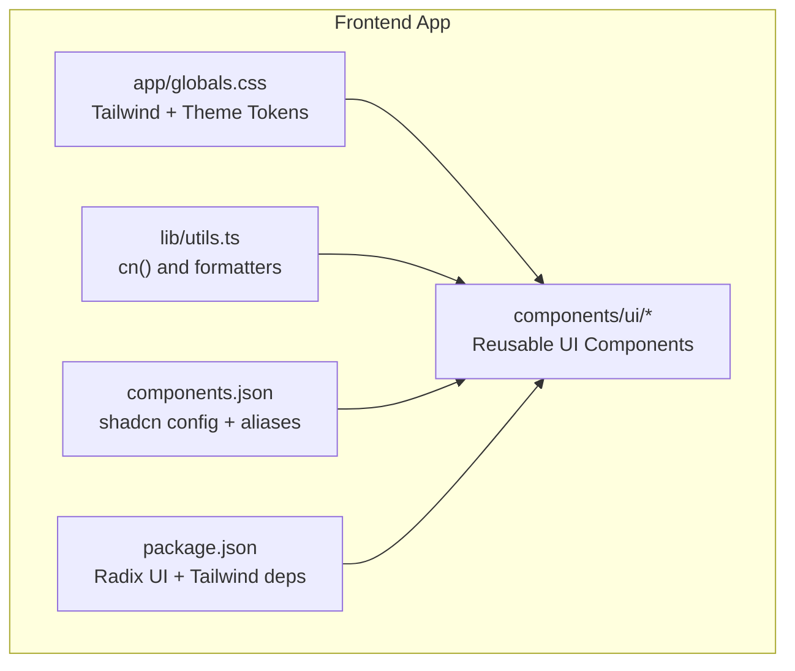
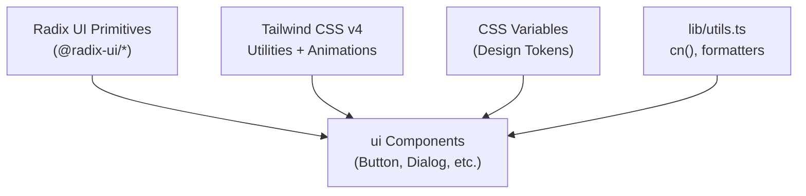
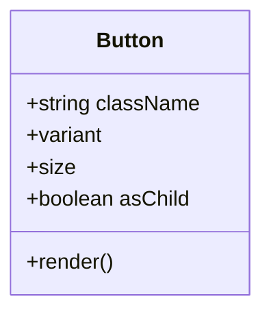
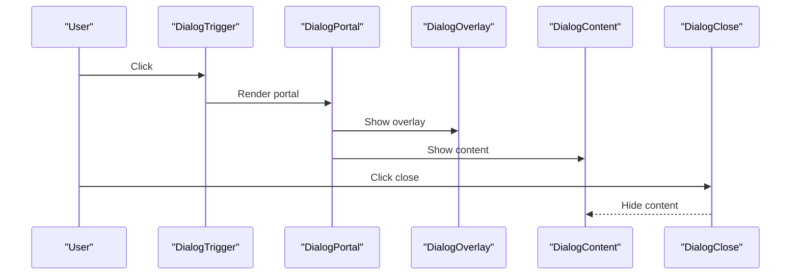
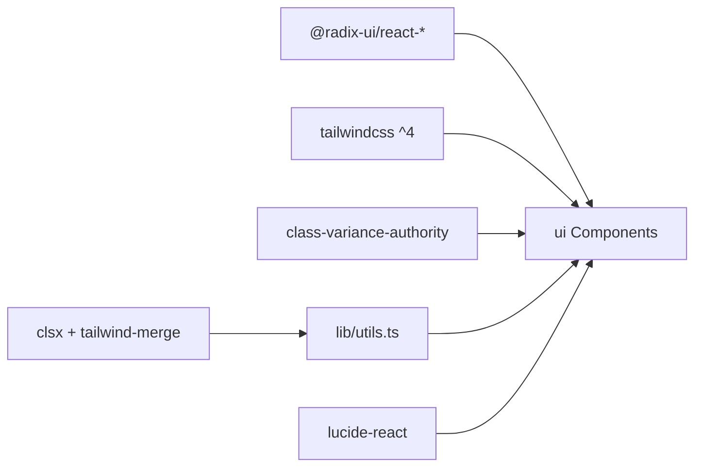

# Component System & Design Library

<cite>
**Referenced Files in This Document**
- [components.json](file://apps/frontend/components.json)
- [package.json](file://apps/frontend/package.json)
- [globals.css](file://apps/frontend/app/globals.css)
- [utils.ts](file://apps/frontend/lib/utils.ts)
- [button.tsx](file://apps/frontend/components/ui/button.tsx)
- [input.tsx](file://apps/frontend/components/ui/input.tsx)
- [card.tsx](file://apps/frontend/components/ui/card.tsx)
- [dialog.tsx](file://apps/frontend/components/ui/dialog.tsx)
- [alert-dialog.tsx](file://apps/frontend/components/ui/alert-dialog.tsx)
- [accordion.tsx](file://apps/frontend/components/ui/accordion.tsx)
- [badge.tsx](file://apps/frontend/components/ui/badge.tsx)
- [select.tsx](file://apps/frontend/components/ui/select.tsx)
</cite>

## Table of Contents
1. [Introduction](#introduction)
2. [Project Structure](#project-structure)
3. [Core Components](#core-components)
4. [Architecture Overview](#architecture-overview)
5. [Detailed Component Analysis](#detailed-component-analysis)
6. [Dependency Analysis](#dependency-analysis)
7. [Performance Considerations](#performance-considerations)
8. [Troubleshooting Guide](#troubleshooting-guide)
9. [Conclusion](#conclusion)
10. [Appendices](#appendices)

## Introduction
This document explains the component system and design library architecture used by the frontend application. It covers:
- Radix UI primitives integration and how they are wrapped into accessible, theme-aware components
- Custom component composition patterns using Tailwind CSS v4 and utility-first styling
- The design token system via CSS custom properties and Tailwind theme variables
- Reusable UI components in the ui directory with their props interfaces and customization options
- Guidelines for creating new components, maintaining consistency, and ensuring accessibility
- Testing strategies, Storybook integration guidance, and component versioning approaches

## Project Structure
The design library lives under apps/frontend/components/ui and is configured through shadcn-style tooling and aliases. Key configuration and assets include:
- Shadcn configuration and aliases (including ui alias to @/components/ui)
- Tailwind CSS v4 setup with CSS variables for theming
- Utility helpers for class merging and formatting

**Diagram sources**
- [globals.css:1-55](file://apps/frontend/app/globals.css#L1-L55)
- [utils.ts:1-7](file://apps/frontend/lib/utils.ts#L1-L7)
- [components.json:1-21](file://apps/frontend/components.json#L1-L21)
- [package.json:11-85](file://apps/frontend/package.json#L11-L85)

**Section sources**
- [components.json:1-21](file://apps/frontend/components.json#L1-L21)
- [package.json:11-85](file://apps/frontend/package.json#L11-L85)
- [globals.css:1-55](file://apps/frontend/app/globals.css#L1-L55)

## Core Components
The ui directory provides a comprehensive set of accessible primitives built on Radix UI and styled with Tailwind CSS v4. Common patterns:
- Primitives from Radix UI are wrapped to provide consistent data-slot attributes, focus states, and theme tokens
- Styling uses Tailwind utilities and CSS variables defined in globals.css
- Variant systems use class-variance-authority (cva) for buttons and badges
- Class merging uses the shared cn helper

Key components analyzed:
- Button: variant and size variants, asChild support, focus-visible and aria-invalid states
- Input: base input with focus-visible ring, placeholder color, disabled state
- Card: composite layout with header/title/description/content/footer/action parts
- Dialog: full dialog primitive suite with overlay, portal, header/footer/title/description
- Alert Dialog: confirmation dialogs with action/cancel buttons styled via buttonVariants
- Accordion: expandable sections with animated content and chevron indicator
- Badge: small status labels with variants and icon support
- Select: controlled select with trigger, content, items, separators, and scroll buttons

**Section sources**
- [button.tsx:1-63](file://apps/frontend/components/ui/button.tsx#L1-L63)
- [input.tsx:1-22](file://apps/frontend/components/ui/input.tsx#L1-L22)
- [card.tsx:1-97](file://apps/frontend/components/ui/card.tsx#L1-L97)
- [dialog.tsx:1-136](file://apps/frontend/components/ui/dialog.tsx#L1-L136)
- [alert-dialog.tsx:1-158](file://apps/frontend/components/ui/alert-dialog.tsx#L1-L158)
- [accordion.tsx:1-67](file://apps/frontend/components/ui/accordion.tsx#L1-L67)
- [badge.tsx:1-47](file://apps/frontend/components/ui/badge.tsx#L1-L47)
- [select.tsx:1-187](file://apps/frontend/components/ui/select.tsx#L1-L187)

## Architecture Overview
The design library follows a layered architecture:
- Presentation layer: React components in ui that compose Radix primitives
- Styling layer: Tailwind CSS v4 utilities and CSS variables for tokens
- Utilities layer: Shared helpers like cn for class merging and formatting functions
- Configuration layer: shadcn config and package dependencies

**Diagram sources**
- [package.json:11-33](file://apps/frontend/package.json#L11-L33)
- [globals.css:1-55](file://apps/frontend/app/globals.css#L1-L55)
- [utils.ts:1-7](file://apps/frontend/lib/utils.ts#L1-L7)
- [button.tsx:1-63](file://apps/frontend/components/ui/button.tsx#L1-L63)

## Detailed Component Analysis

### Button
- Purpose: Primary interactive element with multiple visual variants and sizes
- Props interface:
  - className: string (merged via cn)
  - variant: default | destructive | outline | secondary | ghost | link
  - size: default | sm | lg | icon | icon-sm | icon-lg
  - asChild: boolean (renders via Radix Slot)
  - All standard HTML button props
- Styling: cva-based variants; focus-visible ring; aria-invalid states; icon sizing rules
- Accessibility: Focus management delegated to browser; supports keyboard interaction when used as child of Radix primitives

**Diagram sources**
- [button.tsx:7-38](file://apps/frontend/components/ui/button.tsx#L7-L38)
- [button.tsx:40-61](file://apps/frontend/components/ui/button.tsx#L40-L61)

**Section sources**
- [button.tsx:1-63](file://apps/frontend/components/ui/button.tsx#L1-L63)

### Input
- Purpose: Base text input with consistent focus and validation styles
- Props interface:
  - className: string
  - type: string (HTML input type)
  - All standard HTML input props
- Styling: Placeholder color, focus-visible ring, disabled state, responsive font sizing

**Section sources**
- [input.tsx:1-22](file://apps/frontend/components/ui/input.tsx#L1-L22)

### Card
- Purpose: Composite card layout with semantic parts
- Exposed parts:
  - Card: container
  - CardHeader, CardTitle, CardDescription, CardContent, CardFooter, CardAction
- Props interface: Each part accepts className and standard div props
- Styling: Grid-based header layout, responsive padding, border and shadow tokens

**Section sources**
- [card.tsx:1-97](file://apps/frontend/components/ui/card.tsx#L1-L97)

### Dialog
- Purpose: Accessible modal dialog with overlay and portal
- Exposed parts:
  - Dialog, DialogTrigger, DialogPortal, DialogClose
  - DialogOverlay, DialogContent
  - DialogHeader, DialogFooter, DialogTitle, DialogDescription
- Props interface: Each part forwards Radix primitive props and adds data-slot attributes
- Styling: Overlay fade/scale animations, centered fixed positioning, responsive max-width

**Diagram sources**
- [dialog.tsx:9-13](file://apps/frontend/components/ui/dialog.tsx#L9-L13)
- [dialog.tsx:15-31](file://apps/frontend/components/ui/dialog.tsx#L15-L31)
- [dialog.tsx:33-73](file://apps/frontend/components/ui/dialog.tsx#L33-L73)
- [dialog.tsx:75-122](file://apps/frontend/components/ui/dialog.tsx#L75-L122)

**Section sources**
- [dialog.tsx:1-136](file://apps/frontend/components/ui/dialog.tsx#L1-L136)

### Alert Dialog
- Purpose: Confirmation dialogs with action and cancel buttons
- Exposed parts: Root, Trigger, Portal, Overlay, Content, Header, Footer, Title, Description, Action, Cancel
- Styling: Uses buttonVariants for Action and Cancel to maintain visual consistency

**Section sources**
- [alert-dialog.tsx:1-158](file://apps/frontend/components/ui/alert-dialog.tsx#L1-L158)

### Accordion
- Purpose: Expandable sections with animated content and chevron indicator
- Exposed parts: Accordion, AccordionItem, AccordionTrigger, AccordionContent
- Styling: Border separators, focus-visible ring, chevron rotation on open state, animation classes

**Section sources**
- [accordion.tsx:1-67](file://apps/frontend/components/ui/accordion.tsx#L1-L67)

### Badge
- Purpose: Small inline labels for status or metadata
- Props interface:
  - className: string
  - variant: default | secondary | destructive | outline
  - asChild: boolean
  - All standard span props
- Styling: Compact typography, focus-visible ring, icon sizing rules

**Section sources**
- [badge.tsx:1-47](file://apps/frontend/components/ui/badge.tsx#L1-L47)

### Select
- Purpose: Accessible dropdown select with popper positioning and scrolling
- Exposed parts: Root, Group, Value, Trigger, Content, Label, Item, Separator, ScrollUpButton, ScrollDownButton
- Styling: Popper positioning, viewport sizing, focus and disabled states, checkmark indicator

**Section sources**
- [select.tsx:1-187](file://apps/frontend/components/ui/select.tsx#L1-L187)

## Dependency Analysis
External dependencies relevant to the component system:
- Radix UI primitives for unstyled, accessible behavior
- Tailwind CSS v4 for utility-first styling and animations
- class-variance-authority for variant systems
- clsx and tailwind-merge via cn helper for robust class composition
- lucide-react icons used within components

**Diagram sources**
- [package.json:11-33](file://apps/frontend/package.json#L11-L33)
- [package.json:72-85](file://apps/frontend/package.json#L72-L85)
- [utils.ts:1-7](file://apps/frontend/lib/utils.ts#L1-L7)

**Section sources**
- [package.json:11-85](file://apps/frontend/package.json#L11-L85)
- [utils.ts:1-7](file://apps/frontend/lib/utils.ts#L1-L7)

## Performance Considerations
- Use Radix primitives for optimal performance and accessibility without reinventing logic
- Prefer Tailwind utilities over heavy CSS; leverage CSS variables for theme tokens
- Avoid unnecessary re-renders by keeping components pure and memoizing expensive computations where needed
- Minimize DOM depth in complex components (e.g., Dialog, Select) by leveraging portals appropriately
- Respect prefers-reduced-motion to disable animations for users who prefer reduced motion

[No sources needed since this section provides general guidance]

## Troubleshooting Guide
Common issues and resolutions:
- Classes not applying: Ensure cn helper is used to merge classes and avoid conflicts
- Focus ring missing: Verify focus-visible styles and ensure components are interactive elements or have proper role/tabindex
- Dark mode not working: Confirm .dark class is applied at root and CSS variables are defined for dark mode
- Animation glitches: Check for conflicting transforms or will-change; respect prefers-reduced-motion

**Section sources**
- [globals.css:92-125](file://apps/frontend/app/globals.css#L92-L125)
- [globals.css:374-387](file://apps/frontend/app/globals.css#L374-L387)

## Conclusion
The component system combines Radix UI primitives with Tailwind CSS v4 and a robust design token system to deliver accessible, customizable, and consistent UI components. By following the established patterns—using cva for variants, cn for class merging, and data-slot attributes for testing—you can extend the library with new components while maintaining quality and accessibility.

[No sources needed since this section summarizes without analyzing specific files]

## Appendices

### Design Token System
- Theme tokens are defined as CSS custom properties in globals.css and exposed via Tailwind’s @theme inline block
- Light and dark themes are provided through :root and .dark selectors
- Brand-specific colors are also defined alongside semantic tokens

**Section sources**
- [globals.css:7-55](file://apps/frontend/app/globals.css#L7-L55)
- [globals.css:57-125](file://apps/frontend/app/globals.css#L57-L125)

### Creating New Components
Guidelines:
- Wrap Radix primitives to expose a clean API and add data-slot attributes for testing
- Use cva for variant-driven styling when appropriate
- Merge user-provided classes with cn to allow overrides
- Provide sensible defaults and forward all underlying props
- Include focus-visible and aria-invalid states for accessibility
- Keep components small and composable; split large components into parts (like Card)

**Section sources**
- [button.tsx:7-38](file://apps/frontend/components/ui/button.tsx#L7-L38)
- [card.tsx:5-85](file://apps/frontend/components/ui/card.tsx#L5-L85)

### Accessibility Compliance
- Use Radix primitives for built-in accessibility (keyboard navigation, focus management, ARIA)
- Ensure interactive elements have visible focus indicators
- Provide descriptive labels and sr-only text where needed
- Respect prefers-reduced-motion

**Section sources**
- [dialog.tsx:66-69](file://apps/frontend/components/ui/dialog.tsx#L66-L69)
- [globals.css:374-387](file://apps/frontend/app/globals.css#L374-L387)

### Testing Strategies
- Use data-slot attributes to target components in tests
- Test variant combinations and size variants
- Validate focus management and keyboard interactions
- Snapshot test rendered structure for stable components

**Section sources**
- [button.tsx:52-57](file://apps/frontend/components/ui/button.tsx#L52-L57)
- [dialog.tsx:12-13](file://apps/frontend/components/ui/dialog.tsx#L12-L13)

### Storybook Integration
Recommended approach:
- Create stories per component showcasing variants and sizes
- Use controls to toggle variants and sizes
- Add a11y addon to validate accessibility
- Document usage patterns and constraints

[No sources needed since this section provides general guidance]

### Component Versioning
Recommendations:
- Treat each component as a public API; bump major versions for breaking changes
- Maintain backward compatibility for className and prop names where possible
- Use changelog entries to document deprecations and migration steps

[No sources needed since this section provides general guidance]