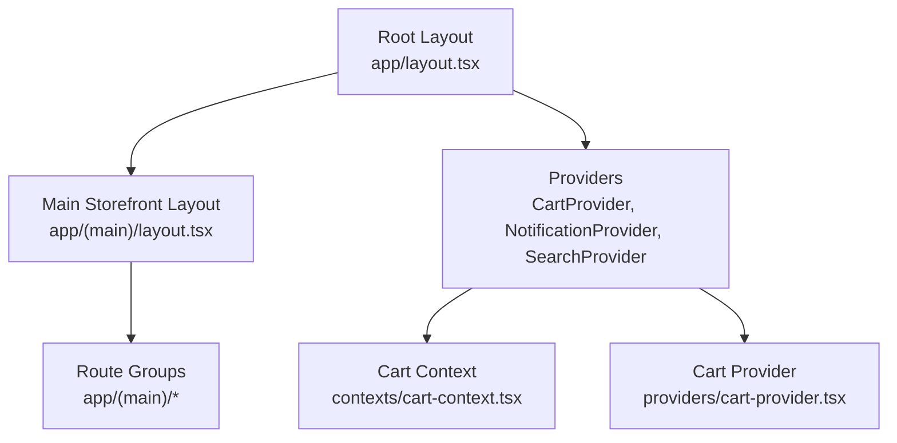
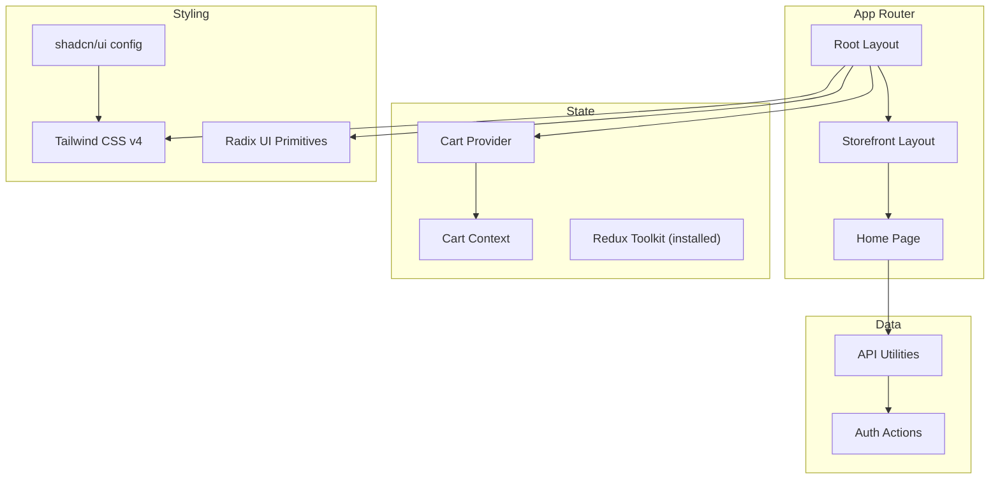
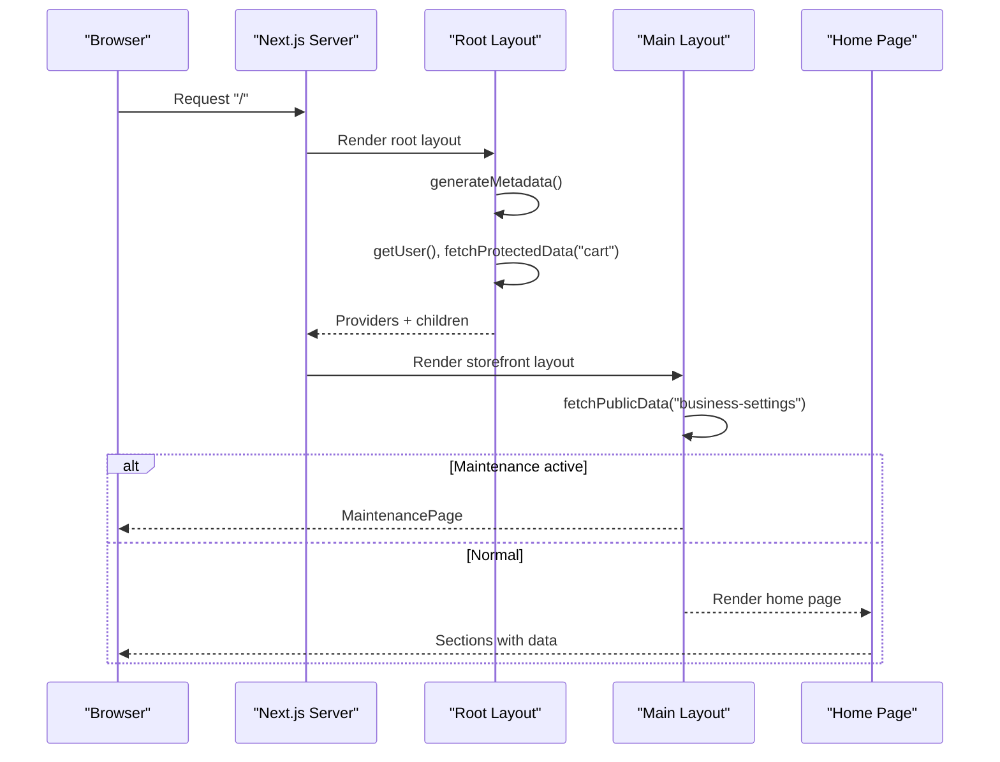
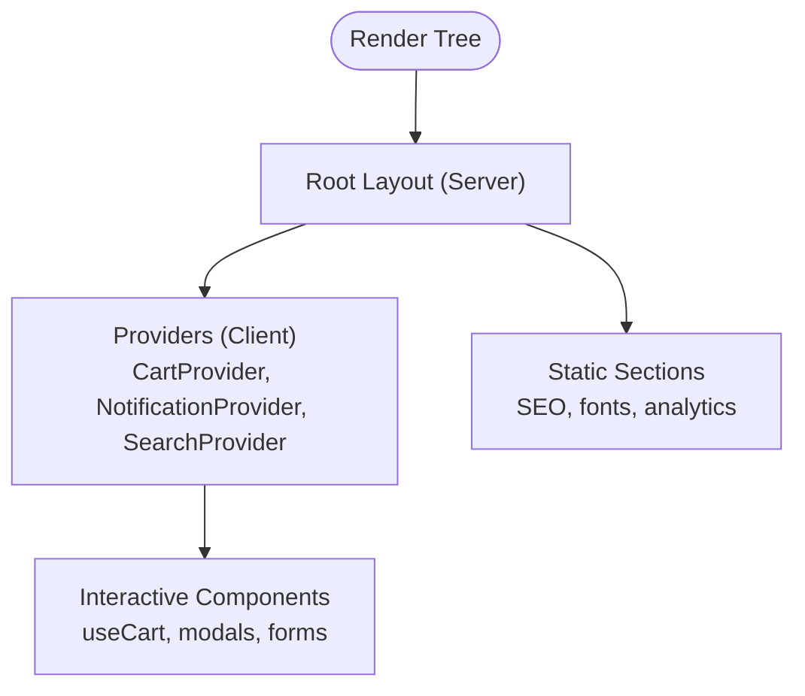
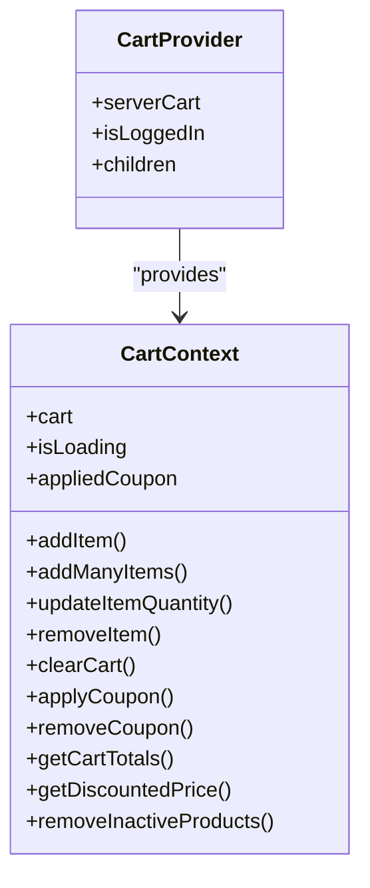
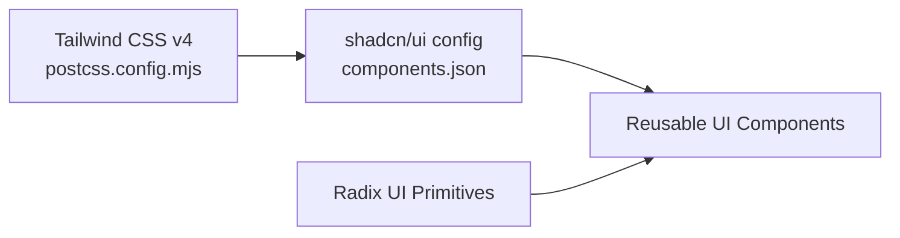
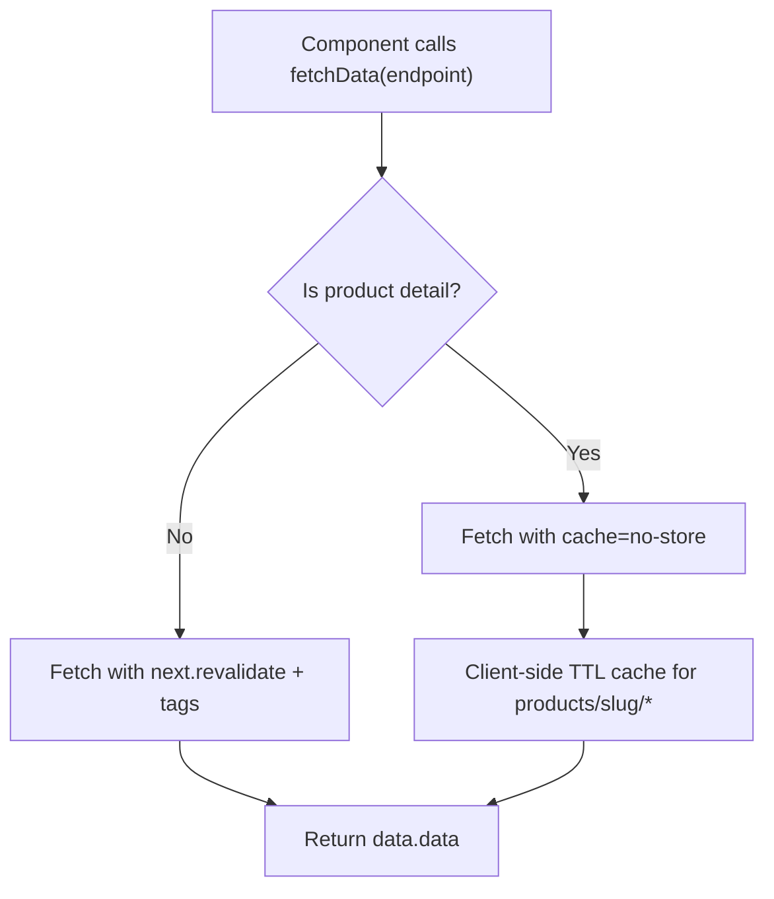
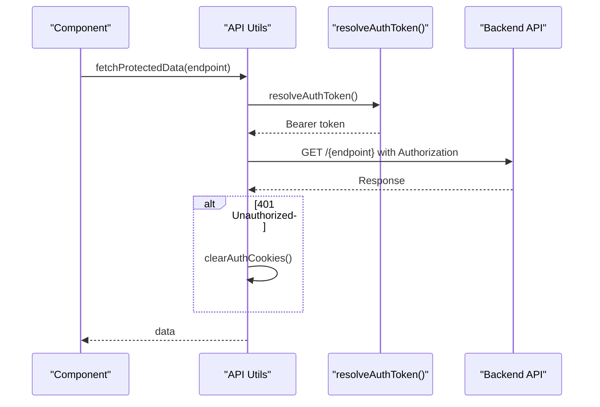
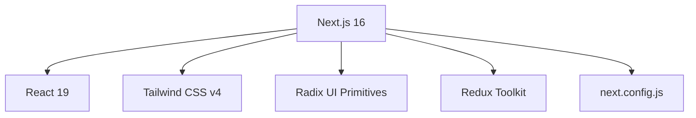

# Frontend Architecture

<cite>
**Referenced Files in This Document**
- [package.json](file://apps/frontend/package.json)
- [next.config.js](file://apps/frontend/next.config.js)
- [postcss.config.mjs](file://apps/frontend/postcss.config.mjs)
- [components.json](file://apps/frontend/components.json)
- [layout.tsx](file://apps/frontend/app/layout.tsx)
- [app\(main)\layout.tsx](file://apps/frontend/app/(main)/layout.tsx)
- [app\(main)\page.tsx](file://apps/frontend/app/(main)/page.tsx)
- [providers\cart-provider.tsx](file://apps/frontend/providers/cart-provider.tsx)
- [contexts\cart-context.tsx](file://apps/frontend/contexts/cart-context.tsx)
- [utils\api-utils.ts](file://apps/frontend/utils/api-utils.ts)
- [actions\auth.ts](file://apps/frontend/actions/auth.ts)
</cite>

## Table of Contents
1. [Introduction](#introduction)
2. [Project Structure](#project-structure)
3. [Core Components](#core-components)
4. [Architecture Overview](#architecture-overview)
5. [Detailed Component Analysis](#detailed-component-analysis)
6. [Dependency Analysis](#dependency-analysis)
7. [Performance Considerations](#performance-considerations)
8. [Troubleshooting Guide](#troubleshooting-guide)
9. [Conclusion](#conclusion)

## Introduction
This document explains the frontend architecture of the Next.js application, focusing on:
- App Router structure with route groups
- Server components vs client components strategy
- Component hierarchy organization
- State management using React Context and Redux Toolkit
- Styling system with Tailwind CSS v4 and Radix UI primitives
- API integration patterns and data fetching strategies (SSR, ISR, client hydration)
- Design system architecture, reusable component library, and theming
- Performance optimizations including code splitting, image optimization, and caching

## Project Structure
The frontend is a Next.js 16 application under apps/frontend. It uses the App Router with route groups to separate storefront and admin experiences. The root layout sets global providers, fonts, analytics, and metadata. The main storefront layout composes header, footer, maintenance mode, and shared UI chrome.

**Diagram sources**
- [layout.tsx:180-206](file://apps/frontend/app/layout.tsx#L180-L206)
- [app\(main)\layout.tsx:36-72](file://apps/frontend/app/(main)/layout.tsx#L36-L72)
- [providers\cart-provider.tsx:14-31](file://apps/frontend/providers/cart-provider.tsx#L14-L31)
- [contexts\cart-context.tsx:38-48](file://apps/frontend/contexts/cart-context.tsx#L38-L48)

Key observations:
- Route groups: app/(main) for storefront pages; app/admin for admin routes; app/auth for authentication flows; app/api for internal API endpoints.
- Root layout wires global providers and metadata; main layout adds storefront chrome and maintenance gating.
- The homepage page composes multiple section components that fetch their own data.

**Section sources**
- [layout.tsx:36-178](file://apps/frontend/app/layout.tsx#L36-L178)
- [layout.tsx:180-206](file://apps/frontend/app/layout.tsx#L180-L206)
- [app\(main)\layout.tsx:16-72](file://apps/frontend/app/(main)/layout.tsx#L16-L72)
- [app\(main)\page.tsx:1-107](file://apps/frontend/app/(main)/page.tsx#L1-L107)

## Core Components
- Root layout: Sets up Google Tag Manager, Google Analytics, Toaster, and global providers (Notification, Cart, Search). It also loads fonts and injects SEO metadata.
- Main storefront layout: Loads business settings, enforces maintenance mode, renders Header, Footer, WhatsApp widget, mobile bottom header, and a loading bar.
- Cart provider and context: Provide cart state and actions across the app via React Context.
- API utilities: Centralized functions for public and protected requests, token resolution, and caching strategies.

**Section sources**
- [layout.tsx:10-15](file://apps/frontend/app/layout.tsx#L10-L15)
- [layout.tsx:180-206](file://apps/frontend/app/layout.tsx#L180-L206)
- [app\(main)\layout.tsx:36-72](file://apps/frontend/app/(main)/layout.tsx#L36-L72)
- [providers\cart-provider.tsx:14-31](file://apps/frontend/providers/cart-provider.tsx#L14-L31)
- [contexts\cart-context.tsx:7-48](file://apps/frontend/contexts/cart-context.tsx#L7-L48)
- [utils\api-utils.ts:22-46](file://apps/frontend/utils/api-utils.ts#L22-L46)

## Architecture Overview
The application follows a layered approach:
- Presentation layer: Next.js App Router pages and layouts.
- State layer: React Context for cart, notifications, and search; Redux Toolkit dependency present for potential or existing features.
- Data layer: API utilities wrapping fetch calls with token handling, revalidation, and caching.
- Infrastructure: Next.js configuration for images, compiler, and bundler; PostCSS with Tailwind v4; shadcn/ui configuration.

**Diagram sources**
- [layout.tsx:180-206](file://apps/frontend/app/layout.tsx#L180-L206)
- [app\(main)\layout.tsx:36-72](file://apps/frontend/app/(main)/layout.tsx#L36-L72)
- [providers\cart-provider.tsx:14-31](file://apps/frontend/providers/cart-provider.tsx#L14-L31)
- [contexts\cart-context.tsx:38-48](file://apps/frontend/contexts/cart-context.tsx#L38-L48)
- [utils\api-utils.ts:71-139](file://apps/frontend/utils/api-utils.ts#L71-L139)
- [package.json:11-70](file://apps/frontend/package.json#L11-L70)
- [components.json:1-21](file://apps/frontend/components.json#L1-L21)

## Detailed Component Analysis

### App Router and Route Groups
- Root layout defines global metadata, fonts, analytics, and providers.
- Main storefront layout handles business settings, maintenance mode, and shared UI shell.
- Homepage composes sections that each manage their own data fetching.

**Diagram sources**
- [layout.tsx:36-178](file://apps/frontend/app/layout.tsx#L36-L178)
- [layout.tsx:180-206](file://apps/frontend/app/layout.tsx#L180-L206)
- [app\(main)\layout.tsx:16-72](file://apps/frontend/app/(main)/layout.tsx#L16-L72)
- [app\(main)\page.tsx:1-107](file://apps/frontend/app/(main)/page.tsx#L1-L107)

**Section sources**
- [layout.tsx:36-178](file://apps/frontend/app/layout.tsx#L36-L178)
- [layout.tsx:180-206](file://apps/frontend/app/layout.tsx#L180-L206)
- [app\(main)\layout.tsx:16-72](file://apps/frontend/app/(main)/layout.tsx#L16-L72)
- [app\(main)\page.tsx:1-107](file://apps/frontend/app/(main)/page.tsx#L1-L107)

### Server Components vs Client Components Strategy
- Root layout and main layout are server components that fetch data and render initial HTML.
- Providers like CartProvider are marked as client components and wrap interactive parts of the app.
- Context consumers and hooks operate in client components where interactivity is required.

**Diagram sources**
- [layout.tsx:180-206](file://apps/frontend/app/layout.tsx#L180-L206)
- [providers\cart-provider.tsx:1-6](file://apps/frontend/providers/cart-provider.tsx#L1-L6)

**Section sources**
- [providers\cart-provider.tsx:1-6](file://apps/frontend/providers/cart-provider.tsx#L1-L6)

### State Management: React Context and Redux Toolkit
- Cart state is managed via React Context and a custom hook. The provider initializes from server-side cart data when available.
- Redux Toolkit is installed, indicating either current usage elsewhere or readiness for global state needs beyond cart.

**Diagram sources**
- [contexts\cart-context.tsx:7-48](file://apps/frontend/contexts/cart-context.tsx#L7-L48)
- [providers\cart-provider.tsx:14-31](file://apps/frontend/providers/cart-provider.tsx#L14-L31)

**Section sources**
- [contexts\cart-context.tsx:7-48](file://apps/frontend/contexts/cart-context.tsx#L7-L48)
- [providers\cart-provider.tsx:14-31](file://apps/frontend/providers/cart-provider.tsx#L14-L31)
- [package.json:35-35](file://apps/frontend/package.json#L35-L35)

### Styling System: Tailwind CSS v4 and Radix UI Primitives
- Tailwind CSS v4 is configured via PostCSS plugin.
- shadcn/ui is set up with aliases and Tailwind integration.
- Radix UI primitives are used for accessible base components.

**Diagram sources**
- [postcss.config.mjs:1-5](file://apps/frontend/postcss.config.mjs#L1-L5)
- [components.json:1-21](file://apps/frontend/components.json#L1-L21)
- [package.json:15-33](file://apps/frontend/package.json#L15-L33)

**Section sources**
- [postcss.config.mjs:1-5](file://apps/frontend/postcss.config.mjs#L1-L5)
- [components.json:1-21](file://apps/frontend/components.json#L1-L21)
- [package.json:15-33](file://apps/frontend/package.json#L15-L33)

### Theming Approach
- Fonts are loaded via next/font/google and local font, exposing CSS variables for consistent typography.
- Global styles are applied through globals.css and Tailwind classes.
- Theme variables can be extended via CSS variables exposed by fonts and Tailwind configuration.

**Section sources**
- [layout.tsx:17-34](file://apps/frontend/app/layout.tsx#L17-L34)
- [layout.tsx:189-193](file://apps/frontend/app/layout.tsx#L189-L193)
- [components.json:6-12](file://apps/frontend/components.json#L6-L12)

### API Integration Patterns and Data Fetching Strategies
- Public data uses ISR with revalidate tags for short-term caching.
- Protected data includes Authorization headers and token resolution; unauthorized responses clear auth cookies.
- Product detail endpoints bypass Next.js Data Cache to ensure immediate deactivation propagation; a client-side cache reduces redundant network calls.
- Token resolution is centralized and cached per request cycle.

**Diagram sources**
- [utils\api-utils.ts:66-139](file://apps/frontend/utils/api-utils.ts#L66-L139)

Token and protected request flow:

**Diagram sources**
- [utils\api-utils.ts:141-189](file://apps/frontend/utils/api-utils.ts#L141-L189)
- [utils\api-utils.ts:22-46](file://apps/frontend/utils/api-utils.ts#L22-L46)

**Section sources**
- [utils\api-utils.ts:66-139](file://apps/frontend/utils/api-utils.ts#L66-L139)
- [utils\api-utils.ts:141-189](file://apps/frontend/utils/api-utils.ts#L141-L189)
- [utils\api-utils.ts:232-265](file://apps/frontend/utils/api-utils.ts#L232-L265)
- [actions\auth.ts:55-157](file://apps/frontend/actions/auth.ts#L55-L157)

## Dependency Analysis
- Next.js 16 with Turbopack dev and Webpack build.
- React 19 and React DOM 19.
- Tailwind CSS v4 and @tailwindcss/postcss.
- Radix UI primitives for accessible UI building blocks.
- Redux Toolkit installed alongside React Context usage.
- Image optimization configured for remote S3 buckets with long cache TTL.

**Diagram sources**
- [package.json:53-85](file://apps/frontend/package.json#L53-L85)
- [next.config.js:1-39](file://apps/frontend/next.config.js#L1-L39)

**Section sources**
- [package.json:11-85](file://apps/frontend/package.json#L11-L85)
- [next.config.js:1-39](file://apps/frontend/next.config.js#L1-L39)

## Performance Considerations
- Image Optimization:
  - Remote patterns for S3 buckets with minimumCacheTTL of 31 days.
  - Quality presets and content disposition configured.
- Data Caching:
  - Public endpoints use ISR with 60-second revalidation.
  - Product detail endpoints use no-store to avoid stale caches; client-side 5-second cache reduces repeated requests.
  - Protected endpoints default to no-store unless explicit revalidate options are provided.
- Code Splitting:
  - Dynamic imports for server-only modules (e.g., auth actions) to avoid bundling server code on the client.
- Build Optimizations:
  - React Compiler enabled.
  - Standalone output for efficient deployment.
  - Externalizing heavy packages on the server side.

**Section sources**
- [next.config.js:14-35](file://apps/frontend/next.config.js#L14-L35)
- [next.config.js:1-12](file://apps/frontend/next.config.js#L1-L12)
- [utils\api-utils.ts:66-139](file://apps/frontend/utils/api-utils.ts#L66-L139)
- [utils\api-utils.ts:141-189](file://apps/frontend/utils/api-utils.ts#L141-L189)
- [utils\api-utils.ts:232-265](file://apps/frontend/utils/api-utils.ts#L232-L265)

## Troubleshooting Guide
- Authentication Issues:
  - If protected requests return 401, auth cookies are cleared automatically. Ensure tokens are set correctly via auth actions and that the client resolves tokens via the internal API endpoint.
- Stale Product Data:
  - Product detail pages intentionally bypass Next.js Data Cache. If deactivations are not reflected immediately, verify client-side cache behavior and backend availability.
- Maintenance Mode:
  - When business settings enable maintenance within the scheduled window, the storefront layout renders a maintenance page. Confirm settings and schedule times if the site appears down unexpectedly.

**Section sources**
- [utils\api-utils.ts:141-189](file://apps/frontend/utils/api-utils.ts#L141-L189)
- [utils\api-utils.ts:66-139](file://apps/frontend/utils/api-utils.ts#L66-L139)
- [app\(main)\layout.tsx:16-53](file://apps/frontend/app/(main)/layout.tsx#L16-L53)

## Conclusion
The frontend leverages Next.js App Router with clear separation between server-rendered layouts and client-driven interactions. State is primarily managed via React Context, with Redux Toolkit available for broader state needs. The styling system combines Tailwind CSS v4 and Radix UI primitives, supported by shadcn/ui configuration. Data fetching is centralized with robust caching and revalidation strategies, ensuring performance and correctness. Image optimization and build configurations further enhance runtime efficiency and deployment readiness.