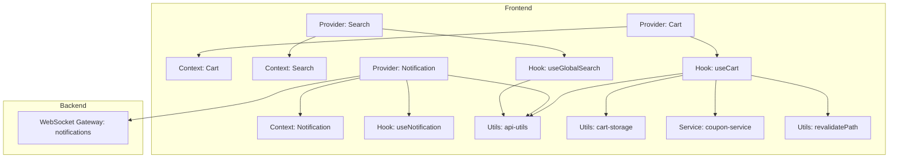
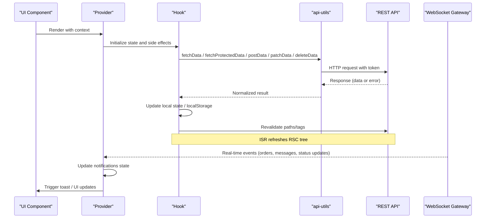
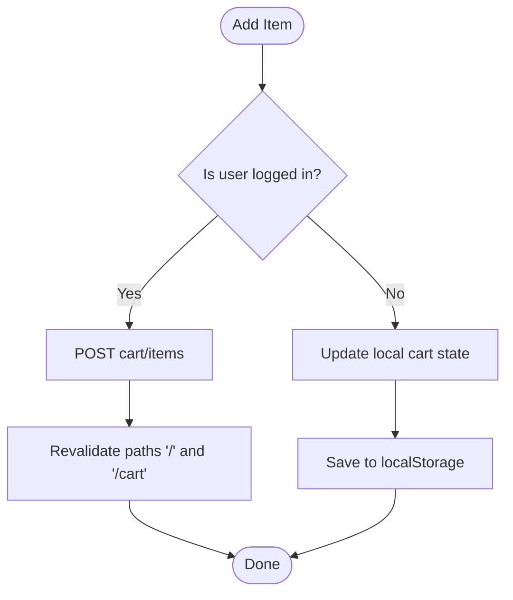
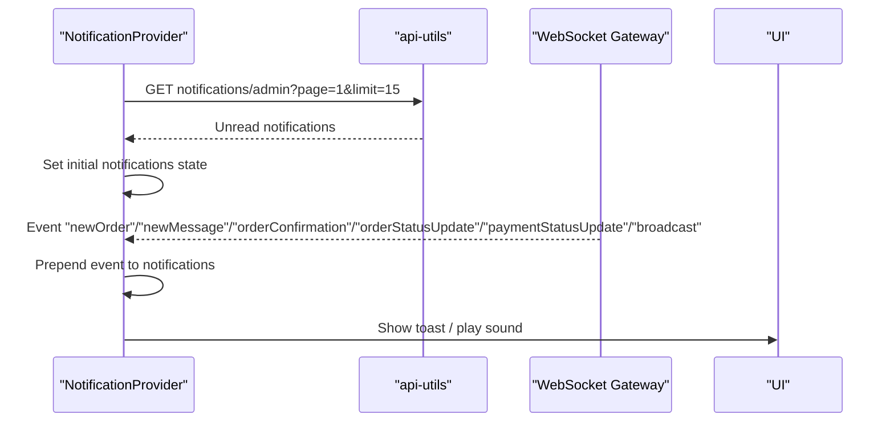
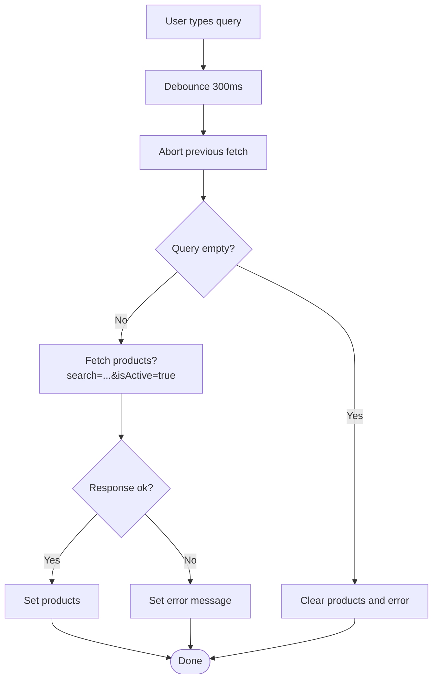
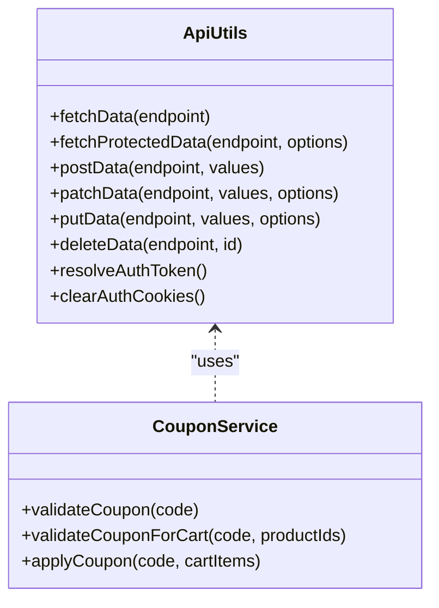
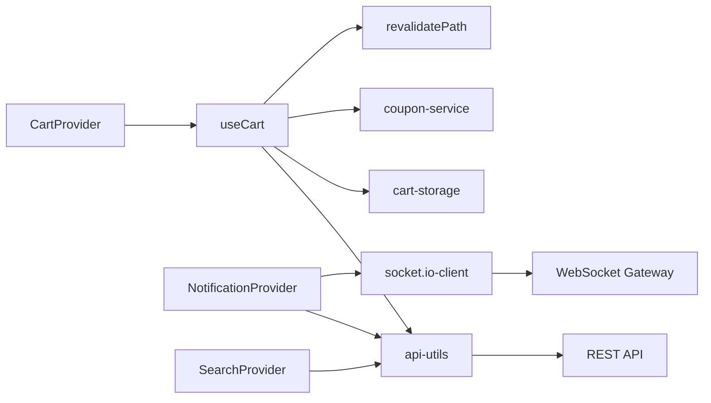

# State Management & Data Flow

<cite>
**Referenced Files in This Document**
- [cart-context.tsx](file://apps/frontend/contexts/cart-context.tsx)
- [notification-context.tsx](file://apps/frontend/contexts/notification-context.tsx)
- [search-context.tsx](file://apps/frontend/contexts/search-context.tsx)
- [cart-provider.tsx](file://apps/frontend/providers/cart-provider.tsx)
- [notification-provider.tsx](file://apps/frontend/providers/notification-provider.tsx)
- [search-provider.tsx](file://apps/frontend/providers/search-provider.tsx)
- [use-cart.ts](file://apps/frontend/hooks/use-cart.ts)
- [use-notification.ts](file://apps/frontend/hooks/use-notification.ts)
- [use-global-search.tsx](file://apps/frontend/hooks/use-global-search.tsx)
- [cart-storage.ts](file://apps/frontend/utils/cart-storage.ts)
- [api-utils.ts](file://apps/frontend/utils/api-utils.ts)
- [coupon-service.ts](file://apps/frontend/lib/coupon-service.ts)
- [revalidatePath.ts](file://apps/frontend/utils/revalidatePath.ts)
- [cart-page-wrapper.tsx](file://apps/frontend/components/cart/cart-page-wrapper.tsx)
- [notification.gateway.ts](file://apps/backend/src/notification/notification.gateway.ts)
</cite>

## Table of Contents
1. [Introduction](#introduction)
2. [Project Structure](#project-structure)
3. [Core Components](#core-components)
4. [Architecture Overview](#architecture-overview)
5. [Detailed Component Analysis](#detailed-component-analysis)
6. [Dependency Analysis](#dependency-analysis)
7. [Performance Considerations](#performance-considerations)
8. [Troubleshooting Guide](#troubleshooting-guide)
9. [Conclusion](#conclusion)

## Introduction
This document explains the state management architecture and data flow patterns across the frontend application. It focuses on:
- React Context usage for global state (cart, notifications, search)
- Custom hooks that encapsulate business logic
- Data fetching strategies with server-side rendering and client hydration
- API service layer, error handling, and caching
- State persistence, optimistic updates, and real-time synchronization via WebSockets

The goal is to provide a clear mental model for both new and experienced contributors to understand how state flows from the server to the UI and back.

## Project Structure
The state management spans contexts, providers, hooks, utilities, and services:
- Contexts define the shape of global state and are consumed by components via custom hooks
- Providers wrap the app or feature areas and manage lifecycle, side effects, and synchronization
- Hooks encapsulate reusable logic (e.g., cart operations, notification subscriptions)
- Utilities handle persistence (localStorage), API calls, and Next.js cache revalidation
- Services abstract domain-specific API interactions (e.g., coupon application)

**Diagram sources**
- [cart-context.tsx:7-48](file://apps/frontend/contexts/cart-context.tsx#L7-L48)
- [notification-context.tsx:1-7](file://apps/frontend/contexts/notification-context.tsx#L1-L7)
- [search-context.tsx:1-21](file://apps/frontend/contexts/search-context.tsx#L1-L21)
- [cart-provider.tsx:1-31](file://apps/frontend/providers/cart-provider.tsx#L1-L31)
- [notification-provider.tsx:1-291](file://apps/frontend/providers/notification-provider.tsx#L1-L291)
- [search-provider.tsx:1-136](file://apps/frontend/providers/search-provider.tsx#L1-L136)
- [use-cart.ts:1-647](file://apps/frontend/hooks/use-cart.ts#L1-L647)
- [use-notification.ts:1-15](file://apps/frontend/hooks/use-notification.ts#L1-L15)
- [use-global-search.tsx:1-13](file://apps/frontend/hooks/use-global-search.tsx#L1-L13)
- [api-utils.ts:1-565](file://apps/frontend/utils/api-utils.ts#L1-L565)
- [cart-storage.ts:1-109](file://apps/frontend/utils/cart-storage.ts#L1-L109)
- [coupon-service.ts:1-81](file://apps/frontend/lib/coupon-service.ts#L1-L81)
- [revalidatePath.ts:1-27](file://apps/frontend/utils/revalidatePath.ts#L1-L27)
- [notification.gateway.ts:1-48](file://apps/backend/src/notification/notification.gateway.ts#L1-L48)

**Section sources**
- [cart-context.tsx:7-48](file://apps/frontend/contexts/cart-context.tsx#L7-L48)
- [notification-context.tsx:1-7](file://apps/frontend/contexts/notification-context.tsx#L1-L7)
- [search-context.tsx:1-21](file://apps/frontend/contexts/search-context.tsx#L1-L21)
- [cart-provider.tsx:1-31](file://apps/frontend/providers/cart-provider.tsx#L1-L31)
- [notification-provider.tsx:1-291](file://apps/frontend/providers/notification-provider.tsx#L1-L291)
- [search-provider.tsx:1-136](file://apps/frontend/providers/search-provider.tsx#L1-L136)
- [use-cart.ts:1-647](file://apps/frontend/hooks/use-cart.ts#L1-L647)
- [use-notification.ts:1-15](file://apps/frontend/hooks/use-notification.ts#L1-L15)
- [use-global-search.tsx:1-13](file://apps/frontend/hooks/use-global-search.tsx#L1-L13)
- [cart-storage.ts:1-109](file://apps/frontend/utils/cart-storage.ts#L1-L109)
- [api-utils.ts:1-565](file://apps/frontend/utils/api-utils.ts#L1-L565)
- [coupon-service.ts:1-81](file://apps/frontend/lib/coupon-service.ts#L1-L81)
- [revalidatePath.ts:1-27](file://apps/frontend/utils/revalidatePath.ts#L1-L27)
- [notification.gateway.ts:1-48](file://apps/backend/src/notification/notification.gateway.ts#L1-L48)

## Core Components
- Cart context and provider: Manage cart items, coupons, totals, and sync between local storage and server. Exposes actions like add/update/remove items, apply/remove coupon, and cleanup inactive products.
- Notification context and provider: Manage WebSocket connection, persist unread notifications, and expose methods to mark read, clear, and remove notifications.
- Search context and provider: Manage search query, debounced product search, URL synchronization, and loading/error states.

Key responsibilities:
- Contexts define types and provide safe consumption via hooks
- Providers orchestrate side effects (fetching, sockets, persistence)
- Hooks encapsulate reusable logic and integrate with API and persistence layers

**Section sources**
- [cart-context.tsx:7-48](file://apps/frontend/contexts/cart-context.tsx#L7-L48)
- [cart-provider.tsx:1-31](file://apps/frontend/providers/cart-provider.tsx#L1-L31)
- [use-cart.ts:1-647](file://apps/frontend/hooks/use-cart.ts#L1-L647)
- [notification-context.tsx:1-7](file://apps/frontend/contexts/notification-context.tsx#L1-L7)
- [notification-provider.tsx:1-291](file://apps/frontend/providers/notification-provider.tsx#L1-L291)
- [use-notification.ts:1-15](file://apps/frontend/hooks/use-notification.ts#L1-L15)
- [search-context.tsx:1-21](file://apps/frontend/contexts/search-context.tsx#L1-L21)
- [search-provider.tsx:1-136](file://apps/frontend/providers/search-provider.tsx#L1-L136)
- [use-global-search.tsx:1-13](file://apps/frontend/hooks/use-global-search.tsx#L1-L13)

## Architecture Overview
The system uses a layered approach:
- UI components consume contexts via hooks
- Providers manage state and side effects
- Hooks coordinate API calls, persistence, and Next.js cache revalidation
- API utilities centralize fetch behavior, token resolution, and caching
- Backend provides REST endpoints and a WebSocket gateway for real-time events

**Diagram sources**
- [api-utils.ts:71-139](file://apps/frontend/utils/api-utils.ts#L71-L139)
- [api-utils.ts:141-189](file://apps/frontend/utils/api-utils.ts#L141-L189)
- [api-utils.ts:266-307](file://apps/frontend/utils/api-utils.ts#L266-L307)
- [api-utils.ts:391-439](file://apps/frontend/utils/api-utils.ts#L391-L439)
- [api-utils.ts:483-517](file://apps/frontend/utils/api-utils.ts#L483-L517)
- [revalidatePath.ts:8-21](file://apps/frontend/utils/revalidatePath.ts#L8-L21)
- [notification-provider.tsx:86-248](file://apps/frontend/providers/notification-provider.tsx#L86-L248)
- [notification.gateway.ts:15-48](file://apps/backend/src/notification/notification.gateway.ts#L15-L48)

## Detailed Component Analysis

### Cart State Management
Responsibilities:
- Maintain cart items and applied coupon
- Persist guest cart to localStorage
- Sync guest cart to server upon login
- Compute totals and discounted prices
- Handle item add/update/remove and coupon apply/remove
- Refresh product data and remove inactive items

**Diagram sources**
- [use-cart.ts:157-224](file://apps/frontend/hooks/use-cart.ts#L157-L224)
- [use-cart.ts:95-105](file://apps/frontend/hooks/use-cart.ts#L95-L105)
- [use-cart.ts:107-155](file://apps/frontend/hooks/use-cart.ts#L107-L155)
- [revalidatePath.ts:8-21](file://apps/frontend/utils/revalidatePath.ts#L8-L21)

Key implementation notes:
- Guest cart persists to localStorage; server cart is used when authenticated
- On login, local items are posted to server and then cleared locally
- Product data refresh runs in background to update prices/stock
- Coupon application integrates with a dedicated service and updates UI accordingly

**Section sources**
- [use-cart.ts:29-93](file://apps/frontend/hooks/use-cart.ts#L29-L93)
- [use-cart.ts:107-155](file://apps/frontend/hooks/use-cart.ts#L107-L155)
- [use-cart.ts:157-224](file://apps/frontend/hooks/use-cart.ts#L157-L224)
- [use-cart.ts:386-445](file://apps/frontend/hooks/use-cart.ts#L386-L445)
- [use-cart.ts:460-500](file://apps/frontend/hooks/use-cart.ts#L460-L500)
- [use-cart.ts:502-582](file://apps/frontend/hooks/use-cart.ts#L502-L582)
- [cart-storage.ts:26-43](file://apps/frontend/utils/cart-storage.ts#L26-L43)
- [cart-storage.ts:68-95](file://apps/frontend/utils/cart-storage.ts#L68-L95)
- [coupon-service.ts:66-81](file://apps/frontend/lib/coupon-service.ts#L66-L81)
- [revalidatePath.ts:8-21](file://apps/frontend/utils/revalidatePath.ts#L8-L21)

### Notification State Management and Real-Time Sync
Responsibilities:
- Connect to WebSocket namespace for real-time events
- Seed unread notifications from DB to keep bell consistent after reload
- Handle admin-only events (new orders/messages) and general events (order confirmation/status/payment/broadcast)
- Mark notifications as read and clear them

**Diagram sources**
- [notification-provider.tsx:37-79](file://apps/frontend/providers/notification-provider.tsx#L37-L79)
- [notification-provider.tsx:86-248](file://apps/frontend/providers/notification-provider.tsx#L86-L248)
- [notification-provider.tsx:250-272](file://apps/frontend/providers/notification-provider.tsx#L250-L272)
- [notification.gateway.ts:15-48](file://apps/backend/src/notification/notification.gateway.ts#L15-L48)

Key implementation notes:
- Uses socket.io-client with reconnection settings
- Seeds unread notifications on mount and reconnect to avoid missing events while disconnected
- Marks persisted notifications as read when clearing or marking individually

**Section sources**
- [notification-provider.tsx:37-79](file://apps/frontend/providers/notification-provider.tsx#L37-L79)
- [notification-provider.tsx:86-248](file://apps/frontend/providers/notification-provider.tsx#L86-L248)
- [notification-provider.tsx:250-272](file://apps/frontend/providers/notification-provider.tsx#L250-L272)
- [notification.gateway.ts:15-48](file://apps/backend/src/notification/notification.gateway.ts#L15-L48)

### Search State Management
Responsibilities:
- Manage open state, expanded state, and query string synchronization
- Debounce search input and cancel previous requests
- Fetch products based on query and handle loading/error states

**Diagram sources**
- [search-provider.tsx:32-87](file://apps/frontend/providers/search-provider.tsx#L32-L87)
- [search-provider.tsx:89-114](file://apps/frontend/providers/search-provider.tsx#L89-L114)

Key implementation notes:
- Uses AbortController to cancel stale requests
- Updates URL only on explicit search action (e.g., Enter key)
- Initializes query from URL on first mount

**Section sources**
- [search-provider.tsx:8-30](file://apps/frontend/providers/search-provider.tsx#L8-L30)
- [search-provider.tsx:32-87](file://apps/frontend/providers/search-provider.tsx#L32-L87)
- [search-provider.tsx:89-114](file://apps/frontend/providers/search-provider.tsx#L89-L114)

### API Service Layer and Caching
Responsibilities:
- Centralize HTTP requests with token resolution
- Differentiate public vs protected endpoints
- Apply Next.js Data Cache tags and revalidation rules
- Provide typed wrappers for POST/PATCH/PUT/DELETE
- Implement client-side product detail cache to reduce redundant requests

**Diagram sources**
- [api-utils.ts:22-46](file://apps/frontend/utils/api-utils.ts#L22-L46)
- [api-utils.ts:71-139](file://apps/frontend/utils/api-utils.ts#L71-L139)
- [api-utils.ts:141-189](file://apps/frontend/utils/api-utils.ts#L141-L189)
- [api-utils.ts:266-307](file://apps/frontend/utils/api-utils.ts#L266-L307)
- [api-utils.ts:391-439](file://apps/frontend/utils/api-utils.ts#L391-L439)
- [api-utils.ts:483-517](file://apps/frontend/utils/api-utils.ts#L483-L517)
- [coupon-service.ts:36-81](file://apps/frontend/lib/coupon-service.ts#L36-L81)

Key implementation notes:
- Token resolution caches the token during the session and supports server-side retrieval
- Product detail endpoints use no-store to ensure deactivations are immediate; a short-lived client cache reduces repeated network calls
- Public endpoints use ISR with revalidation tags
- Protected endpoints include Authorization header and handle 401 by clearing auth cookies

**Section sources**
- [api-utils.ts:22-46](file://apps/frontend/utils/api-utils.ts#L22-L46)
- [api-utils.ts:71-139](file://apps/frontend/utils/api-utils.ts#L71-L139)
- [api-utils.ts:141-189](file://apps/frontend/utils/api-utils.ts#L141-L189)
- [api-utils.ts:232-265](file://apps/frontend/utils/api-utils.ts#L232-L265)
- [api-utils.ts:266-307](file://apps/frontend/utils/api-utils.ts#L266-L307)
- [api-utils.ts:391-439](file://apps/frontend/utils/api-utils.ts#L391-L439)
- [api-utils.ts:483-517](file://apps/frontend/utils/api-utils.ts#L483-L517)
- [coupon-service.ts:36-81](file://apps/frontend/lib/coupon-service.ts#L36-L81)

### Context Providers and Consumption Patterns
- CartProvider wraps children with CartContext and injects server-provided cart and login state into useCart
- NotificationProvider manages WebSocket lifecycle and exposes notification state/actions
- SearchProvider manages search state and URL synchronization

Consumers access state via:
- useCartContext for cart operations
- useNotification for notification state and actions
- useGlobalSearch for search state and actions

Example consumer pattern:
- A page component consumes cart context to render cart contents and totals
- A header component consumes search context to display results and toggle search UI
- An admin dashboard consumes notification context to show live alerts

**Section sources**
- [cart-provider.tsx:1-31](file://apps/frontend/providers/cart-provider.tsx#L1-L31)
- [cart-context.tsx:7-48](file://apps/frontend/contexts/cart-context.tsx#L7-L48)
- [cart-page-wrapper.tsx:1-12](file://apps/frontend/components/cart/cart-page-wrapper.tsx#L1-L12)
- [notification-provider.tsx:1-291](file://apps/frontend/providers/notification-provider.tsx#L1-L291)
- [notification-context.tsx:1-7](file://apps/frontend/contexts/notification-context.tsx#L1-L7)
- [use-notification.ts:1-15](file://apps/frontend/hooks/use-notification.ts#L1-L15)
- [search-provider.tsx:1-136](file://apps/frontend/providers/search-provider.tsx#L1-L136)
- [search-context.tsx:1-21](file://apps/frontend/contexts/search-context.tsx#L1-L21)
- [use-global-search.tsx:1-13](file://apps/frontend/hooks/use-global-search.tsx#L1-L13)

## Dependency Analysis
High-level dependencies:
- Providers depend on contexts to supply typed state
- Hooks depend on API utilities, persistence utilities, and services
- Providers depend on API utilities and external libraries (socket.io-client)
- Backend WebSocket gateway depends on user service for routing events

**Diagram sources**
- [cart-provider.tsx:1-31](file://apps/frontend/providers/cart-provider.tsx#L1-L31)
- [use-cart.ts:1-647](file://apps/frontend/hooks/use-cart.ts#L1-L647)
- [api-utils.ts:1-565](file://apps/frontend/utils/api-utils.ts#L1-L565)
- [cart-storage.ts:1-109](file://apps/frontend/utils/cart-storage.ts#L1-L109)
- [coupon-service.ts:1-81](file://apps/frontend/lib/coupon-service.ts#L1-L81)
- [revalidatePath.ts:1-27](file://apps/frontend/utils/revalidatePath.ts#L1-L27)
- [notification-provider.tsx:1-291](file://apps/frontend/providers/notification-provider.tsx#L1-L291)
- [search-provider.tsx:1-136](file://apps/frontend/providers/search-provider.tsx#L1-L136)
- [notification.gateway.ts:1-48](file://apps/backend/src/notification/notification.gateway.ts#L1-L48)

**Section sources**
- [cart-provider.tsx:1-31](file://apps/frontend/providers/cart-provider.tsx#L1-L31)
- [use-cart.ts:1-647](file://apps/frontend/hooks/use-cart.ts#L1-L647)
- [api-utils.ts:1-565](file://apps/frontend/utils/api-utils.ts#L1-L565)
- [cart-storage.ts:1-109](file://apps/frontend/utils/cart-storage.ts#L1-L109)
- [coupon-service.ts:1-81](file://apps/frontend/lib/coupon-service.ts#L1-L81)
- [revalidatePath.ts:1-27](file://apps/frontend/utils/revalidatePath.ts#L1-L27)
- [notification-provider.tsx:1-291](file://apps/frontend/providers/notification-provider.tsx#L1-L291)
- [search-provider.tsx:1-136](file://apps/frontend/providers/search-provider.tsx#L1-L136)
- [notification.gateway.ts:1-48](file://apps/backend/src/notification/notification.gateway.ts#L1-L48)

## Performance Considerations
- Next.js Data Cache:
  - Public endpoints use ISR with revalidation tags to balance freshness and performance
  - Product detail endpoints use no-store to ensure deactivation changes are immediately visible
  - Client-side product detail cache reduces repeated network calls for slug-based endpoints
- Debouncing and cancellation:
  - Search input is debounced to limit API calls
  - Previous fetch requests are aborted to prevent race conditions
- Optimistic updates:
  - Local cart updates occur immediately for guest users, improving perceived responsiveness
  - Notifications prepend incoming events instantly before persisting read state
- Revalidation strategy:
  - After mutating cart or applying coupons, targeted path revalidations refresh relevant pages without full reloads
- WebSocket resilience:
  - Reconnection settings ensure robust real-time updates
  - Seeding unread notifications prevents missed events during disconnections

[No sources needed since this section provides general guidance]

## Troubleshooting Guide
Common issues and resolutions:
- Unauthorized errors:
  - Protected endpoints return 401; the API utility clears auth cookies and logs an error
  - Ensure tokens are resolved correctly and sessions are valid
- Stale product details:
  - If product deactivation appears cached, verify no-store usage for product detail endpoints
  - Check client-side product cache TTL and ensure it does not mask deactivations
- WebSocket connectivity:
  - Verify environment variables for socket URL and CORS configuration on the backend
  - Confirm userId and isAdmin parameters are passed correctly
- Cart sync failures:
  - Review error handling in cart operations and ensure server endpoints are reachable
  - Validate coupon application responses and excluded products feedback

**Section sources**
- [api-utils.ts:141-189](file://apps/frontend/utils/api-utils.ts#L141-L189)
- [api-utils.ts:266-307](file://apps/frontend/utils/api-utils.ts#L266-L307)
- [api-utils.ts:391-439](file://apps/frontend/utils/api-utils.ts#L391-L439)
- [api-utils.ts:483-517](file://apps/frontend/utils/api-utils.ts#L483-L517)
- [notification-provider.tsx:128-131](file://apps/frontend/providers/notification-provider.tsx#L128-L131)
- [notification-provider.tsx:250-272](file://apps/frontend/providers/notification-provider.tsx#L250-L272)

## Conclusion
The state management architecture combines React Context, custom hooks, and a centralized API layer to deliver a responsive and reliable user experience. The cart leverages local persistence and server synchronization, notifications integrate real-time updates via WebSockets, and search balances UX with efficient data fetching. Caching and revalidation strategies ensure data freshness while minimizing network overhead. Following these patterns helps maintain consistency, performance, and scalability across the application.

[No sources needed since this section summarizes without analyzing specific files]