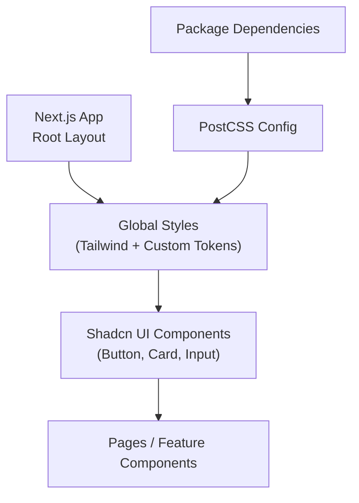
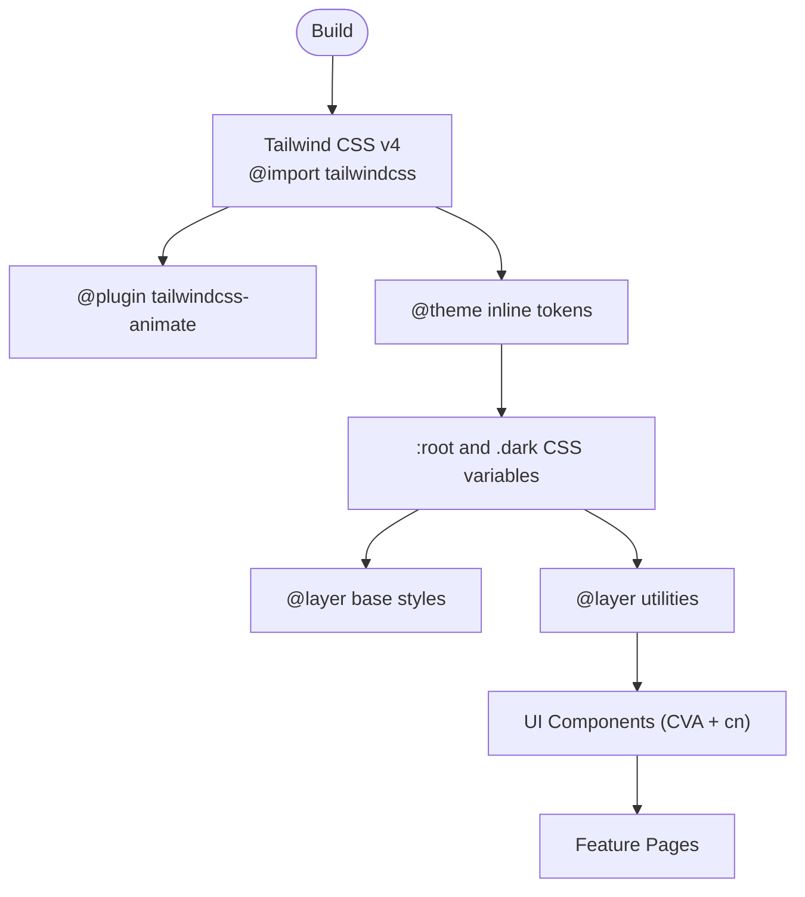
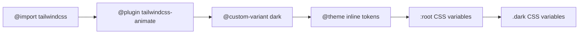
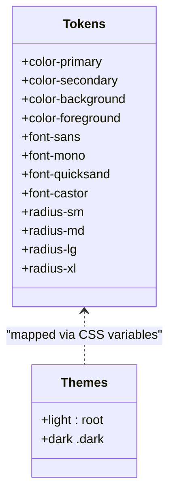
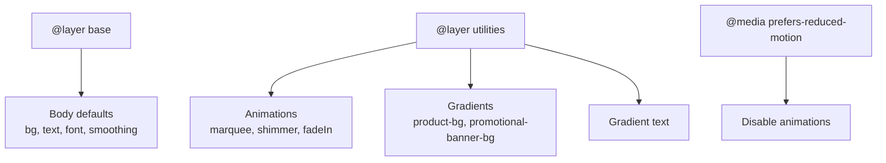
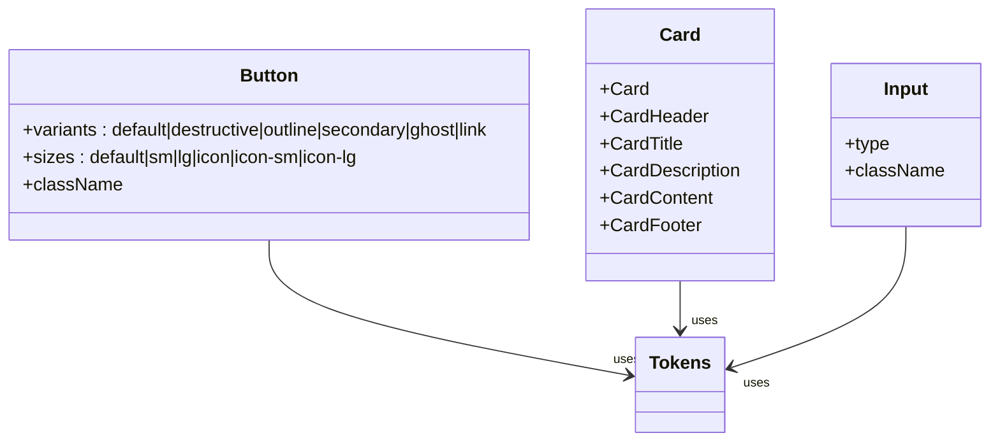
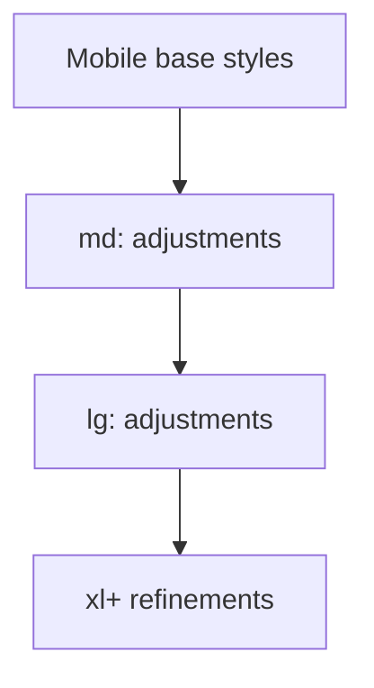
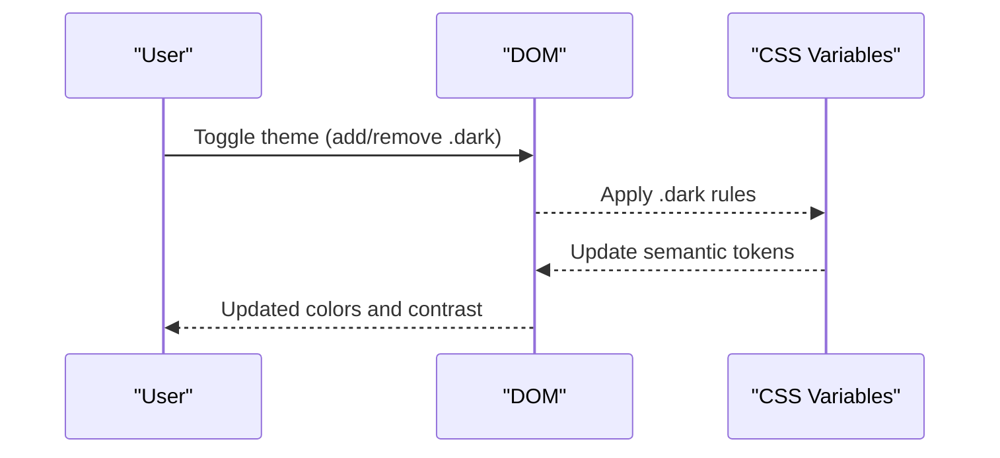
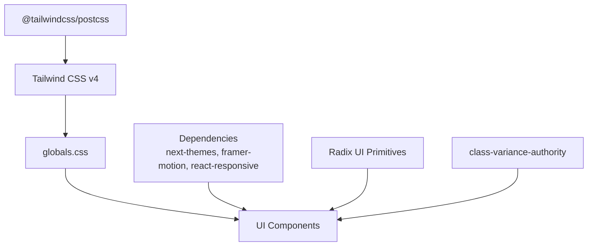

# Styling Architecture & Theming

<cite>
**Referenced Files in This Document**
- [package.json](file://apps/frontend/package.json)
- [postcss.config.mjs](file://apps/frontend/postcss.config.mjs)
- [components.json](file://apps/frontend/components.json)
- [globals.css](file://apps/frontend/app/globals.css)
- [layout.tsx](file://apps/frontend/app/layout.tsx)
- [button.tsx](file://apps/frontend/components/ui/button.tsx)
- [card.tsx](file://apps/frontend/components/ui/card.tsx)
- [input.tsx](file://apps/frontend/components/ui/input.tsx)
</cite>

## Table of Contents
1. [Introduction](#introduction)
2. [Project Structure](#project-structure)
3. [Core Components](#core-components)
4. [Architecture Overview](#architecture-overview)
5. [Detailed Component Analysis](#detailed-component-analysis)
6. [Dependency Analysis](#dependency-analysis)
7. [Performance Considerations](#performance-considerations)
8. [Troubleshooting Guide](#troubleshooting-guide)
9. [Conclusion](#conclusion)

## Introduction
This document explains the styling architecture and theming system for the frontend application. It covers Tailwind CSS v4 configuration, custom theme extensions, design tokens, global styles organization, component-specific styling patterns, responsive design approach, dark mode support, accessibility considerations, and performance optimizations such as CSS purging and bundle size strategies.

## Project Structure
The styling stack is centered around:
- Tailwind CSS v4 with PostCSS integration
- Shadcn UI components configured via a JSON manifest
- Global CSS that defines design tokens, base styles, utilities, animations, and dark mode variables
- Next.js layout that injects fonts and applies font variables to the root HTML element

**Diagram sources**
- [layout.tsx:15-34](file://apps/frontend/app/layout.tsx#L15-L34)
- [globals.css:1-55](file://apps/frontend/app/globals.css#L1-L55)
- [postcss.config.mjs:1-6](file://apps/frontend/postcss.config.mjs#L1-L6)
- [package.json:72-85](file://apps/frontend/package.json#L72-L85)

**Section sources**
- [package.json:11-85](file://apps/frontend/package.json#L11-L85)
- [postcss.config.mjs:1-6](file://apps/frontend/postcss.config.mjs#L1-L6)
- [components.json:1-21](file://apps/frontend/components.json#L1-L21)
- [globals.css:1-55](file://apps/frontend/app/globals.css#L1-L55)
- [layout.tsx:15-34](file://apps/frontend/app/layout.tsx#L15-L34)

## Core Components
- Tailwind CSS v4 is imported directly in global styles and processed through @tailwindcss/postcss.
- Shadcn UI is configured to use Tailwind with CSS variables enabled and a neutral base color.
- The button, card, and input components are built using class-variance-authority (CVA) and utility composition via cn() for consistent, variant-driven styling.

Key responsibilities:
- globals.css: Defines Tailwind import, plugin registration, custom dark variant, inline theme tokens, CSS variables for light/dark modes, base layer styles, and utility classes/animations.
- components.json: Declares Shadcn UI style, RSC usage, Tailwind CSS path, base color, CSS variables, aliases, and icon library.
- UI components: Provide accessible, theme-aware primitives with variants and sizes.

**Section sources**
- [globals.css:1-55](file://apps/frontend/app/globals.css#L1-L55)
- [components.json:1-21](file://apps/frontend/components.json#L1-L21)
- [button.tsx:1-63](file://apps/frontend/components/ui/button.tsx#L1-L63)
- [card.tsx:1-97](file://apps/frontend/components/ui/card.tsx#L1-L97)
- [input.tsx:1-22](file://apps/frontend/components/ui/input.tsx#L1-L22)

## Architecture Overview
The styling architecture follows a layered approach:
- Build-time: PostCSS compiles Tailwind v4 and plugins into optimized CSS.
- Theme layer: CSS variables define semantic tokens (colors, radii, typography).
- Base layer: Global resets and body defaults.
- Utility layer: Animations, gradients, and reusable visual helpers.
- Component layer: Primitives composed from utilities and tokens.

**Diagram sources**
- [globals.css:1-55](file://apps/frontend/app/globals.css#L1-L55)
- [globals.css:57-125](file://apps/frontend/app/globals.css#L57-L125)
- [globals.css:127-222](file://apps/frontend/app/globals.css#L127-L222)
- [button.tsx:7-38](file://apps/frontend/components/ui/button.tsx#L7-L38)

## Detailed Component Analysis

### Tailwind CSS v4 Configuration
- Import and plugin setup:
  - Tailwind is imported via @import "tailwindcss".
  - Animation plugin is registered with @plugin "tailwindcss-animate".
  - Dark mode is implemented using a custom variant scoped to .dark.
- Inline theme tokens:
  - Brand colors and additional semantic colors are defined under @theme inline.
  - Typography tokens map to CSS variables for Google Fonts and local fonts.
  - Semantic color tokens (primary, secondary, accent, destructive, etc.) are mapped to CSS variables.
  - Radius tokens derive from a single --radius variable.

**Diagram sources**
- [globals.css:1-55](file://apps/frontend/app/globals.css#L1-L55)
- [globals.css:57-125](file://apps/frontend/app/globals.css#L57-L125)

**Section sources**
- [globals.css:1-55](file://apps/frontend/app/globals.css#L1-L55)
- [globals.css:57-125](file://apps/frontend/app/globals.css#L57-L125)

### Design Tokens and Theming
- Color tokens:
  - Light and dark palettes are defined using OKLCH values for perceptual uniformity.
  - Chart tokens are provided for data visualization components.
  - Sidebar tokens provide dedicated semantics for admin panels.
- Typography tokens:
  - Font families are exposed as CSS variables and applied in the base layer.
  - Root layout sets font variables on html and body for consistent rendering.
- Spacing and radius:
  - Radius tokens are derived from a single base variable to ensure consistency across components.

**Diagram sources**
- [globals.css:7-55](file://apps/frontend/app/globals.css#L7-L55)
- [globals.css:57-125](file://apps/frontend/app/globals.css#L57-L125)
- [layout.tsx:17-34](file://apps/frontend/app/layout.tsx#L17-L34)

**Section sources**
- [globals.css:7-55](file://apps/frontend/app/globals.css#L7-L55)
- [globals.css:57-125](file://apps/frontend/app/globals.css#L57-L125)
- [layout.tsx:17-34](file://apps/frontend/app/layout.tsx#L17-L34)

### Global Styles Organization
- Base layer:
  - Applies border and outline tokens globally.
  - Sets body background, text color, font family, smoothing, and line-height.
- Utilities layer:
  - Defines marquee and shimmer animations.
  - Provides product background gradient and promotional banner backdrop.
  - Adds golden radial backgrounds and gradient text utilities.
- Accessibility:
  - Reduced motion media query disables animations for users who prefer reduced motion.
- Scrollbars:
  - Thin scrollbars styled consistently across browsers with dark mode variants.

**Diagram sources**
- [globals.css:127-222](file://apps/frontend/app/globals.css#L127-L222)
- [globals.css:374-387](file://apps/frontend/app/globals.css#L374-L387)

**Section sources**
- [globals.css:127-222](file://apps/frontend/app/globals.css#L127-L222)
- [globals.css:320-373](file://apps/frontend/app/globals.css#L320-L373)
- [globals.css:374-387](file://apps/frontend/app/globals.css#L374-L387)

### Component-Specific Styling Patterns
- Button:
  - Uses CVA to define variants (default, destructive, outline, secondary, ghost, link) and sizes (default, sm, lg, icon, icon-sm, icon-lg).
  - Focus-visible states leverage ring tokens; invalid states use destructive token.
  - Composes classes via cn() for flexible overrides.
- Card:
  - Provides a container with consistent spacing, borders, and shadow.
  - Sub-components (Header, Title, Description, Content, Footer) compose grid layouts and spacing.
- Input:
  - Styled with focus-visible rings, placeholder and file input styles, disabled states, and aria-invalid feedback.

**Diagram sources**
- [button.tsx:7-38](file://apps/frontend/components/ui/button.tsx#L7-L38)
- [card.tsx:5-97](file://apps/frontend/components/ui/card.tsx#L5-L97)
- [input.tsx:5-22](file://apps/frontend/components/ui/input.tsx#L5-L22)

**Section sources**
- [button.tsx:1-63](file://apps/frontend/components/ui/button.tsx#L1-L63)
- [card.tsx:1-97](file://apps/frontend/components/ui/card.tsx#L1-L97)
- [input.tsx:1-22](file://apps/frontend/components/ui/input.tsx#L1-L22)

### Responsive Design Approach
- Breakpoints:
  - Components and pages use Tailwind’s responsive prefixes (e.g., sm:, md:, lg:) to adapt layouts across screen sizes.
- Container queries:
  - Some components use @container for internal responsiveness.
- Mobile-first:
  - Base styles apply universally; enhancements are layered with responsive utilities.

**Diagram sources**
- [card.tsx:22-27](file://apps/frontend/components/ui/card.tsx#L22-L27)

**Section sources**
- [card.tsx:22-27](file://apps/frontend/components/ui/card.tsx#L22-L27)

### Dark Mode Support
- Implementation:
  - A custom dark variant is declared to scope styles under .dark.
  - CSS variables are redefined in .dark to invert or adjust colors for dark themes.
- Usage:
  - Components rely on semantic tokens (e.g., bg-background, text-foreground) which automatically adapt to dark mode.

**Diagram sources**
- [globals.css:5](file://apps/frontend/app/globals.css#L5)
- [globals.css:92-125](file://apps/frontend/app/globals.css#L92-L125)

**Section sources**
- [globals.css:5](file://apps/frontend/app/globals.css#L5)
- [globals.css:92-125](file://apps/frontend/app/globals.css#L92-L125)

### Accessibility Considerations
- Reduced motion:
  - Animations are disabled when prefers-reduced-motion is set.
- Focus management:
  - Components use focus-visible outlines and rings for keyboard navigation.
- ARIA attributes:
  - Inputs and interactive elements include aria-invalid and other attributes for assistive technologies.
- Contrast and readability:
  - Semantic tokens ensure sufficient contrast across light and dark themes.

**Section sources**
- [globals.css:374-387](file://apps/frontend/app/globals.css#L374-L387)
- [input.tsx:10-14](file://apps/frontend/components/ui/input.tsx#L10-L14)
- [button.tsx:8-8](file://apps/frontend/components/ui/button.tsx#L8-L8)

## Dependency Analysis
- Build pipeline:
  - PostCSS uses @tailwindcss/postcss to compile Tailwind v4.
- Runtime dependencies:
  - next-themes enables theme toggling at runtime.
  - framer-motion provides advanced animations where needed.
  - react-responsive supports media queries in React.
- UI ecosystem:
  - Radix UI primitives provide accessible building blocks.
  - class-variance-authority powers variant systems in components.
  - tailwind-merge and clsx help merge class names safely.

**Diagram sources**
- [postcss.config.mjs:1-6](file://apps/frontend/postcss.config.mjs#L1-L6)
- [package.json:11-85](file://apps/frontend/package.json#L11-L85)
- [globals.css:1-55](file://apps/frontend/app/globals.css#L1-L55)

**Section sources**
- [postcss.config.mjs:1-6](file://apps/frontend/postcss.config.mjs#L1-L6)
- [package.json:11-85](file://apps/frontend/package.json#L11-L85)

## Performance Considerations
- CSS Purging:
  - Tailwind v4 generates only used utilities based on source scanning; no explicit purge config is required.
- Critical CSS Extraction:
  - Next.js optimizes critical CSS by default during build; keep global styles minimal and avoid heavy animations in initial render paths.
- Bundle Size Optimization:
  - Prefer semantic tokens and utilities over large custom CSS blocks.
  - Use animation sparingly; leverage hardware-accelerated properties (transform, opacity).
  - Avoid !important unless necessary; prefer specificity control via cn() and CVA.
- Fonts:
  - Use display: swap and subset loading to reduce FOIT/FOUT impact.
- Images and Assets:
  - Utilize Next.js image optimization and lazy loading where applicable.

[No sources needed since this section provides general guidance]

## Troubleshooting Guide
- Dark mode not applying:
  - Ensure .dark class is present on the root element and that CSS variables are correctly overridden.
- Colors not updating:
  - Verify that components use semantic tokens (e.g., bg-background, text-foreground) rather than hardcoded colors.
- Animations causing jank:
  - Check prefers-reduced-motion behavior and avoid animating layout-affecting properties.
- Focus visibility missing:
  - Confirm focus-visible styles are applied and not overridden by custom CSS.

**Section sources**
- [globals.css:92-125](file://apps/frontend/app/globals.css#L92-L125)
- [globals.css:374-387](file://apps/frontend/app/globals.css#L374-L387)
- [input.tsx:10-14](file://apps/frontend/components/ui/input.tsx#L10-L14)

## Conclusion
The styling architecture leverages Tailwind CSS v4 with a robust design token system, enabling consistent theming across light and dark modes. Global styles establish base behaviors and utilities, while UI components encapsulate variant-driven, accessible patterns. The build pipeline ensures efficient CSS generation, and careful attention to accessibility and performance yields a maintainable, scalable foundation for future growth.

[No sources needed since this section summarizes without analyzing specific files]