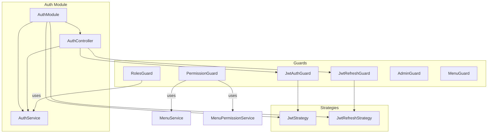
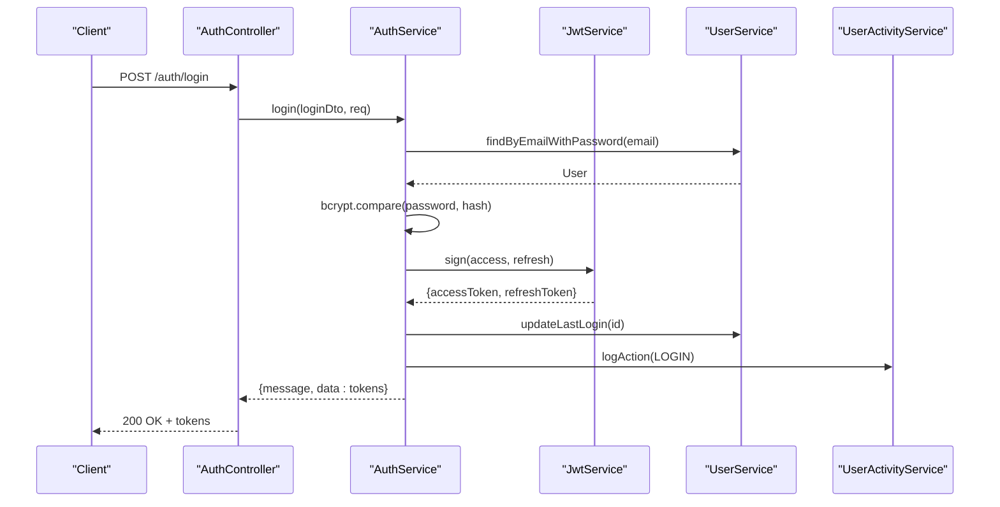
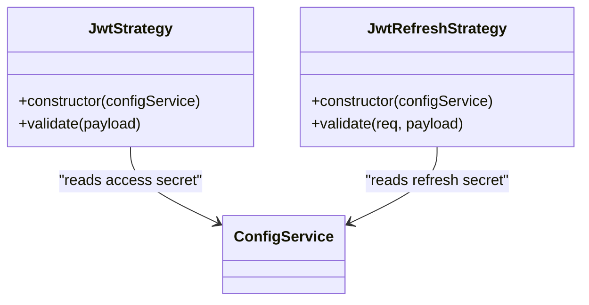
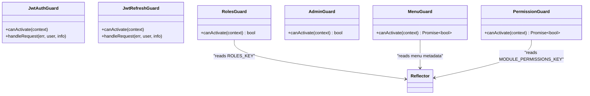
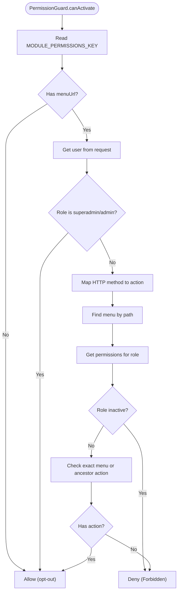
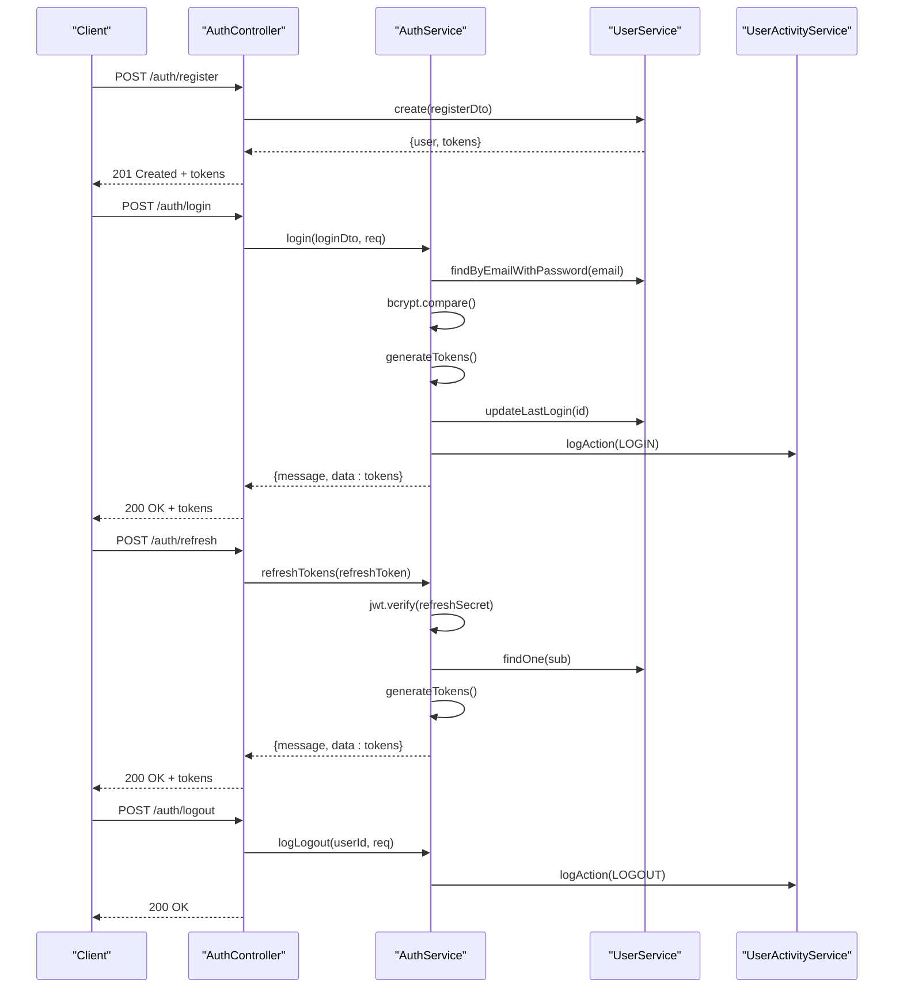
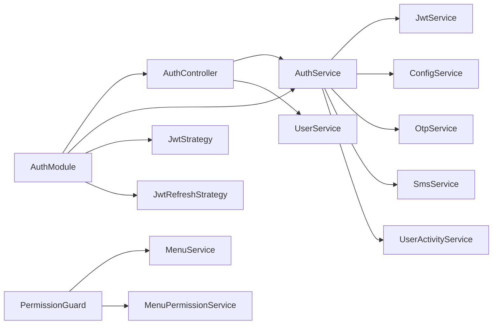

# Authentication & Authorization

<cite>
**Referenced Files in This Document**
- [auth.module.ts](file://apps/backend/src/auth/auth.module.ts)
- [auth.controller.ts](file://apps/backend/src/auth/auth.controller.ts)
- [auth.service.ts](file://apps/backend/src/auth/auth.service.ts)
- [jwt.strategy.ts](file://apps/backend/src/auth/strategies/jwt.strategy.ts)
- [jwt-refresh.strategy.ts](file://apps/backend/src/auth/strategies/jwt-refresh.strategy.ts)
- [jwt-auth.guard.ts](file://apps/backend/src/auth/guards/jwt-auth.guard.ts)
- [jwt-refresh.guard.ts](file://apps/backend/src/auth/guards/jwt-refresh.guard.ts)
- [roles.guard.ts](file://apps/backend/src/auth/guards/roles.guard.ts)
- [permission.guard.ts](file://apps/backend/src/auth/guards/permission.guard.ts)
- [admin.guard.ts](file://apps/backend/src/auth/guards/admin.guard.ts)
- [menu.guard.ts](file://apps/backend/src/auth/guards/menu.guard.ts)
- [roles.decorator.ts](file://apps/backend/src/auth/decorators/roles.decorator.ts)
</cite>

## Table of Contents
1. [Introduction](#introduction)
2. [Project Structure](#project-structure)
3. [Core Components](#core-components)
4. [Architecture Overview](#architecture-overview)
5. [Detailed Component Analysis](#detailed-component-analysis)
6. [Dependency Analysis](#dependency-analysis)
7. [Performance Considerations](#performance-considerations)
8. [Troubleshooting Guide](#troubleshooting-guide)
9. [Conclusion](#conclusion)

## Introduction
This document explains the authentication and authorization system implemented in the backend. It covers:
- JWT-based authentication flow with access and refresh tokens
- Token management, rotation, and lifecycle
- Role-based access control (RBAC) via guards and decorators
- Permission guards for module-level authorization
- Complete lifecycle from user registration to session management
- Security best practices including token rotation, password hashing, and audit logging

## Project Structure
The authentication subsystem is organized under apps/backend/src/auth with clear separation of concerns:
- Controllers expose public endpoints for login, register, refresh, logout, and OTP flows
- Services implement business logic for token generation, validation, and user activity tracking
- Strategies define Passport JWT verification for access and refresh tokens
- Guards enforce authentication, roles, permissions, and menu visibility
- Decorators provide metadata for role checks and module permissions

**Diagram sources**
- [auth.module.ts:15-34](file://apps/backend/src/auth/auth.module.ts#L15-L34)
- [auth.controller.ts:31-36](file://apps/backend/src/auth/auth.controller.ts#L31-L36)
- [auth.service.ts:21-32](file://apps/backend/src/auth/auth.service.ts#L21-L32)
- [jwt.strategy.ts:6-14](file://apps/backend/src/auth/strategies/jwt.strategy.ts#L6-L14)
- [jwt-refresh.strategy.ts:7-19](file://apps/backend/src/auth/strategies/jwt-refresh.strategy.ts#L7-L19)
- [jwt-auth.guard.ts:10-15](file://apps/backend/src/auth/guards/jwt-auth.guard.ts#L10-L15)
- [jwt-refresh.guard.ts:10-15](file://apps/backend/src/auth/guards/jwt-refresh.guard.ts#L10-L15)
- [roles.guard.ts:5-7](file://apps/backend/src/auth/guards/roles.guard.ts#L5-L7)
- [permission.guard.ts:31-37](file://apps/backend/src/auth/guards/permission.guard.ts#L31-L37)
- [admin.guard.ts:5-14](file://apps/backend/src/auth/guards/admin.guard.ts#L5-L14)
- [menu.guard.ts:7-13](file://apps/backend/src/auth/guards/menu.guard.ts#L7-L13)

**Section sources**
- [auth.module.ts:1-37](file://apps/backend/src/auth/auth.module.ts#L1-L37)
- [auth.controller.ts:1-309](file://apps/backend/src/auth/auth.controller.ts#L1-L309)
- [auth.service.ts:1-433](file://apps/backend/src/auth/auth.service.ts#L1-L433)

## Core Components
- AuthModule configures Passport, JwtModule, and providers for strategies and services
- AuthController exposes REST endpoints for registration, login, refresh, logout, validate, mobile login, and OTP verification
- AuthService handles user validation, token generation/refresh, OTP flows, and audit logging
- JwtStrategy validates access tokens and attaches user context to requests
- JwtRefreshStrategy validates refresh tokens and passes request context
- Guards:
  - JwtAuthGuard enforces bearer token authentication and supports public route overrides
  - JwtRefreshGuard enforces refresh token validation
  - RolesGuard enforces role-based checks using a decorator
  - PermissionGuard enforces module-level permissions based on menu configuration
  - AdminGuard restricts routes to admin roles
  - MenuGuard controls menu visibility based on permissions

**Section sources**
- [auth.module.ts:15-34](file://apps/backend/src/auth/auth.module.ts#L15-L34)
- [auth.controller.ts:31-36](file://apps/backend/src/auth/auth.controller.ts#L31-L36)
- [auth.service.ts:21-32](file://apps/backend/src/auth/auth.service.ts#L21-L32)
- [jwt.strategy.ts:6-25](file://apps/backend/src/auth/strategies/jwt.strategy.ts#L6-L25)
- [jwt-refresh.strategy.ts:7-24](file://apps/backend/src/auth/strategies/jwt-refresh.strategy.ts#L7-L24)
- [jwt-auth.guard.ts:10-45](file://apps/backend/src/auth/guards/jwt-auth.guard.ts#L10-L45)
- [jwt-refresh.guard.ts:10-61](file://apps/backend/src/auth/guards/jwt-refresh.guard.ts#L10-L61)
- [roles.guard.ts:5-28](file://apps/backend/src/auth/guards/roles.guard.ts#L5-L28)
- [permission.guard.ts:31-90](file://apps/backend/src/auth/guards/permission.guard.ts#L31-L90)
- [admin.guard.ts:5-14](file://apps/backend/src/auth/guards/admin.guard.ts#L5-L14)
- [menu.guard.ts:7-35](file://apps/backend/src/auth/guards/menu.guard.ts#L7-L35)
- [roles.decorator.ts:1-6](file://apps/backend/src/auth/decorators/roles.decorator.ts#L1-L6)

## Architecture Overview
The authentication architecture uses NestJS modules, Passport strategies, and custom guards to secure APIs. Access tokens are short-lived; refresh tokens are used to obtain new access tokens without re-authentication. RBAC and permission checks are enforced at the controller level via guards and decorators.

**Diagram sources**
- [auth.controller.ts:81-114](file://apps/backend/src/auth/auth.controller.ts#L81-L114)
- [auth.service.ts:54-100](file://apps/backend/src/auth/auth.service.ts#L54-L100)
- [auth.service.ts:146-170](file://apps/backend/src/auth/auth.service.ts#L146-L170)
- [auth.service.ts:382-407](file://apps/backend/src/auth/auth.service.ts#L382-L407)

## Detailed Component Analysis

### JWT Strategy Implementation
- JwtStrategy extracts Bearer tokens from headers and validates them using the configured access secret
- On successful validation, it maps payload fields to request.user for downstream use
- JwtRefreshStrategy validates refresh tokens using a separate secret and passes the request object to attach the raw refresh token

**Diagram sources**
- [jwt.strategy.ts:6-25](file://apps/backend/src/auth/strategies/jwt.strategy.ts#L6-L25)
- [jwt-refresh.strategy.ts:7-24](file://apps/backend/src/auth/strategies/jwt-refresh.strategy.ts#L7-L24)

**Section sources**
- [jwt.strategy.ts:1-27](file://apps/backend/src/auth/strategies/jwt.strategy.ts#L1-L27)
- [jwt-refresh.strategy.ts:1-26](file://apps/backend/src/auth/strategies/jwt-refresh.strategy.ts#L1-L26)

### Guard Decorators for Route Protection
- JwtAuthGuard wraps Passport's AuthGuard('jwt') and supports an 'isPublic' override via reflector
- JwtRefreshGuard wraps AuthGuard('jwt-refresh'), ensures Authorization header presence, and normalizes the refresh token
- RolesGuard reads roles metadata via ROLES_KEY and compares against user.role
- AdminGuard restricts access to superadmin or admin roles
- MenuGuard checks menu visibility based on user permissions
- PermissionGuard enforces module-level permissions by mapping HTTP methods to actions and checking menu lineage

**Diagram sources**
- [jwt-auth.guard.ts:10-45](file://apps/backend/src/auth/guards/jwt-auth.guard.ts#L10-L45)
- [jwt-refresh.guard.ts:10-61](file://apps/backend/src/auth/guards/jwt-refresh.guard.ts#L10-L61)
- [roles.guard.ts:5-28](file://apps/backend/src/auth/guards/roles.guard.ts#L5-L28)
- [admin.guard.ts:5-14](file://apps/backend/src/auth/guards/admin.guard.ts#L5-L14)
- [menu.guard.ts:7-35](file://apps/backend/src/auth/guards/menu.guard.ts#L7-L35)
- [permission.guard.ts:31-90](file://apps/backend/src/auth/guards/permission.guard.ts#L31-L90)
- [roles.decorator.ts:1-6](file://apps/backend/src/auth/decorators/roles.decorator.ts#L1-L6)

**Section sources**
- [jwt-auth.guard.ts:1-46](file://apps/backend/src/auth/guards/jwt-auth.guard.ts#L1-L46)
- [jwt-refresh.guard.ts:1-62](file://apps/backend/src/auth/guards/jwt-refresh.guard.ts#L1-L62)
- [roles.guard.ts:1-29](file://apps/backend/src/auth/guards/roles.guard.ts#L1-L29)
- [admin.guard.ts:1-16](file://apps/backend/src/auth/guards/admin.guard.ts#L1-L16)
- [menu.guard.ts:1-37](file://apps/backend/src/auth/guards/menu.guard.ts#L1-L37)
- [permission.guard.ts:1-100](file://apps/backend/src/auth/guards/permission.guard.ts#L1-L100)
- [roles.decorator.ts:1-6](file://apps/backend/src/auth/decorators/roles.decorator.ts#L1-L6)

### Module-Level Permissions System
- PermissionGuard is opt-in via @ModulePermissions(menuUrl) metadata
- It maps HTTP methods to permission actions (GET -> canView, POST -> canCreate, PUT/PATCH -> canEdit, DELETE -> canDelete)
- It fetches the menu by path and checks if the user’s role has the required action, including ancestor menu inheritance
- Superadmin and admin roles bypass the check; inactive roles are denied

**Diagram sources**
- [permission.guard.ts:31-90](file://apps/backend/src/auth/guards/permission.guard.ts#L31-L90)

**Section sources**
- [permission.guard.ts:1-100](file://apps/backend/src/auth/guards/permission.guard.ts#L1-L100)

### Complete Authentication Lifecycle
- Registration: client calls register endpoint; user creation returns tokens
- Login: client calls login; service validates credentials, generates tokens, updates last login, logs activity
- Refresh: client calls refresh with valid refresh token; service verifies and issues new tokens
- Logout: client calls logout; service logs logout activity
- Mobile login: initiate OTP, verify OTP, then issue tokens

**Diagram sources**
- [auth.controller.ts:38-79](file://apps/backend/src/auth/auth.controller.ts#L38-L79)
- [auth.controller.ts:81-114](file://apps/backend/src/auth/auth.controller.ts#L81-L114)
- [auth.controller.ts:116-150](file://apps/backend/src/auth/auth.controller.ts#L116-L150)
- [auth.controller.ts:152-195](file://apps/backend/src/auth/auth.controller.ts#L152-L195)
- [auth.service.ts:54-100](file://apps/backend/src/auth/auth.service.ts#L54-L100)
- [auth.service.ts:107-170](file://apps/backend/src/auth/auth.service.ts#L107-L170)
- [auth.service.ts:364-431](file://apps/backend/src/auth/auth.service.ts#L364-L431)

**Section sources**
- [auth.controller.ts:38-195](file://apps/backend/src/auth/auth.controller.ts#L38-L195)
- [auth.service.ts:54-170](file://apps/backend/src/auth/auth.service.ts#L54-L170)
- [auth.service.ts:364-431](file://apps/backend/src/auth/auth.service.ts#L364-L431)

### Practical Examples

#### Protected Routes Using Guards
- Apply @UseGuards(JwtAuthGuard) to require a valid access token
- Apply @UseGuards(JwtRefreshGuard) to require a valid refresh token
- Apply @UseGuards(RolesGuard) along with @Roles(...) to restrict by role
- Apply @UseGuards(PermissionGuard) alongside @ModulePermissions(menuUrl) for module-level permissions
- Apply @UseGuards(AdminGuard) to restrict to admin roles

Example patterns:
- Protect a route with JWT:
  - Use @UseGuards(JwtAuthGuard) on the controller method
- Protect a route with roles:
  - Use @UseGuards(RolesGuard) and @Roles('roleName')
- Protect a route with module permissions:
  - Use @UseGuards(PermissionGuard) and @ModulePermissions('/path/to/module')

**Section sources**
- [jwt-auth.guard.ts:10-45](file://apps/backend/src/auth/guards/jwt-auth.guard.ts#L10-L45)
- [jwt-refresh.guard.ts:10-61](file://apps/backend/src/auth/guards/jwt-refresh.guard.ts#L10-L61)
- [roles.guard.ts:5-28](file://apps/backend/src/auth/guards/roles.guard.ts#L5-L28)
- [permission.guard.ts:31-90](file://apps/backend/src/auth/guards/permission.guard.ts#L31-L90)
- [admin.guard.ts:5-14](file://apps/backend/src/auth/guards/admin.guard.ts#L5-L14)
- [roles.decorator.ts:1-6](file://apps/backend/src/auth/decorators/roles.decorator.ts#L1-L6)

#### Custom Guards and Permission Checks
- Implement CanActivate in a guard to perform custom checks
- Use Reflector to read metadata from handlers/classes
- Combine multiple guards for layered security (e.g., JwtAuthGuard + RolesGuard + PermissionGuard)

**Section sources**
- [permission.guard.ts:31-90](file://apps/backend/src/auth/guards/permission.guard.ts#L31-L90)
- [roles.guard.ts:5-28](file://apps/backend/src/auth/guards/roles.guard.ts#L5-L28)

## Dependency Analysis
- AuthModule imports PassportModule and JwtModule, registers JwtStrategy and JwtRefreshStrategy, and exports AuthService
- AuthController depends on AuthService and UserService
- AuthService depends on JwtService, ConfigService, UserService, OtpService, SmsService, and UserActivityService
- Guards depend on Reflector and various services (MenuService, MenuPermissionService)

**Diagram sources**
- [auth.module.ts:15-34](file://apps/backend/src/auth/auth.module.ts#L15-L34)
- [auth.controller.ts:31-36](file://apps/backend/src/auth/auth.controller.ts#L31-L36)
- [auth.service.ts:21-32](file://apps/backend/src/auth/auth.service.ts#L21-L32)
- [permission.guard.ts:31-37](file://apps/backend/src/auth/guards/permission.guard.ts#L31-L37)

**Section sources**
- [auth.module.ts:15-34](file://apps/backend/src/auth/auth.module.ts#L15-L34)
- [auth.controller.ts:31-36](file://apps/backend/src/auth/auth.controller.ts#L31-L36)
- [auth.service.ts:21-32](file://apps/backend/src/auth/auth.service.ts#L21-L32)
- [permission.guard.ts:31-37](file://apps/backend/src/auth/guards/permission.guard.ts#L31-L37)

## Performance Considerations
- Throttling: Endpoints like register, login, mobile-login, and verify-otp apply rate limits to mitigate abuse
- Non-blocking audit writes: Login and logout activities are logged asynchronously to avoid blocking responses
- Parallel token signing: Access and refresh tokens are signed concurrently to reduce latency
- Efficient permission checks: PermissionGuard caches permissions per role and uses lineage traversal to minimize DB queries

[No sources needed since this section provides general guidance]

## Troubleshooting Guide
Common issues and resolutions:
- Invalid or expired token: Ensure Authorization header contains a valid Bearer token; check token expiration and secret configuration
- Missing refresh token: Ensure Authorization header includes a valid refresh token for /auth/refresh
- Unauthorized due to missing roles: Verify that the user’s role matches the required roles; ensure roles are included in the JWT payload
- Forbidden due to missing permissions: Confirm that the user’s role has the required action for the module; check menu lineage and role activation status
- OTP resend blocked: Respect the 60-second cooldown per mobile number; ensure OTP validity window is respected
- Audit logging failures: Non-critical; errors are logged but do not block authentication flows

**Section sources**
- [jwt-auth.guard.ts:31-45](file://apps/backend/src/auth/guards/jwt-auth.guard.ts#L31-L45)
- [jwt-refresh.guard.ts:41-61](file://apps/backend/src/auth/guards/jwt-refresh.guard.ts#L41-L61)
- [permission.guard.ts:39-75](file://apps/backend/src/auth/guards/permission.guard.ts#L39-L75)
- [auth.service.ts:107-170](file://apps/backend/src/auth/auth.service.ts#L107-L170)
- [auth.service.ts:172-250](file://apps/backend/src/auth/auth.service.ts#L172-L250)
- [auth.service.ts:382-431](file://apps/backend/src/auth/auth.service.ts#L382-L431)

## Conclusion
The authentication and authorization system leverages JWT strategies, robust guards, and a flexible permissions model to secure the application. The design emphasizes security best practices such as token rotation, password hashing, throttling, and audit logging. By combining role-based and permission-based controls, the system supports fine-grained access control across modules and endpoints.

[No sources needed since this section summarizes without analyzing specific files]