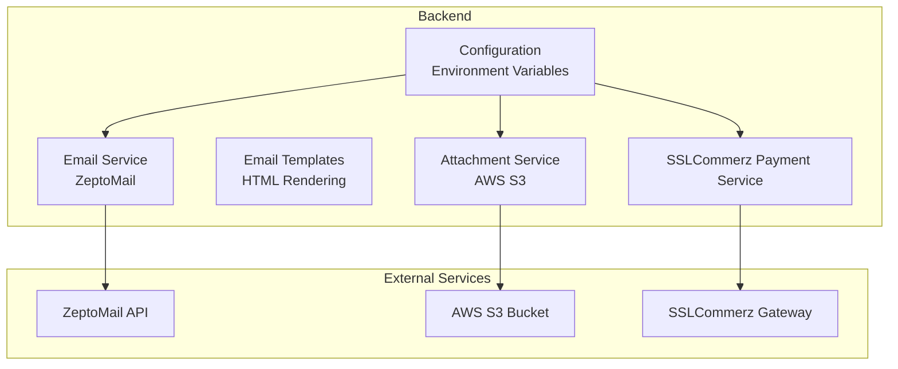
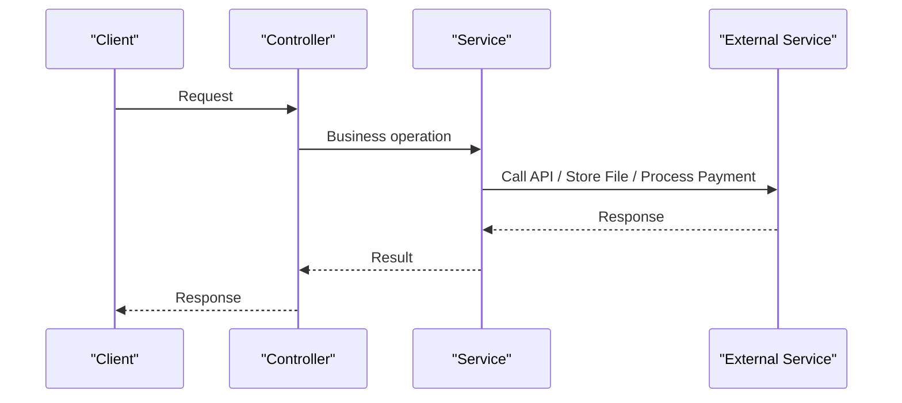
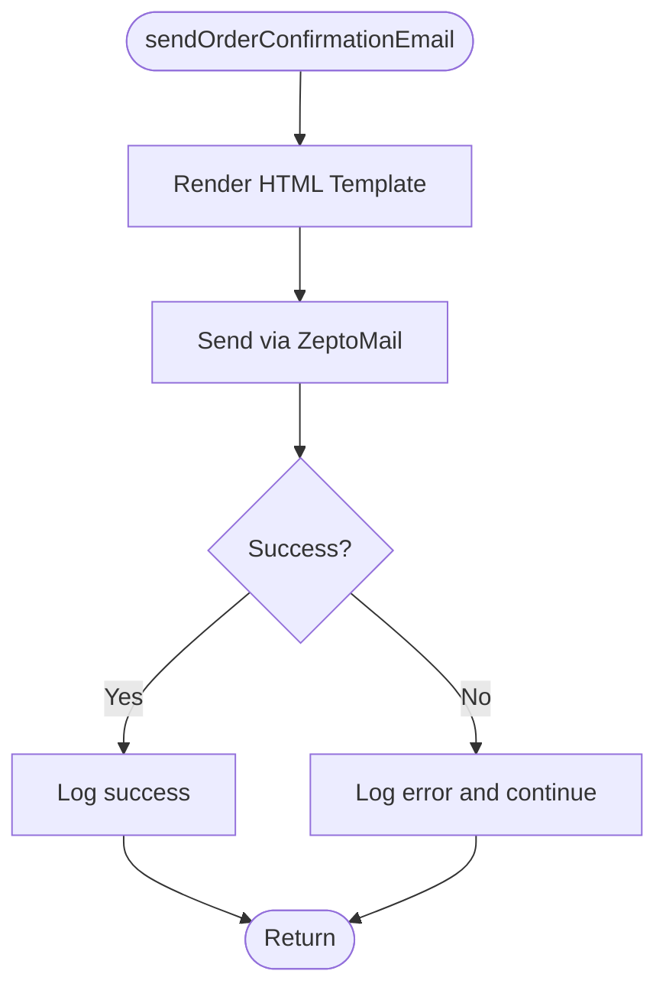
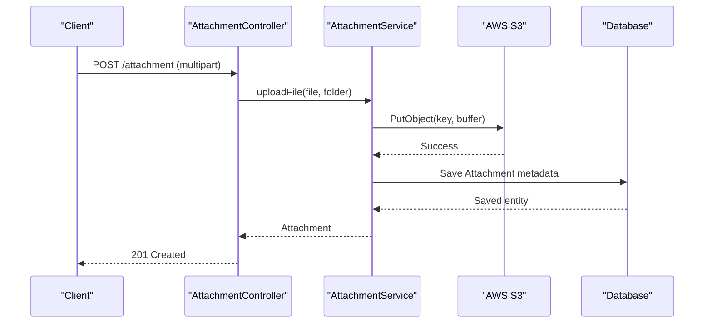
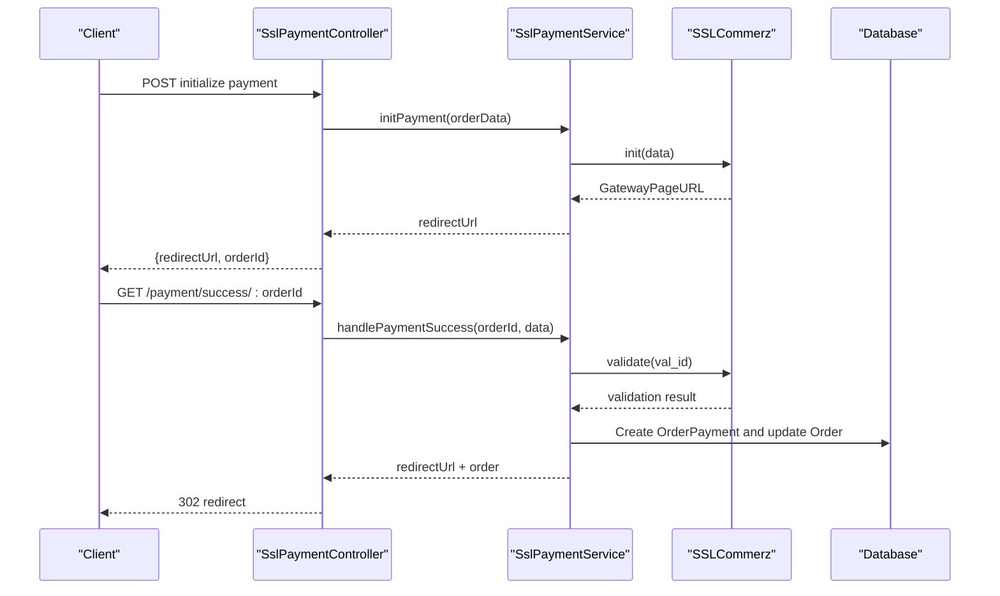
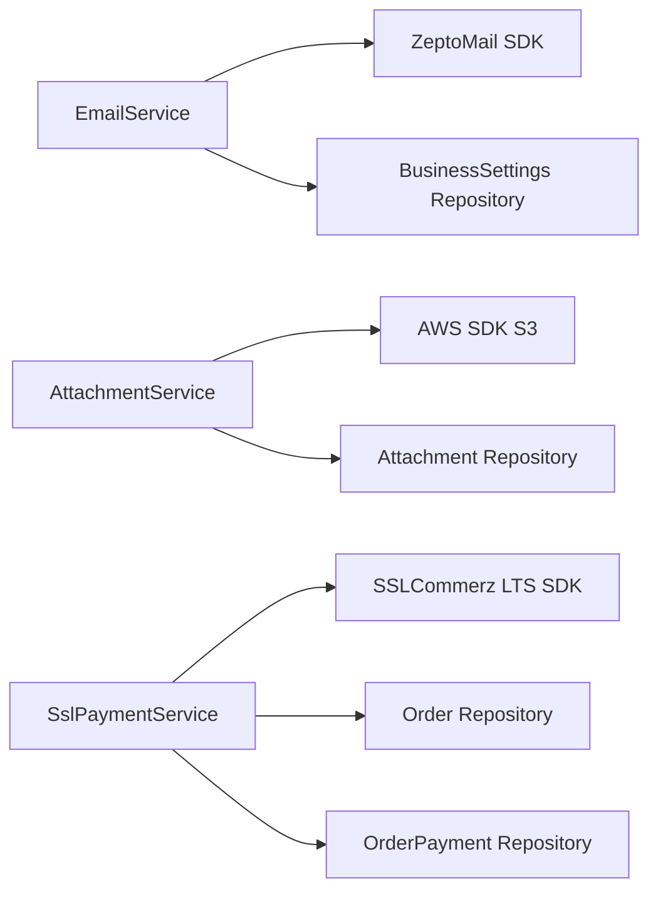

# External Services Integration

<cite>
**Referenced Files in This Document**
- [email.service.ts](file://apps/backend/src/email/email.service.ts)
- [order-confirmation.template.ts](file://apps/backend/src/email/templates/order-confirmation.template.ts)
- [configuration.ts](file://apps/backend/src/config/configuration.ts)
- [attachment.service.ts](file://apps/backend/src/attachment/attachment.service.ts)
- [attachment.controller.ts](file://apps/backend/src/attachment/attachment.controller.ts)
- [attachment.entity.ts](file://apps/backend/src/attachment/entities/attachment.entity.ts)
- [pdf-image route.ts](file://apps/frontend/app/api/pdf-image/route.ts)
- [ssl-payment.service.ts](file://apps/backend/src/ssl-payment/ssl-payment.service.ts)
- [ssl-payment.controller.ts](file://apps/backend/src/ssl-payment/ssl-payment.controller.ts)
- [payment.service.ts](file://apps/backend/src/payment/payment.service.ts)
- [main.ts](file://apps/backend/src/main.ts)
</cite>

## Table of Contents
1. [Introduction](#introduction)
2. [Project Structure](#project-structure)
3. [Core Components](#core-components)
4. [Architecture Overview](#architecture-overview)
5. [Detailed Component Analysis](#detailed-component-analysis)
6. [Dependency Analysis](#dependency-analysis)
7. [Performance Considerations](#performance-considerations)
8. [Troubleshooting Guide](#troubleshooting-guide)
9. [Conclusion](#conclusion)

## Introduction
This document explains how the backend integrates with external services for email delivery, AWS S3 file storage, and payment processing. It focuses on configuration management, error handling strategies, retry behavior, template rendering, attachment workflows, and payment flows. The goal is to help developers configure, monitor, and troubleshoot these integrations safely and reliably.

## Project Structure
The relevant integration code lives under the backend NestJS application:
- Email service and templates under `apps/backend/src/email`.
- AWS S3 attachment storage under `apps/backend/src/attachment`.
- Payment gateway integration under `apps/backend/src/ssl-payment` and related payment modules.
- Centralized environment-driven configuration under `apps/backend/src/config`.

**Diagram sources**
- [email.service.ts:30-56](file://apps/backend/src/email/email.service.ts#L30-L56)
- [attachment.service.ts:20-36](file://apps/backend/src/attachment/attachment.service.ts#L20-L36)
- [ssl-payment.service.ts:29-42](file://apps/backend/src/ssl-payment/ssl-payment.service.ts#L29-L42)
- [configuration.ts:1-16](file://apps/backend/src/config/configuration.ts#L1-L16)

**Section sources**
- [email.service.ts:1-344](file://apps/backend/src/email/email.service.ts#L1-L344)
- [attachment.service.ts:1-196](file://apps/backend/src/attachment/attachment.service.ts#L1-L196)
- [ssl-payment.service.ts:1-414](file://apps/backend/src/ssl-payment/ssl-payment.service.ts#L1-L414)
- [configuration.ts:1-16](file://apps/backend/src/config/configuration.ts#L1-L16)

## Core Components
- Email Service: Sends transactional and admin emails using ZeptoMail, renders HTML templates, and isolates failures so core business flows remain resilient.
- Attachment Service: Uploads files to AWS S3, stores metadata in the database, and provides list/get/delete operations.
- SSLCommerz Payment Service: Initializes payments, handles success/failure callbacks, verifies transactions, processes IPN webhooks, and supports refunds.
- Configuration: Environment variables drive credentials, URLs, and feature toggles for third-party services.

Key responsibilities:
- EmailService: Template rendering, recipient resolution, safe logging, non-fatal failure handling for non-critical emails.
- AttachmentService: S3 client initialization, object upload/download via public URLs, DB persistence, error propagation for critical failures.
- SslPaymentService: Gateway initialization, callback verification, idempotent success handling, refund initiation, and IPN processing.
- Configuration: Centralizes SSLCommerz and payment URL settings; other services read environment variables directly.

**Section sources**
- [email.service.ts:30-56](file://apps/backend/src/email/email.service.ts#L30-L56)
- [attachment.service.ts:20-36](file://apps/backend/src/attachment/attachment.service.ts#L20-L36)
- [ssl-payment.service.ts:29-42](file://apps/backend/src/ssl-payment/ssl-payment.service.ts#L29-L42)
- [configuration.ts:1-16](file://apps/backend/src/config/configuration.ts#L1-L16)

## Architecture Overview
The system uses a service-oriented architecture where controllers delegate to domain services that interact with external APIs or storage.

**Diagram sources**
- [attachment.controller.ts:31-112](file://apps/backend/src/attachment/attachment.controller.ts#L31-L112)
- [ssl-payment.controller.ts:41-91](file://apps/backend/src/ssl-payment/ssl-payment.controller.ts#L41-L91)

## Detailed Component Analysis

### Email Service Integration (ZeptoMail)
Responsibilities:
- Initialize ZeptoMail client from environment variables.
- Render HTML templates for order confirmation, contact responses, password changes, OTP resets, and admin alerts.
- Resolve admin recipients from business settings or environment fallback.
- Provide both non-fatal and fatal send methods depending on flow sensitivity.

Configuration:
- `ZEPTOMAIL_API_URL`, `ZEPTOMAIL_API_KEY`, `ZEPTOMAIL_FROM_EMAIL`, `ZEPTOMAIL_FROM_NAME`.
- Admin notifications can be sourced from business settings (`adminNotificationEmail`) or `ADMIN_NOTIFICATION_EMAIL`.

Error Handling:
- Non-critical emails (order confirmation, contact response, password change/reset) catch and log errors without throwing, ensuring main flows continue.
- A dedicated method throws if the email client is not configured, allowing callers to fail fast when required.

Template Rendering:
- Templates generate responsive HTML with headers, footers, item tables, shipping info, discounts, and totals.
- Data interfaces define strongly typed inputs for each template.

**Diagram sources**
- [email.service.ts:84-116](file://apps/backend/src/email/email.service.ts#L84-L116)
- [order-confirmation.template.ts:39-263](file://apps/backend/src/email/templates/order-confirmation.template.ts#L39-L263)

Practical examples:
- Configure ZeptoMail by setting the API URL and key; optionally set default sender address and name.
- For admin alerts, seed business settings with `adminNotificationEmail` or provide `ADMIN_NOTIFICATION_EMAIL`.

Monitoring patterns:
- Use structured logs around send attempts and failures.
- Track admin notification delivery separately since it must never block primary operations.

Retry mechanisms:
- No automatic retries are implemented. If retries are needed, wrap calls with an exponential backoff strategy at the caller level.

**Section sources**
- [email.service.ts:30-56](file://apps/backend/src/email/email.service.ts#L30-L56)
- [email.service.ts:58-82](file://apps/backend/src/email/email.service.ts#L58-L82)
- [email.service.ts:84-116](file://apps/backend/src/email/email.service.ts#L84-L116)
- [email.service.ts:118-176](file://apps/backend/src/email/email.service.ts#L118-L176)
- [email.service.ts:181-219](file://apps/backend/src/email/email.service.ts#L181-L219)
- [email.service.ts:221-293](file://apps/backend/src/email/email.service.ts#L221-L293)
- [email.service.ts:295-343](file://apps/backend/src/email/email.service.ts#L295-L343)
- [order-confirmation.template.ts:1-263](file://apps/backend/src/email/templates/order-confirmation.template.ts#L1-L263)

### AWS S3 File Storage Integration
Responsibilities:
- Initialize S3 client with region and credentials.
- Upload single or multiple files, generating unique keys and storing metadata.
- Delete files and manage attachments through a repository.
- Expose REST endpoints for upload, listing, retrieval, and deletion.

Configuration:
- `AWS_REGION`, `AWS_S3_ACCESS_KEY`, `AWS_S3_SECRET_KEY`, `AWS_S3_BUCKET_NAME`, `AWS_S3_BASE_URL`.

Upload Workflow:
- Generate UUID-based filename with original extension.
- Put object into bucket with public-read ACL.
- Persist attachment metadata including URL and storage key.

Download Workflow:
- Public URLs are constructed from `AWS_S3_BASE_URL` and object key.
- Frontend includes a proxy route that validates allowed hosts to prevent SSRF abuse.

Error Handling:
- Single upload does not wrap errors; failures propagate to the controller.
- Multiple upload wraps errors and rethrows after logging.
- Delete operations throw on S3/database errors after logging.

**Diagram sources**
- [attachment.controller.ts:36-66](file://apps/backend/src/attachment/attachment.controller.ts#L36-L66)
- [attachment.service.ts:38-71](file://apps/backend/src/attachment/attachment.service.ts#L38-L71)

Presigned URLs:
- The current implementation uses public ACL and base URL construction rather than presigned URLs. To adopt presigned URLs:
  - Replace public ACL with private ACL.
  - Implement a secure endpoint that generates short-lived presigned URLs scoped to authenticated users.
  - Validate requested paths against allowed prefixes and user permissions before signing.

Frontend Proxy:
- A Next.js route proxies image requests only from an allowed host to mitigate SSRF risks.

**Section sources**
- [attachment.service.ts:20-36](file://apps/backend/src/attachment/attachment.service.ts#L20-L36)
- [attachment.service.ts:38-71](file://apps/backend/src/attachment/attachment.service.ts#L38-L71)
- [attachment.service.ts:73-119](file://apps/backend/src/attachment/attachment.service.ts#L73-L119)
- [attachment.service.ts:120-155](file://apps/backend/src/attachment/attachment.service.ts#L120-L155)
- [attachment.controller.ts:31-112](file://apps/backend/src/attachment/attachment.controller.ts#L31-L112)
- [attachment.entity.ts:19-118](file://apps/backend/src/attachment/entities/attachment.entity.ts#L19-L118)
- [pdf-image route.ts:1-41](file://apps/frontend/app/api/pdf-image/route.ts#L1-L41)

### Payment Gateway Integration (SSLCommerz)
Responsibilities:
- Initialize payments with customer, shipping, product, and order details.
- Handle success and failure redirects.
- Verify payments via gateway validation.
- Process IPN webhooks asynchronously.
- Initiate refunds and create reversal postings.

Configuration:
- `SSLCOMMERZ_STORE_ID`, `SSLCOMMERZ_STORE_PASSWORD`, `SSLCOMMERZ_IS_LIVE`.
- Payment URLs: `BASE_URL`, `PAYMENT_SUCCESS_URL`, `PAYMENT_FAIL_URL`, `PAYMENT_CANCEL_URL`, `PAYMENT_IPN_URL`, `FRONTEND_URL`.

Initialization Flow:
- Build payload with amount, currency, transaction ID, redirect URLs, and contextual values.
- Call gateway init and return the gateway page URL.

Success Flow:
- Verify payment via gateway validation.
- Load order and ensure idempotency by checking existing payment records.
- Create order payment record and update order fields.
- Redirect to frontend success page.

Failure Flow:
- Log non-sensitive fields and redirect to frontend failure page.

IPN Flow:
- Accept asynchronous webhook, validate status, and process success logic.

Refund Flow:
- Validate input, call gateway refund API, handle IP whitelist errors, and create reversal posting on success.

**Diagram sources**
- [ssl-payment.controller.ts:41-91](file://apps/backend/src/ssl-payment/ssl-payment.controller.ts#L41-L91)
- [ssl-payment.service.ts:44-111](file://apps/backend/src/ssl-payment/ssl-payment.service.ts#L44-L111)
- [ssl-payment.service.ts:113-234](file://apps/backend/src/ssl-payment/ssl-payment.service.ts#L113-L234)

Error Handling:
- Initialization fails fast with bad request exceptions when credentials are missing or gateway returns no gateway URL.
- Success handler verifies payment and throws on invalid verification or missing orders.
- Failure handler logs minimal PII and redirects appropriately.
- Refund initiation checks IP whitelist errors and maps gateway statuses to business exceptions.

Idempotency:
- Existing payment check prevents duplicate processing for the same transaction ID.

Monitoring Patterns:
- Logs include sanitized fields such as transaction IDs, amounts, and statuses.
- Avoid logging full payloads containing sensitive card or customer information.

Retry Mechanisms:
- No built-in retries. For robustness, implement:
  - Retry with exponential backoff for transient network errors during initialization and validation.
  - Dead-letter queue for failed IPN messages requiring manual review.
  - Idempotency keys based on transaction IDs to avoid duplicates.

**Section sources**
- [ssl-payment.service.ts:29-42](file://apps/backend/src/ssl-payment/ssl-payment.service.ts#L29-L42)
- [ssl-payment.service.ts:44-111](file://apps/backend/src/ssl-payment/ssl-payment.service.ts#L44-L111)
- [ssl-payment.service.ts:113-234](file://apps/backend/src/ssl-payment/ssl-payment.service.ts#L113-L234)
- [ssl-payment.service.ts:236-267](file://apps/backend/src/ssl-payment/ssl-payment.service.ts#L236-L267)
- [ssl-payment.service.ts:269-306](file://apps/backend/src/ssl-payment/ssl-payment.service.ts#L269-L306)
- [ssl-payment.service.ts:308-328](file://apps/backend/src/ssl-payment/ssl-payment.service.ts#L308-L328)
- [ssl-payment.service.ts:330-412](file://apps/backend/src/ssl-payment/ssl-payment.service.ts#L330-L412)
- [ssl-payment.controller.ts:41-91](file://apps/backend/src/ssl-payment/ssl-payment.controller.ts#L41-L91)

### Payment Module (Internal Ledger)
Responsibilities:
- Record payments against purchases, link payment methods, and compute aggregate payment status.
- Update purchase payment status to due/partial/paid based on total paid vs total value.

Integration Points:
- Used by higher-level payment flows to persist payment records and keep purchase state consistent.

Error Handling:
- Throws not found for missing purchases or payment methods.
- Updates purchase status whenever payment amount changes.

**Section sources**
- [payment.service.ts:11-51](file://apps/backend/src/payment/payment.service.ts#L11-L51)
- [payment.service.ts:53-92](file://apps/backend/src/payment/payment.service.ts#L53-L92)
- [payment.service.ts:94-136](file://apps/backend/src/payment/payment.service.ts#L94-L136)

## Dependency Analysis
External dependencies and their roles:
- ZeptoMail SDK: Email delivery client used by EmailService.
- AWS SDK S3 Client: Object storage client used by AttachmentService.
- SSLCommerz LTS SDK: Payment gateway client used by SslPaymentService.
- TypeORM repositories: Database access for attachments, orders, payments, and business settings.

Coupling:
- EmailService depends on business settings for admin recipients but remains decoupled from business logic beyond data shaping.
- AttachmentService couples S3 operations with database persistence; consider separating storage concerns for testability.
- SslPaymentService orchestrates gateway interactions and database updates; ensure idempotency and strong validation.

Potential circular dependencies:
- None observed among the analyzed services. Controllers depend on services; services depend on repositories and config.

**Diagram sources**
- [email.service.ts:30-56](file://apps/backend/src/email/email.service.ts#L30-L56)
- [attachment.service.ts:20-36](file://apps/backend/src/attachment/attachment.service.ts#L20-L36)
- [ssl-payment.service.ts:18-27](file://apps/backend/src/ssl-payment/ssl-payment.service.ts#L18-L27)

**Section sources**
- [email.service.ts:1-344](file://apps/backend/src/email/email.service.ts#L1-L344)
- [attachment.service.ts:1-196](file://apps/backend/src/attachment/attachment.service.ts#L1-L196)
- [ssl-payment.service.ts:1-414](file://apps/backend/src/ssl-payment/ssl-payment.service.ts#L1-L414)

## Performance Considerations
- Email sending should be offloaded to background jobs for high-volume scenarios to reduce request latency.
- S3 uploads use in-memory buffers; for large files, consider streaming uploads and multipart uploads.
- Increase body parser limits for checkout payloads as already done in bootstrap.
- Enable compression and security headers globally.

[No sources needed since this section provides general guidance]

## Troubleshooting Guide
Common issues and resolutions:
- Email service misconfiguration:
  - Ensure ZeptoMail API URL and key are set; otherwise, a warning is logged and email functionality will be disabled.
  - For admin notifications, verify business settings or environment variable for admin email addresses.
- S3 upload failures:
  - Check region, access key, secret key, bucket name, and bucket policy for public-read ACL if using public URLs.
  - Validate file size limits enforced by the controller.
- Payment initialization failures:
  - Verify SSLCommerz store credentials and live/test mode flag.
  - Confirm BASE_URL and PAYMENT_IPN_URL are correctly configured.
- Payment verification failures:
  - Ensure val_id and tran_id match expected values and amounts align.
- IP whitelist errors during refunds:
  - Whitelist server IP in SSLCommerz merchant panel.

Operational tips:
- Add structured logging and metrics for external API calls.
- Integrate health checks for email and payment readiness.
- Implement retry policies with idempotency keys for transient failures.

**Section sources**
- [email.service.ts:41-55](file://apps/backend/src/email/email.service.ts#L41-L55)
- [email.service.ts:58-82](file://apps/backend/src/email/email.service.ts#L58-L82)
- [attachment.service.ts:20-36](file://apps/backend/src/attachment/attachment.service.ts#L20-L36)
- [attachment.controller.ts:48-66](file://apps/backend/src/attachment/attachment.controller.ts#L48-L66)
- [ssl-payment.service.ts:29-42](file://apps/backend/src/ssl-payment/ssl-payment.service.ts#L29-L42)
- [ssl-payment.service.ts:330-412](file://apps/backend/src/ssl-payment/ssl-payment.service.ts#L330-L412)
- [main.ts:16-34](file://apps/backend/src/main.ts#L16-L34)

## Conclusion
The backend integrates three major external services: ZeptoMail for email, AWS S3 for file storage, and SSLCommerz for payments. Each service has clear configuration boundaries, explicit error handling, and well-defined workflows. Email sends are resilient for non-critical flows, S3 operations expose straightforward CRUD endpoints with public URLs, and payment flows include verification, idempotency, and refund support. To strengthen reliability, introduce background job queues for email, presigned URLs for secure downloads, and retry mechanisms with dead-letter queues for transient failures. Monitoring and structured logging should be extended across all external integrations to improve observability and incident response.