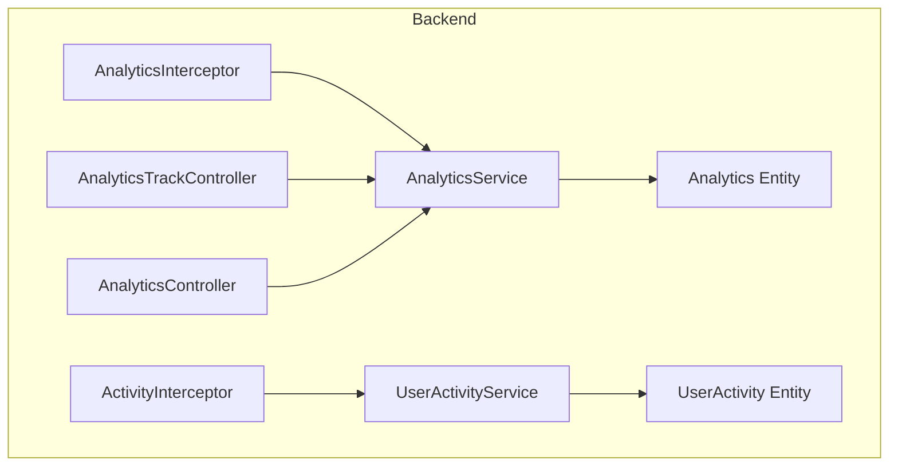
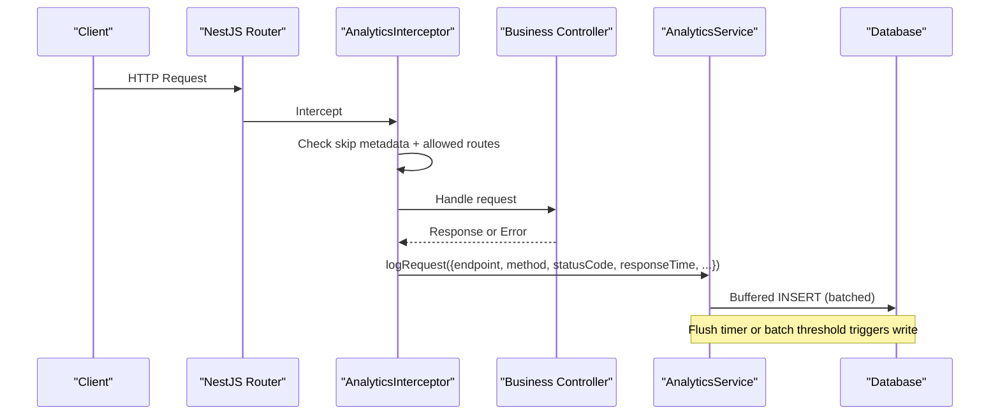
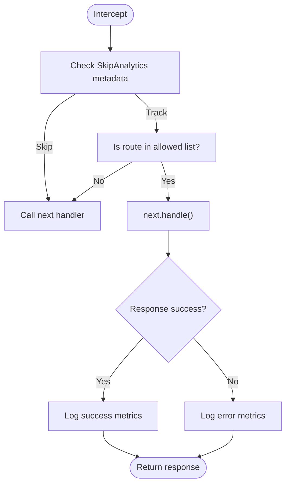
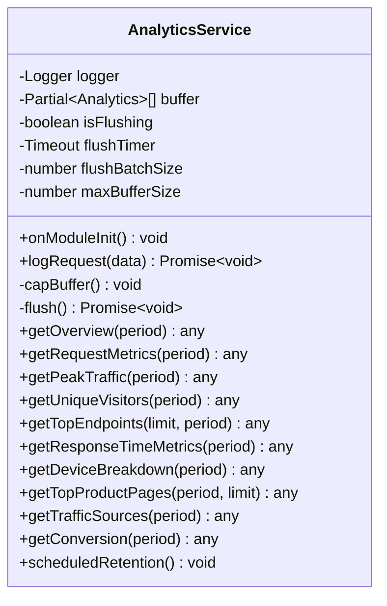
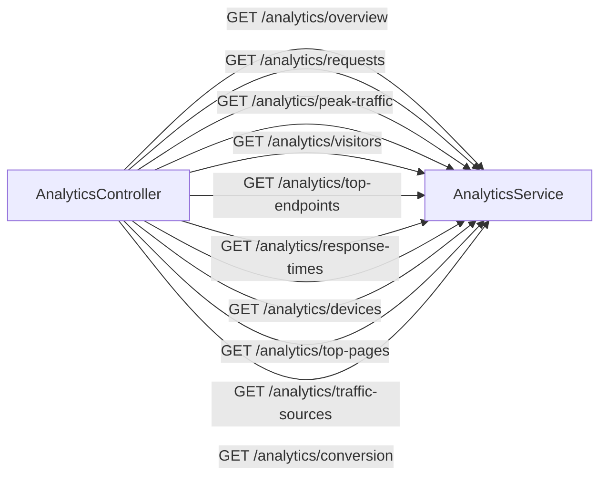
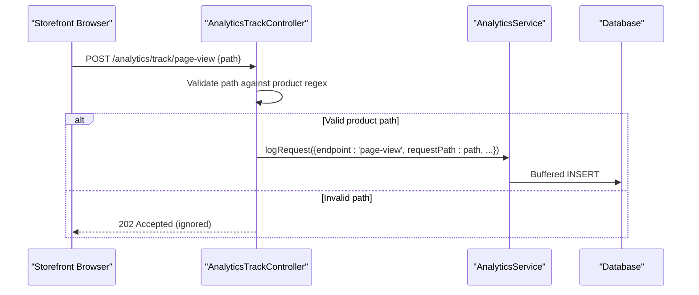
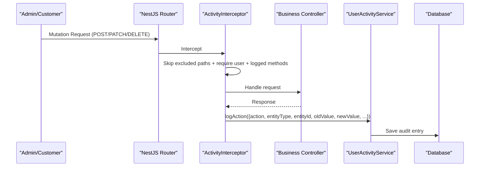
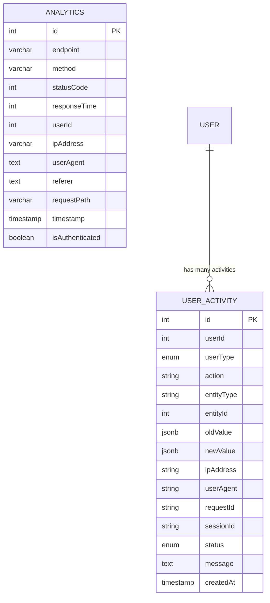
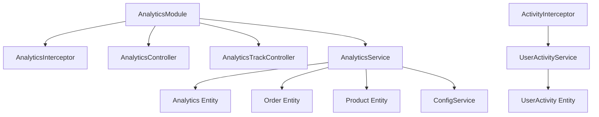

# Monitoring & Analytics

<cite>
**Referenced Files in This Document**
- [analytics.service.ts](file://apps/backend/src/analytics/analytics.service.ts)
- [analytics.interceptor.ts](file://apps/backend/src/analytics/interceptors/analytics.interceptor.ts)
- [analytics.controller.ts](file://apps/backend/src/analytics/analytics.controller.ts)
- [analytics-track.controller.ts](file://apps/backend/src/analytics/analytics-track.controller.ts)
- [analytics.entity.ts](file://apps/backend/src/analytics/entities/analytics.entity.ts)
- [analytics.module.ts](file://apps/backend/src/analytics/analytics.module.ts)
- [skip-analytics.decorator.ts](file://apps/backend/src/common/decorators/skip-analytics.decorator.ts)
- [activity.interceptor.ts](file://apps/backend/src/interceptor/activity.interceptor.ts)
- [user-activity.service.ts](file://apps/backend/src/user-activity/user-activity.service.ts)
- [user-activity.entity.ts](file://apps/backend/src/user-activity/entities/user-activity.entity.ts)
</cite>

## Table of Contents
1. [Introduction](#introduction)
2. [Project Structure](#project-structure)
3. [Core Components](#core-components)
4. [Architecture Overview](#architecture-overview)
5. [Detailed Component Analysis](#detailed-component-analysis)
6. [Dependency Analysis](#dependency-analysis)
7. [Performance Considerations](#performance-considerations)
8. [Troubleshooting Guide](#troubleshooting-guide)
9. [Conclusion](#conclusion)
10. [Appendices](#appendices)

## Introduction
This document explains the monitoring and analytics system used by the backend application. It covers:
- Application performance tracking through request/response logging
- User activity monitoring with change auditing
- Business analytics collection for traffic, conversion, device/browser breakdown, and top product pages
- The analytics interceptor that captures metrics for selected API routes
- Caching strategies for storefront page views
- Metrics aggregation patterns and reporting endpoints
- Practical guidance for adding custom analytics, building dashboards, and optimizing cache and retention behavior

The system is built around a buffered analytics writer, an HTTP-level interceptor, dedicated controllers for analytics data, and a separate user activity audit pipeline.

## Project Structure
The monitoring and analytics features are primarily implemented under the backend NestJS application:
- Analytics module provides request/response metrics, business analytics endpoints, and a public beacon for storefront page views
- Activity interceptor records detailed user actions with before/after snapshots
- User activity service persists audit logs and runs scheduled cleanup

**Diagram sources**
- [analytics.interceptor.ts:13-115](file://apps/backend/src/analytics/interceptors/analytics.interceptor.ts#L13-L115)
- [analytics.service.ts:38-122](file://apps/backend/src/analytics/analytics.service.ts#L38-L122)
- [analytics.controller.ts:27-33](file://apps/backend/src/analytics/analytics.controller.ts#L27-L33)
- [analytics-track.controller.ts:29-60](file://apps/backend/src/analytics/analytics-track.controller.ts#L29-L60)
- [analytics.entity.ts:12-58](file://apps/backend/src/analytics/entities/analytics.entity.ts#L12-L58)
- [activity.interceptor.ts:20-73](file://apps/backend/src/interceptor/activity.interceptor.ts#L20-L73)
- [user-activity.service.ts:25-53](file://apps/backend/src/user-activity/user-activity.service.ts#L25-L53)
- [user-activity.entity.ts:23-87](file://apps/backend/src/user-activity/entities/user-activity.entity.ts#L23-L87)

**Section sources**
- [analytics.module.ts:11-16](file://apps/backend/src/analytics/analytics.module.ts#L11-L16)

## Core Components
- AnalyticsInterceptor: Captures request/response metrics for allowed routes, extracts IP, user identity, user agent, referer, and request path, then delegates to AnalyticsService
- AnalyticsService: Buffers analytics rows, flushes them periodically or on batch thresholds, creates indexes at startup, aggregates metrics for dashboards, and runs retention cleanup
- AnalyticsController: Exposes read-only analytics endpoints for dashboards (overview, requests over time, peak traffic, unique visitors, top endpoints, response times, devices/browsers, top product pages, traffic sources, conversion)
- AnalyticsTrackController: Public endpoint for storefront page-view beacons; only accepts product detail paths
- ActivityInterceptor: Records user-driven mutations (POST/PATCH/DELETE) with descriptive messages, old/new values, and contextual enrichment
- UserActivityService: Persists audit entries, supports filtering/pagination, and schedules daily cleanup of old records
- Entities: Analytics and UserActivity define the persisted schema and indexes

Key responsibilities:
- Performance tracking: response time, status codes, throughput, peak hours
- User activity: who did what, when, where, and what changed
- Business analytics: visitors, conversion rate, device/browser mix, top product pages, traffic sources

**Section sources**
- [analytics.interceptor.ts:13-115](file://apps/backend/src/analytics/interceptors/analytics.interceptor.ts#L13-L115)
- [analytics.service.ts:38-122](file://apps/backend/src/analytics/analytics.service.ts#L38-L122)
- [analytics.controller.ts:27-329](file://apps/backend/src/analytics/analytics.controller.ts#L27-L329)
- [analytics-track.controller.ts:29-60](file://apps/backend/src/analytics/analytics-track.controller.ts#L29-L60)
- [activity.interceptor.ts:20-73](file://apps/backend/src/interceptor/activity.interceptor.ts#L20-L73)
- [user-activity.service.ts:25-53](file://apps/backend/src/user-activity/user-activity.service.ts#L25-L53)

## Architecture Overview
The analytics flow has two main tracks:

1) Request/response analytics
- Interceptor intercepts eligible routes
- Service buffers and flushes analytics rows
- Controllers expose aggregated metrics

2) User activity audit
- Interceptor captures mutation events
- Service persists structured audit entries
- Scheduled jobs clean up old records

**Diagram sources**
- [analytics.interceptor.ts:20-115](file://apps/backend/src/analytics/interceptors/analytics.interceptor.ts#L20-L115)
- [analytics.service.ts:142-192](file://apps/backend/src/analytics/analytics.service.ts#L142-L192)

## Detailed Component Analysis

### Analytics Interceptor
Responsibilities:
- Skip analytics for routes decorated with SkipAnalytics
- Track only a curated set of high-value routes
- Measure response time and capture context (userId, IP, userAgent, referer, requestPath)
- Log both successful responses and errors without breaking the request pipeline

**Diagram sources**
- [analytics.interceptor.ts:20-115](file://apps/backend/src/analytics/interceptors/analytics.interceptor.ts#L20-L115)
- [skip-analytics.decorator.ts:1-5](file://apps/backend/src/common/decorators/skip-analytics.decorator.ts#L1-L5)

Practical notes:
- Use SkipAnalytics on endpoints that should not pollute analytics (e.g., health checks, internal telemetry)
- Extend allowedRoutes if you need to track additional endpoints

**Section sources**
- [analytics.interceptor.ts:20-115](file://apps/backend/src/analytics/interceptors/analytics.interceptor.ts#L20-L115)
- [skip-analytics.decorator.ts:1-5](file://apps/backend/src/common/decorators/skip-analytics.decorator.ts#L1-L5)

### Analytics Service
Responsibilities:
- Buffer analytics rows and flush them in batches or on a timer
- Ensure database indexes exist at startup
- Provide aggregation methods for dashboard charts
- Run scheduled retention cleanup

Buffering strategy:
- Batch size and max buffer size are configurable via environment variables
- On failure, rows are re-queued respecting the cap to avoid unbounded memory growth
- Timer-based flush ensures low-traffic rows still land promptly

Indexing strategy:
- At startup, the service attempts to create indexes concurrently if they do not already exist
- This avoids full table scans for dashboard queries in production

Aggregation highlights:
- Overview: requests per minute, total requests, unique visitors, peak hour, top endpoint, average response time
- Requests over time: hourly buckets with zero-filled gaps
- Peak traffic: hour-of-day distribution aligned to local timezone
- Unique visitors: daily counts aligned to local timezone
- Top endpoints: count and average response time
- Response time metrics: avg/min/max
- Device/browser breakdown: derived from stored user-agent strings
- Top product pages: matches concrete product paths and resolves product names
- Traffic sources: grouped by referer host, missing referer counted as Direct
- Conversion: orders vs unique visitors

Retention:
- Daily cron deletes rows older than configured retention window

**Diagram sources**
- [analytics.service.ts:38-122](file://apps/backend/src/analytics/analytics.service.ts#L38-L122)
- [analytics.service.ts:142-192](file://apps/backend/src/analytics/analytics.service.ts#L142-L192)
- [analytics.service.ts:194-615](file://apps/backend/src/analytics/analytics.service.ts#L194-L615)

**Section sources**
- [analytics.service.ts:38-122](file://apps/backend/src/analytics/analytics.service.ts#L38-L122)
- [analytics.service.ts:142-192](file://apps/backend/src/analytics/analytics.service.ts#L142-L192)
- [analytics.service.ts:194-615](file://apps/backend/src/analytics/analytics.service.ts#L194-L615)

### Analytics Controller
Exposes read-only endpoints for dashboards:
- Overview, requests, peak-traffic, visitors, top-endpoints, response-times, devices, top-pages, traffic-sources, conversion
- All endpoints accept a period parameter and return standardized responses
- Decorated with SkipAnalytics so dashboard queries themselves are not tracked

**Diagram sources**
- [analytics.controller.ts:27-329](file://apps/backend/src/analytics/analytics.controller.ts#L27-L329)

**Section sources**
- [analytics.controller.ts:27-329](file://apps/backend/src/analytics/analytics.controller.ts#L27-L329)

### Analytics Track Controller (Storefront Beacon)
Purpose:
- Record real browser page views for product detail pages that may be served from cache and never hit tracked API routes
- Accepts only product detail paths matching a strict pattern
- Uses the same log shape as the interceptor for consistency

**Diagram sources**
- [analytics-track.controller.ts:29-60](file://apps/backend/src/analytics/analytics-track.controller.ts#L29-L60)
- [analytics.service.ts:142-192](file://apps/backend/src/analytics/analytics.service.ts#L142-L192)

**Section sources**
- [analytics-track.controller.ts:29-60](file://apps/backend/src/analytics/analytics-track.controller.ts#L29-L60)

### Activity Interceptor and User Activity Service
ActivityInterceptor:
- Skips excluded high-frequency routes
- Only logs POST, PATCH, DELETE
- For PATCH, fetches the old record and aligns keys/types to build comparable oldValue/newValue
- Generates readable action messages based on route semantics
- Persists via UserActivityService

UserActivityService:
- Persists audit entries with user context, IP, user agent, request/session IDs, and typed enums
- Provides paginated queries, filters, entity-type listing, audit trails per entity
- Schedules daily cleanup of old records

**Diagram sources**
- [activity.interceptor.ts:20-73](file://apps/backend/src/interceptor/activity.interceptor.ts#L20-L73)
- [activity.interceptor.ts:75-182](file://apps/backend/src/interceptor/activity.interceptor.ts#L75-L182)
- [activity.interceptor.ts:184-251](file://apps/backend/src/interceptor/activity.interceptor.ts#L184-L251)
- [user-activity.service.ts:25-53](file://apps/backend/src/user-activity/user-activity.service.ts#L25-L53)

**Section sources**
- [activity.interceptor.ts:20-73](file://apps/backend/src/interceptor/activity.interceptor.ts#L20-L73)
- [activity.interceptor.ts:75-182](file://apps/backend/src/interceptor/activity.interceptor.ts#L75-L182)
- [activity.interceptor.ts:184-251](file://apps/backend/src/interceptor/activity.interceptor.ts#L184-L251)
- [user-activity.service.ts:25-53](file://apps/backend/src/user-activity/user-activity.service.ts#L25-L53)

### Data Models

**Diagram sources**
- [analytics.entity.ts:12-58](file://apps/backend/src/analytics/entities/analytics.entity.ts#L12-L58)
- [user-activity.entity.ts:23-87](file://apps/backend/src/user-activity/entities/user-activity.entity.ts#L23-L87)

## Dependency Analysis
- AnalyticsModule wires together controllers, service, entities, and the interceptor
- AnalyticsInterceptor depends on Reflector for SkipAnalytics metadata and on AnalyticsService for persistence
- AnalyticsController and AnalyticsTrackController depend on AnalyticsService
- AnalyticsService depends on TypeORM repositories for Analytics, Order, Product, and ConfigService for tuning parameters
- ActivityInterceptor depends on UserActivityService and DataSource for raw queries
- UserActivityService depends on UserActivity repository and @nestjs/schedule for cron tasks

**Diagram sources**
- [analytics.module.ts:11-16](file://apps/backend/src/analytics/analytics.module.ts#L11-L16)
- [analytics.interceptor.ts:13-18](file://apps/backend/src/analytics/interceptors/analytics.interceptor.ts#L13-L18)
- [analytics.controller.ts:27-34](file://apps/backend/src/analytics/analytics.controller.ts#L27-L34)
- [analytics-track.controller.ts:29-33](file://apps/backend/src/analytics/analytics-track.controller.ts#L29-L33)
- [analytics.service.ts:49-57](file://apps/backend/src/analytics/analytics.service.ts#L49-L57)
- [activity.interceptor.ts:31-35](file://apps/backend/src/interceptor/activity.interceptor.ts#L31-L35)
- [user-activity.service.ts:29-32](file://apps/backend/src/user-activity/user-activity.service.ts#L29-L32)

**Section sources**
- [analytics.module.ts:11-16](file://apps/backend/src/analytics/analytics.module.ts#L11-L16)

## Performance Considerations
- Buffered writes: AnalyticsService uses a memory buffer with configurable batch size and interval to reduce database round trips
- Backpressure safety: Buffer is capped; on flush failure, rows are re-queued respecting the cap
- Index management: Startup index creation prevents full table scans for dashboard queries
- Timezone alignment: Aggregations align to local timezone to ensure consistent chart labels
- Storefront caching: Page-view beacon complements cached server-rendered product pages
- Retention policies: Both analytics and user activity have scheduled cleanup to keep tables bounded

Recommendations:
- Tune ANALYTICS_FLUSH_BATCH_SIZE, ANALYTICS_MAX_BUFFER_SIZE, and ANALYTICS_FLUSH_INTERVAL_MS according to traffic volume
- Keep ALLOWED_ROUTES focused to minimize overhead
- Monitor retention days to balance storage costs and reporting needs
- Ensure database permissions allow concurrent index creation

[No sources needed since this section provides general guidance]

## Troubleshooting Guide
Common issues and resolutions:
- Missing dashboard data: Verify that the route is included in the allowed list and not decorated with SkipAnalytics
- Slow dashboard queries: Confirm indexes were created at startup; check logs for index creation warnings
- High memory usage: Increase ANALYTICS_FLUSH_INTERVAL_MS or decrease ANALYTICS_MAX_BUFFER_SIZE
- No storefront page views: Ensure the client sends valid product detail paths to the beacon
- Audit logs missing: Confirm the request is a logged method (POST/PATCH/DELETE), authenticated, and not an excluded path

Operational tips:
- Inspect console errors for failed analytics logging; these are intentionally non-fatal
- Review scheduled job logs for retention cleanup results
- Use pagination and filters in user activity queries to avoid heavy loads

**Section sources**
- [analytics.interceptor.ts:82-110](file://apps/backend/src/analytics/interceptors/analytics.interceptor.ts#L82-L110)
- [analytics.service.ts:89-117](file://apps/backend/src/analytics/analytics.service.ts#L89-L117)
- [analytics.service.ts:593-615](file://apps/backend/src/analytics/analytics.service.ts#L593-L615)
- [user-activity.service.ts:252-277](file://apps/backend/src/user-activity/user-activity.service.ts#L252-L277)

## Conclusion
The monitoring and analytics subsystem provides robust performance tracking, comprehensive user activity auditing, and actionable business insights. Its design emphasizes resilience (buffering, retries, caps), correctness (timezone alignment, path validation), and maintainability (scheduled retention, explicit indexes). By following the extension points and configuration options described here, teams can add custom analytics, build dashboards, and optimize performance and storage efficiently.

[No sources needed since this section summarizes without analyzing specific files]

## Appendices

### How to Add Custom Analytics
- To track a new route:
  - Add the route prefix to the allowed list in the analytics interceptor
  - Optionally decorate the controller/method with SkipAnalytics if it should not be tracked
- To emit a custom event:
  - Call AnalyticsService.logRequest with a meaningful endpoint and requestPath
  - For storefront-specific events, use the public beacon endpoint with a validated path

**Section sources**
- [analytics.interceptor.ts:34-56](file://apps/backend/src/analytics/interceptors/analytics.interceptor.ts#L34-L56)
- [analytics.service.ts:142-161](file://apps/backend/src/analytics/analytics.service.ts#L142-L161)
- [analytics-track.controller.ts:42-60](file://apps/backend/src/analytics/analytics-track.controller.ts#L42-L60)

### Setting Up Monitoring Dashboards
- Use AnalyticsController endpoints to populate charts:
  - Overview for KPIs
  - Requests for time-series traffic
  - Peak-traffic for hour-of-day analysis
  - Visitors for daily unique users
  - Top-endpoints for hotspots
  - Response-times for latency trends
  - Devices for device/browser mix
  - Top-pages for product popularity
  - Traffic-sources for attribution
  - Conversion for funnel insight

**Section sources**
- [analytics.controller.ts:36-311](file://apps/backend/src/analytics/analytics.controller.ts#L36-L311)

### Optimizing Cache Performance
- Rely on the storefront page-view beacon to capture product page views even when responses are served from cache
- Validate beacon payloads to avoid noise
- Adjust retention and buffer settings to match traffic patterns

**Section sources**
- [analytics-track.controller.ts:23-60](file://apps/backend/src/analytics/analytics-track.controller.ts#L23-L60)
- [analytics.service.ts:59-80](file://apps/backend/src/analytics/analytics.service.ts#L59-L80)