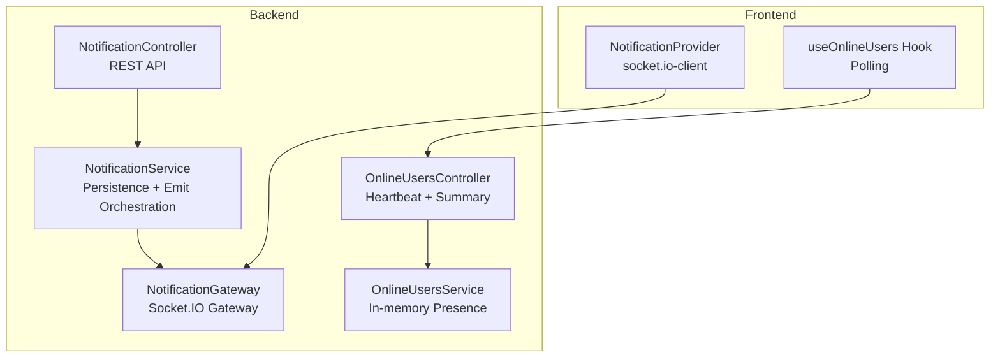
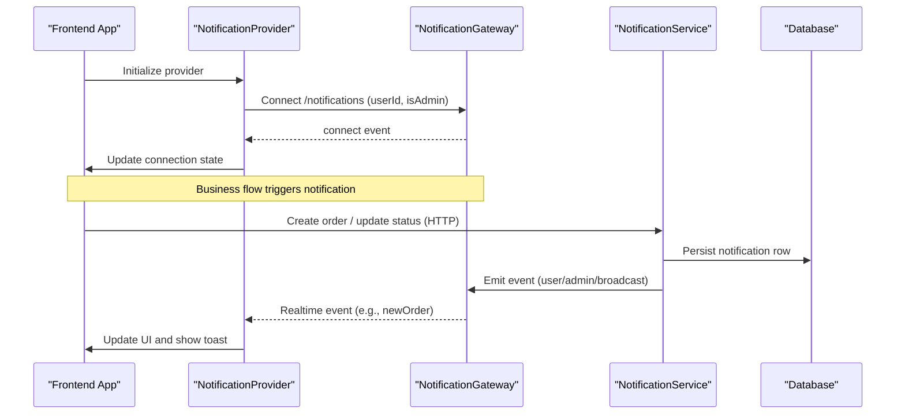
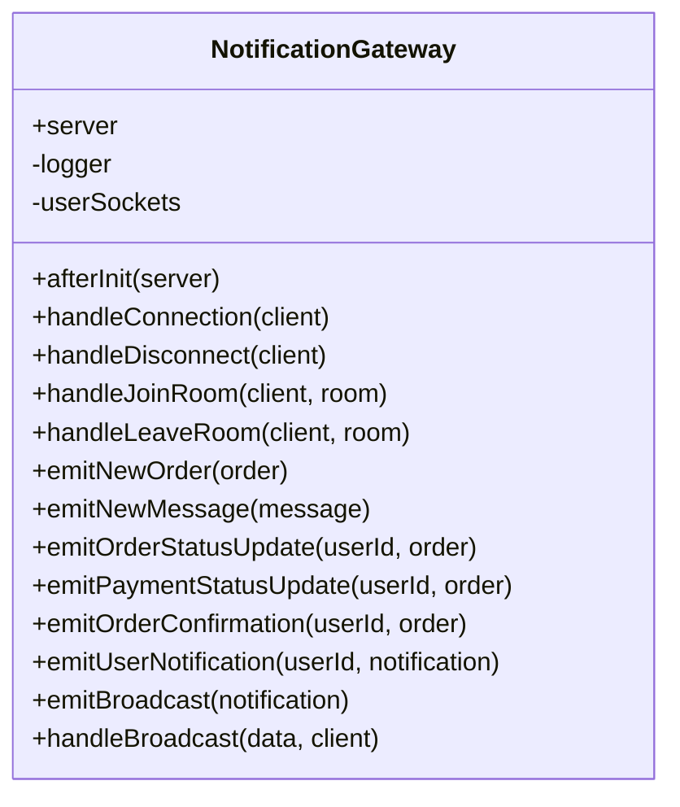
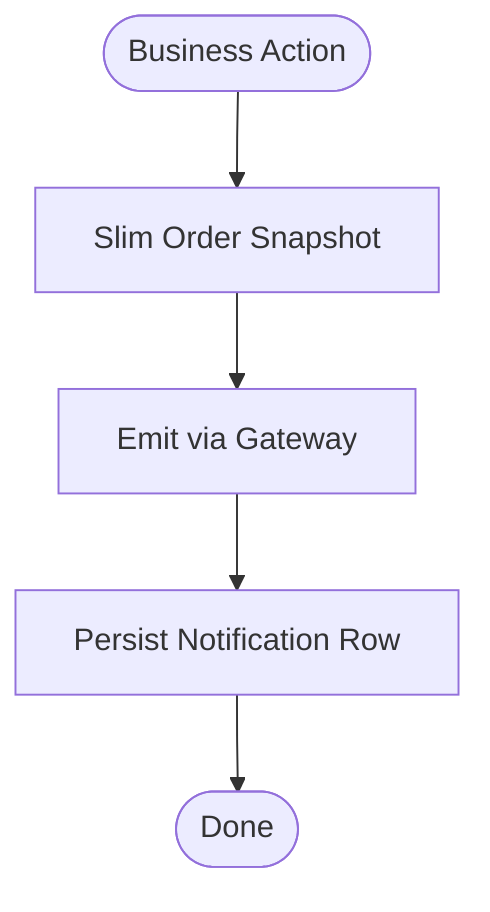
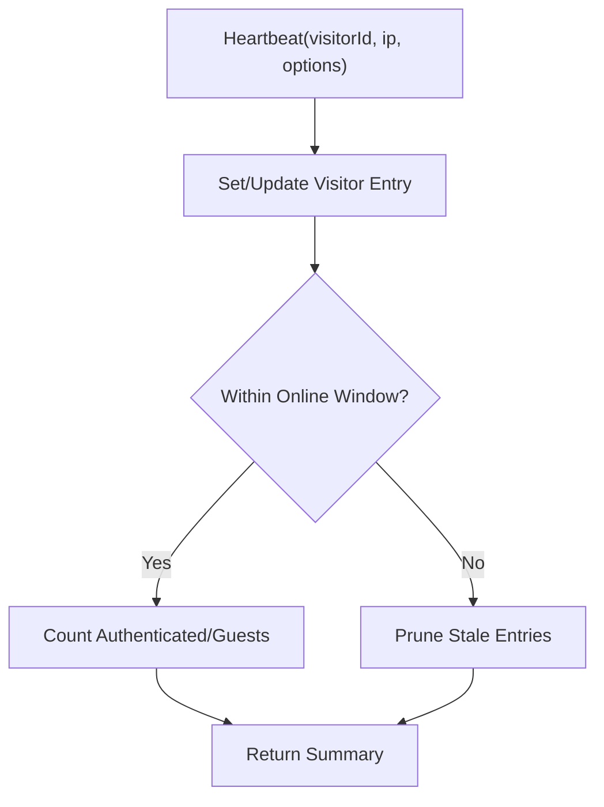
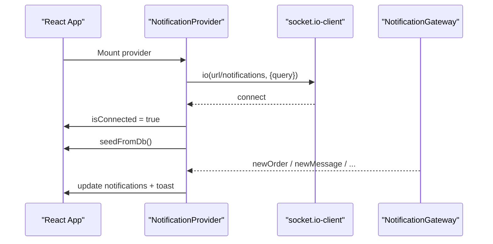
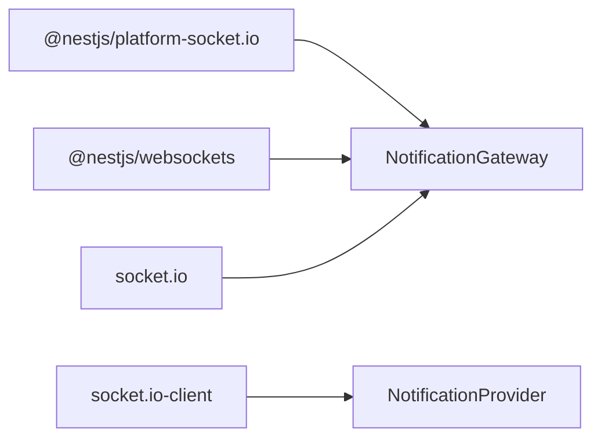

# Real-time Communication

<cite>
**Referenced Files in This Document**
- [package.json](file://apps/backend/package.json)
- [notification.gateway.ts](file://apps/backend/src/notification/notification.gateway.ts)
- [notification.module.ts](file://apps/backend/src/notification/notification.module.ts)
- [notification.service.ts](file://apps/backend/src/notification/notification.service.ts)
- [notification.controller.ts](file://apps/backend/src/notification/notification.controller.ts)
- [online-users.service.ts](file://apps/backend/src/online-users/online-users.service.ts)
- [online-users.controller.ts](file://apps/backend/src/online-users/online-users.controller.ts)
- [online-users.module.ts](file://apps/backend/src/online-users/online-users.module.ts)
- [heartbeat.dto.ts](file://apps/backend/src/online-users/dto/heartbeat.dto.ts)
- [order.service.ts](file://apps/backend/src/order/order.service.ts)
- [notification-provider.tsx](file://apps/frontend/providers/notification-provider.tsx)
- [use-online-users.ts](file://apps/frontend/hooks/use-online-users.ts)
</cite>

## Table of Contents
1. [Introduction](#introduction)
2. [Project Structure](#project-structure)
3. [Core Components](#core-components)
4. [Architecture Overview](#architecture-overview)
5. [Detailed Component Analysis](#detailed-component-analysis)
6. [Dependency Analysis](#dependency-analysis)
7. [Performance Considerations](#performance-considerations)
8. [Troubleshooting Guide](#troubleshooting-guide)
9. [Conclusion](#conclusion)

## Introduction
This document explains the real-time communication layer built with Socket.IO and NestJS WebSockets. It covers:
- WebSocket implementation and connection management
- Event-driven architecture for live notifications
- Online user presence tracking via heartbeat polling
- Notification broadcasting, user-targeted updates, and admin-only channels
- Client-server communication patterns and subscription handling
- Practical examples for implementing real-time features and managing client subscriptions

The system provides:
- A Socket.IO gateway under a dedicated namespace for real-time events
- A notification service that emits events and persists them for UI consistency
- An online users subsystem that tracks active visitors and pages

## Project Structure
Real-time capabilities are implemented across backend modules (gateway, service, controller) and frontend providers/hooks.

**Diagram sources**
- [notification.gateway.ts:15-37](file://apps/backend/src/notification/notification.gateway.ts#L15-L37)
- [notification.service.ts:21-29](file://apps/backend/src/notification/notification.service.ts#L21-L29)
- [notification.controller.ts:25-28](file://apps/backend/src/notification/notification.controller.ts#L25-L28)
- [online-users.service.ts:20-24](file://apps/backend/src/online-users/online-users.service.ts#L20-L24)
- [online-users.controller.ts:28-29](file://apps/backend/src/online-users/online-users.controller.ts#L28-L29)
- [notification-provider.tsx:16-17](file://apps/frontend/providers/notification-provider.tsx#L16-L17)
- [use-online-users.ts:1-3](file://apps/frontend/hooks/use-online-users.ts#L1-L3)

**Section sources**
- [notification.gateway.ts:15-37](file://apps/backend/src/notification/notification.gateway.ts#L15-L37)
- [notification.service.ts:21-29](file://apps/backend/src/notification/notification.service.ts#L21-L29)
- [notification.controller.ts:25-28](file://apps/backend/src/notification/notification.controller.ts#L25-L28)
- [online-users.service.ts:20-24](file://apps/backend/src/online-users/online-users.service.ts#L20-L24)
- [online-users.controller.ts:28-29](file://apps/backend/src/online-users/online-users.controller.ts#L28-L29)
- [notification-provider.tsx:16-17](file://apps/frontend/providers/notification-provider.tsx#L16-L17)
- [use-online-users.ts:1-3](file://apps/frontend/hooks/use-online-users.ts#L1-L3)

## Core Components
- NotificationGateway: Socket.IO server-side gateway handling connections, rooms, and event emission.
- NotificationService: Orchestrates emitting events via the gateway and persisting notifications for persistence and pagination.
- NotificationController: REST endpoints to read and manage persisted notifications for users and admins.
- OnlineUsersService: In-memory visitor presence tracker with heartbeat, summary, and page analytics.
- OnlineUsersController: Endpoints for heartbeat registration and admin summary retrieval.
- Frontend NotificationProvider: Manages socket.io-client connection, subscribes to events, and updates UI state.
- Frontend useOnlineUsers hook: Polls the online-users endpoint periodically.

Key responsibilities:
- Connection lifecycle and room membership
- Targeted and broadcast messaging
- Admin-only channels and authorization checks
- Persistence of notifications alongside real-time delivery
- Visitor heartbeat and presence aggregation

**Section sources**
- [notification.gateway.ts:15-37](file://apps/backend/src/notification/notification.gateway.ts#L15-L37)
- [notification.service.ts:21-29](file://apps/backend/src/notification/notification.service.ts#L21-L29)
- [notification.controller.ts:25-28](file://apps/backend/src/notification/notification.controller.ts#L25-L28)
- [online-users.service.ts:20-24](file://apps/backend/src/online-users/online-users.service.ts#L20-L24)
- [online-users.controller.ts:28-29](file://apps/backend/src/online-users/online-users.controller.ts#L28-L29)
- [notification-provider.tsx:86-114](file://apps/frontend/providers/notification-provider.tsx#L86-L114)
- [use-online-users.ts:7-30](file://apps/frontend/hooks/use-online-users.ts#L7-L30)

## Architecture Overview
The real-time architecture follows an event-driven pattern:
- Clients connect to the Socket.IO gateway under the notifications namespace.
- The gateway joins clients into rooms based on userId and admin role.
- Services emit events to specific rooms or all connected clients.
- Notifications are persisted for reliability and UI synchronization.
- Online presence is tracked via periodic HTTP heartbeats and summarized by the online users service.

**Diagram sources**
- [notification-provider.tsx:86-114](file://apps/frontend/providers/notification-provider.tsx#L86-L114)
- [notification.gateway.ts:43-87](file://apps/backend/src/notification/notification.gateway.ts#L43-L87)
- [notification.service.ts:60-75](file://apps/backend/src/notification/notification.service.ts#L60-L75)
- [order.service.ts:1252-1272](file://apps/backend/src/order/order.service.ts#L1252-L1272)

## Detailed Component Analysis

### WebSocket Gateway (NotificationGateway)
Responsibilities:
- Configure CORS and namespace
- Track per-user sockets and join rooms
- Handle connection/disconnection logging and cleanup
- Provide methods to emit targeted and broadcast events
- Validate admin broadcasts and enforce authorization

**Diagram sources**
- [notification.gateway.ts:15-37](file://apps/backend/src/notification/notification.gateway.ts#L15-L37)
- [notification.gateway.ts:43-126](file://apps/backend/src/notification/notification.gateway.ts#L43-L126)
- [notification.gateway.ts:128-222](file://apps/backend/src/notification/notification.gateway.ts#L128-L222)
- [notification.gateway.ts:224-338](file://apps/backend/src/notification/notification.gateway.ts#L224-L338)

Key behaviors:
- Connections pass userId and isAdmin via handshake query; clients join user-specific rooms and optionally the admins room.
- Room operations allow explicit join/leave flows.
- Emission helpers target either user rooms or the admins room, or broadcast globally.
- Broadcast handler validates the sender’s identity and admin role before emitting.

**Section sources**
- [notification.gateway.ts:15-37](file://apps/backend/src/notification/notification.gateway.ts#L15-L37)
- [notification.gateway.ts:43-126](file://apps/backend/src/notification/notification.gateway.ts#L43-L126)
- [notification.gateway.ts:128-222](file://apps/backend/src/notification/notification.gateway.ts#L128-L222)
- [notification.gateway.ts:224-338](file://apps/backend/src/notification/notification.gateway.ts#L224-L338)

### Notification Service (NotificationService)
Responsibilities:
- Slim down order payloads for efficient realtime events and storage
- Emit events through the gateway
- Persist notifications for persistence, pagination, and read-state management
- Provide queries for user and admin feeds, unread counts, and mark-as-read operations

**Diagram sources**
- [notification.service.ts:31-58](file://apps/backend/src/notification/notification.service.ts#L31-L58)
- [notification.service.ts:60-75](file://apps/backend/src/notification/notification.service.ts#L60-L75)
- [notification.service.ts:308-325](file://apps/backend/src/notification/notification.service.ts#L308-L325)

Important design notes:
- Payload slimming avoids leaking sensitive relations and reduces payload size.
- Persistence is fail-open: failures do not break the business flow or the already-emitted realtime event.
- User vs admin audiences ensure proper visibility and read semantics.

**Section sources**
- [notification.service.ts:31-58](file://apps/backend/src/notification/notification.service.ts#L31-L58)
- [notification.service.ts:60-75](file://apps/backend/src/notification/notification.service.ts#L60-L75)
- [notification.service.ts:99-167](file://apps/backend/src/notification/notification.service.ts#L99-L167)
- [notification.service.ts:169-244](file://apps/backend/src/notification/notification.service.ts#L169-L244)
- [notification.service.ts:246-325](file://apps/backend/src/notification/notification.service.ts#L246-L325)

### Notification Controller (NotificationController)
Responsibilities:
- Expose REST endpoints for admin and user notification feeds
- Provide endpoints for unread counts and mark-as-read actions
- Enforce authentication and admin authorization where required

Typical endpoints:
- GET /notifications/admin (admin feed)
- GET /notifications/admin/unread-count
- PATCH /notifications/admin/read-all
- PATCH /notifications/admin/:id/read
- GET /notifications/my (user feed including broadcasts)
- GET /notifications/my/unread-count
- PATCH /notifications/read-all
- PATCH /notifications/:id/read

**Section sources**
- [notification.controller.ts:25-28](file://apps/backend/src/notification/notification.controller.ts#L25-L28)
- [notification.controller.ts:30-79](file://apps/backend/src/notification/notification.controller.ts#L30-L79)
- [notification.controller.ts:81-136](file://apps/backend/src/notification/notification.controller.ts#L81-L136)

### Online Users Service (OnlineUsersService)
Responsibilities:
- Maintain an in-memory map of visitors with lastSeen timestamps
- Accept heartbeats with optional userId, page, and userAgent
- Compute summaries (total, authenticated, guests) within a time window
- Aggregate page popularity among recent visitors
- Periodically prune stale entries

**Diagram sources**
- [online-users.service.ts:41-53](file://apps/backend/src/online-users/online-users.service.ts#L41-L53)
- [online-users.service.ts:55-82](file://apps/backend/src/online-users/online-users.service.ts#L55-L82)
- [online-users.service.ts:84-91](file://apps/backend/src/online-users/online-users.service.ts#L84-L91)

**Section sources**
- [online-users.service.ts:20-24](file://apps/backend/src/online-users/online-users.service.ts#L20-L24)
- [online-users.service.ts:41-53](file://apps/backend/src/online-users/online-users.service.ts#L41-L53)
- [online-users.service.ts:55-82](file://apps/backend/src/online-users/online-users.service.ts#L55-L82)
- [online-users.service.ts:84-91](file://apps/backend/src/online-users/online-users.service.ts#L84-L91)

### Online Users Controller (OnlineUsersController)
Responsibilities:
- Accept heartbeat requests from storefront browsers (optional JWT)
- Return online users summary and page distribution for admins

Endpoints:
- POST /online-users/heartbeat
- GET /online-users (admin only)

**Section sources**
- [online-users.controller.ts:28-29](file://apps/backend/src/online-users/online-users.controller.ts#L28-L29)
- [online-users.controller.ts:31-51](file://apps/backend/src/online-users/online-users.controller.ts#L31-L51)
- [online-users.controller.ts:53-97](file://apps/backend/src/online-users/online-users.controller.ts#L53-L97)
- [heartbeat.dto.ts:4-22](file://apps/backend/src/online-users/dto/heartbeat.dto.ts#L4-L22)

### Frontend Notification Provider
Responsibilities:
- Establish a socket.io-client connection to the backend gateway
- Pass userId and isAdmin in the handshake query
- Subscribe to events: newOrder, newMessage, orderConfirmation, orderStatusUpdate, paymentStatusUpdate, notification, broadcast
- Seed unread notifications from the database on mount and reconnect
- Manage local notification state and UI toasts

**Diagram sources**
- [notification-provider.tsx:86-114](file://apps/frontend/providers/notification-provider.tsx#L86-L114)
- [notification-provider.tsx:116-131](file://apps/frontend/providers/notification-provider.tsx#L116-L131)
- [notification-provider.tsx:133-235](file://apps/frontend/providers/notification-provider.tsx#L133-L235)

**Section sources**
- [notification-provider.tsx:86-114](file://apps/frontend/providers/notification-provider.tsx#L86-L114)
- [notification-provider.tsx:116-131](file://apps/frontend/providers/notification-provider.tsx#L116-L131)
- [notification-provider.tsx:133-235](file://apps/frontend/providers/notification-provider.tsx#L133-L235)
- [notification-provider.tsx:250-268](file://apps/frontend/providers/notification-provider.tsx#L250-L268)

### Frontend Online Users Hook
Responsibilities:
- Poll the online-users endpoint every 30 seconds
- Surface data and loading state to components

**Section sources**
- [use-online-users.ts:1-3](file://apps/frontend/hooks/use-online-users.ts#L1-L3)
- [use-online-users.ts:7-30](file://apps/frontend/hooks/use-online-users.ts#L7-L30)

## Dependency Analysis
Runtime dependencies relevant to real-time communication:
- NestJS WebSockets and Socket.IO platform integration
- socket.io server library
- socket.io-client on the frontend

**Diagram sources**
- [package.json:35-40](file://apps/backend/package.json#L35-L40)
- [package.json:58-58](file://apps/backend/package.json#L58-L58)
- [notification-provider.tsx:16-17](file://apps/frontend/providers/notification-provider.tsx#L16-L17)

**Section sources**
- [package.json:35-40](file://apps/backend/package.json#L35-L40)
- [package.json:58-58](file://apps/backend/package.json#L58-L58)
- [notification-provider.tsx:16-17](file://apps/frontend/providers/notification-provider.tsx#L16-L17)

## Performance Considerations
- Payload slimming: The notification service compresses order snapshots to avoid bloating messages and preventing sensitive relation leakage.
- Fail-open persistence: Database writes are isolated from the critical path so realtime delivery remains reliable even if persistence fails.
- Room-based targeting: Using user-specific rooms minimizes unnecessary message fan-out.
- Heartbeat pruning: The online users service prunes stale entries periodically to keep memory usage bounded.
- Polling interval: The online users hook uses a moderate polling interval to balance freshness and load.

[No sources needed since this section provides general guidance]

## Troubleshooting Guide
Common issues and resolutions:
- CORS errors when connecting from frontend:
  - Ensure the gateway CORS origins include your frontend domains and localhost ports.
  - Verify credentials are enabled if using cookies or auth headers.
- Unauthorized broadcast attempts:
  - Broadcasts require a valid userId and admin role; non-admins will receive an error response.
- Missing notifications after reload:
  - The frontend seeds unread notifications from the database on mount and reconnect to close gaps during disconnections.
- Presence not updating:
  - Ensure the heartbeat endpoint is called periodically with a stable visitorId.
  - Confirm the admin summary endpoint returns expected totals and page distribution.

Operational tips:
- Inspect gateway logs for connection and broadcast events.
- Use the admin notification endpoints to verify persisted rows and read states.
- Monitor the online users summary endpoint to validate heartbeat ingestion.

**Section sources**
- [notification.gateway.ts:15-27](file://apps/backend/src/notification/notification.gateway.ts#L15-L27)
- [notification.gateway.ts:224-338](file://apps/backend/src/notification/notification.gateway.ts#L224-L338)
- [notification-provider.tsx:33-84](file://apps/frontend/providers/notification-provider.tsx#L33-L84)
- [online-users.controller.ts:31-51](file://apps/backend/src/online-users/online-users.controller.ts#L31-L51)
- [online-users.controller.ts:53-97](file://apps/backend/src/online-users/online-users.controller.ts#L53-L97)

## Conclusion
The real-time communication layer combines Socket.IO for live event delivery with robust persistence and presence tracking. The gateway manages connections and rooms, the service coordinates emissions and persistence, and the frontend maintains resilient connections and UI state. Online presence is tracked via lightweight heartbeats and summarized for administrative dashboards. Together, these components provide a scalable foundation for live notifications, order updates, and user presence across the application.

[No sources needed since this section summarizes without analyzing specific files]