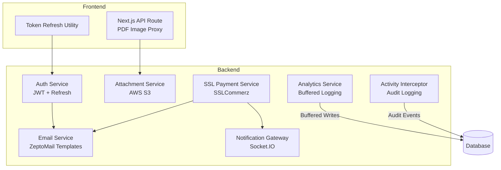
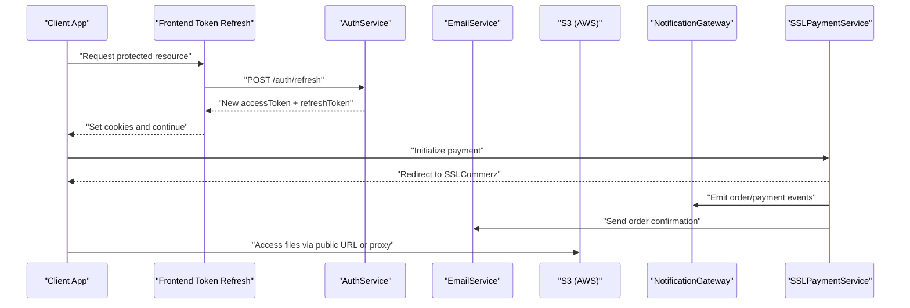
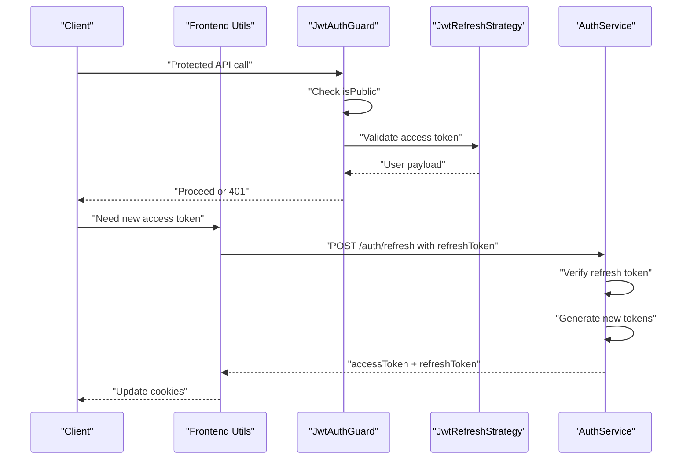
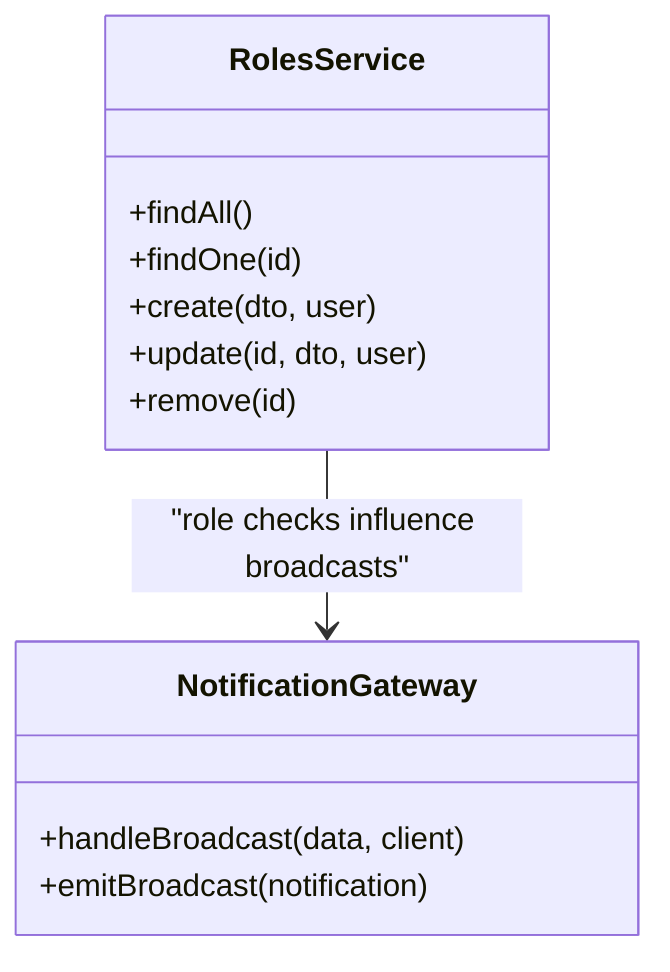
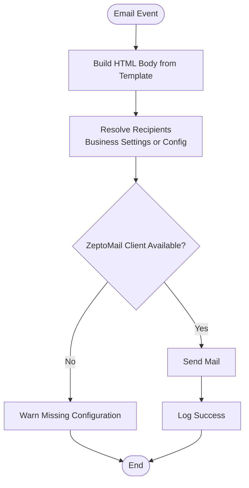
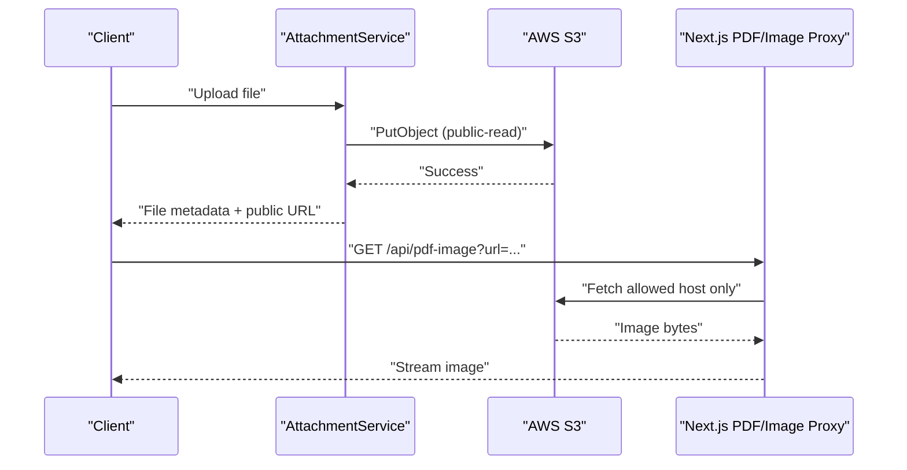
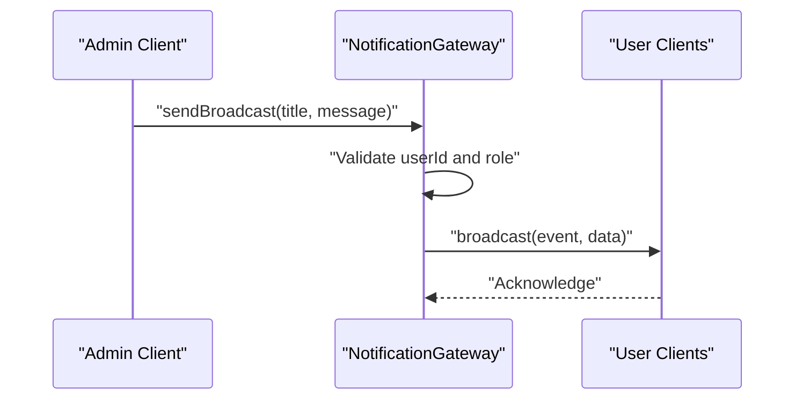
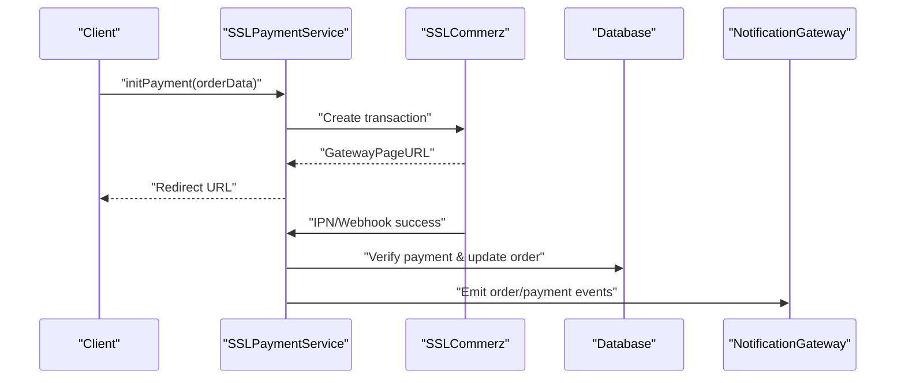
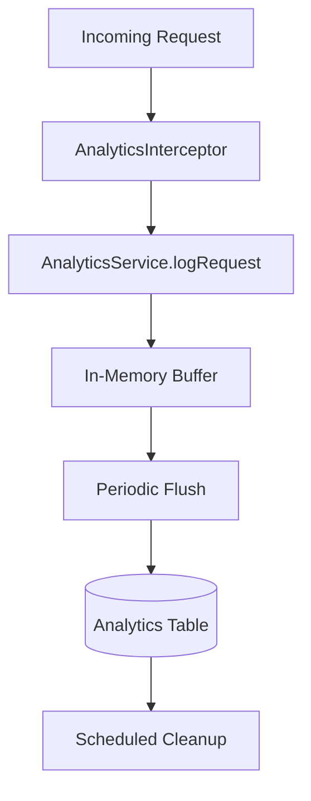
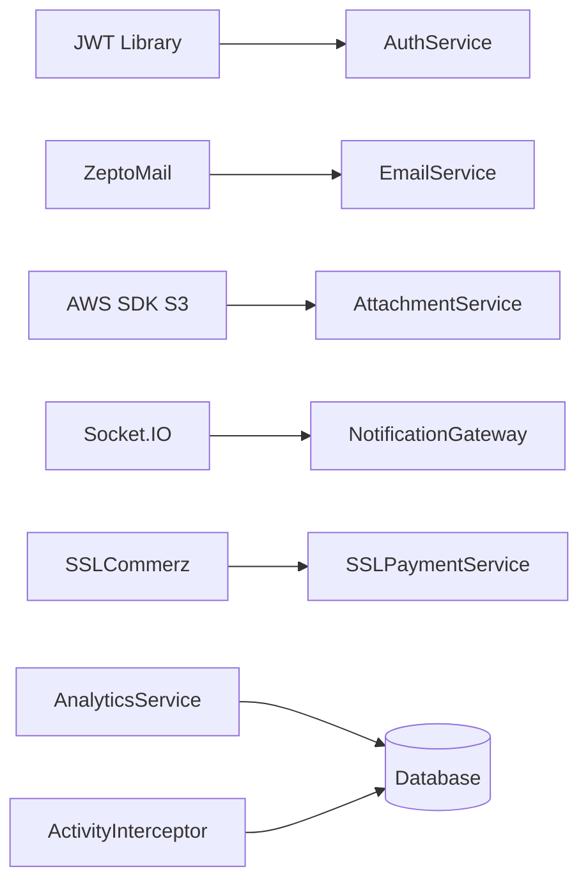

# System Integration

<cite>
**Referenced Files in This Document**   
- [auth.service.ts](file://apps/backend/src/auth/auth.service.ts)
- [jwt-auth.guard.ts](file://apps/backend/src/auth/guards/jwt-auth.guard.ts)
- [jwt-refresh.guard.ts](file://apps/backend/src/auth/guards/jwt-refresh.guard.ts)
- [jwt-refresh.strategy.ts](file://apps/backend/src/auth/strategies/jwt-refresh.strategy.ts)
- [tokens.dto.ts](file://apps/backend/src/auth/dto/tokens.dto.ts)
- [token-refresh.ts](file://apps/frontend/utils/token-refresh.ts)
- [email.service.ts](file://apps/backend/src/email/email.service.ts)
- [attachment.service.ts](file://apps/backend/src/attachment/attachment.service.ts)
- [route.ts](file://apps/frontend/app/api/pdf-image/route.ts)
- [notification.gateway.ts](file://apps/backend/src/notification/notification.gateway.ts)
- [ssl-payment.service.ts](file://apps/backend/src/ssl-payment/ssl-payment.service.ts)
- [payment.service.ts](file://apps/backend/src/payment/payment.service.ts)
- [analytics.service.ts](file://apps/backend/src/analytics/analytics.service.ts)
- [analytics.interceptor.ts](file://apps/backend/src/analytics/interceptors/analytics.interceptor.ts)
- [log-request.dto.ts](file://apps/backend/src/analytics/dto/log-request.dto.ts)
- [activity.interceptor.ts](file://apps/backend/src/interceptor/activity.interceptor.ts)
- [ip-extractor.util.ts](file://apps/backend/src/common/utils/ip-extractor.util.ts)
</cite>

## Table of Contents
1. [Introduction](#introduction)
2. [Project Structure](#project-structure)
3. [Core Components](#core-components)
4. [Architecture Overview](#architecture-overview)
5. [Detailed Component Analysis](#detailed-component-analysis)
6. [Dependency Analysis](#dependency-analysis)
7. [Performance Considerations](#performance-considerations)
8. [Troubleshooting Guide](#troubleshooting-guide)
9. [Conclusion](#conclusion)

## Introduction
This document explains the system integration patterns used across the backend and frontend services. It covers authentication with JWT, refresh token rotation, role-based authorization, email delivery with template management, file storage via AWS S3 including public URL handling, real-time notifications through Socket.IO, payment gateway integration with SSLCommerz, webhook/IPN handling, monitoring and logging, analytics tracking, and third-party API client patterns. The goal is to help developers understand how external services are integrated and how internal components communicate safely and reliably.

## Project Structure
The repository is a monorepo with:
- Backend: NestJS application providing REST APIs, WebSocket gateway, scheduled jobs, and integrations.
- Frontend: Next.js application handling UI, server-side token refresh, and secure proxying for asset access.

**Diagram sources**
- [token-refresh.ts](file://apps/frontend/utils/token-refresh.ts)
- [route.ts](file://apps/frontend/app/api/pdf-image/route.ts)
- [auth.service.ts](file://apps/backend/src/auth/auth.service.ts)
- [email.service.ts](file://apps/backend/src/email/email.service.ts)
- [attachment.service.ts](file://apps/backend/src/attachment/attachment.service.ts)
- [notification.gateway.ts](file://apps/backend/src/notification/notification.gateway.ts)
- [ssl-payment.service.ts](file://apps/backend/src/ssl-payment/ssl-payment.service.ts)
- [analytics.service.ts](file://apps/backend/src/analytics/analytics.service.ts)
- [activity.interceptor.ts](file://apps/backend/src/interceptor/activity.interceptor.ts)

**Section sources**
- [auth.service.ts](file://apps/backend/src/auth/auth.service.ts)
- [email.service.ts](file://apps/backend/src/email/email.service.ts)
- [attachment.service.ts](file://apps/backend/src/attachment/attachment.service.ts)
- [notification.gateway.ts](file://apps/backend/src/notification/notification.gateway.ts)
- [ssl-payment.service.ts](file://apps/backend/src/ssl-payment/ssl-payment.service.ts)
- [analytics.service.ts](file://apps/backend/src/analytics/analytics.service.ts)
- [activity.interceptor.ts](file://apps/backend/src/interceptor/activity.interceptor.ts)

## Core Components
- Authentication and Authorization: JWT access tokens, refresh token rotation, Passport strategies, guards, and DTOs.
- Email Delivery: ZeptoMail integration with HTML templates for order confirmation, contact response, password change/reset OTP, admin alerts, and campaign emails.
- File Storage: AWS S3 client for upload/delete and public URL generation; frontend proxy route for safe image fetching.
- Real-Time Communication: Socket.IO gateway managing user rooms, admin room, broadcast, and event emission for orders/messages/payments.
- Payments: SSLCommerz initialization, IPN/webhook verification, success/failure handling, and purchase payment status reconciliation.
- Monitoring and Analytics: Request analytics buffered and flushed to database, retention cleanup, device/browser breakdown, top endpoints, conversion metrics.
- Audit Logging: Activity interceptor capturing CRUD actions, old/new values, IP, user agent, request ID, session ID, and user type.

**Section sources**
- [auth.service.ts](file://apps/backend/src/auth/auth.service.ts)
- [jwt-auth.guard.ts](file://apps/backend/src/auth/guards/jwt-auth.guard.ts)
- [jwt-refresh.guard.ts](file://apps/backend/src/auth/guards/jwt-refresh.guard.ts)
- [jwt-refresh.strategy.ts](file://apps/backend/src/auth/strategies/jwt-refresh.strategy.ts)
- [tokens.dto.ts](file://apps/backend/src/auth/dto/tokens.dto.ts)
- [email.service.ts](file://apps/backend/src/email/email.service.ts)
- [attachment.service.ts](file://apps/backend/src/attachment/attachment.service.ts)
- [route.ts](file://apps/frontend/app/api/pdf-image/route.ts)
- [notification.gateway.ts](file://apps/backend/src/notification/notification.gateway.ts)
- [ssl-payment.service.ts](file://apps/backend/src/ssl-payment/ssl-payment.service.ts)
- [payment.service.ts](file://apps/backend/src/payment/payment.service.ts)
- [analytics.service.ts](file://apps/backend/src/analytics/analytics.service.ts)
- [analytics.interceptor.ts](file://apps/backend/src/analytics/interceptors/analytics.interceptor.ts)
- [activity.interceptor.ts](file://apps/backend/src/interceptor/activity.interceptor.ts)

## Architecture Overview
The system integrates multiple external services:
- JWT-based auth with separate access and refresh secrets.
- ZeptoMail for transactional and marketing emails.
- AWS S3 for object storage with public URLs.
- Socket.IO for live notifications.
- SSLCommerz for payment processing with IPN webhooks.
- Internal analytics and audit logging for observability.

**Diagram sources**
- [token-refresh.ts](file://apps/frontend/utils/token-refresh.ts)
- [auth.service.ts](file://apps/backend/src/auth/auth.service.ts)
- [email.service.ts](file://apps/backend/src/email/email.service.ts)
- [attachment.service.ts](file://apps/backend/src/attachment/attachment.service.ts)
- [notification.gateway.ts](file://apps/backend/src/notification/notification.gateway.ts)
- [ssl-payment.service.ts](file://apps/backend/src/ssl-payment/ssl-payment.service.ts)

## Detailed Component Analysis

### Authentication Flow with JWT and Refresh Token Rotation
- Access and refresh tokens are generated using separate secrets and expiration settings.
- Login validates credentials, sanitizes user data, generates tokens, updates last login, and logs activity asynchronously.
- Refresh endpoint verifies the refresh token, fetches the user, and issues new tokens.
- Guards enforce Bearer token validation and allow public routes when marked.
- Frontend utility calls the refresh endpoint, sets cookies on success, and clears them on failure.

**Diagram sources**
- [jwt-auth.guard.ts](file://apps/backend/src/auth/guards/jwt-auth.guard.ts)
- [jwt-refresh.strategy.ts](file://apps/backend/src/auth/strategies/jwt-refresh.strategy.ts)
- [auth.service.ts](file://apps/backend/src/auth/auth.service.ts)
- [token-refresh.ts](file://apps/frontend/utils/token-refresh.ts)

Key implementation points:
- Separate secrets for access and refresh tokens ensure isolation.
- Refresh flow returns both tokens, enabling rotation.
- Guards support public routes via reflector metadata.
- Frontend handles cookie persistence and error cleanup.

**Section sources**
- [auth.service.ts:54-170](file://apps/backend/src/auth/auth.service.ts#L54-L170)
- [jwt-auth.guard.ts:10-45](file://apps/backend/src/auth/guards/jwt-auth.guard.ts#L10-L45)
- [jwt-refresh.guard.ts:10-61](file://apps/backend/src/auth/guards/jwt-refresh.guard.ts#L10-L61)
- [jwt-refresh.strategy.ts:7-25](file://apps/backend/src/auth/strategies/jwt-refresh.strategy.ts#L7-L25)
- [tokens.dto.ts:4-27](file://apps/backend/src/auth/dto/tokens.dto.ts#L4-L27)
- [token-refresh.ts:7-46](file://apps/frontend/utils/token-refresh.ts#L7-L46)

### Role-Based Authorization
- Roles are managed via a dedicated service that queries active roles and supports CRUD operations.
- User roles are included in JWT payloads and can be used by downstream guards or interceptors for authorization decisions.
- Broadcast capability in the notification gateway restricts broadcasting to specific admin role IDs.

**Diagram sources**
- [roles.service.ts](file://apps/backend/src/roles/roles.service.ts)
- [notification.gateway.ts](file://apps/backend/src/notification/notification.gateway.ts)

**Section sources**
- [roles.service.ts:13-93](file://apps/backend/src/roles/roles.service.ts#L13-L93)
- [notification.gateway.ts:228-338](file://apps/backend/src/notification/notification.gateway.ts#L228-L338)

### Email Service Integration with Template Management
- EmailService uses ZeptoMail client configured via environment variables.
- Templates generate HTML bodies for order confirmation, contact response, password changed/reset OTP, admin alerts, and campaign emails.
- Admin recipients are resolved from business settings or fallback configuration.
- Non-critical email failures are logged without breaking main flows.

**Diagram sources**
- [email.service.ts:29-56](file://apps/backend/src/email/email.service.ts#L29-L56)
- [email.service.ts:84-116](file://apps/backend/src/email/email.service.ts#L84-L116)
- [email.service.ts:181-219](file://apps/backend/src/email/email.service.ts#L181-L219)

**Section sources**
- [email.service.ts:29-56](file://apps/backend/src/email/email.service.ts#L29-L56)
- [email.service.ts:84-116](file://apps/backend/src/email/email.service.ts#L84-L116)
- [email.service.ts:118-176](file://apps/backend/src/email/email.service.ts#L118-L176)
- [email.service.ts:181-219](file://apps/backend/src/email/email.service.ts#L181-L219)
- [email.service.ts:221-293](file://apps/backend/src/email/email.service.ts#L221-L293)
- [email.service.ts:295-342](file://apps/backend/src/email/email.service.ts#L295-L342)

### File Storage Integration with AWS S3 and Presigned URLs
- AttachmentService configures S3 client with region and credentials, uploads files with public ACL, stores metadata, and constructs public URLs.
- Frontend includes a Next.js API route that proxies images only from an allowed S3 host to prevent SSRF abuse.
- Note: The current attachment service uses direct public URLs rather than presigned URLs; if short-lived signed URLs are required, consider adding a presign method using @aws-sdk/s3-request-presigner.

**Diagram sources**
- [attachment.service.ts:20-36](file://apps/backend/src/attachment/attachment.service.ts#L20-L36)
- [attachment.service.ts:38-71](file://apps/backend/src/attachment/attachment.service.ts#L38-L71)
- [route.ts:1-41](file://apps/frontend/app/api/pdf-image/route.ts#L1-L41)

**Section sources**
- [attachment.service.ts:20-36](file://apps/backend/src/attachment/attachment.service.ts#L20-L36)
- [attachment.service.ts:38-71](file://apps/backend/src/attachment/attachment.service.ts#L38-L71)
- [attachment.service.ts:73-119](file://apps/backend/src/attachment/attachment.service.ts#L73-L119)
- [attachment.service.ts:120-155](file://apps/backend/src/attachment/attachment.service.ts#L120-L155)
- [route.ts:1-41](file://apps/frontend/app/api/pdf-image/route.ts#L1-L41)

### Real-Time Communication via Socket.IO for Live Notifications
- NotificationGateway manages connections, joins user-specific and admin rooms, and emits events for new orders, messages, order status updates, payment status updates, order confirmations, and general notifications.
- Admin-only broadcast endpoint validates user identity and role before sending announcements to all connected clients.
- CORS is configured for specified origins and credentials.

**Diagram sources**
- [notification.gateway.ts:15-37](file://apps/backend/src/notification/notification.gateway.ts#L15-L37)
- [notification.gateway.ts:148-222](file://apps/backend/src/notification/notification.gateway.ts#L148-L222)
- [notification.gateway.ts:228-338](file://apps/backend/src/notification/notification.gateway.ts#L228-L338)

**Section sources**
- [notification.gateway.ts:15-37](file://apps/backend/src/notification/notification.gateway.ts#L15-L37)
- [notification.gateway.ts:43-87](file://apps/backend/src/notification/notification.gateway.ts#L43-L87)
- [notification.gateway.ts:89-126](file://apps/backend/src/notification/notification.gateway.ts#L89-L126)
- [notification.gateway.ts:128-146](file://apps/backend/src/notification/notification.gateway.ts#L128-L146)
- [notification.gateway.ts:148-222](file://apps/backend/src/notification/notification.gateway.ts#L148-L222)
- [notification.gateway.ts:228-338](file://apps/backend/src/notification/notification.gateway.ts#L228-L338)

### Payment Gateway Integration, Webhook Handling, and Error Recovery
- SSLPaymentService initializes payments with SSLCommerz, builds request data, and returns the gateway page URL.
- Success handler verifies payment, prevents duplicate processing, associates payment method, and updates order state.
- PaymentService reconciles purchase payment statuses based on recorded payments.

**Diagram sources**
- [ssl-payment.service.ts:44-111](file://apps/backend/src/ssl-payment/ssl-payment.service.ts#L44-L111)
- [ssl-payment.service.ts:113-179](file://apps/backend/src/ssl-payment/ssl-payment.service.ts#L113-L179)
- [payment.service.ts:112-136](file://apps/backend/src/payment/payment.service.ts#L112-L136)

**Section sources**
- [ssl-payment.service.ts:31-42](file://apps/backend/src/ssl-payment/ssl-payment.service.ts#L31-L42)
- [ssl-payment.service.ts:44-111](file://apps/backend/src/ssl-payment/ssl-payment.service.ts#L44-L111)
- [ssl-payment.service.ts:113-179](file://apps/backend/src/ssl-payment/ssl-payment.service.ts#L113-L179)
- [payment.service.ts:23-51](file://apps/backend/src/payment/payment.service.ts#L23-L51)
- [payment.service.ts:112-136](file://apps/backend/src/payment/payment.service.ts#L112-L136)

### Monitoring and Logging Integration
- AnalyticsInterceptor captures request metrics (endpoint, method, status code, response time, user info, IP, user agent, referer, path, authentication flag) and delegates to AnalyticsService.
- AnalyticsService buffers requests and flushes them periodically or when batch size is reached; it also creates indexes at startup and runs daily retention cleanup.
- ActivityInterceptor records detailed audit events for mutations, capturing old/new values, IP, user agent, request ID, session ID, and user type.

**Diagram sources**
- [analytics.interceptor.ts:42-115](file://apps/backend/src/analytics/interceptors/analytics.interceptor.ts#L42-L115)
- [analytics.service.ts:142-192](file://apps/backend/src/analytics/analytics.service.ts#L142-L192)
- [analytics.service.ts:59-80](file://apps/backend/src/analytics/analytics.service.ts#L59-L80)
- [analytics.service.ts:593-615](file://apps/backend/src/analytics/analytics.service.ts#L593-L615)
- [activity.interceptor.ts:37-73](file://apps/backend/src/interceptor/activity.interceptor.ts#L37-L73)
- [activity.interceptor.ts:184-251](file://apps/backend/src/interceptor/activity.interceptor.ts#L184-L251)

**Section sources**
- [analytics.interceptor.ts:42-115](file://apps/backend/src/analytics/interceptors/analytics.interceptor.ts#L42-L115)
- [log-request.dto.ts:3-45](file://apps/backend/src/analytics/dto/log-request.dto.ts#L3-L45)
- [analytics.service.ts:38-80](file://apps/backend/src/analytics/analytics.service.ts#L38-L80)
- [analytics.service.ts:142-192](file://apps/backend/src/analytics/analytics.service.ts#L142-L192)
- [analytics.service.ts:593-615](file://apps/backend/src/analytics/analytics.service.ts#L593-L615)
- [activity.interceptor.ts:37-73](file://apps/backend/src/interceptor/activity.interceptor.ts#L37-L73)
- [activity.interceptor.ts:184-251](file://apps/backend/src/interceptor/activity.interceptor.ts#L184-L251)
- [ip-extractor.util.ts:8-54](file://apps/backend/src/common/utils/ip-extractor.util.ts#L8-L54)

### Third-Party API Client Patterns
- ZeptoMail client is initialized with URL and token from configuration; methods encapsulate template rendering and recipient resolution.
- AWS SDK S3 client is configured with region and credentials; upload/delete commands are wrapped with logging and metadata persistence.
- SSLCommerz client is instantiated per payment initialization with store credentials and environment flags.

**Section sources**
- [email.service.ts:29-56](file://apps/backend/src/email/email.service.ts#L29-L56)
- [attachment.service.ts:20-36](file://apps/backend/src/attachment/attachment.service.ts#L20-L36)
- [ssl-payment.service.ts:31-42](file://apps/backend/src/ssl-payment/ssl-payment.service.ts#L31-L42)

## Dependency Analysis
External dependencies and their usage:
- JWT: Used for access and refresh tokens with separate secrets.
- ZeptoMail: Transactional and marketing email delivery.
- AWS S3: Object storage for attachments and media.
- Socket.IO: Real-time event streaming for notifications.
- SSLCommerz: Payment gateway integration with IPN/webhooks.
- Analytics and Audit: Internal observability via buffered logging and activity interception.

**Diagram sources**
- [auth.service.ts](file://apps/backend/src/auth/auth.service.ts)
- [email.service.ts](file://apps/backend/src/email/email.service.ts)
- [attachment.service.ts](file://apps/backend/src/attachment/attachment.service.ts)
- [notification.gateway.ts](file://apps/backend/src/notification/notification.gateway.ts)
- [ssl-payment.service.ts](file://apps/backend/src/ssl-payment/ssl-payment.service.ts)
- [analytics.service.ts](file://apps/backend/src/analytics/analytics.service.ts)
- [activity.interceptor.ts](file://apps/backend/src/interceptor/activity.interceptor.ts)

**Section sources**
- [auth.service.ts](file://apps/backend/src/auth/auth.service.ts)
- [email.service.ts](file://apps/backend/src/email/email.service.ts)
- [attachment.service.ts](file://apps/backend/src/attachment/attachment.service.ts)
- [notification.gateway.ts](file://apps/backend/src/notification/notification.gateway.ts)
- [ssl-payment.service.ts](file://apps/backend/src/ssl-payment/ssl-payment.service.ts)
- [analytics.service.ts](file://apps/backend/src/analytics/analytics.service.ts)
- [activity.interceptor.ts](file://apps/backend/src/interceptor/activity.interceptor.ts)

## Performance Considerations
- Analytics buffering reduces database write overhead; tune batch size, interval, and buffer cap via configuration.
- Index creation at startup improves dashboard query performance; monitor index creation errors.
- Email and SMS operations are non-blocking where possible to avoid impacting critical flows.
- S3 uploads use public ACL; consider private buckets with presigned URLs for sensitive content.
- Socket.IO rooms scale with connected users; ensure proper cleanup on disconnect.

[No sources needed since this section provides general guidance]

## Troubleshooting Guide
Common issues and resolutions:
- Invalid or expired refresh token: Ensure correct secret and token format; verify frontend sends valid refresh token.
- Email service not configured: Check ZeptoMail URL and token; verify admin notification email configuration.
- S3 upload failures: Validate region, credentials, bucket name, and base URL; check network and permissions.
- Socket.IO connection errors: Verify CORS origins and credentials; ensure userId is provided for user-scoped events.
- Payment verification failures: Confirm SSLCommerz credentials, IPN URL, and idempotency checks.
- Analytics ingestion gaps: Inspect buffer flush timer and DB connectivity; review retention schedule.

**Section sources**
- [jwt-refresh.guard.ts:41-61](file://apps/backend/src/auth/guards/jwt-refresh.guard.ts#L41-L61)
- [email.service.ts:49-55](file://apps/backend/src/email/email.service.ts#L49-L55)
- [attachment.service.ts:111-118](file://apps/backend/src/attachment/attachment.service.ts#L111-L118)
- [notification.gateway.ts:228-338](file://apps/backend/src/notification/notification.gateway.ts#L228-L338)
- [ssl-payment.service.ts:113-179](file://apps/backend/src/ssl-payment/ssl-payment.service.ts#L113-L179)
- [analytics.service.ts:172-192](file://apps/backend/src/analytics/analytics.service.ts#L172-L192)

## Conclusion
The system integrates authentication, email, file storage, real-time communication, payments, and observability into a cohesive architecture. JWT with refresh token rotation ensures secure sessions; email templates provide consistent messaging; S3 offers scalable storage; Socket.IO enables live updates; SSLCommerz handles payments with robust verification; and analytics/audit logging deliver actionable insights. Following the documented patterns helps maintain reliability, security, and performance across integrations.

[No sources needed since this section summarizes without analyzing specific files]