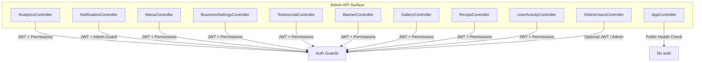
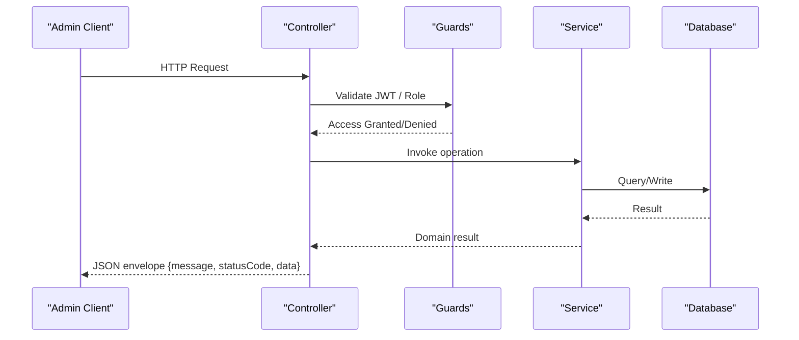
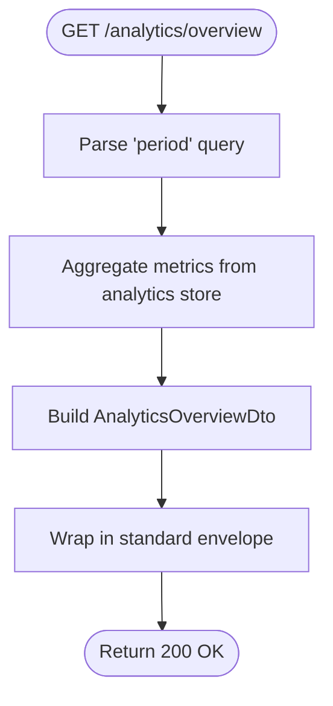
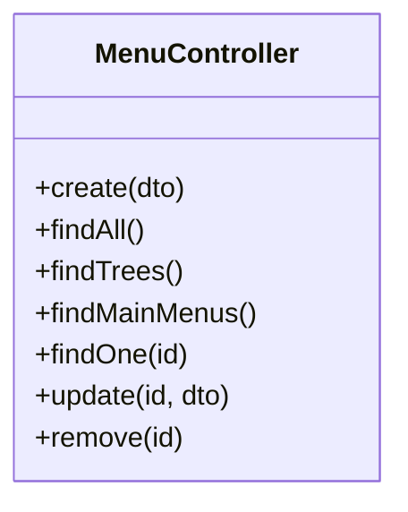
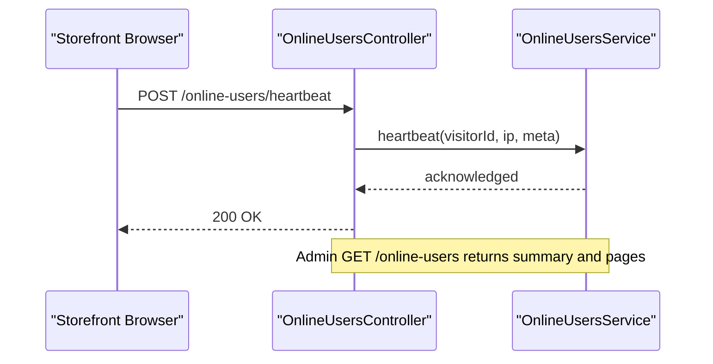
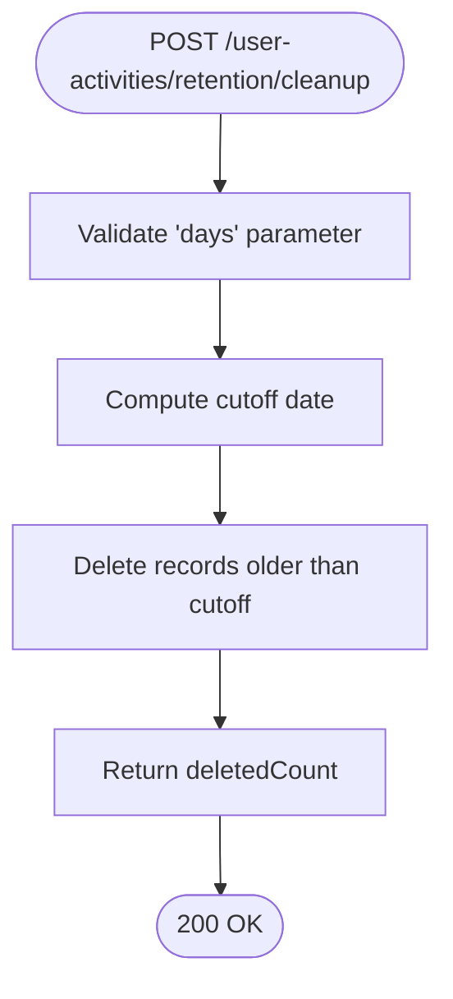
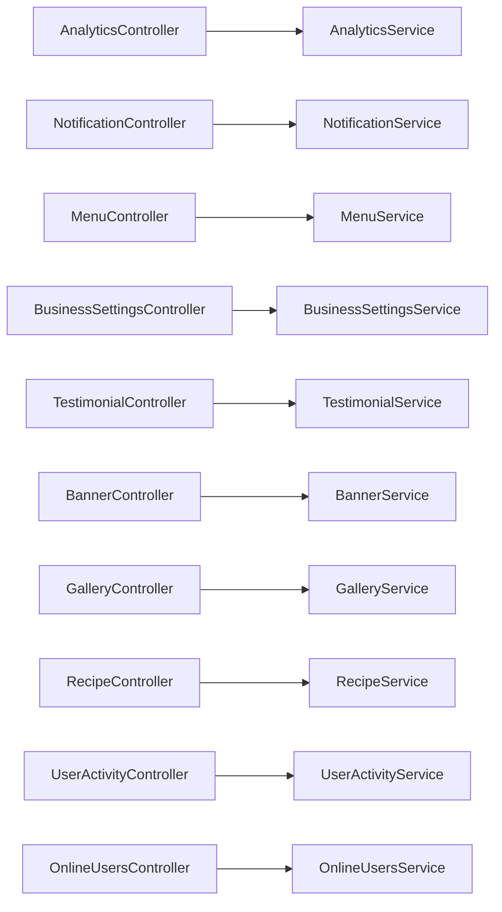

# Admin Operations APIs

<cite>
**Referenced Files in This Document**
- [app.controller.ts](file://apps/backend/src/app.controller.ts)
- [analytics.controller.ts](file://apps/backend/src/analytics/analytics.controller.ts)
- [analytics-response.dto.ts](file://apps/backend/src/analytics/dto/analytics-response.dto.ts)
- [notification.controller.ts](file://apps/backend/src/notification/notification.controller.ts)
- [menu.controller.ts](file://apps/backend/src/menu/menu.controller.ts)
- [business-settings.controller.ts](file://apps/backend/src/business-settings/business-settings.controller.ts)
- [testimonial.controller.ts](file://apps/backend/src/testimonial/testimonial.controller.ts)
- [banner.controller.ts](file://apps/backend/src/banner/banner.controller.ts)
- [gallery.controller.ts](file://apps/backend/src/gallery/gallery.controller.ts)
- [recipe.controller.ts](file://apps/backend/src/recipe/recipe.controller.ts)
- [user-activity.controller.ts](file://apps/backend/src/user-activity/user-activity.controller.ts)
- [online-users.controller.ts](file://apps/backend/src/online-users/online-users.controller.ts)
- [module-permissions.decorator.ts](file://apps/backend/src/auth/decorators/module-permissions.decorator.ts)
</cite>

## Table of Contents
1. [Introduction](#introduction)
2. [Project Structure](#project-structure)
3. [Core Components](#core-components)
4. [Architecture Overview](#architecture-overview)
5. [Detailed Component Analysis](#detailed-component-analysis)
6. [Dependency Analysis](#dependency-analysis)
7. [Performance Considerations](#performance-considerations)
8. [Troubleshooting Guide](#troubleshooting-guide)
9. [Conclusion](#conclusion)

## Introduction
This document provides comprehensive API documentation for administrative operations across analytics and reporting, notifications, menu configuration, business settings, content management (testimonials, banners, galleries, recipes), system monitoring, audit logs, and operational controls. It also covers security, permissions, performance monitoring, health checks, and diagnostics exposed by the backend.

Where applicable, each endpoint includes:
- HTTP method and path
- Authentication and authorization requirements
- Query parameters and request body schema
- Response structure and status codes
- Security notes and permission scopes

## Project Structure
The admin-facing endpoints are implemented as NestJS controllers under apps/backend/src. Each domain is encapsulated in its own controller with consistent patterns:
- JWT authentication via JwtAuthGuard
- Fine-grained authorization via PermissionGuard and ModulePermissions decorator
- Swagger/OpenAPI metadata for discoverability
- Standardized response envelopes with message, statusCode, and data fields

**Diagram sources**
- [analytics.controller.ts:27-34](file://apps/backend/src/analytics/analytics.controller.ts#L27-L34)
- [notification.controller.ts:25-28](file://apps/backend/src/notification/notification.controller.ts#L25-L28)
- [menu.controller.ts:35-39](file://apps/backend/src/menu/menu.controller.ts#L35-L39)
- [business-settings.controller.ts:19-24](file://apps/backend/src/business-settings/business-settings.controller.ts#L19-L24)
- [testimonial.controller.ts:33-36](file://apps/backend/src/testimonial/testimonial.controller.ts#L33-L36)
- [banner.controller.ts:36-40](file://apps/backend/src/banner/banner.controller.ts#L36-L40)
- [gallery.controller.ts:36-40](file://apps/backend/src/gallery/gallery.controller.ts#L36-L40)
- [recipe.controller.ts:33-37](file://apps/backend/src/recipe/recipe.controller.ts#L33-L37)
- [user-activity.controller.ts:25-29](file://apps/backend/src/user-activity/user-activity.controller.ts#L25-L29)
- [online-users.controller.ts:26-29](file://apps/backend/src/online-users/online-users.controller.ts#L26-L29)
- [app.controller.ts:4-11](file://apps/backend/src/app.controller.ts#L4-L11)

**Section sources**
- [analytics.controller.ts:27-34](file://apps/backend/src/analytics/analytics.controller.ts#L27-L34)
- [notification.controller.ts:25-28](file://apps/backend/src/notification/notification.controller.ts#L25-L28)
- [menu.controller.ts:35-39](file://apps/backend/src/menu/menu.controller.ts#L35-L39)
- [business-settings.controller.ts:19-24](file://apps/backend/src/business-settings/business-settings.controller.ts#L19-L24)
- [testimonial.controller.ts:33-36](file://apps/backend/src/testimonial/testimonial.controller.ts#L33-L36)
- [banner.controller.ts:36-40](file://apps/backend/src/banner/banner.controller.ts#L36-L40)
- [gallery.controller.ts:36-40](file://apps/backend/src/gallery/gallery.controller.ts#L36-L40)
- [recipe.controller.ts:33-37](file://apps/backend/src/recipe/recipe.controller.ts#L33-L37)
- [user-activity.controller.ts:25-29](file://apps/backend/src/user-activity/user-activity.controller.ts#L25-L29)
- [online-users.controller.ts:26-29](file://apps/backend/src/online-users/online-users.controller.ts#L26-L29)
- [app.controller.ts:4-11](file://apps/backend/src/app.controller.ts#L4-L11)

## Core Components
- Analytics and Reporting: Aggregated traffic, performance, conversion, device/browser breakdown, top endpoints, and product page views.
- Notifications: Admin and user notification feeds, read/unread management.
- Menu Configuration: CRUD and tree/list retrieval for admin menus with filtering and pagination.
- Business Settings: Public read-only settings and protected update endpoint.
- Content Management: Testimonials, banners, galleries, and recipes with full CRUD and filters.
- System Monitoring: Online users heartbeat and summary; health check root endpoint.
- Audit Logs: Paginated activity log, entity audit trails, retention stats, and cleanup.

Security model:
- Most admin endpoints require JWT and a role permission mapped to a menu URL via ModulePermissions.
- Some endpoints additionally require AdminGuard.
- Public endpoints exist for storefront-facing reads (e.g., business settings GET).

**Section sources**
- [module-permissions.decorator.ts:1-14](file://apps/backend/src/auth/decorators/module-permissions.decorator.ts#L1-L14)
- [analytics.controller.ts:27-34](file://apps/backend/src/analytics/analytics.controller.ts#L27-L34)
- [notification.controller.ts:30-31](file://apps/backend/src/notification/notification.controller.ts#L30-L31)
- [menu.controller.ts:41-43](file://apps/backend/src/menu/menu.controller.ts#L41-L43)
- [business-settings.controller.ts:28-40](file://apps/backend/src/business-settings/business-settings.controller.ts#L28-L40)
- [testimonial.controller.ts:113-115](file://apps/backend/src/testimonial/testimonial.controller.ts#L113-L115)
- [banner.controller.ts:41-43](file://apps/backend/src/banner/banner.controller.ts#L41-L43)
- [gallery.controller.ts:42-44](file://apps/backend/src/gallery/gallery.controller.ts#L42-L44)
- [recipe.controller.ts:38-40](file://apps/backend/src/recipe/recipe.controller.ts#L38-L40)
- [user-activity.controller.ts:31-33](file://apps/backend/src/user-activity/user-activity.controller.ts#L31-L33)
- [online-users.controller.ts:31-33](file://apps/backend/src/online-users/online-users.controller.ts#L31-L33)

## Architecture Overview
The admin API surface follows a layered architecture:
- Controllers expose REST endpoints with OpenAPI annotations.
- Guards enforce authentication and authorization.
- Services implement business logic and data access.
- DTOs define request/response schemas.

**Diagram sources**
- [analytics.controller.ts:27-34](file://apps/backend/src/analytics/analytics.controller.ts#L27-L34)
- [notification.controller.ts:30-31](file://apps/backend/src/notification/notification.controller.ts#L30-L31)
- [menu.controller.ts:41-43](file://apps/backend/src/menu/menu.controller.ts#L41-L43)
- [business-settings.controller.ts:38-40](file://apps/backend/src/business-settings/business-settings.controller.ts#L38-L40)
- [testimonial.controller.ts:113-115](file://apps/backend/src/testimonial/testimonial.controller.ts#L113-L115)
- [banner.controller.ts:41-43](file://apps/backend/src/banner/banner.controller.ts#L41-L43)
- [gallery.controller.ts:42-44](file://apps/backend/src/gallery/gallery.controller.ts#L42-L44)
- [recipe.controller.ts:38-40](file://apps/backend/src/recipe/recipe.controller.ts#L38-L40)
- [user-activity.controller.ts:31-33](file://apps/backend/src/user-activity/user-activity.controller.ts#L31-L33)
- [online-users.controller.ts:31-33](file://apps/backend/src/online-users/online-users.controller.ts#L31-L33)

## Detailed Component Analysis

### Analytics and Reporting
Endpoints:
- GET /analytics/overview?period=...
- GET /analytics/requests?period=...
- GET /analytics/peak-traffic?period=...
- GET /analytics/visitors?period=...
- GET /analytics/top-endpoints?limit=&period=...
- GET /analytics/response-times?period=...
- GET /analytics/devices?period=...
- GET /analytics/top-pages?period=&limit=...
- GET /analytics/traffic-sources?period=...
- GET /analytics/conversion?period=...

Authentication:
- Requires JWT and role permission mapped to /admin/dashboard.

Key behaviors:
- Period parameter supports 1h, 24h, 7d, 15d, 30d.
- Top endpoints include count and average response time.
- Conversion endpoint computes visitor-to-order rate over period.

Response envelope:
- message, statusCode, data, optional meta fields like limit/period.

DTOs:
- AnalyticsOverviewDto, PeakTrafficDto, ResponseTimeMetricsDto, TopEndpointDto.

Example usage:
- Dashboard aggregation: call overview and response-times to render KPI tiles.
- Performance tuning: use top-endpoints and response-times to identify slow routes.

**Diagram sources**
- [analytics.controller.ts:36-62](file://apps/backend/src/analytics/analytics.controller.ts#L36-L62)
- [analytics-response.dto.ts:44-65](file://apps/backend/src/analytics/dto/analytics-response.dto.ts#L44-L65)

**Section sources**
- [analytics.controller.ts:27-330](file://apps/backend/src/analytics/analytics.controller.ts#L27-L330)
- [analytics-response.dto.ts:1-65](file://apps/backend/src/analytics/dto/analytics-response.dto.ts#L1-L65)

### Notification Management
Endpoints:
- GET /notifications/admin?page=&limit=...
- GET /notifications/admin/unread-count
- PATCH /notifications/admin/read-all
- PATCH /notifications/admin/:id/read
- GET /notifications/my?page=&limit=...
- GET /notifications/my/unread-count
- PATCH /notifications/read-all
- PATCH /notifications/:id/read

Authentication:
- Admin endpoints require JWT + AdminGuard.
- User endpoints require JWT.

Capabilities:
- Paginated notification lists for admins and current user.
- Unread counts.
- Mark all or single notifications as read.

Operational example:
- Admin bell badge uses unread-count; clicking clears via read-all.

**Section sources**
- [notification.controller.ts:25-138](file://apps/backend/src/notification/notification.controller.ts#L25-L138)

### Menu Configuration
Endpoints:
- POST /menu (create)
- GET /menu (list with filters and pagination)
- GET /menu/tree (hierarchical tree with pagination)
- GET /menu/main (main menu items)
- GET /menu/:id (single item)
- PATCH /menu/:id (update)
- DELETE /menu/:id (delete)

Authentication:
- Write endpoints require JWT + PermissionGuard with module permission /admin/menu.

Filters:
- isAdminMenu, isMainMenu, isActive, search, page, limit.

Tree behavior:
- Returns paginated top-level items with nested children.

Error handling:
- Not found returns 404; internal errors return 500 with contextual messages.

**Diagram sources**
- [menu.controller.ts:35-446](file://apps/backend/src/menu/menu.controller.ts#L35-L446)

**Section sources**
- [menu.controller.ts:35-446](file://apps/backend/src/menu/menu.controller.ts#L35-L446)

### Business Settings
Endpoints:
- GET /business-settings (public)
- PATCH /business-settings (protected)

Authentication:
- Update requires JWT + PermissionGuard with module permission /admin/settings/business-info.

Use cases:
- Storefront reads logo, contact info, maintenance mode flags without login.
- Admin updates settings including maintenance windows and CRM segment thresholds.

**Section sources**
- [business-settings.controller.ts:19-55](file://apps/backend/src/business-settings/business-settings.controller.ts#L19-L55)

### Testimonials
Endpoints:
- GET /testimonials?isPublish=...
- GET /testimonials/:id
- POST /testimonials (protected)
- PATCH /testimonials/:id (protected)
- DELETE /testimonials/:id (protected)

Authentication:
- Write endpoints require JWT + PermissionGuard with module permission /admin/testimonial/testimonial-list.

Behavior:
- Optional publication filter on list.
- Full CRUD with standardized responses.

**Section sources**
- [testimonial.controller.ts:33-222](file://apps/backend/src/testimonial/testimonial.controller.ts#L33-L222)

### Banners
Endpoints:
- POST /banners (protected)
- GET /banners (list with filters and pagination)
- GET /banners/active (cached)
- GET /banners/:id
- PATCH /banners/reorder (protected)
- PATCH /banners/:id (protected)
- DELETE /banners/:id (protected)

Authentication:
- Write endpoints require JWT + PermissionGuard with module permission /admin/content.

Features:
- Filtering by type, position, active status, and search.
- Reordering via index-based payload.
- Active banners cached for short TTL.

**Section sources**
- [banner.controller.ts:36-262](file://apps/backend/src/banner/banner.controller.ts#L36-L262)

### Galleries
Endpoints:
- POST /galleries (protected, multipart)
- GET /galleries
- GET /galleries/:id
- POST /galleries/:id/attachments (protected, multipart)
- DELETE /galleries/:id/attachments/:attachmentId (protected)
- DELETE /galleries/:id (protected)

Authentication:
- Write endpoints require JWT + PermissionGuard with module permission /admin/products.

Behavior:
- Create gallery with multiple images.
- Add/remove attachments to existing galleries.

**Section sources**
- [gallery.controller.ts:36-202](file://apps/backend/src/gallery/gallery.controller.ts#L36-L202)

### Recipes
Endpoints:
- POST /recipes (protected)
- GET /recipes?page=&limit=&isPublished=&recipesearch=&categorySlug=...
- GET /recipes/:id
- PATCH /recipes/:id (protected)
- DELETE /recipes/:id (protected)

Authentication:
- Write endpoints require JWT + PermissionGuard with module permission /admin/recipe.

Behavior:
- Pagination and filtering by published status, search text, and category slug.

**Section sources**
- [recipe.controller.ts:33-208](file://apps/backend/src/recipe/recipe.controller.ts#L33-L208)

### System Monitoring and Diagnostics
Endpoints:
- GET / (health check returning database host)
- POST /online-users/heartbeat (optional JWT)
- GET /online-users?window=... (admin only)

Authentication:
- Heartbeat accepts optional JWT; admin summary requires JWT + AdminGuard.

Purpose:
- Root endpoint serves as a basic health probe.
- Online users tracks active visitors and pages viewed within a configurable window.

**Diagram sources**
- [online-users.controller.ts:31-98](file://apps/backend/src/online-users/online-users.controller.ts#L31-L98)
- [app.controller.ts:8-11](file://apps/backend/src/app.controller.ts#L8-L11)

**Section sources**
- [online-users.controller.ts:26-99](file://apps/backend/src/online-users/online-users.controller.ts#L26-L99)
- [app.controller.ts:4-11](file://apps/backend/src/app.controller.ts#L4-L11)

### Audit Logs and Operational Auditing
Endpoints:
- GET /user-activities?page=&limit=&action=&entityType=&userType=&status=&userId=...
- GET /user-activities/audit-trail/:entityType/:entityId
- GET /user-activities/entity-types
- GET /user-activities/details/:id
- GET /user-activities/:userId
- POST /user-activities/retention/cleanup?days=...
- GET /user-activities/retention/stats?days=...

Authentication:
- All endpoints require JWT; write/maintenance endpoints additionally require PermissionGuard with module permission /admin/audit-log.

Capabilities:
- Paginated activity listing with rich filters.
- Entity-specific audit trail.
- Retention statistics and manual cleanup.

Operational example:
- Schedule periodic cleanup of old records using retention/cleanup.
- Use retention/stats to estimate storage impact before cleanup.

**Diagram sources**
- [user-activity.controller.ts:312-350](file://apps/backend/src/user-activity/user-activity.controller.ts#L312-L350)

**Section sources**
- [user-activity.controller.ts:25-395](file://apps/backend/src/user-activity/user-activity.controller.ts#L25-L395)

### Security, Permissions, and Escalation Controls
- Authentication: JWT bearer tokens required for most admin endpoints.
- Authorization:
  - PermissionGuard enforces per-module permissions.
  - ModulePermissions decorator maps endpoints to menu URLs that must exist in the menu table.
  - AdminGuard restricts sensitive admin-only endpoints.
- Permission escalation:
  - Ensure roles are assigned appropriate permissions for each menu URL.
  - Avoid granting broad permissions; prefer least privilege.
- Operational auditing:
  - Use audit logs to track who performed which action and when.
  - Monitor retention stats and schedule cleanup to manage storage.

**Section sources**
- [module-permissions.decorator.ts:1-14](file://apps/backend/src/auth/decorators/module-permissions.decorator.ts#L1-L14)
- [analytics.controller.ts:27-34](file://apps/backend/src/analytics/analytics.controller.ts#L27-L34)
- [notification.controller.ts:30-31](file://apps/backend/src/notification/notification.controller.ts#L30-L31)
- [menu.controller.ts:41-43](file://apps/backend/src/menu/menu.controller.ts#L41-L43)
- [business-settings.controller.ts:38-40](file://apps/backend/src/business-settings/business-settings.controller.ts#L38-L40)
- [testimonial.controller.ts:113-115](file://apps/backend/src/testimonial/testimonial.controller.ts#L113-L115)
- [banner.controller.ts:41-43](file://apps/backend/src/banner/banner.controller.ts#L41-L43)
- [gallery.controller.ts:42-44](file://apps/backend/src/gallery/gallery.controller.ts#L42-L44)
- [recipe.controller.ts:38-40](file://apps/backend/src/recipe/recipe.controller.ts#L38-L40)
- [user-activity.controller.ts:31-33](file://apps/backend/src/user-activity/user-activity.controller.ts#L31-L33)
- [online-users.controller.ts:53-56](file://apps/backend/src/online-users/online-users.controller.ts#L53-L56)

## Dependency Analysis
Controllers depend on:
- Guards for authentication and authorization.
- Services for business logic and persistence.
- DTOs for typed request/response contracts.

[No diagram sources needed since this diagram shows conceptual relationships not tied to specific files]

**Section sources**
- [analytics.controller.ts:27-34](file://apps/backend/src/analytics/analytics.controller.ts#L27-L34)
- [notification.controller.ts:25-28](file://apps/backend/src/notification/notification.controller.ts#L25-L28)
- [menu.controller.ts:35-39](file://apps/backend/src/menu/menu.controller.ts#L35-L39)
- [business-settings.controller.ts:19-24](file://apps/backend/src/business-settings/business-settings.controller.ts#L19-L24)
- [testimonial.controller.ts:33-36](file://apps/backend/src/testimonial/testimonial.controller.ts#L33-L36)
- [banner.controller.ts:36-40](file://apps/backend/src/banner/banner.controller.ts#L36-L40)
- [gallery.controller.ts:36-40](file://apps/backend/src/gallery/gallery.controller.ts#L36-L40)
- [recipe.controller.ts:33-37](file://apps/backend/src/recipe/recipe.controller.ts#L33-L37)
- [user-activity.controller.ts:25-29](file://apps/backend/src/user-activity/user-activity.controller.ts#L25-L29)
- [online-users.controller.ts:26-29](file://apps/backend/src/online-users/online-users.controller.ts#L26-L29)

## Performance Considerations
- Analytics endpoints aggregate large datasets; prefer narrower periods and limits where possible.
- Active banners endpoint uses caching to reduce load on frequent reads.
- Online users summary allows configuring the observation window to balance accuracy and overhead.
- Audit log retention cleanup helps control database growth and query performance.

[No sources needed since this section provides general guidance]

## Troubleshooting Guide
Common issues and resolutions:
- 401 Unauthorized: Missing or invalid JWT token. Ensure bearer token is included.
- 403 Forbidden: Insufficient permissions. Verify role has the required module permission for the target menu URL.
- 404 Not Found: Resource ID does not exist. Confirm IDs for banners, testimonials, galleries, recipes, and menu items.
- 500 Internal Server Error: Unexpected server-side error. Check service layer exceptions and database connectivity.

Operational tips:
- Use /user-activities/retention/stats to preview cleanup impact.
- Use /user-activities/retention/cleanup to remove old records after approval.
- For dashboard performance, tune analytics.period and top-endpoints.limit.

**Section sources**
- [menu.controller.ts:347-368](file://apps/backend/src/menu/menu.controller.ts#L347-L368)
- [banner.controller.ts:173-180](file://apps/backend/src/banner/banner.controller.ts#L173-L180)
- [testimonial.controller.ts:108-112](file://apps/backend/src/testimonial/testimonial.controller.ts#L108-L112)
- [recipe.controller.ts:138-145](file://apps/backend/src/recipe/recipe.controller.ts#L138-L145)
- [user-activity.controller.ts:312-393](file://apps/backend/src/user-activity/user-activity.controller.ts#L312-L393)

## Conclusion
The admin API surface provides robust capabilities for analytics, notifications, menu configuration, business settings, content management, system monitoring, and audit logging. Security is enforced through JWT and granular role-based permissions mapped to menu modules. Operators can monitor system health, track online users, and maintain audit logs with retention policies. Use the documented endpoints to build dashboards, automate tasks, and ensure secure, auditable administration.

[No sources needed since this section summarizes without analyzing specific files]