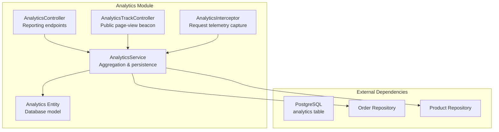
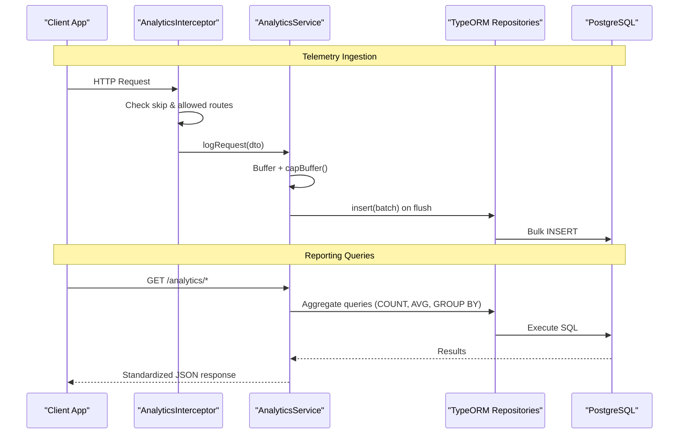
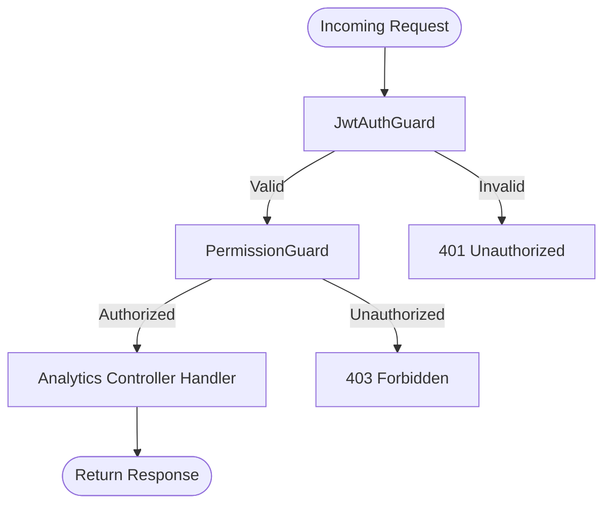
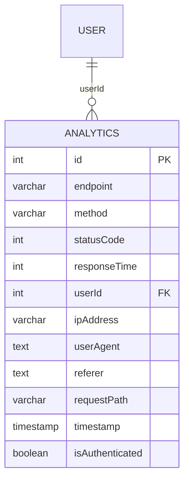
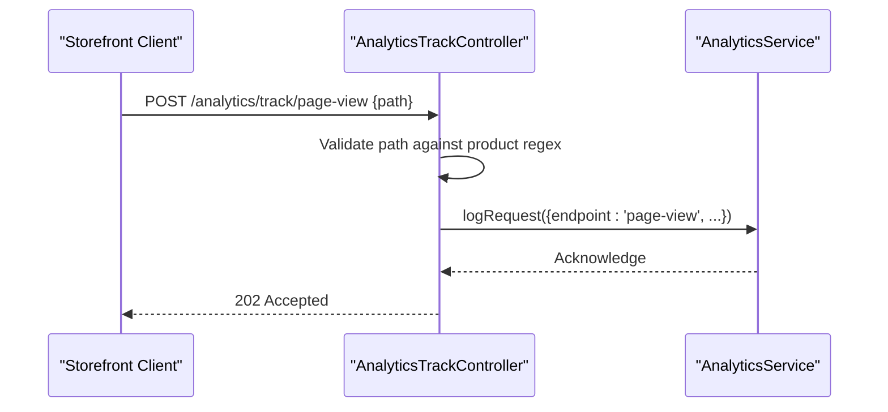
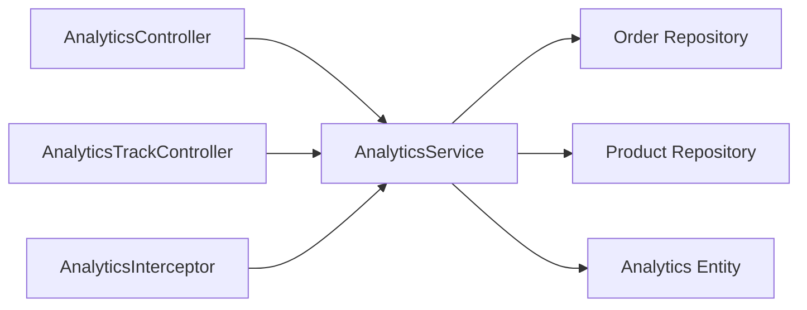

# Analytics & Reporting APIs

<cite>
**Referenced Files in This Document**
- [analytics.controller.ts](file://apps/backend/src/analytics/analytics.controller.ts)
- [analytics.service.ts](file://apps/backend/src/analytics/analytics.service.ts)
- [analytics.module.ts](file://apps/backend/src/analytics/analytics.module.ts)
- [analytics.interceptor.ts](file://apps/backend/src/analytics/interceptors/analytics.interceptor.ts)
- [analytics-track.controller.ts](file://apps/backend/src/analytics/analytics-track.controller.ts)
- [analytics-response.dto.ts](file://apps/backend/src/analytics/dto/analytics-response.dto.ts)
- [log-request.dto.ts](file://apps/backend/src/analytics/dto/log-request.dto.ts)
- [analytics.entity.ts](file://apps/backend/src/analytics/entities/analytics.entity.ts)
</cite>

## Table of Contents
1. [Introduction](#introduction)
2. [Project Structure](#project-structure)
3. [Core Components](#core-components)
4. [Architecture Overview](#architecture-overview)
5. [Detailed Component Analysis](#detailed-component-analysis)
6. [Dependency Analysis](#dependency-analysis)
7. [Performance Considerations](#performance-considerations)
8. [Troubleshooting Guide](#troubleshooting-guide)
9. [Conclusion](#conclusion)

## Introduction
This document provides comprehensive API documentation for the analytics and reporting endpoints exposed by the backend. It covers:
- The analytics overview endpoint that aggregates requests per minute, total requests, unique visitors, peak hours, top endpoints, and average response times.
- Request metrics over time, peak traffic analysis, unique visitor tracking, device/browser breakdowns.
- Top endpoints monitoring, response time metrics, traffic sources analysis, and conversion rate tracking.
- Query parameters for time periods (1h, 24h, 7d, 15d, 30d), limit parameters, and standardized response formats.
- Examples for dashboard data aggregation, performance monitoring, and business intelligence queries.
- Authentication requirements using JWT and permission guards.

The analytics subsystem records request telemetry via an interceptor and a public page-view beacon, then exposes read-only reporting endpoints protected by authentication and module permissions.

## Project Structure
The analytics feature is implemented as a NestJS module with controllers, services, DTOs, entities, and an interceptor that captures request telemetry.

**Diagram sources**
- [analytics.module.ts:11-16](file://apps/backend/src/analytics/analytics.module.ts#L11-L16)
- [analytics.controller.ts:27-34](file://apps/backend/src/analytics/analytics.controller.ts#L27-L34)
- [analytics-track.controller.ts:29-33](file://apps/backend/src/analytics/analytics-track.controller.ts#L29-L33)
- [analytics.service.ts:38-57](file://apps/backend/src/analytics/analytics.service.ts#L38-L57)
- [analytics.entity.ts:12-58](file://apps/backend/src/analytics/entities/analytics.entity.ts#L12-L58)

**Section sources**
- [analytics.module.ts:1-18](file://apps/backend/src/analytics/analytics.module.ts#L1-L18)

## Core Components
- AnalyticsController: Exposes reporting endpoints under /analytics with Swagger metadata, query parameter validation, and consistent JSON responses.
- AnalyticsService: Implements all aggregation logic, buffer-flush persistence, retention cleanup, and timezone-aware formatting.
- AnalyticsInterceptor: Captures request telemetry for allowed routes and writes to the analytics buffer.
- AnalyticsTrackController: Public endpoint for storefront page views, accepting only product detail paths.
- DTOs: Define request/response shapes for logging and reporting.
- Entity: Defines the analytics table schema and indexes.

Key responsibilities:
- Time-windowed aggregation across 1h, 24h, 7d, 15d, 30d periods.
- Unique visitor counting using userId or ipAddress fallback.
- Peak hour and peak traffic analysis aligned to local time zones.
- Device and browser classification from user-agent strings.
- Traffic source attribution from referer host.
- Conversion rate calculation combining orders and unique visitors.

**Section sources**
- [analytics.controller.ts:27-330](file://apps/backend/src/analytics/analytics.controller.ts#L27-L330)
- [analytics.service.ts:38-617](file://apps/backend/src/analytics/analytics.service.ts#L38-L617)
- [analytics.interceptor.ts:13-116](file://apps/backend/src/analytics/interceptors/analytics.interceptor.ts#L13-L116)
- [analytics-track.controller.ts:29-62](file://apps/backend/src/analytics/analytics-track.controller.ts#L29-L62)
- [analytics-response.dto.ts:1-66](file://apps/backend/src/analytics/dto/analytics-response.dto.ts#L1-L66)
- [log-request.dto.ts:1-46](file://apps/backend/src/analytics/dto/log-request.dto.ts#L1-L46)
- [analytics.entity.ts:12-58](file://apps/backend/src/analytics/entities/analytics.entity.ts#L12-L58)

## Architecture Overview
The analytics architecture consists of:
- Telemetry ingestion via the interceptor for selected routes and a public beacon for storefront page views.
- Buffered persistence to reduce database load, with periodic flushes and safety caps.
- Aggregation service providing multiple reporting endpoints.
- Database entity storing request-level telemetry with indexes optimized for time-based queries.

**Diagram sources**
- [analytics.interceptor.ts:20-116](file://apps/backend/src/analytics/interceptors/analytics.interceptor.ts#L20-L116)
- [analytics.service.ts:142-192](file://apps/backend/src/analytics/analytics.service.ts#L142-L192)
- [analytics.controller.ts:36-311](file://apps/backend/src/analytics/analytics.controller.ts#L36-L311)

## Detailed Component Analysis

### Authentication and Authorization
All reporting endpoints are protected by:
- JWT authentication guard.
- Permission guard enforcing module-level permissions.
- Swagger bearer token configuration.

**Diagram sources**
- [analytics.controller.ts:27-32](file://apps/backend/src/analytics/analytics.controller.ts#L27-L32)

**Section sources**
- [analytics.controller.ts:27-32](file://apps/backend/src/analytics/analytics.controller.ts#L27-L32)

### Analytics Overview Endpoint
- Path: GET /analytics/overview
- Purpose: Provides a high-level summary including requests per minute, total requests, unique visitors, peak hour, top endpoint, and average response time.
- Query Parameters:
  - period: string enum ["1h", "24h", "7d", "15d", "30d"], default "24h".
- Response Format:
  - message: string
  - statusCode: number
  - data: object containing:
    - requestsPerMinute: number
    - totalRequests: number
    - uniqueVisitors: number
    - peakHour: string
    - topEndpoint: string
    - avgResponseTime: number
    - period: string
- Example Usage:
  - Dashboard aggregation: fetch overview for "24h" to populate KPI cards.
  - Performance monitoring: compare avgResponseTime across periods.
  - Business intelligence: correlate peakHour with marketing campaigns.

**Section sources**
- [analytics.controller.ts:36-62](file://apps/backend/src/analytics/analytics.controller.ts#L36-L62)
- [analytics.service.ts:194-252](file://apps/backend/src/analytics/analytics.service.ts#L194-L252)
- [analytics-response.dto.ts:44-65](file://apps/backend/src/analytics/dto/analytics-response.dto.ts#L44-L65)

### Request Metrics Over Time
- Path: GET /analytics/requests
- Purpose: Returns request counts per time bucket; for short periods, buckets align to hourly windows.
- Query Parameters:
  - period: string enum ["1h", "24h", "7d", "15d", "30d"], default "24h".
- Response Format:
  - Array of objects with:
    - time: string (hour label)
    - count: number
- Example Usage:
  - Charting traffic trends over time.
  - Detecting anomalies in request volume.

**Section sources**
- [analytics.controller.ts:64-97](file://apps/backend/src/analytics/analytics.controller.ts#L64-L97)
- [analytics.service.ts:254-286](file://apps/backend/src/analytics/analytics.service.ts#L254-L286)

### Peak Traffic Analysis
- Path: GET /analytics/peak-traffic
- Purpose: Returns the busiest hours aggregated across the specified period, zero-filled for all 24 hours.
- Query Parameters:
  - period: string enum ["1h", "24h", "7d", "15d", "30d"], default "7d".
- Response Format:
  - Array of objects with:
    - hour: string ("HH:00")
    - requestCount: number
- Example Usage:
  - Capacity planning based on peak hours.
  - Scheduling maintenance during low-traffic windows.

**Section sources**
- [analytics.controller.ts:99-122](file://apps/backend/src/analytics/analytics.controller.ts#L99-L122)
- [analytics.service.ts:288-316](file://apps/backend/src/analytics/analytics.service.ts#L288-L316)

### Unique Visitor Tracking
- Path: GET /analytics/visitors
- Purpose: Counts unique visitors per day, deduplicating by userId or ipAddress.
- Query Parameters:
  - period: string enum ["1h", "24h", "7d", "15d", "30d"], default "7d".
- Response Format:
  - Array of objects with:
    - date: string (localized date label)
    - count: number
- Example Usage:
  - Daily active users trend.
  - Campaign effectiveness measured by unique reach.

**Section sources**
- [analytics.controller.ts:124-156](file://apps/backend/src/analytics/analytics.controller.ts#L124-L156)
- [analytics.service.ts:318-339](file://apps/backend/src/analytics/analytics.service.ts#L318-L339)

### Top Endpoints Monitoring
- Path: GET /analytics/top-endpoints
- Purpose: Lists the most accessed endpoints with request counts and average response times.
- Query Parameters:
  - limit: number, default 10.
  - period: string enum ["1h", "24h", "7d", "15d", "30d"], default "7d".
- Response Format:
  - Array of objects with:
    - endpoint: string
    - method: string
    - count: number
    - avgResponseTime: number
- Example Usage:
  - Identify hotspots and optimize slow endpoints.
  - Prioritize performance improvements.

**Section sources**
- [analytics.controller.ts:158-191](file://apps/backend/src/analytics/analytics.controller.ts#L158-L191)
- [analytics.service.ts:341-362](file://apps/backend/src/analytics/analytics.service.ts#L341-L362)
- [analytics-response.dto.ts:3-15](file://apps/backend/src/analytics/dto/analytics-response.dto.ts#L3-L15)

### Response Time Metrics
- Path: GET /analytics/response-times
- Purpose: Returns average, minimum, and maximum response times for the period.
- Query Parameters:
  - period: string enum ["1h", "24h", "7d", "15d", "30d"], default "24h".
- Response Format:
  - Object with:
    - avg: number
    - min: number
    - max: number
- Example Usage:
  - SLA monitoring and alerting thresholds.
  - Regression detection after deployments.

**Section sources**
- [analytics.controller.ts:193-216](file://apps/backend/src/analytics/analytics.controller.ts#L193-L216)
- [analytics.service.ts:364-380](file://apps/backend/src/analytics/analytics.service.ts#L364-L380)
- [analytics-response.dto.ts:17-26](file://apps/backend/src/analytics/dto/analytics-response.dto.ts#L17-L26)

### Device and Browser Breakdown
- Path: GET /analytics/devices
- Purpose: Classifies devices into Mobile/Tablet/Desktop and breaks down browsers (Chrome, Safari, Firefox, Edge, Opera).
- Query Parameters:
  - period: string enum ["1h", "24h", "7d", "15d", "30d"], default "7d".
- Response Format:
  - Object with:
    - devices: array of { name: string, count: number }
    - browsers: array of { name: string, count: number }
- Example Usage:
  - UX optimization targeting mobile vs desktop.
  - Browser compatibility testing prioritization.

**Section sources**
- [analytics.controller.ts:218-238](file://apps/backend/src/analytics/analytics.controller.ts#L218-L238)
- [analytics.service.ts:382-440](file://apps/backend/src/analytics/analytics.service.ts#L382-L440)

### Top Product Pages
- Path: GET /analytics/top-pages
- Purpose: Aggregates concrete product detail paths and resolves product names.
- Query Parameters:
  - period: string enum ["1h", "24h", "7d", "15d", "30d"], default "7d".
  - limit: number, default 8, capped at 25.
- Response Format:
  - Array of objects with:
    - path: string
    - productName: string
    - count: number
- Example Usage:
  - Merchandising insights and inventory planning.
  - SEO and content strategy refinement.

**Section sources**
- [analytics.controller.ts:240-267](file://apps/backend/src/analytics/analytics.controller.ts#L240-L267)
- [analytics.service.ts:442-500](file://apps/backend/src/analytics/analytics.service.ts#L442-L500)

### Traffic Sources Analysis
- Path: GET /analytics/traffic-sources
- Purpose: Groups requests by referer host; missing referer counts as Direct.
- Query Parameters:
  - period: string enum ["1h", "24h", "7d", "15d", "30d"], default "30d".
- Response Format:
  - Array of objects with:
    - source: string
    - count: number
- Example Usage:
  - Marketing channel attribution.
  - Referral campaign measurement.

**Section sources**
- [analytics.controller.ts:269-289](file://apps/backend/src/analytics/analytics.controller.ts#L269-L289)
- [analytics.service.ts:502-523](file://apps/backend/src/analytics/analytics.service.ts#L502-L523)

### Conversion Rate Tracking
- Path: GET /analytics/conversion
- Purpose: Computes visitor-to-order conversion rate by comparing placed orders with unique visitors in the period.
- Query Parameters:
  - period: string enum ["1h", "24h", "7d", "15d", "30d"], default "30d".
- Response Format:
  - Object with:
    - orders: number
    - visitors: number
    - conversionRate: number (percentage rounded to two decimals)
- Example Usage:
  - E-commerce funnel analysis.
  - A/B test evaluation of checkout flows.

**Section sources**
- [analytics.controller.ts:291-311](file://apps/backend/src/analytics/analytics.controller.ts#L291-L311)
- [analytics.service.ts:525-548](file://apps/backend/src/analytics/analytics.service.ts#L525-L548)

### Data Model and Persistence
The analytics entity stores request-level telemetry with fields for endpoint, method, status code, response time, user identifiers, IP address, user agent, referer, request path, timestamp, and authentication flag. Indexes are applied to timestamp and composite timestamp+endpoint to optimize time-series queries.

**Diagram sources**
- [analytics.entity.ts:12-58](file://apps/backend/src/analytics/entities/analytics.entity.ts#L12-L58)

**Section sources**
- [analytics.entity.ts:12-58](file://apps/backend/src/analytics/entities/analytics.entity.ts#L12-L58)

### Telemetry Ingestion Flow
The interceptor captures request telemetry for allowed routes and logs it asynchronously without blocking the response. A public beacon endpoint accepts product page view events from the storefront.

**Diagram sources**
- [analytics-track.controller.ts:35-60](file://apps/backend/src/analytics/analytics-track.controller.ts#L35-L60)
- [analytics.service.ts:142-161](file://apps/backend/src/analytics/analytics.service.ts#L142-L161)

**Section sources**
- [analytics.interceptor.ts:20-116](file://apps/backend/src/analytics/interceptors/analytics.interceptor.ts#L20-L116)
- [analytics-track.controller.ts:29-62](file://apps/backend/src/analytics/analytics-track.controller.ts#L29-L62)

## Dependency Analysis
The analytics module depends on TypeORM repositories for analytics, orders, and products. Controllers depend on the service for aggregation logic. The interceptor depends on the service for telemetry ingestion.

**Diagram sources**
- [analytics.module.ts:11-16](file://apps/backend/src/analytics/analytics.module.ts#L11-L16)
- [analytics.controller.ts:33-34](file://apps/backend/src/analytics/analytics.controller.ts#L33-L34)
- [analytics-track.controller.ts:32-33](file://apps/backend/src/analytics/analytics-track.controller.ts#L32-L33)
- [analytics.interceptor.ts:14-18](file://apps/backend/src/analytics/interceptors/analytics.interceptor.ts#L14-L18)

**Section sources**
- [analytics.module.ts:1-18](file://apps/backend/src/analytics/analytics.module.ts#L1-L18)

## Performance Considerations
- Buffered Writes: Requests are buffered and flushed in batches to reduce database round trips. Configuration options include batch size, flush interval, and buffer cap.
- Index Optimization: Automatic index creation ensures efficient time-range queries and endpoint grouping.
- Retention Cleanup: Scheduled daily task purges old analytics rows beyond a configurable retention window.
- Timezone Handling: All chart labels are formatted in local time (Asia/Dhaka), ensuring consistent dashboards regardless of server timezone.

Recommendations:
- Tune ANALYTICS_FLUSH_BATCH_SIZE and ANALYTICS_FLUSH_INTERVAL_MS based on traffic volume.
- Monitor ANALYTICS_MAX_BUFFER_SIZE to prevent memory pressure under DB outages.
- Set ANALYTICS_RETENTION_DAYS appropriately to balance storage costs and historical analysis needs.

**Section sources**
- [analytics.service.ts:16-23](file://apps/backend/src/analytics/analytics.service.ts#L16-L23)
- [analytics.service.ts:59-80](file://apps/backend/src/analytics/analytics.service.ts#L59-L80)
- [analytics.service.ts:89-117](file://apps/backend/src/analytics/analytics.service.ts#L89-L117)
- [analytics.service.ts:593-615](file://apps/backend/src/analytics/analytics.service.ts#L593-L615)
- [analytics.service.ts:567-585](file://apps/backend/src/analytics/analytics.service.ts#L567-L585)

## Troubleshooting Guide
Common issues and resolutions:
- Missing Data in Reports:
  - Ensure the interceptor is enabled globally and allowed routes match incoming requests.
  - Verify that analytics endpoints are not skipped via decorators.
- Slow Dashboard Queries:
  - Confirm indexes exist on timestamp and composite timestamp+endpoint.
  - Use appropriate period values; longer periods aggregate more data.
- Incorrect Time Labels:
  - Check timezone settings; labels are rendered in Asia/Dhaka.
- High Memory Usage:
  - Adjust ANALYTICS_MAX_BUFFER_SIZE and ANALYTICS_FLUSH_INTERVAL_MS.
- Conversion Rate Anomalies:
  - Verify order timestamps and unique visitor counting logic alignment.

Operational checks:
- Inspect flush errors and requeue behavior when DB is unreachable.
- Review scheduled retention logs for successful deletions.

**Section sources**
- [analytics.interceptor.ts:24-56](file://apps/backend/src/analytics/interceptors/analytics.interceptor.ts#L24-L56)
- [analytics.service.ts:172-192](file://apps/backend/src/analytics/analytics.service.ts#L172-L192)
- [analytics.service.ts:593-615](file://apps/backend/src/analytics/analytics.service.ts#L593-L615)

## Conclusion
The analytics and reporting APIs provide a robust foundation for monitoring system performance, understanding user behavior, and driving business decisions. With secure access controls, flexible time-windowed queries, and rich aggregations, these endpoints support dashboards, performance monitoring, and BI workflows. Proper configuration of buffering, indexing, and retention ensures scalability and reliability under production workloads.