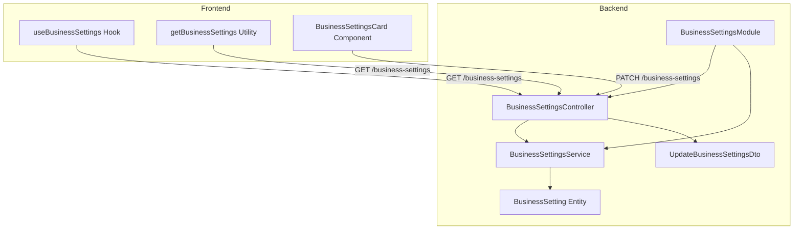
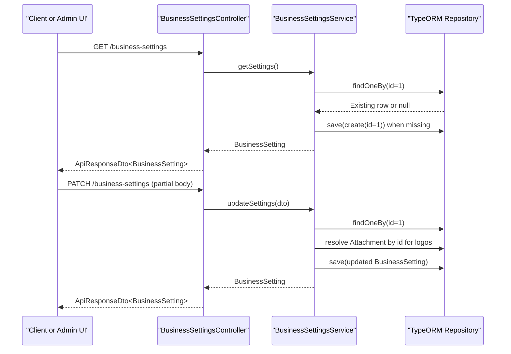
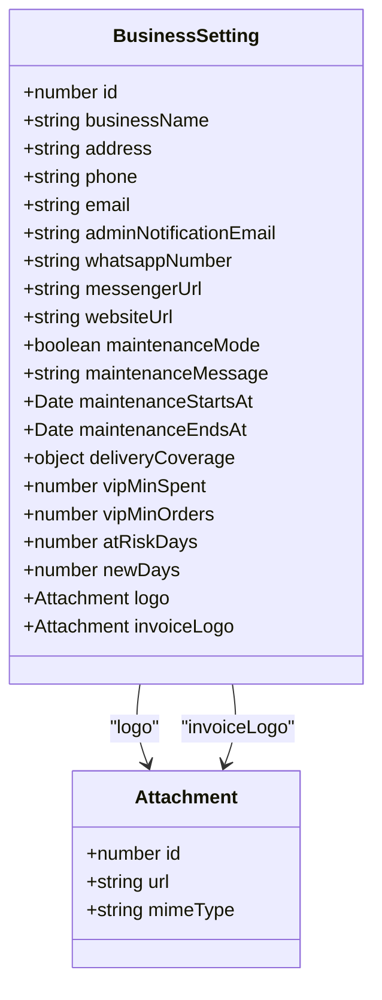
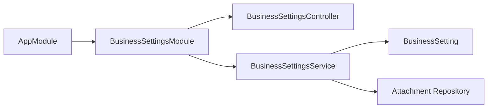

# Business Settings APIs

<cite>
**Referenced Files in This Document**
- [business-settings.controller.ts](file://apps/backend/src/business-settings/business-settings.controller.ts)
- [business-settings.service.ts](file://apps/backend/src/business-settings/business-settings.service.ts)
- [business-setting.entity.ts](file://apps/backend/src/business-settings/entities/business-setting.entity.ts)
- [update-business-settings.dto.ts](file://apps/backend/src/business-settings/dto/update-business-settings.dto.ts)
- [business-settings.module.ts](file://apps/backend/src/business-settings/business-settings.module.ts)
- [app.module.ts](file://apps/backend/src/app.module.ts)
- [use-business-settings.ts](file://apps/frontend/hooks/use-business-settings.ts)
- [business-settings-server.ts](file://apps/frontend/utils/business-settings-server.ts)
- [business-settings-card.tsx](file://apps/frontend/components/admin/settings/business-settings-card.tsx)
</cite>

## Table of Contents
1. [Introduction](#introduction)
2. [Project Structure](#project-structure)
3. [Core Components](#core-components)
4. [Architecture Overview](#architecture-overview)
5. [API Reference](#api-reference)
6. [Settings Model and Categories](#settings-model-and-categories)
7. [Validation Rules](#validation-rules)
8. [Bulk Update Operations](#bulk-update-operations)
9. [Default Value Management](#default-value-management)
10. [Environment-Specific Configurations](#environment-specific-configurations)
11. [Settings Versioning](#settings-versioning)
12. [Backup and Restore](#backup-and-restore)
13. [Usage Examples](#usage-examples)
14. [Dependency Analysis](#dependency-analysis)
15. [Performance Considerations](#performance-considerations)
16. [Troubleshooting Guide](#troubleshooting-guide)
17. [Conclusion](#conclusion)

## Introduction
This document provides detailed API documentation for the business settings management endpoints. It covers configuration of business information, operational settings, delivery coverage, CRM thresholds, and system preferences. The implementation uses a singleton business settings record, public read access for storefronts, and protected update access for administrators.

The scope includes:
- Company details such as name, address, phone, email, WhatsApp number, website, and admin notification emails.
- Operational toggles such as maintenance mode with optional scheduled windows.
- Delivery zone configuration through divisions, cities, and areas.
- CRM-related thresholds such as VIP spend/order minimums and customer lifecycle day rules.
- Logo attachments for branding and invoice rendering.

## Project Structure
The business settings feature is implemented as a NestJS module under the backend application. It exposes a controller for HTTP endpoints, a service for persistence logic, an entity describing the settings schema, and a DTO defining validation rules for updates. The frontend consumes the public endpoint to render store-facing content and provides an admin interface for editing settings.

**Diagram sources**
- [business-settings.controller.ts:19-53](file://apps/backend/src/business-settings/business-settings.controller.ts#L19-L53)
- [business-settings.service.ts:9-82](file://apps/backend/src/business-settings/business-settings.service.ts#L9-L82)
- [business-setting.entity.ts:11-174](file://apps/backend/src/business-settings/entities/business-setting.entity.ts#L11-L174)
- [update-business-settings.dto.ts:11-182](file://apps/backend/src/business-settings/dto/update-business-settings.dto.ts#L11-L182)
- [business-settings.module.ts:9-14](file://apps/backend/src/business-settings/business-settings.module.ts#L9-L14)
- [use-business-settings.ts:15-23](file://apps/frontend/hooks/use-business-settings.ts#L15-L23)
- [business-settings-server.ts:4-7](file://apps/frontend/utils/business-settings-server.ts#L4-L7)
- [business-settings-card.tsx:217-225](file://apps/frontend/components/admin/settings/business-settings-card.tsx#L217-L225)

**Section sources**
- [business-settings.controller.ts:19-53](file://apps/backend/src/business-settings/business-settings.controller.ts#L19-L53)
- [business-settings.module.ts:9-14](file://apps/backend/src/business-settings/business-settings.module.ts#L9-L14)
- [app.module.ts:16-16](file://apps/backend/src/app.module.ts#L16-L16)

## Core Components
- Controller: Defines REST endpoints for retrieving and updating business settings.
- Service: Handles singleton initialization, attachment resolution, and partial updates.
- Entity: Describes all configurable fields including company info, maintenance window, delivery coverage, CRM thresholds, and logo references.
- DTO: Declares optional update fields with validation decorators.
- Frontend hook and utility: Provide client-side caching and server-side fetching for public settings.
- Admin card component: Provides UI for editing settings and calling the PATCH endpoint.

**Section sources**
- [business-settings.controller.ts:19-53](file://apps/backend/src/business-settings/business-settings.controller.ts#L19-L53)
- [business-settings.service.ts:9-82](file://apps/backend/src/business-settings/business-settings.service.ts#L9-L82)
- [business-setting.entity.ts:11-174](file://apps/backend/src/business-settings/entities/business-setting.entity.ts#L11-L174)
- [update-business-settings.dto.ts:11-182](file://apps/backend/src/business-settings/dto/update-business-settings.dto.ts#L11-L182)
- [use-business-settings.ts:15-42](file://apps/frontend/hooks/use-business-settings.ts#L15-L42)
- [business-settings-server.ts:4-7](file://apps/frontend/utils/business-settings-server.ts#L4-L7)
- [business-settings-card.tsx:202-225](file://apps/frontend/components/admin/settings/business-settings-card.tsx#L202-L225)

## Architecture Overview
The business settings API follows a simple two-endpoint design:
- Public GET endpoint returns the current singleton settings object.
- Protected PATCH endpoint accepts partial updates and persists changes.

**Diagram sources**
- [business-settings.controller.ts:28-53](file://apps/backend/src/business-settings/business-settings.controller.ts#L28-L53)
- [business-settings.service.ts:20-80](file://apps/backend/src/business-settings/business-settings.service.ts#L20-L80)

## API Reference

### Get Business Settings
- Method: GET
- Path: `/business-settings`
- Authentication: None (public)
- Response: `ApiResponseDto<BusinessSetting>`
- Purpose: Returns the current business settings for storefront consumption.

Notes:
- If no settings row exists, the service creates a default singleton row on first read.
- Consumers should handle null or incomplete fields gracefully.

**Section sources**
- [business-settings.controller.ts:26-36](file://apps/backend/src/business-settings/business-settings.controller.ts#L26-L36)
- [business-settings.service.ts:18-37](file://apps/backend/src/business-settings/business-settings.service.ts#L18-L37)

### Update Business Settings
- Method: PATCH
- Path: `/business-settings`
- Authentication: JWT + Permission guard
- Authorization: Requires permission for `/admin/settings/business-info`
- Request Body: Partial `UpdateBusinessSettingsDto`
- Response: `ApiResponseDto<BusinessSetting>`
- Purpose: Partially updates business settings. Only provided fields are changed.

Behavior highlights:
- Logo and invoice logo can be set by attachment ID; empty string clears the field.
- Non-logo fields are merged into the existing settings record.
- Errors during load or update return internal server error responses.

**Section sources**
- [business-settings.controller.ts:38-53](file://apps/backend/src/business-settings/business-settings.controller.ts#L38-L53)
- [business-settings.service.ts:39-80](file://apps/backend/src/business-settings/business-settings.service.ts#L39-L80)

## Settings Model and Categories
The settings model groups related configuration into logical categories:

- Company Details
  - Business name
  - Physical address
  - Phone number
  - Contact email
  - Admin notification email list
  - WhatsApp number
  - Messenger URL
  - Website URL

- Branding Assets
  - Logo attachment
  - Invoice logo attachment

- Operational Settings
  - Maintenance mode toggle
  - Maintenance message
  - Maintenance start time
  - Maintenance end time

- Regional Preferences and Delivery Coverage
  - Divisions list
  - Cities list
  - Areas list

- CRM Thresholds
  - Minimum delivered spend for VIP
  - Minimum delivered orders for VIP
  - Days without order before At Risk
  - Days since signup considered New

**Diagram sources**
- [business-setting.entity.ts:11-174](file://apps/backend/src/business-settings/entities/business-setting.entity.ts#L11-L174)

**Section sources**
- [business-setting.entity.ts:11-174](file://apps/backend/src/business-settings/entities/business-setting.entity.ts#L11-L174)

## Validation Rules
The update payload uses optional validators per field:

- Strings: business name, address, phone, email, admin notification email, WhatsApp number, messenger URL, website URL, maintenance message, maintenance timestamps (as ISO strings).
- Booleans: maintenance mode.
- Integers: VIP minimum spend, VIP minimum orders, at-risk days, new days.
- Objects: delivery coverage structure with divisions, cities, and areas arrays.
- Attachment IDs: logoId and invoiceLogoId are strings; empty string clears the corresponding logo.

Validation notes:
- All update fields are optional; only provided fields are applied.
- Positive integer validation applies to numeric thresholds.
- Delivery coverage must conform to the expected nested object shape.

**Section sources**
- [update-business-settings.dto.ts:11-182](file://apps/backend/src/business-settings/dto/update-business-settings.dto.ts#L11-L182)

## Bulk Update Operations
There is no dedicated bulk update endpoint. Instead, the PATCH endpoint supports partial updates, allowing clients to send only the fields they want to change. This effectively acts as a single-record bulk merge operation.

Recommended approach:
- Fetch the current settings via GET.
- Modify only the desired fields in memory.
- Send a PATCH request with the partial payload.

This pattern avoids overwriting unrelated fields and keeps updates atomic.

**Section sources**
- [business-settings.controller.ts:38-53](file://apps/backend/src/business-settings/business-settings.controller.ts#L38-L53)
- [business-settings.service.ts:39-80](file://apps/backend/src/business-settings/business-settings.service.ts#L39-L80)

## Default Value Management
The service ensures that a singleton settings row always exists:
- On first GET, if no row is found, it creates a default row with id 1.
- Defaults include boolean flags like maintenance mode defaulting to false.
- Other fields remain nullable until configured.

Implications:
- Storefront consumers can safely assume a settings object is returned even before any admin edits.
- Missing values should be treated as unset rather than invalid.

**Section sources**
- [business-settings.service.ts:18-37](file://apps/backend/src/business-settings/business-settings.service.ts#L18-L37)
- [business-setting.entity.ts:77-83](file://apps/backend/src/business-settings/entities/business-setting.entity.ts#L77-L83)

## Environment-Specific Configurations
The current implementation does not provide environment-scoped settings. There is a single global settings record used across environments.

Recommendations for environment-specific behavior:
- Use deployment-level configuration (e.g., environment variables) for non-persistent runtime settings.
- Keep persistent business settings environment-neutral unless explicitly required.
- If needed, extend the model with an environment discriminator and adjust service logic accordingly.

[No sources needed since this section provides general guidance]

## Settings Versioning
The current implementation does not implement explicit versioning for business settings. Each PATCH replaces the relevant fields on the singleton record.

Potential enhancements:
- Add a version column to track changes.
- Maintain an audit log table recording previous snapshots.
- Implement rollback endpoints using stored versions.

[No sources needed since this section provides general guidance]

## Backup and Restore
There is no built-in backup/restore endpoint for business settings. Administrators can export and import settings using database tools or custom scripts.

Suggested workflow:
- Export the singleton settings row from the database.
- Import the exported data into target environments.
- Validate imported data against the DTO schema before applying.

[No sources needed since this section provides general guidance]

## Usage Examples

### Updating Business Profile
Steps:
1. Call GET `/business-settings` to retrieve current settings.
2. Modify fields such as business name, address, phone, email, WhatsApp number, website URL, or admin notification email.
3. Send PATCH `/business-settings` with the updated fields.
4. Receive the updated settings object.

Authorization:
- Requires JWT authentication and permission for `/admin/settings/business-info`.

**Section sources**
- [business-settings.controller.ts:38-53](file://apps/backend/src/business-settings/business-settings.controller.ts#L38-L53)
- [update-business-settings.dto.ts:11-75](file://apps/backend/src/business-settings/dto/update-business-settings.dto.ts#L11-L75)

### Configuring Delivery Zones
Steps:
1. Retrieve current settings.
2. Update the delivery coverage object with divisions, cities, and areas.
3. Send PATCH `/business-settings` with the modified delivery coverage.
4. Verify the response contains the updated coverage structure.

Validation:
- Ensure each division, city, and area entry includes enabled flags and required identifiers.

**Section sources**
- [update-business-settings.dto.ts:130-145](file://apps/backend/src/business-settings/dto/update-business-settings.dto.ts#L130-L145)
- [business-setting.entity.ts:108-122](file://apps/backend/src/business-settings/entities/business-setting.entity.ts#L108-L122)

### Managing System-Wide Preferences
Examples include:
- Enabling maintenance mode and setting a maintenance message.
- Scheduling maintenance windows using start and end timestamps.
- Adjusting CRM thresholds for VIP qualification and customer lifecycle rules.

Authorization:
- Same JWT and permission requirements as other updates.

**Section sources**
- [update-business-settings.dto.ts:95-128](file://apps/backend/src/business-settings/dto/update-business-settings.dto.ts#L95-L128)
- [update-business-settings.dto.ts:147-181](file://apps/backend/src/business-settings/dto/update-business-settings.dto.ts#L147-L181)
- [business-setting.entity.ts:77-106](file://apps/backend/src/business-settings/entities/business-setting.entity.ts#L77-L106)

## Dependency Analysis
The business settings module integrates with the application module and depends on TypeORM repositories for persistence and attachments for logo assets.

**Diagram sources**
- [app.module.ts:16-16](file://apps/backend/src/app.module.ts#L16-L16)
- [business-settings.module.ts:9-14](file://apps/backend/src/business-settings/business-settings.module.ts#L9-L14)
- [business-settings.service.ts:11-16](file://apps/backend/src/business-settings/business-settings.service.ts#L11-L16)

**Section sources**
- [app.module.ts:16-16](file://apps/backend/src/app.module.ts#L16-L16)
- [business-settings.module.ts:9-14](file://apps/backend/src/business-settings/business-settings.module.ts#L9-L14)

## Performance Considerations
- Singleton design reduces complexity and avoids multi-row synchronization issues.
- Eager loading of attachment relations simplifies retrieval but may increase payload size when logos are included.
- Frontend caching in the hook prevents redundant network requests within the same tab.

Optimization opportunities:
- Paginate or exclude large attachment payloads when not needed.
- Cache settings at the API layer for high-read scenarios.
- Use selective field projection for public endpoints if sensitive fields are added later.

**Section sources**
- [business-setting.entity.ts:156-173](file://apps/backend/src/business-settings/entities/business-setting.entity.ts#L156-L173)
- [use-business-settings.ts:8-23](file://apps/frontend/hooks/use-business-settings.ts#L8-L23)

## Troubleshooting Guide
Common issues and resolutions:
- Missing settings row: The service auto-creates a default row on first GET. If errors occur, check database connectivity and permissions.
- Invalid attachment IDs: Setting logoId or invoiceLogoId to an unknown ID results in null assignment. Clear the field by passing an empty string if you intend to remove the logo.
- Validation failures: Ensure numeric thresholds are positive integers and delivery coverage conforms to the expected structure.
- Authorization errors: Confirm JWT token validity and that the user has permission for `/admin/settings/business-info`.

Error handling:
- Load and update operations wrap errors in internal server exceptions with descriptive messages.

**Section sources**
- [business-settings.service.ts:30-36](file://apps/backend/src/business-settings/business-settings.service.ts#L30-L36)
- [business-settings.service.ts:74-80](file://apps/backend/src/business-settings/business-settings.service.ts#L74-L80)
- [business-settings.controller.ts:38-53](file://apps/backend/src/business-settings/business-settings.controller.ts#L38-L53)

## Conclusion
The business settings API provides a straightforward mechanism for managing core business information, operational toggles, delivery zones, and CRM thresholds. Its singleton design ensures simplicity, while partial updates enable flexible configuration. For advanced needs such as versioning, backups, and environment-specific settings, consider extending the model and service layers with appropriate safeguards and tooling.