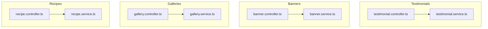
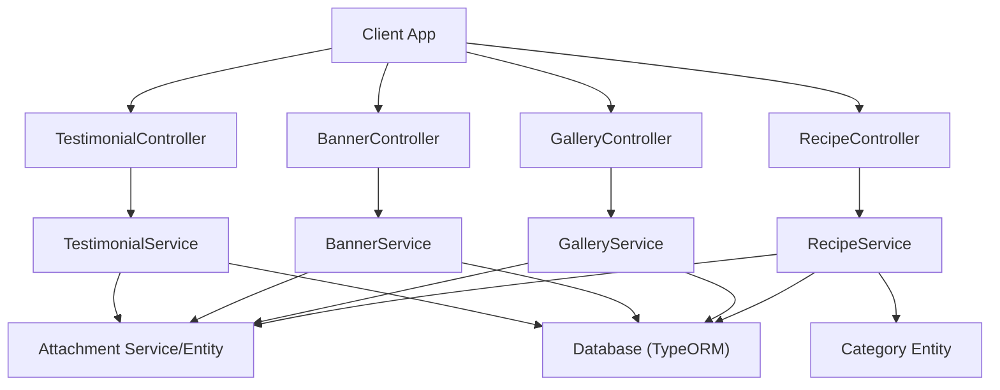
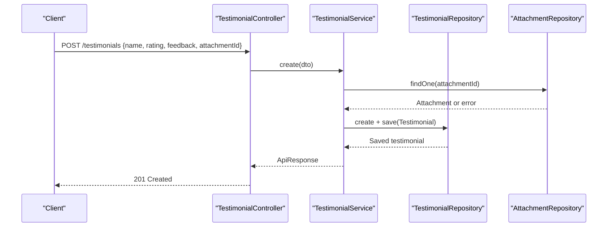
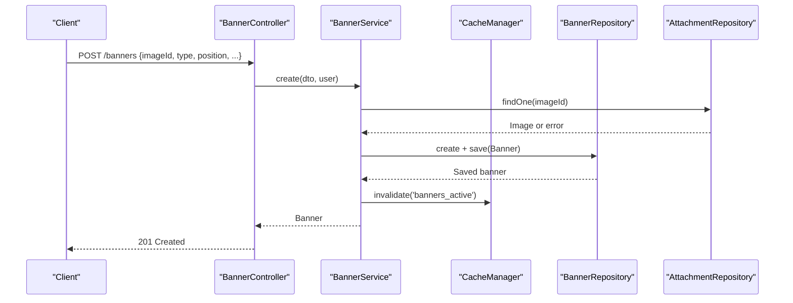
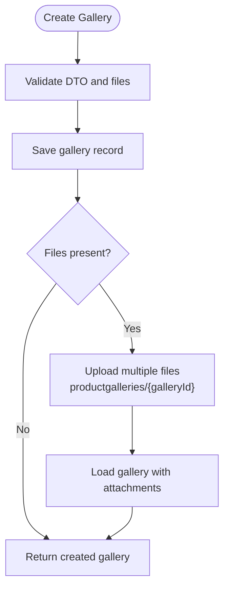
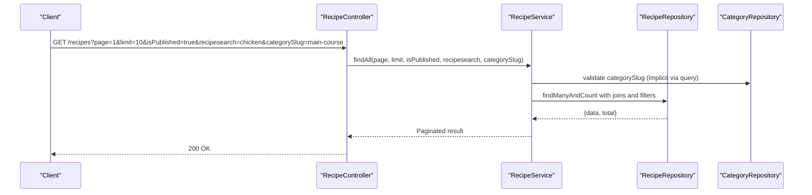
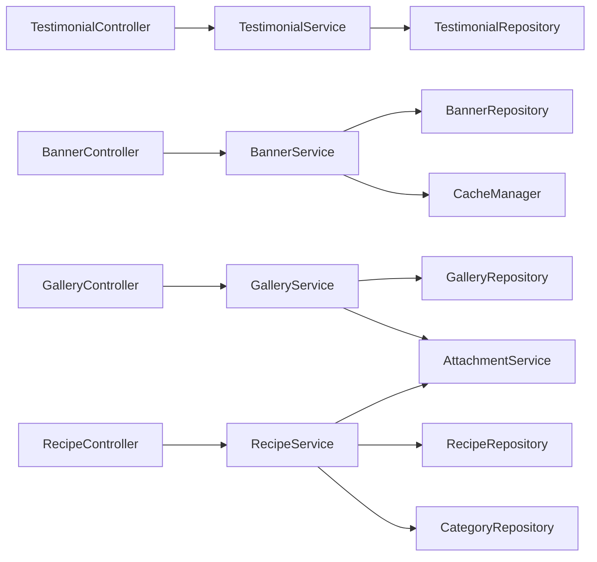

# Content Management APIs

<cite>
**Referenced Files in This Document**
- [testimonial.controller.ts](file://apps/backend/src/testimonial/testimonial.controller.ts)
- [testimonial.service.ts](file://apps/backend/src/testimonial/testimonial.service.ts)
- [banner.controller.ts](file://apps/backend/src/banner/banner.controller.ts)
- [banner.service.ts](file://apps/backend/src/banner/banner.service.ts)
- [gallery.controller.ts](file://apps/backend/src/gallery/gallery.controller.ts)
- [gallery.service.ts](file://apps/backend/src/gallery/gallery.service.ts)
- [recipe.controller.ts](file://apps/backend/src/recipe/recipe.controller.ts)
- [recipe.service.ts](file://apps/backend/src/recipe/recipe.service.ts)
</cite>

## Table of Contents
1. [Introduction](#introduction)
2. [Project Structure](#project-structure)
3. [Core Components](#core-components)
4. [Architecture Overview](#architecture-overview)
5. [Detailed Component Analysis](#detailed-component-analysis)
6. [Dependency Analysis](#dependency-analysis)
7. [Performance Considerations](#performance-considerations)
8. [Troubleshooting Guide](#troubleshooting-guide)
9. [Conclusion](#conclusion)

## Introduction
This document provides comprehensive API documentation for content management endpoints covering testimonials, banners, galleries, and recipes. It details CRUD operations, approval workflows where applicable, media upload handling, ordering and filtering capabilities, and integration points with attachments and categories. The goal is to enable both technical and non-technical users to understand how to create, update, publish, and manage these content types effectively.

## Project Structure
The backend implements four feature modules: Testimonials, Banners, Galleries, and Recipes. Each module follows a consistent pattern with controllers exposing REST endpoints and services encapsulating business logic and data access.

**Diagram sources**
- [testimonial.controller.ts:1-222](file://apps/backend/src/testimonial/testimonial.controller.ts#L1-L222)
- [testimonial.service.ts:1-179](file://apps/backend/src/testimonial/testimonial.service.ts#L1-L179)
- [banner.controller.ts:1-262](file://apps/backend/src/banner/banner.controller.ts#L1-L262)
- [banner.service.ts:1-232](file://apps/backend/src/banner/banner.service.ts#L1-L232)
- [gallery.controller.ts:1-202](file://apps/backend/src/gallery/gallery.controller.ts#L1-L202)
- [gallery.service.ts:1-103](file://apps/backend/src/gallery/gallery.service.ts#L1-L103)
- [recipe.controller.ts:1-208](file://apps/backend/src/recipe/recipe.controller.ts#L1-L208)
- [recipe.service.ts:1-194](file://apps/backend/src/recipe/recipe.service.ts#L1-L194)

**Section sources**
- [testimonial.controller.ts:1-222](file://apps/backend/src/testimonial/testimonial.controller.ts#L1-L222)
- [banner.controller.ts:1-262](file://apps/backend/src/banner/banner.controller.ts#L1-L262)
- [gallery.controller.ts:1-202](file://apps/backend/src/gallery/gallery.controller.ts#L1-L202)
- [recipe.controller.ts:1-208](file://apps/backend/src/recipe/recipe.controller.ts#L1-L208)

## Core Components
- Testimonials: Full CRUD with optional attachment association and publication status filtering.
- Banners: Full CRUD with pagination, search, type/position filters, active listing, reorder endpoint, and caching for active list.
- Galleries: Create gallery with multiple images, add/remove attachments, delete gallery with cascading file deletion.
- Recipes: Full CRUD with category association, pagination, search across title/details/nutrition, and category slug filter.

Key cross-cutting concerns:
- Authentication and authorization via JWT and permission guards.
- Attachment integration for media files.
- Pagination and filtering for large datasets.
- Caching for frequently accessed banner lists.

**Section sources**
- [testimonial.service.ts:25-179](file://apps/backend/src/testimonial/testimonial.service.ts#L25-L179)
- [banner.service.ts:40-232](file://apps/backend/src/banner/banner.service.ts#L40-L232)
- [gallery.service.ts:22-103](file://apps/backend/src/gallery/gallery.service.ts#L22-L103)
- [recipe.service.ts:22-194](file://apps/backend/src/recipe/recipe.service.ts#L22-L194)

## Architecture Overview
The system uses NestJS controllers to expose REST endpoints and services to implement business logic. Data persistence is handled via TypeORM repositories. Media assets are managed through an attachment service and entities.

**Diagram sources**
- [testimonial.controller.ts:1-222](file://apps/backend/src/testimonial/testimonial.controller.ts#L1-L222)
- [banner.controller.ts:1-262](file://apps/backend/src/banner/banner.controller.ts#L1-L262)
- [gallery.controller.ts:1-202](file://apps/backend/src/gallery/gallery.controller.ts#L1-L202)
- [recipe.controller.ts:1-208](file://apps/backend/src/recipe/recipe.controller.ts#L1-L208)
- [testimonial.service.ts:1-179](file://apps/backend/src/testimonial/testimonial.service.ts#L1-L179)
- [banner.service.ts:1-232](file://apps/backend/src/banner/banner.service.ts#L1-L232)
- [gallery.service.ts:1-103](file://apps/backend/src/gallery/gallery.service.ts#L1-L103)
- [recipe.service.ts:1-194](file://apps/backend/src/recipe/recipe.service.ts#L1-L194)

## Detailed Component Analysis

### Testimonials API
Endpoints:
- GET /testimonials?isPublish=true|false
- GET /testimonials/:id
- POST /testimonials (admin)
- PATCH /testimonials/:id (admin)
- DELETE /testimonials/:id (admin)

Capabilities:
- List testimonials with optional publication status filter.
- Retrieve a single testimonial by ID.
- Create/update/delete testimonials with optional attachment association.
- Admin endpoints protected by JWT and permission guards.

Approval workflow and rating management:
- Publication status is controlled via the isPublish field; filtering supports published vs draft states.
- Rating fields are part of the DTOs used by create/update operations.

Media handling:
- Attachments can be associated by providing an attachmentId during creation or update.

Example request flows:
- Create testimonial with attachment:
  - POST /testimonials with body containing name, rating, feedback text, and attachmentId.
- Update testimonial and remove attachment:
  - PATCH /testimonials/:id with attachmentId set to null.

**Diagram sources**
- [testimonial.controller.ts:113-143](file://apps/backend/src/testimonial/testimonial.controller.ts#L113-L143)
- [testimonial.service.ts:25-62](file://apps/backend/src/testimonial/testimonial.service.ts#L25-L62)

**Section sources**
- [testimonial.controller.ts:33-222](file://apps/backend/src/testimonial/testimonial.controller.ts#L33-L222)
- [testimonial.service.ts:25-179](file://apps/backend/src/testimonial/testimonial.service.ts#L25-L179)

### Banners API
Endpoints:
- POST /banners (admin)
- GET /banners?page&limit&search&isActive&type&position
- GET /banners/active
- GET /banners/:id
- PATCH /banners/reorder (admin)
- PATCH /banners/:id (admin)
- DELETE /banners/:id (admin)

Capabilities:
- Create banners with imageId, type, position, displayOrder, isActive, targetUrl, title, description.
- Paginated listing with search and filters by isActive, type, position.
- Active banners endpoint with caching for performance.
- Reorder endpoint to set displayOrder based on provided id array.
- Update and delete with audit fields updatedBy.

Scheduling and targeting:
- Targeting is supported via type and position fields.
- Scheduling can be implemented by toggling isActive and using type/position to control visibility.

Performance tracking:
- Active banners endpoint caches results to reduce database load.

**Diagram sources**
- [banner.controller.ts:41-71](file://apps/backend/src/banner/banner.controller.ts#L41-L71)
- [banner.service.ts:40-73](file://apps/backend/src/banner/banner.service.ts#L40-L73)

**Section sources**
- [banner.controller.ts:36-262](file://apps/backend/src/banner/banner.controller.ts#L36-L262)
- [banner.service.ts:23-232](file://apps/backend/src/banner/banner.service.ts#L23-L232)

### Galleries API
Endpoints:
- POST /galleries (admin) — multipart/form-data with files[]
- GET /galleries
- GET /galleries/:id
- POST /galleries/:id/attachments (admin) — multipart/form-data with file
- DELETE /galleries/:id/attachments/:attachmentId (admin)
- DELETE /galleries/:id (admin)

Capabilities:
- Create gallery with multiple images uploaded in one request.
- Add/remove individual attachments to/from a gallery.
- Delete gallery with cascading deletion of associated files.

Media management:
- Uses AttachmentService for uploading and deleting files.
- Organizes files under paths like productgalleries/{galleryId} and galleries/{galleryId}.

**Diagram sources**
- [gallery.controller.ts:42-86](file://apps/backend/src/gallery/gallery.controller.ts#L42-L86)
- [gallery.service.ts:22-44](file://apps/backend/src/gallery/gallery.service.ts#L22-L44)

**Section sources**
- [gallery.controller.ts:36-202](file://apps/backend/src/gallery/gallery.controller.ts#L36-L202)
- [gallery.service.ts:14-103](file://apps/backend/src/gallery/gallery.service.ts#L14-L103)

### Recipes API
Endpoints:
- POST /recipes (admin)
- GET /recipes?page&limit&isPublished&recipesearch&categorySlug
- GET /recipes/:id
- PATCH /recipes/:id (admin)
- DELETE /recipes/:id (admin)

Capabilities:
- Create recipes with category association and optional attachment.
- Paginated listing with filters by isPublished, search across title/details/nutrition_details, and category slug.
- Update and delete with audit fields updatedBy.
- Category validation ensures referenced categories exist.

Content organization:
- Categories provide grouping and SEO-friendly slugs.
- Recipe detail fields include nutrition information.

**Diagram sources**
- [recipe.controller.ts:57-124](file://apps/backend/src/recipe/recipe.controller.ts#L57-L124)
- [recipe.service.ts:43-123](file://apps/backend/src/recipe/recipe.service.ts#L43-L123)

**Section sources**
- [recipe.controller.ts:33-208](file://apps/backend/src/recipe/recipe.controller.ts#L33-L208)
- [recipe.service.ts:12-194](file://apps/backend/src/recipe/recipe.service.ts#L12-L194)

## Dependency Analysis
- Controllers depend on their respective services for business logic.
- Services interact with TypeORM repositories for persistence.
- Galleries and Recipes integrate with AttachmentService for media operations.
- Recipes also depend on Category entity for categorization.
- Banners use cache-manager to optimize active list retrieval.

**Diagram sources**
- [testimonial.controller.ts:1-222](file://apps/backend/src/testimonial/testimonial.controller.ts#L1-L222)
- [banner.controller.ts:1-262](file://apps/backend/src/banner/banner.controller.ts#L1-L262)
- [gallery.controller.ts:1-202](file://apps/backend/src/gallery/gallery.controller.ts#L1-L202)
- [recipe.controller.ts:1-208](file://apps/backend/src/recipe/recipe.controller.ts#L1-L208)
- [testimonial.service.ts:1-179](file://apps/backend/src/testimonial/testimonial.service.ts#L1-L179)
- [banner.service.ts:1-232](file://apps/backend/src/banner/banner.service.ts#L1-L232)
- [gallery.service.ts:1-103](file://apps/backend/src/gallery/gallery.service.ts#L1-L103)
- [recipe.service.ts:1-194](file://apps/backend/src/recipe/recipe.service.ts#L1-L194)

**Section sources**
- [banner.service.ts:30-38](file://apps/backend/src/banner/banner.service.ts#L30-L38)
- [gallery.service.ts:16-20](file://apps/backend/src/gallery/gallery.service.ts#L16-L20)
- [recipe.service.ts:14-20](file://apps/backend/src/recipe/recipe.service.ts#L14-L20)

## Performance Considerations
- Use pagination for large datasets in banners and recipes to avoid heavy payloads.
- Leverage the active banners endpoint with built-in caching to reduce database queries.
- Optimize search queries by limiting search scope to relevant fields (e.g., title, details).
- Batch uploads for galleries to minimize round trips when creating multiple images.

[No sources needed since this section provides general guidance]

## Troubleshooting Guide
Common issues and resolutions:
- Attachment not found errors:
  - Ensure attachmentId/imageId references valid existing attachments before creating/updating content.
- Not Found errors:
  - Verify IDs for testimonials, banners, galleries, and recipes exist before performing updates or deletions.
- Permission denied:
  - Admin endpoints require JWT authentication and appropriate permissions; ensure tokens and roles are correctly configured.
- Search/filter mismatches:
  - For recipes, use the correct parameter names (e.g., recipesearch instead of search) and ensure case-insensitive matching expectations.

**Section sources**
- [testimonial.service.ts:36-40](file://apps/backend/src/testimonial/testimonial.service.ts#L36-L40)
- [banner.service.ts:45-47](file://apps/backend/src/banner/banner.service.ts#L45-L47)
- [gallery.service.ts:92-97](file://apps/backend/src/gallery/gallery.service.ts#L92-L97)
- [recipe.service.ts:29-31](file://apps/backend/src/recipe/recipe.service.ts#L29-L31)

## Conclusion
The content management APIs provide robust CRUD operations for testimonials, banners, galleries, and recipes with strong support for media handling, categorization, filtering, and performance optimizations. By following the documented workflows and leveraging the provided endpoints, teams can efficiently manage content, enforce approval processes, and deliver optimized experiences to end users.

[No sources needed since this section summarizes without analyzing specific files]