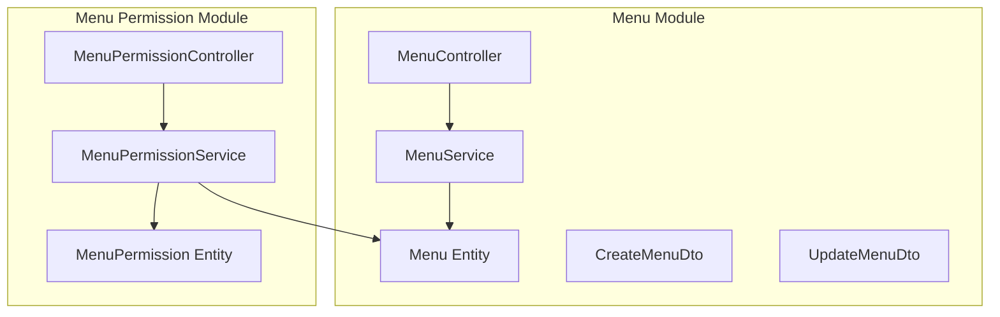
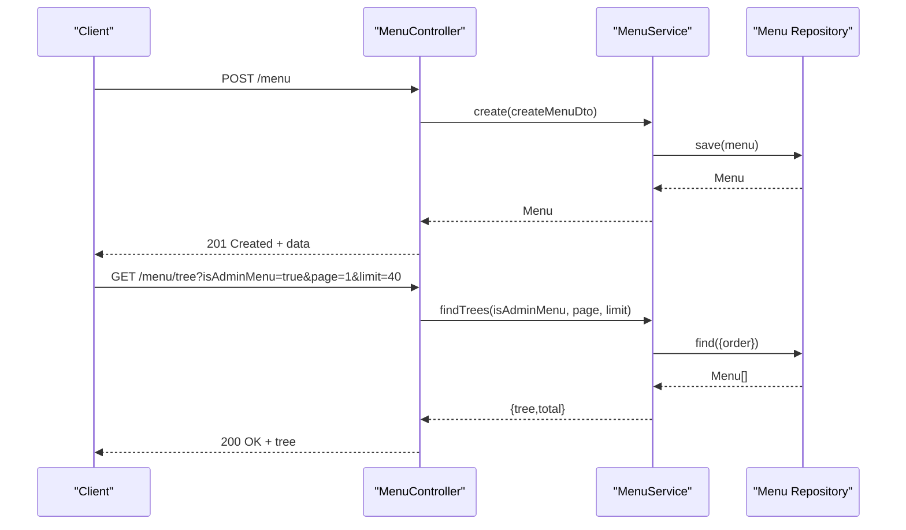
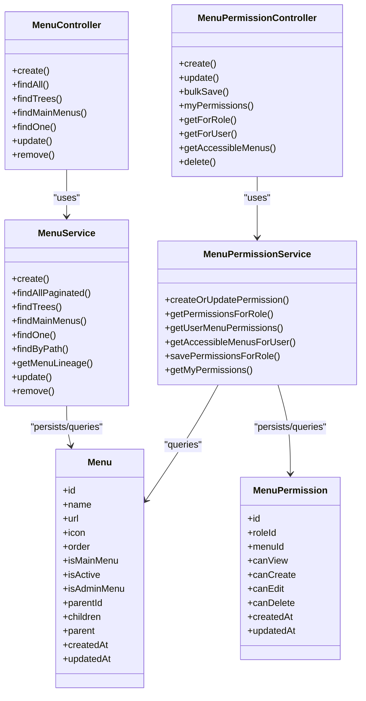

# Menu Configuration APIs

<cite>
**Referenced Files in This Document**
- [menu.controller.ts](file://apps/backend/src/menu/menu.controller.ts)
- [menu.service.ts](file://apps/backend/src/menu/menu.service.ts)
- [menu.entity.ts](file://apps/backend/src/menu/entities/menu.entity.ts)
- [create-menu.dto.ts](file://apps/backend/src/menu/dto/create-menu.dto.ts)
- [update-menu.dto.ts](file://apps/backend/src/menu/dto/update-menu.dto.ts)
- [menu-permission.controller.ts](file://apps/backend/src/menu-permission/menu-permission.controller.ts)
- [menu-permission.service.ts](file://apps/backend/src/menu-permission/menu-permission.service.ts)
- [menu-permission.entity.ts](file://apps/backend/src/menu-permission/entities/menu-permission.entity.ts)
</cite>

## Table of Contents
1. [Introduction](#introduction)
2. [Project Structure](#project-structure)
3. [Core Components](#core-components)
4. [Architecture Overview](#architecture-overview)
5. [Detailed Component Analysis](#detailed-component-analysis)
6. [Dependency Analysis](#dependency-analysis)
7. [Performance Considerations](#performance-considerations)
8. [Troubleshooting Guide](#troubleshooting-guide)
9. [Conclusion](#conclusion)

## Introduction
This document provides comprehensive API documentation for menu configuration endpoints. It covers dynamic menu item creation, modification, and deletion with hierarchical structure support, visibility controls, role-based access, ordering management, and permission-driven visibility. It also includes examples for nested menus, conditional visibility based on roles, and guidance for caching and real-time updates across clients.

## Project Structure
The menu feature is implemented in the backend under a dedicated module:
- Controller exposes REST endpoints for menu CRUD and tree retrieval.
- Service implements business logic including pagination, tree building, and parent validation.
- Entity defines the menu data model with hierarchical relationships.
- DTOs define input validation for create and update operations.
- A separate menu-permission module manages role-based access to menus.

**Diagram sources**
- [menu.controller.ts:35-39](file://apps/backend/src/menu/menu.controller.ts#L35-L39)
- [menu.service.ts:8-15](file://apps/backend/src/menu/menu.service.ts#L8-L15)
- [menu.entity.ts:12-93](file://apps/backend/src/menu/entities/menu.entity.ts#L12-L93)
- [menu-permission.controller.ts:37-42](file://apps/backend/src/menu-permission/menu-permission.controller.ts#L37-L42)
- [menu-permission.service.ts:9-18](file://apps/backend/src/menu-permission/menu-permission.service.ts#L9-L18)
- [menu-permission.entity.ts:12-34](file://apps/backend/src/menu-permission/entities/menu-permission.entity.ts#L12-L34)

**Section sources**
- [menu.controller.ts:35-39](file://apps/backend/src/menu/menu.controller.ts#L35-L39)
- [menu.service.ts:8-15](file://apps/backend/src/menu/menu.service.ts#L8-L15)
- [menu.entity.ts:12-93](file://apps/backend/src/menu/entities/menu.entity.ts#L12-L93)
- [menu-permission.controller.ts:37-42](file://apps/backend/src/menu-permission/menu-permission.controller.ts#L37-L42)
- [menu-permission.service.ts:9-18](file://apps/backend/src/menu-permission/menu-permission.service.ts#L9-L18)
- [menu-permission.entity.ts:12-34](file://apps/backend/src/menu-permission/entities/menu-permission.entity.ts#L12-L34)

## Core Components
- Menu Controller: Exposes endpoints for creating, listing (flat and tree), reading, updating, and deleting menu items. Includes filtering by admin/main/active flags and search/pagination.
- Menu Service: Implements pagination, tree construction, main menu retrieval, path lookup, lineage traversal, and parent validation.
- Menu Entity: Defines fields such as name, url, icon, order, visibility flags, and hierarchical relations (parent/children).
- Create/Update DTOs: Validate inputs for menu creation and partial updates.
- Menu Permission Controller/Service/Entity: Manage per-role permissions (view/create/edit/delete) and provide endpoints to query accessible menus and user-specific permissions.

**Section sources**
- [menu.controller.ts:41-65](file://apps/backend/src/menu/menu.controller.ts#L41-L65)
- [menu.controller.ts:67-184](file://apps/backend/src/menu/menu.controller.ts#L67-L184)
- [menu.controller.ts:186-294](file://apps/backend/src/menu/menu.controller.ts#L186-L294)
- [menu.controller.ts:296-334](file://apps/backend/src/menu/menu.controller.ts#L296-L334)
- [menu.controller.ts:336-369](file://apps/backend/src/menu/menu.controller.ts#L336-L369)
- [menu.controller.ts:371-411](file://apps/backend/src/menu/menu.controller.ts#L371-L411)
- [menu.controller.ts:413-445](file://apps/backend/src/menu/menu.controller.ts#L413-L445)
- [menu.service.ts:17-26](file://apps/backend/src/menu/menu.service.ts#L17-L26)
- [menu.service.ts:28-67](file://apps/backend/src/menu/menu.service.ts#L28-L67)
- [menu.service.ts:69-124](file://apps/backend/src/menu/menu.service.ts#L69-L124)
- [menu.service.ts:126-140](file://apps/backend/src/menu/menu.service.ts#L126-L140)
- [menu.service.ts:142-157](file://apps/backend/src/menu/menu.service.ts#L142-L157)
- [menu.service.ts:159-172](file://apps/backend/src/menu/menu.service.ts#L159-L172)
- [menu.service.ts:174-188](file://apps/backend/src/menu/menu.service.ts#L174-L188)
- [menu.service.ts:190-205](file://apps/backend/src/menu/menu.service.ts#L190-L205)
- [menu.entity.ts:12-93](file://apps/backend/src/menu/entities/menu.entity.ts#L12-L93)
- [create-menu.dto.ts:12-87](file://apps/backend/src/menu/dto/create-menu.dto.ts#L12-L87)
- [update-menu.dto.ts:1-5](file://apps/backend/src/menu/dto/update-menu.dto.ts#L1-L5)
- [menu-permission.controller.ts:44-78](file://apps/backend/src/menu-permission/menu-permission.controller.ts#L44-L78)
- [menu-permission.controller.ts:80-122](file://apps/backend/src/menu-permission/menu-permission.controller.ts#L80-L122)
- [menu-permission.controller.ts:124-149](file://apps/backend/src/menu-permission/menu-permission.controller.ts#L124-L149)
- [menu-permission.controller.ts:151-169](file://apps/backend/src/menu-permission/menu-permission.controller.ts#L151-L169)
- [menu-permission.controller.ts:171-198](file://apps/backend/src/menu-permission/menu-permission.controller.ts#L171-L198)
- [menu-permission.controller.ts:200-223](file://apps/backend/src/menu-permission/menu-permission.controller.ts#L200-L223)
- [menu-permission.controller.ts:225-248](file://apps/backend/src/menu-permission/menu-permission.controller.ts#L225-L248)
- [menu-permission.controller.ts:250-274](file://apps/backend/src/menu-permission/menu-permission.controller.ts#L250-L274)
- [menu-permission.service.ts:20-43](file://apps/backend/src/menu-permission/menu-permission.service.ts#L20-L43)
- [menu-permission.service.ts:45-51](file://apps/backend/src/menu-permission/menu-permission.service.ts#L45-L51)
- [menu-permission.service.ts:53-64](file://apps/backend/src/menu-permission/menu-permission.service.ts#L53-L64)
- [menu-permission.service.ts:66-88](file://apps/backend/src/menu-permission/menu-permission.service.ts#L66-L88)
- [menu-permission.service.ts:89-91](file://apps/backend/src/menu-permission/menu-permission.service.ts#L89-L91)
- [menu-permission.service.ts:97-123](file://apps/backend/src/menu-permission/menu-permission.service.ts#L97-L123)
- [menu-permission.service.ts:130-178](file://apps/backend/src/menu-permission/menu-permission.service.ts#L130-L178)
- [menu-permission.entity.ts:12-50](file://apps/backend/src/menu-permission/entities/menu-permission.entity.ts#L12-L50)

## Architecture Overview
The menu system separates concerns into controllers, services, entities, and DTOs. The permission subsystem integrates with roles and users to control visibility and actions on menus.

**Diagram sources**
- [menu.controller.ts:41-65](file://apps/backend/src/menu/menu.controller.ts#L41-L65)
- [menu.controller.ts:186-294](file://apps/backend/src/menu/menu.controller.ts#L186-L294)
- [menu.service.ts:17-26](file://apps/backend/src/menu/menu.service.ts#L17-L26)
- [menu.service.ts:69-124](file://apps/backend/src/menu/menu.service.ts#L69-L124)

## Detailed Component Analysis

### Menu Endpoints
Base path: `/menu`

- Create menu item
  - Method: POST
  - Path: `/menu`
  - Auth: JWT + Role/Permission guard
  - Body: CreateMenuDto
  - Response: 201 Created with created menu object
  - Notes: Supports setting parentId for hierarchy; service validates parent existence

- List all menu items (flat)
  - Method: GET
  - Path: `/menu`
  - Query params:
    - isAdminMenu: boolean
    - isMainMenu: boolean
    - isActive: boolean
    - search: string
    - page: number (default 1)
    - limit: number (default 10)
  - Response: Paginated list with total and totalPages

- Get hierarchical tree
  - Method: GET
  - Path: `/menu/tree`
  - Query params:
    - isAdminMenu: boolean
    - page: number (default 1)
    - limit: number (default 40)
  - Response: Paginated top-level nodes with children arrays sorted by order

- Get main menu items
  - Method: GET
  - Path: `/menu/main`
  - Query params:
    - isAdminMenu: boolean
  - Response: Array of active main menu items ordered by display order

- Get menu by ID
  - Method: GET
  - Path: `/menu/:id`
  - Response: Single menu object with parent/children relations

- Update menu item
  - Method: PATCH
  - Path: `/menu/:id`
  - Auth: JWT + Role/Permission guard
  - Body: UpdateMenuDto (partial)
  - Response: Updated menu object

- Delete menu item
  - Method: DELETE
  - Path: `/menu/:id`
  - Auth: JWT + Role/Permission guard
  - Response: Success message

Error handling:
- Not found returns 404 for missing menu IDs.
- Validation errors return appropriate HTTP status codes.
- Internal server errors return 500 with messages.

**Section sources**
- [menu.controller.ts:41-65](file://apps/backend/src/menu/menu.controller.ts#L41-L65)
- [menu.controller.ts:67-184](file://apps/backend/src/menu/menu.controller.ts#L67-L184)
- [menu.controller.ts:186-294](file://apps/backend/src/menu/menu.controller.ts#L186-L294)
- [menu.controller.ts:296-334](file://apps/backend/src/menu/menu.controller.ts#L296-L334)
- [menu.controller.ts:336-369](file://apps/backend/src/menu/menu.controller.ts#L336-L369)
- [menu.controller.ts:371-411](file://apps/backend/src/menu/menu.controller.ts#L371-L411)
- [menu.controller.ts:413-445](file://apps/backend/src/menu/menu.controller.ts#L413-L445)

### Menu Data Model
Key properties:
- id: unique identifier
- name: display title
- url: navigation target path
- icon: icon class or identifier
- order: numeric sort order
- isMainMenu: marks top-level main menu entries
- isActive: visibility toggle
- isAdminMenu: indicates admin-only menu
- parentId: parent node for hierarchy
- children: child nodes array
- createdAt/updatedAt: timestamps

Hierarchical relations are supported via TypeORM tree decorators and explicit parent/children fields.

**Section sources**
- [menu.entity.ts:12-93](file://apps/backend/src/menu/entities/menu.entity.ts#L12-L93)

### Input Validation (DTOs)
- CreateMenuDto: Validates required name and optional fields like parentId, icon, url, order, isMainMenu, isActive, isAdminMenu.
- UpdateMenuDto: Partial version of CreateMenuDto for patch updates.

**Section sources**
- [create-menu.dto.ts:12-87](file://apps/backend/src/menu/dto/create-menu.dto.ts#L12-L87)
- [update-menu.dto.ts:1-5](file://apps/backend/src/menu/dto/update-menu.dto.ts#L1-L5)

### Menu Service Logic
- create: Builds menu entity, validates parent if provided, saves to DB.
- findAllPaginated: Filters by flags and search, joins parent/children, orders by parentId then order, paginates results.
- findTrees: Loads all menus, builds a map, attaches children to parents, sorts children by order, paginates top-level nodes.
- findMainMenus: Returns active main menus optionally filtered by admin flag.
- findOne: Retrieves single menu with relations; throws not found if missing.
- findByPath: Finds menu by URL path.
- getMenuLineage: Traverses parent chain for permission inheritance checks.
- update: Updates fields, handles parent changes safely, persists changes.
- remove: Deletes menu after verifying existence.

Complexity considerations:
- Tree building is O(n) to build map and attach children; sorting children adds O(k log k) per parent where k is number of children.
- Pagination uses database-level skip/take for efficiency.

**Section sources**
- [menu.service.ts:17-26](file://apps/backend/src/menu/menu.service.ts#L17-L26)
- [menu.service.ts:28-67](file://apps/backend/src/menu/menu.service.ts#L28-L67)
- [menu.service.ts:69-124](file://apps/backend/src/menu/menu.service.ts#L69-L124)
- [menu.service.ts:126-140](file://apps/backend/src/menu/menu.service.ts#L126-L140)
- [menu.service.ts:142-157](file://apps/backend/src/menu/menu.service.ts#L142-L157)
- [menu.service.ts:159-172](file://apps/backend/src/menu/menu.service.ts#L159-L172)
- [menu.service.ts:174-188](file://apps/backend/src/menu/menu.service.ts#L174-L188)
- [menu.service.ts:190-205](file://apps/backend/src/menu/menu.service.ts#L190-L205)

### Role-Based Access and Permissions
Endpoints:
- Create permission: POST /menu-permissions
- Update permission: PATCH /menu-permissions/:roleId/:menuId
- Bulk save permissions: PUT /menu-permissions/role/:roleId
- My permissions: GET /menu-permissions/my-permissions
- Get permissions by role: GET /menu-permissions/role/:roleId
- Get user permissions: GET /menu-permissions/user/:userId
- Get accessible menus: GET /menu-permissions/accessible-menus/:userId
- Delete permission: DELETE /menu-permissions/:id

Behavior:
- Superadmin role required for write operations.
- getMyPermissions returns fresh permissions from DB for every admin menu with a URL, granting full access to superadmin/admin roles without explicit rows.
- getAccessibleMenusForUser filters menus by canView and reconstructs hierarchy with only visible children.

Data model:
- MenuPermission links Role and Menu with view/create/edit/delete flags.

**Section sources**
- [menu-permission.controller.ts:44-78](file://apps/backend/src/menu-permission/menu-permission.controller.ts#L44-L78)
- [menu-permission.controller.ts:80-122](file://apps/backend/src/menu-permission/menu-permission.controller.ts#L80-L122)
- [menu-permission.controller.ts:124-149](file://apps/backend/src/menu-permission/menu-permission.controller.ts#L124-L149)
- [menu-permission.controller.ts:151-169](file://apps/backend/src/menu-permission/menu-permission.controller.ts#L151-L169)
- [menu-permission.controller.ts:171-198](file://apps/backend/src/menu-permission/menu-permission.controller.ts#L171-L198)
- [menu-permission.controller.ts:200-223](file://apps/backend/src/menu-permission/menu-permission.controller.ts#L200-L223)
- [menu-permission.controller.ts:225-248](file://apps/backend/src/menu-permission/menu-permission.controller.ts#L225-L248)
- [menu-permission.controller.ts:250-274](file://apps/backend/src/menu-permission/menu-permission.controller.ts#L250-L274)
- [menu-permission.service.ts:20-43](file://apps/backend/src/menu-permission/menu-permission.service.ts#L20-L43)
- [menu-permission.service.ts:45-51](file://apps/backend/src/menu-permission/menu-permission.service.ts#L45-L51)
- [menu-permission.service.ts:53-64](file://apps/backend/src/menu-permission/menu-permission.service.ts#L53-L64)
- [menu-permission.service.ts:66-88](file://apps/backend/src/menu-permission/menu-permission.service.ts#L66-L88)
- [menu-permission.service.ts:89-91](file://apps/backend/src/menu-permission/menu-permission.service.ts#L89-L91)
- [menu-permission.service.ts:97-123](file://apps/backend/src/menu-permission/menu-permission.service.ts#L97-L123)
- [menu-permission.service.ts:130-178](file://apps/backend/src/menu-permission/menu-permission.service.ts#L130-L178)
- [menu-permission.entity.ts:12-50](file://apps/backend/src/menu-permission/entities/menu-permission.entity.ts#L12-L50)

### Examples

#### Creating Nested Menus
- Create a parent menu: POST /menu with name, url, icon, order, isMainMenu=false, isActive=true.
- Create a child menu: POST /menu with parentId set to the parent’s id.
- Use GET /menu/tree to verify hierarchy and ordering.

#### Conditional Visibility Based on Roles
- Assign permissions: POST /menu-permissions or bulk save via PUT /menu-permissions/role/:roleId.
- For a given user, call GET /menu-permissions/accessible-menus/:userId to retrieve only visible menus.
- Frontend should render menus based on this response.

#### Dynamic Menu Generation
- Fetch flat list via GET /menu with filters (isAdminMenu, isActive, isMainMenu) and search.
- Build UI dynamically using parentId and order fields.
- Optionally use GET /menu/tree for pre-built hierarchy.

[No sources needed since these examples describe usage patterns rather than analyzing specific code lines]

## Dependency Analysis
The following diagram shows how controllers depend on services and how services interact with repositories and entities.

**Diagram sources**
- [menu.controller.ts:35-39](file://apps/backend/src/menu/menu.controller.ts#L35-L39)
- [menu.service.ts:8-15](file://apps/backend/src/menu/menu.service.ts#L8-L15)
- [menu.entity.ts:12-93](file://apps/backend/src/menu/entities/menu.entity.ts#L12-L93)
- [menu-permission.controller.ts:37-42](file://apps/backend/src/menu-permission/menu-permission.controller.ts#L37-L42)
- [menu-permission.service.ts:9-18](file://apps/backend/src/menu-permission/menu-permission.service.ts#L9-L18)
- [menu-permission.entity.ts:12-50](file://apps/backend/src/menu-permission/entities/menu-permission.entity.ts#L12-L50)

**Section sources**
- [menu.controller.ts:35-39](file://apps/backend/src/menu/menu.controller.ts#L35-L39)
- [menu.service.ts:8-15](file://apps/backend/src/menu/menu.service.ts#L8-L15)
- [menu.entity.ts:12-93](file://apps/backend/src/menu/entities/menu.entity.ts#L12-L93)
- [menu-permission.controller.ts:37-42](file://apps/backend/src/menu-permission/menu-permission.controller.ts#L37-L42)
- [menu-permission.service.ts:9-18](file://apps/backend/src/menu-permission/menu-permission.service.ts#L9-L18)
- [menu-permission.entity.ts:12-50](file://apps/backend/src/menu-permission/entities/menu-permission.entity.ts#L12-L50)

## Performance Considerations
- Pagination: Use GET /menu with page and limit to avoid large payloads.
- Tree queries: GET /menu/tree loads all menus and builds hierarchy in memory; consider limiting top-level nodes via limit and caching frequently accessed trees.
- Indexing: Ensure indexes exist on frequently queried fields like parentId, order, isActive, isAdminMenu, and url.
- Caching strategies:
  - Cache GET /menu/tree responses keyed by isAdminMenu and other filters.
  - Cache GET /menu/main responses separately.
  - Invalidate caches on menu mutations (POST/PATCH/DELETE).
- Real-time updates:
  - Emit events on menu changes and broadcast to connected clients.
  - Clients can subscribe to refresh their local cache upon receiving updates.
- Permission lookups:
  - Cache getMyPermissions and getAccessibleMenusForUser per userId/role to reduce DB load.
  - Invalidate permission caches when permissions change.

[No sources needed since this section provides general guidance]

## Troubleshooting Guide
Common issues and resolutions:
- Parent not found: When creating or updating a menu with parentId, ensure the parent exists; otherwise, a not found error is thrown.
- Missing menu ID: GET/PATCH/DELETE by ID will return 404 if the menu does not exist.
- Invalid isAdminMenu parameter: GET /menu/tree requires isAdminMenu to be either true or false when provided.
- Unauthorized/FORBIDDEN: Write endpoints require JWT authentication and appropriate role permissions.
- Empty tree: If no menus match criteria, GET /menu/tree returns 404 with a descriptive message.

Operational tips:
- Verify DTO validations for required fields like name.
- Check role assignments and permission matrix for visibility issues.
- Monitor logs for internal server errors and validate environment-specific error details.

**Section sources**
- [menu.controller.ts:246-257](file://apps/backend/src/menu/menu.controller.ts#L246-L257)
- [menu.controller.ts:347-369](file://apps/backend/src/menu/menu.controller.ts#L347-L369)
- [menu.controller.ts:385-411](file://apps/backend/src/menu/menu.controller.ts#L385-L411)
- [menu.controller.ts:423-445](file://apps/backend/src/menu/menu.controller.ts#L423-L445)
- [menu.service.ts:199-205](file://apps/backend/src/menu/menu.service.ts#L199-L205)

## Conclusion
The menu configuration APIs provide robust capabilities for managing hierarchical menus with visibility controls and role-based permissions. They support efficient querying through pagination and tree construction, and integrate seamlessly with a permission subsystem to enforce fine-grained access. By applying caching and real-time update strategies, applications can deliver responsive and secure menu experiences across clients.

[No sources needed since this section summarizes without analyzing specific files]