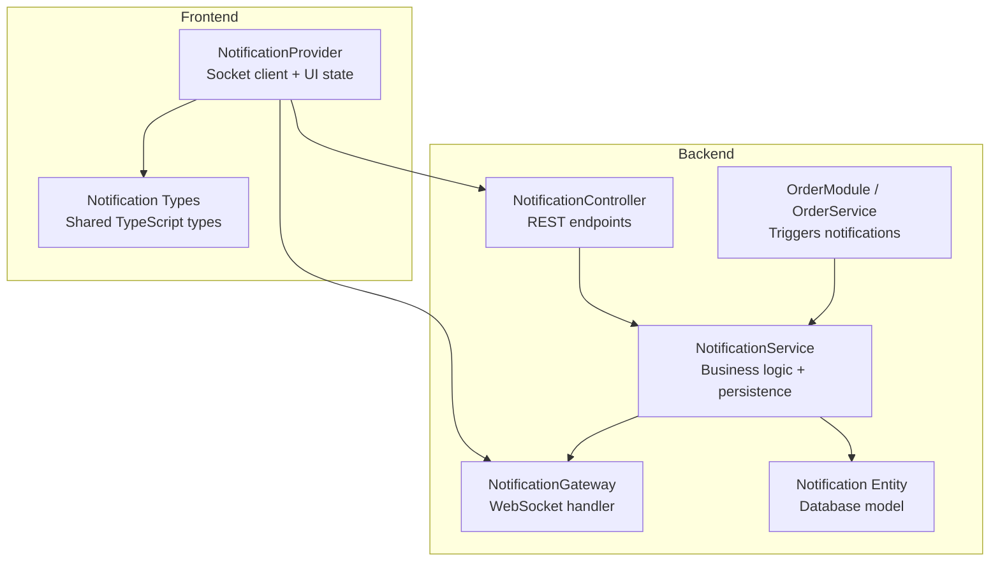
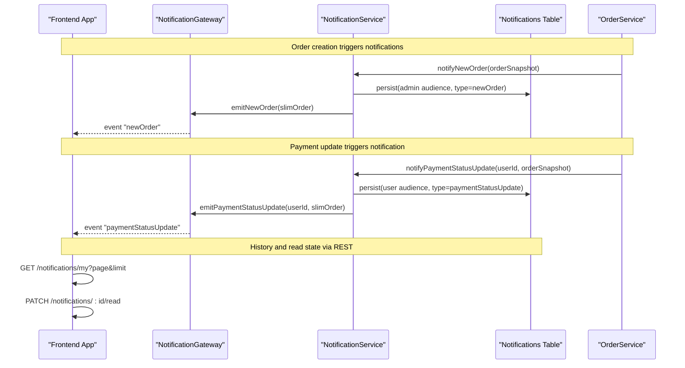
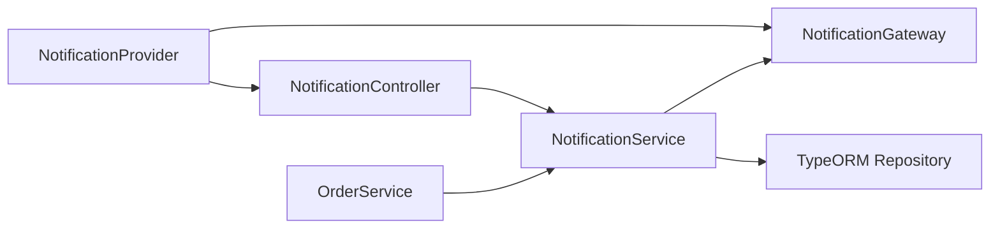

# Notification Management APIs

<cite>
**Referenced Files in This Document**   
- [notification.gateway.ts](file://apps/backend/src/notification/notification.gateway.ts)
- [notification.controller.ts](file://apps/backend/src/notification/notification.controller.ts)
- [notification.service.ts](file://apps/backend/src/notification/notification.service.ts)
- [notification.entity.ts](file://apps/backend/src/notification/entities/notification.entity.ts)
- [notification.module.ts](file://apps/backend/src/notification/notification.module.ts)
- [order.service.ts](file://apps/backend/src/order/order.service.ts)
- [notification-provider.tsx](file://apps/frontend/providers/notification-provider.tsx)
- [notification-context.tsx](file://apps/frontend/contexts/notification-context.tsx)
- [types.ts](file://apps/frontend/utils/types.ts)
</cite>

## Table of Contents
1. [Introduction](#introduction)
2. [Project Structure](#project-structure)
3. [Core Components](#core-components)
4. [Architecture Overview](#architecture-overview)
5. [Detailed Component Analysis](#detailed-component-analysis)
6. [Dependency Analysis](#dependency-analysis)
7. [Performance Considerations](#performance-considerations)
8. [Troubleshooting Guide](#troubleshooting-guide)
9. [Conclusion](#conclusion)

## Introduction
This document describes the notification management system for the application. It covers real-time notifications through WebSocket, REST endpoints for notification history and read-state management, broadcast capabilities, persistence, delivery semantics, and frontend integration.

The system supports:
- Real-time order lifecycle events to customers and admins.
- Broadcast announcements to all connected clients.
- Persistent notification history with pagination and unread tracking.
- Admin-only operational alerts such as new orders and contact messages.
- Targeted user notifications and general broadcasts.

## Project Structure
The notification feature is implemented under the backend `notification` module and consumed by both admin and customer-facing frontend components.

**Diagram sources**
- [notification.gateway.ts:15-37](file://apps/backend/src/notification/notification.gateway.ts#L15-L37)
- [notification.service.ts:21-29](file://apps/backend/src/notification/notification.service.ts#L21-L29)
- [notification.entity.ts:12-58](file://apps/backend/src/notification/entities/notification.entity.ts#L12-L58)
- [notification.controller.ts:25-28](file://apps/backend/src/notification/notification.controller.ts#L25-L28)
- [order.service.ts:668-691](file://apps/backend/src/order/order.service.ts#L668-L691)
- [notification-provider.tsx:86-114](file://apps/frontend/providers/notification-provider.tsx#L86-L114)
- [types.ts:1-22](file://apps/frontend/utils/types.ts#L1-L22)

**Section sources**
- [notification.module.ts:9-14](file://apps/backend/src/notification/notification.module.ts#L9-L14)
- [notification.gateway.ts:15-37](file://apps/backend/src/notification/notification.gateway.ts#L15-L37)
- [notification.service.ts:21-29](file://apps/backend/src/notification/notification.service.ts#L21-L29)
- [notification.controller.ts:25-28](file://apps/backend/src/notification/notification.controller.ts#L25-L28)
- [notification-provider.tsx:86-114](file://apps/frontend/providers/notification-provider.tsx#L86-L114)

## Core Components
- WebSocket Gateway: Handles connection, rooms, authentication metadata, and emits events.
- Service Layer: Transforms business data into compact notification payloads, persists records, and delegates real-time emission.
- REST Controller: Exposes paginated history, unread counts, and mark-as-read operations for users and admins.
- Database Model: Stores audience-scoped notifications with read status and JSON payload.
- Frontend Provider: Connects via Socket.IO, listens to events, updates UI state, and calls REST endpoints for persistence.

Key responsibilities:
- Real-time event emission: `newOrder`, `newMessage`, `orderConfirmation`, `orderStatusUpdate`, `paymentStatusUpdate`, `broadcast`.
- Persistence: Every emitted notification is persisted for history and unread counting.
- Audience scoping: `user` feed includes personal and broadcast notifications; `admin` feed includes operational alerts.
- Read semantics: User broadcasts are shared across recipients; admin rows are shared across the admin team.

**Section sources**
- [notification.gateway.ts:128-222](file://apps/backend/src/notification/notification.gateway.ts#L128-L222)
- [notification.service.ts:60-167](file://apps/backend/src/notification/notification.service.ts#L60-L167)
- [notification.entity.ts:12-58](file://apps/backend/src/notification/entities/notification.entity.ts#L12-L58)
- [notification.controller.ts:30-136](file://apps/backend/src/notification/notification.controller.ts#L30-L136)
- [notification-provider.tsx:133-235](file://apps/frontend/providers/notification-provider.tsx#L133-L235)

## Architecture Overview
The notification flow combines synchronous REST history with asynchronous real-time delivery.

**Diagram sources**
- [order.service.ts:668-691](file://apps/backend/src/order/order.service.ts#L668-L691)
- [order.service.ts:1373-1397](file://apps/backend/src/order/order.service.ts#L1373-L1397)
- [notification.service.ts:60-167](file://apps/backend/src/notification/notification.service.ts#L60-L167)
- [notification.gateway.ts:148-222](file://apps/backend/src/notification/notification.gateway.ts#L148-L222)
- [notification.controller.ts:81-136](file://apps/backend/src/notification/notification.controller.ts#L81-L136)

## Detailed Component Analysis

### WebSocket Connection and Authentication
- Namespace: `/notifications`.
- Handshake query parameters:
  - `userId`: string identifier used to join a per-user room `user:{userId}`.
  - `isAdmin`: boolean flag (string `"true"` or `"false"`) used to join the `admins` room.
- CORS is configured for production domains and local development origins.
- Anonymous connections are allowed but do not receive targeted notifications.

Connection handling:
- On connect, the gateway logs client identity and joins appropriate rooms.
- On disconnect, the gateway cleans up socket mappings and logs disconnection.

Authentication approach:
- The gateway trusts the provided `userId` and `isAdmin` flags from the handshake.
- For broadcast requests, the gateway validates that the user exists and has an admin role before allowing broadcast emission.

Recommended client behavior:
- Always pass `userId` and `isAdmin` during connection.
- Use JWT-based HTTP auth for REST endpoints; use handshake metadata for WebSocket routing.

**Section sources**
- [notification.gateway.ts:15-37](file://apps/backend/src/notification/notification.gateway.ts#L15-L37)
- [notification.gateway.ts:43-87](file://apps/backend/src/notification/notification.gateway.ts#L43-L87)
- [notification.gateway.ts:89-126](file://apps/backend/src/notification/notification.gateway.ts#L89-L126)
- [notification.gateway.ts:228-338](file://apps/backend/src/notification/notification.gateway.ts#L228-L338)
- [notification-provider.tsx:99-114](file://apps/frontend/providers/notification-provider.tsx#L99-L114)

### WebSocket Events and Payloads
Events emitted by the server:
- `newOrder`: Admin alert when a new order arrives.
- `newMessage`: Admin alert for new contact messages.
- `orderConfirmation`: Customer confirmation for their order.
- `orderStatusUpdate`: Customer update on order status changes.
- `paymentStatusUpdate`: Customer update on payment status changes.
- `broadcast`: System-wide announcement sent by admins.

Event envelope structure:
- `event`: Event name matching the emitter.
- `data`: Domain-specific payload.
- `timestamp`: Emission timestamp.

Targeting:
- Admin events are emitted to the `admins` room.
- User-targeted events are emitted to `user:{userId}`.
- Broadcast events are emitted to all connected sockets.

Broadcast request:
- Admins can send broadcasts via the `sendBroadcast` socket message.
- Payload must include `title` and `message`; optional fields include `discount`, `offerId`, and `type`.
- The gateway validates admin role and returns success or error responses.

Example usage patterns:
- Maintenance alerts: Broadcast with `type` indicating maintenance, including start/end times in `data`.
- Promotional notifications: Broadcast with `discount` and `offerId`.
- System updates: Broadcast with informational `message` and optional structured `data`.

**Section sources**
- [notification.gateway.ts:148-222](file://apps/backend/src/notification/notification.gateway.ts#L148-L222)
- [notification.gateway.ts:228-338](file://apps/backend/src/notification/notification.gateway.ts#L228-L338)
- [notification-provider.tsx:133-235](file://apps/frontend/providers/notification-provider.tsx#L133-L235)

### REST Endpoints for Notification History
Admin endpoints:
- `GET /notifications/admin?page&limit`: Paginated admin feed.
- `GET /notifications/admin/unread-count`: Unread count for admin feed.
- `PATCH /notifications/admin/read-all`: Mark all admin notifications as read.
- `PATCH /notifications/admin/:id/read`: Mark one admin notification as read.

User endpoints:
- `GET /notifications/my?page&limit`: Paginated user feed including broadcasts.
- `GET /notifications/my/unread-count`: Unread count for user feed.
- `PATCH /notifications/read-all`: Mark all user notifications as read.
- `PATCH /notifications/:id/read`: Mark one user notification as read.

Authentication:
- All endpoints require JWT authentication.
- Admin endpoints additionally require admin guard.

Response shape:
- Envelope includes `message`, `statusCode`, and `data`.
- Paginated responses include `total`, `page`, `limit`, and `totalPages`.

Read semantics:
- User broadcasts are shared across recipients; marking read affects all recipients.
- Admin notifications are shared across the admin team.

**Section sources**
- [notification.controller.ts:30-79](file://apps/backend/src/notification/notification.controller.ts#L30-L79)
- [notification.controller.ts:81-136](file://apps/backend/src/notification/notification.controller.ts#L81-L136)
- [notification.service.ts:173-244](file://apps/backend/src/notification/notification.service.ts#L173-L244)
- [notification.service.ts:249-302](file://apps/backend/src/notification/notification.service.ts#L249-L302)

### Data Model and Persistence
Entity fields:
- `id`: Primary key.
- `userId`: Recipient user; null for broadcasts visible to all users.
- `audience`: Feed scope (`user` or `admin`).
- `type`: Event kind matching socket event names.
- `title`: Human-readable title.
- `message`: Human-readable summary.
- `data`: Optional JSON payload.
- `isRead`: Read status.
- `createdAt`: Creation timestamp.

Persistence strategy:
- Notifications are persisted after real-time emission.
- Persistence failures are logged but do not break the caller’s workflow.

Indexes:
- `userId`, `audience`, `type`, and `createdAt` are indexed for efficient queries.

Complexity considerations:
- Order snapshots are slimmed to avoid leaking sensitive relations and reduce payload size.

**Section sources**
- [notification.entity.ts:12-58](file://apps/backend/src/notification/entities/notification.entity.ts#L12-L58)
- [notification.service.ts:31-58](file://apps/backend/src/notification/notification.service.ts#L31-L58)
- [notification.service.ts:304-325](file://apps/backend/src/notification/notification.service.ts#L304-L325)

### Frontend Integration
The frontend provider:
- Establishes a Socket.IO connection to `/notifications` with `userId` and `isAdmin` query parameters.
- Reconnects automatically with configurable delay and attempt limits.
- Listens for admin events (`newOrder`, `newMessage`) and user events (`orderConfirmation`, `orderStatusUpdate`, `paymentStatusUpdate`, `broadcast`).
- Updates local notification state and shows toast notifications.
- Seeds unread admin notifications from the database on connect to reconcile missed events.

Reconnection strategy:
- Uses Socket.IO reconnection with exponential backoff capped at a maximum delay.
- Calls seed-from-database on successful reconnect to ensure UI consistency.

Error handling:
- Logs connection errors and sets disconnected state.
- Gracefully handles missing user context by not connecting.

**Section sources**
- [notification-provider.tsx:86-131](file://apps/frontend/providers/notification-provider.tsx#L86-L131)
- [notification-provider.tsx:133-235](file://apps/frontend/providers/notification-provider.tsx#L133-L235)
- [notification-provider.tsx:249-268](file://apps/frontend/providers/notification-provider.tsx#L249-L268)
- [types.ts:1-22](file://apps/frontend/utils/types.ts#L1-L22)

## Dependency Analysis
The notification subsystem depends on:
- User service for fetching user details and validating admin roles.
- TypeORM repository for persistence.
- Order service for triggering order-related notifications.
- Frontend provider for consuming WebSocket events and calling REST endpoints.

**Diagram sources**
- [order.service.ts:668-691](file://apps/backend/src/order/order.service.ts#L668-L691)
- [notification.service.ts:21-29](file://apps/backend/src/notification/notification.service.ts#L21-L29)
- [notification.gateway.ts:15-37](file://apps/backend/src/notification/notification.gateway.ts#L15-L37)
- [notification.controller.ts:25-28](file://apps/backend/src/notification/notification.controller.ts#L25-L28)
- [notification-provider.tsx:86-114](file://apps/frontend/providers/notification-provider.tsx#L86-L114)

**Section sources**
- [notification.module.ts:9-14](file://apps/backend/src/notification/notification.module.ts#L9-L14)
- [notification.service.ts:21-29](file://apps/backend/src/notification/notification.service.ts#L21-L29)
- [order.service.ts:668-691](file://apps/backend/src/order/order.service.ts#L668-L691)

## Performance Considerations
- Payload minimization: Order snapshots are slimmed to exclude heavy relations and sensitive fields.
- Indexing: Frequently queried columns (`userId`, `audience`, `type`, `createdAt`) are indexed.
- Fail-open persistence: Database write failures are logged without breaking real-time flows.
- Room-based targeting: Using Socket.IO rooms reduces fan-out overhead compared to iterating sockets manually.
- Pagination: REST endpoints return paginated results to limit memory and network usage.

[No sources needed since this section provides general guidance]

## Troubleshooting Guide
Common issues and resolutions:
- WebSocket connection fails:
  - Verify CORS configuration allows the frontend origin.
  - Ensure `userId` and `isAdmin` are passed in the handshake query.
  - Check environment variable for socket URL and network connectivity.
- Missing notifications after reload:
  - The frontend seeds unread admin notifications on connect; verify the seeding call succeeds.
  - Confirm REST endpoints return expected data and pagination.
- Broadcast not received:
  - Validate sender is an admin (role checks).
  - Ensure broadcast payload includes required `title` and `message`.
- Read state inconsistencies:
  - User broadcasts are shared; marking read affects all recipients.
  - Admin notifications are shared across the admin team.

Operational logging:
- Gateway logs connection/disconnection and broadcast attempts.
- Service logs persistence failures with context.

**Section sources**
- [notification.gateway.ts:15-37](file://apps/backend/src/notification/notification.gateway.ts#L15-L37)
- [notification.gateway.ts:228-338](file://apps/backend/src/notification/notification.gateway.ts#L228-L338)
- [notification.service.ts:304-325](file://apps/backend/src/notification/notification.service.ts#L304-L325)
- [notification-provider.tsx:86-131](file://apps/frontend/providers/notification-provider.tsx#L86-L131)

## Conclusion
The notification management system provides robust real-time communication and persistent history. It separates concerns between WebSocket event emission and REST-based history management, supports audience scoping, and integrates cleanly with both admin and customer interfaces. By following the documented event shapes, endpoint contracts, and connection practices, developers can reliably implement maintenance alerts, promotional broadcasts, and system updates while maintaining consistent user experience and auditability.

[No sources needed since this section summarizes without analyzing specific files]