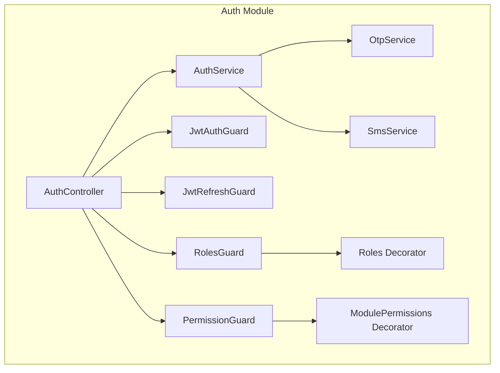
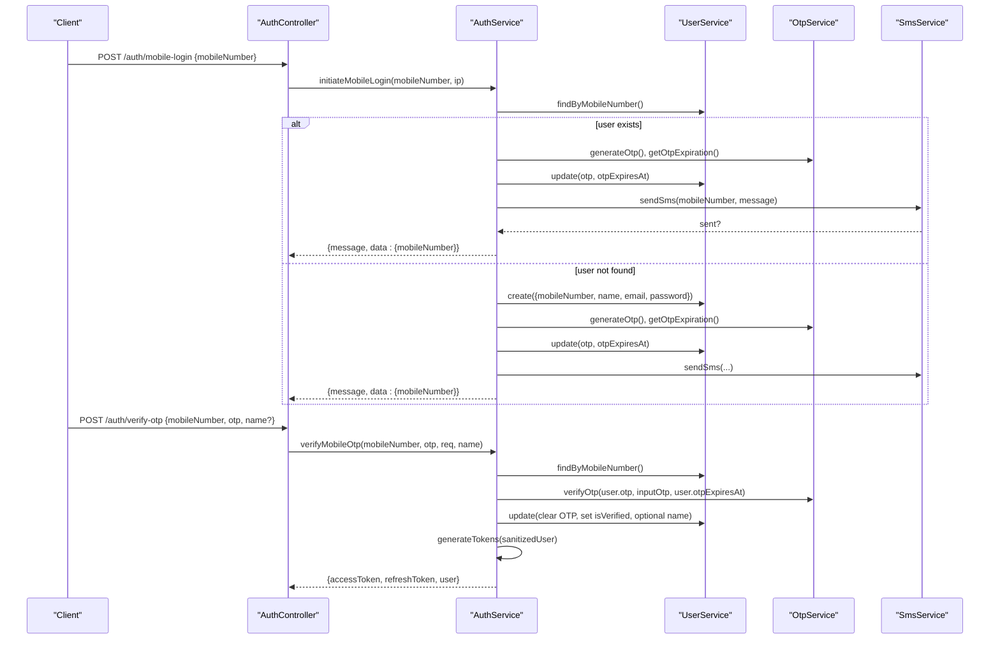
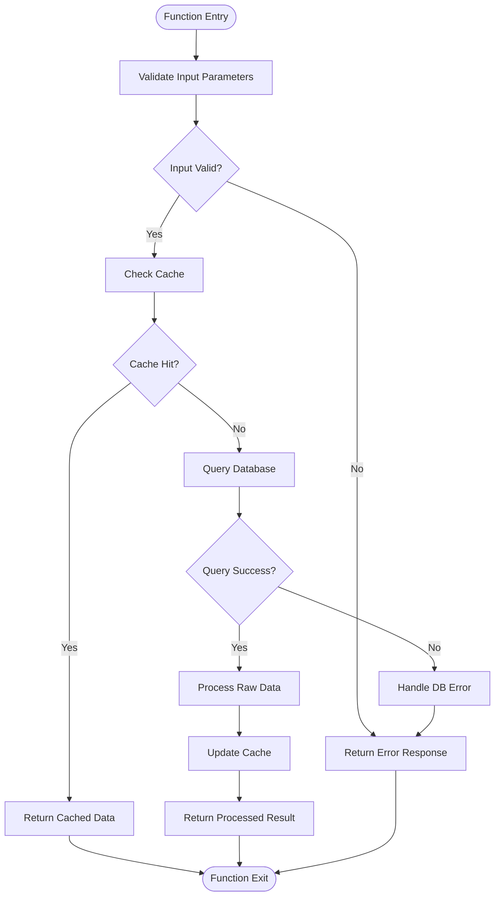
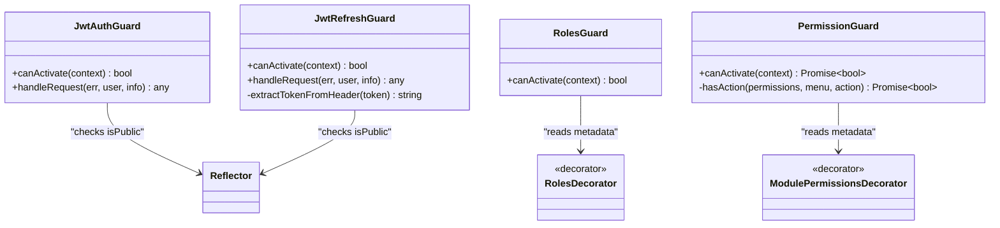
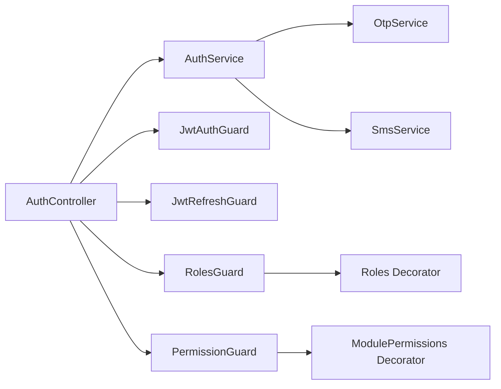

# Authentication & Authorization APIs

<cite>
**Referenced Files in This Document**
- [auth.controller.ts](file://apps/backend/src/auth/auth.controller.ts)
- [auth.service.ts](file://apps/backend/src/auth/auth.service.ts)
- [otp.service.ts](file://apps/backend/src/auth/otp.service.ts)
- [sms.service.ts](file://apps/backend/src/auth/sms.service.ts)
- [jwt-auth.guard.ts](file://apps/backend/src/auth/guards/jwt-auth.guard.ts)
- [jwt-refresh.guard.ts](file://apps/backend/src/auth/guards/jwt-refresh.guard.ts)
- [roles.guard.ts](file://apps/backend/src/auth/guards/roles.guard.ts)
- [permission.guard.ts](file://apps/backend/src/auth/guards/permission.guard.ts)
- [roles.decorator.ts](file://apps/backend/src/auth/decorators/roles.decorator.ts)
- [module-permissions.decorator.ts](file://apps/backend/src/auth/decorators/module-permissions.decorator.ts)
- [login.dto.ts](file://apps/backend/src/auth/dto/login.dto.ts)
- [register.dto.ts](file://apps/backend/src/auth/dto/register.dto.ts)
</cite>

## Table of Contents
1. [Introduction](#introduction)
2. [Project Structure](#project-structure)
3. [Core Components](#core-components)
4. [Architecture Overview](#architecture-overview)
5. [Detailed Component Analysis](#detailed-component-analysis)
6. [Dependency Analysis](#dependency-analysis)
7. [Performance Considerations](#performance-considerations)
8. [Troubleshooting Guide](#troubleshooting-guide)
9. [Conclusion](#conclusion)
10. [Appendices](#appendices)

## Introduction
This document provides comprehensive API documentation for the authentication and authorization subsystem, covering JWT-based flows (registration, login, logout, token refresh), OTP verification via SMS, role-based access control, guard system, and decorator-based permission checks. It includes request/response schemas, security headers, token expiration handling, error responses, and client integration guidance.

## Project Structure
The authentication feature is implemented under the backend auth module with controllers, services, DTOs, guards, decorators, and OTP/SMS utilities.

**Diagram sources**
- [auth.controller.ts:31-36](file://apps/backend/src/auth/auth.controller.ts#L31-L36)
- [auth.service.ts:21-32](file://apps/backend/src/auth/auth.service.ts#L21-L32)
- [otp.service.ts:4-6](file://apps/backend/src/auth/otp.service.ts#L4-L6)
- [sms.service.ts:6-10](file://apps/backend/src/auth/sms.service.ts#L6-L10)
- [jwt-auth.guard.ts:10-15](file://apps/backend/src/auth/guards/jwt-auth.guard.ts#L10-L15)
- [jwt-refresh.guard.ts:10-15](file://apps/backend/src/auth/guards/jwt-refresh.guard.ts#L10-L15)
- [roles.guard.ts:5-7](file://apps/backend/src/auth/guards/roles.guard.ts#L5-L7)
- [permission.guard.ts:31-37](file://apps/backend/src/auth/guards/permission.guard.ts#L31-L37)
- [roles.decorator.ts:1-5](file://apps/backend/src/auth/decorators/roles.decorator.ts#L1-L5)
- [module-permissions.decorator.ts:1-14](file://apps/backend/src/auth/decorators/module-permissions.decorator.ts#L1-L14)

**Section sources**
- [auth.controller.ts:31-36](file://apps/backend/src/auth/auth.controller.ts#L31-L36)
- [auth.service.ts:21-32](file://apps/backend/src/auth/auth.service.ts#L21-L32)

## Core Components
- AuthController: Exposes public endpoints for registration, login, mobile login, OTP verification, token refresh, logout, and validation. Applies throttling and Swagger metadata.
- AuthService: Implements business logic for user validation, token generation, refresh, OTP lifecycle, and audit logging.
- OtpService: Generates OTPs, computes validity windows, and verifies OTPs against stored values and expiry.
- SmsService: Sends OTP messages via an external SMS gateway using environment configuration.
- Guards: JwtAuthGuard validates access tokens; JwtRefreshGuard validates refresh tokens; RolesGuard enforces role constraints; PermissionGuard enforces menu-based permissions.
- Decorators: Roles sets required roles; ModulePermissions declares the menu URL for fine-grained permission checks.

**Section sources**
- [auth.controller.ts:31-309](file://apps/backend/src/auth/auth.controller.ts#L31-L309)
- [auth.service.ts:21-433](file://apps/backend/src/auth/auth.service.ts#L21-L433)
- [otp.service.ts:4-34](file://apps/backend/src/auth/otp.service.ts#L4-L34)
- [sms.service.ts:6-63](file://apps/backend/src/auth/sms.service.ts#L6-L63)
- [jwt-auth.guard.ts:10-45](file://apps/backend/src/auth/guards/jwt-auth.guard.ts#L10-L45)
- [jwt-refresh.guard.ts:10-61](file://apps/backend/src/auth/guards/jwt-refresh.guard.ts#L10-L61)
- [roles.guard.ts:5-28](file://apps/backend/src/auth/guards/roles.guard.ts#L5-L28)
- [permission.guard.ts:31-90](file://apps/backend/src/auth/guards/permission.guard.ts#L31-L90)
- [roles.decorator.ts:1-5](file://apps/backend/src/auth/decorators/roles.decorator.ts#L1-L5)
- [module-permissions.decorator.ts:1-14](file://apps/backend/src/auth/decorators/module-permissions.decorator.ts#L1-L14)

## Architecture Overview
The authentication flow uses JWT access and refresh tokens. Access tokens are validated by JwtAuthGuard; refresh tokens are validated by JwtRefreshGuard. Role and permission checks are enforced via RolesGuard and PermissionGuard respectively. OTP verification integrates with OtpService and SmsService.

**Diagram sources**
- [auth.controller.ts:231-307](file://apps/backend/src/auth/auth.controller.ts#L231-L307)
- [auth.service.ts:172-358](file://apps/backend/src/auth/auth.service.ts#L172-L358)
- [otp.service.ts:8-33](file://apps/backend/src/auth/otp.service.ts#L8-L33)
- [sms.service.ts:12-62](file://apps/backend/src/auth/sms.service.ts#L12-L62)

## Detailed Component Analysis

### Endpoints Reference

#### Register
- Method: POST
- Path: /auth/register
- Throttling: 5 requests per minute
- Auth: None
- Request body schema (RegisterDto):
  - email: string, required, valid email format
  - name: string, required, length 2–100
  - password: string, required, min 8 chars, must include uppercase, lowercase, digit, special char
  - mobileNumber: string, optional, phone number format
- Success response (201):
  - message: string
  - statusCode: 201
  - data.user: object with id, email, name, mobileNumber
  - data.tokens: object with accessToken, refreshToken
- Error responses:
  - 400 Bad Request: invalid data or duplicate email
- Security headers:
  - Bearer token not required for this endpoint

**Section sources**
- [auth.controller.ts:38-79](file://apps/backend/src/auth/auth.controller.ts#L38-L79)
- [register.dto.ts:13-62](file://apps/backend/src/auth/dto/register.dto.ts#L13-L62)

#### Login
- Method: POST
- Path: /auth/login
- Throttling: 10 requests per minute
- Auth: None
- Request body schema (LoginDto):
  - email: string, required, valid email format
  - password: string, required, min 6 chars
- Success response (200):
  - message: string
  - statusCode: 200
  - data: object with accessToken, refreshToken
- Error responses:
  - 401 Unauthorized: invalid credentials

**Section sources**
- [auth.controller.ts:81-114](file://apps/backend/src/auth/auth.controller.ts#L81-L114)
- [login.dto.ts:4-26](file://apps/backend/src/auth/dto/login.dto.ts#L4-L26)

#### Refresh Tokens
- Method: POST
- Path: /auth/refresh
- Auth: Requires refresh token via Authorization header (Bearer <refreshToken>)
- Request: No body
- Success response (200):
  - message: string
  - statusCode: 200
  - data: object with accessToken, refreshToken
- Error responses:
  - 401 Unauthorized: invalid or expired refresh token

**Section sources**
- [auth.controller.ts:116-150](file://apps/backend/src/auth/auth.controller.ts#L116-L150)
- [jwt-refresh.guard.ts:10-61](file://apps/backend/src/auth/guards/jwt-refresh.guard.ts#L10-L61)

#### Logout
- Method: POST
- Path: /auth/logout
- Auth: Requires access token via Authorization header (Bearer <accessToken>)
- Request: No body
- Success response (200):
  - message: string
  - statusCode: 200
- Error responses:
  - 401 Unauthorized: invalid or missing access token

**Section sources**
- [auth.controller.ts:152-195](file://apps/backend/src/auth/auth.controller.ts#L152-L195)
- [jwt-auth.guard.ts:10-45](file://apps/backend/src/auth/guards/jwt-auth.guard.ts#L10-L45)

#### Validate Token
- Method: POST
- Path: /auth/validate
- Auth: Requires access token via Authorization header (Bearer <accessToken>)
- Request: No body
- Success response (200):
  - message: string
  - statusCode: 200
- Error responses:
  - 401 Unauthorized: invalid or expired token

**Section sources**
- [auth.controller.ts:197-229](file://apps/backend/src/auth/auth.controller.ts#L197-L229)
- [jwt-auth.guard.ts:10-45](file://apps/backend/src/auth/guards/jwt-auth.guard.ts#L10-L45)

#### Mobile Login (OTP Initiation)
- Method: POST
- Path: /auth/mobile-login
- Throttling: short 30/min, medium 100/5min, long 300/hour
- Auth: None
- Request body schema (MobileLoginDto):
  - mobileNumber: string, required, E.164 format (+[country][number])
- Success response (200):
  - message: string
  - statusCode: 200
  - data.mobileNumber: string
- Error responses:
  - 400 Bad Request: invalid mobile number
  - 429 Too Many Requests: resend cooldown active
  - 503 Service Unavailable: SMS provider failure

**Section sources**
- [auth.controller.ts:231-267](file://apps/backend/src/auth/auth.controller.ts#L231-L267)
- [auth.service.ts:172-250](file://apps/backend/src/auth/auth.service.ts#L172-L250)
- [otp.service.ts:8-26](file://apps/backend/src/auth/otp.service.ts#L8-L26)
- [sms.service.ts:12-62](file://apps/backend/src/auth/sms.service.ts#L12-L62)

#### Verify OTP
- Method: POST
- Path: /auth/verify-otp
- Throttling: short 30/min, medium 100/5min, long 500/hour
- Auth: None
- Request body schema (VerifyOtpDto):
  - mobileNumber: string, required, E.164 format
  - otp: string, required, exactly 6 digits
  - name: string, optional, used to update user name during first-time setup
- Success response (200):
  - message: string
  - statusCode: 200
  - data: object with accessToken, refreshToken, user (id, name, mobileNumber, roles, isVerified)
- Error responses:
  - 400 Bad Request: invalid mobile number or OTP format
  - 401 Unauthorized: mobile not registered, no OTP requested, or invalid OTP

**Section sources**
- [auth.controller.ts:269-307](file://apps/backend/src/auth/auth.controller.ts#L269-L307)
- [auth.service.ts:252-358](file://apps/backend/src/auth/auth.service.ts#L252-L358)
- [otp.service.ts:28-33](file://apps/backend/src/auth/otp.service.ts#L28-L33)

### Token Generation and Refresh Flow
- Access token payload includes user identifier, name, email, mobileNumber, and roles.
- Separate secrets and expiration times are used for access and refresh tokens.
- Refresh endpoint validates the refresh token, locates the user, and issues new tokens.

**Diagram sources**
- [auth.service.ts:107-170](file://apps/backend/src/auth/auth.service.ts#L107-L170)

**Section sources**
- [auth.service.ts:75-170](file://apps/backend/src/auth/auth.service.ts#L75-L170)

### Guard System and RBAC

#### Guards
- JwtAuthGuard: Validates access tokens and supports a public route override via reflector metadata.
- JwtRefreshGuard: Validates refresh tokens and ensures Authorization header presence.
- RolesGuard: Enforces that the authenticated user has at least one of the required roles declared via @Roles.
- PermissionGuard: Opt-in guard for menu-based permissions mapped from HTTP methods to actions (GET→canView, POST→canCreate, PUT/PATCH→canEdit, DELETE→canDelete). Supports ancestor menu inheritance and bypasses for superadmin/admin roles.

**Diagram sources**
- [jwt-auth.guard.ts:10-45](file://apps/backend/src/auth/guards/jwt-auth.guard.ts#L10-L45)
- [jwt-refresh.guard.ts:10-61](file://apps/backend/src/auth/guards/jwt-refresh.guard.ts#L10-L61)
- [roles.guard.ts:5-28](file://apps/backend/src/auth/guards/roles.guard.ts#L5-L28)
- [permission.guard.ts:31-90](file://apps/backend/src/auth/guards/permission.guard.ts#L31-L90)
- [roles.decorator.ts:1-5](file://apps/backend/src/auth/decorators/roles.decorator.ts#L1-L5)
- [module-permissions.decorator.ts:1-14](file://apps/backend/src/auth/decorators/module-permissions.decorator.ts#L1-L14)

**Section sources**
- [jwt-auth.guard.ts:10-45](file://apps/backend/src/auth/guards/jwt-auth.guard.ts#L10-L45)
- [jwt-refresh.guard.ts:10-61](file://apps/backend/src/auth/guards/jwt-refresh.guard.ts#L10-L61)
- [roles.guard.ts:5-28](file://apps/backend/src/auth/guards/roles.guard.ts#L5-L28)
- [permission.guard.ts:31-90](file://apps/backend/src/auth/guards/permission.guard.ts#L31-L90)
- [roles.decorator.ts:1-5](file://apps/backend/src/auth/decorators/roles.decorator.ts#L1-L5)
- [module-permissions.decorator.ts:1-14](file://apps/backend/src/auth/decorators/module-permissions.decorator.ts#L1-L14)

### Security Headers and Token Handling
- All protected endpoints require Authorization: Bearer <token>.
- Access token endpoints use JwtAuthGuard; refresh endpoints use JwtRefreshGuard.
- Swagger annotations declare bearer schemes for both token types.

**Section sources**
- [auth.controller.ts:29-31](file://apps/backend/src/auth/auth.controller.ts#L29-L31)
- [jwt-auth.guard.ts:10-11](file://apps/backend/src/auth/guards/jwt-auth.guard.ts#L10-L11)
- [jwt-refresh.guard.ts:10-11](file://apps/backend/src/auth/guards/jwt-refresh.guard.ts#L10-L11)

### Error Responses
Common error shapes:
- 400 Bad Request: invalid input or service-level failures (e.g., invalid mobile number, OTP generation failure)
- 401 Unauthorized: invalid credentials, invalid/expired tokens, missing OTP, or unauthorized access
- 403 Forbidden: missing permissions or inactive role
- 429 Too Many Requests: throttling limits exceeded
- 503 Service Unavailable: SMS provider failure

**Section sources**
- [auth.controller.ts:67-76](file://apps/backend/src/auth/auth.controller.ts#L67-L76)
- [auth.controller.ts:102-111](file://apps/backend/src/auth/auth.controller.ts#L102-L111)
- [auth.controller.ts:138-147](file://apps/backend/src/auth/auth.controller.ts#L138-L147)
- [auth.controller.ts:170-178](file://apps/backend/src/auth/auth.controller.ts#L170-L178)
- [auth.controller.ts:214-223](file://apps/backend/src/auth/auth.controller.ts#L214-L223)
- [auth.controller.ts:259-261](file://apps/backend/src/auth/auth.controller.ts#L259-L261)
- [auth.controller.ts:296-298](file://apps/backend/src/auth/auth.controller.ts#L296-L298)
- [auth.service.ts:138-143](file://apps/backend/src/auth/auth.service.ts#L138-L143)
- [auth.service.ts:238-243](file://apps/backend/src/auth/auth.service.ts#L238-L243)
- [permission.guard.ts:49-74](file://apps/backend/src/auth/guards/permission.guard.ts#L49-L74)

## Dependency Analysis
The following diagram shows how controllers depend on services and guards, and how decorators provide metadata consumed by guards.

**Diagram sources**
- [auth.controller.ts:31-36](file://apps/backend/src/auth/auth.controller.ts#L31-L36)
- [auth.service.ts:21-32](file://apps/backend/src/auth/auth.service.ts#L21-L32)
- [roles.guard.ts:5-7](file://apps/backend/src/auth/guards/roles.guard.ts#L5-L7)
- [permission.guard.ts:31-37](file://apps/backend/src/auth/guards/permission.guard.ts#L31-L37)
- [roles.decorator.ts:1-5](file://apps/backend/src/auth/decorators/roles.decorator.ts#L1-L5)
- [module-permissions.decorator.ts:1-14](file://apps/backend/src/auth/decorators/module-permissions.decorator.ts#L1-L14)

**Section sources**
- [auth.controller.ts:31-36](file://apps/backend/src/auth/auth.controller.ts#L31-L36)
- [auth.service.ts:21-32](file://apps/backend/src/auth/auth.service.ts#L21-L32)

## Performance Considerations
- Throttling: Rate limiting is applied to sensitive endpoints (register, login, mobile-login, verify-otp) to mitigate brute-force attacks.
- Non-blocking audit writes: Login/logout activity logs are fire-and-forget to avoid impacting response latency.
- Parallel token signing: Access and refresh tokens are signed concurrently to reduce latency.
- SMS reliability: The SMS service returns false on failures; callers handle this with appropriate error codes.

**Section sources**
- [auth.controller.ts:38-40](file://apps/backend/src/auth/auth.controller.ts#L38-L40)
- [auth.controller.ts:81-83](file://apps/backend/src/auth/auth.controller.ts#L81-L83)
- [auth.controller.ts:231-240](file://apps/backend/src/auth/auth.controller.ts#L231-L240)
- [auth.controller.ts:269-276](file://apps/backend/src/auth/auth.controller.ts#L269-L276)
- [auth.service.ts:86-93](file://apps/backend/src/auth/auth.service.ts#L86-L93)
- [auth.service.ts:155-164](file://apps/backend/src/auth/auth.service.ts#L155-L164)
- [sms.service.ts:44-60](file://apps/backend/src/auth/sms.service.ts#L44-L60)

## Troubleshooting Guide
- Invalid credentials: Ensure email/password match stored records; check password hashing method and minimum length rules.
- Invalid refresh token: Confirm the refresh token is present in Authorization header and not expired; verify secret configuration.
- OTP resend blocked: A 60-second cooldown prevents frequent resends; wait before retrying.
- SMS delivery failures: Check SMS_API_KEY, SMS_SENDER_NUMBER, and SMS_SEND_URL environment variables; inspect service logs for gateway errors.
- Permission denied: Ensure the user’s role has the required action for the target menu URL; verify role activation status.

**Section sources**
- [auth.service.ts:54-73](file://apps/backend/src/auth/auth.service.ts#L54-L73)
- [auth.service.ts:107-143](file://apps/backend/src/auth/auth.service.ts#L107-L143)
- [auth.service.ts:204-218](file://apps/backend/src/auth/auth.service.ts#L204-L218)
- [sms.service.ts:21-24](file://apps/backend/src/auth/sms.service.ts#L21-L24)
- [permission.guard.ts:63-74](file://apps/backend/src/auth/guards/permission.guard.ts#L63-L74)

## Conclusion
The authentication and authorization subsystem implements secure, rate-limited endpoints for registration, login, OTP-based mobile login, token refresh, and logout. JWT access and refresh tokens are generated with separate secrets and expirations. Role-based and menu-based permissions are enforced through dedicated guards and decorators. Clients should store tokens securely, handle token expiration gracefully, and implement automatic refresh using the refresh endpoint.

## Appendices

### Client Integration Examples

- Registration
  - Send POST /auth/register with RegisterDto fields.
  - Store accessToken and refreshToken returned in data.tokens.
  - Use accessToken in Authorization header for subsequent requests.

- Email Login
  - Send POST /auth/login with LoginDto fields.
  - Store tokens and attach accessToken to future requests.

- Mobile Login (OTP)
  - Send POST /auth/mobile-login with mobileNumber.
  - Wait for OTP via SMS, then send POST /auth/verify-otp with mobileNumber, otp, and optional name.
  - Store tokens and user details returned in data.

- Token Refresh
  - When accessToken expires, call POST /auth/refresh with Authorization: Bearer <refreshToken>.
  - Replace stored tokens with the new ones returned.

- Logout
  - Call POST /auth/logout with Authorization: Bearer <accessToken>.
  - Clear stored tokens on success.

- Automatic Refresh Strategy
  - On receiving 401 Unauthorized for protected endpoints, attempt refresh once.
  - If refresh fails, redirect to login and clear session state.

**Section sources**
- [auth.controller.ts:38-79](file://apps/backend/src/auth/auth.controller.ts#L38-L79)
- [auth.controller.ts:81-114](file://apps/backend/src/auth/auth.controller.ts#L81-L114)
- [auth.controller.ts:116-150](file://apps/backend/src/auth/auth.controller.ts#L116-L150)
- [auth.controller.ts:152-195](file://apps/backend/src/auth/auth.controller.ts#L152-L195)
- [auth.controller.ts:231-307](file://apps/backend/src/auth/auth.controller.ts#L231-L307)

### Security Best Practices
- Password Hashing: Use bcrypt for password comparison and ensure strong password policies on registration.
- Token Storage: Prefer httpOnly cookies or secure storage mechanisms; never log tokens.
- Session Management: Treat logout as client-side token invalidation; consider server-side revocation if needed.
- Protection Against Vulnerabilities:
  - Rate limiting on sensitive endpoints.
  - Strict input validation and sanitization.
  - Least privilege principle with role and permission checks.
  - Secure transport (HTTPS) and proper CORS configuration.

**Section sources**
- [auth.service.ts:54-73](file://apps/backend/src/auth/auth.service.ts#L54-L73)
- [register.dto.ts:45-51](file://apps/backend/src/auth/dto/register.dto.ts#L45-L51)
- [auth.controller.ts:38-40](file://apps/backend/src/auth/auth.controller.ts#L38-L40)
- [auth.controller.ts:81-83](file://apps/backend/src/auth/auth.controller.ts#L81-L83)
- [auth.controller.ts:231-240](file://apps/backend/src/auth/auth.controller.ts#L231-L240)
- [auth.controller.ts:269-276](file://apps/backend/src/auth/auth.controller.ts#L269-L276)
- [roles.guard.ts:9-27](file://apps/backend/src/auth/guards/roles.guard.ts#L9-L27)
- [permission.guard.ts:39-74](file://apps/backend/src/auth/guards/permission.guard.ts#L39-L74)