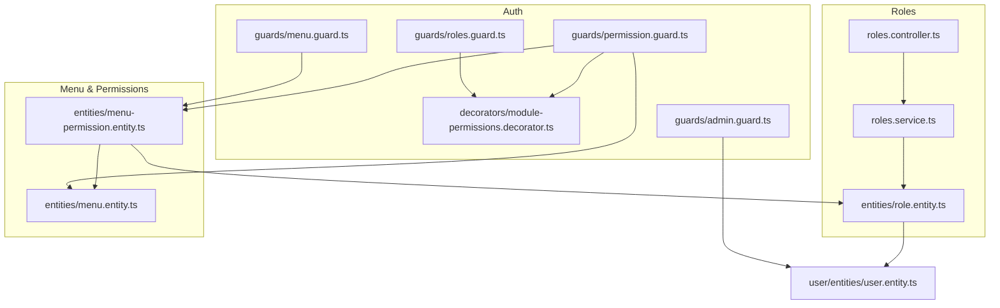
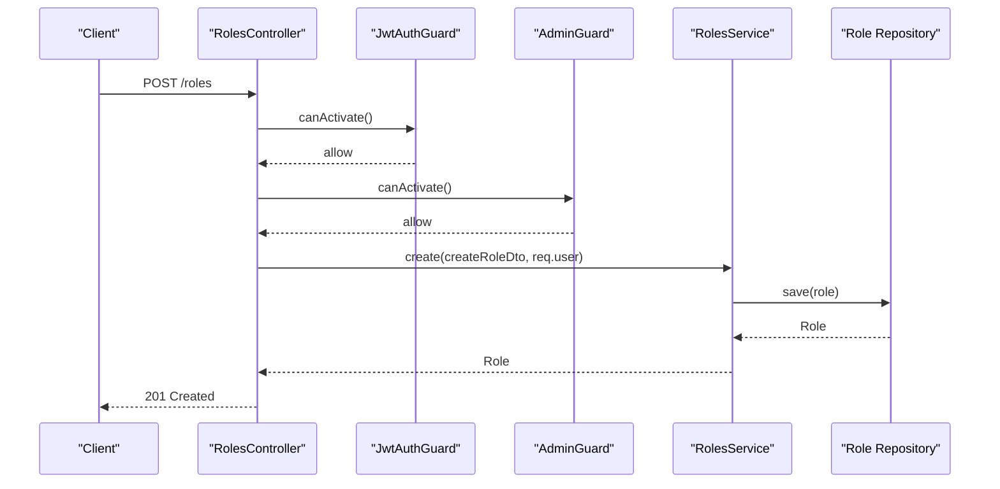
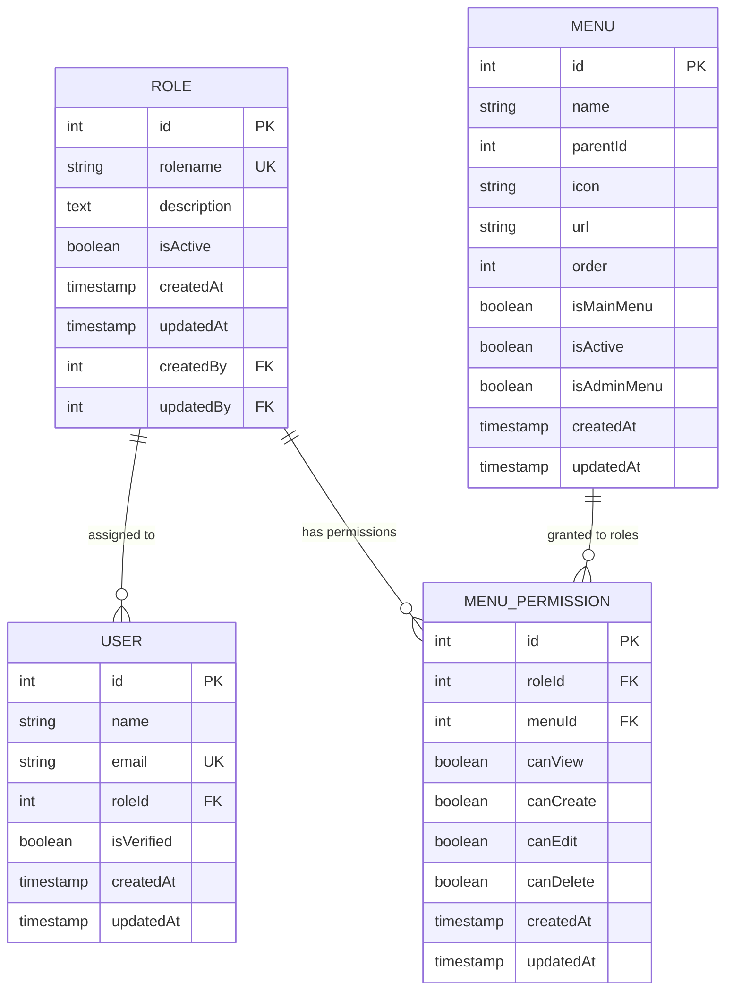
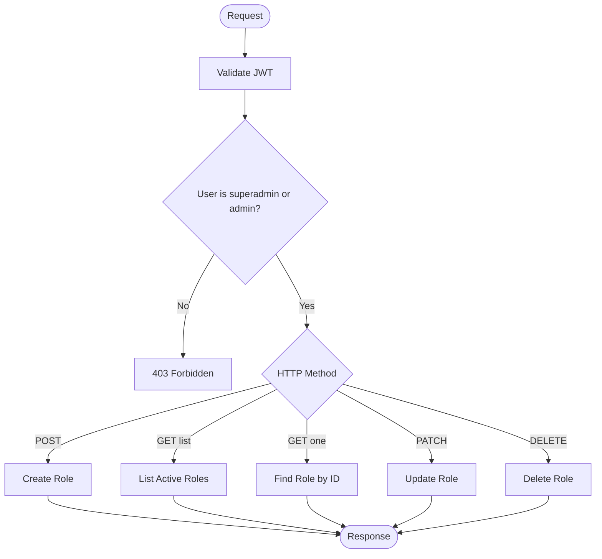
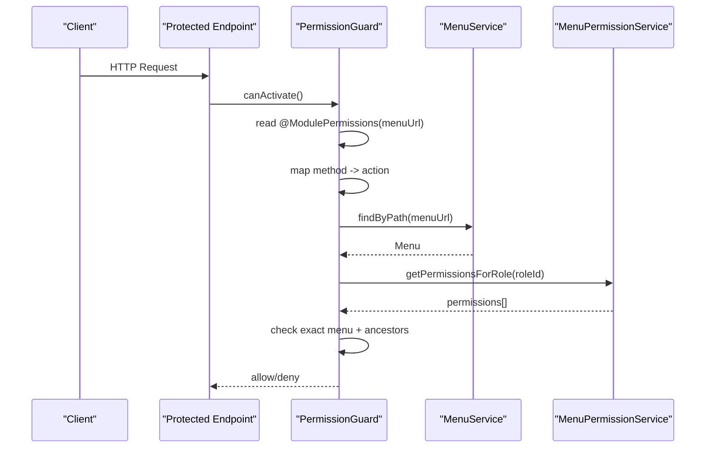
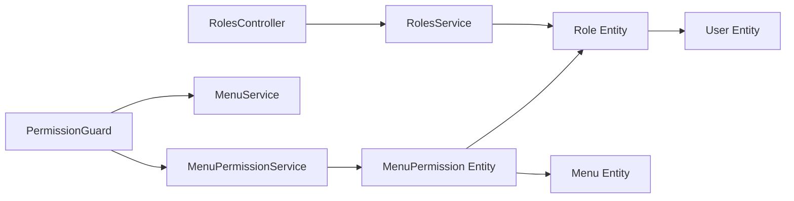

# Role-Based Access Control

<cite>
**Referenced Files in This Document**
- [roles.controller.ts](file://apps/backend/src/roles/roles.controller.ts)
- [roles.service.ts](file://apps/backend/src/roles/roles.service.ts)
- [role.entity.ts](file://apps/backend/src/roles/entities/role.entity.ts)
- [user.entity.ts](file://apps/backend/src/user/entities/user.entity.ts)
- [menu-permission.entity.ts](file://apps/backend/src/menu-permission/entities/menu-permission.entity.ts)
- [menu.entity.ts](file://apps/backend/src/menu/entities/menu.entity.ts)
- [module-permissions.decorator.ts](file://apps/backend/src/auth/decorators/module-permissions.decorator.ts)
- [permission.guard.ts](file://apps/backend/src/auth/guards/permission.guard.ts)
- [roles.guard.ts](file://apps/backend/src/auth/guards/roles.guard.ts)
- [admin.guard.ts](file://apps/backend/src/auth/guards/admin.guard.ts)
- [menu.guard.ts](file://apps/backend/src/auth/guards/menu.guard.ts)
</cite>

## Table of Contents
1. [Introduction](#introduction)
2. [Project Structure](#project-structure)
3. [Core Components](#core-components)
4. [Architecture Overview](#architecture-overview)
5. [Detailed Component Analysis](#detailed-component-analysis)
6. [Dependency Analysis](#dependency-analysis)
7. [Performance Considerations](#performance-considerations)
8. [Troubleshooting Guide](#troubleshooting-guide)
9. [Conclusion](#conclusion)

## Introduction
This document explains the role-based access control (RBAC) system implemented in the backend. It covers:
- Role hierarchy and permission assignment model
- User-role relationships
- Roles controller endpoints for managing roles
- Decorator-based route protection using @Roles() and the roles guard
- Menu-scoped permissions via @ModulePermissions(menuUrl) and PermissionGuard
- Entity structure and database relationships
- Practical examples for implementing role checks in controllers and services
- Security considerations including privilege escalation prevention and audit logging

## Project Structure
The RBAC implementation spans several modules:
- Roles module: defines the Role entity, CRUD endpoints, and service logic
- Auth guards and decorators: provide role-based and menu-scoped authorization
- Menu and MenuPermission entities: define hierarchical menus and per-role actions
- User entity: links users to roles

**Diagram sources**
- [roles.controller.ts:1-139](file://apps/backend/src/roles/roles.controller.ts#L1-L139)
- [roles.service.ts:1-93](file://apps/backend/src/roles/roles.service.ts#L1-L93)
- [role.entity.ts:1-79](file://apps/backend/src/roles/entities/role.entity.ts#L1-L79)
- [user.entity.ts:1-183](file://apps/backend/src/user/entities/user.entity.ts#L1-L183)
- [menu-permission.entity.ts:1-72](file://apps/backend/src/menu-permission/entities/menu-permission.entity.ts#L1-L72)
- [menu.entity.ts:1-115](file://apps/backend/src/menu/entities/menu.entity.ts#L1-L115)
- [module-permissions.decorator.ts:1-15](file://apps/backend/src/auth/decorators/module-permissions.decorator.ts#L1-L15)
- [permission.guard.ts:1-100](file://apps/backend/src/auth/guards/permission.guard.ts#L1-L100)
- [roles.guard.ts:1-29](file://apps/backend/src/auth/guards/roles.guard.ts#L1-L29)
- [admin.guard.ts:1-15](file://apps/backend/src/auth/guards/admin.guard.ts#L1-L15)
- [menu.guard.ts:1-36](file://apps/backend/src/auth/guards/menu.guard.ts#L1-L36)

**Section sources**
- [roles.controller.ts:1-139](file://apps/backend/src/roles/roles.controller.ts#L1-L139)
- [roles.service.ts:1-93](file://apps/backend/src/roles/roles.service.ts#L1-L93)
- [role.entity.ts:1-79](file://apps/backend/src/roles/entities/role.entity.ts#L1-L79)
- [user.entity.ts:1-183](file://apps/backend/src/user/entities/user.entity.ts#L1-L183)
- [menu-permission.entity.ts:1-72](file://apps/backend/src/menu-permission/entities/menu-permission.entity.ts#L1-L72)
- [menu.entity.ts:1-115](file://apps/backend/src/menu/entities/menu.entity.ts#L1-L115)
- [module-permissions.decorator.ts:1-15](file://apps/backend/src/auth/decorators/module-permissions.decorator.ts#L1-L15)
- [permission.guard.ts:1-100](file://apps/backend/src/auth/guards/permission.guard.ts#L1-L100)
- [roles.guard.ts:1-29](file://apps/backend/src/auth/guards/roles.guard.ts#L1-L29)
- [admin.guard.ts:1-15](file://apps/backend/src/auth/guards/admin.guard.ts#L1-L15)
- [menu.guard.ts:1-36](file://apps/backend/src/auth/guards/menu.guard.ts#L1-L36)

## Core Components
- Role entity: represents a role with name, description, active status, timestamps, and audit fields createdBy/updatedBy; linked to users via OneToMany.
- User entity: holds roleId and a ManyToOne relationship to Role; used to determine user’s role at runtime.
- Menu entity: hierarchical menu tree with parentId, url, and flags for admin/main menu and active state.
- MenuPermission entity: maps a Role to a Menu with boolean flags canView/canCreate/canEdit/canDelete.
- RolesController: exposes REST endpoints for creating, reading, updating, and deleting roles; protected by JWT and Admin guards.
- RolesService: implements business logic for role CRUD operations and persists audit fields.
- Auth decorators and guards:
  - @ModulePermissions(menuUrl): marks endpoints with a menu URL for fine-grained permission checks.
  - PermissionGuard: enforces action-level permissions based on HTTP method and menu lineage.
  - @Roles() decorator and RolesGuard: enforce coarse-grained role checks.
  - AdminGuard: restricts endpoints to superadmin/admin.
  - MenuGuard: optional menu visibility check.

**Section sources**
- [role.entity.ts:1-79](file://apps/backend/src/roles/entities/role.entity.ts#L1-L79)
- [user.entity.ts:62-77](file://apps/backend/src/user/entities/user.entity.ts#L62-L77)
- [menu.entity.ts:1-115](file://apps/backend/src/menu/entities/menu.entity.ts#L1-L115)
- [menu-permission.entity.ts:1-72](file://apps/backend/src/menu-permission/entities/menu-permission.entity.ts#L1-L72)
- [roles.controller.ts:1-139](file://apps/backend/src/roles/roles.controller.ts#L1-L139)
- [roles.service.ts:1-93](file://apps/backend/src/roles/roles.service.ts#L1-L93)
- [module-permissions.decorator.ts:1-15](file://apps/backend/src/auth/decorators/module-permissions.decorator.ts#L1-L15)
- [permission.guard.ts:1-100](file://apps/backend/src/auth/guards/permission.guard.ts#L1-L100)
- [roles.guard.ts:1-29](file://apps/backend/src/auth/guards/roles.guard.ts#L1-L29)
- [admin.guard.ts:1-15](file://apps/backend/src/auth/guards/admin.guard.ts#L1-L15)
- [menu.guard.ts:1-36](file://apps/backend/src/auth/guards/menu.guard.ts#L1-L36)

## Architecture Overview
The RBAC architecture combines coarse-grained role checks and fine-grained menu-scoped permissions:
- Coarse-grained: @Roles() + RolesGuard verify that the caller’s role matches required roles.
- Fine-grained: @ModulePermissions(menuUrl) + PermissionGuard map HTTP methods to actions and validate against MenuPermission rows, including inheritance from parent menus.
- Administrative endpoints are additionally restricted by AdminGuard.

**Diagram sources**
- [roles.controller.ts:37-57](file://apps/backend/src/roles/roles.controller.ts#L37-L57)
- [roles.service.ts:57-64](file://apps/backend/src/roles/roles.service.ts#L57-L64)
- [admin.guard.ts:1-15](file://apps/backend/src/auth/guards/admin.guard.ts#L1-L15)

## Detailed Component Analysis

### Role Entity and Relationships
- Role has unique rolename, isActive flag, createdAt/updatedAt, createdBy/updatedBy audit fields, and a OneToMany relation to User.
- User has a ManyToOne relation to Role via roleId and role fields.

**Diagram sources**
- [role.entity.ts:14-78](file://apps/backend/src/roles/entities/role.entity.ts#L14-L78)
- [user.entity.ts:62-77](file://apps/backend/src/user/entities/user.entity.ts#L62-L77)
- [menu-permission.entity.ts:12-71](file://apps/backend/src/menu-permission/entities/menu-permission.entity.ts#L12-L71)
- [menu.entity.ts:12-114](file://apps/backend/src/menu/entities/menu.entity.ts#L12-L114)

**Section sources**
- [role.entity.ts:14-78](file://apps/backend/src/roles/entities/role.entity.ts#L14-L78)
- [user.entity.ts:62-77](file://apps/backend/src/user/entities/user.entity.ts#L62-L77)
- [menu-permission.entity.ts:12-71](file://apps/backend/src/menu-permission/entities/menu-permission.entity.ts#L12-L71)
- [menu.entity.ts:12-114](file://apps/backend/src/menu/entities/menu.entity.ts#L12-L114)

### Roles Controller Endpoints
- POST /roles: Create a new role; requires JWT and Admin privileges.
- GET /roles: List all active roles.
- GET /roles/:id: Retrieve a single role with audit relations.
- PATCH /roles/:id: Update a role; sets updatedBy audit field.
- DELETE /roles/:id: Delete a role by ID.

All endpoints return a standardized ApiResponseDto envelope.

**Diagram sources**
- [roles.controller.ts:37-137](file://apps/backend/src/roles/roles.controller.ts#L37-L137)
- [admin.guard.ts:1-15](file://apps/backend/src/auth/guards/admin.guard.ts#L1-L15)

**Section sources**
- [roles.controller.ts:37-137](file://apps/backend/src/roles/roles.controller.ts#L37-L137)

### Roles Service Logic
- findAll: returns only active roles, ordered by rolename.
- findOne: loads createdBy/updatedBy relations; throws not found if missing.
- create: persists role and sets createdBy/updatedBy from the authenticated user.
- update: updates role and refreshes the entity; throws not found if missing after update.
- remove: deletes role; throws not found if no rows affected.

**Section sources**
- [roles.service.ts:20-91](file://apps/backend/src/roles/roles.service.ts#L20-L91)

### Decorator-Based Protection: @Roles() and RolesGuard
- @Roles() decorator (via ROLES_KEY) declares required roles for an endpoint.
- RolesGuard reads required roles from metadata and compares them with the request user’s role.
- If no roles are specified, the guard allows the request.

Usage pattern:
- Apply @UseGuards(RolesGuard) and decorate the handler with @Roles(['admin', 'superadmin']).

**Section sources**
- [roles.guard.ts:1-29](file://apps/backend/src/auth/guards/roles.guard.ts#L1-L29)

### Menu-Scoped Permissions: @ModulePermissions(menuUrl) and PermissionGuard
- @ModulePermissions(menuUrl) attaches metadata indicating which menu URL the endpoint belongs to.
- PermissionGuard:
  - Reads the menuUrl from metadata.
  - Maps HTTP method to an action: GET→canView, POST→canCreate, PUT/PATCH→canEdit, DELETE→canDelete.
  - Requires user.userId and user.roleId; denies if missing.
  - Bypasses checks for superadmin/admin roles.
  - Resolves the Menu by path and fetches permissions for the user’s role.
  - Enforces deactivation: if the role is inactive, deny access.
  - Checks exact menu row first, then nearest ancestor granting the action (lineage inheritance).

**Diagram sources**
- [module-permissions.decorator.ts:1-15](file://apps/backend/src/auth/decorators/module-permissions.decorator.ts#L1-L15)
- [permission.guard.ts:16-90](file://apps/backend/src/auth/guards/permission.guard.ts#L16-L90)

**Section sources**
- [module-permissions.decorator.ts:1-15](file://apps/backend/src/auth/decorators/module-permissions.decorator.ts#L1-L15)
- [permission.guard.ts:16-90](file://apps/backend/src/auth/guards/permission.guard.ts#L16-L90)

### Additional Guards
- AdminGuard: restricts access to superadmin/admin roles.
- MenuGuard: optional menu visibility check based on user’s menu permissions.

**Section sources**
- [admin.guard.ts:1-15](file://apps/backend/src/auth/guards/admin.guard.ts#L1-L15)
- [menu.guard.ts:1-36](file://apps/backend/src/auth/guards/menu.guard.ts#L1-L36)

### Practical Examples

#### Defining Custom Roles
- Use POST /roles with a payload containing rolename, description, and isActive.
- The service will persist the role and set createdBy/updatedBy to the current user.

Reference:
- [roles.controller.ts:37-57](file://apps/backend/src/roles/roles.controller.ts#L37-L57)
- [roles.service.ts:57-64](file://apps/backend/src/roles/roles.service.ts#L57-L64)

#### Assigning Permissions to Users
- Assign a role to a user by setting the user’s roleId (and optionally role object).
- For menu-scoped permissions, create MenuPermission entries linking the role to specific menus with canView/canCreate/canEdit/canDelete flags.

References:
- [user.entity.ts:62-77](file://apps/backend/src/user/entities/user.entity.ts#L62-L77)
- [menu-permission.entity.ts:12-71](file://apps/backend/src/menu-permission/entities/menu-permission.entity.ts#L12-L71)

#### Checking Permissions at Runtime
- Coarse-grained: apply @Roles(['admin']) and RolesGuard to ensure the caller has the required role.
- Fine-grained: apply @ModulePermissions('/some-menu-url') and PermissionGuard to enforce action-level permissions based on HTTP method and menu lineage.

References:
- [roles.guard.ts:1-29](file://apps/backend/src/auth/guards/roles.guard.ts#L1-L29)
- [module-permissions.decorator.ts:1-15](file://apps/backend/src/auth/decorators/module-permissions.decorator.ts#L1-L15)
- [permission.guard.ts:16-90](file://apps/backend/src/auth/guards/permission.guard.ts#L16-L90)

#### Implementing Role Checks in Controllers and Services
- In controllers, combine JwtAuthGuard and AdminGuard for administrative endpoints.
- In services, rely on injected repositories and pass the authenticated user to capture audit fields.

References:
- [roles.controller.ts:37-137](file://apps/backend/src/roles/roles.controller.ts#L37-L137)
- [roles.service.ts:57-83](file://apps/backend/src/roles/roles.service.ts#L57-L83)

## Dependency Analysis
Key dependencies and coupling:
- RolesController depends on RolesService and auth guards (JwtAuthGuard, AdminGuard).
- RolesService depends on TypeORM repository for Role and User audit references.
- PermissionGuard depends on MenuService and MenuPermissionService to resolve menu lineage and permissions.
- MenuPermission ties Role and Menu together, enabling flexible permission assignment.

**Diagram sources**
- [roles.controller.ts:1-139](file://apps/backend/src/roles/roles.controller.ts#L1-L139)
- [roles.service.ts:1-93](file://apps/backend/src/roles/roles.service.ts#L1-L93)
- [role.entity.ts:1-79](file://apps/backend/src/roles/entities/role.entity.ts#L1-L79)
- [user.entity.ts:1-183](file://apps/backend/src/user/entities/user.entity.ts#L1-L183)
- [permission.guard.ts:1-100](file://apps/backend/src/auth/guards/permission.guard.ts#L1-L100)
- [menu-permission.entity.ts:1-72](file://apps/backend/src/menu-permission/entities/menu-permission.entity.ts#L1-L72)
- [menu.entity.ts:1-115](file://apps/backend/src/menu/entities/menu.entity.ts#L1-L115)

**Section sources**
- [roles.controller.ts:1-139](file://apps/backend/src/roles/roles.controller.ts#L1-L139)
- [roles.service.ts:1-93](file://apps/backend/src/roles/roles.service.ts#L1-L93)
- [role.entity.ts:1-79](file://apps/backend/src/roles/entities/role.entity.ts#L1-L79)
- [user.entity.ts:1-183](file://apps/backend/src/user/entities/user.entity.ts#L1-L183)
- [permission.guard.ts:1-100](file://apps/backend/src/auth/guards/permission.guard.ts#L1-L100)
- [menu-permission.entity.ts:1-72](file://apps/backend/src/menu-permission/entities/menu-permission.entity.ts#L1-L72)
- [menu.entity.ts:1-115](file://apps/backend/src/menu/entities/menu.entity.ts#L1-L115)

## Performance Considerations
- Minimize N+1 queries when loading roles with related data; prefer selective selects and controlled relations.
- Cache frequently accessed menu hierarchies and permissions where appropriate to reduce repeated DB calls.
- Avoid returning sensitive fields (e.g., password) in responses; use DTOs and class-transformer exclusions.
- Keep PermissionGuard checks efficient by leveraging indexed columns (roleId, menuId) and avoiding unnecessary joins.

[No sources needed since this section provides general guidance]

## Troubleshooting Guide
Common issues and resolutions:
- Missing authenticated role: PermissionGuard throws when user.userId or user.roleId is absent. Ensure JWT payload includes these fields.
- Unknown module menu: PermissionGuard throws when the menuUrl does not match any Menu entry. Verify the menu exists and the URL matches exactly.
- Unsupported method: PermissionGuard throws for unsupported HTTP methods. Map your routes to supported methods.
- Role is inactive: PermissionGuard denies access if the role associated with the user is marked inactive. Reactivate the role or assign an active role.
- Missing permissions: PermissionGuard denies when the role lacks the required action for the menu or its ancestors. Configure MenuPermission accordingly.

**Section sources**
- [permission.guard.ts:46-74](file://apps/backend/src/auth/guards/permission.guard.ts#L46-L74)

## Conclusion
The RBAC system provides both coarse-grained role checks and fine-grained menu-scoped permissions. Roles are managed through a dedicated controller and service, while permissions are enforced via guards and decorators. The design supports auditability through createdBy/updatedBy fields and integrates with a hierarchical menu model to enable inheritance of permissions. Proper configuration of roles, menu permissions, and guards ensures secure and maintainable access control across the application.

[No sources needed since this section summarizes without analyzing specific files]