# Security Guards & Decorators

<cite>
**Referenced Files in This Document**
- [jwt-auth.guard.ts](file://apps/backend/src/auth/guards/jwt-auth.guard.ts)
- [jwt-refresh.guard.ts](file://apps/backend/src/auth/guards/jwt-refresh.guard.ts)
- [optional-jwt-auth.guard.ts](file://apps/backend/src/auth/guards/optional-jwt-auth.guard.ts)
- [admin.guard.ts](file://apps/backend/src/auth/guards/admin.guard.ts)
- [roles.guard.ts](file://apps/backend/src/auth/guards/roles.guard.ts)
- [menu.guard.ts](file://apps/backend/src/auth/guards/menu.guard.ts)
- [permission.guard.ts](file://apps/backend/src/auth/guards/permission.guard.ts)
- [module-permissions.decorator.ts](file://apps/backend/src/auth/decorators/module-permissions.decorator.ts)
- [throttler.guard.ts](file://apps/backend/src/common/guards/throttler.guard.ts)
- [analytics.controller.ts](file://apps/backend/src/analytics/analytics.controller.ts)
- [banner.controller.ts](file://apps/backend/src/banner/banner.controller.ts)
</cite>

## Table of Contents
1. [Introduction](#introduction)
2. [Project Structure](#project-structure)
3. [Core Components](#core-components)
4. [Architecture Overview](#architecture-overview)
5. [Detailed Component Analysis](#detailed-component-analysis)
6. [Dependency Analysis](#dependency-analysis)
7. [Performance Considerations](#performance-considerations)
8. [Troubleshooting Guide](#troubleshooting-guide)
9. [Conclusion](#conclusion)

## Introduction
This document explains the security guards and decorators used across the application to authenticate requests, enforce roles, and perform fine-grained authorization. It covers:
- JWT authentication guard for validating access tokens and extracting user information
- Admin guard for restricting administrative functions
- Permission guard for method-level authorization based on menu permissions
- Module permissions decorator for dynamic permission checking by role
- Throttler guard for rate limiting and abuse protection
- Examples of custom guards and decorators
- Guard execution order and composition patterns
- Performance considerations and best practices

## Project Structure
The security-related code is organized under two main areas:
- Authentication and authorization guards and decorators under apps/backend/src/auth
- Shared infrastructure such as throttling under apps/backend/src/common

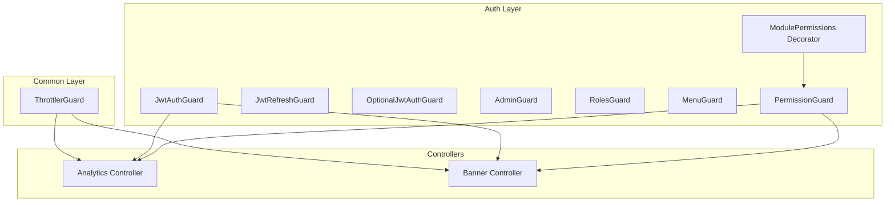

**Diagram sources**
- [jwt-auth.guard.ts:10-45](file://apps/backend/src/auth/guards/jwt-auth.guard.ts#L10-L45)
- [jwt-refresh.guard.ts:10-60](file://apps/backend/src/auth/guards/jwt-refresh.guard.ts#L10-L60)
- [optional-jwt-auth.guard.ts:8-18](file://apps/backend/src/auth/guards/optional-jwt-auth.guard.ts#L8-L18)
- [admin.guard.ts:5-15](file://apps/backend/src/auth/guards/admin.guard.ts#L5-L15)
- [roles.guard.ts:5-28](file://apps/backend/src/auth/guards/roles.guard.ts#L5-L28)
- [menu.guard.ts:7-36](file://apps/backend/src/auth/guards/menu.guard.ts#L7-L36)
- [permission.guard.ts:31-90](file://apps/backend/src/auth/guards/permission.guard.ts#L31-L90)
- [module-permissions.decorator.ts:7-14](file://apps/backend/src/auth/decorators/module-permissions.decorator.ts#L7-L14)
- [throttler.guard.ts:5-27](file://apps/backend/src/common/guards/throttler.guard.ts#L5-L27)
- [analytics.controller.ts:30-31](file://apps/backend/src/analytics/analytics.controller.ts#L30-L31)
- [banner.controller.ts:41-42](file://apps/backend/src/banner/banner.controller.ts#L41-L42)

**Section sources**
- [jwt-auth.guard.ts:10-45](file://apps/backend/src/auth/guards/jwt-auth.guard.ts#L10-L45)
- [permission.guard.ts:31-90](file://apps/backend/src/auth/guards/permission.guard.ts#L31-L90)
- [module-permissions.decorator.ts:7-14](file://apps/backend/src/auth/decorators/module-permissions.decorator.ts#L7-L14)
- [throttler.guard.ts:5-27](file://apps/backend/src/common/guards/throttler.guard.ts#L5-L27)

## Core Components
- JwtAuthGuard: Validates Bearer access tokens via Passport’s JWT strategy, supports public route bypass using a reflector flag, and normalizes error responses.
- JwtRefreshGuard: Validates refresh tokens, enforces presence of an Authorization header, and attaches a normalized token to the user object.
- OptionalJwtAuthGuard: Allows anonymous requests while still populating req.user when a valid token is present.
- AdminGuard: Restricts access to users with admin or superadmin roles.
- RolesGuard: Checks if the current user has one of the required roles declared via metadata.
- MenuGuard: Grants access based on a menu path and per-user menu permissions.
- PermissionGuard: Enforces fine-grained permissions (view/create/edit/delete) mapped from HTTP methods against a module’s menu row and role-based permissions.
- ModulePermissions Decorator: Declares which menu URL a controller belongs to, enabling PermissionGuard to evaluate permissions dynamically.
- ThrottlerGuard: Extends NestJS throttler guard to support skipping rate limits via metadata.

**Section sources**
- [jwt-auth.guard.ts:10-45](file://apps/backend/src/auth/guards/jwt-auth.guard.ts#L10-L45)
- [jwt-refresh.guard.ts:10-60](file://apps/backend/src/auth/guards/jwt-refresh.guard.ts#L10-L60)
- [optional-jwt-auth.guard.ts:8-18](file://apps/backend/src/auth/guards/optional-jwt-auth.guard.ts#L8-L18)
- [admin.guard.ts:5-15](file://apps/backend/src/auth/guards/admin.guard.ts#L5-L15)
- [roles.guard.ts:5-28](file://apps/backend/src/auth/guards/roles.guard.ts#L5-L28)
- [menu.guard.ts:7-36](file://apps/backend/src/auth/guards/menu.guard.ts#L7-L36)
- [permission.guard.ts:31-90](file://apps/backend/src/auth/guards/permission.guard.ts#L31-L90)
- [module-permissions.decorator.ts:7-14](file://apps/backend/src/auth/decorators/module-permissions.decorator.ts#L7-L14)
- [throttler.guard.ts:5-27](file://apps/backend/src/common/guards/throttler.guard.ts#L5-L27)

## Architecture Overview
The request lifecycle flows through multiple layers of guards before reaching the controller handler. The typical order is:
1. Throttling check (rate limiting)
2. Authentication (JWT access token or refresh token)
3. Role checks (admin or specific roles)
4. Fine-grained authorization (method-based permissions)

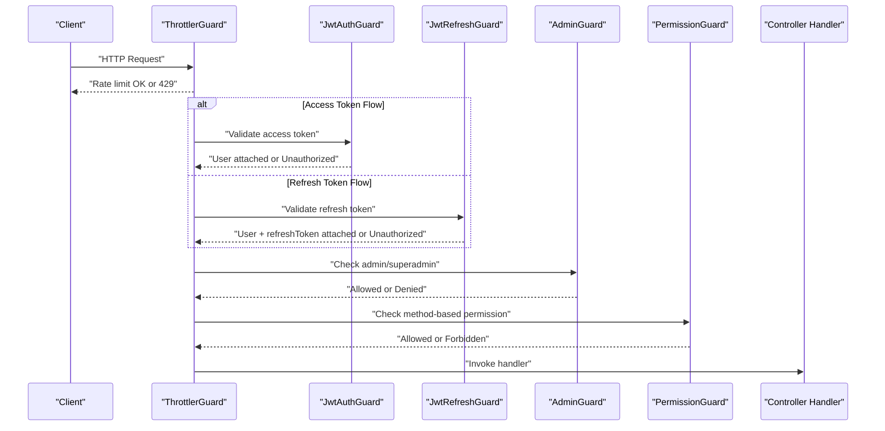

**Diagram sources**
- [throttler.guard.ts:5-27](file://apps/backend/src/common/guards/throttler.guard.ts#L5-L27)
- [jwt-auth.guard.ts:10-45](file://apps/backend/src/auth/guards/jwt-auth.guard.ts#L10-L45)
- [jwt-refresh.guard.ts:10-60](file://apps/backend/src/auth/guards/jwt-refresh.guard.ts#L10-L60)
- [admin.guard.ts:5-15](file://apps/backend/src/auth/guards/admin.guard.ts#L5-L15)
- [permission.guard.ts:31-90](file://apps/backend/src/auth/guards/permission.guard.ts#L31-L90)

## Detailed Component Analysis

### JWT Authentication Guard
Validates access tokens, supports public routes, and standardizes unauthorized errors.

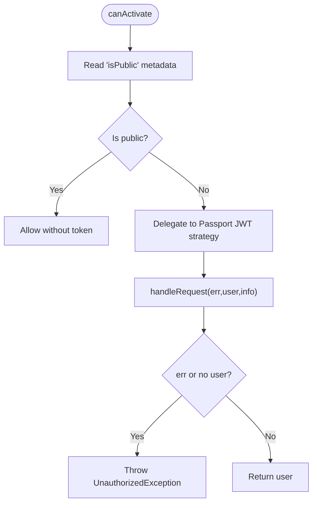

**Diagram sources**
- [jwt-auth.guard.ts:17-44](file://apps/backend/src/auth/guards/jwt-auth.guard.ts#L17-L44)

**Section sources**
- [jwt-auth.guard.ts:10-45](file://apps/backend/src/auth/guards/jwt-auth.guard.ts#L10-L45)

### JWT Refresh Guard
Ensures a refresh token is provided and validates it, attaching a normalized token to the user object.

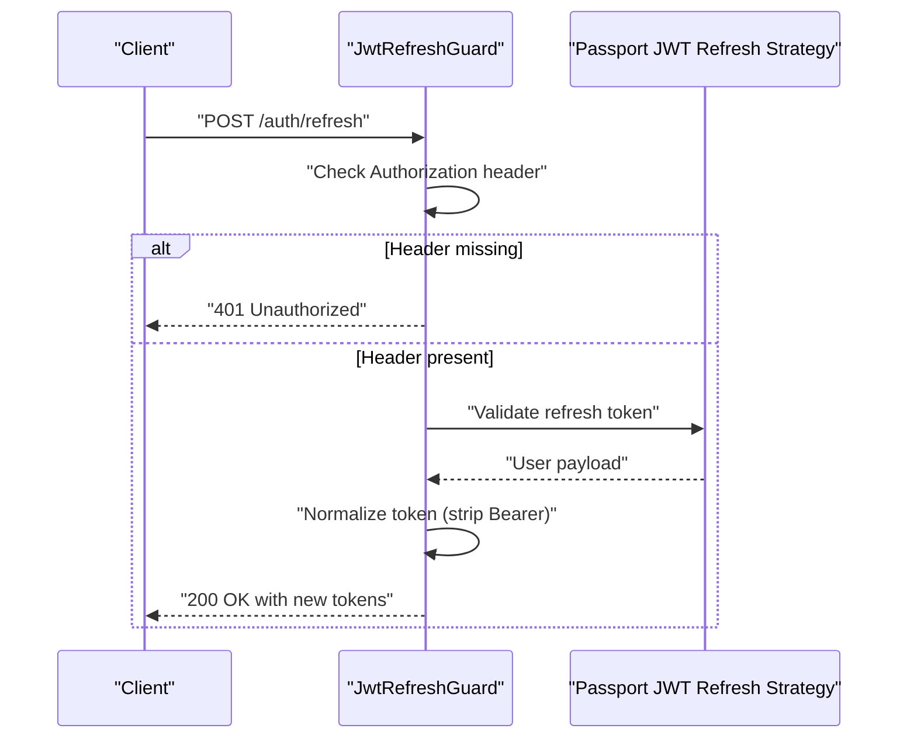

**Diagram sources**
- [jwt-refresh.guard.ts:17-59](file://apps/backend/src/auth/guards/jwt-refresh.guard.ts#L17-L59)

**Section sources**
- [jwt-refresh.guard.ts:10-60](file://apps/backend/src/auth/guards/jwt-refresh.guard.ts#L10-L60)

### Optional JWT Authentication Guard
Allows anonymous requests while enriching req.user when a valid token exists.

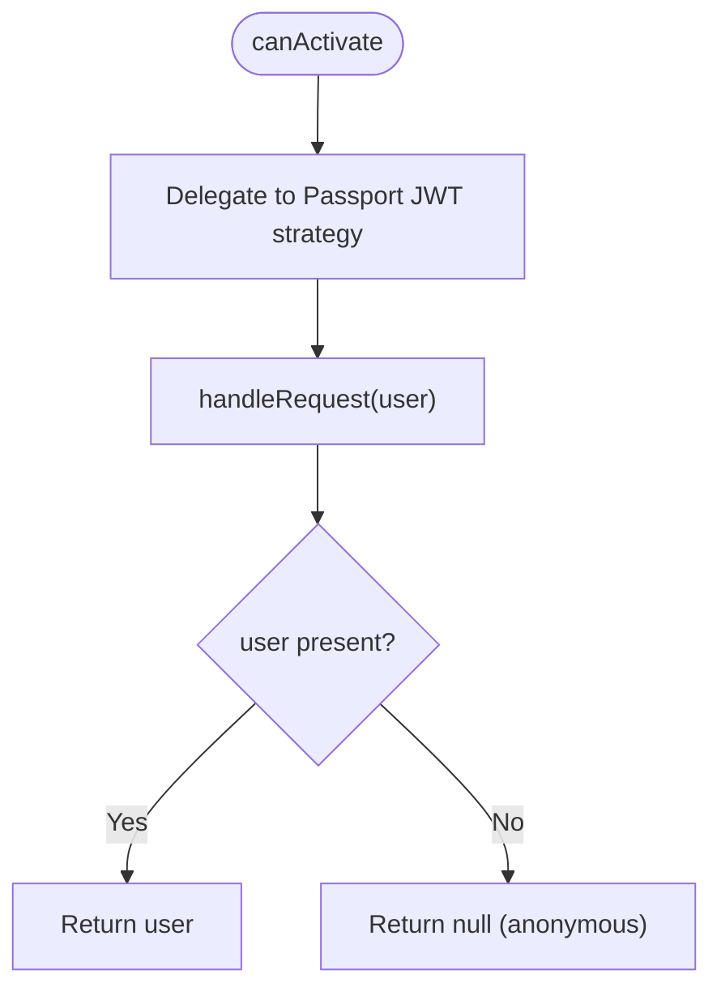

**Diagram sources**
- [optional-jwt-auth.guard.ts:10-17](file://apps/backend/src/auth/guards/optional-jwt-auth.guard.ts#L10-L17)

**Section sources**
- [optional-jwt-auth.guard.ts:8-18](file://apps/backend/src/auth/guards/optional-jwt-auth.guard.ts#L8-L18)

### Admin Guard
Restricts endpoints to admin or superadmin roles.

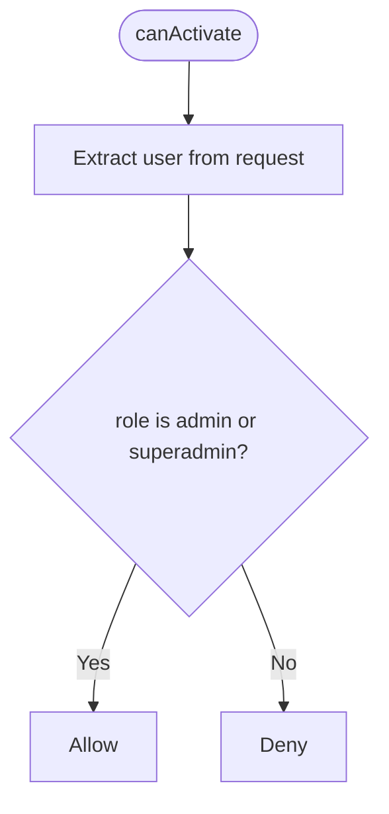

**Diagram sources**
- [admin.guard.ts:7-14](file://apps/backend/src/auth/guards/admin.guard.ts#L7-L14)

**Section sources**
- [admin.guard.ts:5-15](file://apps/backend/src/auth/guards/admin.guard.ts#L5-L15)

### Roles Guard
Checks whether the current user has any of the required roles declared via metadata.

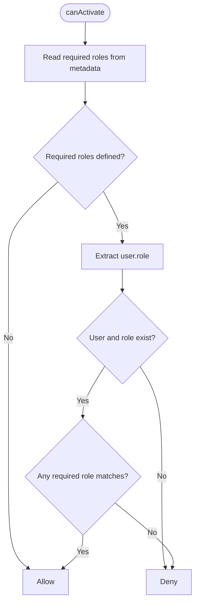

**Diagram sources**
- [roles.guard.ts:9-27](file://apps/backend/src/auth/guards/roles.guard.ts#L9-L27)

**Section sources**
- [roles.guard.ts:5-28](file://apps/backend/src/auth/guards/roles.guard.ts#L5-L28)

### Menu Guard
Grants access based on a menu path and per-user menu permissions.

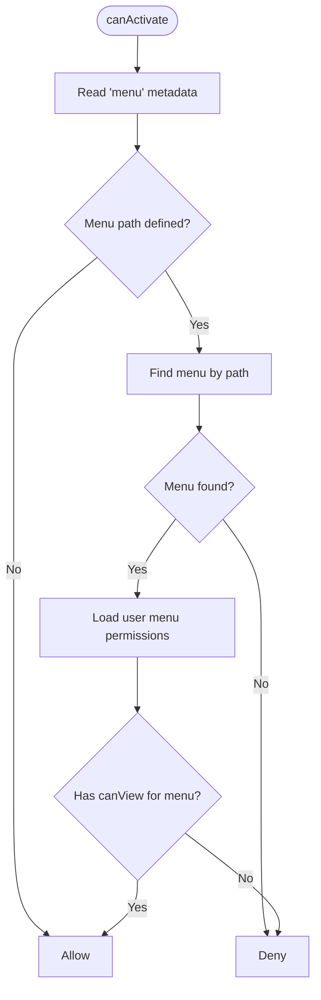

**Diagram sources**
- [menu.guard.ts:15-35](file://apps/backend/src/auth/guards/menu.guard.ts#L15-L35)

**Section sources**
- [menu.guard.ts:7-36](file://apps/backend/src/auth/guards/menu.guard.ts#L7-L36)

### Permission Guard and Module Permissions Decorator
Enables fine-grained authorization by mapping HTTP methods to actions and checking role-based permissions for a given menu URL.

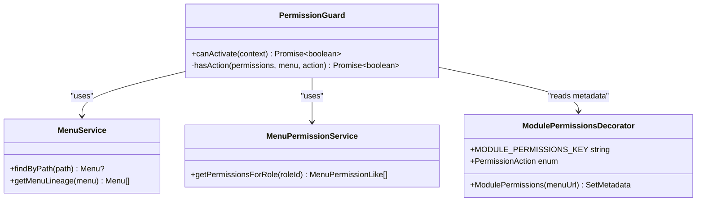

**Diagram sources**
- [permission.guard.ts:31-90](file://apps/backend/src/auth/guards/permission.guard.ts#L31-L90)
- [module-permissions.decorator.ts:7-14](file://apps/backend/src/auth/decorators/module-permissions.decorator.ts#L7-L14)

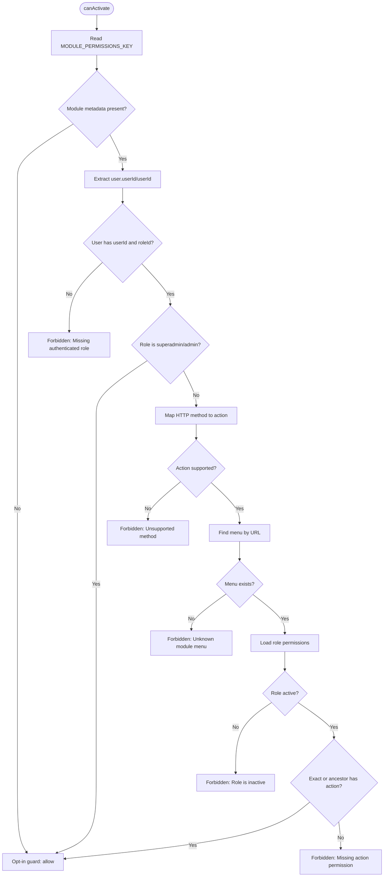

**Diagram sources**
- [permission.guard.ts:39-90](file://apps/backend/src/auth/guards/permission.guard.ts#L39-L90)

**Section sources**
- [permission.guard.ts:31-90](file://apps/backend/src/auth/guards/permission.guard.ts#L31-L90)
- [module-permissions.decorator.ts:7-14](file://apps/backend/src/auth/decorators/module-permissions.decorator.ts#L7-L14)

### Throttler Guard
Extends NestJS throttler guard to support skipping rate limits via metadata.

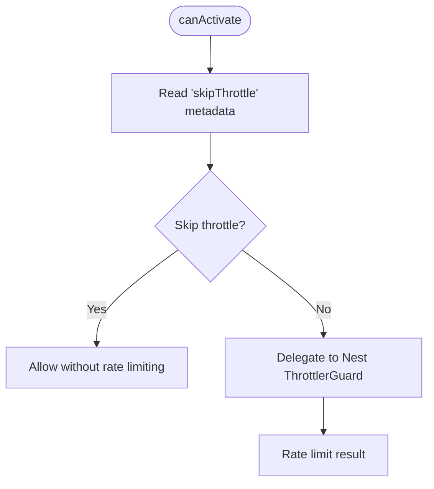

**Diagram sources**
- [throttler.guard.ts:15-26](file://apps/backend/src/common/guards/throttler.guard.ts#L15-L26)

**Section sources**
- [throttler.guard.ts:5-27](file://apps/backend/src/common/guards/throttler.guard.ts#L5-L27)

### Controller Usage Examples
- Analytics controller applies both authentication and permission checks, along with module metadata.
- Banner controller applies authentication and permission checks with module metadata.

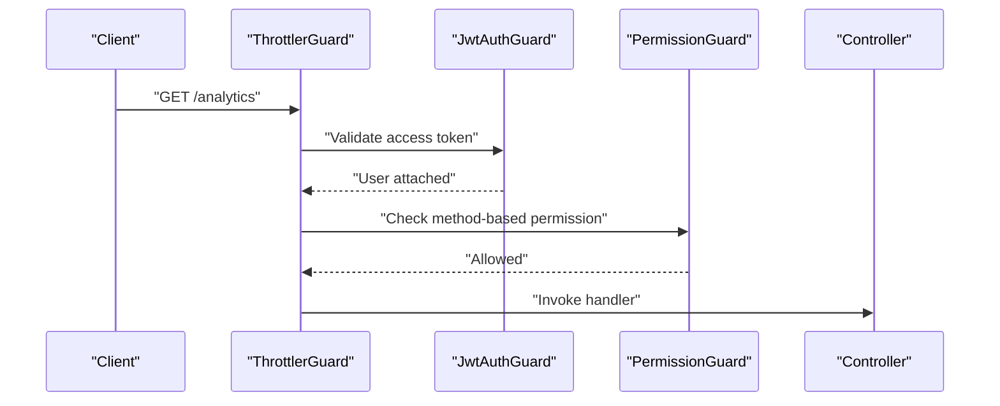

**Diagram sources**
- [analytics.controller.ts:30-31](file://apps/backend/src/analytics/analytics.controller.ts#L30-L31)
- [banner.controller.ts:41-42](file://apps/backend/src/banner/banner.controller.ts#L41-L42)

**Section sources**
- [analytics.controller.ts:30-31](file://apps/backend/src/analytics/analytics.controller.ts#L30-L31)
- [banner.controller.ts:41-42](file://apps/backend/src/banner/banner.controller.ts#L41-L42)

## Dependency Analysis
Guards compose to form layered security:
- Throttling is independent and runs first to protect all endpoints.
- Authentication ensures identity; optional variants allow anonymous access where appropriate.
- Role-based guards restrict high-privilege operations.
- Permission guard provides fine-grained control tied to menu structure and role permissions.

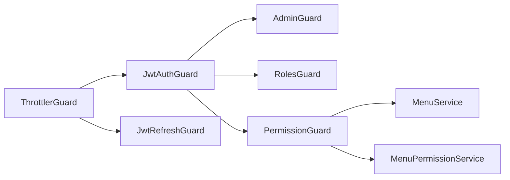

**Diagram sources**
- [throttler.guard.ts:5-27](file://apps/backend/src/common/guards/throttler.guard.ts#L5-L27)
- [jwt-auth.guard.ts:10-45](file://apps/backend/src/auth/guards/jwt-auth.guard.ts#L10-L45)
- [jwt-refresh.guard.ts:10-60](file://apps/backend/src/auth/guards/jwt-refresh.guard.ts#L10-L60)
- [admin.guard.ts:5-15](file://apps/backend/src/auth/guards/admin.guard.ts#L5-L15)
- [roles.guard.ts:5-28](file://apps/backend/src/auth/guards/roles.guard.ts#L5-L28)
- [permission.guard.ts:31-90](file://apps/backend/src/auth/guards/permission.guard.ts#L31-L90)

**Section sources**
- [throttler.guard.ts:5-27](file://apps/backend/src/common/guards/throttler.guard.ts#L5-L27)
- [jwt-auth.guard.ts:10-45](file://apps/backend/src/auth/guards/jwt-auth.guard.ts#L10-L45)
- [permission.guard.ts:31-90](file://apps/backend/src/auth/guards/permission.guard.ts#L31-L90)

## Performance Considerations
- Prefer coarse-grained checks early: use AdminGuard or simple role checks before expensive permission lookups.
- Cache frequently accessed menu lineage and role permissions at the service layer to reduce repeated DB calls.
- Use OptionalJwtAuthGuard for endpoints that benefit from user context but do not require authentication.
- Avoid unnecessary metadata reads; only enable PermissionGuard where fine-grained checks are needed.
- Configure throttling thresholds appropriately to balance security and performance.
- Minimize synchronous work inside canActivate; keep logic asynchronous and efficient.

[No sources needed since this section provides general guidance]

## Troubleshooting Guide
- 401 Unauthorized: Occurs when the access token is invalid/expired or missing. Verify JwtAuthGuard.handleRequest behavior and ensure proper Authorization headers.
- 401 Refresh token required: Occurs when the Authorization header is missing for refresh endpoints. Ensure clients send the refresh token in the Authorization header.
- 403 Forbidden:
  - Missing authenticated role: Ensure user.userId and user.roleId are present after authentication.
  - Unknown module menu: Verify the menu URL matches a row in the menu table.
  - Unsupported method: Only GET/POST/PUT/PATCH/DELETE are mapped to actions.
  - Role is inactive: Deactivated roles are denied even if they have permissions.
  - Missing action permission: Confirm the role has the correct action for the target menu.
- Public routes: If endpoints should be accessible without tokens, set the isPublic metadata so JwtAuthGuard allows them.
- Skipping throttling: For internal or health endpoints, set skipThrottle metadata to avoid rate limiting.

**Section sources**
- [jwt-auth.guard.ts:31-44](file://apps/backend/src/auth/guards/jwt-auth.guard.ts#L31-L44)
- [jwt-refresh.guard.ts:28-59](file://apps/backend/src/auth/guards/jwt-refresh.guard.ts#L28-L59)
- [permission.guard.ts:46-74](file://apps/backend/src/auth/guards/permission.guard.ts#L46-L74)
- [throttler.guard.ts:15-26](file://apps/backend/src/common/guards/throttler.guard.ts#L15-L26)

## Conclusion
The application employs a layered security model combining throttling, authentication, role checks, and fine-grained authorization. JwtAuthGuard and JwtRefreshGuard secure endpoints with robust error handling. AdminGuard and RolesGuard provide quick role-based restrictions. PermissionGuard, driven by ModulePermissions, enables scalable, data-driven authorization aligned with the menu hierarchy. ThrottlerGuard protects against abuse while allowing selective bypasses. By composing these guards thoughtfully and following the best practices outlined here, you can build secure, maintainable APIs that scale with evolving business requirements.

[No sources needed since this section summarizes without analyzing specific files]