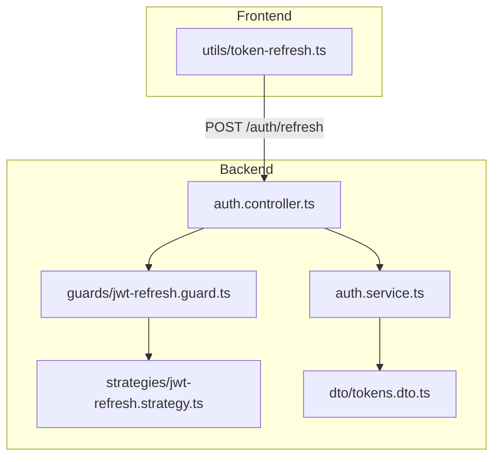
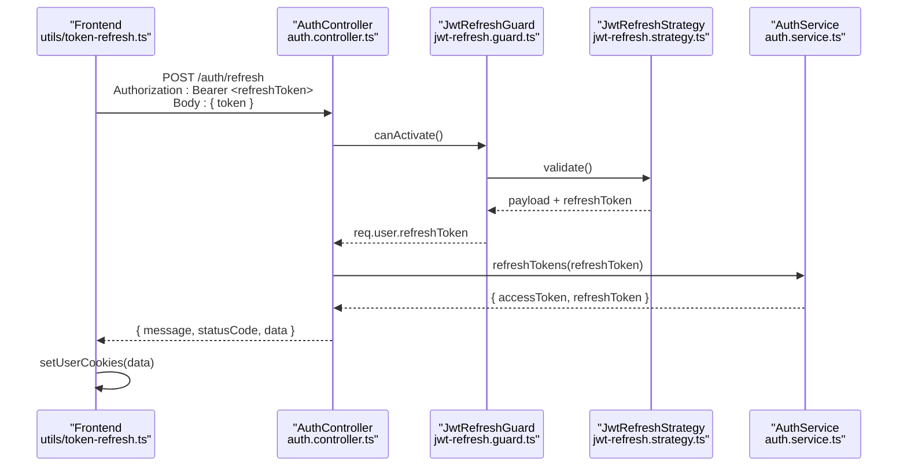
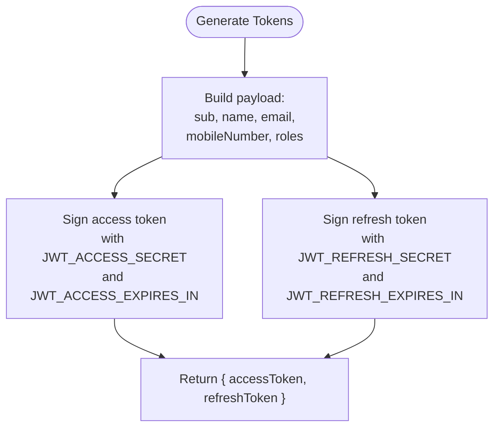
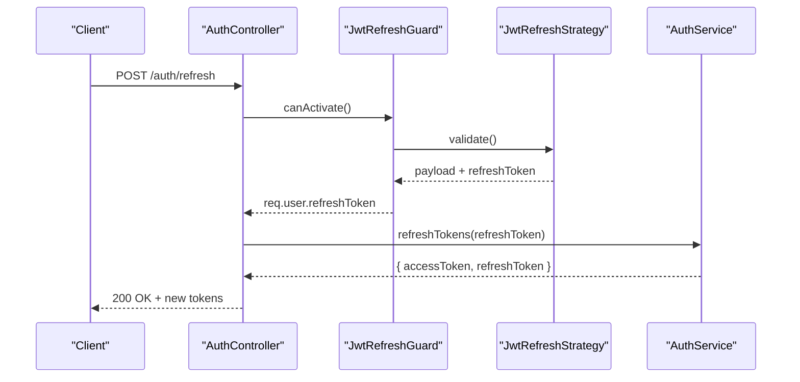
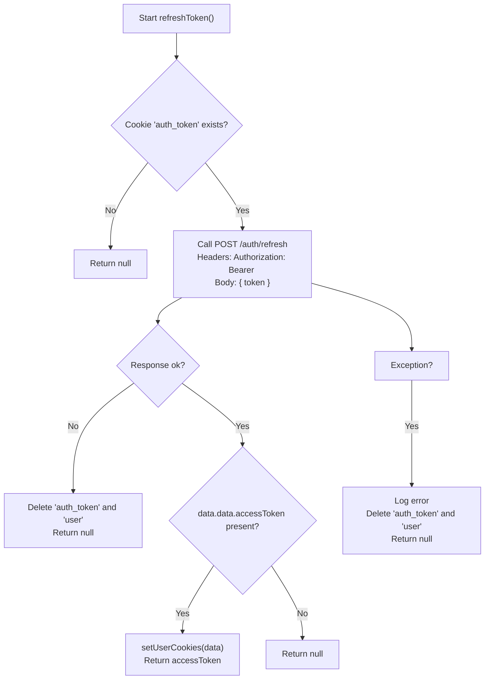
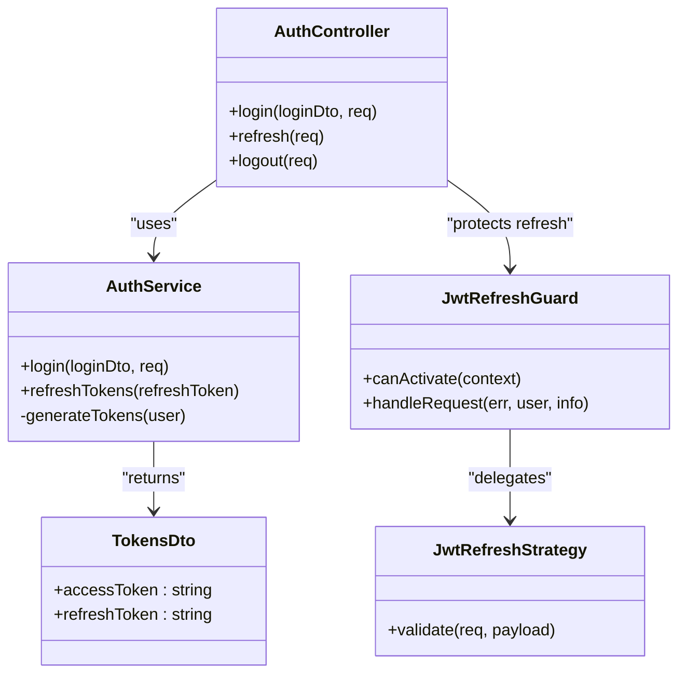

# Token Management

<cite>
**Referenced Files in This Document**
- [auth.service.ts](file://apps/backend/src/auth/auth.service.ts)
- [auth.controller.ts](file://apps/backend/src/auth/auth.controller.ts)
- [jwt-refresh.strategy.ts](file://apps/backend/src/auth/strategies/jwt-refresh.strategy.ts)
- [jwt-refresh.guard.ts](file://apps/backend/src/auth/guards/jwt-refresh.guard.ts)
- [tokens.dto.ts](file://apps/backend/src/auth/dto/tokens.dto.ts)
- [token-refresh.ts](file://apps/frontend/utils/token-refresh.ts)
</cite>

## Table of Contents
1. [Introduction](#introduction)
2. [Project Structure](#project-structure)
3. [Core Components](#core-components)
4. [Architecture Overview](#architecture-overview)
5. [Detailed Component Analysis](#detailed-component-analysis)
6. [Dependency Analysis](#dependency-analysis)
7. [Performance Considerations](#performance-considerations)
8. [Troubleshooting Guide](#troubleshooting-guide)
9. [Conclusion](#conclusion)

## Introduction
This document explains the JWT token management system used by the backend and frontend. It covers how access tokens and refresh tokens are generated, their payload structure, expiration behavior, and the refresh flow that allows seamless session continuation without re-authentication. It also documents request/response schemas for token operations, security headers, automatic token refresh on the server-side Next.js route handler, error handling for expired tokens, storage strategies, secure transmission, cleanup procedures, and security best practices.

## Project Structure
The token system spans two applications:
- Backend (NestJS): token generation, validation, refresh endpoint, guards, and strategies.
- Frontend (Next.js): server-side token refresh utility that calls the backend refresh endpoint and updates cookies.

**Diagram sources**
- [token-refresh.ts:7-35](file://apps/frontend/utils/token-refresh.ts#L7-L35)
- [auth.controller.ts:116-150](file://apps/backend/src/auth/auth.controller.ts#L116-L150)
- [auth.service.ts:107-170](file://apps/backend/src/auth/auth.service.ts#L107-L170)
- [jwt-refresh.strategy.ts:7-24](file://apps/backend/src/auth/strategies/jwt-refresh.strategy.ts#L7-L24)
- [jwt-refresh.guard.ts:10-61](file://apps/backend/src/auth/guards/jwt-refresh.guard.ts#L10-L61)
- [tokens.dto.ts:4-27](file://apps/backend/src/auth/dto/tokens.dto.ts#L4-L27)

**Section sources**
- [auth.controller.ts:116-150](file://apps/backend/src/auth/auth.controller.ts#L116-L150)
- [auth.service.ts:107-170](file://apps/backend/src/auth/auth.service.ts#L107-L170)
- [jwt-refresh.strategy.ts:7-24](file://apps/backend/src/auth/strategies/jwt-refresh.strategy.ts#L7-L24)
- [jwt-refresh.guard.ts:10-61](file://apps/backend/src/auth/guards/jwt-refresh.guard.ts#L10-L61)
- [tokens.dto.ts:4-27](file://apps/backend/src/auth/dto/tokens.dto.ts#L4-L27)
- [token-refresh.ts:7-35](file://apps/frontend/utils/token-refresh.ts#L7-L35)

## Core Components
- AuthService: generates access and refresh tokens, validates refresh tokens, and returns new tokens.
- AuthController: exposes login and refresh endpoints with Swagger documentation.
- JwtRefreshStrategy: extracts and validates refresh tokens from Authorization header using a dedicated secret.
- JwtRefreshGuard: enforces refresh-token requirement and attaches validated user context to requests.
- TokensDto: defines the shape of token responses and marks refresh token as write-only in API docs.
- Frontend refreshToken utility: server-side function that calls the backend refresh endpoint and updates cookies.

Key responsibilities:
- Token generation uses separate secrets and expiration settings for access and refresh tokens.
- Refresh flow requires a valid refresh token in the Authorization header.
- Frontend automatically refreshes tokens when needed and clears local state on failure.

**Section sources**
- [auth.service.ts:146-170](file://apps/backend/src/auth/auth.service.ts#L146-L170)
- [auth.controller.ts:116-150](file://apps/backend/src/auth/auth.controller.ts#L116-L150)
- [jwt-refresh.strategy.ts:7-24](file://apps/backend/src/auth/strategies/jwt-refresh.strategy.ts#L7-L24)
- [jwt-refresh.guard.ts:10-61](file://apps/backend/src/auth/guards/jwt-refresh.guard.ts#L10-L61)
- [tokens.dto.ts:4-27](file://apps/backend/src/auth/dto/tokens.dto.ts#L4-L27)
- [token-refresh.ts:7-35](file://apps/frontend/utils/token-refresh.ts#L7-L35)

## Architecture Overview
The token lifecycle is as follows:
- Login or mobile OTP verification produces both an access token and a refresh token.
- Access tokens are short-lived and used for API authorization via Bearer tokens.
- Refresh tokens are longer-lived and used to obtain new access tokens without re-authentication.
- The frontend’s server-side refresh utility calls the backend refresh endpoint and updates cookies upon success.

**Diagram sources**
- [token-refresh.ts:15-35](file://apps/frontend/utils/token-refresh.ts#L15-L35)
- [auth.controller.ts:116-150](file://apps/backend/src/auth/auth.controller.ts#L116-L150)
- [jwt-refresh.guard.ts:17-38](file://apps/backend/src/auth/guards/jwt-refresh.guard.ts#L17-L38)
- [jwt-refresh.strategy.ts:21-24](file://apps/backend/src/auth/strategies/jwt-refresh.strategy.ts#L21-L24)
- [auth.service.ts:107-144](file://apps/backend/src/auth/auth.service.ts#L107-L144)

## Detailed Component Analysis

### Token Generation and Payloads
- Both access and refresh tokens are created concurrently with distinct secrets and expiration durations configured via environment variables.
- Token payload includes:
  - sub: user identifier
  - name: user display name
  - email: user email
  - mobileNumber: user phone number
  - roles: user role(s)

Security notes:
- Access tokens use JWT_ACCESS_SECRET and JWT_ACCESS_EXPIRES_IN.
- Refresh tokens use JWT_REFRESH_SECRET and JWT_REFRESH_EXPIRES_IN.
- Sensitive fields like password are sanitized before token creation.

**Diagram sources**
- [auth.service.ts:146-170](file://apps/backend/src/auth/auth.service.ts#L146-L170)

**Section sources**
- [auth.service.ts:146-170](file://apps/backend/src/auth/auth.service.ts#L146-L170)

### Refresh Endpoint Flow
- The refresh endpoint requires a valid refresh token in the Authorization header.
- JwtRefreshGuard ensures the Authorization header exists and delegates to JwtRefreshStrategy.
- JwtRefreshStrategy verifies the token using JWT_REFRESH_SECRET and attaches the raw token back into the request context.
- AuthService.verifyAsync validates the refresh token, checks the user exists, and issues new tokens.

**Diagram sources**
- [auth.controller.ts:116-150](file://apps/backend/src/auth/auth.controller.ts#L116-L150)
- [jwt-refresh.guard.ts:17-38](file://apps/backend/src/auth/guards/jwt-refresh.guard.ts#L17-L38)
- [jwt-refresh.strategy.ts:21-24](file://apps/backend/src/auth/strategies/jwt-refresh.strategy.ts#L21-L24)
- [auth.service.ts:107-144](file://apps/backend/src/auth/auth.service.ts#L107-L144)

**Section sources**
- [auth.controller.ts:116-150](file://apps/backend/src/auth/auth.controller.ts#L116-L150)
- [jwt-refresh.guard.ts:17-38](file://apps/backend/src/auth/guards/jwt-refresh.guard.ts#L17-L38)
- [jwt-refresh.strategy.ts:21-24](file://apps/backend/src/auth/strategies/jwt-refresh.strategy.ts#L21-L24)
- [auth.service.ts:107-144](file://apps/backend/src/auth/auth.service.ts#L107-L144)

### Request and Response Schemas
- Login response schema:
  - message: string
  - statusCode: number
  - data: TokensDto
- Refresh response schema:
  - message: string
  - statusCode: number
  - data: TokensDto

TokensDto fields:
- accessToken: string (JWT)
- refreshToken: string (JWT; writeOnly in API docs)

Example JSON responses:
- Login success:
  - { "message": "Login successful", "statusCode": 200, "data": { "accessToken": "...", "refreshToken": "..." } }
- Refresh success:
  - { "message": "Tokens refreshed successfully", "statusCode": 200, "data": { "accessToken": "...", "refreshToken": "..." } }

Error examples:
- Invalid credentials:
  - { "message": "Invalid credentials", "statusCode": 401, "error": "Unauthorized" }
- Invalid refresh token:
  - { "message": "Invalid refresh token", "statusCode": 401, "error": "Unauthorized" }

**Section sources**
- [auth.controller.ts:91-114](file://apps/backend/src/auth/auth.controller.ts#L91-L114)
- [auth.controller.ts:125-150](file://apps/backend/src/auth/auth.controller.ts#L125-L150)
- [tokens.dto.ts:4-27](file://apps/backend/src/auth/dto/tokens.dto.ts#L4-L27)

### Security Headers and Transmission
- Authorization header:
  - Use "Authorization: Bearer <token>" for both access and refresh token flows.
- Content-Type:
  - application/json for JSON payloads.
- Transport security:
  - Always use HTTPS to protect tokens in transit.
- Cookie configuration (frontend):
  - The frontend sets cookies after successful refresh; ensure cookies are HttpOnly, Secure, SameSite=Strict/Lax, and scoped to the correct domain/path.

Note: The current frontend refresh utility reads auth_token from cookies and sends it in the Authorization header. Ensure cookie names and attributes align with your deployment environment.

**Section sources**
- [token-refresh.ts:15-23](file://apps/frontend/utils/token-refresh.ts#L15-L23)
- [jwt-refresh.strategy.ts:12-18](file://apps/backend/src/auth/strategies/jwt-refresh.strategy.ts#L12-L18)

### Automatic Token Refresh on Frontend
- The server-side refreshToken function:
  - Reads the current token from cookies.
  - Calls POST /auth/refresh with Authorization header and body containing the token.
  - On success, updates cookies with new tokens via setUserCookies.
  - On failure or exception, deletes auth_token and user cookies and returns null.

**Diagram sources**
- [token-refresh.ts:7-46](file://apps/frontend/utils/token-refresh.ts#L7-L46)

**Section sources**
- [token-refresh.ts:7-46](file://apps/frontend/utils/token-refresh.ts#L7-L46)

### Error Handling for Expired Tokens
- Backend:
  - If refresh token is invalid or expired, AuthService throws UnauthorizedException with message "Invalid refresh token".
  - JwtRefreshGuard handles missing Authorization header and invalid/expired tokens, returning 401 with appropriate messages.
- Frontend:
  - On non-ok response or exception, the refreshToken utility deletes auth_token and user cookies and returns null, effectively logging the user out.

Recommended client behavior:
- Treat 401 from protected endpoints as a signal to attempt refresh.
- If refresh fails, redirect to sign-in and clear sensitive state.

**Section sources**
- [auth.service.ts:107-144](file://apps/backend/src/auth/auth.service.ts#L107-L144)
- [jwt-refresh.guard.ts:17-61](file://apps/backend/src/auth/guards/jwt-refresh.guard.ts#L17-L61)
- [token-refresh.ts:25-46](file://apps/frontend/utils/token-refresh.ts#L25-L46)

### Token Storage Strategies
- Cookies:
  - Store tokens in HttpOnly, Secure cookies to prevent XSS access.
  - Set SameSite=Strict or Lax depending on cross-site needs.
  - Scope cookies to the correct domain and path.
- Memory:
  - For single-page apps, keep access tokens in memory only; avoid localStorage for tokens.
- Server-side:
  - Prefer server-side sessions or signed cookies where possible to minimize client exposure.

Current implementation note:
- The frontend reads auth_token from cookies and sends it in the Authorization header. Ensure cookie attributes match your security policy.

**Section sources**
- [token-refresh.ts:8-13](file://apps/frontend/utils/token-refresh.ts#L8-L13)

### Cleanup Procedures
- Logout:
  - Call the logout endpoint to log activity and allow clients to discard tokens.
- On refresh failure:
  - Delete auth_token and user cookies to prevent stale state.
- On sign-out or session expiry:
  - Clear all authentication-related cookies and local state.

**Section sources**
- [auth.controller.ts:152-188](file://apps/backend/src/auth/auth.controller.ts#L152-L188)
- [token-refresh.ts:25-46](file://apps/frontend/utils/token-refresh.ts#L25-L46)

### Security Best Practices
- Token encryption:
  - Use strong secrets for signing tokens; never hardcode secrets in code.
  - Rotate secrets periodically and manage them via secure environment variables.
- Secure cookie configuration:
  - HttpOnly, Secure, SameSite=Strict/Lax, proper domain/path scoping.
- Protection against token theft:
  - Enforce HTTPS everywhere.
  - Avoid storing tokens in localStorage.
  - Implement short-lived access tokens and long-lived refresh tokens.
- Protection against replay attacks:
  - Use nonce or jti claims if required by your threat model.
  - Bind tokens to device fingerprints or IP ranges cautiously, considering privacy and mobility.
- Least privilege:
  - Include minimal claims in tokens; avoid sensitive data in payloads.
- Monitoring and auditing:
  - Log login/logout events and detect anomalies.

[No sources needed since this section provides general guidance]

## Dependency Analysis
The token system components depend on each other as follows:
- AuthController depends on AuthService and JwtRefreshGuard.
- JwtRefreshGuard depends on JwtRefreshStrategy.
- AuthService depends on JwtService and ConfigService for token signing and configuration.
- TokensDto defines the response contract used by controllers and documented via Swagger.

**Diagram sources**
- [auth.controller.ts:116-150](file://apps/backend/src/auth/auth.controller.ts#L116-L150)
- [auth.service.ts:107-170](file://apps/backend/src/auth/auth.service.ts#L107-L170)
- [jwt-refresh.guard.ts:10-61](file://apps/backend/src/auth/guards/jwt-refresh.guard.ts#L10-L61)
- [jwt-refresh.strategy.ts:7-24](file://apps/backend/src/auth/strategies/jwt-refresh.strategy.ts#L7-L24)
- [tokens.dto.ts:4-27](file://apps/backend/src/auth/dto/tokens.dto.ts#L4-L27)

**Section sources**
- [auth.controller.ts:116-150](file://apps/backend/src/auth/auth.controller.ts#L116-L150)
- [auth.service.ts:107-170](file://apps/backend/src/auth/auth.service.ts#L107-L170)
- [jwt-refresh.guard.ts:10-61](file://apps/backend/src/auth/guards/jwt-refresh.guard.ts#L10-L61)
- [jwt-refresh.strategy.ts:7-24](file://apps/backend/src/auth/strategies/jwt-refresh.strategy.ts#L7-L24)
- [tokens.dto.ts:4-27](file://apps/backend/src/auth/dto/tokens.dto.ts#L4-L27)

## Performance Considerations
- Concurrent token signing:
  - Access and refresh tokens are signed concurrently to reduce latency.
- Non-critical audit writes:
  - Login activity and last login updates are fire-and-forget to avoid blocking responses.
- Rate limiting:
  - Registration endpoint is throttled; consider similar limits for refresh endpoints to mitigate abuse.

Recommendations:
- Monitor token signing performance and adjust expiration times based on usage patterns.
- Add rate limiting to the refresh endpoint to prevent token flooding.

**Section sources**
- [auth.service.ts:155-164](file://apps/backend/src/auth/auth.service.ts#L155-L164)
- [auth.service.ts:86-93](file://apps/backend/src/auth/auth.service.ts#L86-L93)
- [auth.controller.ts:38-40](file://apps/backend/src/auth/auth.controller.ts#L38-L40)

## Troubleshooting Guide
Common issues and resolutions:
- Missing Authorization header on refresh:
  - Ensure the client sends "Authorization: Bearer <refreshToken>".
- Invalid or expired refresh token:
  - Verify the refresh token is valid and not expired; call refresh endpoint again after re-authentication if necessary.
- Frontend refresh failures:
  - Check network errors and ensure cookies are set correctly; the frontend will delete auth_token and user cookies on failure.
- Token mismatch between header and body:
  - The frontend sends the token in both Authorization header and body; ensure consistency.

Debugging steps:
- Inspect backend logs for UnauthorizedException messages.
- Validate JWT secrets and expiration configurations.
- Confirm HTTPS is enforced across all endpoints.

**Section sources**
- [jwt-refresh.guard.ts:17-61](file://apps/backend/src/auth/guards/jwt-refresh.guard.ts#L17-L61)
- [auth.service.ts:107-144](file://apps/backend/src/auth/auth.service.ts#L107-L144)
- [token-refresh.ts:25-46](file://apps/frontend/utils/token-refresh.ts#L25-L46)

## Conclusion
The token management system uses separate secrets and expiration policies for access and refresh tokens, ensuring short-lived access tokens for API authorization and longer-lived refresh tokens for seamless session continuation. The frontend’s server-side refresh utility automates token renewal and cleans up state on failure. Proper security headers, secure cookie configuration, and robust error handling are essential to protect against token theft and replay attacks. Following the recommended best practices will enhance the security and reliability of the authentication flow.